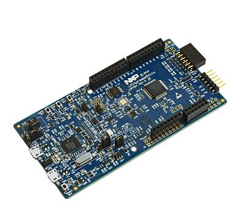

<!-- Copyright 2015-2026 Zephyr Project members and individual contributors. -->
<!-- SPDX-License-Identifier: Apache-2.0 -->
<!-- 中文翻译；编号、导航与译注为本地新增。 -->

<a id="lpcxpresso54114"></a>

# 第4章\_LPCXPRESSO54114

原文：[官方页面](https://docs.zephyrproject.org/latest/boards/nxp/lpcxpresso54114/doc/index.html)。读取日期：2026-10-16；来源摘要见[来源记录](../SOURCES.md)。

开发板概览（Board Overview）

<a id="id1"></a>

[](images/lpcxpresso54114_m4.jpg)

LPCXPRESSO54114

名称（Name）：

`lpcxpresso54114`

厂商（Vendor）：

[恩智浦半导体（NXP Semiconductors）](https://docs.zephyrproject.org/latest/boards/index.html#vendor=nxp)

状态（Status）：

维护中（Maintained）

架构（Architecture）：

[arm](https://docs.zephyrproject.org/latest/boards/index.html#arch=arm)

片上系统（SoC）：

[lpc54114](https://docs.zephyrproject.org/latest/boards/index.html#soc=lpc54114)

<a id="board-github-link"></a>

[浏览开发板源码（Browse Board Sources）](https://github.com/zephyrproject-rtos/zephyr/blob/main//boards/nxp/lpcxpresso54114/doc/index.rst/../..)<a id="overview"></a>

## 概述（Overview）

NXP开发的LPCXpresso54114用于低功耗LPC54110 MCU系列的评估及原型开发。LPCXpresso是支持NXP Arm微控制器的低成本开发平台，提供从初期评估到最终生产的完整应用开发方案。

<a id="hardware"></a>

## 硬件（Hardware）


- LPC54114双核MCU，最高100 MHz；原文将核组成写作“M4F and dual M0”，与“双核”表述不一致，按原文保留
- 板载高速USB调试探针，支持CMSIS-DAP及J-Link协议，可调试板上LPC54114或外部目标
- 可选外部调试探针
- 三色LED及目标复位、ISP、中断／用户按键，便于测试软件功能
- 基于Arduino UNO及Pmod的扩展选项，以及额外扩展端口引脚
- 板载1.8 V及3.3 V稳压器，也可使用外部电源
- 8 Mbit Macronix MX25R SPI闪存
- 内置MCU功耗及供电电压测量功能
- 通过板载调试探针，将LPC54114目标的UART、I2C及SPI端口桥接到USB
- FTDI UART连接器

LPC54114 SoC及LPCXPRESSO54114开发板的更多信息见以下资料：


- [LPC54114 SoC网站](https://www.nxp.com/products/processors-and-microcontrollers/arm-based-processors-and-mcus/lpc-cortex-m-mcus/lpc54000-series-cortex-m4-mcus/low-power-microcontrollers-mcus-based-on-arm-cortex-m4-cores-with-optional-cortex-m0-plus-co-processor:LPC541XX)
- [LPC54114 数据手册（Datasheet）](https://www.nxp.com/docs/en/data-sheet/LPC5411X.pdf)
- [LPC54114 参考手册（Reference Manual）](https://www.nxp.com/webapp/Download?colCode=UM10914)
- [LPCXPRESSO54114 网站](https://www.nxp.com/support/developer-resources/evaluation-and-development-boards/lpcxpresso-boards/lpcxpresso54114-board:OM13089)
- [LPCXPRESSO54114 用户指南（User Guide）](https://www.nxp.com/webapp/Download?colCode=UM10973)
- [LPCXPRESSO54114 原理图（Schematics）](https://www.nxp.com/downloads/en/design-support/LPCX5411x_Schematic_Rev_A1.pdf)

<a id="supported-features"></a>

### 支持的功能（Supported Features）

`lpcxpresso54114`开发板支持下表所列的硬件功能。

片上／板载（On-Chip / On-Board）

功能集成在片上系统（SoC）内／位于开发板上。

2 / 2

分别表示已启用／已禁用的实例数。点击数量标签，可查看开发板或SoC设备树源码（DTS）中该功能的第一个实例。

`vnd,foo`

与此功能匹配的设备树绑定兼容字符串（Compatible String）；点击链接可查看绑定文档。

<a id="lpcxpresso54114-hw-features"></a>

<a id="lpcxpresso54114-lpcxpresso54114/lpc54114/m0-hw-features-section"></a>

#### `lpcxpresso54114/lpc54114/m0`目标（Target）

<a id="lpcxpresso54114-lpcxpresso54114/lpc54114/m0-hw-features-panel"></a>

<a id="lpcxpresso54114-lpcxpresso54114/lpc54114/m0-hw-features-memory"></a>

该开发板目标的片上存储容量：32 KiB RAM、64 KiB Flash。

<a id="lpcxpresso54114-lpcxpresso54114/lpc54114/m0-hw-features-table"></a>

<table>
<tr>
<th>类型（Type）</th>
<th>位置（Location）</th>
<th>说明（Description）</th>
<th>兼容字符串（Compatible）</th>
</tr>
<tr>
<td rowspan="1">中央处理器（CPU）</td>
<td>片上（On-Chip）</td>
<td>ARM Cortex-M0+处理器（CPU）（<a href="https://github.com/zephyrproject-rtos/zephyr/blob/main/dts/arm/nxp/lpc/lpc54xxx/nxp_lpc54xxx.dtsi?plain=1#L34">已启用：1</a>）</td>
<td><a href="../cpu_arm_riscv_binding_reference/P017_arm_cortex-m0+.md#std-dtcompatible-arm-cortex-m0"><code>arm,cortex-m0+</code></a></td>
</tr>
<tr>
<td rowspan="1">ARM 架构（ARM Architecture）</td>
<td>片上（On-Chip）</td>
<td>LPC Flexcomm节点（<a href="https://github.com/zephyrproject-rtos/zephyr/blob/main/dts/arm/nxp/lpc/lpc54xxx/nxp_lpc54xxx.dtsi?plain=1#L191">已禁用：5</a>）</td>
<td><a href="../arm_nordic_nxp_control_binding_reference/P015_nxp_lpc-flexcomm.md#std-dtcompatible-nxp-lpc-flexcomm"><code>nxp,lpc-flexcomm</code></a></td>
</tr>
<tr>
<td rowspan="1">时钟控制（Clock Control）</td>
<td>片上（On-Chip）</td>
<td>LPC SYSCON及CLKCTL IP节点（<a href="https://github.com/zephyrproject-rtos/zephyr/blob/main/dts/arm/nxp/lpc/lpc54xxx/nxp_lpc54xxx.dtsi?plain=1#L41">已启用：1</a>）</td>
<td><a href="../clock_nxp_pico_realtek_renesas_binding_reference/P007_nxp_lpc-syscon.md#std-dtcompatible-nxp-lpc-syscon"><code>nxp,lpc-syscon</code></a></td>
</tr>
<tr>
<td rowspan="1">闪存控制器（Flash Controller）</td>
<td>片上（On-Chip）</td>
<td>用于lpc54xxx系列的NXP在应用编程（IAP）闪存控制器（<a href="https://github.com/zephyrproject-rtos/zephyr/blob/main/dts/arm/nxp/lpc/lpc54xxx/nxp_lpc54xxx.dtsi?plain=1#L93">已禁用：1</a>）</td>
<td><a href="../flash_nuvoton_nxp_renesas_binding_reference/P010_nxp_iap-fmc54.md#std-dtcompatible-nxp-iap-fmc54"><code>nxp,iap-fmc54</code></a></td>
</tr>
<tr>
<td rowspan="2">通用输入输出与接插件（GPIO &amp; Headers）</td>
<td>片上（On-Chip）</td>
<td>LPC通用输入输出（GPIO）（<a href="https://github.com/zephyrproject-rtos/zephyr/blob/main/dts/arm/nxp/lpc/lpc54xxx/nxp_lpc54xxx.dtsi?plain=1#L124">已启用：1</a>）</td>
<td><a href="../gpio_nxp_expanders_binding_reference/P006_nxp_lpc-gpio.md#std-dtcompatible-nxp-lpc-gpio"><code>nxp,lpc-gpio</code></a></td>
</tr>
<tr>
<td>片上（On-Chip）</td>
<td>LPC GPIO端口设备（<a href="https://github.com/zephyrproject-rtos/zephyr/blob/main/dts/arm/nxp/lpc/lpc54xxx/nxp_lpc54xxx.dtsi?plain=1#L130">已启用：2</a>）</td>
<td><a href="../gpio_nxp_expanders_binding_reference/P005_nxp_lpc-gpio-port.md#std-dtcompatible-nxp-lpc-gpio-port"><code>nxp,lpc-gpio-port</code></a></td>
</tr>
<tr>
<td rowspan="1">集成电路间总线（I2C）</td>
<td>片上（On-Chip）</td>
<td>LPC I2C控制器（<a href="https://github.com/zephyrproject-rtos/zephyr/blob/main/dts/arm/nxp/lpc/lpc54xxx/nxp_lpc54xxx.dtsi?plain=1#L218">已禁用：1</a>）</td>
<td><a href="../i2c_nxp_pico_renesas_binding_reference/P003_nxp_lpc-i2c.md#std-dtcompatible-nxp-lpc-i2c"><code>nxp,lpc-i2c</code></a></td>
</tr>
<tr>
<td rowspan="3">中断控制器（Interrupt Controller）</td>
<td>片上（On-Chip）</td>
<td>ARMv6-M嵌套向量中断控制器（NVIC / Nested Vectored Interrupt Controller）（<a href="https://github.com/zephyrproject-rtos/zephyr/blob/main/dts/arm/armv6-m.dtsi?plain=1#L13">已启用：1</a>）</td>
<td><a href="../arm_interrupt_timer_binding_reference/P001_ARMv6_M_NVIC.md#std-dtcompatible-arm-v6m-nvic"><code>arm,v6m-nvic</code></a></td>
</tr>
<tr>
<td>片上（On-Chip）</td>
<td>NXP分组GPIO输入中断（GINT / Grouped GPIO Input Interrupt）控制器（<a href="https://github.com/zephyrproject-rtos/zephyr/blob/main/dts/arm/nxp/lpc/lpc54xxx/nxp_lpc54xxx.dtsi?plain=1#L147">已禁用：2</a>）</td>
<td><a href="../nxp_interrupt_binding_reference/P001_nxp_gint.md#std-dtcompatible-nxp-gint"><code>nxp,gint</code></a></td>
</tr>
<tr>
<td>片上（On-Chip）</td>
<td>NXP引脚中断及模式匹配引擎（PINT）（<a href="https://github.com/zephyrproject-rtos/zephyr/blob/main/dts/arm/nxp/lpc/lpc54xxx/nxp_lpc54xxx.dtsi?plain=1#L163">已启用：1</a>）</td>
<td><a href="../nxp_interrupt_binding_reference/P004_nxp_pint.md#std-dtcompatible-nxp-pint"><code>nxp,pint</code></a></td>
</tr>
<tr>
<td rowspan="1">处理器间消息（IPM）</td>
<td>片上（On-Chip）</td>
<td>LPC邮箱（MAILBOX）（<a href="https://github.com/zephyrproject-rtos/zephyr/blob/main/dts/arm/nxp/lpc/lpc54xxx/nxp_lpc54xxx.dtsi?plain=1#L175">已启用：1</a>）</td>
<td><a href="../intercore_reference/P073_NXPLPC邮箱绑定.md#dtbinding-nxp-lpc-mailbox"><code>nxp,lpc-mailbox</code></a></td>
</tr>
<tr>
<td rowspan="1">发光二极管（LED）</td>
<td>板载（On-Board）</td>
<td>一组由 GPIO 控制的 LED（GPIO-Controlled LEDs）（<a href="https://github.com/zephyrproject-rtos/zephyr/blob/main/boards/nxp/lpcxpresso54114/lpcxpresso54114.dtsi?plain=1#L18">已启用：1</a>）</td>
<td><a href="../hardware/P564_GPIO指示灯绑定.md#dtbinding-gpio-leds"><code>gpio-leds</code></a></td>
</tr>
<tr>
<td rowspan="1">存储技术设备（MTD）</td>
<td>片上（On-Chip）</td>
<td>闪存（Flash）节点（<a href="https://github.com/zephyrproject-rtos/zephyr/blob/main/dts/arm/nxp/lpc/lpc54xxx/nxp_lpc54xxx.dtsi?plain=1#L101">已启用：1</a>）</td>
<td><a href="../mtd_nxp_st_ti_partition_binding_reference/P013_soc-nv-flash.md#std-dtcompatible-soc-nv-flash"><code>soc-nv-flash</code></a></td>
</tr>
<tr>
<td rowspan="2">引脚控制（Pin Control）</td>
<td>片上（On-Chip）</td>
<td>LPC I/O引脚配置（IOCON）（<a href="https://github.com/zephyrproject-rtos/zephyr/blob/main/dts/arm/nxp/lpc/lpc54xxx/nxp_lpc54xxx.dtsi?plain=1#L112">已启用：1</a>）</td>
<td><a href="../pinctrl_nxp_pico_binding_reference/P007_nxp_lpc-iocon.md#std-dtcompatible-nxp-lpc-iocon"><code>nxp,lpc-iocon</code></a></td>
</tr>
<tr>
<td>片上（On-Chip）</td>
<td>LPC引脚控制（Pinctrl）节点（<a href="https://github.com/zephyrproject-rtos/zephyr/blob/main/dts/arm/nxp/lpc/lpc54xxx/nxp_lpc54xxx.dtsi?plain=1#L119">已启用：1</a>）</td>
<td><a href="../pinctrl_nxp_pico_binding_reference/P005_nxp_lpc-iocon-pinctrl.md#std-dtcompatible-nxp-lpc-iocon-pinctrl"><code>nxp,lpc-iocon-pinctrl</code></a></td>
</tr>
<tr>
<td rowspan="1">复位控制器（Reset Controller）</td>
<td>片上（On-Chip）</td>
<td>LPC SYSCON外设复位控制器（<a href="https://github.com/zephyrproject-rtos/zephyr/blob/main/dts/arm/nxp/lpc/lpc54xxx/nxp_lpc54xxx.dtsi?plain=1#L46">已启用：1</a>）</td>
<td><a href="../reset_controller_binding_reference/P009_nxp_lpc-syscon-reset.md#std-dtcompatible-nxp-lpc-syscon-reset"><code>nxp,lpc-syscon-reset</code></a></td>
</tr>
<tr>
<td rowspan="1">串行控制器（Serial Controller）</td>
<td>片上（On-Chip）</td>
<td>LPC通用同步异步收发器（USART）（<a href="https://github.com/zephyrproject-rtos/zephyr/blob/main/dts/arm/nxp/lpc/lpc54xxx/nxp_lpc54xxx.dtsi?plain=1#L182">已禁用：1</a>）</td>
<td><a href="../uart_microchip_nordic_nxp_binding_reference/P014_nxp_lpc-usart.md#std-dtcompatible-nxp-lpc-usart"><code>nxp,lpc-usart</code></a></td>
</tr>
<tr>
<td rowspan="1">串行外设接口（SPI）</td>
<td>片上（On-Chip）</td>
<td>NXP LPC串行外设接口（SPI）控制器（<a href="https://github.com/zephyrproject-rtos/zephyr/blob/main/dts/arm/nxp/lpc/lpc54xxx/nxp_lpc54xxx.dtsi?plain=1#L227">已禁用：1</a>）</td>
<td><a href="../spi_flexspi_nxp_renesas_binding_reference/P003_nxp_lpc-spi.md#std-dtcompatible-nxp-lpc-spi"><code>nxp,lpc-spi</code></a></td>
</tr>
<tr>
<td rowspan="1">静态随机存储器（SRAM）</td>
<td>片上（On-Chip）</td>
<td>通用片上静态随机存储器（SRAM）（<a href="https://github.com/zephyrproject-rtos/zephyr/blob/main/dts/arm/nxp/lpc/lpc54xxx/nxp_lpc54xxx.dtsi?plain=1#L66">已启用：2</a>）</td>
<td><a href="../hardware/P567_内存映射SRAM绑定.md#dtbinding-mmio-sram"><code>mmio-sram</code></a></td>
</tr>
<tr>
<td rowspan="1">定时器（Timer）</td>
<td>片上（On-Chip）</td>
<td>ARMv6-M系统节拍（System Tick）（<a href="https://github.com/zephyrproject-rtos/zephyr/blob/main/dts/arm/armv6-m.dtsi?plain=1#L21">已启用：1</a>）</td>
<td><a href="../arm_interrupt_timer_binding_reference/P005_ARMv6_M_SysTick.md#std-dtcompatible-arm-armv6m-systick"><code>arm,armv6m-systick</code></a></td>
</tr>
</table>

<a id="lpcxpresso54114-lpcxpresso54114/lpc54114/m4-hw-features-section"></a>

#### `lpcxpresso54114/lpc54114/m4`目标（Target）

<a id="lpcxpresso54114-lpcxpresso54114/lpc54114/m4-hw-features-panel"></a>

<a id="lpcxpresso54114-lpcxpresso54114/lpc54114/m4-hw-features-memory"></a>

该开发板目标的片上存储容量：128 KiB RAM、256 KiB Flash。

<a id="lpcxpresso54114-lpcxpresso54114/lpc54114/m4-hw-features-table"></a>

<table>
<tr>
<th>类型（Type）</th>
<th>位置（Location）</th>
<th>说明（Description）</th>
<th>兼容字符串（Compatible）</th>
</tr>
<tr>
<td rowspan="1">中央处理器（CPU）</td>
<td>片上（On-Chip）</td>
<td>ARM Cortex-M4F 处理器（CPU）（<a href="https://github.com/zephyrproject-rtos/zephyr/blob/main/dts/arm/nxp/lpc/lpc54xxx/nxp_lpc54xxx.dtsi?plain=1#L29">已启用：1</a>）</td>
<td><a href="../cpu_arm_riscv_binding_reference/P025_arm_cortex-m4f.md#std-dtcompatible-arm-cortex-m4f"><code>arm,cortex-m4f</code></a></td>
</tr>
<tr>
<td rowspan="1">ARM 架构（ARM Architecture）</td>
<td>片上（On-Chip）</td>
<td>LPC Flexcomm节点（<a href="https://github.com/zephyrproject-rtos/zephyr/blob/main/dts/arm/nxp/lpc/lpc54xxx/nxp_lpc54xxx.dtsi?plain=1#L191">已禁用：5</a>）</td>
<td><a href="../arm_nordic_nxp_control_binding_reference/P015_nxp_lpc-flexcomm.md#std-dtcompatible-nxp-lpc-flexcomm"><code>nxp,lpc-flexcomm</code></a></td>
</tr>
<tr>
<td rowspan="1">时钟控制（Clock Control）</td>
<td>片上（On-Chip）</td>
<td>LPC SYSCON及CLKCTL IP节点（<a href="https://github.com/zephyrproject-rtos/zephyr/blob/main/dts/arm/nxp/lpc/lpc54xxx/nxp_lpc54xxx.dtsi?plain=1#L41">已启用：1</a>）</td>
<td><a href="../clock_nxp_pico_realtek_renesas_binding_reference/P007_nxp_lpc-syscon.md#std-dtcompatible-nxp-lpc-syscon"><code>nxp,lpc-syscon</code></a></td>
</tr>
<tr>
<td rowspan="1">闪存控制器（Flash Controller）</td>
<td>片上（On-Chip）</td>
<td>用于lpc54xxx系列的NXP在应用编程（IAP）闪存控制器（<a href="https://github.com/zephyrproject-rtos/zephyr/blob/main/dts/arm/nxp/lpc/lpc54xxx/nxp_lpc54xxx.dtsi?plain=1#L93">已启用：1</a>）</td>
<td><a href="../flash_nuvoton_nxp_renesas_binding_reference/P010_nxp_iap-fmc54.md#std-dtcompatible-nxp-iap-fmc54"><code>nxp,iap-fmc54</code></a></td>
</tr>
<tr>
<td rowspan="2">通用输入输出与接插件（GPIO &amp; Headers）</td>
<td>片上（On-Chip）</td>
<td>LPC通用输入输出（GPIO）（<a href="https://github.com/zephyrproject-rtos/zephyr/blob/main/dts/arm/nxp/lpc/lpc54xxx/nxp_lpc54xxx.dtsi?plain=1#L124">已启用：1</a>）</td>
<td><a href="../gpio_nxp_expanders_binding_reference/P006_nxp_lpc-gpio.md#std-dtcompatible-nxp-lpc-gpio"><code>nxp,lpc-gpio</code></a></td>
</tr>
<tr>
<td>片上（On-Chip）</td>
<td>LPC GPIO端口设备（<a href="https://github.com/zephyrproject-rtos/zephyr/blob/main/dts/arm/nxp/lpc/lpc54xxx/nxp_lpc54xxx.dtsi?plain=1#L130">已启用：2</a>）</td>
<td><a href="../gpio_nxp_expanders_binding_reference/P005_nxp_lpc-gpio-port.md#std-dtcompatible-nxp-lpc-gpio-port"><code>nxp,lpc-gpio-port</code></a></td>
</tr>
<tr>
<td rowspan="1">集成电路间总线（I2C）</td>
<td>片上（On-Chip）</td>
<td>LPC I2C控制器（<a href="https://github.com/zephyrproject-rtos/zephyr/blob/main/dts/arm/nxp/lpc/lpc54xxx/nxp_lpc54xxx.dtsi?plain=1#L218">已启用：1</a>）</td>
<td><a href="../i2c_nxp_pico_renesas_binding_reference/P003_nxp_lpc-i2c.md#std-dtcompatible-nxp-lpc-i2c"><code>nxp,lpc-i2c</code></a></td>
</tr>
<tr>
<td rowspan="1">输入（Input）</td>
<td>板载（On-Board）</td>
<td>一组绑定到 GPIO 的输入按键（GPIO-Bound Input Keys）（<a href="https://github.com/zephyrproject-rtos/zephyr/blob/main/boards/nxp/lpcxpresso54114/lpcxpresso54114_lpc54114_m4.dts?plain=1#L32">已启用：1</a>）</td>
<td><a href="../hardware/P563_GPIO按键绑定.md#std-dtcompatible-gpio-keys"><code>gpio-keys</code></a></td>
</tr>
<tr>
<td rowspan="3">中断控制器（Interrupt Controller）</td>
<td>片上（On-Chip）</td>
<td>ARMv7-M 嵌套向量中断控制器（Nested Vectored Interrupt Controller，NVIC）（<a href="https://github.com/zephyrproject-rtos/zephyr/blob/main/dts/arm/armv7-m.dtsi?plain=1#L13">已启用：1</a>）</td>
<td><a href="../arm_interrupt_timer_binding_reference/P002_ARMv7_M_NVIC.md#std-dtcompatible-arm-v7m-nvic"><code>arm,v7m-nvic</code></a></td>
</tr>
<tr>
<td>片上（On-Chip）</td>
<td>NXP分组GPIO输入中断（GINT / Grouped GPIO Input Interrupt）控制器（<a href="https://github.com/zephyrproject-rtos/zephyr/blob/main/dts/arm/nxp/lpc/lpc54xxx/nxp_lpc54xxx.dtsi?plain=1#L147">已启用：2</a>）</td>
<td><a href="../nxp_interrupt_binding_reference/P001_nxp_gint.md#std-dtcompatible-nxp-gint"><code>nxp,gint</code></a></td>
</tr>
<tr>
<td>片上（On-Chip）</td>
<td>NXP引脚中断及模式匹配引擎（PINT）（<a href="https://github.com/zephyrproject-rtos/zephyr/blob/main/dts/arm/nxp/lpc/lpc54xxx/nxp_lpc54xxx.dtsi?plain=1#L163">已启用：1</a>）</td>
<td><a href="../nxp_interrupt_binding_reference/P004_nxp_pint.md#std-dtcompatible-nxp-pint"><code>nxp,pint</code></a></td>
</tr>
<tr>
<td rowspan="1">处理器间消息（IPM）</td>
<td>片上（On-Chip）</td>
<td>LPC邮箱（MAILBOX）（<a href="https://github.com/zephyrproject-rtos/zephyr/blob/main/dts/arm/nxp/lpc/lpc54xxx/nxp_lpc54xxx.dtsi?plain=1#L175">已启用：1</a>）</td>
<td><a href="../intercore_reference/P073_NXPLPC邮箱绑定.md#dtbinding-nxp-lpc-mailbox"><code>nxp,lpc-mailbox</code></a></td>
</tr>
<tr>
<td rowspan="1">发光二极管（LED）</td>
<td>板载（On-Board）</td>
<td>一组由 GPIO 控制的 LED（GPIO-Controlled LEDs）（<a href="https://github.com/zephyrproject-rtos/zephyr/blob/main/boards/nxp/lpcxpresso54114/lpcxpresso54114.dtsi?plain=1#L18">已启用：1</a>）</td>
<td><a href="../hardware/P564_GPIO指示灯绑定.md#dtbinding-gpio-leds"><code>gpio-leds</code></a></td>
</tr>
<tr>
<td rowspan="1">存储技术设备（MTD）</td>
<td>片上（On-Chip）</td>
<td>闪存（Flash）节点（<a href="https://github.com/zephyrproject-rtos/zephyr/blob/main/dts/arm/nxp/lpc/lpc54xxx/nxp_lpc54xxx.dtsi?plain=1#L101">已启用：1</a>）</td>
<td><a href="../mtd_nxp_st_ti_partition_binding_reference/P013_soc-nv-flash.md#std-dtcompatible-soc-nv-flash"><code>soc-nv-flash</code></a></td>
</tr>
<tr>
<td rowspan="2">引脚控制（Pin Control）</td>
<td>片上（On-Chip）</td>
<td>LPC I/O引脚配置（IOCON）（<a href="https://github.com/zephyrproject-rtos/zephyr/blob/main/dts/arm/nxp/lpc/lpc54xxx/nxp_lpc54xxx.dtsi?plain=1#L112">已启用：1</a>）</td>
<td><a href="../pinctrl_nxp_pico_binding_reference/P007_nxp_lpc-iocon.md#std-dtcompatible-nxp-lpc-iocon"><code>nxp,lpc-iocon</code></a></td>
</tr>
<tr>
<td>片上（On-Chip）</td>
<td>LPC引脚控制（Pinctrl）节点（<a href="https://github.com/zephyrproject-rtos/zephyr/blob/main/dts/arm/nxp/lpc/lpc54xxx/nxp_lpc54xxx.dtsi?plain=1#L119">已启用：1</a>）</td>
<td><a href="../pinctrl_nxp_pico_binding_reference/P005_nxp_lpc-iocon-pinctrl.md#std-dtcompatible-nxp-lpc-iocon-pinctrl"><code>nxp,lpc-iocon-pinctrl</code></a></td>
</tr>
<tr>
<td rowspan="1">复位控制器（Reset Controller）</td>
<td>片上（On-Chip）</td>
<td>LPC SYSCON外设复位控制器（<a href="https://github.com/zephyrproject-rtos/zephyr/blob/main/dts/arm/nxp/lpc/lpc54xxx/nxp_lpc54xxx.dtsi?plain=1#L46">已启用：1</a>）</td>
<td><a href="../reset_controller_binding_reference/P009_nxp_lpc-syscon-reset.md#std-dtcompatible-nxp-lpc-syscon-reset"><code>nxp,lpc-syscon-reset</code></a></td>
</tr>
<tr>
<td rowspan="1">串行控制器（Serial Controller）</td>
<td>片上（On-Chip）</td>
<td>LPC通用同步异步收发器（USART）（<a href="https://github.com/zephyrproject-rtos/zephyr/blob/main/dts/arm/nxp/lpc/lpc54xxx/nxp_lpc54xxx.dtsi?plain=1#L182">已启用：1</a>）</td>
<td><a href="../uart_microchip_nordic_nxp_binding_reference/P014_nxp_lpc-usart.md#std-dtcompatible-nxp-lpc-usart"><code>nxp,lpc-usart</code></a></td>
</tr>
<tr>
<td rowspan="1">串行外设接口（SPI）</td>
<td>片上（On-Chip）</td>
<td>NXP LPC串行外设接口（SPI）控制器（<a href="https://github.com/zephyrproject-rtos/zephyr/blob/main/dts/arm/nxp/lpc/lpc54xxx/nxp_lpc54xxx.dtsi?plain=1#L227">已启用：1</a>）</td>
<td><a href="../spi_flexspi_nxp_renesas_binding_reference/P003_nxp_lpc-spi.md#std-dtcompatible-nxp-lpc-spi"><code>nxp,lpc-spi</code></a></td>
</tr>
<tr>
<td rowspan="1">静态随机存储器（SRAM）</td>
<td>片上（On-Chip）</td>
<td>通用片上静态随机存储器（SRAM）（<a href="https://github.com/zephyrproject-rtos/zephyr/blob/main/dts/arm/nxp/lpc/lpc54xxx/nxp_lpc54xxx.dtsi?plain=1#L66">已启用：2</a>）</td>
<td><a href="../hardware/P567_内存映射SRAM绑定.md#dtbinding-mmio-sram"><code>mmio-sram</code></a></td>
</tr>
<tr>
<td rowspan="1">定时器（Timer）</td>
<td>片上（On-Chip）</td>
<td>ARMv7-M 系统节拍（System Tick）（<a href="https://github.com/zephyrproject-rtos/zephyr/blob/main/dts/arm/armv7-m.dtsi?plain=1#L21">已启用：1</a>）</td>
<td><a href="../arm_interrupt_timer_binding_reference/P006_ARMv7_M_SysTick.md#std-dtcompatible-arm-armv7m-systick"><code>arm,armv7m-systick</code></a></td>
</tr>
</table>

<a id="connections-and-ios"></a>

### 连接与输入输出（Connections and IOs）

LPC54114 SoC具有IOCON寄存器，可用于配置引脚功能。

<table>
<tr>
<th>名称（Name）</th>
<th>功能（Function）</th>
<th>用途（Usage）</th>
</tr>
<tr>
<td>PIO0_0</td>
<td>通用同步异步收发器（USART）</td>
<td>USART接收（RX）</td>
</tr>
<tr>
<td>PIO0_1</td>
<td>通用同步异步收发器（USART）</td>
<td>USART发送（TX）</td>
</tr>
<tr>
<td>PIO0_18</td>
<td>串行外设接口（SPI）</td>
<td>SPI主机输入从机输出（MISO）</td>
</tr>
<tr>
<td>PIO0_19</td>
<td>串行外设接口（SPI）</td>
<td>SPI串行时钟（SCK）</td>
</tr>
<tr>
<td>PIO0_20</td>
<td>串行外设接口（SPI）</td>
<td>SPI主机输出从机输入（MOSI）</td>
</tr>
<tr>
<td>PIO0_25</td>
<td>集成电路间总线（I2C）</td>
<td>I2C串行时钟（SCL）</td>
</tr>
<tr>
<td>PIO0_26</td>
<td>集成电路间总线（I2C）</td>
<td>I2C串行数据（SDA）</td>
</tr>
<tr>
<td>PIO0_29</td>
<td>通用输入输出（GPIO）</td>
<td>红色LED（RED LED）</td>
</tr>
<tr>
<td>PIO1_1</td>
<td>串行外设接口（SPI）</td>
<td>SPI从设备选择2（SSEL2）</td>
</tr>
<tr>
<td>PIO1_9</td>
<td>通用输入输出（GPIO）</td>
<td>BLUE_LED</td>
</tr>
<tr>
<td>PIO1_10</td>
<td>通用输入输出（GPIO）</td>
<td>绿色LED（GREEN LED）</td>
</tr>
</table>

<a id="system-clock"></a>

### 系统时钟（System Clock）

LPC54114 SoC配置为使用48 MHz内部FRO作为系统时钟源。SoC也提供其他时钟源，可按系统需求选择。

<a id="serial-port"></a>

### 串口（Serial Port）

LPC54114 SoC有8路FLEXCOMM串行通信接口，一路配置为控制台USART，其余未使用。

<a id="programming-and-debugging"></a>

## 烧录与调试（Programming and Debugging）

`lpcxpresso54114`开发板支持下表所列的运行工具（Runners）及相关west命令。

<table>
<tr>
<th></th>
<th>烧录（flash）</th>
<th>调试（debug）</th>
<th>连接调试会话（attach）</th>
<th>实时传输（rtt）</th>
<th>复位（reset）</th>
<th>调试服务器（debugserver）</th>
</tr>
<tr>
<td><a href="https://docs.zephyrproject.org/latest/develop/flash_debug/host-tools.html#runner-jlink">jlink</a></td>
<td>✅（默认 / default）</td>
<td>✅（默认 / default）</td>
<td>✅</td>
<td>✅</td>
<td>✅</td>
<td>✅</td>
</tr>
</table>

按通常方式构建并烧录应用，详见“构建应用”（[Building an Application](../application/P001_应用开发.md#build-an-application)）与“运行应用”（[Run an Application](https://docs.zephyrproject.org/latest/develop/application/index.html#application-run)）。

<a id="configuring-a-debug-probe"></a>

### 配置调试探针（Configuring a Debug Probe）

烧录及调试都使用调试探针。此板默认配置为使用LPC-Link2 CMSIS-DAP板载探针，但原文说明pyOCD调试主机工具不支持该探针，因此必须重新配置为以下调试探针之一。（[pyOCD调试主机工具（Debug Host Tools）](https://docs.zephyrproject.org/latest/develop/flash_debug/host-tools.html#pyocd-debug-host-tools)）

<a id="lpclink2-jlink-onboard-debug-probe"></a>

#### [LPC-Link2 J-Link板载调试探针（Onboard Debug Probe）](../debugging/P003_调试探针.md#lpclink2-jlink-onboard-debug-probe)

安装J-Link调试主机工具（Debug Host Tools），并确保工具位于搜索路径中。（[J-Link主机调试工具（Debug Host Tools）](https://docs.zephyrproject.org/latest/develop/flash_debug/host-tools.html#jlink-debug-host-tools)）

按LPC-Link2 J-Link板载调试探针说明写入J-Link固件。（[LPC-Link2 J-Link板载调试探针（Onboard Debug Probe）](../debugging/P003_调试探针.md#lpclink2-jlink-onboard-debug-probe)）

<a id="configuring-a-console"></a>

### 配置控制台（Configuring a Console）

无论选择何种调试探针，串口控制台均使用LPC-Link2微控制器作为USB转串口适配器。

用USB线缆将PC连接到J5。

在串口终端中使用以下设置，例如minicom或PuTTY：


- 速率（Speed）：115200波特率
- 数据位（Data）：8位
- 奇偶校验（Parity）：无（None）
- 停止位（Stop Bits）：1位

<a id="flashing"></a>

### 烧录（Flashing）

下面以[Hello World](../getting_started/P005_HelloWorld示例.md#hello_world)应用为例。

```text
# From the root of the zephyr repository
west build -b lpcxpresso54114/lpc54114/m4 samples/hello_world
west flash
```

打开串口终端，按SW4复位开发板，终端应显示以下消息：

```text
***** Booting Zephyr OS v1.14.0-rc1 *****
Hello World! lpcxpresso54114_m4
```

<a id="debugging"></a>

### 调试（Debugging）

下面以[Hello World](../getting_started/P005_HelloWorld示例.md#hello_world)应用为例。

```text
# From the root of the zephyr repository
west build -b lpcxpresso54114/lpc54114/m4 samples/hello_world
west debug
```

打开串口终端，在调试器中单步运行应用，应能在终端中看到以下消息：

```text
***** Booting Zephyr OS v1.14.0-rc1 *****
Hello World! lpcxpresso54114_m4
```

<a id="support-resources-for-zephyr"></a>

### Zephyr支持资源（Support Resources）


- [NXP开发板支持状态（Board Support Status）](https://github.com/nxp-zephyr/nxp-zsdk/blob/main/doc/releases/Board-Support-Status.md)
- [NXP Zephyr下游软件开发工具包（Downstream SDK）](https://github.com/nxp-zephyr/nxp-zsdk)
- [MCUXpresso for VS Code文档](https://mcuxpresso.nxp.com/mcux-vscode)及[Zephyr实验指南](https://mcuxpresso.nxp.com/mcux-vscode/latest/html/Training-Zephyr-Getting-Started.html)
- [NXP Zephyr知识中心（Knowledge Hub）](https://community.nxp.com/t5/Zephyr-Project-Knowledge-Base/Zephyr-Knowledge-Hub/ta-p/2008548)
- NXP Zephyr主页，包含培训资源（[NXP的Zephyr专题页面](https://nxp.com/zephyr)）
- [NXP Zephyr支持社区论坛（Support Community）](https://community.nxp.com/t5/Zephyr-Project/bd-p/Zephyr-Project)

## 译注

原文称LPC54114为dual-core，括号又写M4F and dual M0，已就地标注不一致。硬件最高100 MHz与当前FRO 48 MHz系统配置分别保留。

## 原文外链核对

2026-10-16核对并重试以下原文外链时未能确认可访问性，保留原始目标，不将访问失败解释为原文内容有误。

- [2008548](https://community.nxp.com/t5/Zephyr-Project-Knowledge-Base/Zephyr-Knowledge-Hub/ta-p/2008548)：HTTP Error 403: Forbidden。
- [Zephyr-Project](https://community.nxp.com/t5/Zephyr-Project/bd-p/Zephyr-Project)：HTTP Error 403: Forbidden。
- [Training-Zephyr-Getting-Started.html](https://mcuxpresso.nxp.com/mcux-vscode/latest/html/Training-Zephyr-Getting-Started.html)：HTTP Error 404: Not Found。
- [zephyr](https://nxp.com/zephyr)：HTTP Error 404: Not Found。
- [LPC5411X.pdf](https://www.nxp.com/docs/en/data-sheet/LPC5411X.pdf)：HTTP Error 404: Not Found。
- [LPCX5411x_Schematic_Rev_A1.pdf](https://www.nxp.com/downloads/en/design-support/LPCX5411x_Schematic_Rev_A1.pdf)：HTTP Error 404: Not Found。
- [low-power-microcontrollers-mcus-based-on-arm-cortex-m4-cores-with-optional-cortex-m0-plus-co-processor:LPC541XX](https://www.nxp.com/products/processors-and-microcontrollers/arm-based-processors-and-mcus/lpc-cortex-m-mcus/lpc54000-series-cortex-m4-mcus/low-power-microcontrollers-mcus-based-on-arm-cortex-m4-cores-with-optional-cortex-m0-plus-co-processor:LPC541XX)：HTTP Error 404: Not Found。
- [lpcxpresso54114-board:OM13089](https://www.nxp.com/support/developer-resources/evaluation-and-development-boards/lpcxpresso-boards/lpcxpresso54114-board:OM13089)：HTTP Error 404: Not Found。
- [Download?colCode=UM10914](https://www.nxp.com/webapp/Download?colCode=UM10914)：HTTP Error 404: Not Found。
- [Download?colCode=UM10973](https://www.nxp.com/webapp/Download?colCode=UM10973)：HTTP Error 404: Not Found。

---

[上一章](P003_LPCXPRESSO51U68.md) · [返回大纲](大纲.md) · [全站翻译进度](../PROGRESS.md) · [下一章](P005_LPCXpresso54628.md)
