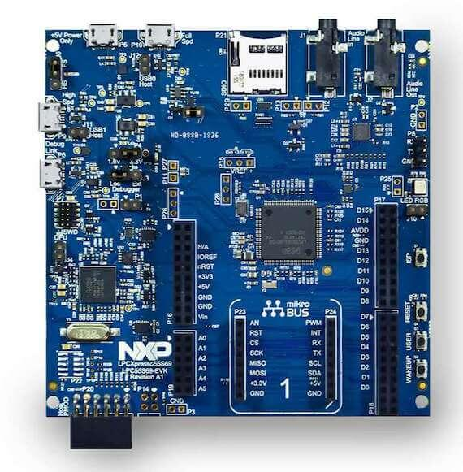

<!-- Copyright 2015-2026 Zephyr Project members and individual contributors. -->
<!-- SPDX-License-Identifier: Apache-2.0 -->
<!-- 中文翻译；编号、导航与译注为本地新增。 -->

<a id="lpcxpresso55s69"></a>

# 第10章\_LPCXPRESSO55S69

原文：[官方页面](https://docs.zephyrproject.org/latest/boards/nxp/lpcxpresso55s69/doc/index.html)。读取日期：2026-10-16；来源摘要见[来源记录](../SOURCES.md)。

开发板概览（Board Overview）

<a id="id1"></a>

[](images/lpcxpresso55s69.jpg)

LPCXPRESSO55S69

名称（Name）：

`lpcxpresso55s69`

厂商（Vendor）：

[恩智浦半导体（NXP Semiconductors）](https://docs.zephyrproject.org/latest/boards/index.html#vendor=nxp)

状态（Status）：

维护中（Maintained）

架构（Architecture）：

[arm](https://docs.zephyrproject.org/latest/boards/index.html#arch=arm)

片上系统（SoC）：

[lpc55s69](https://docs.zephyrproject.org/latest/boards/index.html#soc=lpc55s69)

<a id="board-github-link"></a>

[浏览开发板源码（Browse Board Sources）](https://github.com/zephyrproject-rtos/zephyr/blob/main//boards/nxp/lpcxpresso55s69/doc/index.rst/../..)<a id="overview"></a>

## 概述（Overview）

LPCXpresso55S69用于基于Arm Cortex-M33的LPC55S6x MCU评估及开发。板载高性能调试探针、音频子系统及加速度计，并提供多种选项来添加现成的网络、传感器、显示及其他接口扩展板。

<a id="hardware"></a>

## 硬件（Hardware）


- LPC55S69双核Arm Cortex-M33微控制器，原文硬件清单列出的最高频率为100 MHz
- 板载高速USB Link2调试探针，可选CMSIS-DAP及SEGGER J-Link协议
- 通过板载调试探针，将LPC55S69目标的UART及SPI端口桥接到USB
- 提供外部调试探针的硬件支持
- 3个用户LED，以及复位、ISP（3）及用户按键，括号数字按原文保留
- MicroSD卡槽，支持4位SDIO
- NXP MMA8652FCR1加速度计
- 带线路输入／输出的立体声音频编解码器
- 高速及全速USB端口，使用Micro-A/B连接器，支持主机或设备功能
- MikroElektronika Click扩展选项
- 兼容Arduino UNO的LPCXpresso-V3扩展选项
- 兼容Pmod的扩展／主机连接器

LPC55S69 SoC及LPCXPRESSO55S69开发板的更多信息见以下资料：


- [LPC55S69 SoC网站](https://www.nxp.com/products/processors-and-microcontrollers/arm-based-processors-and-mcus/lpc-cortex-m-mcus/lpc5500-cortex-m33/high-efficiency-arm-cortex-m33-based-microcontroller-family:LPC55S6x)
- [LPC55S69 数据手册（Datasheet）](https://www.nxp.com/docs/en/nxp/data-sheets/LPC55S6x_DS.pdf)
- [LPC55S69 参考手册（Reference Manual）](https://www.nxp.com/webapp/Download?colCode=UM11126)
- [LPCXPRESSO55S69 网站](https://www.nxp.com/products/processors-and-microcontrollers/arm-based-processors-and-mcus/lpc-cortex-m-mcus/lpc5500-cortex-m33/lpcxpresso55s69-development-board:LPC55S69-EVK)
- [LPCXPRESSO55S69 用户指南（User Guide）](https://www.nxp.com/webapp/Download?colCode=UM11158)
- [LPCXPRESSO55S69 原理图（Schematics）](https://www.nxp.com/webapp/Download?colCode=LPC55S69-SCH)
- [LPCXPRESSO55S69 调试固件（Debug Firmware）](https://www.nxp.com/docs/en/application-note/AN13206.pdf)

<a id="supported-features"></a>

### 支持的功能（Supported Features）

NXP将LPCXpresso55S69视为LPC55xx系列功能覆盖更广的开发板，并优先在该板落实Zephyr完整平台支持及新功能，以服务整个LPC55xx系列。

`lpcxpresso55s69`开发板支持下表所列的硬件功能。

片上／板载（On-Chip / On-Board）

功能集成在片上系统（SoC）内／位于开发板上。

2 / 2

分别表示已启用／已禁用的实例数。点击数量标签，可查看开发板或SoC设备树源码（DTS）中该功能的第一个实例。

`vnd,foo`

与此功能匹配的设备树绑定兼容字符串（Compatible String）；点击链接可查看绑定文档。

<a id="lpcxpresso55s69-hw-features"></a>

<a id="lpcxpresso55s69-lpcxpresso55s69/lpc55s69/cpu0-hw-features-section"></a>

#### `lpcxpresso55s69/lpc55s69/cpu0`目标（Target）

<a id="lpcxpresso55s69-lpcxpresso55s69/lpc55s69/cpu0-hw-features-panel"></a>

<a id="lpcxpresso55s69-lpcxpresso55s69/lpc55s69/cpu0-hw-features-memory"></a>

该开发板目标的片上存储容量：192 KiB RAM、630 KiB Flash。

<a id="lpcxpresso55s69-lpcxpresso55s69/lpc55s69/cpu0-hw-features-table"></a>

<table>
<tr>
<th>类型（Type）</th>
<th>位置（Location）</th>
<th>说明（Description）</th>
<th>兼容字符串（Compatible）</th>
</tr>
<tr>
<td rowspan="1">中央处理器（CPU）</td>
<td>片上（On-Chip）</td>
<td>ARM Cortex-M33F处理器（CPU）（<a href="https://github.com/zephyrproject-rtos/zephyr/blob/main/dts/arm/nxp/lpc/lpc55xxx/nxp_lpc55S6x_common.dtsi?plain=1#L32">已启用：1</a>）</td>
<td><a href="../cpu_arm_riscv_binding_reference/P023_arm_cortex-m33f.md#std-dtcompatible-arm-cortex-m33f"><code>arm,cortex-m33f</code></a></td>
</tr>
<tr>
<td rowspan="1">模数转换器（ADC）</td>
<td>片上（On-Chip）</td>
<td>LPC低功耗模数转换器（LPADC）（<a href="https://github.com/zephyrproject-rtos/zephyr/blob/main/dts/arm/nxp/lpc/lpc55xxx/nxp_lpc55S6x_common.dtsi?plain=1#L409">已启用：1</a>）</td>
<td><a href="../hardware/P851_NXPLPC低功耗ADC绑定.md#dtbinding-nxp-lpc-lpadc"><code>nxp,lpc-lpadc</code></a></td>
</tr>
<tr>
<td rowspan="1">ARM 架构（ARM Architecture）</td>
<td>片上（On-Chip）</td>
<td>LPC Flexcomm节点（<a href="https://github.com/zephyrproject-rtos/zephyr/blob/main/dts/arm/nxp/lpc/lpc55xxx/nxp_lpc55S6x_common.dtsi?plain=1#L274">已禁用：3</a>）</td>
<td><a href="../arm_nordic_nxp_control_binding_reference/P015_nxp_lpc-flexcomm.md#std-dtcompatible-nxp-lpc-flexcomm"><code>nxp,lpc-flexcomm</code></a></td>
</tr>
<tr>
<td rowspan="1">音频（Audio）</td>
<td>板载（On-Board）</td>
<td>WM8904音频编解码器（Audio Codec）（<a href="https://github.com/zephyrproject-rtos/zephyr/blob/main/boards/nxp/lpcxpresso55s69/lpcxpresso55s69.dtsi?plain=1#L177">已启用：1</a>）</td>
<td><a href="../audio_stm32_ti_wolfson_binding_reference/P011_wolfson_wm8904.md#std-dtcompatible-wolfson-wm8904"><code>wolfson,wm8904</code></a></td>
</tr>
<tr>
<td rowspan="1">时钟控制（Clock Control）</td>
<td>片上（On-Chip）</td>
<td>LPC SYSCON及CLKCTL IP节点（<a href="https://github.com/zephyrproject-rtos/zephyr/blob/main/dts/arm/nxp/lpc/lpc55xxx/nxp_lpc55S6x_common.dtsi?plain=1#L157">已启用：1</a>）</td>
<td><a href="../clock_nxp_pico_realtek_renesas_binding_reference/P007_nxp_lpc-syscon.md#std-dtcompatible-nxp-lpc-syscon"><code>nxp,lpc-syscon</code></a></td>
</tr>
<tr>
<td rowspan="4">计数器（Counter）</td>
<td>片上（On-Chip）</td>
<td>NXP MCUX标准定时器／计数器（Standard Timer/Counter）（<a href="https://github.com/zephyrproject-rtos/zephyr/blob/main/dts/arm/nxp/lpc/lpc55xxx/nxp_lpc55S6x_common.dtsi?plain=1#L463">已启用：5</a>）</td>
<td><a href="../nxp_nuvoton_counter_binding_reference/P009_nxp_lpc-ctimer.md#std-dtcompatible-nxp-lpc-ctimer"><code>nxp,lpc-ctimer</code></a></td>
</tr>
<tr>
<td>片上（On-Chip）</td>
<td>使用NXP LPC RTC高分辨率计数器（High Resolution Counter）的驱动（<a href="https://github.com/zephyrproject-rtos/zephyr/blob/main/dts/arm/nxp/lpc/lpc55xxx/nxp_lpc55S6x_common.dtsi?plain=1#L539">已禁用：1</a>）</td>
<td><a href="../nxp_nuvoton_counter_binding_reference/P010_nxp_lpc-rtc-highres.md#std-dtcompatible-nxp-lpc-rtc-highres"><code>nxp,lpc-rtc-highres</code></a></td>
</tr>
<tr>
<td>片上（On-Chip）</td>
<td>NXP多速率定时器（Multirate Timer）（<a href="https://github.com/zephyrproject-rtos/zephyr/blob/main/dts/arm/nxp/lpc/lpc55xxx/nxp_lpc55S6x_common.dtsi?plain=1#L551">已启用：1</a>）</td>
<td><a href="../nxp_nuvoton_counter_binding_reference/P015_nxp_mrt.md#std-dtcompatible-nxp-mrt"><code>nxp,mrt</code></a></td>
</tr>
<tr>
<td>片上（On-Chip）</td>
<td>NXP多速率定时器通道（<a href="https://github.com/zephyrproject-rtos/zephyr/blob/main/dts/arm/nxp/lpc/lpc55xxx/nxp_lpc55S6x_common.dtsi?plain=1#L562">已启用：1</a>；<a href="https://github.com/zephyrproject-rtos/zephyr/blob/main/dts/arm/nxp/lpc/lpc55xxx/nxp_lpc55S6x_common.dtsi?plain=1#L568">已禁用：3</a>）</td>
<td><a href="../nxp_nuvoton_counter_binding_reference/P014_nxp_mrt-channel.md#std-dtcompatible-nxp-mrt-channel"><code>nxp,mrt-channel</code></a></td>
</tr>
<tr>
<td rowspan="1">循环冗余校验（CRC）</td>
<td>片上（On-Chip）</td>
<td>NXP LPC循环冗余校验（CRC）设备（<a href="https://github.com/zephyrproject-rtos/zephyr/blob/main/dts/arm/nxp/lpc/lpc55xxx/nxp_lpc55S6x_common.dtsi?plain=1#L336">已启用：1</a>）</td>
<td><a href="../crc_clock_monitor_binding_reference/P007_nxp_lpc-crc.md#std-dtcompatible-nxp-lpc-crc"><code>nxp,lpc-crc</code></a></td>
</tr>
<tr>
<td rowspan="1">直接存储器访问（DMA）</td>
<td>片上（On-Chip）</td>
<td>NXP LPC直接存储器访问（DMA）控制器（<a href="https://github.com/zephyrproject-rtos/zephyr/blob/main/dts/arm/nxp/lpc/lpc55xxx/nxp_lpc55S6x_common.dtsi?plain=1#L231">已启用：2</a>）</td>
<td><a href="../nxp_realtek_renesas_dma_binding_reference/P003_nxp_lpc-dma.md#std-dtcompatible-nxp-lpc-dma"><code>nxp,lpc-dma</code></a></td>
</tr>
<tr>
<td rowspan="1">数字信号处理（DSP）</td>
<td>片上（On-Chip）</td>
<td>NXP PowerQuad数字信号处理（DSP）协处理器（<a href="https://github.com/zephyrproject-rtos/zephyr/blob/main/dts/arm/nxp/lpc/lpc55xxx/nxp_lpc55S6x_common.dtsi?plain=1#L329">已启用：1</a>）</td>
<td><a href="../sound_haptic_binding_reference/P004_nxp_powerquad.md#std-dtcompatible-nxp-powerquad"><code>nxp,powerquad</code></a></td>
</tr>
<tr>
<td rowspan="1">闪存控制器（Flash Controller）</td>
<td>片上（On-Chip）</td>
<td>用于lpc55xxx系列、但不包括lpc553x的NXP在应用编程（IAP / In-Application Programming）闪存控制器（<a href="https://github.com/zephyrproject-rtos/zephyr/blob/main/dts/arm/nxp/lpc/lpc55xxx/nxp_lpc55S6x_common.dtsi?plain=1#L110">已启用：1</a>）</td>
<td><a href="../flash_nuvoton_nxp_renesas_binding_reference/P011_nxp_iap-fmc55.md#std-dtcompatible-nxp-iap-fmc55"><code>nxp,iap-fmc55</code></a></td>
</tr>
<tr>
<td rowspan="4">通用输入输出与接插件（GPIO &amp; Headers）</td>
<td>片上（On-Chip）</td>
<td>LPC通用输入输出（GPIO）（<a href="https://github.com/zephyrproject-rtos/zephyr/blob/main/dts/arm/nxp/lpc/lpc55xxx/nxp_lpc55S6x_common.dtsi?plain=1#L180">已启用：1</a>）</td>
<td><a href="../gpio_nxp_expanders_binding_reference/P006_nxp_lpc-gpio.md#std-dtcompatible-nxp-lpc-gpio"><code>nxp,lpc-gpio</code></a></td>
</tr>
<tr>
<td>片上（On-Chip）</td>
<td>LPC GPIO端口设备（<a href="https://github.com/zephyrproject-rtos/zephyr/blob/main/dts/arm/nxp/lpc/lpc55xxx/nxp_lpc55S6x_common.dtsi?plain=1#L186">已启用：2</a>）</td>
<td><a href="../gpio_nxp_expanders_binding_reference/P005_nxp_lpc-gpio-port.md#std-dtcompatible-nxp-lpc-gpio-port"><code>nxp,lpc-gpio-port</code></a></td>
</tr>
<tr>
<td>板载（On-Board）</td>
<td>通过Mikro BUS排针引出的GPIO引脚（<a href="https://github.com/zephyrproject-rtos/zephyr/blob/main/boards/nxp/lpcxpresso55s69/lpcxpresso55s69.dtsi?plain=1#L41">已启用：1</a>）</td>
<td><a href="../gpio_microchip_nordic_nuvoton_binding_reference/P006_mikro-bus.md#std-dtcompatible-mikro-bus"><code>mikro-bus</code></a></td>
</tr>
<tr>
<td>板载（On-Board）</td>
<td>引出到Arduino Uno R3排针（Headers）的GPIO引脚（<a href="https://github.com/zephyrproject-rtos/zephyr/blob/main/boards/nxp/lpcxpresso55s69/lpcxpresso55s69.dtsi?plain=1#L64">已启用：1</a>）</td>
<td><a href="../gpio_adi_headers_ambiq_binding_reference/P023_arduino-header-r3.md#std-dtcompatible-arduino-header-r3"><code>arduino-header-r3</code></a></td>
</tr>
<tr>
<td rowspan="2">硬件信息（Hardware Information）</td>
<td>片上（On-Chip）</td>
<td>NXP LPC 128位唯一标识符（Unique Identifier）（<a href="https://github.com/zephyrproject-rtos/zephyr/blob/main/dts/arm/nxp/lpc/lpc55xxx/nxp_lpc55S6x_common.dtsi?plain=1#L134">已启用：1</a>）</td>
<td><a href="../hwinfo_binding_reference/P009_nxp_lpc-uid.md#std-dtcompatible-nxp-lpc-uid"><code>nxp,lpc-uid</code></a></td>
</tr>
<tr>
<td>片上（On-Chip）</td>
<td>NXP LPC55xx电源管理控制器（PMC）的复位原因硬件信息（Hwinfo）（<a href="https://github.com/zephyrproject-rtos/zephyr/blob/main/dts/arm/nxp/lpc/lpc55xxx/nxp_lpc55S6x_common.dtsi?plain=1#L145">已启用：1</a>）</td>
<td><a href="../hwinfo_binding_reference/P008_nxp_lpc-pmc-hwinfo.md#std-dtcompatible-nxp-lpc-pmc-hwinfo"><code>nxp,lpc-pmc-hwinfo</code></a></td>
</tr>
<tr>
<td rowspan="1">集成电路间总线（I2C）</td>
<td>片上（On-Chip）</td>
<td>LPC I2C控制器（<a href="https://github.com/zephyrproject-rtos/zephyr/blob/main/dts/arm/nxp/lpc/lpc55xxx/nxp_lpc55S6x_common.dtsi?plain=1#L307">已启用：1</a>）</td>
<td><a href="../i2c_nxp_pico_renesas_binding_reference/P003_nxp_lpc-i2c.md#std-dtcompatible-nxp-lpc-i2c"><code>nxp,lpc-i2c</code></a></td>
</tr>
<tr>
<td rowspan="1">集成电路间音频总线（I2S）</td>
<td>片上（On-Chip）</td>
<td>LPC I2S音频总线节点（<a href="https://github.com/zephyrproject-rtos/zephyr/blob/main/dts/arm/nxp/lpc/lpc55xxx/nxp_lpc55S6x_common.dtsi?plain=1#L343">已启用：2</a>）</td>
<td><a href="../i2s_binding_reference/P012_nxp_lpc-i2s.md#std-dtcompatible-nxp-lpc-i2s"><code>nxp,lpc-i2s</code></a></td>
</tr>
<tr>
<td rowspan="1">输入（Input）</td>
<td>板载（On-Board）</td>
<td>一组绑定到 GPIO 的输入按键（GPIO-Bound Input Keys）（<a href="https://github.com/zephyrproject-rtos/zephyr/blob/main/boards/nxp/lpcxpresso55s69/lpcxpresso55s69_lpc55s69_cpu0.dts?plain=1#L50">已启用：1</a>）</td>
<td><a href="../hardware/P563_GPIO按键绑定.md#std-dtcompatible-gpio-keys"><code>gpio-keys</code></a></td>
</tr>
<tr>
<td rowspan="3">中断控制器（Interrupt Controller）</td>
<td>片上（On-Chip）</td>
<td>ARMv8-M嵌套向量中断控制器（NVIC / Nested Vectored Interrupt Controller）（<a href="https://github.com/zephyrproject-rtos/zephyr/blob/main/dts/arm/armv8-m.dtsi?plain=1#L13">已启用：1</a>）</td>
<td><a href="../arm_interrupt_timer_binding_reference/P003_ARMv8_M_NVIC.md#std-dtcompatible-arm-v8m-nvic"><code>arm,v8m-nvic</code></a></td>
</tr>
<tr>
<td>片上（On-Chip）</td>
<td>NXP分组GPIO输入中断（GINT / Grouped GPIO Input Interrupt）控制器（<a href="https://github.com/zephyrproject-rtos/zephyr/blob/main/dts/arm/nxp/lpc/lpc55xxx/nxp_lpc55S6x_common.dtsi?plain=1#L203">已启用：2</a>）</td>
<td><a href="../nxp_interrupt_binding_reference/P001_nxp_gint.md#std-dtcompatible-nxp-gint"><code>nxp,gint</code></a></td>
</tr>
<tr>
<td>片上（On-Chip）</td>
<td>NXP引脚中断及模式匹配引擎（PINT）（<a href="https://github.com/zephyrproject-rtos/zephyr/blob/main/dts/arm/nxp/lpc/lpc55xxx/nxp_lpc55S6x_common.dtsi?plain=1#L219">已启用：1</a>）</td>
<td><a href="../nxp_interrupt_binding_reference/P004_nxp_pint.md#std-dtcompatible-nxp-pint"><code>nxp,pint</code></a></td>
</tr>
<tr>
<td rowspan="1">处理器间消息（IPM）</td>
<td>片上（On-Chip）</td>
<td>LPC邮箱（MAILBOX）（<a href="https://github.com/zephyrproject-rtos/zephyr/blob/main/dts/arm/nxp/lpc/lpc55xxx/nxp_lpc55S6x_common.dtsi?plain=1#L255">已启用：1</a>）</td>
<td><a href="../intercore_reference/P073_NXPLPC邮箱绑定.md#dtbinding-nxp-lpc-mailbox"><code>nxp,lpc-mailbox</code></a></td>
</tr>
<tr>
<td rowspan="2">发光二极管（LED）</td>
<td>板载（On-Board）</td>
<td>一组由 GPIO 控制的 LED（GPIO-Controlled LEDs）（<a href="https://github.com/zephyrproject-rtos/zephyr/blob/main/boards/nxp/lpcxpresso55s69/lpcxpresso55s69.dtsi?plain=1#L19">已启用：1</a>）</td>
<td><a href="../hardware/P564_GPIO指示灯绑定.md#dtbinding-gpio-leds"><code>gpio-leds</code></a></td>
</tr>
<tr>
<td>板载（On-Board）</td>
<td>一组由脉宽调制（PWM）控制的LED（<a href="https://github.com/zephyrproject-rtos/zephyr/blob/main/boards/nxp/lpcxpresso55s69/lpcxpresso55s69_lpc55s69_cpu0.dts?plain=1#L72">已启用：1</a>）</td>
<td><a href="../hardware/P565_PWM指示灯绑定.md#dtbinding-pwm-leds"><code>pwm-leds</code></a></td>
</tr>
<tr>
<td rowspan="1">内存管理单元／内存保护单元（MMU / MPU）</td>
<td>片上（On-Chip）</td>
<td>ARMv8-M存储器保护单元（MPU / Memory Protection Unit）（<a href="https://github.com/zephyrproject-rtos/zephyr/blob/main/dts/arm/nxp/lpc/lpc55xxx/nxp_lpc55S6x_common.dtsi?plain=1#L39">已启用：1</a>）</td>
<td><a href="../memory_protection_binding_reference/P007_arm_armv8m-mpu.md#std-dtcompatible-arm-armv8m-mpu"><code>arm,armv8m-mpu</code></a></td>
</tr>
<tr>
<td rowspan="1">存储技术设备（MTD）</td>
<td>片上（On-Chip）</td>
<td>闪存（Flash）节点（<a href="https://github.com/zephyrproject-rtos/zephyr/blob/main/dts/arm/nxp/lpc/lpc55xxx/nxp_lpc55S6x_common.dtsi?plain=1#L118">已启用：2</a>；<a href="https://github.com/zephyrproject-rtos/zephyr/blob/main/dts/arm/nxp/lpc/lpc55xxx/nxp_lpc55S6x_common.dtsi?plain=1#L128">已禁用：1</a>）</td>
<td><a href="../mtd_nxp_st_ti_partition_binding_reference/P013_soc-nv-flash.md#std-dtcompatible-soc-nv-flash"><code>soc-nv-flash</code></a></td>
</tr>
<tr>
<td rowspan="2">引脚控制（Pin Control）</td>
<td>片上（On-Chip）</td>
<td>LPC I/O引脚配置（IOCON）（<a href="https://github.com/zephyrproject-rtos/zephyr/blob/main/dts/arm/nxp/lpc/lpc55xxx/nxp_lpc55S6x_common.dtsi?plain=1#L168">已启用：1</a>）</td>
<td><a href="../pinctrl_nxp_pico_binding_reference/P007_nxp_lpc-iocon.md#std-dtcompatible-nxp-lpc-iocon"><code>nxp,lpc-iocon</code></a></td>
</tr>
<tr>
<td>片上（On-Chip）</td>
<td>LPC引脚控制（Pinctrl）节点（<a href="https://github.com/zephyrproject-rtos/zephyr/blob/main/dts/arm/nxp/lpc/lpc55xxx/nxp_lpc55S6x_common.dtsi?plain=1#L175">已启用：1</a>）</td>
<td><a href="../pinctrl_nxp_pico_binding_reference/P005_nxp_lpc-iocon-pinctrl.md#std-dtcompatible-nxp-lpc-iocon-pinctrl"><code>nxp,lpc-iocon-pinctrl</code></a></td>
</tr>
<tr>
<td rowspan="1">脉宽调制（PWM）</td>
<td>片上（On-Chip）</td>
<td>NXP状态可配置定时器（SCTimer）脉宽调制（PWM）（<a href="https://github.com/zephyrproject-rtos/zephyr/blob/main/dts/arm/nxp/lpc/lpc55xxx/nxp_lpc55S6x_common.dtsi?plain=1#L523">已启用：1</a>）</td>
<td><a href="../pwm_nxp_renesas_binding_reference/P012_nxp_sctimer-pwm.md#std-dtcompatible-nxp-sctimer-pwm"><code>nxp,sctimer-pwm</code></a></td>
</tr>
<tr>
<td rowspan="1">复位控制器（Reset Controller）</td>
<td>片上（On-Chip）</td>
<td>LPC SYSCON外设复位控制器（<a href="https://github.com/zephyrproject-rtos/zephyr/blob/main/dts/arm/nxp/lpc/lpc55xxx/nxp_lpc55S6x_common.dtsi?plain=1#L162">已启用：1</a>）</td>
<td><a href="../reset_controller_binding_reference/P009_nxp_lpc-syscon-reset.md#std-dtcompatible-nxp-lpc-syscon-reset"><code>nxp,lpc-syscon-reset</code></a></td>
</tr>
<tr>
<td rowspan="1">随机数生成器（RNG）</td>
<td>片上（On-Chip）</td>
<td>LPC随机数发生器（RNG / Random Number Generator）（<a href="https://github.com/zephyrproject-rtos/zephyr/blob/main/dts/arm/nxp/lpc/lpc55xxx/nxp_lpc55S6x_common.dtsi?plain=1#L394">已启用：1</a>）</td>
<td><a href="../rng_binding_reference/P021_nxp_lpc-rng.md#std-dtcompatible-nxp-lpc-rng"><code>nxp,lpc-rng</code></a></td>
</tr>
<tr>
<td rowspan="1">实时时钟（RTC）</td>
<td>片上（On-Chip）</td>
<td>NXP LPC实时时钟（RTC）（<a href="https://github.com/zephyrproject-rtos/zephyr/blob/main/dts/arm/nxp/lpc/lpc55xxx/nxp_lpc55S6x_common.dtsi?plain=1#L533">已启用：1</a>）</td>
<td><a href="../microchip_microcrystal_nxp_rtc_binding_reference/P013_nxp_lpc-rtc.md#std-dtcompatible-nxp-lpc-rtc"><code>nxp,lpc-rtc</code></a></td>
</tr>
<tr>
<td rowspan="1">SD 主机控制器（SDHC）</td>
<td>片上（On-Chip）</td>
<td>NXP LPC SD接口（SDIF）主控制器（<a href="https://github.com/zephyrproject-rtos/zephyr/blob/main/dts/arm/nxp/lpc/lpc55xxx/nxp_lpc55S6x_common.dtsi?plain=1#L365">已启用：1</a>）</td>
<td><a href="../sdhc_binding_reference/P015_nxp_lpc-sdif.md#std-dtcompatible-nxp-lpc-sdif"><code>nxp,lpc-sdif</code></a></td>
</tr>
<tr>
<td rowspan="1">传感器（Sensors）</td>
<td>板载（On-Board）</td>
<td>FXOS8700六轴加速度计／磁力计传感器（<a href="https://github.com/zephyrproject-rtos/zephyr/blob/main/boards/nxp/lpcxpresso55s69/lpcxpresso55s69.dtsi?plain=1#L171">已启用：1</a>）</td>
<td><a href="../compatible_binding_reference/P052_nxp_fxos8700.md#std-dtcompatible-nxp-fxos8700"><code>nxp,fxos8700</code></a></td>
</tr>
<tr>
<td rowspan="1">串行控制器（Serial Controller）</td>
<td>片上（On-Chip）</td>
<td>LPC通用同步异步收发器（USART）（<a href="https://github.com/zephyrproject-rtos/zephyr/blob/main/dts/arm/nxp/lpc/lpc55xxx/nxp_lpc55S6x_common.dtsi?plain=1#L263">已启用：1</a>；<a href="https://github.com/zephyrproject-rtos/zephyr/blob/main/dts/arm/nxp/lpc/lpc55xxx/nxp_lpc55S6x_common.dtsi?plain=1#L285">已禁用：1</a>）</td>
<td><a href="../uart_microchip_nordic_nxp_binding_reference/P014_nxp_lpc-usart.md#std-dtcompatible-nxp-lpc-usart"><code>nxp,lpc-usart</code></a></td>
</tr>
<tr>
<td rowspan="1">串行外设接口（SPI）</td>
<td>片上（On-Chip）</td>
<td>NXP LPC串行外设接口（SPI）控制器（<a href="https://github.com/zephyrproject-rtos/zephyr/blob/main/dts/arm/nxp/lpc/lpc55xxx/nxp_lpc55S6x_common.dtsi?plain=1#L373">已启用：1</a>）</td>
<td><a href="../spi_flexspi_nxp_renesas_binding_reference/P003_nxp_lpc-spi.md#std-dtcompatible-nxp-lpc-spi"><code>nxp,lpc-spi</code></a></td>
</tr>
<tr>
<td rowspan="1">静态随机存储器（SRAM）</td>
<td>片上（On-Chip）</td>
<td>通用片上静态随机存储器（SRAM）（<a href="https://github.com/zephyrproject-rtos/zephyr/blob/main/dts/arm/nxp/lpc/lpc55xxx/nxp_lpc55S6x_common.dtsi?plain=1#L79">已启用：5</a>）</td>
<td><a href="../hardware/P567_内存映射SRAM绑定.md#dtbinding-mmio-sram"><code>mmio-sram</code></a></td>
</tr>
<tr>
<td rowspan="1">定时器（Timer）</td>
<td>片上（On-Chip）</td>
<td>ARMv8-M系统节拍（System Tick）（<a href="https://github.com/zephyrproject-rtos/zephyr/blob/main/dts/arm/armv8-m.dtsi?plain=1#L21">已启用：1</a>）</td>
<td><a href="../arm_interrupt_timer_binding_reference/P007_ARMv8_M_SysTick.md#std-dtcompatible-arm-armv8m-systick"><code>arm,armv8m-systick</code></a></td>
</tr>
<tr>
<td rowspan="4">通用串行总线（USB）</td>
<td>片上（On-Chip）</td>
<td>NXP LPCIP3511 USB设备模式（<a href="https://github.com/zephyrproject-rtos/zephyr/blob/main/dts/arm/nxp/lpc/lpc55xxx/nxp_lpc55S6x_common.dtsi?plain=1#L434">已启用：1</a>；<a href="https://github.com/zephyrproject-rtos/zephyr/blob/main/dts/arm/nxp/lpc/lpc55xxx/nxp_lpc55S6x_common.dtsi?plain=1#L425">已禁用：1</a>）</td>
<td><a href="../usb_soc_binding_reference/P008_nxp_lpcip3511.md#std-dtcompatible-nxp-lpcip3511"><code>nxp,lpcip3511</code></a></td>
</tr>
<tr>
<td>片上（On-Chip）</td>
<td>NXP开放主机控制器接口（OHCI）USB主控制器（<a href="https://github.com/zephyrproject-rtos/zephyr/blob/main/dts/arm/nxp/lpc/lpc55xxx/nxp_lpc55S6x_common.dtsi?plain=1#L442">已启用：1</a>）</td>
<td><a href="../usb_soc_binding_reference/P012_nxp_uhc-ohci.md#std-dtcompatible-nxp-uhc-ohci"><code>nxp,uhc-ohci</code></a></td>
</tr>
<tr>
<td>片上（On-Chip）</td>
<td>NXP IP3516HS USB主控制器（<a href="https://github.com/zephyrproject-rtos/zephyr/blob/main/dts/arm/nxp/lpc/lpc55xxx/nxp_lpc55S6x_common.dtsi?plain=1#L450">已启用：1</a>）</td>
<td><a href="../usb_soc_binding_reference/P010_nxp_uhc-ip3516hs.md#std-dtcompatible-nxp-uhc-ip3516hs"><code>nxp,uhc-ip3516hs</code></a></td>
</tr>
<tr>
<td>片上（On-Chip）</td>
<td>NXP USB高速物理层（High Speed PHY）（<a href="https://github.com/zephyrproject-rtos/zephyr/blob/main/dts/arm/nxp/lpc/lpc55xxx/nxp_lpc55S6x_common.dtsi?plain=1#L457">已启用：1</a>）</td>
<td><a href="../usb_soc_binding_reference/P013_nxp_usbphy.md#std-dtcompatible-nxp-usbphy"><code>nxp,usbphy</code></a></td>
</tr>
<tr>
<td rowspan="1">看门狗（Watchdog）</td>
<td>片上（On-Chip）</td>
<td>LPC窗口看门狗定时器（Windowed Watchdog Timer）（<a href="https://github.com/zephyrproject-rtos/zephyr/blob/main/dts/arm/nxp/lpc/lpc55xxx/nxp_lpc55S6x_common.dtsi?plain=1#L400">已启用：1</a>）</td>
<td><a href="../nxp_nordic_nuvoton_watchdog_binding_reference/P011_nxp_lpc-wwdt.md#std-dtcompatible-nxp-lpc-wwdt"><code>nxp,lpc-wwdt</code></a></td>
</tr>
</table>

<a id="lpcxpresso55s69-lpcxpresso55s69/lpc55s69/cpu0/ns-hw-features-section"></a>

#### `lpcxpresso55s69/lpc55s69/cpu0/ns`目标（Target）

<a id="lpcxpresso55s69-lpcxpresso55s69/lpc55s69/cpu0/ns-hw-features-panel"></a>

<a id="lpcxpresso55s69-lpcxpresso55s69/lpc55s69/cpu0/ns-hw-features-memory"></a>

该开发板目标的片上存储容量：136 KiB RAM、630 KiB Flash。

<a id="lpcxpresso55s69-lpcxpresso55s69/lpc55s69/cpu0/ns-hw-features-table"></a>

<table>
<tr>
<th>类型（Type）</th>
<th>位置（Location）</th>
<th>说明（Description）</th>
<th>兼容字符串（Compatible）</th>
</tr>
<tr>
<td rowspan="1">中央处理器（CPU）</td>
<td>片上（On-Chip）</td>
<td>ARM Cortex-M33F处理器（CPU）（<a href="https://github.com/zephyrproject-rtos/zephyr/blob/main/dts/arm/nxp/lpc/lpc55xxx/nxp_lpc55S6x_common.dtsi?plain=1#L32">已启用：1</a>）</td>
<td><a href="../cpu_arm_riscv_binding_reference/P023_arm_cortex-m33f.md#std-dtcompatible-arm-cortex-m33f"><code>arm,cortex-m33f</code></a></td>
</tr>
<tr>
<td rowspan="1">模数转换器（ADC）</td>
<td>片上（On-Chip）</td>
<td>LPC低功耗模数转换器（LPADC）（<a href="https://github.com/zephyrproject-rtos/zephyr/blob/main/dts/arm/nxp/lpc/lpc55xxx/nxp_lpc55S6x_common.dtsi?plain=1#L409">已启用：1</a>）</td>
<td><a href="../hardware/P851_NXPLPC低功耗ADC绑定.md#dtbinding-nxp-lpc-lpadc"><code>nxp,lpc-lpadc</code></a></td>
</tr>
<tr>
<td rowspan="1">ARM 架构（ARM Architecture）</td>
<td>片上（On-Chip）</td>
<td>LPC Flexcomm节点（<a href="https://github.com/zephyrproject-rtos/zephyr/blob/main/dts/arm/nxp/lpc/lpc55xxx/nxp_lpc55S6x_common.dtsi?plain=1#L274">已禁用：5</a>）</td>
<td><a href="../arm_nordic_nxp_control_binding_reference/P015_nxp_lpc-flexcomm.md#std-dtcompatible-nxp-lpc-flexcomm"><code>nxp,lpc-flexcomm</code></a></td>
</tr>
<tr>
<td rowspan="1">音频（Audio）</td>
<td>板载（On-Board）</td>
<td>WM8904音频编解码器（Audio Codec）（<a href="https://github.com/zephyrproject-rtos/zephyr/blob/main/boards/nxp/lpcxpresso55s69/lpcxpresso55s69.dtsi?plain=1#L177">已启用：1</a>）</td>
<td><a href="../audio_stm32_ti_wolfson_binding_reference/P011_wolfson_wm8904.md#std-dtcompatible-wolfson-wm8904"><code>wolfson,wm8904</code></a></td>
</tr>
<tr>
<td rowspan="1">时钟控制（Clock Control）</td>
<td>片上（On-Chip）</td>
<td>LPC SYSCON及CLKCTL IP节点（<a href="https://github.com/zephyrproject-rtos/zephyr/blob/main/dts/arm/nxp/lpc/lpc55xxx/nxp_lpc55S6x_common.dtsi?plain=1#L157">已启用：1</a>）</td>
<td><a href="../clock_nxp_pico_realtek_renesas_binding_reference/P007_nxp_lpc-syscon.md#std-dtcompatible-nxp-lpc-syscon"><code>nxp,lpc-syscon</code></a></td>
</tr>
<tr>
<td rowspan="4">计数器（Counter）</td>
<td>片上（On-Chip）</td>
<td>NXP MCUX标准定时器／计数器（Standard Timer/Counter）（<a href="https://github.com/zephyrproject-rtos/zephyr/blob/main/dts/arm/nxp/lpc/lpc55xxx/nxp_lpc55S6x_common.dtsi?plain=1#L463">已启用：5</a>）</td>
<td><a href="../nxp_nuvoton_counter_binding_reference/P009_nxp_lpc-ctimer.md#std-dtcompatible-nxp-lpc-ctimer"><code>nxp,lpc-ctimer</code></a></td>
</tr>
<tr>
<td>片上（On-Chip）</td>
<td>使用NXP LPC RTC高分辨率计数器（High Resolution Counter）的驱动（<a href="https://github.com/zephyrproject-rtos/zephyr/blob/main/dts/arm/nxp/lpc/lpc55xxx/nxp_lpc55S6x_common.dtsi?plain=1#L539">已禁用：1</a>）</td>
<td><a href="../nxp_nuvoton_counter_binding_reference/P010_nxp_lpc-rtc-highres.md#std-dtcompatible-nxp-lpc-rtc-highres"><code>nxp,lpc-rtc-highres</code></a></td>
</tr>
<tr>
<td>片上（On-Chip）</td>
<td>NXP多速率定时器（Multirate Timer）（<a href="https://github.com/zephyrproject-rtos/zephyr/blob/main/dts/arm/nxp/lpc/lpc55xxx/nxp_lpc55S6x_common.dtsi?plain=1#L551">已启用：1</a>）</td>
<td><a href="../nxp_nuvoton_counter_binding_reference/P015_nxp_mrt.md#std-dtcompatible-nxp-mrt"><code>nxp,mrt</code></a></td>
</tr>
<tr>
<td>片上（On-Chip）</td>
<td>NXP多速率定时器通道（<a href="https://github.com/zephyrproject-rtos/zephyr/blob/main/dts/arm/nxp/lpc/lpc55xxx/nxp_lpc55S6x_common.dtsi?plain=1#L562">已禁用：4</a>）</td>
<td><a href="../nxp_nuvoton_counter_binding_reference/P014_nxp_mrt-channel.md#std-dtcompatible-nxp-mrt-channel"><code>nxp,mrt-channel</code></a></td>
</tr>
<tr>
<td rowspan="1">循环冗余校验（CRC）</td>
<td>片上（On-Chip）</td>
<td>NXP LPC循环冗余校验（CRC）设备（<a href="https://github.com/zephyrproject-rtos/zephyr/blob/main/dts/arm/nxp/lpc/lpc55xxx/nxp_lpc55S6x_common.dtsi?plain=1#L336">已启用：1</a>）</td>
<td><a href="../crc_clock_monitor_binding_reference/P007_nxp_lpc-crc.md#std-dtcompatible-nxp-lpc-crc"><code>nxp,lpc-crc</code></a></td>
</tr>
<tr>
<td rowspan="1">直接存储器访问（DMA）</td>
<td>片上（On-Chip）</td>
<td>NXP LPC直接存储器访问（DMA）控制器（<a href="https://github.com/zephyrproject-rtos/zephyr/blob/main/dts/arm/nxp/lpc/lpc55xxx/nxp_lpc55S6x_common.dtsi?plain=1#L231">已启用：1</a>；<a href="https://github.com/zephyrproject-rtos/zephyr/blob/main/dts/arm/nxp/lpc/lpc55xxx/nxp_lpc55S6x_common.dtsi?plain=1#L243">已禁用：1</a>）</td>
<td><a href="../nxp_realtek_renesas_dma_binding_reference/P003_nxp_lpc-dma.md#std-dtcompatible-nxp-lpc-dma"><code>nxp,lpc-dma</code></a></td>
</tr>
<tr>
<td rowspan="1">数字信号处理（DSP）</td>
<td>片上（On-Chip）</td>
<td>NXP PowerQuad数字信号处理（DSP）协处理器（<a href="https://github.com/zephyrproject-rtos/zephyr/blob/main/dts/arm/nxp/lpc/lpc55xxx/nxp_lpc55S6x_common.dtsi?plain=1#L329">已启用：1</a>）</td>
<td><a href="../sound_haptic_binding_reference/P004_nxp_powerquad.md#std-dtcompatible-nxp-powerquad"><code>nxp,powerquad</code></a></td>
</tr>
<tr>
<td rowspan="1">闪存控制器（Flash Controller）</td>
<td>片上（On-Chip）</td>
<td>用于lpc55xxx系列、但不包括lpc553x的NXP在应用编程（IAP / In-Application Programming）闪存控制器（<a href="https://github.com/zephyrproject-rtos/zephyr/blob/main/dts/arm/nxp/lpc/lpc55xxx/nxp_lpc55S6x_common.dtsi?plain=1#L110">已禁用：1</a>）</td>
<td><a href="../flash_nuvoton_nxp_renesas_binding_reference/P011_nxp_iap-fmc55.md#std-dtcompatible-nxp-iap-fmc55"><code>nxp,iap-fmc55</code></a></td>
</tr>
<tr>
<td rowspan="4">通用输入输出与接插件（GPIO &amp; Headers）</td>
<td>片上（On-Chip）</td>
<td>LPC通用输入输出（GPIO）（<a href="https://github.com/zephyrproject-rtos/zephyr/blob/main/dts/arm/nxp/lpc/lpc55xxx/nxp_lpc55S6x_common.dtsi?plain=1#L180">已启用：1</a>）</td>
<td><a href="../gpio_nxp_expanders_binding_reference/P006_nxp_lpc-gpio.md#std-dtcompatible-nxp-lpc-gpio"><code>nxp,lpc-gpio</code></a></td>
</tr>
<tr>
<td>片上（On-Chip）</td>
<td>LPC GPIO端口设备（<a href="https://github.com/zephyrproject-rtos/zephyr/blob/main/dts/arm/nxp/lpc/lpc55xxx/nxp_lpc55S6x_common.dtsi?plain=1#L186">已启用：2</a>）</td>
<td><a href="../gpio_nxp_expanders_binding_reference/P005_nxp_lpc-gpio-port.md#std-dtcompatible-nxp-lpc-gpio-port"><code>nxp,lpc-gpio-port</code></a></td>
</tr>
<tr>
<td>板载（On-Board）</td>
<td>通过Mikro BUS排针引出的GPIO引脚（<a href="https://github.com/zephyrproject-rtos/zephyr/blob/main/boards/nxp/lpcxpresso55s69/lpcxpresso55s69.dtsi?plain=1#L41">已启用：1</a>）</td>
<td><a href="../gpio_microchip_nordic_nuvoton_binding_reference/P006_mikro-bus.md#std-dtcompatible-mikro-bus"><code>mikro-bus</code></a></td>
</tr>
<tr>
<td>板载（On-Board）</td>
<td>引出到Arduino Uno R3排针（Headers）的GPIO引脚（<a href="https://github.com/zephyrproject-rtos/zephyr/blob/main/boards/nxp/lpcxpresso55s69/lpcxpresso55s69.dtsi?plain=1#L64">已启用：1</a>）</td>
<td><a href="../gpio_adi_headers_ambiq_binding_reference/P023_arduino-header-r3.md#std-dtcompatible-arduino-header-r3"><code>arduino-header-r3</code></a></td>
</tr>
<tr>
<td rowspan="2">硬件信息（Hardware Information）</td>
<td>片上（On-Chip）</td>
<td>NXP LPC 128位唯一标识符（Unique Identifier）（<a href="https://github.com/zephyrproject-rtos/zephyr/blob/main/dts/arm/nxp/lpc/lpc55xxx/nxp_lpc55S6x_common.dtsi?plain=1#L134">已启用：1</a>）</td>
<td><a href="../hwinfo_binding_reference/P009_nxp_lpc-uid.md#std-dtcompatible-nxp-lpc-uid"><code>nxp,lpc-uid</code></a></td>
</tr>
<tr>
<td>片上（On-Chip）</td>
<td>NXP LPC55xx电源管理控制器（PMC）的复位原因硬件信息（Hwinfo）（<a href="https://github.com/zephyrproject-rtos/zephyr/blob/main/dts/arm/nxp/lpc/lpc55xxx/nxp_lpc55S6x_common.dtsi?plain=1#L145">已启用：1</a>）</td>
<td><a href="../hwinfo_binding_reference/P008_nxp_lpc-pmc-hwinfo.md#std-dtcompatible-nxp-lpc-pmc-hwinfo"><code>nxp,lpc-pmc-hwinfo</code></a></td>
</tr>
<tr>
<td rowspan="1">集成电路间总线（I2C）</td>
<td>片上（On-Chip）</td>
<td>LPC I2C控制器（<a href="https://github.com/zephyrproject-rtos/zephyr/blob/main/dts/arm/nxp/lpc/lpc55xxx/nxp_lpc55S6x_common.dtsi?plain=1#L307">已启用：1</a>）</td>
<td><a href="../i2c_nxp_pico_renesas_binding_reference/P003_nxp_lpc-i2c.md#std-dtcompatible-nxp-lpc-i2c"><code>nxp,lpc-i2c</code></a></td>
</tr>
<tr>
<td rowspan="1">输入（Input）</td>
<td>板载（On-Board）</td>
<td>一组绑定到 GPIO 的输入按键（GPIO-Bound Input Keys）（<a href="https://github.com/zephyrproject-rtos/zephyr/blob/main/boards/nxp/lpcxpresso55s69/lpcxpresso55s69_lpc55s69_cpu0_ns.dts?plain=1#L40">已启用：1</a>）</td>
<td><a href="../hardware/P563_GPIO按键绑定.md#std-dtcompatible-gpio-keys"><code>gpio-keys</code></a></td>
</tr>
<tr>
<td rowspan="3">中断控制器（Interrupt Controller）</td>
<td>片上（On-Chip）</td>
<td>NXP分组GPIO输入中断（GINT / Grouped GPIO Input Interrupt）控制器（<a href="https://github.com/zephyrproject-rtos/zephyr/blob/main/dts/arm/nxp/lpc/lpc55xxx/nxp_lpc55S6x_common.dtsi?plain=1#L203">已启用：2</a>）</td>
<td><a href="../nxp_interrupt_binding_reference/P001_nxp_gint.md#std-dtcompatible-nxp-gint"><code>nxp,gint</code></a></td>
</tr>
<tr>
<td>片上（On-Chip）</td>
<td>NXP引脚中断及模式匹配引擎（PINT）（<a href="https://github.com/zephyrproject-rtos/zephyr/blob/main/dts/arm/nxp/lpc/lpc55xxx/nxp_lpc55S6x_common.dtsi?plain=1#L219">已启用：1</a>）</td>
<td><a href="../nxp_interrupt_binding_reference/P004_nxp_pint.md#std-dtcompatible-nxp-pint"><code>nxp,pint</code></a></td>
</tr>
<tr>
<td>片上（On-Chip）</td>
<td>ARMv8-M嵌套向量中断控制器（NVIC / Nested Vectored Interrupt Controller）（<a href="https://github.com/zephyrproject-rtos/zephyr/blob/main/dts/arm/armv8-m.dtsi?plain=1#L13">已启用：1</a>）</td>
<td><a href="../arm_interrupt_timer_binding_reference/P003_ARMv8_M_NVIC.md#std-dtcompatible-arm-v8m-nvic"><code>arm,v8m-nvic</code></a></td>
</tr>
<tr>
<td rowspan="1">处理器间消息（IPM）</td>
<td>片上（On-Chip）</td>
<td>LPC邮箱（MAILBOX）（<a href="https://github.com/zephyrproject-rtos/zephyr/blob/main/dts/arm/nxp/lpc/lpc55xxx/nxp_lpc55S6x_common.dtsi?plain=1#L255">已禁用：1</a>）</td>
<td><a href="../intercore_reference/P073_NXPLPC邮箱绑定.md#dtbinding-nxp-lpc-mailbox"><code>nxp,lpc-mailbox</code></a></td>
</tr>
<tr>
<td rowspan="1">发光二极管（LED）</td>
<td>板载（On-Board）</td>
<td>一组由 GPIO 控制的 LED（GPIO-Controlled LEDs）（<a href="https://github.com/zephyrproject-rtos/zephyr/blob/main/boards/nxp/lpcxpresso55s69/lpcxpresso55s69.dtsi?plain=1#L19">已启用：1</a>）</td>
<td><a href="../hardware/P564_GPIO指示灯绑定.md#dtbinding-gpio-leds"><code>gpio-leds</code></a></td>
</tr>
<tr>
<td rowspan="1">内存管理单元／内存保护单元（MMU / MPU）</td>
<td>片上（On-Chip）</td>
<td>ARMv8-M存储器保护单元（MPU / Memory Protection Unit）（<a href="https://github.com/zephyrproject-rtos/zephyr/blob/main/dts/arm/nxp/lpc/lpc55xxx/nxp_lpc55S6x_common.dtsi?plain=1#L39">已启用：1</a>）</td>
<td><a href="../memory_protection_binding_reference/P007_arm_armv8m-mpu.md#std-dtcompatible-arm-armv8m-mpu"><code>arm,armv8m-mpu</code></a></td>
</tr>
<tr>
<td rowspan="1">存储技术设备（MTD）</td>
<td>片上（On-Chip）</td>
<td>闪存（Flash）节点（<a href="https://github.com/zephyrproject-rtos/zephyr/blob/main/dts/arm/nxp/lpc/lpc55xxx/nxp_lpc55S6x_common.dtsi?plain=1#L118">已启用：2</a>；<a href="https://github.com/zephyrproject-rtos/zephyr/blob/main/dts/arm/nxp/lpc/lpc55xxx/nxp_lpc55S6x_common.dtsi?plain=1#L128">已禁用：1</a>）</td>
<td><a href="../mtd_nxp_st_ti_partition_binding_reference/P013_soc-nv-flash.md#std-dtcompatible-soc-nv-flash"><code>soc-nv-flash</code></a></td>
</tr>
<tr>
<td rowspan="2">引脚控制（Pin Control）</td>
<td>片上（On-Chip）</td>
<td>LPC I/O引脚配置（IOCON）（<a href="https://github.com/zephyrproject-rtos/zephyr/blob/main/dts/arm/nxp/lpc/lpc55xxx/nxp_lpc55S6x_common.dtsi?plain=1#L168">已启用：1</a>）</td>
<td><a href="../pinctrl_nxp_pico_binding_reference/P007_nxp_lpc-iocon.md#std-dtcompatible-nxp-lpc-iocon"><code>nxp,lpc-iocon</code></a></td>
</tr>
<tr>
<td>片上（On-Chip）</td>
<td>LPC引脚控制（Pinctrl）节点（<a href="https://github.com/zephyrproject-rtos/zephyr/blob/main/dts/arm/nxp/lpc/lpc55xxx/nxp_lpc55S6x_common.dtsi?plain=1#L175">已启用：1</a>）</td>
<td><a href="../pinctrl_nxp_pico_binding_reference/P005_nxp_lpc-iocon-pinctrl.md#std-dtcompatible-nxp-lpc-iocon-pinctrl"><code>nxp,lpc-iocon-pinctrl</code></a></td>
</tr>
<tr>
<td rowspan="1">脉宽调制（PWM）</td>
<td>片上（On-Chip）</td>
<td>NXP状态可配置定时器（SCTimer）脉宽调制（PWM）（<a href="https://github.com/zephyrproject-rtos/zephyr/blob/main/dts/arm/nxp/lpc/lpc55xxx/nxp_lpc55S6x_common.dtsi?plain=1#L523">已禁用：1</a>）</td>
<td><a href="../pwm_nxp_renesas_binding_reference/P012_nxp_sctimer-pwm.md#std-dtcompatible-nxp-sctimer-pwm"><code>nxp,sctimer-pwm</code></a></td>
</tr>
<tr>
<td rowspan="1">复位控制器（Reset Controller）</td>
<td>片上（On-Chip）</td>
<td>LPC SYSCON外设复位控制器（<a href="https://github.com/zephyrproject-rtos/zephyr/blob/main/dts/arm/nxp/lpc/lpc55xxx/nxp_lpc55S6x_common.dtsi?plain=1#L162">已启用：1</a>）</td>
<td><a href="../reset_controller_binding_reference/P009_nxp_lpc-syscon-reset.md#std-dtcompatible-nxp-lpc-syscon-reset"><code>nxp,lpc-syscon-reset</code></a></td>
</tr>
<tr>
<td rowspan="1">随机数生成器（RNG）</td>
<td>片上（On-Chip）</td>
<td>LPC随机数发生器（RNG / Random Number Generator）（<a href="https://github.com/zephyrproject-rtos/zephyr/blob/main/dts/arm/nxp/lpc/lpc55xxx/nxp_lpc55S6x_common.dtsi?plain=1#L394">已启用：1</a>）</td>
<td><a href="../rng_binding_reference/P021_nxp_lpc-rng.md#std-dtcompatible-nxp-lpc-rng"><code>nxp,lpc-rng</code></a></td>
</tr>
<tr>
<td rowspan="1">实时时钟（RTC）</td>
<td>片上（On-Chip）</td>
<td>NXP LPC实时时钟（RTC）（<a href="https://github.com/zephyrproject-rtos/zephyr/blob/main/dts/arm/nxp/lpc/lpc55xxx/nxp_lpc55S6x_common.dtsi?plain=1#L533">已禁用：1</a>）</td>
<td><a href="../microchip_microcrystal_nxp_rtc_binding_reference/P013_nxp_lpc-rtc.md#std-dtcompatible-nxp-lpc-rtc"><code>nxp,lpc-rtc</code></a></td>
</tr>
<tr>
<td rowspan="1">SD 主机控制器（SDHC）</td>
<td>片上（On-Chip）</td>
<td>NXP LPC SD接口（SDIF）主控制器（<a href="https://github.com/zephyrproject-rtos/zephyr/blob/main/dts/arm/nxp/lpc/lpc55xxx/nxp_lpc55S6x_common.dtsi?plain=1#L365">已禁用：1</a>）</td>
<td><a href="../sdhc_binding_reference/P015_nxp_lpc-sdif.md#std-dtcompatible-nxp-lpc-sdif"><code>nxp,lpc-sdif</code></a></td>
</tr>
<tr>
<td rowspan="1">传感器（Sensors）</td>
<td>板载（On-Board）</td>
<td>FXOS8700六轴加速度计／磁力计传感器（<a href="https://github.com/zephyrproject-rtos/zephyr/blob/main/boards/nxp/lpcxpresso55s69/lpcxpresso55s69.dtsi?plain=1#L171">已启用：1</a>）</td>
<td><a href="../compatible_binding_reference/P052_nxp_fxos8700.md#std-dtcompatible-nxp-fxos8700"><code>nxp,fxos8700</code></a></td>
</tr>
<tr>
<td rowspan="1">串行控制器（Serial Controller）</td>
<td>片上（On-Chip）</td>
<td>LPC通用同步异步收发器（USART）（<a href="https://github.com/zephyrproject-rtos/zephyr/blob/main/dts/arm/nxp/lpc/lpc55xxx/nxp_lpc55S6x_common.dtsi?plain=1#L263">已启用：1</a>；<a href="https://github.com/zephyrproject-rtos/zephyr/blob/main/dts/arm/nxp/lpc/lpc55xxx/nxp_lpc55S6x_common.dtsi?plain=1#L285">已禁用：1</a>）</td>
<td><a href="../uart_microchip_nordic_nxp_binding_reference/P014_nxp_lpc-usart.md#std-dtcompatible-nxp-lpc-usart"><code>nxp,lpc-usart</code></a></td>
</tr>
<tr>
<td rowspan="1">串行外设接口（SPI）</td>
<td>片上（On-Chip）</td>
<td>NXP LPC串行外设接口（SPI）控制器（<a href="https://github.com/zephyrproject-rtos/zephyr/blob/main/dts/arm/nxp/lpc/lpc55xxx/nxp_lpc55S6x_common.dtsi?plain=1#L373">已启用：1</a>）</td>
<td><a href="../spi_flexspi_nxp_renesas_binding_reference/P003_nxp_lpc-spi.md#std-dtcompatible-nxp-lpc-spi"><code>nxp,lpc-spi</code></a></td>
</tr>
<tr>
<td rowspan="1">静态随机存储器（SRAM）</td>
<td>片上（On-Chip）</td>
<td>通用片上静态随机存储器（SRAM）（<a href="https://github.com/zephyrproject-rtos/zephyr/blob/main/dts/arm/nxp/lpc/lpc55xxx/nxp_lpc55S6x_common.dtsi?plain=1#L79">已启用：5</a>）</td>
<td><a href="../hardware/P567_内存映射SRAM绑定.md#dtbinding-mmio-sram"><code>mmio-sram</code></a></td>
</tr>
<tr>
<td rowspan="1">定时器（Timer）</td>
<td>片上（On-Chip）</td>
<td>ARMv8-M系统节拍（System Tick）（<a href="https://github.com/zephyrproject-rtos/zephyr/blob/main/dts/arm/armv8-m.dtsi?plain=1#L21">已启用：1</a>）</td>
<td><a href="../arm_interrupt_timer_binding_reference/P007_ARMv8_M_SysTick.md#std-dtcompatible-arm-armv8m-systick"><code>arm,armv8m-systick</code></a></td>
</tr>
<tr>
<td rowspan="4">通用串行总线（USB）</td>
<td>片上（On-Chip）</td>
<td>NXP LPCIP3511 USB设备模式（<a href="https://github.com/zephyrproject-rtos/zephyr/blob/main/dts/arm/nxp/lpc/lpc55xxx/nxp_lpc55S6x_common.dtsi?plain=1#L434">已启用：1</a>；<a href="https://github.com/zephyrproject-rtos/zephyr/blob/main/dts/arm/nxp/lpc/lpc55xxx/nxp_lpc55S6x_common.dtsi?plain=1#L425">已禁用：1</a>）</td>
<td><a href="../usb_soc_binding_reference/P008_nxp_lpcip3511.md#std-dtcompatible-nxp-lpcip3511"><code>nxp,lpcip3511</code></a></td>
</tr>
<tr>
<td>片上（On-Chip）</td>
<td>NXP开放主机控制器接口（OHCI）USB主控制器（<a href="https://github.com/zephyrproject-rtos/zephyr/blob/main/dts/arm/nxp/lpc/lpc55xxx/nxp_lpc55S6x_common.dtsi?plain=1#L442">已禁用：1</a>）</td>
<td><a href="../usb_soc_binding_reference/P012_nxp_uhc-ohci.md#std-dtcompatible-nxp-uhc-ohci"><code>nxp,uhc-ohci</code></a></td>
</tr>
<tr>
<td>片上（On-Chip）</td>
<td>NXP IP3516HS USB主控制器（<a href="https://github.com/zephyrproject-rtos/zephyr/blob/main/dts/arm/nxp/lpc/lpc55xxx/nxp_lpc55S6x_common.dtsi?plain=1#L450">已禁用：1</a>）</td>
<td><a href="../usb_soc_binding_reference/P010_nxp_uhc-ip3516hs.md#std-dtcompatible-nxp-uhc-ip3516hs"><code>nxp,uhc-ip3516hs</code></a></td>
</tr>
<tr>
<td>片上（On-Chip）</td>
<td>NXP USB高速物理层（High Speed PHY）（<a href="https://github.com/zephyrproject-rtos/zephyr/blob/main/dts/arm/nxp/lpc/lpc55xxx/nxp_lpc55S6x_common.dtsi?plain=1#L457">已禁用：1</a>）</td>
<td><a href="../usb_soc_binding_reference/P013_nxp_usbphy.md#std-dtcompatible-nxp-usbphy"><code>nxp,usbphy</code></a></td>
</tr>
<tr>
<td rowspan="1">看门狗（Watchdog）</td>
<td>片上（On-Chip）</td>
<td>LPC窗口看门狗定时器（Windowed Watchdog Timer）（<a href="https://github.com/zephyrproject-rtos/zephyr/blob/main/dts/arm/nxp/lpc/lpc55xxx/nxp_lpc55S6x_common.dtsi?plain=1#L400">已启用：1</a>）</td>
<td><a href="../nxp_nordic_nuvoton_watchdog_binding_reference/P011_nxp_lpc-wwdt.md#std-dtcompatible-nxp-lpc-wwdt"><code>nxp,lpc-wwdt</code></a></td>
</tr>
</table>

<a id="lpcxpresso55s69-lpcxpresso55s69/lpc55s69/cpu1-hw-features-section"></a>

#### `lpcxpresso55s69/lpc55s69/cpu1`目标（Target）

<a id="lpcxpresso55s69-lpcxpresso55s69/lpc55s69/cpu1-hw-features-panel"></a>

<a id="lpcxpresso55s69-lpcxpresso55s69/lpc55s69/cpu1-hw-features-memory"></a>

该开发板目标的片上存储容量：80 KiB RAM、630 KiB Flash。

<a id="lpcxpresso55s69-lpcxpresso55s69/lpc55s69/cpu1-hw-features-table"></a>

<table>
<tr>
<th>类型（Type）</th>
<th>位置（Location）</th>
<th>说明（Description）</th>
<th>兼容字符串（Compatible）</th>
</tr>
<tr>
<td rowspan="1">中央处理器（CPU）</td>
<td>片上（On-Chip）</td>
<td>ARM Cortex-M33处理器（CPU）（<a href="https://github.com/zephyrproject-rtos/zephyr/blob/main/dts/arm/nxp/lpc/lpc55xxx/nxp_lpc55S6x_common.dtsi?plain=1#L45">已启用：1</a>）</td>
<td><a href="../cpu_arm_riscv_binding_reference/P022_arm_cortex-m33.md#std-dtcompatible-arm-cortex-m33"><code>arm,cortex-m33</code></a></td>
</tr>
<tr>
<td rowspan="1">模数转换器（ADC）</td>
<td>片上（On-Chip）</td>
<td>LPC低功耗模数转换器（LPADC）（<a href="https://github.com/zephyrproject-rtos/zephyr/blob/main/dts/arm/nxp/lpc/lpc55xxx/nxp_lpc55S6x_common.dtsi?plain=1#L409">已禁用：1</a>）</td>
<td><a href="../hardware/P851_NXPLPC低功耗ADC绑定.md#dtbinding-nxp-lpc-lpadc"><code>nxp,lpc-lpadc</code></a></td>
</tr>
<tr>
<td rowspan="1">ARM 架构（ARM Architecture）</td>
<td>片上（On-Chip）</td>
<td>LPC Flexcomm节点（<a href="https://github.com/zephyrproject-rtos/zephyr/blob/main/dts/arm/nxp/lpc/lpc55xxx/nxp_lpc55S6x_common.dtsi?plain=1#L274">已禁用：5</a>）</td>
<td><a href="../arm_nordic_nxp_control_binding_reference/P015_nxp_lpc-flexcomm.md#std-dtcompatible-nxp-lpc-flexcomm"><code>nxp,lpc-flexcomm</code></a></td>
</tr>
<tr>
<td rowspan="1">音频（Audio）</td>
<td>板载（On-Board）</td>
<td>WM8904音频编解码器（Audio Codec）（<a href="https://github.com/zephyrproject-rtos/zephyr/blob/main/boards/nxp/lpcxpresso55s69/lpcxpresso55s69.dtsi?plain=1#L177">已启用：1</a>）</td>
<td><a href="../audio_stm32_ti_wolfson_binding_reference/P011_wolfson_wm8904.md#std-dtcompatible-wolfson-wm8904"><code>wolfson,wm8904</code></a></td>
</tr>
<tr>
<td rowspan="1">时钟控制（Clock Control）</td>
<td>片上（On-Chip）</td>
<td>LPC SYSCON及CLKCTL IP节点（<a href="https://github.com/zephyrproject-rtos/zephyr/blob/main/dts/arm/nxp/lpc/lpc55xxx/nxp_lpc55S6x_common.dtsi?plain=1#L157">已启用：1</a>）</td>
<td><a href="../clock_nxp_pico_realtek_renesas_binding_reference/P007_nxp_lpc-syscon.md#std-dtcompatible-nxp-lpc-syscon"><code>nxp,lpc-syscon</code></a></td>
</tr>
<tr>
<td rowspan="4">计数器（Counter）</td>
<td>片上（On-Chip）</td>
<td>NXP MCUX标准定时器／计数器（Standard Timer/Counter）（<a href="https://github.com/zephyrproject-rtos/zephyr/blob/main/dts/arm/nxp/lpc/lpc55xxx/nxp_lpc55S6x_common.dtsi?plain=1#L463">已禁用：5</a>）</td>
<td><a href="../nxp_nuvoton_counter_binding_reference/P009_nxp_lpc-ctimer.md#std-dtcompatible-nxp-lpc-ctimer"><code>nxp,lpc-ctimer</code></a></td>
</tr>
<tr>
<td>片上（On-Chip）</td>
<td>使用NXP LPC RTC高分辨率计数器（High Resolution Counter）的驱动（<a href="https://github.com/zephyrproject-rtos/zephyr/blob/main/dts/arm/nxp/lpc/lpc55xxx/nxp_lpc55S6x_common.dtsi?plain=1#L539">已禁用：1</a>）</td>
<td><a href="../nxp_nuvoton_counter_binding_reference/P010_nxp_lpc-rtc-highres.md#std-dtcompatible-nxp-lpc-rtc-highres"><code>nxp,lpc-rtc-highres</code></a></td>
</tr>
<tr>
<td>片上（On-Chip）</td>
<td>NXP多速率定时器（Multirate Timer）（<a href="https://github.com/zephyrproject-rtos/zephyr/blob/main/dts/arm/nxp/lpc/lpc55xxx/nxp_lpc55S6x_common.dtsi?plain=1#L551">已启用：1</a>）</td>
<td><a href="../nxp_nuvoton_counter_binding_reference/P015_nxp_mrt.md#std-dtcompatible-nxp-mrt"><code>nxp,mrt</code></a></td>
</tr>
<tr>
<td>片上（On-Chip）</td>
<td>NXP多速率定时器通道（<a href="https://github.com/zephyrproject-rtos/zephyr/blob/main/dts/arm/nxp/lpc/lpc55xxx/nxp_lpc55S6x_common.dtsi?plain=1#L562">已禁用：4</a>）</td>
<td><a href="../nxp_nuvoton_counter_binding_reference/P014_nxp_mrt-channel.md#std-dtcompatible-nxp-mrt-channel"><code>nxp,mrt-channel</code></a></td>
</tr>
<tr>
<td rowspan="1">循环冗余校验（CRC）</td>
<td>片上（On-Chip）</td>
<td>NXP LPC循环冗余校验（CRC）设备（<a href="https://github.com/zephyrproject-rtos/zephyr/blob/main/dts/arm/nxp/lpc/lpc55xxx/nxp_lpc55S6x_common.dtsi?plain=1#L336">已启用：1</a>）</td>
<td><a href="../crc_clock_monitor_binding_reference/P007_nxp_lpc-crc.md#std-dtcompatible-nxp-lpc-crc"><code>nxp,lpc-crc</code></a></td>
</tr>
<tr>
<td rowspan="1">直接存储器访问（DMA）</td>
<td>片上（On-Chip）</td>
<td>NXP LPC直接存储器访问（DMA）控制器（<a href="https://github.com/zephyrproject-rtos/zephyr/blob/main/dts/arm/nxp/lpc/lpc55xxx/nxp_lpc55S6x_common.dtsi?plain=1#L231">已禁用：2</a>）</td>
<td><a href="../nxp_realtek_renesas_dma_binding_reference/P003_nxp_lpc-dma.md#std-dtcompatible-nxp-lpc-dma"><code>nxp,lpc-dma</code></a></td>
</tr>
<tr>
<td rowspan="1">数字信号处理（DSP）</td>
<td>片上（On-Chip）</td>
<td>NXP PowerQuad数字信号处理（DSP）协处理器（<a href="https://github.com/zephyrproject-rtos/zephyr/blob/main/dts/arm/nxp/lpc/lpc55xxx/nxp_lpc55S6x_common.dtsi?plain=1#L329">已启用：1</a>）</td>
<td><a href="../sound_haptic_binding_reference/P004_nxp_powerquad.md#std-dtcompatible-nxp-powerquad"><code>nxp,powerquad</code></a></td>
</tr>
<tr>
<td rowspan="1">闪存控制器（Flash Controller）</td>
<td>片上（On-Chip）</td>
<td>用于lpc55xxx系列、但不包括lpc553x的NXP在应用编程（IAP / In-Application Programming）闪存控制器（<a href="https://github.com/zephyrproject-rtos/zephyr/blob/main/dts/arm/nxp/lpc/lpc55xxx/nxp_lpc55S6x_common.dtsi?plain=1#L110">已禁用：1</a>）</td>
<td><a href="../flash_nuvoton_nxp_renesas_binding_reference/P011_nxp_iap-fmc55.md#std-dtcompatible-nxp-iap-fmc55"><code>nxp,iap-fmc55</code></a></td>
</tr>
<tr>
<td rowspan="4">通用输入输出与接插件（GPIO &amp; Headers）</td>
<td>片上（On-Chip）</td>
<td>LPC通用输入输出（GPIO）（<a href="https://github.com/zephyrproject-rtos/zephyr/blob/main/dts/arm/nxp/lpc/lpc55xxx/nxp_lpc55S6x_common.dtsi?plain=1#L180">已启用：1</a>）</td>
<td><a href="../gpio_nxp_expanders_binding_reference/P006_nxp_lpc-gpio.md#std-dtcompatible-nxp-lpc-gpio"><code>nxp,lpc-gpio</code></a></td>
</tr>
<tr>
<td>片上（On-Chip）</td>
<td>LPC GPIO端口设备（<a href="https://github.com/zephyrproject-rtos/zephyr/blob/main/dts/arm/nxp/lpc/lpc55xxx/nxp_lpc55S6x_common.dtsi?plain=1#L186">已启用：2</a>）</td>
<td><a href="../gpio_nxp_expanders_binding_reference/P005_nxp_lpc-gpio-port.md#std-dtcompatible-nxp-lpc-gpio-port"><code>nxp,lpc-gpio-port</code></a></td>
</tr>
<tr>
<td>板载（On-Board）</td>
<td>通过Mikro BUS排针引出的GPIO引脚（<a href="https://github.com/zephyrproject-rtos/zephyr/blob/main/boards/nxp/lpcxpresso55s69/lpcxpresso55s69.dtsi?plain=1#L41">已启用：1</a>）</td>
<td><a href="../gpio_microchip_nordic_nuvoton_binding_reference/P006_mikro-bus.md#std-dtcompatible-mikro-bus"><code>mikro-bus</code></a></td>
</tr>
<tr>
<td>板载（On-Board）</td>
<td>引出到Arduino Uno R3排针（Headers）的GPIO引脚（<a href="https://github.com/zephyrproject-rtos/zephyr/blob/main/boards/nxp/lpcxpresso55s69/lpcxpresso55s69.dtsi?plain=1#L64">已启用：1</a>）</td>
<td><a href="../gpio_adi_headers_ambiq_binding_reference/P023_arduino-header-r3.md#std-dtcompatible-arduino-header-r3"><code>arduino-header-r3</code></a></td>
</tr>
<tr>
<td rowspan="2">硬件信息（Hardware Information）</td>
<td>片上（On-Chip）</td>
<td>NXP LPC 128位唯一标识符（Unique Identifier）（<a href="https://github.com/zephyrproject-rtos/zephyr/blob/main/dts/arm/nxp/lpc/lpc55xxx/nxp_lpc55S6x_common.dtsi?plain=1#L134">已启用：1</a>）</td>
<td><a href="../hwinfo_binding_reference/P009_nxp_lpc-uid.md#std-dtcompatible-nxp-lpc-uid"><code>nxp,lpc-uid</code></a></td>
</tr>
<tr>
<td>片上（On-Chip）</td>
<td>NXP LPC55xx电源管理控制器（PMC）的复位原因硬件信息（Hwinfo）（<a href="https://github.com/zephyrproject-rtos/zephyr/blob/main/dts/arm/nxp/lpc/lpc55xxx/nxp_lpc55S6x_common.dtsi?plain=1#L145">已启用：1</a>）</td>
<td><a href="../hwinfo_binding_reference/P008_nxp_lpc-pmc-hwinfo.md#std-dtcompatible-nxp-lpc-pmc-hwinfo"><code>nxp,lpc-pmc-hwinfo</code></a></td>
</tr>
<tr>
<td rowspan="1">集成电路间总线（I2C）</td>
<td>片上（On-Chip）</td>
<td>LPC I2C控制器（<a href="https://github.com/zephyrproject-rtos/zephyr/blob/main/dts/arm/nxp/lpc/lpc55xxx/nxp_lpc55S6x_common.dtsi?plain=1#L307">已禁用：1</a>）</td>
<td><a href="../i2c_nxp_pico_renesas_binding_reference/P003_nxp_lpc-i2c.md#std-dtcompatible-nxp-lpc-i2c"><code>nxp,lpc-i2c</code></a></td>
</tr>
<tr>
<td rowspan="3">中断控制器（Interrupt Controller）</td>
<td>片上（On-Chip）</td>
<td>NXP分组GPIO输入中断（GINT / Grouped GPIO Input Interrupt）控制器（<a href="https://github.com/zephyrproject-rtos/zephyr/blob/main/dts/arm/nxp/lpc/lpc55xxx/nxp_lpc55S6x_common.dtsi?plain=1#L203">已启用：2</a>）</td>
<td><a href="../nxp_interrupt_binding_reference/P001_nxp_gint.md#std-dtcompatible-nxp-gint"><code>nxp,gint</code></a></td>
</tr>
<tr>
<td>片上（On-Chip）</td>
<td>NXP引脚中断及模式匹配引擎（PINT）（<a href="https://github.com/zephyrproject-rtos/zephyr/blob/main/dts/arm/nxp/lpc/lpc55xxx/nxp_lpc55S6x_common.dtsi?plain=1#L219">已启用：1</a>）</td>
<td><a href="../nxp_interrupt_binding_reference/P004_nxp_pint.md#std-dtcompatible-nxp-pint"><code>nxp,pint</code></a></td>
</tr>
<tr>
<td>片上（On-Chip）</td>
<td>ARMv8-M嵌套向量中断控制器（NVIC / Nested Vectored Interrupt Controller）（<a href="https://github.com/zephyrproject-rtos/zephyr/blob/main/dts/arm/armv8-m.dtsi?plain=1#L13">已启用：1</a>）</td>
<td><a href="../arm_interrupt_timer_binding_reference/P003_ARMv8_M_NVIC.md#std-dtcompatible-arm-v8m-nvic"><code>arm,v8m-nvic</code></a></td>
</tr>
<tr>
<td rowspan="1">处理器间消息（IPM）</td>
<td>片上（On-Chip）</td>
<td>LPC邮箱（MAILBOX）（<a href="https://github.com/zephyrproject-rtos/zephyr/blob/main/dts/arm/nxp/lpc/lpc55xxx/nxp_lpc55S6x_common.dtsi?plain=1#L255">已启用：1</a>）</td>
<td><a href="../intercore_reference/P073_NXPLPC邮箱绑定.md#dtbinding-nxp-lpc-mailbox"><code>nxp,lpc-mailbox</code></a></td>
</tr>
<tr>
<td rowspan="1">发光二极管（LED）</td>
<td>板载（On-Board）</td>
<td>一组由 GPIO 控制的 LED（GPIO-Controlled LEDs）（<a href="https://github.com/zephyrproject-rtos/zephyr/blob/main/boards/nxp/lpcxpresso55s69/lpcxpresso55s69.dtsi?plain=1#L19">已启用：1</a>）</td>
<td><a href="../hardware/P564_GPIO指示灯绑定.md#dtbinding-gpio-leds"><code>gpio-leds</code></a></td>
</tr>
<tr>
<td rowspan="1">存储技术设备（MTD）</td>
<td>片上（On-Chip）</td>
<td>闪存（Flash）节点（<a href="https://github.com/zephyrproject-rtos/zephyr/blob/main/dts/arm/nxp/lpc/lpc55xxx/nxp_lpc55S6x_common.dtsi?plain=1#L118">已启用：2</a>；<a href="https://github.com/zephyrproject-rtos/zephyr/blob/main/dts/arm/nxp/lpc/lpc55xxx/nxp_lpc55S6x_common.dtsi?plain=1#L128">已禁用：1</a>）</td>
<td><a href="../mtd_nxp_st_ti_partition_binding_reference/P013_soc-nv-flash.md#std-dtcompatible-soc-nv-flash"><code>soc-nv-flash</code></a></td>
</tr>
<tr>
<td rowspan="2">引脚控制（Pin Control）</td>
<td>片上（On-Chip）</td>
<td>LPC I/O引脚配置（IOCON）（<a href="https://github.com/zephyrproject-rtos/zephyr/blob/main/dts/arm/nxp/lpc/lpc55xxx/nxp_lpc55S6x_common.dtsi?plain=1#L168">已启用：1</a>）</td>
<td><a href="../pinctrl_nxp_pico_binding_reference/P007_nxp_lpc-iocon.md#std-dtcompatible-nxp-lpc-iocon"><code>nxp,lpc-iocon</code></a></td>
</tr>
<tr>
<td>片上（On-Chip）</td>
<td>LPC引脚控制（Pinctrl）节点（<a href="https://github.com/zephyrproject-rtos/zephyr/blob/main/dts/arm/nxp/lpc/lpc55xxx/nxp_lpc55S6x_common.dtsi?plain=1#L175">已启用：1</a>）</td>
<td><a href="../pinctrl_nxp_pico_binding_reference/P005_nxp_lpc-iocon-pinctrl.md#std-dtcompatible-nxp-lpc-iocon-pinctrl"><code>nxp,lpc-iocon-pinctrl</code></a></td>
</tr>
<tr>
<td rowspan="1">脉宽调制（PWM）</td>
<td>片上（On-Chip）</td>
<td>NXP状态可配置定时器（SCTimer）脉宽调制（PWM）（<a href="https://github.com/zephyrproject-rtos/zephyr/blob/main/dts/arm/nxp/lpc/lpc55xxx/nxp_lpc55S6x_common.dtsi?plain=1#L523">已禁用：1</a>）</td>
<td><a href="../pwm_nxp_renesas_binding_reference/P012_nxp_sctimer-pwm.md#std-dtcompatible-nxp-sctimer-pwm"><code>nxp,sctimer-pwm</code></a></td>
</tr>
<tr>
<td rowspan="1">复位控制器（Reset Controller）</td>
<td>片上（On-Chip）</td>
<td>LPC SYSCON外设复位控制器（<a href="https://github.com/zephyrproject-rtos/zephyr/blob/main/dts/arm/nxp/lpc/lpc55xxx/nxp_lpc55S6x_common.dtsi?plain=1#L162">已启用：1</a>）</td>
<td><a href="../reset_controller_binding_reference/P009_nxp_lpc-syscon-reset.md#std-dtcompatible-nxp-lpc-syscon-reset"><code>nxp,lpc-syscon-reset</code></a></td>
</tr>
<tr>
<td rowspan="1">随机数生成器（RNG）</td>
<td>片上（On-Chip）</td>
<td>LPC随机数发生器（RNG / Random Number Generator）（<a href="https://github.com/zephyrproject-rtos/zephyr/blob/main/dts/arm/nxp/lpc/lpc55xxx/nxp_lpc55S6x_common.dtsi?plain=1#L394">已启用：1</a>）</td>
<td><a href="../rng_binding_reference/P021_nxp_lpc-rng.md#std-dtcompatible-nxp-lpc-rng"><code>nxp,lpc-rng</code></a></td>
</tr>
<tr>
<td rowspan="1">实时时钟（RTC）</td>
<td>片上（On-Chip）</td>
<td>NXP LPC实时时钟（RTC）（<a href="https://github.com/zephyrproject-rtos/zephyr/blob/main/dts/arm/nxp/lpc/lpc55xxx/nxp_lpc55S6x_common.dtsi?plain=1#L533">已禁用：1</a>）</td>
<td><a href="../microchip_microcrystal_nxp_rtc_binding_reference/P013_nxp_lpc-rtc.md#std-dtcompatible-nxp-lpc-rtc"><code>nxp,lpc-rtc</code></a></td>
</tr>
<tr>
<td rowspan="1">SD 主机控制器（SDHC）</td>
<td>片上（On-Chip）</td>
<td>NXP LPC SD接口（SDIF）主控制器（<a href="https://github.com/zephyrproject-rtos/zephyr/blob/main/dts/arm/nxp/lpc/lpc55xxx/nxp_lpc55S6x_common.dtsi?plain=1#L365">已禁用：1</a>）</td>
<td><a href="../sdhc_binding_reference/P015_nxp_lpc-sdif.md#std-dtcompatible-nxp-lpc-sdif"><code>nxp,lpc-sdif</code></a></td>
</tr>
<tr>
<td rowspan="1">传感器（Sensors）</td>
<td>板载（On-Board）</td>
<td>FXOS8700六轴加速度计／磁力计传感器（<a href="https://github.com/zephyrproject-rtos/zephyr/blob/main/boards/nxp/lpcxpresso55s69/lpcxpresso55s69.dtsi?plain=1#L171">已禁用：1</a>）</td>
<td><a href="../compatible_binding_reference/P052_nxp_fxos8700.md#std-dtcompatible-nxp-fxos8700"><code>nxp,fxos8700</code></a></td>
</tr>
<tr>
<td rowspan="1">串行控制器（Serial Controller）</td>
<td>片上（On-Chip）</td>
<td>LPC通用同步异步收发器（USART）（<a href="https://github.com/zephyrproject-rtos/zephyr/blob/main/dts/arm/nxp/lpc/lpc55xxx/nxp_lpc55S6x_common.dtsi?plain=1#L263">已禁用：2</a>）</td>
<td><a href="../uart_microchip_nordic_nxp_binding_reference/P014_nxp_lpc-usart.md#std-dtcompatible-nxp-lpc-usart"><code>nxp,lpc-usart</code></a></td>
</tr>
<tr>
<td rowspan="1">串行外设接口（SPI）</td>
<td>片上（On-Chip）</td>
<td>NXP LPC串行外设接口（SPI）控制器（<a href="https://github.com/zephyrproject-rtos/zephyr/blob/main/dts/arm/nxp/lpc/lpc55xxx/nxp_lpc55S6x_common.dtsi?plain=1#L373">已禁用：1</a>）</td>
<td><a href="../spi_flexspi_nxp_renesas_binding_reference/P003_nxp_lpc-spi.md#std-dtcompatible-nxp-lpc-spi"><code>nxp,lpc-spi</code></a></td>
</tr>
<tr>
<td rowspan="1">静态随机存储器（SRAM）</td>
<td>片上（On-Chip）</td>
<td>通用片上静态随机存储器（SRAM）（<a href="https://github.com/zephyrproject-rtos/zephyr/blob/main/dts/arm/nxp/lpc/lpc55xxx/nxp_lpc55S6x_common.dtsi?plain=1#L79">已启用：5</a>）</td>
<td><a href="../hardware/P567_内存映射SRAM绑定.md#dtbinding-mmio-sram"><code>mmio-sram</code></a></td>
</tr>
<tr>
<td rowspan="1">定时器（Timer）</td>
<td>片上（On-Chip）</td>
<td>ARMv8-M系统节拍（System Tick）（<a href="https://github.com/zephyrproject-rtos/zephyr/blob/main/dts/arm/armv8-m.dtsi?plain=1#L21">已启用：1</a>）</td>
<td><a href="../arm_interrupt_timer_binding_reference/P007_ARMv8_M_SysTick.md#std-dtcompatible-arm-armv8m-systick"><code>arm,armv8m-systick</code></a></td>
</tr>
<tr>
<td rowspan="4">通用串行总线（USB）</td>
<td>片上（On-Chip）</td>
<td>NXP LPCIP3511 USB设备模式（<a href="https://github.com/zephyrproject-rtos/zephyr/blob/main/dts/arm/nxp/lpc/lpc55xxx/nxp_lpc55S6x_common.dtsi?plain=1#L425">已禁用：2</a>）</td>
<td><a href="../usb_soc_binding_reference/P008_nxp_lpcip3511.md#std-dtcompatible-nxp-lpcip3511"><code>nxp,lpcip3511</code></a></td>
</tr>
<tr>
<td>片上（On-Chip）</td>
<td>NXP开放主机控制器接口（OHCI）USB主控制器（<a href="https://github.com/zephyrproject-rtos/zephyr/blob/main/dts/arm/nxp/lpc/lpc55xxx/nxp_lpc55S6x_common.dtsi?plain=1#L442">已禁用：1</a>）</td>
<td><a href="../usb_soc_binding_reference/P012_nxp_uhc-ohci.md#std-dtcompatible-nxp-uhc-ohci"><code>nxp,uhc-ohci</code></a></td>
</tr>
<tr>
<td>片上（On-Chip）</td>
<td>NXP IP3516HS USB主控制器（<a href="https://github.com/zephyrproject-rtos/zephyr/blob/main/dts/arm/nxp/lpc/lpc55xxx/nxp_lpc55S6x_common.dtsi?plain=1#L450">已禁用：1</a>）</td>
<td><a href="../usb_soc_binding_reference/P010_nxp_uhc-ip3516hs.md#std-dtcompatible-nxp-uhc-ip3516hs"><code>nxp,uhc-ip3516hs</code></a></td>
</tr>
<tr>
<td>片上（On-Chip）</td>
<td>NXP USB高速物理层（High Speed PHY）（<a href="https://github.com/zephyrproject-rtos/zephyr/blob/main/dts/arm/nxp/lpc/lpc55xxx/nxp_lpc55S6x_common.dtsi?plain=1#L457">已禁用：1</a>）</td>
<td><a href="../usb_soc_binding_reference/P013_nxp_usbphy.md#std-dtcompatible-nxp-usbphy"><code>nxp,usbphy</code></a></td>
</tr>
<tr>
<td rowspan="1">看门狗（Watchdog）</td>
<td>片上（On-Chip）</td>
<td>LPC窗口看门狗定时器（Windowed Watchdog Timer）（<a href="https://github.com/zephyrproject-rtos/zephyr/blob/main/dts/arm/nxp/lpc/lpc55xxx/nxp_lpc55S6x_common.dtsi?plain=1#L400">已禁用：1</a>）</td>
<td><a href="../nxp_nordic_nuvoton_watchdog_binding_reference/P011_nxp_lpc-wwdt.md#std-dtcompatible-nxp-lpc-wwdt"><code>nxp,lpc-wwdt</code></a></td>
</tr>
</table>

<a id="targets-available"></a>

### 可用构建目标（Targets Available）

默认配置文件[boards/nxp/lpcxpresso55s69/lpcxpresso55s69_lpc55s69_cpu0_defconfig](https://github.com/zephyrproject-rtos/zephyr/blob/main/boards/nxp/lpcxpresso55s69/lpcxpresso55s69_lpc55s69_cpu0_defconfig)仅启用第一个核；CPU0是唯一能够独立运行的目标。


- lpcxpresso55s69/lpc55s69/cpu0：CPU0的安全（S / Secure）地址空间
- lpcxpresso55s69/lpc55s69/cpu0/ns：CPU0的非安全（NS / Non-secure）地址空间
- lpcxpresso55s69/lpc55s69/cpu1：CPU1目标，没有安全扩展（Security Extensions）

CPU0的非安全目标需要安全镜像先配置系统，再把执行权交给非安全环境，否则不能正常工作。可运行任意tfm_integration示例来启用安全镜像。使用非安全目标时，始终启用CONFIG_BUILD_WITH_TFM，确保构建过程包含有效的安全镜像。

CPU1必须由CPU0启用后才能工作。可运行subsys/ipc中的以下示例来启用它：


- `ipm_mcux`
- `openamp`

<a id="connections-and-ios"></a>

### 连接与输入输出（Connections and IOs）

LPC55S69 SoC具有IOCON寄存器，可用于配置引脚功能。

<table>
<tr>
<th>名称（Name）</th>
<th>功能（Function）</th>
<th>用途（Usage）</th>
</tr>
<tr>
<td>PIO0_26</td>
<td>串行外设接口（SPI）</td>
<td>SPI主机输出从机输入（MOSI）</td>
</tr>
<tr>
<td>PIO0_27</td>
<td>通用同步异步收发器（USART）</td>
<td>USART发送（TX）</td>
</tr>
<tr>
<td>PIO0_29</td>
<td>通用同步异步收发器（USART）</td>
<td>USART接收（RX）</td>
</tr>
<tr>
<td>PIO0_30</td>
<td>通用同步异步收发器（USART）</td>
<td>USART发送（TX）</td>
</tr>
<tr>
<td>PIO1_1</td>
<td>串行外设接口（SPI）</td>
<td>SPI从设备选择（SSEL）</td>
</tr>
<tr>
<td>PIO1_2</td>
<td>串行外设接口（SPI）</td>
<td>SPI串行时钟（SCK）</td>
</tr>
<tr>
<td>PIO1_3</td>
<td>串行外设接口（SPI）</td>
<td>SPI主机输入从机输出（MISO）</td>
</tr>
<tr>
<td>PIO1_4</td>
<td>通用输入输出（GPIO）</td>
<td>红色LED（RED LED）</td>
</tr>
<tr>
<td>PIO1_6</td>
<td>通用输入输出（GPIO）</td>
<td>BLUE_LED</td>
</tr>
<tr>
<td>PIO1_7</td>
<td>通用输入输出（GPIO）</td>
<td>绿色LED（GREEN LED）</td>
</tr>
<tr>
<td>PIO1_20</td>
<td>集成电路间总线（I2C）</td>
<td>I2C串行时钟（SCL）</td>
</tr>
<tr>
<td>PIO1_21</td>
<td>集成电路间总线（I2C）</td>
<td>I2C串行数据（SDA）</td>
</tr>
<tr>
<td>PIO1_24</td>
<td>通用同步异步收发器（USART）</td>
<td>USART接收（RX）</td>
</tr>
<tr>
<td>PIO0_20</td>
<td>集成电路间音频总线（I2S）</td>
<td>I2S数据输出（DATAOUT）</td>
</tr>
<tr>
<td>PIO0_19</td>
<td>集成电路间音频总线（I2S）</td>
<td>I2S发送字选择（TX WS）</td>
</tr>
<tr>
<td>PIO0_21</td>
<td>集成电路间音频总线（I2S）</td>
<td>I2S发送串行时钟（TX SCK）</td>
</tr>
<tr>
<td>PIO1_13</td>
<td>集成电路间音频总线（I2S）</td>
<td>I2S数据输入（DATAIN）</td>
</tr>
<tr>
<td>PIO0_15</td>
<td>SCT0_OUT2</td>
<td>脉宽调制（PWM）</td>
</tr>
<tr>
<td>PIO0_24</td>
<td>SD0_D0</td>
<td>SD 主机控制器（SDHC）</td>
</tr>
<tr>
<td>PIO0_25</td>
<td>SD0_D1</td>
<td>SD 主机控制器（SDHC）</td>
</tr>
<tr>
<td>PIO0_31</td>
<td>SD0_D2</td>
<td>SD 主机控制器（SDHC）</td>
</tr>
<tr>
<td>PIO0_7</td>
<td>SD0_CLK</td>
<td>SD 主机控制器（SDHC）</td>
</tr>
<tr>
<td>PIO0_8</td>
<td>SD0_CMD</td>
<td>SD 主机控制器（SDHC）</td>
</tr>
<tr>
<td>PIO0_9</td>
<td>SD0_POW_EN</td>
<td>SD 主机控制器（SDHC）</td>
</tr>
<tr>
<td>PIO1_0</td>
<td>SD0_D3</td>
<td>SD 主机控制器（SDHC）</td>
</tr>
</table>

<a id="memory-mappings"></a>

### 存储器映射（Memory Mappings）

存在多种内存配置，它们都以MCUboot分区为基础，分区如下表。

<table>
<tr>
<th>名称（Name）</th>
<th>地址[容量]（Address[Size]）</th>
<th>备注（Comment）</th>
</tr>
<tr>
<td>boot</td>
<td>0x00000000[32K]</td>
<td>引导加载程序（Bootloader）</td>
</tr>
<tr>
<td>slot0</td>
<td>0x00008000[160k]</td>
<td>启动后运行的镜像</td>
</tr>
<tr>
<td>slot0_ns</td>
<td>0x00030000[96k]</td>
<td>第二个镜像，用于core 1或非安全（NS）环境</td>
</tr>
<tr>
<td>slot1</td>
<td>0x00048000[160k]</td>
<td>用于更新slot0镜像（Updates Slot0 Image）</td>
</tr>
<tr>
<td>slot1_ns</td>
<td>0x00070000[96k]</td>
<td>用于更新slot0_ns镜像（Updates Slot0_ns Image）</td>
</tr>
<tr>
<td>storage</td>
<td>0x00088000[50k]</td>
<td>文件系统与持久存储（File System / Persistent Storage）</td>
</tr>
</table>

以下示例说明如何使用此分区布局。

<a id="trusted-execution"></a>

## 可信执行（Trusted Execution）

<table>
<tr>
<th>存储器（Memory）</th>
<th>地址[容量]（Address[Size]）</th>
<th>备注（Comment）</th>
</tr>
<tr>
<td>MCUboot</td>
<td>0x00000000[32K]</td>
<td>安全引导加载程序（Secure Bootloader）</td>
</tr>
<tr>
<td>TFM_S</td>
<td>0x00008000[160k]</td>
<td>安全镜像（Secure Image）</td>
</tr>
<tr>
<td>Zephyr_NS</td>
<td>0x00030000[96k]</td>
<td>非安全镜像（Non-secure Image）</td>
</tr>
<tr>
<td>storage</td>
<td>0x00088000[50k]</td>
<td>持久存储（Persistent Storage）</td>
</tr>
</table>

<table>
<tr>
<th>随机存取存储器（RAM）</th>
<th>地址[容量]（Address[Size]）</th>
<th>备注（Comment）</th>
</tr>
<tr>
<td>secure_ram</td>
<td>0x20000000[136k]</td>
<td>安全存储器（Secure Memory）</td>
</tr>
<tr>
<td>non_secure_ram</td>
<td>0x20022000[136k]</td>
<td>非安全存储器（Non-Secure Memory）</td>
</tr>
</table>

<a id="dual-core-samples"></a>

## 双核示例（Dual Core Samples）

<table>
<tr>
<th>存储器（Memory）</th>
<th>地址[容量]（Address[Size]）</th>
<th>备注（Comment）</th>
</tr>
<tr>
<td>CPU0</td>
<td>0x00000000[630K]</td>
<td>CPU0，可访问全部闪存</td>
</tr>
<tr>
<td>CPU1</td>
<td>0x00030000[96k]</td>
<td>CPU1，没有内存保护单元（MPU）</td>
</tr>
</table>

<table>
<tr>
<th>随机存取存储器（RAM）</th>
<th>地址[容量]（Address[Size]）</th>
<th>备注（Comment）</th>
</tr>
<tr>
<td>sram0</td>
<td>0x20000000[64k]</td>
<td>CPU0内存</td>
</tr>
<tr>
<td>sram3</td>
<td>0x20030000[64k]</td>
<td>CPU1内存</td>
</tr>
<tr>
<td>sram4</td>
<td>0x20040000[16k]</td>
<td>邮箱／共享内存（Mailbox / Shared Memory）</td>
</tr>
</table>

<a id="system-clock"></a>

### 系统时钟（System Clock）

LPC55S69 SoC使用外部16 MHz晶体驱动PLL1，产生144 MHz系统时钟。启用闪存控制器后，核心时钟降为96 MHz。应用可以在初始化后重新配置时钟，但进行闪存编程操作时，必须始终将核心时钟设为96 MHz。

<a id="serial-port"></a>

### 串口（Serial Port）

LPC55S69 SoC有8路FLEXCOMM串行通信接口，一路配置为控制台USART，其余未使用。

<a id="programming-and-debugging"></a>

## 烧录与调试（Programming and Debugging）

`lpcxpresso55s69`开发板支持下表所列的运行工具（Runners）及相关west命令。

<table>
<tr>
<th></th>
<th>烧录（flash）</th>
<th>调试（debug）</th>
<th>连接调试会话（attach）</th>
<th>实时传输（rtt）</th>
<th>复位（reset）</th>
<th>调试服务器（debugserver）</th>
</tr>
<tr>
<td><a href="https://docs.zephyrproject.org/latest/develop/flash_debug/host-tools.html#runner-jlink">jlink</a></td>
<td>✅</td>
<td>✅</td>
<td>✅</td>
<td>✅</td>
<td>✅</td>
<td>✅</td>
</tr>
<tr>
<td><a href="https://docs.zephyrproject.org/latest/develop/flash_debug/host-tools.html#runner-linkserver">linkserver</a></td>
<td>✅（默认 / default）</td>
<td>✅（默认 / default）</td>
<td>✅</td>
<td></td>
<td></td>
<td>✅</td>
</tr>
<tr>
<td><a href="https://docs.zephyrproject.org/latest/develop/flash_debug/host-tools.html#runner-pyocd">pyocd</a></td>
<td>✅</td>
<td>✅</td>
<td>✅</td>
<td>✅</td>
<td>✅</td>
<td>✅</td>
</tr>
</table>

按通常方式构建并烧录应用，详见“构建应用”（[Building an Application](../application/P001_应用开发.md#build-an-application)）与“运行应用”（[Run an Application](https://docs.zephyrproject.org/latest/develop/application/index.html#application-run)）。

<a id="configuring-a-debug-probe"></a>

### 配置调试探针（Configuring a Debug Probe）

默认运行工具为LinkServer，烧录及调试均使用调试探针。此板默认使用CMSIS-DAP模式的集成LPC-Link2探针。需安装LinkServer调试主机工具并加入搜索路径，才能用于Zephyr；更多信息见“应用调试”概述。（[LPC-Link2板载调试探针](https://docs.zephyrproject.org/latest/develop/flash_debug/probes.html#lpc-link2-onboard-debug-probe)；[LinkServer调试主机工具（Debug Host Tools）](https://docs.zephyrproject.org/latest/develop/flash_debug/host-tools.html#linkserver-debug-host-tools)；[应用调试（Application Debugging）](https://docs.zephyrproject.org/latest/develop/debug/index.html#application-debugging)）

集成LPC-Link2也可通过更新固件作为J-Link探针，方法见LPC-Link2 J-Link板载调试探针说明。此时需提供J-Link调试主机工具。（[LPC-Link2 J-Link板载调试探针（Onboard Debug Probe）](../debugging/P003_调试探针.md#lpclink2-jlink-onboard-debug-probe)；[J-Link主机调试工具（Debug Host Tools）](https://docs.zephyrproject.org/latest/develop/flash_debug/host-tools.html#jlink-debug-host-tools)）

<a id="configuring-a-console"></a>

### 配置控制台（Configuring a Console）

用USB线缆将PC连接P6，在所选串口终端（如minicom、PuTTY）中使用以下设置：


- 速率（Speed）：115200波特率
- 数据位（Data）：8位
- 奇偶校验（Parity）：无（None）
- 停止位（Stop Bits）：1位

<a id="flashing"></a>

### 烧录（Flashing）

下面以[Hello World](../getting_started/P005_HelloWorld示例.md#hello_world)应用为例，默认使用LinkServer调试主机工具。（[LinkServer调试主机工具（Debug Host Tools）](https://docs.zephyrproject.org/latest/develop/flash_debug/host-tools.html#linkserver-debug-host-tools)）

```text
# From the root of the zephyr repository
west build -b lpcxpresso55s69/lpc55s69/cpu0 samples/hello_world
west flash
```

打开串口终端，复位开发板（按下RESET按键），应能在终端中看到以下消息：

```text
***** Booting Zephyr OS v3.7.0 *****
Hello World! lpcxpresso55s69/lpc55s69/cpu0
```

<a id="building-and-flashing-secure-non-secure-with-arm-trustzone"></a>

#### 使用Arm® TrustZone®构建与烧录安全／非安全固件（Secure/Non-Secure）

TF-M集成示例使用lpcxpresso55s69/lpc55s69/cpu0/ns目标运行。需按以下方式用J-Link手工烧录生成的tfm_merged.hex；其中复位及擦除操作用于恢复被锁定的内核：

> ```text
> JLinkExe -device lpc55s69 -if swd -speed 2000 -autoconnect 1
> J-Link>r
> J-Link>erase
> J-Link>loadfile build/zephyr/tfm_merged.hex
> ```

烧录完成后，需要手动复位开发板来运行代码。

<a id="building-a-dual-core-image"></a>

#### 构建双核镜像（Dual-core Image）

双核示例使用lpcxpresso55s69/lpc55s69/cpu0目标运行。选中SECOND_CORE_MCUX后，为lpcxpresso55s69/lpc55s69/cpu1构建的镜像将从闪存加载，在第二个核上执行。使用Sysbuild同时构建两个核的示例见samples/subsys/ipc/openamp/。

<a id="debugging"></a>

### 调试（Debugging）

下面以[Hello World](../getting_started/P005_HelloWorld示例.md#hello_world)应用为例，默认使用LinkServer调试主机工具。（[LinkServer调试主机工具（Debug Host Tools）](https://docs.zephyrproject.org/latest/develop/flash_debug/host-tools.html#linkserver-debug-host-tools)）

```text
# From the root of the zephyr repository
west build -b lpcxpresso55s69/lpc55s69/cpu0 samples/hello_world
west debug
```

打开串口终端，在调试器中单步运行应用，应能在终端中看到以下消息：

```text
***** Booting Zephyr OS zephyr-v1.14.0 *****
Hello World! lpcxpresso55s69
```

<a id="support-resources-for-zephyr"></a>

### Zephyr支持资源（Support Resources）


- [NXP开发板支持状态（Board Support Status）](https://github.com/nxp-zephyr/nxp-zsdk/blob/main/doc/releases/Board-Support-Status.md)
- [NXP Zephyr下游软件开发工具包（Downstream SDK）](https://github.com/nxp-zephyr/nxp-zsdk)
- [MCUXpresso for VS Code文档](https://mcuxpresso.nxp.com/mcux-vscode)及[Zephyr实验指南](https://mcuxpresso.nxp.com/mcux-vscode/latest/html/Training-Zephyr-Getting-Started.html)
- [NXP Zephyr知识中心（Knowledge Hub）](https://community.nxp.com/t5/Zephyr-Project-Knowledge-Base/Zephyr-Knowledge-Hub/ta-p/2008548)
- NXP Zephyr主页，包含培训资源（[NXP的Zephyr专题页面](https://nxp.com/zephyr)）
- [NXP Zephyr支持社区论坛（Support Community）](https://community.nxp.com/t5/Zephyr-Project/bd-p/Zephyr-Project)

## 译注

硬件清单称最高100 MHz，时钟段又写16 MHz晶体经PLL1产生144 MHz，按原文分别保留。CPU0非安全目标必须配套安全镜像；CPU1既无安全扩展也无MPU，并依赖CPU0启动。TF-M的reset及erase用于恢复锁定内核，相关命令仅翻译收录，未实际执行。

## 原文外链核对

2026-10-16核对并重试以下原文外链时未能确认可访问性，保留原始目标，不将访问失败解释为原文内容有误。

- [2008548](https://community.nxp.com/t5/Zephyr-Project-Knowledge-Base/Zephyr-Knowledge-Hub/ta-p/2008548)：HTTP Error 403: Forbidden。
- [Zephyr-Project](https://community.nxp.com/t5/Zephyr-Project/bd-p/Zephyr-Project)：HTTP Error 403: Forbidden。
- [Training-Zephyr-Getting-Started.html](https://mcuxpresso.nxp.com/mcux-vscode/latest/html/Training-Zephyr-Getting-Started.html)：HTTP Error 404: Not Found。
- [zephyr](https://nxp.com/zephyr)：HTTP Error 404: Not Found。
- [AN13206.pdf](https://www.nxp.com/docs/en/application-note/AN13206.pdf)：HTTP Error 404: Not Found。
- [LPC55S6x_DS.pdf](https://www.nxp.com/docs/en/nxp/data-sheets/LPC55S6x_DS.pdf)：HTTP Error 404: Not Found。
- [high-efficiency-arm-cortex-m33-based-microcontroller-family:LPC55S6x](https://www.nxp.com/products/processors-and-microcontrollers/arm-based-processors-and-mcus/lpc-cortex-m-mcus/lpc5500-cortex-m33/high-efficiency-arm-cortex-m33-based-microcontroller-family:LPC55S6x)：HTTP Error 404: Not Found。
- [lpcxpresso55s69-development-board:LPC55S69-EVK](https://www.nxp.com/products/processors-and-microcontrollers/arm-based-processors-and-mcus/lpc-cortex-m-mcus/lpc5500-cortex-m33/lpcxpresso55s69-development-board:LPC55S69-EVK)：HTTP Error 404: Not Found。
- [Download?colCode=LPC55S69-SCH](https://www.nxp.com/webapp/Download?colCode=LPC55S69-SCH)：HTTP Error 404: Not Found。
- [Download?colCode=UM11126](https://www.nxp.com/webapp/Download?colCode=UM11126)：HTTP Error 404: Not Found。
- [Download?colCode=UM11158](https://www.nxp.com/webapp/Download?colCode=UM11158)：HTTP Error 404: Not Found。

---

[上一章](P009_LPCXpresso55S36.md) · [返回大纲](大纲.md) · [全站翻译进度](../PROGRESS.md)
