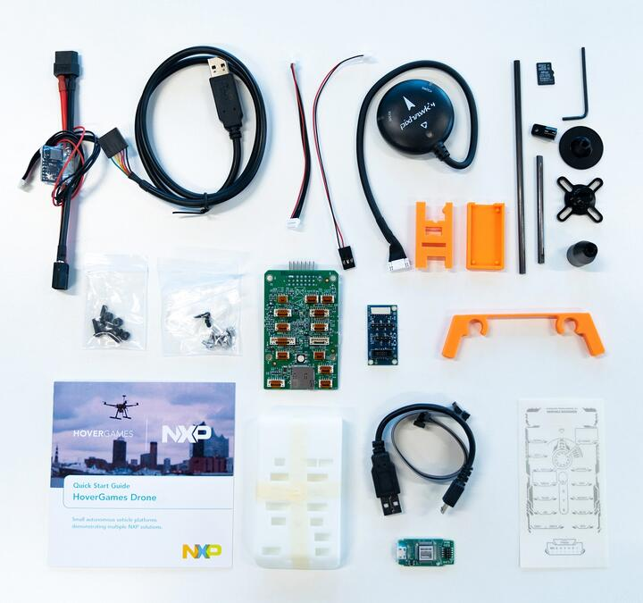

<!-- Copyright 2015-2026 Zephyr Project members and individual contributors. -->
<!-- SPDX-License-Identifier: Apache-2.0 -->
<!-- 中文翻译；编号、导航与译注为本地新增。 -->

<a id="rddrone_fmuk66"></a>

# 第10章\_RDDRONE-FMUK66

原文：[官方页面](https://docs.zephyrproject.org/latest/boards/nxp/rddrone_fmuk66/doc/index.html)。读取日期：2026-10-16；来源摘要见[来源记录](../SOURCES.md)。

开发板概览（Board Overview）

<a id="id1"></a>

[](images/rddrone_fmuk66.jpg)

RDDRONE-FMUK66

名称（Name）：

`rddrone_fmuk66`

厂商（Vendor）：

[恩智浦半导体（NXP Semiconductors）](https://docs.zephyrproject.org/latest/boards/index.html#vendor=nxp)

状态（Status）：

维护中（Maintained）

架构（Architecture）：

[arm](https://docs.zephyrproject.org/latest/boards/index.html#arch=arm)

片上系统（SoC）：

[mk66f18](https://docs.zephyrproject.org/latest/boards/index.html#soc=mk66f18)

<a id="board-github-link"></a>

[浏览开发板源码（Browse Board Sources）](https://github.com/zephyrproject-rtos/zephyr/blob/main//boards/nxp/rddrone_fmuk66/doc/index.rst/../..)<a id="overview"></a>

## 概述（Overview）

RDDRONE FMUK66是无人机控制板，配备常用外设连接器及Kinetis K66微控制器。


- 随附J-Link Edu Mini，用于编程及UART控制台。

<a id="hardware"></a>

## 硬件（Hardware）


- MK66FN2MOVLQ18 MCU：180 MHz、2 MB闪存、256 KB RAM、低功耗、无晶体USB及144引脚低外形四方扁平封装（LQFP）
- 双角色USB接口，使用Micro-B连接器
- RGB发光二极管（LED）
- FXOS8700CQ加速度计及磁力计
- FXAS21002CQ陀螺仪
- BMM150磁力计
- ML3114A2气压计
- BMP280气压计
- PWM舵机／电机控制连接器
- UART GPS／GLONASS连接器
- SD 主机控制器（SDHC）

K64F SoC及FRDM-K64F更多信息：


- [K66F网站](#k66f-website)
- [K66F数据手册（Datasheet）](#k66f-datasheet)
- [K66F参考手册（Reference Manual）](#k66f-reference-manual)
- [RDDRONE-FMUK66网站](#rddrone-fmuk66-website)
- [RDDRONE-FMUK66用户指南（User Guide）](#rddrone-fmuk66-user-guide)
- [RDDRONE-FMUK66原理图（Schematics）](#rddrone-fmuk66-schematics)

<a id="supported-features"></a>

### 支持的功能（Supported Features）

`rddrone_fmuk66`开发板支持下表所列的硬件功能。

片上／板载（On-Chip / On-Board）

功能集成在片上系统（SoC）内／位于开发板上。

2 / 2

分别表示已启用／已禁用的实例数。点击数量标签，可查看开发板或SoC设备树源码（DTS）中该功能的第一个实例。

`vnd,foo`

与此功能匹配的设备树绑定兼容字符串（Compatible String）；点击链接可查看绑定文档。

<a id="rddrone_fmuk66-hw-features"></a>

<a id="rddrone_fmuk66-rddrone_fmuk66/mk66f18-hw-features-section"></a>

#### `rddrone_fmuk66/mk66f18`目标（Target）

<a id="rddrone_fmuk66-rddrone_fmuk66/mk66f18-hw-features-panel"></a>

<a id="rddrone_fmuk66-rddrone_fmuk66/mk66f18-hw-features-memory"></a>

此开发板目标可用存储器：192 KiB RAM、2 MiB 闪存。

<a id="rddrone_fmuk66-rddrone_fmuk66/mk66f18-hw-features-table"></a>

<table>
<tr>
<th>类型（Type）</th>
<th>位置（Location）</th>
<th>说明（Description）</th>
<th>兼容字符串（Compatible）</th>
</tr>
<tr>
<td rowspan="1">中央处理器（CPU）</td>
<td>片上（On-Chip）</td>
<td>ARM Cortex-M4F 处理器（CPU）（<a href="https://github.com/zephyrproject-rtos/zephyr/blob/main/dts/arm/nxp/kinetis/k6x/nxp_k6x.dtsi?plain=1#L30">已启用：1</a>）</td>
<td><a href="../cpu_arm_riscv_binding_reference/P025_arm_cortex-m4f.md#std-dtcompatible-arm-cortex-m4f"><code>arm,cortex-m4f</code></a></td>
</tr>
<tr>
<td rowspan="1">模数转换器（ADC）</td>
<td>片上（On-Chip）</td>
<td>Kinetis 16位模数转换器（ADC16）（<a href="https://github.com/zephyrproject-rtos/zephyr/blob/main/dts/arm/nxp/kinetis/k6x/nxp_k6x.dtsi?plain=1#L436">已启用：2</a>）</td>
<td><a href="../hardware/P850_NXPKinetisADC16绑定.md#dtbinding-nxp-kinetis-adc16"><code>nxp,kinetis-adc16</code></a></td>
</tr>
<tr>
<td rowspan="1">控制器局域网（CAN）</td>
<td>片上（On-Chip）</td>
<td>NXP FlexCAN控制器（<a href="https://github.com/zephyrproject-rtos/zephyr/blob/main/dts/arm/nxp/kinetis/k6x/nxp_k6x.dtsi?plain=1#L528">已启用：2</a>）</td>
<td><a href="../can_adi_atmel_nxp_binding_reference/P017_nxp_flexcan.md#std-dtcompatible-nxp-flexcan"><code>nxp,flexcan</code></a></td>
</tr>
<tr>
<td rowspan="3">时钟控制（Clock Control）</td>
<td>片上（On-Chip）</td>
<td>NXP Kinetis多用途时钟发生器（MCG）IP节点（<a href="https://github.com/zephyrproject-rtos/zephyr/blob/main/dts/arm/nxp/kinetis/k6x/nxp_k6x.dtsi?plain=1#L93">已启用：1</a>）</td>
<td><a href="../clock_nxp_pico_realtek_renesas_binding_reference/P003_nxp_kinetis-mcg.md#std-dtcompatible-nxp-kinetis-mcg"><code>nxp,kinetis-mcg</code></a></td>
</tr>
<tr>
<td>片上（On-Chip）</td>
<td>Kinetis系统集成模块（SIM）IP节点（<a href="https://github.com/zephyrproject-rtos/zephyr/blob/main/dts/arm/nxp/kinetis/k6x/nxp_k6x.dtsi?plain=1#L120">已启用：1</a>）</td>
<td><a href="../clock_nxp_pico_realtek_renesas_binding_reference/P006_nxp_kinetis-sim.md#std-dtcompatible-nxp-kinetis-sim"><code>nxp,kinetis-sim</code></a></td>
</tr>
<tr>
<td>片上（On-Chip）</td>
<td>通用固定比例时钟提供器（Fixed Factor Clock Provider）（<a href="https://github.com/zephyrproject-rtos/zephyr/blob/main/dts/arm/nxp/kinetis/k6x/nxp_k6x.dtsi?plain=1#L125">已启用：4</a>）</td>
<td><a href="../timer_reference/P110_固定比例时钟绑定.md#dtbinding-fixed-factor-clock"><code>fixed-factor-clock</code></a></td>
</tr>
<tr>
<td rowspan="2">计数器（Counter）</td>
<td>片上（On-Chip）</td>
<td>NXP周期中断定时器（PIT / Periodic Interrupt Timer）（<a href="https://github.com/zephyrproject-rtos/zephyr/blob/main/dts/arm/nxp/kinetis/k6x/nxp_k6x.dtsi?plain=1#L562">已启用：1</a>）</td>
<td><a href="../nxp_nuvoton_counter_binding_reference/P017_nxp_pit.md#std-dtcompatible-nxp-pit"><code>nxp,pit</code></a></td>
</tr>
<tr>
<td>片上（On-Chip）</td>
<td>周期中断定时器节点的子节点，用于表示单个定时器通道（<a href="https://github.com/zephyrproject-rtos/zephyr/blob/main/dts/arm/nxp/kinetis/k6x/nxp_k6x.dtsi?plain=1#L571">已禁用：4</a>）</td>
<td><a href="../nxp_nuvoton_counter_binding_reference/P016_nxp_pit-channel.md#std-dtcompatible-nxp-pit-channel"><code>nxp,pit-channel</code></a></td>
</tr>
<tr>
<td rowspan="1">数模转换器（DAC）</td>
<td>片上（On-Chip）</td>
<td>NXP Kinetis MCUX数模转换器（DAC）（<a href="https://github.com/zephyrproject-rtos/zephyr/blob/main/dts/arm/nxp/kinetis/k6x/nxp_k6x.dtsi?plain=1#L462">已启用：1</a>；<a href="https://github.com/zephyrproject-rtos/zephyr/blob/main/dts/arm/nxp/kinetis/k6x/nxp_k6x.dtsi?plain=1#L471">已禁用：1</a>）</td>
<td><a href="../hardware/P768_NXPKinetis数模转换器绑定.md#dtbinding-nxp-kinetis-dac"><code>nxp,kinetis-dac</code></a></td>
</tr>
<tr>
<td rowspan="1">直接存储器访问（DMA）</td>
<td>片上（On-Chip）</td>
<td>NXP MCUX增强型DMA（EDMA）控制器（<a href="https://github.com/zephyrproject-rtos/zephyr/blob/main/dts/arm/nxp/kinetis/k6x/nxp_k6x.dtsi?plain=1#L542">已启用：1</a>）</td>
<td><a href="../nxp_realtek_renesas_dma_binding_reference/P004_nxp_mcux-edma.md#std-dtcompatible-nxp-mcux-edma"><code>nxp,mcux-edma</code></a></td>
</tr>
<tr>
<td rowspan="5">以太网（Ethernet）</td>
<td>片上（On-Chip）</td>
<td>NXP ENET以太网IP模块（<a href="https://github.com/zephyrproject-rtos/zephyr/blob/main/dts/arm/nxp/kinetis/k6x/nxp_k6x.dtsi?plain=1#L489">已启用：1</a>）</td>
<td><a href="../ethernet_nxp_phy_binding_reference/P004_nxp_enet.md#std-dtcompatible-nxp-enet"><code>nxp,enet</code></a></td>
</tr>
<tr>
<td>片上（On-Chip）</td>
<td>NXP ENET MAC／二层（L2）设备（<a href="https://github.com/zephyrproject-rtos/zephyr/blob/main/dts/arm/nxp/kinetis/k6x/nxp_k6x.dtsi?plain=1#L494">已启用：1</a>）</td>
<td><a href="../ethernet_nxp_phy_binding_reference/P001_nxp_enet-mac.md#std-dtcompatible-nxp-enet-mac"><code>nxp,enet-mac</code></a></td>
</tr>
<tr>
<td>片上（On-Chip）</td>
<td>NXP ENET管理数据输入输出（MDIO）功能（<a href="https://github.com/zephyrproject-rtos/zephyr/blob/main/dts/arm/nxp/kinetis/k6x/nxp_k6x.dtsi?plain=1#L504">已启用：1</a>）</td>
<td><a href="../ethernet_mdio_microchip_binding_reference/P002_nxp_enet-mdio.md#std-dtcompatible-nxp-enet-mdio"><code>nxp,enet-mdio</code></a></td>
</tr>
<tr>
<td>板载（On-Board）</td>
<td>通用媒体独立接口物理层（MII PHY）（<a href="https://github.com/zephyrproject-rtos/zephyr/blob/main/boards/nxp/rddrone_fmuk66/rddrone_fmuk66.dts?plain=1#L294">已启用：1</a>）</td>
<td><a href="../ethernet_nxp_phy_binding_reference/P019_ethernet-phy.md#std-dtcompatible-ethernet-phy"><code>ethernet-phy</code></a></td>
</tr>
<tr>
<td>片上（On-Chip）</td>
<td>NXP ENET精确时间协议（PTP / Precision Time Protocol）时钟（<a href="https://github.com/zephyrproject-rtos/zephyr/blob/main/dts/arm/nxp/kinetis/k6x/nxp_k6x.dtsi?plain=1#L511">已禁用：1</a>）</td>
<td><a href="../ethernet_nxp_phy_binding_reference/P002_nxp_enet-ptp-clock.md#std-dtcompatible-nxp-enet-ptp-clock"><code>nxp,enet-ptp-clock</code></a></td>
</tr>
<tr>
<td rowspan="1">闪存控制器（Flash Controller）</td>
<td>片上（On-Chip）</td>
<td>NXP Kinetis闪存模块E（FTFE）（<a href="https://github.com/zephyrproject-rtos/zephyr/blob/main/dts/arm/nxp/kinetis/k6x/nxp_k6x.dtsi?plain=1#L154">已启用：1</a>）</td>
<td><a href="../flash_nuvoton_nxp_renesas_binding_reference/P016_nxp_kinetis-ftfe.md#std-dtcompatible-nxp-kinetis-ftfe"><code>nxp,kinetis-ftfe</code></a></td>
</tr>
<tr>
<td rowspan="1">通用输入输出与接插件（GPIO &amp; Headers）</td>
<td>片上（On-Chip）</td>
<td>Kinetis通用输入输出（GPIO）（<a href="https://github.com/zephyrproject-rtos/zephyr/blob/main/dts/arm/nxp/kinetis/k6x/nxp_k6x.dtsi?plain=1#L299">已启用：5</a>）</td>
<td><a href="../gpio_nxp_expanders_binding_reference/P002_nxp_kinetis-gpio.md#std-dtcompatible-nxp-kinetis-gpio"><code>nxp,kinetis-gpio</code></a></td>
</tr>
<tr>
<td rowspan="1">硬件信息（Hardware Information）</td>
<td>片上（On-Chip）</td>
<td>NXP RCM获取复位原因标志（Reset Cause Flags）（<a href="https://github.com/zephyrproject-rtos/zephyr/blob/main/dts/arm/nxp/kinetis/k6x/nxp_k6x.dtsi?plain=1#L115">已启用：1</a>）</td>
<td><a href="../hwinfo_binding_reference/P012_nxp_rcm-hwinfo.md#std-dtcompatible-nxp-rcm-hwinfo"><code>nxp,rcm-hwinfo</code></a></td>
</tr>
<tr>
<td rowspan="1">集成电路间总线（I2C）</td>
<td>片上（On-Chip）</td>
<td>Kinetis I2C控制器（<a href="https://github.com/zephyrproject-rtos/zephyr/blob/main/dts/arm/nxp/kinetis/k6x/nxp_k6x.dtsi?plain=1#L176">已启用：2</a>；<a href="https://github.com/zephyrproject-rtos/zephyr/blob/main/dts/arm/nxp/kinetis/k6x/nxp_k6x.dtsi?plain=1#L198">已禁用：1</a>）</td>
<td><a href="../i2c_nxp_pico_renesas_binding_reference/P002_nxp_kinetis-i2c.md#std-dtcompatible-nxp-kinetis-i2c"><code>nxp,kinetis-i2c</code></a></td>
</tr>
<tr>
<td rowspan="1">中断控制器（Interrupt Controller）</td>
<td>片上（On-Chip）</td>
<td>ARMv7-M 嵌套向量中断控制器（Nested Vectored Interrupt Controller，NVIC）（<a href="https://github.com/zephyrproject-rtos/zephyr/blob/main/dts/arm/armv7-m.dtsi?plain=1#L13">已启用：1</a>）</td>
<td><a href="../arm_interrupt_timer_binding_reference/P002_ARMv7_M_NVIC.md#std-dtcompatible-arm-v7m-nvic"><code>arm,v7m-nvic</code></a></td>
</tr>
<tr>
<td rowspan="2">发光二极管（LED）</td>
<td>板载（On-Board）</td>
<td>一组由 GPIO 控制的 LED（GPIO-Controlled LEDs）（<a href="https://github.com/zephyrproject-rtos/zephyr/blob/main/boards/nxp/rddrone_fmuk66/rddrone_fmuk66.dts?plain=1#L48">已启用：1</a>）</td>
<td><a href="../hardware/P564_GPIO指示灯绑定.md#dtbinding-gpio-leds"><code>gpio-leds</code></a></td>
</tr>
<tr>
<td>板载（On-Board）</td>
<td>一组由脉宽调制（PWM）控制的LED（<a href="https://github.com/zephyrproject-rtos/zephyr/blob/main/boards/nxp/rddrone_fmuk66/rddrone_fmuk66.dts?plain=1#L62">已启用：1</a>）</td>
<td><a href="../hardware/P565_PWM指示灯绑定.md#dtbinding-pwm-leds"><code>pwm-leds</code></a></td>
</tr>
<tr>
<td rowspan="1">存储技术设备（MTD）</td>
<td>片上（On-Chip）</td>
<td>闪存（Flash）节点（<a href="https://github.com/zephyrproject-rtos/zephyr/blob/main/dts/arm/nxp/kinetis/k6x/nxp_k6x.dtsi?plain=1#L165">已启用：1</a>）</td>
<td><a href="../mtd_nxp_st_ti_partition_binding_reference/P013_soc-nv-flash.md#std-dtcompatible-soc-nv-flash"><code>soc-nv-flash</code></a></td>
</tr>
<tr>
<td rowspan="1">物理层（PHY）</td>
<td>板载（On-Board）</td>
<td>由简单GPIO控制的CAN收发器（Transceiver）（<a href="https://github.com/zephyrproject-rtos/zephyr/blob/main/boards/nxp/rddrone_fmuk66/rddrone_fmuk66.dts?plain=1#L78">已启用：2</a>）</td>
<td><a href="../phy_binding_reference/P001_can-transceiver-gpio.md#std-dtcompatible-can-transceiver-gpio"><code>can-transceiver-gpio</code></a></td>
</tr>
<tr>
<td rowspan="2">引脚控制（Pin Control）</td>
<td>片上（On-Chip）</td>
<td>NXP PORT引脚控制器（Pin Controller）（<a href="https://github.com/zephyrproject-rtos/zephyr/blob/main/dts/arm/nxp/kinetis/k6x/nxp_k6x.dtsi?plain=1#L269">已启用：5</a>）</td>
<td><a href="../pinctrl_nxp_pico_binding_reference/P017_nxp_port-pinmux.md#std-dtcompatible-nxp-port-pinmux"><code>nxp,port-pinmux</code></a></td>
</tr>
<tr>
<td>片上（On-Chip）</td>
<td>NXP PORT引脚控制器（Pin Controller）（<a href="https://github.com/zephyrproject-rtos/zephyr/blob/main/dts/arm/nxp/kinetis/k6x/nxp_k6x.dtsi?plain=1#L80">已启用：1</a>）</td>
<td><a href="../pinctrl_nxp_pico_binding_reference/P016_nxp_port-pinctrl.md#std-dtcompatible-nxp-port-pinctrl"><code>nxp,port-pinctrl</code></a></td>
</tr>
<tr>
<td rowspan="1">脉宽调制（PWM）</td>
<td>片上（On-Chip）</td>
<td>NXP FlexTimer模块（FTM）PWM控制器（<a href="https://github.com/zephyrproject-rtos/zephyr/blob/main/dts/arm/nxp/kinetis/k6x/nxp_k6x.dtsi?plain=1#L400">已启用：2</a>）</td>
<td><a href="../pwm_nxp_renesas_binding_reference/P004_nxp_ftm-pwm.md#std-dtcompatible-nxp-ftm-pwm"><code>nxp,ftm-pwm</code></a></td>
</tr>
<tr>
<td rowspan="1">稳压器（Regulator）</td>
<td>板载（On-Board）</td>
<td>固定电压稳压器（Fixed Voltage Regulators）（<a href="https://github.com/zephyrproject-rtos/zephyr/blob/main/boards/nxp/rddrone_fmuk66/rddrone_fmuk66.dts?plain=1#L93">已启用：3</a>）</td>
<td><a href="../hardware/P635_固定稳压器设备树绑定.md#dtbinding-regulator-fixed"><code>regulator-fixed</code></a></td>
</tr>
<tr>
<td rowspan="1">随机数生成器（RNG）</td>
<td>片上（On-Chip）</td>
<td>Kinetis随机数发生器加速器（RNGA / Random Number Generator Accelerator）（<a href="https://github.com/zephyrproject-rtos/zephyr/blob/main/dts/arm/nxp/kinetis/k6x/nxp_k6x.dtsi?plain=1#L521">已启用：1</a>）</td>
<td><a href="../rng_binding_reference/P019_nxp_kinetis-rnga.md#std-dtcompatible-nxp-kinetis-rnga"><code>nxp,kinetis-rnga</code></a></td>
</tr>
<tr>
<td rowspan="1">实时时钟（RTC）</td>
<td>片上（On-Chip）</td>
<td>NXP实时时钟（RTC / Real Time Clock）（<a href="https://github.com/zephyrproject-rtos/zephyr/blob/main/dts/arm/nxp/kinetis/k6x/nxp_k6x.dtsi?plain=1#L106">已启用：1</a>）</td>
<td><a href="../soc_rtc_binding_reference/P002_nxp_rtc.md#std-dtcompatible-nxp-rtc"><code>nxp,rtc</code></a></td>
</tr>
<tr>
<td rowspan="5">传感器（Sensors）</td>
<td>板载（On-Board）</td>
<td>BME280集成环境传感器（Environmental Sensor）（<a href="https://github.com/zephyrproject-rtos/zephyr/blob/main/boards/nxp/rddrone_fmuk66/rddrone_fmuk66.dts?plain=1#L335">已启用：1</a>）</td>
<td><a href="../compatible_binding_reference/P011_bosch_bme280.md#std-dtcompatible-bosch-bme280"><code>bosch,bme280</code></a></td>
</tr>
<tr>
<td>板载（On-Board）</td>
<td>Bosch BMM150地磁传感器（Geomagnetic Sensor）（<a href="https://github.com/zephyrproject-rtos/zephyr/blob/main/boards/nxp/rddrone_fmuk66/rddrone_fmuk66.dts?plain=1#L341">已启用：1</a>）</td>
<td><a href="../compatible_binding_reference/P018_bosch_bmm150.md#std-dtcompatible-bosch-bmm150"><code>bosch,bmm150</code></a></td>
</tr>
<tr>
<td>板载（On-Board）</td>
<td>FXOS8700六轴加速度计／磁力计传感器（<a href="https://github.com/zephyrproject-rtos/zephyr/blob/main/boards/nxp/rddrone_fmuk66/rddrone_fmuk66.dts?plain=1#L369">已启用：1</a>）</td>
<td><a href="../compatible_binding_reference/P052_nxp_fxos8700.md#std-dtcompatible-nxp-fxos8700"><code>nxp,fxos8700</code></a></td>
</tr>
<tr>
<td>板载（On-Board）</td>
<td>FXAS21002三轴陀螺仪传感器（<a href="https://github.com/zephyrproject-rtos/zephyr/blob/main/boards/nxp/rddrone_fmuk66/rddrone_fmuk66.dts?plain=1#L379">已启用：1</a>）</td>
<td><a href="../compatible_binding_reference/P050_nxp_fxas21002.md#std-dtcompatible-nxp-fxas21002"><code>nxp,fxas21002</code></a></td>
</tr>
<tr>
<td>片上（On-Chip）</td>
<td>NXP Kinetis温度传感器（<a href="https://github.com/zephyrproject-rtos/zephyr/blob/main/dts/arm/nxp/kinetis/k6x/nxp_k6x.dtsi?plain=1#L68">已启用：1</a>；<a href="https://github.com/zephyrproject-rtos/zephyr/blob/main/dts/arm/nxp/kinetis/k6x/nxp_k6x.dtsi?plain=1#L57">已禁用：1</a>）</td>
<td><a href="../sensor_nxp_qdec_optical_binding_reference/P004_nxp_kinetis-temperature.md#std-dtcompatible-nxp-kinetis-temperature"><code>nxp,kinetis-temperature</code></a></td>
</tr>
<tr>
<td rowspan="2">串行控制器（Serial Controller）</td>
<td>片上（On-Chip）</td>
<td>Kinetis通用异步收发器（UART）（<a href="https://github.com/zephyrproject-rtos/zephyr/blob/main/dts/arm/nxp/kinetis/k6x/nxp_k6x.dtsi?plain=1#L209">已启用：4</a>；<a href="https://github.com/zephyrproject-rtos/zephyr/blob/main/dts/arm/nxp/kinetis/k6x/nxp_k6x.dtsi?plain=1#L239">已禁用：2</a>）</td>
<td><a href="../uart_microchip_nordic_nxp_binding_reference/P013_nxp_kinetis-uart.md#std-dtcompatible-nxp-kinetis-uart"><code>nxp,kinetis-uart</code></a></td>
</tr>
<tr>
<td>片上（On-Chip）</td>
<td>NXP低功耗UART（LPUART）（<a href="https://github.com/zephyrproject-rtos/zephyr/blob/main/dts/arm/nxp/kinetis/k6x/nxp_k66.dtsi?plain=1#L17">已启用：1</a>）</td>
<td><a href="../uart_microchip_nordic_nxp_binding_reference/P017_nxp_lpuart.md#std-dtcompatible-nxp-lpuart"><code>nxp,lpuart</code></a></td>
</tr>
<tr>
<td rowspan="1">串行外设接口（SPI）</td>
<td>片上（On-Chip）</td>
<td>NXP DSPI控制器（<a href="https://github.com/zephyrproject-rtos/zephyr/blob/main/dts/arm/nxp/kinetis/k6x/nxp_k6x.dtsi?plain=1#L349">已启用：3</a>）</td>
<td><a href="../spi_microchip_nordic_nxp_binding_reference/P018_nxp_dspi.md#std-dtcompatible-nxp-dspi"><code>nxp,dspi</code></a></td>
</tr>
<tr>
<td rowspan="1">静态随机存储器（SRAM）</td>
<td>片上（On-Chip）</td>
<td>通用片上静态随机存储器（SRAM）（<a href="https://github.com/zephyrproject-rtos/zephyr/blob/main/dts/arm/nxp/kinetis/k6x/nxp_k6x.dtsi?plain=1#L52">已启用：1</a>）</td>
<td><a href="../hardware/P567_内存映射SRAM绑定.md#dtbinding-mmio-sram"><code>mmio-sram</code></a></td>
</tr>
<tr>
<td rowspan="2">定时器（Timer）</td>
<td>片上（On-Chip）</td>
<td>ARMv7-M 系统节拍（System Tick）（<a href="https://github.com/zephyrproject-rtos/zephyr/blob/main/dts/arm/armv7-m.dtsi?plain=1#L21">已启用：1</a>）</td>
<td><a href="../arm_interrupt_timer_binding_reference/P006_ARMv7_M_SysTick.md#std-dtcompatible-arm-armv7m-systick"><code>arm,armv7m-systick</code></a></td>
</tr>
<tr>
<td>片上（On-Chip）</td>
<td>NXP FlexTimer模块（FTM）（<a href="https://github.com/zephyrproject-rtos/zephyr/blob/main/dts/arm/nxp/kinetis/k6x/nxp_k6x.dtsi?plain=1#L409">已禁用：2</a>）</td>
<td><a href="../microchip_nordic_nxp_realtek_timer_binding_reference/P006_nxp_ftm.md#std-dtcompatible-nxp-ftm"><code>nxp,ftm</code></a></td>
</tr>
<tr>
<td rowspan="1">通用串行总线（USB）</td>
<td>片上（On-Chip）</td>
<td>设备模式下的NPX Kinetis USBFSOTG控制器，厂商缩写NPX按原文保留（<a href="https://github.com/zephyrproject-rtos/zephyr/blob/main/dts/arm/nxp/kinetis/k6x/nxp_k6x.dtsi?plain=1#L480">已启用：1</a>）</td>
<td><a href="../usb_soc_binding_reference/P007_nxp_kinetis-usbd.md#std-dtcompatible-nxp-kinetis-usbd"><code>nxp,kinetis-usbd</code></a></td>
</tr>
<tr>
<td rowspan="1">看门狗（Watchdog）</td>
<td>片上（On-Chip）</td>
<td>Kinetis看门狗（Watchdog）（<a href="https://github.com/zephyrproject-rtos/zephyr/blob/main/dts/arm/nxp/kinetis/k6x/nxp_k6x.dtsi?plain=1#L393">已启用：1</a>）</td>
<td><a href="../nxp_nordic_nuvoton_watchdog_binding_reference/P010_nxp_kinetis-wdog.md#std-dtcompatible-nxp-kinetis-wdog"><code>nxp,kinetis-wdog</code></a></td>
</tr>
</table>

<a id="system-clock"></a>

### 系统时钟（System Clock）

K66F SoC使用板载16 MHz外部振荡器及片上锁相环（PLL），生成160 MHz系统时钟。

<a id="serial-port"></a>

### 串口（Serial Port）

K66F SoC有6路UART：LPUART0用作控制台，UART0标为Serial 2，UART2标为GPS，UART4标为Serial 1。通过开发板设备树覆盖文件，可将任一路UART选作控制台。

<a id="usb"></a>

### 通用串行总线（USB）

K66F的USB OTG控制器通过Micro-USB连接器K66F USB支持设备及主机功能；目前Zephyr只支持USB设备功能。

<a id="programming-and-debugging"></a>

## 烧录与调试（Programming and Debugging）

`rddrone_fmuk66`开发板支持下表所列的运行工具（Runners）及相关west命令。

<table>
<tr>
<th></th>
<th>烧录（flash）</th>
<th>调试（debug）</th>
<th>连接调试会话（attach）</th>
<th>实时传输（rtt）</th>
<th>复位（reset）</th>
<th>调试服务器（debugserver）</th>
</tr>
<tr>
<td><a href="https://docs.zephyrproject.org/latest/develop/flash_debug/host-tools.html#runner-jlink">jlink</a></td>
<td>✅（默认 / default）</td>
<td>✅（默认 / default）</td>
<td>✅</td>
<td>✅</td>
<td>✅</td>
<td>✅</td>
</tr>
</table>

按通常方式构建并烧录应用，详见“构建应用”（[Building an Application](../application/P001_应用开发.md#build-an-application)）与“运行应用”（[Run an Application](https://docs.zephyrproject.org/latest/develop/application/index.html#application-run)）。

<a id="configuring-a-debug-probe"></a>

### 配置调试探针（Configuring a Debug Probe）

烧录与调试都使用调试探针，默认运行工具为jlink。带配件的套装提供J-Link Mini Edu、专用线缆及直接连接该探针的USB转UART适配器，这是默认的编程和控制台连接方式。

```text
# From the root of the zephyr repository
west build -b rddrone-fmuk66 samples/hello_world
```

<a id="configuring-a-console"></a>

### 配置控制台（Configuring a Console）

在串口终端中使用以下设置，例如minicom或PuTTY：


- 速率（Speed）：115200波特率
- 数据位（Data）：8位
- 奇偶校验（Parity）：无（None）
- 停止位（Stop Bits）：1位

<a id="flashing"></a>

### 烧录（Flashing）

下面以[Hello World](../getting_started/P005_HelloWorld示例.md#hello_world)应用为例。

```text
# From the root of the zephyr repository
west build -b rddrone-fmuk66 samples/hello_world
west flash
```

打开串口终端，按SW1复位开发板，应显示以下消息：

```text
***** Booting Zephyr OS v2.7.0 *****
Hello World! rddrone-fmuk66
```

<a id="debugging"></a>

### 调试（Debugging）

下面以[Hello World](../getting_started/P005_HelloWorld示例.md#hello_world)应用为例。

```text
# From the root of the zephyr repository
west build -b rddrone-fmuk66 samples/hello_world
west debug
```

打开串口终端，在调试器中单步运行应用，应能在终端中看到以下消息：

```text
***** Booting Zephyr OS v2.7.0 *****
Hello World! rddrone-fmuk66
```

<a id="support-resources-for-zephyr"></a>

### Zephyr支持资源（Support Resources）


- [NXP开发板支持状态（Board Support Status）](https://github.com/nxp-zephyr/nxp-zsdk/blob/main/doc/releases/Board-Support-Status.md)
- [NXP Zephyr下游软件开发工具包（Downstream SDK）](https://github.com/nxp-zephyr/nxp-zsdk)
- [MCUXpresso for VS Code文档](https://mcuxpresso.nxp.com/mcux-vscode)及[Zephyr实验指南](https://mcuxpresso.nxp.com/mcux-vscode/latest/html/Training-Zephyr-Getting-Started.html)
- [NXP Zephyr知识中心（Knowledge Hub）](https://community.nxp.com/t5/Zephyr-Project-Knowledge-Base/Zephyr-Knowledge-Hub/ta-p/2008548)
- NXP Zephyr主页，包含培训资源（[NXP的Zephyr专题页面](https://nxp.com/zephyr)）
- [NXP Zephyr支持社区论坛（Support Community）](https://community.nxp.com/t5/Zephyr-Project/bd-p/Zephyr-Project)

<a id="rddrone-fmuk66-website"></a>

[https://www.nxp.com/design/designs/px4-robotic-drone-vehicle-flight-management-unit-vmu-fmu-rddrone-fmuk66:RDDRONE-FMUK66](https://www.nxp.com/design/designs/px4-robotic-drone-vehicle-flight-management-unit-vmu-fmu-rddrone-fmuk66:RDDRONE-FMUK66)

<a id="rddrone-fmuk66-user-guide"></a>

[https://nxp.gitbook.io/hovergames/userguide/getting-started](https://nxp.gitbook.io/hovergames/userguide/getting-started)

<a id="rddrone-fmuk66-schematics"></a>

[https://www.nxp.com/webapp/Download?colCode=SPF-39053](https://www.nxp.com/webapp/Download?colCode=SPF-39053)

<a id="k66f-website"></a>

[https://www.nxp.com/products/processors-and-microcontrollers/arm-microcontrollers/general-purpose-mcus/k-series-cortex-m4/k6x-ethernet/kinetis-k66-180-mhz-dual-high-speed-full-speed-usbs-2mb-flash-microcontrollers-mcus-based-on-arm-cortex-m4-core:K66_180](https://www.nxp.com/products/processors-and-microcontrollers/arm-microcontrollers/general-purpose-mcus/k-series-cortex-m4/k6x-ethernet/kinetis-k66-180-mhz-dual-high-speed-full-speed-usbs-2mb-flash-microcontrollers-mcus-based-on-arm-cortex-m4-core:K66_180)

<a id="k66f-datasheet"></a>

[https://www.nxp.com/docs/en/data-sheet/K66P144M180SF5V2.pdf](https://www.nxp.com/docs/en/data-sheet/K66P144M180SF5V2.pdf)

<a id="k66f-reference-manual"></a>

[https://www.nxp.com/webapp/Download?colCode=K66P144M180SF5RMV2](https://www.nxp.com/webapp/Download?colCode=K66P144M180SF5RMV2)

## 译注

FMUK66硬件最高180 MHz与当前配置160 MHz分别保留；UART别名、USB仅设备支持及随附J-Link Mini Edu连接方式按原文说明。

## 原文外链核对

2026-10-16核对并重试以下原文外链时未能确认可访问性，保留原始目标，不将访问失败解释为原文内容有误。

- [2008548](https://community.nxp.com/t5/Zephyr-Project-Knowledge-Base/Zephyr-Knowledge-Hub/ta-p/2008548)：HTTP Error 403: Forbidden。
- [Zephyr-Project](https://community.nxp.com/t5/Zephyr-Project/bd-p/Zephyr-Project)：HTTP Error 403: Forbidden。
- [Training-Zephyr-Getting-Started.html](https://mcuxpresso.nxp.com/mcux-vscode/latest/html/Training-Zephyr-Getting-Started.html)：HTTP Error 404: Not Found。
- [zephyr](https://nxp.com/zephyr)：HTTP Error 404: Not Found。
- [px4-robotic-drone-vehicle-flight-management-unit-vmu-fmu-rddrone-fmuk66:RDDRONE-FMUK66](https://www.nxp.com/design/designs/px4-robotic-drone-vehicle-flight-management-unit-vmu-fmu-rddrone-fmuk66:RDDRONE-FMUK66)：HTTP Error 404: Not Found。
- [K66P144M180SF5V2.pdf](https://www.nxp.com/docs/en/data-sheet/K66P144M180SF5V2.pdf)：HTTP Error 404: Not Found。
- [kinetis-k66-180-mhz-dual-high-speed-full-speed-usbs-2mb-flash-microcontrollers-mcus-based-on-arm-cortex-m4-core:K66_180](https://www.nxp.com/products/processors-and-microcontrollers/arm-microcontrollers/general-purpose-mcus/k-series-cortex-m4/k6x-ethernet/kinetis-k66-180-mhz-dual-high-speed-full-speed-usbs-2mb-flash-microcontrollers-mcus-based-on-arm-cortex-m4-core:K66_180)：HTTP Error 404: Not Found。
- [Download?colCode=K66P144M180SF5RMV2](https://www.nxp.com/webapp/Download?colCode=K66P144M180SF5RMV2)：HTTP Error 404: Not Found。
- [Download?colCode=SPF-39053](https://www.nxp.com/webapp/Download?colCode=SPF-39053)：HTTP Error 404: Not Found。

---

[上一章](P009_RD-RW612-BGA.md) · [返回大纲](大纲.md) · [全站翻译进度](../PROGRESS.md) · [下一章](P011_S32K148EVB-Q176.md)
