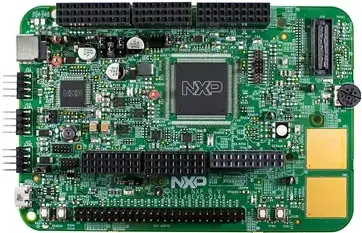

<!-- Copyright 2015-2026 Zephyr Project members and individual contributors. -->
<!-- SPDX-License-Identifier: Apache-2.0 -->
<!-- 中文翻译；编号、导航与译注为本地新增。 -->

# 第11章\_S32K148EVB-Q176

原文：[官方页面](https://docs.zephyrproject.org/latest/boards/nxp/s32k148_evb/doc/index.html)。读取日期：2026-10-16；来源摘要见[来源记录](../SOURCES.md)。

开发板概览（Board Overview）

S32K148EVB-Q176

名称（Name）：

`s32k148_evb`

厂商（Vendor）：

[恩智浦半导体（NXP Semiconductors）](https://docs.zephyrproject.org/latest/boards/index.html#vendor=nxp)

状态（Status）：

维护中（Maintained）

架构（Architecture）：

[arm](https://docs.zephyrproject.org/latest/boards/index.html#arch=arm)

片上系统（SoC）：

[s32k148](https://docs.zephyrproject.org/latest/boards/index.html#soc=s32k148)

[浏览开发板源码（Browse Board Sources）](https://github.com/zephyrproject-rtos/zephyr/blob/main//boards/nxp/s32k148_evb/doc/index.rst/../..)

## 概述（Overview）

[NXP S32K148-Q176](https://www.nxp.com/design/design-center/development-boards-and-designs/automotive-development-platforms/s32k-mcu-platforms/s32k148-q176-evaluation-board-for-automotive-general-purpose:S32K148EVB) [注8](#id18)是面向通用工业及汽车应用的低成本评估开发板，基于32位Arm Cortex-M4F [NXP S32K148](https://www.nxp.com/products/processors-and-microcontrollers/s32-automotive-platform/s32k-auto-general-purpose-mcus/s32k1-microcontrollers-for-automotive-general-purpose:S32K1) [注9](#id21)微控制器。板载OpenSDA串口及调试适配器运行大容量存储设备（MSD）引导程序及一组OpenSDA应用，在USB主机与嵌入式目标处理器之间桥接，提供串行通信、闪存编程及运行控制调试功能。

## 硬件（Hardware）

- NXP S32K148

  - Arm Cortex-M4F，最高112 MHz
  - 1.5 MB闪存
  - 256 KB 静态随机存储器（SRAM）。
  - 最多127个I/O
  - 3路支持FD的FlexCAN
  - 增强型DMA（eDMA）、12位ADC、内存保护单元（MPU）、ECC等
- 接口（Interfaces）

  - CAN、LIN、UART／SCI
  - 可兼容不同以太网子卡的以太网连接器
  - 两个触摸板、电位器、用户RGB LED及两个按键

硬件及设计资源的更多信息见[NXP S32K148-Q176](https://www.nxp.com/design/design-center/development-boards-and-designs/automotive-development-platforms/s32k-mcu-platforms/s32k148-q176-evaluation-board-for-automotive-general-purpose:S32K148EVB) [注8](#id18)网站。

### 支持的功能（Supported Features）

`s32k148_evb`开发板支持下表所列的硬件功能。

片上／板载（On-Chip / On-Board）

功能集成在片上系统（SoC）内／位于开发板上。

2 / 2

分别表示已启用／已禁用的实例数。点击数量标签，可查看开发板或SoC设备树源码（DTS）中该功能的第一个实例。

`vnd,foo`

与此功能匹配的设备树绑定兼容字符串（Compatible String）；点击链接可查看绑定文档。

#### `s32k148_evb/s32k148`目标（Target）

该开发板目标的片上存储容量：128 KiB RAM、1536 KiB Flash。

<table>
<tr>
<th>类型（Type）</th>
<th>位置（Location）</th>
<th>说明（Description）</th>
<th>兼容字符串（Compatible）</th>
</tr>
<tr>
<td rowspan="1">中央处理器（CPU）</td>
<td>片上（On-Chip）</td>
<td>ARM Cortex-M4F 处理器（CPU）（<a href="https://github.com/zephyrproject-rtos/zephyr/blob/main/dts/arm/nxp/s32/nxp_s32k1xx.dtsi?plain=1#L21">已启用：1</a>）</td>
<td><a href="../cpu_arm_riscv_binding_reference/P025_arm_cortex-m4f.md#std-dtcompatible-arm-cortex-m4f"><code>arm,cortex-m4f</code></a></td>
</tr>
<tr>
<td rowspan="1">模数转换器（ADC）</td>
<td>片上（On-Chip）</td>
<td>NXP 12位模数转换器（ADC12）（<a href="https://github.com/zephyrproject-rtos/zephyr/blob/main/dts/arm/nxp/s32/nxp_s32k1xx.dtsi?plain=1#L337">已启用：2</a>）</td>
<td><a href="../hardware/P847_NXPADC12模数转换器绑定.md#dtbinding-nxp-adc12"><code>nxp,adc12</code></a></td>
</tr>
<tr>
<td rowspan="1">控制器局域网（CAN）</td>
<td>片上（On-Chip）</td>
<td>NXP FlexCAN CAN FD控制器（<a href="https://github.com/zephyrproject-rtos/zephyr/blob/main/dts/arm/nxp/s32/nxp_s32k1xx.dtsi?plain=1#L52">已启用：1</a>；<a href="https://github.com/zephyrproject-rtos/zephyr/blob/main/dts/arm/nxp/s32/nxp_s32k1xx.dtsi?plain=1#L61">已禁用：2</a>）</td>
<td><a href="../can_adi_atmel_nxp_binding_reference/P016_nxp_flexcan-fd.md#std-dtcompatible-nxp-flexcan-fd"><code>nxp,flexcan-fd</code></a></td>
</tr>
<tr>
<td rowspan="1">时钟控制（Clock Control）</td>
<td>片上（On-Chip）</td>
<td>NXP S32时钟发生器IP节点（<a href="https://github.com/zephyrproject-rtos/zephyr/blob/main/dts/arm/nxp/s32/nxp_s32k1xx.dtsi?plain=1#L147">已启用：1</a>）</td>
<td><a href="../clock_nxp_pico_realtek_renesas_binding_reference/P014_nxp_s32-clock.md#std-dtcompatible-nxp-s32-clock"><code>nxp,s32-clock</code></a></td>
</tr>
<tr>
<td rowspan="4">以太网（Ethernet）</td>
<td>片上（On-Chip）</td>
<td>NXP ENET以太网IP模块（<a href="https://github.com/zephyrproject-rtos/zephyr/blob/main/dts/arm/nxp/s32/nxp_s32k148.dtsi?plain=1#L34">已禁用：1</a>）</td>
<td><a href="../ethernet_nxp_phy_binding_reference/P004_nxp_enet.md#std-dtcompatible-nxp-enet"><code>nxp,enet</code></a></td>
</tr>
<tr>
<td>片上（On-Chip）</td>
<td>NXP ENET MAC／二层（L2）设备（<a href="https://github.com/zephyrproject-rtos/zephyr/blob/main/dts/arm/nxp/s32/nxp_s32k148.dtsi?plain=1#L40">已禁用：1</a>）</td>
<td><a href="../ethernet_nxp_phy_binding_reference/P001_nxp_enet-mac.md#std-dtcompatible-nxp-enet-mac"><code>nxp,enet-mac</code></a></td>
</tr>
<tr>
<td>片上（On-Chip）</td>
<td>NXP ENET管理数据输入输出（MDIO）功能（<a href="https://github.com/zephyrproject-rtos/zephyr/blob/main/dts/arm/nxp/s32/nxp_s32k148.dtsi?plain=1#L50">已禁用：1</a>）</td>
<td><a href="../ethernet_mdio_microchip_binding_reference/P002_nxp_enet-mdio.md#std-dtcompatible-nxp-enet-mdio"><code>nxp,enet-mdio</code></a></td>
</tr>
<tr>
<td>片上（On-Chip）</td>
<td>NXP ENET精确时间协议（PTP / Precision Time Protocol）时钟（<a href="https://github.com/zephyrproject-rtos/zephyr/blob/main/dts/arm/nxp/s32/nxp_s32k148.dtsi?plain=1#L57">已禁用：1</a>）</td>
<td><a href="../ethernet_nxp_phy_binding_reference/P002_nxp_enet-ptp-clock.md#std-dtcompatible-nxp-enet-ptp-clock"><code>nxp,enet-ptp-clock</code></a></td>
</tr>
<tr>
<td rowspan="1">闪存控制器（Flash Controller）</td>
<td>片上（On-Chip）</td>
<td>NXP Kinetis闪存模块C（FTFC）（<a href="https://github.com/zephyrproject-rtos/zephyr/blob/main/dts/arm/nxp/s32/nxp_s32k1xx.dtsi?plain=1#L42">已禁用：1</a>）</td>
<td><a href="../flash_nuvoton_nxp_renesas_binding_reference/P015_nxp_kinetis-ftfc.md#std-dtcompatible-nxp-kinetis-ftfc"><code>nxp,kinetis-ftfc</code></a></td>
</tr>
<tr>
<td rowspan="1">通用输入输出与接插件（GPIO &amp; Headers）</td>
<td>片上（On-Chip）</td>
<td>Kinetis通用输入输出（GPIO）（<a href="https://github.com/zephyrproject-rtos/zephyr/blob/main/dts/arm/nxp/s32/nxp_s32k1xx.dtsi?plain=1#L198">已启用：5</a>）</td>
<td><a href="../gpio_nxp_expanders_binding_reference/P002_nxp_kinetis-gpio.md#std-dtcompatible-nxp-kinetis-gpio"><code>nxp,kinetis-gpio</code></a></td>
</tr>
<tr>
<td rowspan="1">集成电路间总线（I2C）</td>
<td>片上（On-Chip）</td>
<td>NXP低功耗I2C（LPI2C）控制器（<a href="https://github.com/zephyrproject-rtos/zephyr/blob/main/dts/arm/nxp/s32/nxp_s32k1xx.dtsi?plain=1#L154">已启用：1</a>；<a href="https://github.com/zephyrproject-rtos/zephyr/blob/main/dts/arm/nxp/s32/nxp_s32k1xx.dtsi?plain=1#L165">已禁用：1</a>）</td>
<td><a href="../i2c_nxp_pico_renesas_binding_reference/P005_nxp_lpi2c.md#std-dtcompatible-nxp-lpi2c"><code>nxp,lpi2c</code></a></td>
</tr>
<tr>
<td rowspan="1">输入（Input）</td>
<td>板载（On-Board）</td>
<td>一组绑定到 GPIO 的输入按键（GPIO-Bound Input Keys）（<a href="https://github.com/zephyrproject-rtos/zephyr/blob/main/boards/nxp/s32k148_evb/s32k148_evb.dts?plain=1#L80">已启用：1</a>）</td>
<td><a href="../hardware/P563_GPIO按键绑定.md#std-dtcompatible-gpio-keys"><code>gpio-keys</code></a></td>
</tr>
<tr>
<td rowspan="1">中断控制器（Interrupt Controller）</td>
<td>片上（On-Chip）</td>
<td>ARMv7-M 嵌套向量中断控制器（Nested Vectored Interrupt Controller，NVIC）（<a href="https://github.com/zephyrproject-rtos/zephyr/blob/main/dts/arm/armv7-m.dtsi?plain=1#L13">已启用：1</a>）</td>
<td><a href="../arm_interrupt_timer_binding_reference/P002_ARMv7_M_NVIC.md#std-dtcompatible-arm-v7m-nvic"><code>arm,v7m-nvic</code></a></td>
</tr>
<tr>
<td rowspan="2">发光二极管（LED）</td>
<td>板载（On-Board）</td>
<td>一组由 GPIO 控制的 LED（GPIO-Controlled LEDs）（<a href="https://github.com/zephyrproject-rtos/zephyr/blob/main/boards/nxp/s32k148_evb/s32k148_evb.dts?plain=1#L42">已启用：1</a>）</td>
<td><a href="../hardware/P564_GPIO指示灯绑定.md#dtbinding-gpio-leds"><code>gpio-leds</code></a></td>
</tr>
<tr>
<td>板载（On-Board）</td>
<td>一组由脉宽调制（PWM）控制的LED（<a href="https://github.com/zephyrproject-rtos/zephyr/blob/main/boards/nxp/s32k148_evb/s32k148_evb.dts?plain=1#L61">已启用：1</a>）</td>
<td><a href="../hardware/P565_PWM指示灯绑定.md#dtbinding-pwm-leds"><code>pwm-leds</code></a></td>
</tr>
<tr>
<td rowspan="1">内存管理单元／内存保护单元（MMU / MPU）</td>
<td>片上（On-Chip）</td>
<td>NXP系统内存保护单元（SYSMPU）（<a href="https://github.com/zephyrproject-rtos/zephyr/blob/main/dts/arm/nxp/s32/nxp_s32k1xx.dtsi?plain=1#L36">已禁用：1</a>）</td>
<td><a href="../memory_protection_binding_reference/P008_nxp_sysmpu.md#std-dtcompatible-nxp-sysmpu"><code>nxp,sysmpu</code></a></td>
</tr>
<tr>
<td rowspan="1">存储技术设备（MTD）</td>
<td>片上（On-Chip）</td>
<td>闪存（Flash）节点（<a href="https://github.com/zephyrproject-rtos/zephyr/blob/main/dts/arm/nxp/s32/nxp_s32k148.dtsi?plain=1#L72">已启用：1</a>）</td>
<td><a href="../mtd_nxp_st_ti_partition_binding_reference/P013_soc-nv-flash.md#std-dtcompatible-soc-nv-flash"><code>soc-nv-flash</code></a></td>
</tr>
<tr>
<td rowspan="2">引脚控制（Pin Control）</td>
<td>片上（On-Chip）</td>
<td>NXP PORT引脚控制器（Pin Controller）（<a href="https://github.com/zephyrproject-rtos/zephyr/blob/main/dts/arm/nxp/s32/nxp_s32k1xx.dtsi?plain=1#L107">已启用：5</a>）</td>
<td><a href="../pinctrl_nxp_pico_binding_reference/P017_nxp_port-pinmux.md#std-dtcompatible-nxp-port-pinmux"><code>nxp,port-pinmux</code></a></td>
</tr>
<tr>
<td>片上（On-Chip）</td>
<td>NXP PORT引脚控制器（Pin Controller）（<a href="https://github.com/zephyrproject-rtos/zephyr/blob/main/dts/arm/nxp/s32/nxp_s32k1xx.dtsi?plain=1#L28">已启用：1</a>）</td>
<td><a href="../pinctrl_nxp_pico_binding_reference/P016_nxp_port-pinctrl.md#std-dtcompatible-nxp-port-pinctrl"><code>nxp,port-pinctrl</code></a></td>
</tr>
<tr>
<td rowspan="1">脉宽调制（PWM）</td>
<td>片上（On-Chip）</td>
<td>NXP FlexTimer模块（FTM）PWM控制器（<a href="https://github.com/zephyrproject-rtos/zephyr/blob/main/dts/arm/nxp/s32/nxp_s32k1xx.dtsi?plain=1#L288">已启用：1</a>）</td>
<td><a href="../pwm_nxp_renesas_binding_reference/P004_nxp_ftm-pwm.md#std-dtcompatible-nxp-ftm-pwm"><code>nxp,ftm-pwm</code></a></td>
</tr>
<tr>
<td rowspan="1">实时时钟（RTC）</td>
<td>片上（On-Chip）</td>
<td>NXP实时时钟（RTC / Real Time Clock）（<a href="https://github.com/zephyrproject-rtos/zephyr/blob/main/dts/arm/nxp/s32/nxp_s32k1xx.dtsi?plain=1#L328">已启用：1</a>）</td>
<td><a href="../soc_rtc_binding_reference/P002_nxp_rtc.md#std-dtcompatible-nxp-rtc"><code>nxp,rtc</code></a></td>
</tr>
<tr>
<td rowspan="1">串行控制器（Serial Controller）</td>
<td>片上（On-Chip）</td>
<td>NXP低功耗UART（LPUART）（<a href="https://github.com/zephyrproject-rtos/zephyr/blob/main/dts/arm/nxp/s32/nxp_s32k1xx.dtsi?plain=1#L183">已启用：1</a>；<a href="https://github.com/zephyrproject-rtos/zephyr/blob/main/dts/arm/nxp/s32/nxp_s32k1xx.dtsi?plain=1#L175">已禁用：2</a>）</td>
<td><a href="../uart_microchip_nordic_nxp_binding_reference/P017_nxp_lpuart.md#std-dtcompatible-nxp-lpuart"><code>nxp,lpuart</code></a></td>
</tr>
<tr>
<td rowspan="1">串行外设接口（SPI）</td>
<td>片上（On-Chip）</td>
<td>NXP低功耗SPI（LPSPI）控制器（<a href="https://github.com/zephyrproject-rtos/zephyr/blob/main/dts/arm/nxp/s32/nxp_s32k1xx.dtsi?plain=1#L73">已启用：1</a>；<a href="https://github.com/zephyrproject-rtos/zephyr/blob/main/dts/arm/nxp/s32/nxp_s32k1xx.dtsi?plain=1#L85">已禁用：2</a>）</td>
<td><a href="../spi_flexspi_nxp_renesas_binding_reference/P004_nxp_lpspi.md#std-dtcompatible-nxp-lpspi"><code>nxp,lpspi</code></a></td>
</tr>
<tr>
<td rowspan="1">静态随机存储器（SRAM）</td>
<td>片上（On-Chip）</td>
<td>通用片上静态随机存储器（SRAM）（<a href="https://github.com/zephyrproject-rtos/zephyr/blob/main/dts/arm/nxp/s32/nxp_s32k148.dtsi?plain=1#L24">已启用：2</a>）</td>
<td><a href="../hardware/P567_内存映射SRAM绑定.md#dtbinding-mmio-sram"><code>mmio-sram</code></a></td>
</tr>
<tr>
<td rowspan="2">定时器（Timer）</td>
<td>片上（On-Chip）</td>
<td>ARMv7-M 系统节拍（System Tick）（<a href="https://github.com/zephyrproject-rtos/zephyr/blob/main/dts/arm/armv7-m.dtsi?plain=1#L21">已启用：1</a>）</td>
<td><a href="../arm_interrupt_timer_binding_reference/P006_ARMv7_M_SysTick.md#std-dtcompatible-arm-armv7m-systick"><code>arm,armv7m-systick</code></a></td>
</tr>
<tr>
<td>片上（On-Chip）</td>
<td>NXP FlexTimer模块（FTM）（<a href="https://github.com/zephyrproject-rtos/zephyr/blob/main/dts/arm/nxp/s32/nxp_s32k1xx.dtsi?plain=1#L248">已禁用：7</a>）</td>
<td><a href="../microchip_nordic_nxp_realtek_timer_binding_reference/P006_nxp_ftm.md#std-dtcompatible-nxp-ftm"><code>nxp,ftm</code></a></td>
</tr>
<tr>
<td rowspan="1">看门狗（Watchdog）</td>
<td>片上（On-Chip）</td>
<td>NXP看门狗（WDOG32）（<a href="https://github.com/zephyrproject-rtos/zephyr/blob/main/dts/arm/nxp/s32/nxp_s32k1xx.dtsi?plain=1#L137">已启用：1</a>）</td>
<td><a href="../nxp_nordic_nuvoton_watchdog_binding_reference/P014_nxp_wdog32.md#std-dtcompatible-nxp-wdog32"><code>nxp,wdog32</code></a></td>
</tr>
</table>

注意（Note）

使用以太网接口前，请注意以下事项：

- 若开发板U16处器件型号为LSF24D，需移除R553。

### 连接与输入输出（Connections and IOs）

此板有5个GPIO端口，名为gpioa至gpioe。

可在应用覆盖文件中，向唯一的pinctrl节点添加包含所需引脚复用配置的子节点，进一步配置引脚控制。支持的属性见[dts/bindings/pinctrl/nxp,port-pinctrl.yaml](https://github.com/zephyrproject-rtos/zephyr/blob/main/dts/bindings/pinctrl/nxp,port-pinctrl.yaml)。

#### 发光二极管（LEDs）

NXP S32K148-Q176有一个用户RGB LED，可用作GPIO LED或PWM LED。

<table>
<tr>
<th>设备树节点（Devicetree Node）</th>
<th>设备树别名（Devicetree Alias）</th>
<th>标签（Label）</th>
<th>引脚（Pin）</th>
</tr>
<tr>
<td>led1_red</td>
<td>led0</td>
<td>LED1_RGB_RED</td>
<td>PTE21</td>
</tr>
<tr>
<td>led1_green</td>
<td>led1</td>
<td>LED1_RGB_GREEN</td>
<td>PTE22</td>
</tr>
<tr>
<td>led1_blue</td>
<td>led2</td>
<td>LED1_RGB_BLUE</td>
<td>PTE23</td>
</tr>
</table>

<table>
<tr>
<th>设备树节点（Devicetree Node）</th>
<th>设备树别名（Devicetree Alias）</th>
<th>标签（Label）</th>
<th>引脚（Pin）</th>
</tr>
<tr>
<td>led1_red_pwm</td>
<td>pwm-led0 / red-pwm-led</td>
<td>LED1_RGB_RED_PWM</td>
<td>PTE21 / FTM4_CH1</td>
</tr>
<tr>
<td>led1_green_pwm</td>
<td>pwm-led1 / green-pwm-led</td>
<td>LED1_RGB_GREEN_PWM</td>
<td>PTE22 / FTM4_CH2</td>
</tr>
<tr>
<td>led1_blue_pwm</td>
<td>pwm-led2 / blue-pwm-led</td>
<td>LED1_RGB_BLUE_PWM</td>
<td>PTE23 / FTM4_CH3</td>
</tr>
</table>

用户可自行控制这些LED，输出0时LED亮起。

#### 按键（Buttons）

NXP S32K148-Q176有两个用户按键：

<table>
<tr>
<th>设备树节点（Devicetree Node）</th>
<th>标签（Label）</th>
<th>引脚（Pin）</th>
</tr>
<tr>
<td>sw0 / button_3</td>
<td>SW3</td>
<td>PTC12</td>
</tr>
<tr>
<td>sw1 / button_4</td>
<td>SW4</td>
<td>PTC13</td>
</tr>
</table>

### 串口控制台（Serial Console）

串口控制台通过OpenSDA适配器连接lpuart1。

<table>
<tr>
<th>引脚（Pin）</th>
<th>引脚功能（Pin Function）</th>
</tr>
<tr>
<td>PTC7</td>
<td>LPUART1_TX</td>
</tr>
<tr>
<td>PTC6</td>
<td>LPUART1_RX</td>
</tr>
</table>

### 系统时钟（System Clock）

Arm Cortex-M4F核配置为在RUN模式下以80 MHz运行。

## 烧录与调试（Programming and Debugging）

`s32k148_evb`开发板支持下表所列的运行工具（Runners）及相关west命令。

<table>
<tr>
<th></th>
<th>烧录（flash）</th>
<th>调试（debug）</th>
<th>连接调试会话（attach）</th>
<th>实时传输（rtt）</th>
<th>复位（reset）</th>
<th>调试服务器（debugserver）</th>
</tr>
<tr>
<td><a href="https://docs.zephyrproject.org/latest/develop/flash_debug/host-tools.html#runner-jlink">jlink</a></td>
<td>✅（默认 / default）</td>
<td>✅（默认 / default）</td>
<td>✅</td>
<td>✅</td>
<td>✅</td>
<td>✅</td>
</tr>
</table>

s32k148_evb应用可按“构建应用”中的常规方法构建。（[构建应用（Building an Application）](../application/P001_应用开发.md#build-an-application)）

此板支持使用[SEGGER J-Link](https://wiki.segger.com/S32Kxxx) [注10](#id23)运行工具烧录及调试应用。按“J-Link调试主机工具”中的步骤设置所需主机工具。（[J-Link主机调试工具（Debug Host Tools）](https://docs.zephyrproject.org/latest/develop/flash_debug/host-tools.html#jlink-debug-host-tools)）

### 烧录（Flashing）

运行west flash，通过SEGGER J-Link烧录应用。

### 调试（Debugging）

运行west debug，通过SEGGER J-Link启动GDB会话。

### 配置控制台（Configuring a Console）

串口控制台使用OpenSDA作为USB转串口适配器。

在串口终端中使用以下设置，例如minicom或PuTTY：

- 速率（Speed）：115200波特率
- 数据位（Data）：8位
- 奇偶校验（Parity）：无（None）
- 停止位（Stop Bits）：1位

### Zephyr支持资源（Support Resources）

- 

  [NXP开发板支持状态（Board Support Status）](https://github.com/nxp-zephyr/nxp-zsdk/blob/main/doc/releases/Board-Support-Status.md)[注1](#id4)
- 

  [NXP Zephyr下游软件开发工具包（Downstream SDK）](https://github.com/nxp-zephyr/nxp-zsdk)[注2](#id6)
- 

  

  [MCUXpresso for VS Code文档](https://mcuxpresso.nxp.com/mcux-vscode) [注3](#id8)及[Zephyr实验指南](https://mcuxpresso.nxp.com/mcux-vscode/latest/html/Training-Zephyr-Getting-Started.html) [注4](#id10)
- 

  [NXP Zephyr知识中心（Knowledge Hub）](https://community.nxp.com/t5/Zephyr-Project-Knowledge-Base/Zephyr-Knowledge-Hub/ta-p/2008548)[注5](#id12)
- 

  [NXP的Zephyr专题页面](https://nxp.com/zephyr) [注6](#id14)，含培训资源
- 

  NXP Zephyr支持社区论坛 [注7](#id16)（[NXP Zephyr支持社区论坛（Support Community）](https://community.nxp.com/t5/Zephyr-Project/bd-p/Zephyr-Project)）

## 参考资料（References）

〔[1](#id5)〕 [https://github.com/nxp-zephyr/nxp-zsdk/blob/main/doc/releases/Board-Support-Status.md](https://github.com/nxp-zephyr/nxp-zsdk/blob/main/doc/releases/Board-Support-Status.md)

〔[2](#id7)〕 [https://github.com/nxp-zephyr/nxp-zsdk](https://github.com/nxp-zephyr/nxp-zsdk)

〔[3](#id9)〕 [https://mcuxpresso.nxp.com/mcux-vscode](https://mcuxpresso.nxp.com/mcux-vscode)

〔[4](#id11)〕 [https://mcuxpresso.nxp.com/mcux-vscode/latest/html/Training-Zephyr-Getting-Started.html](https://mcuxpresso.nxp.com/mcux-vscode/latest/html/Training-Zephyr-Getting-Started.html)

〔[5](#id13)〕 [https://community.nxp.com/t5/Zephyr-Project-Knowledge-Base/Zephyr-Knowledge-Hub/ta-p/2008548](https://community.nxp.com/t5/Zephyr-Project-Knowledge-Base/Zephyr-Knowledge-Hub/ta-p/2008548)

〔[6](#id15)〕 [https://nxp.com/zephyr](https://nxp.com/zephyr)

〔[7](#id17)〕 [https://community.nxp.com/t5/Zephyr-Project/bd-p/Zephyr-Project](https://community.nxp.com/t5/Zephyr-Project/bd-p/Zephyr-Project)

〔8〕 ([1](#id19),[2](#id20)) [https://www.nxp.com/design/design-center/development-boards-and-designs/automotive-development-platforms/s32k-mcu-platforms/s32k148-q176-evaluation-board-for-automotive-general-purpose:S32K148EVB](https://www.nxp.com/design/design-center/development-boards-and-designs/automotive-development-platforms/s32k-mcu-platforms/s32k148-q176-evaluation-board-for-automotive-general-purpose:S32K148EVB)

〔[9](#id22)〕 [https://www.nxp.com/products/processors-and-microcontrollers/s32-automotive-platform/s32k-auto-general-purpose-mcus/s32k1-microcontrollers-for-automotive-general-purpose:S32K1](https://www.nxp.com/products/processors-and-microcontrollers/s32-automotive-platform/s32k-auto-general-purpose-mcus/s32k1-microcontrollers-for-automotive-general-purpose:S32K1)

〔[10](#id24)〕 [https://wiki.segger.com/S32Kxxx](https://wiki.segger.com/S32Kxxx)

## 译注

S32K148硬件最高112 MHz与当前RUN模式80 MHz分别保留；以太网对U16为LSF24D的板卡要求移除R553，RGB LED可由GPIO或PWM控制。

## 原文外链核对

2026-10-16核对并重试以下原文外链时未能确认可访问性，保留原始目标，不将访问失败解释为原文内容有误。

- [2008548](https://community.nxp.com/t5/Zephyr-Project-Knowledge-Base/Zephyr-Knowledge-Hub/ta-p/2008548)：HTTP Error 403: Forbidden。
- [Zephyr-Project](https://community.nxp.com/t5/Zephyr-Project/bd-p/Zephyr-Project)：HTTP Error 403: Forbidden。
- [Training-Zephyr-Getting-Started.html](https://mcuxpresso.nxp.com/mcux-vscode/latest/html/Training-Zephyr-Getting-Started.html)：HTTP Error 404: Not Found。
- [zephyr](https://nxp.com/zephyr)：HTTP Error 404: Not Found。
- [s32k148-q176-evaluation-board-for-automotive-general-purpose:S32K148EVB](https://www.nxp.com/design/design-center/development-boards-and-designs/automotive-development-platforms/s32k-mcu-platforms/s32k148-q176-evaluation-board-for-automotive-general-purpose:S32K148EVB)：HTTP Error 404: Not Found。
- [s32k1-microcontrollers-for-automotive-general-purpose:S32K1](https://www.nxp.com/products/processors-and-microcontrollers/s32-automotive-platform/s32k-auto-general-purpose-mcus/s32k1-microcontrollers-for-automotive-general-purpose:S32K1)：HTTP Error 404: Not Found。

---

[上一章](P010_RDDRONE-FMUK66.md) · [返回大纲](大纲.md) · [全站翻译进度](../PROGRESS.md) · [下一章](P012_S32K5XXCVB.md)
