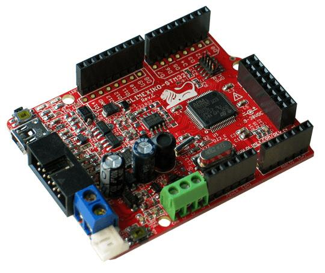
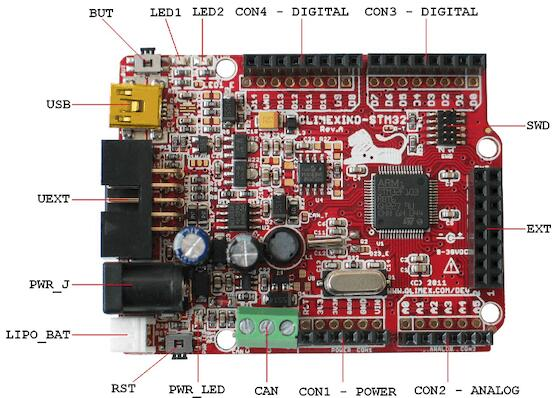

<!-- Copyright 2015-2026 Zephyr Project members and individual contributors. -->
<!-- SPDX-License-Identifier: Apache-2.0 -->
<!-- 中文翻译；编号、导航与译注为本地新增。 -->

<a id="olimexino_stm32"></a>

# 第7章\_OLIMEXINO-STM32

原文：[官方页面](https://docs.zephyrproject.org/latest/boards/olimex/olimexino_stm32/doc/index.html)。读取日期：2026-10-16；来源摘要见[来源记录](../SOURCES.md)。

开发板概览（Board Overview）

<a id="id1"></a>

[](images/olimexino_stm32.jpg)

OLIMEXINO-STM32

名称（Name）：

`olimexino_stm32`

厂商（Vendor）：

[OLIMEX Ltd.](https://docs.zephyrproject.org/latest/boards/index.html#vendor=olimex)

状态（Status）：

当前未积极维护（Not Actively Maintained）

架构（Architecture）：

[arm](https://docs.zephyrproject.org/latest/boards/index.html#arch=arm)

片上系统（SoC）：

[stm32f103xb](https://docs.zephyrproject.org/latest/boards/index.html#soc=stm32f103xb)

<a id="board-github-link"></a>

[浏览开发板源码（Browse Board Sources）](https://github.com/zephyrproject-rtos/zephyr/blob/main//boards/olimex/olimexino_stm32/doc/index.rst/../..)<a id="overview"></a>

## 概述（Overview）

OLIMEXINO-STM32基于STMicroelectronics STM32F103RB Arm Cortex-M3 CPU。

开发板详情见[OLIMEXINO-STM32网站](https://www.olimex.com/Products/Duino/STM32/OLIMEXINO-STM32/)及用户手册；处理器信息见[ST STM32F103xB数据手册](https://www.st.com/resource/en/datasheet/stm32f103tb.pdf)。（[OLIMEXINO-STM32用户手册](https://www.olimex.com/Products/Duino/STM32/OLIMEXINO-STM32/resources/OLIMEXINO-STM32.pdf)）

<a id="supported-features"></a>

### 支持的功能（Supported Features）

`olimexino_stm32`开发板支持下表所列的硬件功能。

片上／板载（On-Chip / On-Board）

功能集成在片上系统（SoC）内／位于开发板上。

2 / 2

分别表示已启用／已禁用的实例数。点击数量标签，可查看开发板或SoC设备树源码（DTS）中该功能的第一个实例。

`vnd,foo`

与此功能匹配的设备树绑定兼容字符串（Compatible String）；点击链接可查看绑定文档。

<a id="olimexino_stm32-hw-features"></a>

<a id="olimexino_stm32-olimexino_stm32/stm32f103xb-hw-features-section"></a>

#### `olimexino_stm32/stm32f103xb`目标（Target）

<a id="olimexino_stm32-olimexino_stm32/stm32f103xb-hw-features-panel"></a>

<a id="olimexino_stm32-olimexino_stm32/stm32f103xb-hw-features-memory"></a>

该开发板目标的片上存储容量：20 KiB RAM、128 KiB Flash。

<a id="olimexino_stm32-olimexino_stm32/stm32f103xb-hw-features-table"></a>

<table>
<tr>
<th>类型（Type）</th>
<th>位置（Location）</th>
<th>说明（Description）</th>
<th>兼容字符串（Compatible）</th>
</tr>
<tr>
<td rowspan="1">中央处理器（CPU）</td>
<td>片上（On-Chip）</td>
<td>ARM Cortex-M3处理器（CPU）（<a href="https://github.com/zephyrproject-rtos/zephyr/blob/main/dts/arm/st/f1/stm32f1.dtsi?plain=1#L32">已启用：1</a>）</td>
<td><a href="../cpu_arm_riscv_binding_reference/P021_arm_cortex-m3.md#std-dtcompatible-arm-cortex-m3"><code>arm,cortex-m3</code></a></td>
</tr>
<tr>
<td rowspan="1">模数转换器（ADC）</td>
<td>片上（On-Chip）</td>
<td>STM32F1模数转换器（ADC）（<a href="https://github.com/zephyrproject-rtos/zephyr/blob/main/dts/arm/st/f1/stm32f1.dtsi?plain=1#L354">已禁用：1</a>）</td>
<td><a href="../hardware/P840_STM32F1模数转换器绑定.md#dtbinding-st-stm32f1-adc"><code>st,stm32f1-adc</code></a></td>
</tr>
<tr>
<td rowspan="1">控制器局域网（CAN）</td>
<td>片上（On-Chip）</td>
<td>STM32 CAN 控制器（Controller）（<a href="https://github.com/zephyrproject-rtos/zephyr/blob/main/dts/arm/st/f1/stm32f103X6.dtsi?plain=1#L37">已启用：1</a>）</td>
<td><a href="../can_nxp_renesas_stm32_ti_binding_reference/P011_st_stm32-bxcan.md#std-dtcompatible-st-stm32-bxcan"><code>st,stm32-bxcan</code></a></td>
</tr>
<tr>
<td rowspan="5">时钟控制（Clock Control）</td>
<td>片上（On-Chip）</td>
<td>STM32复位和时钟控制器（RCC / Reset and Clock Controller）（<a href="https://github.com/zephyrproject-rtos/zephyr/blob/main/dts/arm/st/f1/stm32f1.dtsi?plain=1#L127">已启用：1</a>）</td>
<td><a href="../timer_reference/P126_STM32复位与时钟控制绑定.md#dtbinding-st-stm32-rcc"><code>st,stm32-rcc</code></a></td>
</tr>
<tr>
<td>片上（On-Chip）</td>
<td>STM32 外部高速时钟（HSE Clock）（<a href="https://github.com/zephyrproject-rtos/zephyr/blob/main/dts/arm/st/f1/stm32f1.dtsi?plain=1#L64">已启用：1</a>）</td>
<td><a href="../timer_reference/P129_STM32高速外部时钟绑定.md#dtbinding-st-stm32-hse-clock"><code>st,stm32-hse-clock</code></a></td>
</tr>
<tr>
<td>片上（On-Chip）</td>
<td>通用固定频率时钟提供者（Fixed-Rate Clock Provider）（<a href="https://github.com/zephyrproject-rtos/zephyr/blob/main/dts/arm/st/f1/stm32f1.dtsi?plain=1#L70">已禁用：3</a>）</td>
<td><a href="../hardware/P566_固定时钟绑定.md#dtbinding-fixed-clock"><code>fixed-clock</code></a></td>
</tr>
<tr>
<td>片上（On-Chip）</td>
<td>适用于低、中、高及超大容量器件的STM32F1主锁相环（Main PLL）（<a href="https://github.com/zephyrproject-rtos/zephyr/blob/main/dts/arm/st/f1/stm32f1.dtsi?plain=1#L91">已启用：1</a>）</td>
<td><a href="../timer_reference/P137_STM32F1锁相环时钟绑定.md#dtbinding-st-stm32f1-pll-clock"><code>st,stm32f1-pll-clock</code></a></td>
</tr>
<tr>
<td>片上（On-Chip）</td>
<td>STM32F1微控制器时钟输出（MCO）（<a href="https://github.com/zephyrproject-rtos/zephyr/blob/main/dts/arm/st/f1/stm32f1.dtsi?plain=1#L99">已禁用：1</a>）</td>
<td><a href="../timer_reference/P135_STM32F1时钟输出绑定.md#dtbinding-st-stm32f1-clock-mco"><code>st,stm32f1-clock-mco</code></a></td>
</tr>
<tr>
<td rowspan="1">计数器（Counter）</td>
<td>片上（On-Chip）</td>
<td>STM32 计数器（Counters）（<a href="https://github.com/zephyrproject-rtos/zephyr/blob/main/dts/arm/st/f1/stm32f1.dtsi?plain=1#L273">已禁用：4</a>）</td>
<td><a href="../stm32_ti_xilinx_counter_binding_reference/P007_st_stm32-counter.md#std-dtcompatible-st-stm32-counter"><code>st,stm32-counter</code></a></td>
</tr>
<tr>
<td rowspan="1">直接存储器访问（DMA）</td>
<td>片上（On-Chip）</td>
<td>用于stm32F0、stm32F1和stm32L1片上系统（SoC）系列的STM32直接存储器访问控制器（DMA，V2bis）（<a href="https://github.com/zephyrproject-rtos/zephyr/blob/main/dts/arm/st/f1/stm32f1.dtsi?plain=1#L378">已禁用：1</a>）</td>
<td><a href="../stm32_ti_xilinx_dma_binding_reference/P009_st_stm32-dma-v2bis.md#std-dtcompatible-st-stm32-dma-v2bis"><code>st,stm32-dma-v2bis</code></a></td>
</tr>
<tr>
<td rowspan="1">闪存控制器（Flash Controller）</td>
<td>片上（On-Chip）</td>
<td>STM32 系列闪存控制器（Flash Controller）（<a href="https://github.com/zephyrproject-rtos/zephyr/blob/main/dts/arm/st/f1/stm32f1.dtsi?plain=1#L107">已启用：1</a>）</td>
<td><a href="../flash_renesas_st_ti_binding_reference/P011_st_stm32-flash-controller.md#std-dtcompatible-st-stm32-flash-controller"><code>st,stm32-flash-controller</code></a></td>
</tr>
<tr>
<td rowspan="1">通用输入输出与接插件（GPIO &amp; Headers）</td>
<td>片上（On-Chip）</td>
<td>STM32 通用输入输出控制器（GPIO Controller）（<a href="https://github.com/zephyrproject-rtos/zephyr/blob/main/dts/arm/st/f1/stm32f1.dtsi?plain=1#L160">已启用：5</a>）</td>
<td><a href="../gpio_silabs_st_connectors_binding_reference/P029_st_stm32-gpio.md#std-dtcompatible-st-stm32-gpio"><code>st,stm32-gpio</code></a></td>
</tr>
<tr>
<td rowspan="1">集成电路间总线（I2C）</td>
<td>片上（On-Chip）</td>
<td>STM32 I2C V1 控制器（Controller）（<a href="https://github.com/zephyrproject-rtos/zephyr/blob/main/dts/arm/st/f1/stm32f1.dtsi?plain=1#L219">已启用：2</a>）</td>
<td><a href="../i2c_stm32_ti_mux_binding_reference/P007_st_stm32-i2c-v1.md#std-dtcompatible-st-stm32-i2c-v1"><code>st,stm32-i2c-v1</code></a></td>
</tr>
<tr>
<td rowspan="1">输入（Input）</td>
<td>板载（On-Board）</td>
<td>一组绑定到 GPIO 的输入按键（GPIO-Bound Input Keys）（<a href="https://github.com/zephyrproject-rtos/zephyr/blob/main/boards/olimex/olimexino_stm32/olimexino_stm32.dts?plain=1#L38">已启用：1</a>）</td>
<td><a href="../hardware/P563_GPIO按键绑定.md#std-dtcompatible-gpio-keys"><code>gpio-keys</code></a></td>
</tr>
<tr>
<td rowspan="2">中断控制器（Interrupt Controller）</td>
<td>片上（On-Chip）</td>
<td>ARMv7-M 嵌套向量中断控制器（Nested Vectored Interrupt Controller，NVIC）（<a href="https://github.com/zephyrproject-rtos/zephyr/blob/main/dts/arm/armv7-m.dtsi?plain=1#L13">已启用：1</a>）</td>
<td><a href="../arm_interrupt_timer_binding_reference/P002_ARMv7_M_NVIC.md#std-dtcompatible-arm-v7m-nvic"><code>arm,v7m-nvic</code></a></td>
</tr>
<tr>
<td>片上（On-Chip）</td>
<td>STM32 外部中断控制器（External Interrupt Controller）（<a href="https://github.com/zephyrproject-rtos/zephyr/blob/main/dts/arm/st/f1/stm32f1.dtsi?plain=1#L138">已启用：1</a>）</td>
<td><a href="../mcu_external_interrupt_binding_reference/P001_st_stm32-exti.md#std-dtcompatible-st-stm32-exti"><code>st,stm32-exti</code></a></td>
</tr>
<tr>
<td rowspan="1">发光二极管（LED）</td>
<td>板载（On-Board）</td>
<td>一组由 GPIO 控制的 LED（GPIO-Controlled LEDs）（<a href="https://github.com/zephyrproject-rtos/zephyr/blob/main/boards/olimex/olimexino_stm32/olimexino_stm32.dts?plain=1#L24">已启用：1</a>）</td>
<td><a href="../hardware/P564_GPIO指示灯绑定.md#dtbinding-gpio-leds"><code>gpio-leds</code></a></td>
</tr>
<tr>
<td rowspan="1">存储技术设备（MTD）</td>
<td>片上（On-Chip）</td>
<td>STM32闪存（Flash Memory）（<a href="https://github.com/zephyrproject-rtos/zephyr/blob/main/dts/arm/st/f1/stm32f1.dtsi?plain=1#L117">已启用：1</a>）</td>
<td><a href="../mtd_nxp_st_ti_partition_binding_reference/P016_st_stm32-nv-flash.md#std-dtcompatible-st-stm32-nv-flash"><code>st,stm32-nv-flash</code></a></td>
</tr>
<tr>
<td rowspan="2">物理层（PHY）</td>
<td>片上（On-Chip）</td>
<td>用于所有内置于 USB IP 的 USB 收发器（USB Transceivers）的绑定。（<a href="https://github.com/zephyrproject-rtos/zephyr/blob/main/dts/arm/st/f1/stm32f103X6.dtsi?plain=1#L47">已启用：1</a>）</td>
<td><a href="../phy_binding_reference/P008_usb-nop-xceiv.md#std-dtcompatible-usb-nop-xceiv"><code>usb-nop-xceiv</code></a></td>
</tr>
<tr>
<td>板载（On-Board）</td>
<td>由简单GPIO控制的CAN收发器（Transceiver）（<a href="https://github.com/zephyrproject-rtos/zephyr/blob/main/boards/olimex/olimexino_stm32/olimexino_stm32.dts?plain=1#L48">已启用：1</a>）</td>
<td><a href="../phy_binding_reference/P001_can-transceiver-gpio.md#std-dtcompatible-can-transceiver-gpio"><code>can-transceiver-gpio</code></a></td>
</tr>
<tr>
<td rowspan="1">引脚控制（Pin Control）</td>
<td>片上（On-Chip）</td>
<td>STM32F1引脚控制器（Pin Controller）（<a href="https://github.com/zephyrproject-rtos/zephyr/blob/main/dts/arm/st/f1/stm32f1.dtsi?plain=1#L153">已启用：1</a>）</td>
<td><a href="../pinctrl_stm32_ti_xilinx_binding_reference/P005_st_stm32f1-pinctrl.md#std-dtcompatible-st-stm32f1-pinctrl"><code>st,stm32f1-pinctrl</code></a></td>
</tr>
<tr>
<td rowspan="2">电源管理（Power Management）</td>
<td>片上（On-Chip）</td>
<td>STM32 电源控制器（Power Controller）（<a href="https://github.com/zephyrproject-rtos/zephyr/blob/main/dts/arm/st/f1/stm32f1.dtsi?plain=1#L387">已启用：1</a>）</td>
<td><a href="../stm32_soc_power_binding_reference/P010_st_stm32-pwr.md#std-dtcompatible-st-stm32-pwr"><code>st,stm32-pwr</code></a></td>
</tr>
<tr>
<td>片上（On-Chip）</td>
<td>STM32F1 风格的唤醒引脚控制器（Wake-Up Pins Controller）（<a href="https://github.com/zephyrproject-rtos/zephyr/blob/main/dts/arm/st/f1/stm32f1.dtsi?plain=1#L391">已禁用：1</a>）</td>
<td><a href="../stm32_soc_power_binding_reference/P011_st_stm32f1-pwr-wkupctrl.md#std-dtcompatible-st-stm32f1-pwr-wkupctrl"><code>st,stm32f1-pwr-wkupctrl</code></a></td>
</tr>
<tr>
<td rowspan="1">脉宽调制（PWM）</td>
<td>片上（On-Chip）</td>
<td>STM32 脉宽调制（PWM）（<a href="https://github.com/zephyrproject-rtos/zephyr/blob/main/dts/arm/st/f1/stm32f1.dtsi?plain=1#L267">已启用：1</a>；<a href="https://github.com/zephyrproject-rtos/zephyr/blob/main/dts/arm/st/f1/stm32f1.dtsi?plain=1#L296">已禁用：3</a>）</td>
<td><a href="../pwm_stm32_ti_generic_binding_reference/P011_st_stm32-pwm.md#std-dtcompatible-st-stm32-pwm"><code>st,stm32-pwm</code></a></td>
</tr>
<tr>
<td rowspan="1">复位控制器（Reset Controller）</td>
<td>片上（On-Chip）</td>
<td>STM32 复位与时钟控制器（Reset and Clock Control，RCC）（<a href="https://github.com/zephyrproject-rtos/zephyr/blob/main/dts/arm/st/f1/stm32f1.dtsi?plain=1#L132">已启用：1</a>）</td>
<td><a href="../reset_controller_binding_reference/P017_st_stm32-rcc-rctl.md#std-dtcompatible-st-stm32-rcc-rctl"><code>st,stm32-rcc-rctl</code></a></td>
</tr>
<tr>
<td rowspan="1">实时时钟（RTC）</td>
<td>片上（On-Chip）</td>
<td>STM32 实时时钟（RTC）（<a href="https://github.com/zephyrproject-rtos/zephyr/blob/main/dts/arm/st/f1/stm32f1.dtsi?plain=1#L343">已禁用：1</a>）</td>
<td><a href="../soc_rtc_binding_reference/P014_st_stm32-rtc.md#std-dtcompatible-st-stm32-rtc"><code>st,stm32-rtc</code></a></td>
</tr>
<tr>
<td rowspan="2">传感器（Sensors）</td>
<td>片上（On-Chip）</td>
<td>STM32 正交解码器（Quadrature Decoder）（<a href="https://github.com/zephyrproject-rtos/zephyr/blob/main/dts/arm/st/f1/stm32f1.dtsi?plain=1#L278">已禁用：4</a>）</td>
<td><a href="../sensor_st_lsm_stm32_binding_reference/P028_st_stm32-qdec.md#std-dtcompatible-st-stm32-qdec"><code>st,stm32-qdec</code></a></td>
</tr>
<tr>
<td>片上（On-Chip）</td>
<td>STM32内部温度传感器（Internal Temperature Sensor）（<a href="https://github.com/zephyrproject-rtos/zephyr/blob/main/dts/arm/st/f1/stm32f1.dtsi?plain=1#L407">已禁用：1</a>）</td>
<td><a href="../sensor_st_lsm_stm32_binding_reference/P030_st_stm32-temp.md#std-dtcompatible-st-stm32-temp"><code>st,stm32-temp</code></a></td>
</tr>
<tr>
<td rowspan="1">串行控制器（Serial Controller）</td>
<td>片上（On-Chip）</td>
<td>STM32 通用同步／异步收发器（USART）（<a href="https://github.com/zephyrproject-rtos/zephyr/blob/main/dts/arm/st/f1/stm32f1.dtsi?plain=1#L201">已启用：1</a>；<a href="https://github.com/zephyrproject-rtos/zephyr/blob/main/dts/arm/st/f1/stm32f1.dtsi?plain=1#L210">已禁用：2</a>）</td>
<td><a href="../uart_silabs_stm32_ti_binding_reference/P016_st_stm32-usart.md#std-dtcompatible-st-stm32-usart"><code>st,stm32-usart</code></a></td>
</tr>
<tr>
<td rowspan="1">系统管理总线（SMbus）</td>
<td>片上（On-Chip）</td>
<td>STM32 系统管理总线控制器（SMBus Controller）（<a href="https://github.com/zephyrproject-rtos/zephyr/blob/main/dts/arm/st/f1/stm32f1.dtsi?plain=1#L416">已禁用：2</a>）</td>
<td><a href="../i3c_smbus_binding_reference/P013_st_stm32-smbus.md#std-dtcompatible-st-stm32-smbus"><code>st,stm32-smbus</code></a></td>
</tr>
<tr>
<td rowspan="1">串行外设接口（SPI）</td>
<td>片上（On-Chip）</td>
<td>STM32 串行外设接口控制器（SPI Controller）（<a href="https://github.com/zephyrproject-rtos/zephyr/blob/main/dts/arm/st/f1/stm32f1.dtsi?plain=1#L231">已启用：2</a>）</td>
<td><a href="../spi_stm32_ti_xilinx_binding_reference/P012_st_stm32-spi.md#std-dtcompatible-st-stm32-spi"><code>st,stm32-spi</code></a></td>
</tr>
<tr>
<td rowspan="2">定时器（Timer）</td>
<td>片上（On-Chip）</td>
<td>ARMv7-M 系统节拍（System Tick）（<a href="https://github.com/zephyrproject-rtos/zephyr/blob/main/dts/arm/armv7-m.dtsi?plain=1#L21">已启用：1</a>）</td>
<td><a href="../arm_interrupt_timer_binding_reference/P006_ARMv7_M_SysTick.md#std-dtcompatible-arm-armv7m-systick"><code>arm,armv7m-systick</code></a></td>
</tr>
<tr>
<td>片上（On-Chip）</td>
<td>STM32 定时器（Timers）（<a href="https://github.com/zephyrproject-rtos/zephyr/blob/main/dts/arm/st/f1/stm32f1.dtsi?plain=1#L256">已启用：1</a>；<a href="https://github.com/zephyrproject-rtos/zephyr/blob/main/dts/arm/st/f1/stm32f1.dtsi?plain=1#L285">已禁用：3</a>）</td>
<td><a href="../stm32_ti_silabs_timer_binding_reference/P008_st_stm32-timers.md#std-dtcompatible-st-stm32-timers"><code>st,stm32-timers</code></a></td>
</tr>
<tr>
<td rowspan="1">通用串行总线（USB）</td>
<td>片上（On-Chip）</td>
<td>STM32 USB控制器（Controller）（<a href="https://github.com/zephyrproject-rtos/zephyr/blob/main/dts/arm/st/f1/stm32f103X6.dtsi?plain=1#L24">已启用：1</a>）</td>
<td><a href="../usb_stm32_audio_binding_reference/P006_st_stm32-usb.md#std-dtcompatible-st-stm32-usb"><code>st,stm32-usb</code></a></td>
</tr>
<tr>
<td rowspan="2">看门狗（Watchdog）</td>
<td>片上（On-Chip）</td>
<td>STM32 看门狗（Watchdog）（<a href="https://github.com/zephyrproject-rtos/zephyr/blob/main/dts/arm/st/f1/stm32f1.dtsi?plain=1#L242">已启用：1</a>）</td>
<td><a href="../stm32_ti_xilinx_watchdog_binding_reference/P001_st_stm32-watchdog.md#std-dtcompatible-st-stm32-watchdog"><code>st,stm32-watchdog</code></a></td>
</tr>
<tr>
<td>片上（On-Chip）</td>
<td>STM32 系统窗口看门狗（System Window Watchdog）（<a href="https://github.com/zephyrproject-rtos/zephyr/blob/main/dts/arm/st/f1/stm32f1.dtsi?plain=1#L248">已禁用：1</a>）</td>
<td><a href="../stm32_ti_xilinx_watchdog_binding_reference/P002_st_stm32-window-watchdog.md#std-dtcompatible-st-stm32-window-watchdog"><code>st,stm32-window-watchdog</code></a></td>
</tr>
</table>

<a id="pin-mapping"></a>

### 引脚映射（Pin Mapping）

<a id="id2"></a>



OLIMEXINO-STM32连接器

<a id="led"></a>

#### 发光二极管（LED）


- LED1，绿色：PA5
- LED2，黄色：PA1
- PWR_LED，红色：电源指示灯

<a id="push-buttons"></a>

#### 按键（Push Buttons）


- BUT = PC9 / TIM3CH4 / BOOT0
- RST = NRST

<a id="external-connectors"></a>

#### 外部接插件（External Connectors）

SWD

<table>
<tr>
<th>引脚编号（PIN #）</th>
<th>信号名称（Signal Name）</th>
<th>STM32F103RB功能（Functions）</th>
</tr>
<tr>
<td>1</td>
<td>电源（VCC）</td>
<td>不适用（N/A）</td>
</tr>
<tr>
<td>2</td>
<td>TMS / SWDIO</td>
<td>JTMS / SWDIO / PA13</td>
</tr>
<tr>
<td>3</td>
<td>地（GND）</td>
<td>不适用（N/A）</td>
</tr>
<tr>
<td>4</td>
<td>TCK / SWCLK</td>
<td>JTCK / SWCLK / PA14</td>
</tr>
<tr>
<td>5</td>
<td>地（GND）</td>
<td>不适用（N/A）</td>
</tr>
<tr>
<td>6</td>
<td>TDO / SWO</td>
<td>JTDO /TIM2_CH2 / PB3 / TRACESWO / SPI1_SCK</td>
</tr>
<tr>
<td>7</td>
<td>断开（Cut off）</td>
<td>不适用（N/A）</td>
</tr>
<tr>
<td>8</td>
<td>测试数据输入（TDI）</td>
<td>JTDI / TIM2_CH1_ETR / PA15 / SPI1_NSS</td>
</tr>
<tr>
<td>9</td>
<td>地（GND）</td>
<td>不适用（N/A）</td>
</tr>
<tr>
<td>10</td>
<td>复位（RESET）</td>
<td>低电平复位（NRST）</td>
</tr>
</table>

UEXT

<table>
<tr>
<th>引脚编号（PIN #）</th>
<th>信号名称（Signal Name）</th>
<th>STM32F103RB功能（Functions）</th>
</tr>
<tr>
<td>1</td>
<td>电源（VCC）</td>
<td>不适用（N/A）</td>
</tr>
<tr>
<td>2</td>
<td>地（GND）</td>
<td>不适用（N/A）</td>
</tr>
<tr>
<td>3</td>
<td>D7 (TXD1)</td>
<td>PA9 / USART1_TX / TIM1_CH2</td>
</tr>
<tr>
<td>4</td>
<td>D8 (RXD1)</td>
<td>PA10 / USART1_RX / TIM1_CH3</td>
</tr>
<tr>
<td>5</td>
<td>D29 (SCL2)</td>
<td>PB10 / I2C2_SCL / USART3_TX / TIM2_CH3</td>
</tr>
<tr>
<td>6</td>
<td>D30 (SDA2)</td>
<td>PB11 / I2C2_SDA / USART3_RX / TIM2_CH4</td>
</tr>
<tr>
<td>7</td>
<td>D12 (MISO1)</td>
<td>PA6 / SPI1_MISO / ADC12_IN6 / TIM3_CH1 / TIM1_BKIN</td>
</tr>
<tr>
<td>8</td>
<td>D11 (MOSI1)</td>
<td>PA7 / SPI1_MOSI / ADC12_IN7 / TIM3_CH2 / TIM1_CH1N</td>
</tr>
<tr>
<td>9</td>
<td>D13 (SCK / LED1)</td>
<td>PA5 / SPI1_SCK / ADC12_IN5</td>
</tr>
<tr>
<td>10</td>
<td>UEXT_#CS</td>
<td>不适用（N/A）</td>
</tr>
</table>

EXT

<table>
<tr>
<th>引脚编号（PIN #）</th>
<th>信号名称（Signal Name）</th>
<th>STM32F103RB功能（Functions）</th>
</tr>
<tr>
<td>1</td>
<td>D23_EXT</td>
<td>PC15 / OSC32_OUT</td>
</tr>
<tr>
<td>2</td>
<td>D24 (CANTX)</td>
<td>PB9 / TIM4_CH4 / I2C1_SDA / CANTX</td>
</tr>
<tr>
<td>3</td>
<td>D25 (MMC_CS)</td>
<td>PD2 / TIM3_ETR</td>
</tr>
<tr>
<td>4</td>
<td>D26</td>
<td>PC10 / USART3_TX</td>
</tr>
<tr>
<td>5</td>
<td>D27</td>
<td>PB0 / ADC12_IN8 / TIM3_CH3 / TIM1_CH2N</td>
</tr>
<tr>
<td>6</td>
<td>D28</td>
<td>PB1 / ADC12_IN9 / TIM3_CH4 / TIM1_CH3N</td>
</tr>
<tr>
<td>7</td>
<td>D29 (SCL2)</td>
<td>PB10 / I2C2_SCL / USART3_TX / TIM2_CH3</td>
</tr>
<tr>
<td>8</td>
<td>D30 (SDA2)</td>
<td>PB11 / I2C2_SDA / USART3_RX / TIM2_CH4</td>
</tr>
<tr>
<td>9</td>
<td>D31 (#SS2)</td>
<td>PB12 / SPI2_NSS / I2C2_SMBAI / USART3_CK / TIM1_BKIN</td>
</tr>
<tr>
<td>10</td>
<td>D32 (SCK2)</td>
<td>PB13 / SPI2_SCK/ USART3_CTS / TIM1_CH1N</td>
</tr>
<tr>
<td>11</td>
<td>D33 (MISO2)</td>
<td>PB14 / SPI2_MISO / USART3_RTS / TIM1_CH2N</td>
</tr>
<tr>
<td>12</td>
<td>D34 (MOSI2)</td>
<td>PB15 / SPI2_MOSI / TIM1_CH3N</td>
</tr>
<tr>
<td>13</td>
<td>D35</td>
<td>PC6 / TIM3_CH1</td>
</tr>
<tr>
<td>14</td>
<td>D36</td>
<td>PC7 / TIM3_CH2</td>
</tr>
<tr>
<td>15</td>
<td>D37</td>
<td>PC8 / TIM3_CH3</td>
</tr>
<tr>
<td>16</td>
<td>地（GND）</td>
<td>不适用（N/A）</td>
</tr>
</table>

<a id="arduino-headers"></a>

#### Arduino排针（Headers）

CON1电源（Power）

<table>
<tr>
<th>引脚编号（PIN #）</th>
<th>信号名称（Signal Name）</th>
<th>STM32F103RB功能（Functions）</th>
</tr>
<tr>
<td>1</td>
<td>复位（RESET）</td>
<td>低电平复位（NRST）</td>
</tr>
<tr>
<td>2</td>
<td>VCC (3V3)</td>
<td>不适用（N/A）</td>
</tr>
<tr>
<td>3</td>
<td>VDD (3V3A)</td>
<td>不适用（N/A）</td>
</tr>
<tr>
<td>4</td>
<td>地（GND）</td>
<td>不适用（N/A）</td>
</tr>
<tr>
<td>5</td>
<td>地（GND）</td>
<td>不适用（N/A）</td>
</tr>
<tr>
<td>6</td>
<td>输入电源（VIN）</td>
<td>不适用（N/A）</td>
</tr>
</table>

CON2模拟信号（Analog）

<table>
<tr>
<th>引脚编号（PIN #）</th>
<th>信号名称（Signal Name）</th>
<th>STM32F103RB功能（Functions）</th>
</tr>
<tr>
<td>1</td>
<td>D15 (A0)</td>
<td>PC0 / ADC12_IN10</td>
</tr>
<tr>
<td>2</td>
<td>D16 (A1)</td>
<td>PC1 / ADC12_IN11</td>
</tr>
<tr>
<td>3</td>
<td>D17 (A2)</td>
<td>PC2 / ADC12_IN12</td>
</tr>
<tr>
<td>4</td>
<td>D18 (A3)</td>
<td>PC3 / ADC12_IN13</td>
</tr>
<tr>
<td>5</td>
<td>D19 (A4)</td>
<td>PC4 / ADC12_IN14</td>
</tr>
<tr>
<td>6</td>
<td>D20 (A5)</td>
<td>PC5 / ADC12_IN15</td>
</tr>
</table>

CON3数字信号（Digital）

<table>
<tr>
<th>引脚编号（PIN #）</th>
<th>信号名称（Signal Name）</th>
<th>STM32F103RB功能（Functions）</th>
</tr>
<tr>
<td>1</td>
<td>D0 (RXD2)</td>
<td>PA3 / USART2_RX / ADC12_IN3 / TIM2_CH4</td>
</tr>
<tr>
<td>2</td>
<td>D1 (TXD2)</td>
<td>PA2 / USART2_TX / ADC12_IN2 / TIM2_CH3</td>
</tr>
<tr>
<td>3</td>
<td>D2</td>
<td>PA0 / WKUP / USART2_CTS / ADC12_IN0 / TIM2_CH1</td>
</tr>
<tr>
<td>4</td>
<td>D3 (LED2)</td>
<td>PA1 / USART2_RTS / ADC12_IN1 / TIM2_CH2</td>
</tr>
<tr>
<td>5</td>
<td>D4</td>
<td>PB5 / I2C1_SMBAI / TIM3_CH2 / SPI1_MOSI</td>
</tr>
<tr>
<td>6</td>
<td>D5</td>
<td>PB6 / I2C1_SCL / TIM4_CH1 / USART1_TX</td>
</tr>
<tr>
<td>7</td>
<td>D6</td>
<td>PA8 / USART1_CK / TIM1_CH1 / MCO</td>
</tr>
<tr>
<td>8</td>
<td>D7 (TXD1)</td>
<td>PA9 / USART1_TX / TIM1_CH2</td>
</tr>
</table>

CON4数字信号（Digital）

<table>
<tr>
<th>引脚编号（PIN #）</th>
<th>信号名称（Signal Name）</th>
<th>STM32F103RB功能（Functions）</th>
</tr>
<tr>
<td>1</td>
<td>D8 (RXD1)</td>
<td>PA10 / USART1_RX / TIM1_CH3</td>
</tr>
<tr>
<td>2</td>
<td>D9</td>
<td>PB7 / I2C1_SDA / TIM4_CH2 / USART1_RX</td>
</tr>
<tr>
<td>3</td>
<td>D10 (#SS1)</td>
<td>PA4 / SPI1_NSS / USART2_CK / ADC12_IN4</td>
</tr>
<tr>
<td>4</td>
<td>D11 (MOSI1)</td>
<td>PA7 / SPI1_MOSI / ADC12_IN7 / TIM3_CH2 / TIM1_CH1N</td>
</tr>
<tr>
<td>5</td>
<td>D12 (MISO1)</td>
<td>PA6 / SPI1_MISO / ADC12_IN6 / TIM3_CH1 / TIM1_BKIN</td>
</tr>
<tr>
<td>6</td>
<td>D13 (SCK1 / LED1)</td>
<td>PA5 / SPI1_SCK / ADC12_IN5</td>
</tr>
<tr>
<td>7</td>
<td>地（GND）</td>
<td>不适用（N/A）</td>
</tr>
<tr>
<td>8</td>
<td>D14 (CANRX)</td>
<td>PB8 / TIM4_CH3 / I2C1_SCL / CANRX</td>
</tr>
</table>

控制器局域网（CAN）

<table>
<tr>
<th>引脚编号（PIN #）</th>
<th>信号名称（Signal Name）</th>
</tr>
<tr>
<td>1</td>
<td>地（GND）</td>
</tr>
<tr>
<td>2</td>
<td>CAN L</td>
</tr>
<tr>
<td>3</td>
<td>CAN H</td>
</tr>
</table>

<a id="system-clock"></a>

### 系统时钟（System Clock）

OLIMEXINO-STM32有两个外部振荡器，低速时钟为32.768 kHz，主时钟为8 MHz。可配置HSE驱动最高72 MHz的系统主时钟。

<a id="serial-port"></a>

### 串口（Serial Port）

OLIMEXINO-STM32最多有3路U(S)ART。Zephyr控制台输出分配给USART1，默认115200、8N1。

<a id="spi"></a>

### 串行外设接口（SPI）

OLIMEXINO-STM32最多有两路SPI，Zephyr默认SPI映射为：


- `SPI1_NSS : PA4`
- `SPI1_SCK : PA5`
- `SPI1_MISO : PA6`
- `SPI1_MOSI : PA7`

<a id="i2c"></a>

### 集成电路间总线（I2C）

OLIMEXINO-STM32支持两个I2C设备，Zephyr默认I2C映射为：


- `I2C1_SCL : PB6`
- `I2C1_SDA : PB7`
- `I2C2_SCL : PB10`
- I2C2_SDA：PB11

<a id="usb"></a>

### 通用串行总线（USB）

OLIMEXINO-STM32通过Mini-USB连接器提供USB 2.0全速设备接口。


- USB_DM：PA11
- `USB_DP : PA12`

<a id="can"></a>

### 控制器局域网（CAN）

OLIMEXINO-STM32板载带收发器的CAN接口，通过螺钉接线端子访问。


- CAN接收（CAN_RX）：PB8
- `CAN_TX : PB9`

<a id="jumpers"></a>

### 跳线（Jumpers）

Zephyr使用OLIMEXINO-STM32的默认跳线设置。板上全部跳线为表面贴装（SMD）类型，改变配置需要焊接、拆焊或切断连接。

OLIMEXIMO-STM32E的默认跳线设置如下；此处板名按原文拼写保留。

<table>
<tr>
<th>跳线名称（Jumper Name）</th>
<th>开路（Open）</th>
<th>闭合（Close）</th>
</tr>
<tr>
<td>LED1_E</td>
<td></td>
<td>x</td>
</tr>
<tr>
<td>LED2_E</td>
<td></td>
<td>x</td>
</tr>
<tr>
<td>D23_E</td>
<td>x</td>
<td></td>
</tr>
<tr>
<td>R-T</td>
<td>x</td>
<td></td>
</tr>
<tr>
<td>P10_E</td>
<td></td>
<td>x</td>
</tr>
</table>

<table>
<tr>
<th>跳线名称（Jumper Name）</th>
<th>D10</th>
<th>D4</th>
</tr>
<tr>
<td>D10/D4</td>
<td></td>
<td>x</td>
</tr>
</table>

<a id="flashing-zephyr-onto-olimexino-stm32"></a>

## 将Zephyr烧录到OLIMEXINO-STM32

`olimexino_stm32`开发板支持下表所列的运行工具（Runners）及相关west命令。

<table>
<tr>
<th></th>
<th>烧录（flash）</th>
<th>调试（debug）</th>
<th>连接调试会话（attach）</th>
<th>实时传输（rtt）</th>
<th>复位（reset）</th>
<th>调试服务器（debugserver）</th>
</tr>
<tr>
<td><a href="https://docs.zephyrproject.org/latest/develop/flash_debug/host-tools.html#runner-jlink">jlink</a></td>
<td>✅</td>
<td>✅</td>
<td>✅</td>
<td>✅</td>
<td>✅</td>
<td>✅</td>
</tr>
<tr>
<td><a href="https://docs.zephyrproject.org/latest/develop/flash_debug/host-tools.html#runner-openocd"><code>openocd</code></a></td>
<td>✅</td>
<td>✅（默认 / default）</td>
<td>✅</td>
<td>✅</td>
<td></td>
<td>✅</td>
</tr>
<tr>
<td><code>stm32flash</code></td>
<td>✅（默认 / default）</td>
<td></td>
<td></td>
<td></td>
<td></td>
<td></td>
</tr>
</table>

向OLIMEXINO-STM32烧录Zephyr内核需要[stm32flash工具](https://sourceforge.net/p/stm32flash/wiki/Home/)。

<a id="building-stm32flash-command-line-tool"></a>

### 构建stm32flash命令行工具

按以下步骤构建stm32flash：


1. 从仓库检出stm32flash源码。

> ```text
> $ git clone http://git.code.sf.net/p/stm32flash/code stm32flash
> $ cd stm32flash
> ```


1. 构建stm32flash工具。

> ```text
> $ make
> ```


1. 生成的可执行文件位于stm32flash。

<a id="flashing-an-application-to-olimexino-stm32"></a>

### 向OLIMEXINO-STM32烧录应用

上传应用需要3.3 V TTL串口适配器。以下以[Button](../basic_samples/P003_按钮输入.md#button)按键示例为例。


1. 将串口线接到UEXT接口的UART信号，第3脚为TX，第4脚为RX。
2. 通过Mini-USB为OLIMEXINO-STM32供电。
3. 按住BUT按键并复位开发板。
4. 输入以下命令构建并烧录应用：

  ```text
  # From the root of the zephyr repository
  west build -b olimexino_stm32 samples/basic/button
  west flash
  ```
5. 运行你惯用的终端程序，监听输出。

  ```text
  $ minicom -D /dev/ttyUSB0 -b 115200
  ```

  -b选项指定波特率，并忽略配置文件中的值。
6. 按复位键后，终端应显示Button应用输出。程序监测BUT按键GPIO状态并输出至串口控制台；按下按键时，中断处理程序输出该事件及其时间戳。

注意（Note）

烧录二进制镜像前务必关闭终端程序，否则它会干扰烧录过程。

## 译注

OLIMEXINO-STM32的引脚复用、SMD跳线及TTL串口烧录流程完整保留。原文跳线段使用OLIMEXIMO-STM32E拼写，已明确标注。

## 原文外链核对

2026-10-16核对并重试以下原文外链时未能确认可访问性，保留原始目标，不将访问失败解释为原文内容有误。

- [](https://sourceforge.net/p/stm32flash/wiki/Home/)：HTTP Error 403: Forbidden。
- [stm32f103tb.pdf](https://www.st.com/resource/en/datasheet/stm32f103tb.pdf)：HTTP Error 567: Unknown Status。

---

[上一章](P006_ESP32-EVB.md) · [返回大纲](大纲.md) · [全站翻译进度](../PROGRESS.md) · [下一章](P008_OLIMEX-STM32-E407.md)
