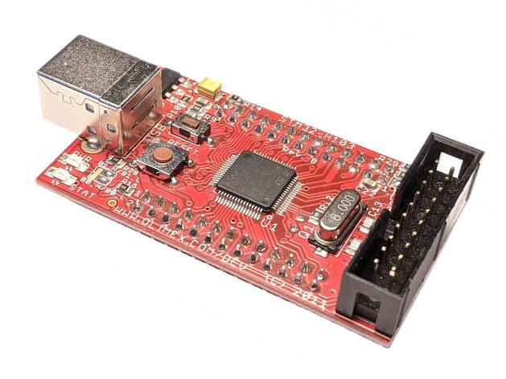

<!-- Copyright 2015-2026 Zephyr Project members and individual contributors. -->
<!-- SPDX-License-Identifier: Apache-2.0 -->
<!-- 中文翻译；编号、导航与译注为本地新增。 -->

<a id="olimex_stm32_h103"></a>

# 第9章\_OLIMEX-STM32-H103

原文：[官方页面](https://docs.zephyrproject.org/latest/boards/olimex/stm32_h103/doc/index.html)。读取日期：2026-10-16；来源摘要见[来源记录](../SOURCES.md)。

开发板概览（Board Overview）

<a id="id1"></a>

[](images/olimex_stm32_h103_top.jpg)

OLIMEX-STM32-H103

名称（Name）：

`olimex_stm32_h103`

厂商（Vendor）：

[OLIMEX Ltd.](https://docs.zephyrproject.org/latest/boards/index.html#vendor=olimex)

状态（Status）：

当前未积极维护（Not Actively Maintained）

架构（Architecture）：

[arm](https://docs.zephyrproject.org/latest/boards/index.html#arch=arm)

片上系统（SoC）：

[stm32f103xb](https://docs.zephyrproject.org/latest/boards/index.html#soc=stm32f103xb)

<a id="board-github-link"></a>

[浏览开发板源码（Browse Board Sources）](https://github.com/zephyrproject-rtos/zephyr/blob/main//boards/olimex/stm32_h103/doc/index.rst/../..)<a id="overview"></a>

## 概述（Overview）

OLIMEX-STM32-H103是基于STM32F103RBT6 Arm Cortex-M3 CPU的简易开发板，全部MCU引脚通过两个26引脚公头连接器引出。

<a id="hardware"></a>

## 硬件（Hardware）

开发板信息见[OLIMEX-STM32-H103网站](https://www.olimex.com/Products/ARM/ST/STM32-H103/)及用户手册，另有原理图可供参考。（[OLIMEX-STM32-H103用户手册](https://www.olimex.com/Products/ARM/ST/STM32-H103/resources/STM32-H103.pdf)；[OLIMEX-STM32-H103原理图](https://www.olimex.com/Products/ARM/ST/STM32-H405/resources/STM32-H405_sch.pdf)）

处理器信息见[ST STM32F103RB数据手册](https://www.st.com/resource/en/datasheet/stm32f103rb.pdf)。

<a id="supported-features"></a>

### 支持的功能（Supported Features）

`olimex_stm32_h103`开发板支持下表所列的硬件功能。

片上／板载（On-Chip / On-Board）

功能集成在片上系统（SoC）内／位于开发板上。

2 / 2

分别表示已启用／已禁用的实例数。点击数量标签，可查看开发板或SoC设备树源码（DTS）中该功能的第一个实例。

`vnd,foo`

与此功能匹配的设备树绑定兼容字符串（Compatible String）；点击链接可查看绑定文档。

<a id="olimex_stm32_h103-hw-features"></a>

<a id="olimex_stm32_h103-olimex_stm32_h103/stm32f103xb-hw-features-section"></a>

#### `olimex_stm32_h103/stm32f103xb`目标（Target）

<a id="olimex_stm32_h103-olimex_stm32_h103/stm32f103xb-hw-features-panel"></a>

<a id="olimex_stm32_h103-olimex_stm32_h103/stm32f103xb-hw-features-memory"></a>

该开发板目标的片上存储容量：20 KiB RAM、128 KiB Flash。

<a id="olimex_stm32_h103-olimex_stm32_h103/stm32f103xb-hw-features-table"></a>

<table>
<tr>
<th>类型（Type）</th>
<th>位置（Location）</th>
<th>说明（Description）</th>
<th>兼容字符串（Compatible）</th>
</tr>
<tr>
<td rowspan="1">中央处理器（CPU）</td>
<td>片上（On-Chip）</td>
<td>ARM Cortex-M3处理器（CPU）（<a href="https://github.com/zephyrproject-rtos/zephyr/blob/main/dts/arm/st/f1/stm32f1.dtsi?plain=1#L32">已启用：1</a>）</td>
<td><a href="../cpu_arm_riscv_binding_reference/P021_arm_cortex-m3.md#std-dtcompatible-arm-cortex-m3"><code>arm,cortex-m3</code></a></td>
</tr>
<tr>
<td rowspan="1">模数转换器（ADC）</td>
<td>片上（On-Chip）</td>
<td>STM32F1模数转换器（ADC）（<a href="https://github.com/zephyrproject-rtos/zephyr/blob/main/dts/arm/st/f1/stm32f1.dtsi?plain=1#L354">已禁用：1</a>）</td>
<td><a href="../hardware/P840_STM32F1模数转换器绑定.md#dtbinding-st-stm32f1-adc"><code>st,stm32f1-adc</code></a></td>
</tr>
<tr>
<td rowspan="1">控制器局域网（CAN）</td>
<td>片上（On-Chip）</td>
<td>STM32 CAN 控制器（Controller）（<a href="https://github.com/zephyrproject-rtos/zephyr/blob/main/dts/arm/st/f1/stm32f103X6.dtsi?plain=1#L37">已禁用：1</a>）</td>
<td><a href="../can_nxp_renesas_stm32_ti_binding_reference/P011_st_stm32-bxcan.md#std-dtcompatible-st-stm32-bxcan"><code>st,stm32-bxcan</code></a></td>
</tr>
<tr>
<td rowspan="5">时钟控制（Clock Control）</td>
<td>片上（On-Chip）</td>
<td>STM32复位和时钟控制器（RCC / Reset and Clock Controller）（<a href="https://github.com/zephyrproject-rtos/zephyr/blob/main/dts/arm/st/f1/stm32f1.dtsi?plain=1#L127">已启用：1</a>）</td>
<td><a href="../timer_reference/P126_STM32复位与时钟控制绑定.md#dtbinding-st-stm32-rcc"><code>st,stm32-rcc</code></a></td>
</tr>
<tr>
<td>片上（On-Chip）</td>
<td>STM32 外部高速时钟（HSE Clock）（<a href="https://github.com/zephyrproject-rtos/zephyr/blob/main/dts/arm/st/f1/stm32f1.dtsi?plain=1#L64">已启用：1</a>）</td>
<td><a href="../timer_reference/P129_STM32高速外部时钟绑定.md#dtbinding-st-stm32-hse-clock"><code>st,stm32-hse-clock</code></a></td>
</tr>
<tr>
<td>片上（On-Chip）</td>
<td>通用固定频率时钟提供者（Fixed-Rate Clock Provider）（<a href="https://github.com/zephyrproject-rtos/zephyr/blob/main/dts/arm/st/f1/stm32f1.dtsi?plain=1#L70">已禁用：3</a>）</td>
<td><a href="../hardware/P566_固定时钟绑定.md#dtbinding-fixed-clock"><code>fixed-clock</code></a></td>
</tr>
<tr>
<td>片上（On-Chip）</td>
<td>适用于低、中、高及超大容量器件的STM32F1主锁相环（Main PLL）（<a href="https://github.com/zephyrproject-rtos/zephyr/blob/main/dts/arm/st/f1/stm32f1.dtsi?plain=1#L91">已启用：1</a>）</td>
<td><a href="../timer_reference/P137_STM32F1锁相环时钟绑定.md#dtbinding-st-stm32f1-pll-clock"><code>st,stm32f1-pll-clock</code></a></td>
</tr>
<tr>
<td>片上（On-Chip）</td>
<td>STM32F1微控制器时钟输出（MCO）（<a href="https://github.com/zephyrproject-rtos/zephyr/blob/main/dts/arm/st/f1/stm32f1.dtsi?plain=1#L99">已禁用：1</a>）</td>
<td><a href="../timer_reference/P135_STM32F1时钟输出绑定.md#dtbinding-st-stm32f1-clock-mco"><code>st,stm32f1-clock-mco</code></a></td>
</tr>
<tr>
<td rowspan="1">计数器（Counter）</td>
<td>片上（On-Chip）</td>
<td>STM32 计数器（Counters）（<a href="https://github.com/zephyrproject-rtos/zephyr/blob/main/dts/arm/st/f1/stm32f1.dtsi?plain=1#L273">已禁用：4</a>）</td>
<td><a href="../stm32_ti_xilinx_counter_binding_reference/P007_st_stm32-counter.md#std-dtcompatible-st-stm32-counter"><code>st,stm32-counter</code></a></td>
</tr>
<tr>
<td rowspan="1">直接存储器访问（DMA）</td>
<td>片上（On-Chip）</td>
<td>用于stm32F0、stm32F1和stm32L1片上系统（SoC）系列的STM32直接存储器访问控制器（DMA，V2bis）（<a href="https://github.com/zephyrproject-rtos/zephyr/blob/main/dts/arm/st/f1/stm32f1.dtsi?plain=1#L378">已禁用：1</a>）</td>
<td><a href="../stm32_ti_xilinx_dma_binding_reference/P009_st_stm32-dma-v2bis.md#std-dtcompatible-st-stm32-dma-v2bis"><code>st,stm32-dma-v2bis</code></a></td>
</tr>
<tr>
<td rowspan="1">闪存控制器（Flash Controller）</td>
<td>片上（On-Chip）</td>
<td>STM32 系列闪存控制器（Flash Controller）（<a href="https://github.com/zephyrproject-rtos/zephyr/blob/main/dts/arm/st/f1/stm32f1.dtsi?plain=1#L107">已启用：1</a>）</td>
<td><a href="../flash_renesas_st_ti_binding_reference/P011_st_stm32-flash-controller.md#std-dtcompatible-st-stm32-flash-controller"><code>st,stm32-flash-controller</code></a></td>
</tr>
<tr>
<td rowspan="1">通用输入输出与接插件（GPIO &amp; Headers）</td>
<td>片上（On-Chip）</td>
<td>STM32 通用输入输出控制器（GPIO Controller）（<a href="https://github.com/zephyrproject-rtos/zephyr/blob/main/dts/arm/st/f1/stm32f1.dtsi?plain=1#L160">已启用：5</a>）</td>
<td><a href="../gpio_silabs_st_connectors_binding_reference/P029_st_stm32-gpio.md#std-dtcompatible-st-stm32-gpio"><code>st,stm32-gpio</code></a></td>
</tr>
<tr>
<td rowspan="1">集成电路间总线（I2C）</td>
<td>片上（On-Chip）</td>
<td>STM32 I2C V1 控制器（Controller）（<a href="https://github.com/zephyrproject-rtos/zephyr/blob/main/dts/arm/st/f1/stm32f1.dtsi?plain=1#L219">已禁用：2</a>）</td>
<td><a href="../i2c_stm32_ti_mux_binding_reference/P007_st_stm32-i2c-v1.md#std-dtcompatible-st-stm32-i2c-v1"><code>st,stm32-i2c-v1</code></a></td>
</tr>
<tr>
<td rowspan="1">输入（Input）</td>
<td>板载（On-Board）</td>
<td>一组绑定到 GPIO 的输入按键（GPIO-Bound Input Keys）（<a href="https://github.com/zephyrproject-rtos/zephyr/blob/main/boards/olimex/stm32_h103/olimex_stm32_h103.dts?plain=1#L31">已启用：1</a>）</td>
<td><a href="../hardware/P563_GPIO按键绑定.md#std-dtcompatible-gpio-keys"><code>gpio-keys</code></a></td>
</tr>
<tr>
<td rowspan="2">中断控制器（Interrupt Controller）</td>
<td>片上（On-Chip）</td>
<td>ARMv7-M 嵌套向量中断控制器（Nested Vectored Interrupt Controller，NVIC）（<a href="https://github.com/zephyrproject-rtos/zephyr/blob/main/dts/arm/armv7-m.dtsi?plain=1#L13">已启用：1</a>）</td>
<td><a href="../arm_interrupt_timer_binding_reference/P002_ARMv7_M_NVIC.md#std-dtcompatible-arm-v7m-nvic"><code>arm,v7m-nvic</code></a></td>
</tr>
<tr>
<td>片上（On-Chip）</td>
<td>STM32 外部中断控制器（External Interrupt Controller）（<a href="https://github.com/zephyrproject-rtos/zephyr/blob/main/dts/arm/st/f1/stm32f1.dtsi?plain=1#L138">已启用：1</a>）</td>
<td><a href="../mcu_external_interrupt_binding_reference/P001_st_stm32-exti.md#std-dtcompatible-st-stm32-exti"><code>st,stm32-exti</code></a></td>
</tr>
<tr>
<td rowspan="1">发光二极管（LED）</td>
<td>板载（On-Board）</td>
<td>一组由 GPIO 控制的 LED（GPIO-Controlled LEDs）（<a href="https://github.com/zephyrproject-rtos/zephyr/blob/main/boards/olimex/stm32_h103/olimex_stm32_h103.dts?plain=1#L22">已启用：1</a>）</td>
<td><a href="../hardware/P564_GPIO指示灯绑定.md#dtbinding-gpio-leds"><code>gpio-leds</code></a></td>
</tr>
<tr>
<td rowspan="1">存储技术设备（MTD）</td>
<td>片上（On-Chip）</td>
<td>STM32闪存（Flash Memory）（<a href="https://github.com/zephyrproject-rtos/zephyr/blob/main/dts/arm/st/f1/stm32f1.dtsi?plain=1#L117">已启用：1</a>）</td>
<td><a href="../mtd_nxp_st_ti_partition_binding_reference/P016_st_stm32-nv-flash.md#std-dtcompatible-st-stm32-nv-flash"><code>st,stm32-nv-flash</code></a></td>
</tr>
<tr>
<td rowspan="1">物理层（PHY）</td>
<td>片上（On-Chip）</td>
<td>用于所有内置于 USB IP 的 USB 收发器（USB Transceivers）的绑定。（<a href="https://github.com/zephyrproject-rtos/zephyr/blob/main/dts/arm/st/f1/stm32f103X6.dtsi?plain=1#L47">已启用：1</a>）</td>
<td><a href="../phy_binding_reference/P008_usb-nop-xceiv.md#std-dtcompatible-usb-nop-xceiv"><code>usb-nop-xceiv</code></a></td>
</tr>
<tr>
<td rowspan="1">引脚控制（Pin Control）</td>
<td>片上（On-Chip）</td>
<td>STM32F1引脚控制器（Pin Controller）（<a href="https://github.com/zephyrproject-rtos/zephyr/blob/main/dts/arm/st/f1/stm32f1.dtsi?plain=1#L153">已启用：1</a>）</td>
<td><a href="../pinctrl_stm32_ti_xilinx_binding_reference/P005_st_stm32f1-pinctrl.md#std-dtcompatible-st-stm32f1-pinctrl"><code>st,stm32f1-pinctrl</code></a></td>
</tr>
<tr>
<td rowspan="2">电源管理（Power Management）</td>
<td>片上（On-Chip）</td>
<td>STM32 电源控制器（Power Controller）（<a href="https://github.com/zephyrproject-rtos/zephyr/blob/main/dts/arm/st/f1/stm32f1.dtsi?plain=1#L387">已启用：1</a>）</td>
<td><a href="../stm32_soc_power_binding_reference/P010_st_stm32-pwr.md#std-dtcompatible-st-stm32-pwr"><code>st,stm32-pwr</code></a></td>
</tr>
<tr>
<td>片上（On-Chip）</td>
<td>STM32F1 风格的唤醒引脚控制器（Wake-Up Pins Controller）（<a href="https://github.com/zephyrproject-rtos/zephyr/blob/main/dts/arm/st/f1/stm32f1.dtsi?plain=1#L391">已禁用：1</a>）</td>
<td><a href="../stm32_soc_power_binding_reference/P011_st_stm32f1-pwr-wkupctrl.md#std-dtcompatible-st-stm32f1-pwr-wkupctrl"><code>st,stm32f1-pwr-wkupctrl</code></a></td>
</tr>
<tr>
<td rowspan="1">脉宽调制（PWM）</td>
<td>片上（On-Chip）</td>
<td>STM32 脉宽调制（PWM）（<a href="https://github.com/zephyrproject-rtos/zephyr/blob/main/dts/arm/st/f1/stm32f1.dtsi?plain=1#L267">已禁用：4</a>）</td>
<td><a href="../pwm_stm32_ti_generic_binding_reference/P011_st_stm32-pwm.md#std-dtcompatible-st-stm32-pwm"><code>st,stm32-pwm</code></a></td>
</tr>
<tr>
<td rowspan="1">复位控制器（Reset Controller）</td>
<td>片上（On-Chip）</td>
<td>STM32 复位与时钟控制器（Reset and Clock Control，RCC）（<a href="https://github.com/zephyrproject-rtos/zephyr/blob/main/dts/arm/st/f1/stm32f1.dtsi?plain=1#L132">已启用：1</a>）</td>
<td><a href="../reset_controller_binding_reference/P017_st_stm32-rcc-rctl.md#std-dtcompatible-st-stm32-rcc-rctl"><code>st,stm32-rcc-rctl</code></a></td>
</tr>
<tr>
<td rowspan="1">实时时钟（RTC）</td>
<td>片上（On-Chip）</td>
<td>STM32 实时时钟（RTC）（<a href="https://github.com/zephyrproject-rtos/zephyr/blob/main/dts/arm/st/f1/stm32f1.dtsi?plain=1#L343">已禁用：1</a>）</td>
<td><a href="../soc_rtc_binding_reference/P014_st_stm32-rtc.md#std-dtcompatible-st-stm32-rtc"><code>st,stm32-rtc</code></a></td>
</tr>
<tr>
<td rowspan="2">传感器（Sensors）</td>
<td>片上（On-Chip）</td>
<td>STM32 正交解码器（Quadrature Decoder）（<a href="https://github.com/zephyrproject-rtos/zephyr/blob/main/dts/arm/st/f1/stm32f1.dtsi?plain=1#L278">已禁用：4</a>）</td>
<td><a href="../sensor_st_lsm_stm32_binding_reference/P028_st_stm32-qdec.md#std-dtcompatible-st-stm32-qdec"><code>st,stm32-qdec</code></a></td>
</tr>
<tr>
<td>片上（On-Chip）</td>
<td>STM32内部温度传感器（Internal Temperature Sensor）（<a href="https://github.com/zephyrproject-rtos/zephyr/blob/main/dts/arm/st/f1/stm32f1.dtsi?plain=1#L407">已禁用：1</a>）</td>
<td><a href="../sensor_st_lsm_stm32_binding_reference/P030_st_stm32-temp.md#std-dtcompatible-st-stm32-temp"><code>st,stm32-temp</code></a></td>
</tr>
<tr>
<td rowspan="1">串行控制器（Serial Controller）</td>
<td>片上（On-Chip）</td>
<td>STM32 通用同步／异步收发器（USART）（<a href="https://github.com/zephyrproject-rtos/zephyr/blob/main/dts/arm/st/f1/stm32f1.dtsi?plain=1#L210">已启用：1</a>；<a href="https://github.com/zephyrproject-rtos/zephyr/blob/main/dts/arm/st/f1/stm32f1.dtsi?plain=1#L201">已禁用：2</a>）</td>
<td><a href="../uart_silabs_stm32_ti_binding_reference/P016_st_stm32-usart.md#std-dtcompatible-st-stm32-usart"><code>st,stm32-usart</code></a></td>
</tr>
<tr>
<td rowspan="1">系统管理总线（SMbus）</td>
<td>片上（On-Chip）</td>
<td>STM32 系统管理总线控制器（SMBus Controller）（<a href="https://github.com/zephyrproject-rtos/zephyr/blob/main/dts/arm/st/f1/stm32f1.dtsi?plain=1#L416">已禁用：2</a>）</td>
<td><a href="../i3c_smbus_binding_reference/P013_st_stm32-smbus.md#std-dtcompatible-st-stm32-smbus"><code>st,stm32-smbus</code></a></td>
</tr>
<tr>
<td rowspan="1">串行外设接口（SPI）</td>
<td>片上（On-Chip）</td>
<td>STM32 串行外设接口控制器（SPI Controller）（<a href="https://github.com/zephyrproject-rtos/zephyr/blob/main/dts/arm/st/f1/stm32f1.dtsi?plain=1#L231">已禁用：2</a>）</td>
<td><a href="../spi_stm32_ti_xilinx_binding_reference/P012_st_stm32-spi.md#std-dtcompatible-st-stm32-spi"><code>st,stm32-spi</code></a></td>
</tr>
<tr>
<td rowspan="2">定时器（Timer）</td>
<td>片上（On-Chip）</td>
<td>ARMv7-M 系统节拍（System Tick）（<a href="https://github.com/zephyrproject-rtos/zephyr/blob/main/dts/arm/armv7-m.dtsi?plain=1#L21">已启用：1</a>）</td>
<td><a href="../arm_interrupt_timer_binding_reference/P006_ARMv7_M_SysTick.md#std-dtcompatible-arm-armv7m-systick"><code>arm,armv7m-systick</code></a></td>
</tr>
<tr>
<td>片上（On-Chip）</td>
<td>STM32 定时器（Timers）（<a href="https://github.com/zephyrproject-rtos/zephyr/blob/main/dts/arm/st/f1/stm32f1.dtsi?plain=1#L256">已禁用：4</a>）</td>
<td><a href="../stm32_ti_silabs_timer_binding_reference/P008_st_stm32-timers.md#std-dtcompatible-st-stm32-timers"><code>st,stm32-timers</code></a></td>
</tr>
<tr>
<td rowspan="1">通用串行总线（USB）</td>
<td>片上（On-Chip）</td>
<td>STM32 USB控制器（Controller）（<a href="https://github.com/zephyrproject-rtos/zephyr/blob/main/dts/arm/st/f1/stm32f103X6.dtsi?plain=1#L24">已禁用：1</a>）</td>
<td><a href="../usb_stm32_audio_binding_reference/P006_st_stm32-usb.md#std-dtcompatible-st-stm32-usb"><code>st,stm32-usb</code></a></td>
</tr>
<tr>
<td rowspan="2">看门狗（Watchdog）</td>
<td>片上（On-Chip）</td>
<td>STM32 看门狗（Watchdog）（<a href="https://github.com/zephyrproject-rtos/zephyr/blob/main/dts/arm/st/f1/stm32f1.dtsi?plain=1#L242">已启用：1</a>）</td>
<td><a href="../stm32_ti_xilinx_watchdog_binding_reference/P001_st_stm32-watchdog.md#std-dtcompatible-st-stm32-watchdog"><code>st,stm32-watchdog</code></a></td>
</tr>
<tr>
<td>片上（On-Chip）</td>
<td>STM32 系统窗口看门狗（System Window Watchdog）（<a href="https://github.com/zephyrproject-rtos/zephyr/blob/main/dts/arm/st/f1/stm32f1.dtsi?plain=1#L248">已禁用：1</a>）</td>
<td><a href="../stm32_ti_xilinx_watchdog_binding_reference/P002_st_stm32-window-watchdog.md#std-dtcompatible-st-stm32-window-watchdog"><code>st,stm32-window-watchdog</code></a></td>
</tr>
</table>

<a id="connections-and-ios"></a>

### 连接与输入输出（Connections and IOs）

<a id="system-clock"></a>

#### 系统时钟（System Clock）

板载8 MHz晶体通过PLL生成72 MHz系统时钟。

<a id="zephyr-console"></a>

#### Zephyr控制台（Console）

UART2用作Zephyr控制台，默认115200、8N1。

<a id="on-board-leds"></a>

#### 板载LED（On-Board LEDs）

板载绿色LED连接PC12，低电平有效。

另有一个红色电源LED，不连接MCU，也不受MCU控制。

<a id="on-board-button"></a>

#### 板载按键（On-Board Button）

用户按键连接PA0。

<a id="usb"></a>

#### 通用串行总线（USB）

USB默认未启用。

PC4可配置为GPIO输入，用于检测USB端口电源；拆焊PCB上相应焊盘可断开此连接。

将PC11置为高电平，可断开USB-DP线的上拉电阻。

<a id="external-connectors"></a>

#### 外部接插件（External Connectors）

JTAG／SWD调试

<table>
<tr>
<th>引脚编号（PIN #）</th>
<th>信号名称（Signal Name）</th>
<th>引脚编号（PIN #）</th>
<th>信号名称（Signal Name）</th>
</tr>
<tr>
<td>1</td>
<td>TVCC +3.3V</td>
<td>2</td>
<td>TVCC 3.3V</td>
</tr>
<tr>
<td>3</td>
<td>PB4 / TRST</td>
<td>4</td>
<td>地（GND）</td>
</tr>
<tr>
<td>5</td>
<td>PA15 / TDI</td>
<td>6</td>
<td>地（GND）</td>
</tr>
<tr>
<td>7</td>
<td>PA13 / TMS / SWDIO</td>
<td>8</td>
<td>地（GND）</td>
</tr>
<tr>
<td>9</td>
<td>PA14 / TCK / SWCLK</td>
<td>10</td>
<td>地（GND）</td>
</tr>
<tr>
<td>11</td>
<td>未连接（NC）</td>
<td>12</td>
<td>地（GND）</td>
</tr>
<tr>
<td>13</td>
<td>PB3 / TDO</td>
<td>14</td>
<td>地（GND）</td>
</tr>
<tr>
<td>15</td>
<td>复位（RST）</td>
<td>16</td>
<td>地（GND）</td>
</tr>
<tr>
<td>17</td>
<td>未连接（NC）</td>
<td>18</td>
<td>地（GND）</td>
</tr>
<tr>
<td>19</td>
<td>未连接（NC）</td>
<td>20</td>
<td>地（GND）</td>
</tr>
</table>

扩展连接器1（EXTENSION 1）

<table>
<tr>
<th>引脚编号（PIN #）</th>
<th>名称／STM32F103端口</th>
<th>引脚编号（PIN #）</th>
<th>名称／STM32F103端口</th>
</tr>
<tr>
<td>1</td>
<td>PA11 / USB_DM</td>
<td>2</td>
<td>PA8</td>
</tr>
<tr>
<td>3</td>
<td>PA12 / USB_DP</td>
<td>4</td>
<td>PA9</td>
</tr>
<tr>
<td>5</td>
<td>+3.3V</td>
<td>6</td>
<td>地（GND）</td>
</tr>
<tr>
<td>7</td>
<td>PA10</td>
<td>8</td>
<td>PC10</td>
</tr>
<tr>
<td>9</td>
<td>PC11 / USB_DISC</td>
<td>10</td>
<td>PC12 / LED</td>
</tr>
<tr>
<td>11</td>
<td>PD2</td>
<td>12</td>
<td>PB5</td>
</tr>
<tr>
<td>13</td>
<td>PB6</td>
<td>14</td>
<td>PA6</td>
</tr>
<tr>
<td>15</td>
<td>PB7</td>
<td>16</td>
<td>PB8</td>
</tr>
<tr>
<td>17</td>
<td>PB9</td>
<td>18</td>
<td>PA5</td>
</tr>
<tr>
<td>19</td>
<td>PC0</td>
<td>20</td>
<td>PC1</td>
</tr>
<tr>
<td>21</td>
<td>PB0</td>
<td>22</td>
<td>PA7</td>
</tr>
<tr>
<td>23</td>
<td>电池电源（VBAT）</td>
<td>24</td>
<td>PC13</td>
</tr>
<tr>
<td>25</td>
<td>复位（RST）</td>
<td>26</td>
<td>PB1</td>
</tr>
</table>

扩展连接器2（EXTENSION 2）

<table>
<tr>
<th>引脚编号（PIN #）</th>
<th>名称／STM32F103端口</th>
<th>引脚编号（PIN #）</th>
<th>名称／STM32F103端口</th>
</tr>
<tr>
<td>1</td>
<td>VDDA</td>
<td>2</td>
<td>PC2</td>
</tr>
<tr>
<td>3</td>
<td>GNDA</td>
<td>4</td>
<td>PA0 / BUTTON</td>
</tr>
<tr>
<td>5</td>
<td>+3.3V</td>
<td>6</td>
<td>地（GND）</td>
</tr>
<tr>
<td>7</td>
<td>PA2 / USART2_TX</td>
<td>8</td>
<td>PA1</td>
</tr>
<tr>
<td>9</td>
<td>PC3</td>
<td>10</td>
<td>PA3 / USART2_RX</td>
</tr>
<tr>
<td>11</td>
<td>PA4</td>
<td>12</td>
<td>PC4 / USB_POWER</td>
</tr>
<tr>
<td>13</td>
<td>PC5</td>
<td>14</td>
<td>PB10</td>
</tr>
<tr>
<td>15</td>
<td>P11</td>
<td>16</td>
<td>PB13</td>
</tr>
<tr>
<td>17</td>
<td>PB12</td>
<td>18</td>
<td>PB14</td>
</tr>
<tr>
<td>19</td>
<td>PB15</td>
<td>20</td>
<td>PC6</td>
</tr>
<tr>
<td>21</td>
<td>PC7</td>
<td>22</td>
<td>PC8</td>
</tr>
<tr>
<td>23</td>
<td>USB +5 V</td>
<td>24</td>
<td>PC9</td>
</tr>
<tr>
<td>25</td>
<td>地（GND）</td>
<td>26</td>
<td>输入电源（VIN）</td>
</tr>
</table>

<a id="programming-and-debugging"></a>

## 烧录与调试（Programming and Debugging）

`olimex_stm32_h103`开发板支持下表所列的运行工具（Runners）及相关west命令。

<table>
<tr>
<th></th>
<th>烧录（flash）</th>
<th>调试（debug）</th>
<th>连接调试会话（attach）</th>
<th>实时传输（rtt）</th>
<th>复位（reset）</th>
<th>调试服务器（debugserver）</th>
</tr>
<tr>
<td><a href="https://docs.zephyrproject.org/latest/develop/flash_debug/host-tools.html#runner-blackmagicprobe"><code>blackmagicprobe</code></a></td>
<td>✅</td>
<td>✅</td>
<td>✅</td>
<td></td>
<td></td>
<td></td>
</tr>
<tr>
<td><a href="https://docs.zephyrproject.org/latest/develop/flash_debug/host-tools.html#runner-jlink">jlink</a></td>
<td>✅</td>
<td>✅</td>
<td>✅</td>
<td>✅</td>
<td>✅</td>
<td>✅</td>
</tr>
<tr>
<td><a href="https://docs.zephyrproject.org/latest/develop/flash_debug/host-tools.html#runner-openocd"><code>openocd</code></a></td>
<td>✅（默认 / default）</td>
<td>✅（默认 / default）</td>
<td>✅</td>
<td>✅</td>
<td></td>
<td>✅</td>
</tr>
</table>

此板没有嵌入式调试工具接口，需将外部探针连接20引脚JTAG连接器，进行编程及调试。支持JTAG及SWD。

west debug默认通过OpenOCD的SWD传输使用ST-Link，也可配合Olimex ARM-USB-OCD-H等探针使用JTAG。后一种方式需将开发板support目录中的openocd.cfg替换为openocd_olimex_jtag.cfg。

也可使用Black Magic Probe编程器写入器件。

<a id="flashing"></a>

### 烧录（Flashing）

以下以[Button](../basic_samples/P003_按钮输入.md#button)按键应用为例。

```text
# From the root of the zephyr repository
west build -b olimex_stm32_h103 samples/basic/button
west flash
```

<a id="debugging"></a>

### 调试（Debugging）

可以按常规方式调试应用。下面以[Hello World](../getting_started/P005_HelloWorld示例.md#hello_world)应用为例。

```text
# From the root of the zephyr repository
west build -b olimex_stm32_h103 samples/hello_world
west debug
```

<a id="references"></a>

## 参考资料（References）


- [OLIMEX-STM32-H103网站](https://www.olimex.com/Products/ARM/ST/STM32-H103/)
- [OLIMEX-STM32-H103用户手册](https://www.olimex.com/Products/ARM/ST/STM32-H103/resources/STM32-H103.pdf)
- [OLIMEX-STM32-H103原理图](https://www.olimex.com/Products/ARM/ST/STM32-H405/resources/STM32-H405_sch.pdf)

## 译注

H103默认UART2控制台，用户LED低电平有效；PC4检测USB电源、PC11控制USB-DP上拉。OpenOCD默认ST-Link SWD，Olimex JTAG需更换配置文件。

## 原文外链核对

2026-10-16核对并重试以下原文外链时未能确认可访问性，保留原始目标，不将访问失败解释为原文内容有误。

- [stm32f103rb.pdf](https://www.st.com/resource/en/datasheet/stm32f103rb.pdf)：HTTP Error 567: Unknown Status。

---

[上一章](P008_OLIMEX-STM32-E407.md) · [返回大纲](大纲.md) · [全站翻译进度](../PROGRESS.md) · [下一章](P010_OLIMEX-STM32-H405.md)
