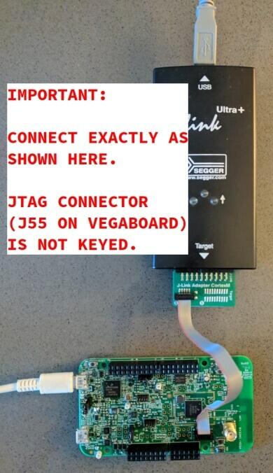
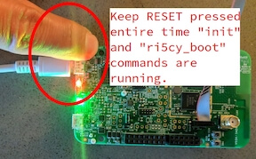

<!-- Copyright 2015-2026 Zephyr Project members and individual contributors. -->
<!-- SPDX-License-Identifier: Apache-2.0 -->
<!-- 中文翻译；编号、导航与译注为本地新增。 -->

<a id="rv32m1_vega"></a>

# 第17章\_OpenISA VEGAboard

原文：[官方页面](https://docs.zephyrproject.org/latest/boards/openisa/rv32m1_vega/doc/index.html)。读取日期：2026-10-16；来源摘要见[来源记录](../SOURCES.md)。

开发板概览（Board Overview）

<a id="id2"></a>

[](images/rv32m1_vega.jpg)

OpenISA VEGAboard

名称（Name）：

`rv32m1_vega`

厂商（Vendor）：

[open-isa.org](https://docs.zephyrproject.org/latest/boards/index.html#vendor=openisa)

状态（Status）：

当前未积极维护（Not Actively Maintained）

架构（Architecture）：

[riscv](https://docs.zephyrproject.org/latest/boards/index.html#arch=riscv)

片上系统（SoC）：

[openisa_rv32m1](https://docs.zephyrproject.org/latest/boards/index.html#soc=openisa_rv32m1)

<a id="board-github-link"></a>

[浏览开发板源码（Browse Board Sources）](https://github.com/zephyrproject-rtos/zephyr/blob/main//boards/openisa/rv32m1_vega/doc/index.rst/../..)<a id="overview"></a>

## 概述（Overview）

VEGAboard采用RV32M1 SoC，具有两个RISC-V CPU、片上就地执行（XIP）闪存及完整外设，包括2.4 GHz多协议无线电。板上还集成传感器及Arduino式扩展连接器。

两个RISC-V CPU分别名为[RI5CY](https://github.com/pulp-platform/riscv)及[ZERO-RISCY](https://github.com/pulp-platform/zero-riscy)，基于[PULP平台](http://iis-projects.ee.ethz.ch/index.php/PULP)的同名设计。RI5CY作为主核，具有更多闪存及RAM，CPU设计也更强；ZERO-RISCY作为次级核，主要为RI5CY上的应用提供无线协处理器（Wireless Coprocessor）功能。两核通过共享内存及消息外设通信。

Zephyr当前使用rv32m1_vega/openisa_rv32m1/ri5cy配置支持RI5CY，使用rv32m1_vega/openisa_rv32m1/zero_riscy配置支持ZERO-RISCY。

<a id="hardware"></a>

## 硬件（Hardware）

VEGAboard具有以下功能。

RV32M1多核SoC：


- RI5CY核：1 MiB闪存及192 KiB SRAM
- ZERO-RISCY核：256 KiB闪存及128 KiB SRAM
- 低功耗模式（Low Power Modes）
- 直接存储器访问（DMA）支持
- 看门狗、CRC、密码运算加速、ADC、DAC、比较器、定时器、PWM、RTC、I2C、UART、SPI、外部存储器、I2S、智能卡、全速USB、uSDHC及2.4 GHz多协议无线电外设

板载传感器及外设：


- 32 Mbit SPI闪存
- FXOS8700六轴加速度计／磁力计及温度传感器
- 环境光传感器（Ambient Light Sensor）
- RGB发光二极管（LED）
- microSD卡槽（Card Slot）
- 天线接口

附加功能：


- 外形兼容Arduino Uno Rev 3扩展连接器布局，但不保证所有Arduino扩展板引脚兼容
- 通过独立OpenSDA芯片提供USB转UART
- 通过2×5、原文写为5 mil间距的连接器，通常称为Arm 10引脚JTAG，连接外部JTAG调试器，对RISC-V烧录及调试；调试器不包含在套件中

<a id="supported-features"></a>

### 支持的功能（Supported Features）

`rv32m1_vega`开发板支持下表所列的硬件功能。

片上／板载（On-Chip / On-Board）

功能集成在片上系统（SoC）内／位于开发板上。

2 / 2

分别表示已启用／已禁用的实例数。点击数量标签，可查看开发板或SoC设备树源码（DTS）中该功能的第一个实例。

`vnd,foo`

与此功能匹配的设备树绑定兼容字符串（Compatible String）；点击链接可查看绑定文档。

<a id="rv32m1_vega-hw-features"></a>

<a id="rv32m1_vega-rv32m1_vega/openisa_rv32m1/ri5cy-hw-features-section"></a>

#### `rv32m1_vega/openisa_rv32m1/ri5cy`目标（Target）

<a id="rv32m1_vega-rv32m1_vega/openisa_rv32m1/ri5cy-hw-features-panel"></a>

<a id="rv32m1_vega-rv32m1_vega/openisa_rv32m1/ri5cy-hw-features-memory"></a>

该开发板目标的片上存储容量：192 KiB RAM、1 MiB Flash。

<a id="rv32m1_vega-rv32m1_vega/openisa_rv32m1/ri5cy-hw-features-table"></a>

<table>
<tr>
<th>类型（Type）</th>
<th>位置（Location）</th>
<th>说明（Description）</th>
<th>兼容字符串（Compatible）</th>
</tr>
<tr>
<td rowspan="1">中央处理器（CPU）</td>
<td>片上（On-Chip）</td>
<td>OpenISA RI5CY核（<a href="https://github.com/zephyrproject-rtos/zephyr/blob/main/dts/riscv/openisa/rv32m1.dtsi?plain=1#L24">已启用：1</a>）</td>
<td><a href="../cpu_vendor_multiarc_binding_reference/P025_openisa_ri5cy.md#std-dtcompatible-openisa-ri5cy"><code>openisa,ri5cy</code></a></td>
</tr>
<tr>
<td rowspan="1">闪存控制器（Flash Controller）</td>
<td>片上（On-Chip）</td>
<td>OpenISA闪存模块E（FTFE）（<a href="https://github.com/zephyrproject-rtos/zephyr/blob/main/dts/riscv/openisa/rv32m1.dtsi?plain=1#L509">已启用：1</a>）</td>
<td><a href="../flash_nuvoton_nxp_renesas_binding_reference/P020_openisa_rv32m1-ftfe.md#std-dtcompatible-openisa-rv32m1-ftfe"><code>openisa,rv32m1-ftfe</code></a></td>
</tr>
<tr>
<td rowspan="2">通用输入输出与接插件（GPIO &amp; Headers）</td>
<td>片上（On-Chip）</td>
<td>OpenISA通用输入输出（GPIO）（<a href="https://github.com/zephyrproject-rtos/zephyr/blob/main/dts/riscv/openisa/rv32m1.dtsi?plain=1#L318">已启用：5</a>）</td>
<td><a href="../gpio_nxp_expanders_binding_reference/P029_openisa_rv32m1-gpio.md#std-dtcompatible-openisa-rv32m1-gpio"><code>openisa,rv32m1-gpio</code></a></td>
</tr>
<tr>
<td>板载（On-Board）</td>
<td>引出到Arduino Uno R3排针（Headers）的GPIO引脚（<a href="https://github.com/zephyrproject-rtos/zephyr/blob/main/boards/openisa/rv32m1_vega/rv32m1_vega_openisa_rv32m1.dtsi?plain=1#L101">已启用：1</a>）</td>
<td><a href="../gpio_adi_headers_ambiq_binding_reference/P023_arduino-header-r3.md#std-dtcompatible-arduino-header-r3"><code>arduino-header-r3</code></a></td>
</tr>
<tr>
<td rowspan="1">集成电路间总线（I2C）</td>
<td>片上（On-Chip）</td>
<td>OpenISA低功耗I2C（LPI2C）控制器（<a href="https://github.com/zephyrproject-rtos/zephyr/blob/main/dts/riscv/openisa/rv32m1.dtsi?plain=1#L387">已启用：2</a>；<a href="https://github.com/zephyrproject-rtos/zephyr/blob/main/dts/riscv/openisa/rv32m1.dtsi?plain=1#L397">已禁用：2</a>）</td>
<td><a href="../i2c_nxp_pico_renesas_binding_reference/P007_openisa_rv32m1-lpi2c.md#std-dtcompatible-openisa-rv32m1-lpi2c"><code>openisa,rv32m1-lpi2c</code></a></td>
</tr>
<tr>
<td rowspan="1">输入（Input）</td>
<td>板载（On-Board）</td>
<td>一组绑定到 GPIO 的输入按键（GPIO-Bound Input Keys）（<a href="https://github.com/zephyrproject-rtos/zephyr/blob/main/boards/openisa/rv32m1_vega/rv32m1_vega_openisa_rv32m1.dtsi?plain=1#L73">已启用：1</a>）</td>
<td><a href="../hardware/P563_GPIO按键绑定.md#std-dtcompatible-gpio-keys"><code>gpio-keys</code></a></td>
</tr>
<tr>
<td rowspan="3">中断控制器（Interrupt Controller）</td>
<td>片上（On-Chip）</td>
<td>RV32M1事件单元（Event Unit）（<a href="https://github.com/zephyrproject-rtos/zephyr/blob/main/dts/riscv/openisa/rv32m1.dtsi?plain=1#L75">已启用：2</a>）</td>
<td><a href="../nxp_interrupt_binding_reference/P008_openisa_rv32m1-event-unit.md#std-dtcompatible-openisa-rv32m1-event-unit"><code>openisa,rv32m1-event-unit</code></a></td>
</tr>
<tr>
<td>片上（On-Chip）</td>
<td>RV32M1中断多路复用（INTMUX）IP（<a href="https://github.com/zephyrproject-rtos/zephyr/blob/main/dts/riscv/openisa/rv32m1.dtsi?plain=1#L91">已启用：1</a>）</td>
<td><a href="../nxp_interrupt_binding_reference/P009_openisa_rv32m1-intmux.md#std-dtcompatible-openisa-rv32m1-intmux"><code>openisa,rv32m1-intmux</code></a></td>
</tr>
<tr>
<td>片上（On-Chip）</td>
<td>RV32M1 INTMUX通道（<a href="https://github.com/zephyrproject-rtos/zephyr/blob/main/dts/riscv/openisa/rv32m1.dtsi?plain=1#L101">已启用：2</a>；<a href="https://github.com/zephyrproject-rtos/zephyr/blob/main/dts/riscv/openisa/rv32m1.dtsi?plain=1#L121">已禁用：6</a>）</td>
<td><a href="../nxp_interrupt_binding_reference/P010_openisa_rv32m1-intmux-ch.md#std-dtcompatible-openisa-rv32m1-intmux-ch"><code>openisa,rv32m1-intmux-ch</code></a></td>
</tr>
<tr>
<td rowspan="2">发光二极管（LED）</td>
<td>板载（On-Board）</td>
<td>一组由 GPIO 控制的 LED（GPIO-Controlled LEDs）（<a href="https://github.com/zephyrproject-rtos/zephyr/blob/main/boards/openisa/rv32m1_vega/rv32m1_vega_openisa_rv32m1.dtsi?plain=1#L30">已启用：1</a>）</td>
<td><a href="../hardware/P564_GPIO指示灯绑定.md#dtbinding-gpio-leds"><code>gpio-leds</code></a></td>
</tr>
<tr>
<td>板载（On-Board）</td>
<td>一组由脉宽调制（PWM）控制的LED（<a href="https://github.com/zephyrproject-rtos/zephyr/blob/main/boards/openisa/rv32m1_vega/rv32m1_vega_openisa_rv32m1.dtsi?plain=1#L54">已启用：1</a>）</td>
<td><a href="../hardware/P565_PWM指示灯绑定.md#dtbinding-pwm-leds"><code>pwm-leds</code></a></td>
</tr>
<tr>
<td rowspan="1">调制解调器（Modem）</td>
<td>片上（On-Chip）</td>
<td>RV32M1通用频移键控（FSK）可编程调制解调器节点（<a href="https://github.com/zephyrproject-rtos/zephyr/blob/main/dts/riscv/openisa/rv32m1.dtsi?plain=1#L463">已启用：1</a>）</td>
<td><a href="../modem_fibocom_nordic_quectel_binding_reference/P005_openisa_rv32m1-genfsk.md#std-dtcompatible-openisa-rv32m1-genfsk"><code>openisa,rv32m1-genfsk</code></a></td>
</tr>
<tr>
<td rowspan="2">存储技术设备（MTD）</td>
<td>板载（On-Board）</td>
<td>这些属性用于支持Zephyr的<code>spi-nor</code>闪存驱动通过Zephyr SPI API，使用基于M25P80的标准命令集控制串行闪存（Serial Flash Memory）。（<a href="https://github.com/zephyrproject-rtos/zephyr/blob/main/boards/openisa/rv32m1_vega/rv32m1_vega_openisa_rv32m1.dtsi?plain=1#L175">已启用：1</a>）</td>
<td><a href="../mtd_microchip_nordic_nxp_binding_reference/P002_jedec_spi-nor.md#std-dtcompatible-jedec-spi-nor"><code>jedec,spi-nor</code></a></td>
</tr>
<tr>
<td>片上（On-Chip）</td>
<td>闪存（Flash）节点（<a href="https://github.com/zephyrproject-rtos/zephyr/blob/main/dts/riscv/openisa/rv32m1.dtsi?plain=1#L516">已启用：2</a>）</td>
<td><a href="../mtd_nxp_st_ti_partition_binding_reference/P013_soc-nv-flash.md#std-dtcompatible-soc-nv-flash"><code>soc-nv-flash</code></a></td>
</tr>
<tr>
<td rowspan="2">引脚控制（Pin Control）</td>
<td>片上（On-Chip）</td>
<td>OpenISA RV32M1引脚控制器（<a href="https://github.com/zephyrproject-rtos/zephyr/blob/main/dts/riscv/openisa/rv32m1.dtsi?plain=1#L52">已启用：1</a>）</td>
<td><a href="../pinctrl_nxp_pico_binding_reference/P022_openisa_rv32m1-pinctrl.md#std-dtcompatible-openisa-rv32m1-pinctrl"><code>openisa,rv32m1-pinctrl</code></a></td>
</tr>
<tr>
<td>片上（On-Chip）</td>
<td>RV32M1引脚复用（Pinmux）（<a href="https://github.com/zephyrproject-rtos/zephyr/blob/main/dts/riscv/openisa/rv32m1.dtsi?plain=1#L288">已启用：5</a>）</td>
<td><a href="../pinctrl_nxp_pico_binding_reference/P023_openisa_rv32m1-pinmux.md#std-dtcompatible-openisa-rv32m1-pinmux"><code>openisa,rv32m1-pinmux</code></a></td>
</tr>
<tr>
<td rowspan="1">脉宽调制（PWM）</td>
<td>片上（On-Chip）</td>
<td>OpenISA定时器／PWM模块（TPM）（<a href="https://github.com/zephyrproject-rtos/zephyr/blob/main/dts/riscv/openisa/rv32m1.dtsi?plain=1#L486">已启用：1</a>；<a href="https://github.com/zephyrproject-rtos/zephyr/blob/main/dts/riscv/openisa/rv32m1.dtsi?plain=1#L470">已禁用：3</a>）</td>
<td><a href="../pwm_nxp_renesas_binding_reference/P013_openisa_rv32m1-tpm.md#std-dtcompatible-openisa-rv32m1-tpm"><code>openisa,rv32m1-tpm</code></a></td>
</tr>
<tr>
<td rowspan="1">RISC-V 架构（RISC-V Architecture）</td>
<td>片上（On-Chip）</td>
<td>RV32M1外设时钟控制（PCC）（<a href="https://github.com/zephyrproject-rtos/zephyr/blob/main/dts/riscv/openisa/rv32m1.dtsi?plain=1#L63">已启用：2</a>）</td>
<td><a href="../platform_rmt_openthread_binding_reference/P011_openisa_rv32m1-pcc.md#std-dtcompatible-openisa-rv32m1-pcc"><code>openisa,rv32m1-pcc</code></a></td>
</tr>
<tr>
<td rowspan="1">随机数生成器（RNG）</td>
<td>片上（On-Chip）</td>
<td>OpenISA真随机数发生器（TRNG）（<a href="https://github.com/zephyrproject-rtos/zephyr/blob/main/dts/riscv/openisa/rv32m1.dtsi?plain=1#L494">已启用：1</a>）</td>
<td><a href="../rng_binding_reference/P022_openisa_rv32m1-trng.md#std-dtcompatible-openisa-rv32m1-trng"><code>openisa,rv32m1-trng</code></a></td>
</tr>
<tr>
<td rowspan="1">传感器（Sensors）</td>
<td>板载（On-Board）</td>
<td>FXOS8700六轴加速度计／磁力计传感器（<a href="https://github.com/zephyrproject-rtos/zephyr/blob/main/boards/openisa/rv32m1_vega/rv32m1_vega_openisa_rv32m1.dtsi?plain=1#L154">已启用：1</a>）</td>
<td><a href="../compatible_binding_reference/P052_nxp_fxos8700.md#std-dtcompatible-nxp-fxos8700"><code>nxp,fxos8700</code></a></td>
</tr>
<tr>
<td rowspan="1">串行控制器（Serial Controller）</td>
<td>片上（On-Chip）</td>
<td>OpenISA低功耗UART（LPUART）（<a href="https://github.com/zephyrproject-rtos/zephyr/blob/main/dts/riscv/openisa/rv32m1.dtsi?plain=1#L359">已启用：1</a>；<a href="https://github.com/zephyrproject-rtos/zephyr/blob/main/dts/riscv/openisa/rv32m1.dtsi?plain=1#L366">已禁用：3</a>）</td>
<td><a href="../uart_microchip_nordic_nxp_binding_reference/P019_openisa_rv32m1-lpuart.md#std-dtcompatible-openisa-rv32m1-lpuart"><code>openisa,rv32m1-lpuart</code></a></td>
</tr>
<tr>
<td rowspan="1">串行外设接口（SPI）</td>
<td>片上（On-Chip）</td>
<td>OpenISA低功耗SPI（LPSPI）控制器（<a href="https://github.com/zephyrproject-rtos/zephyr/blob/main/dts/riscv/openisa/rv32m1.dtsi?plain=1#L427">已启用：2</a>；<a href="https://github.com/zephyrproject-rtos/zephyr/blob/main/dts/riscv/openisa/rv32m1.dtsi?plain=1#L445">已禁用：2</a>）</td>
<td><a href="../spi_flexspi_nxp_renesas_binding_reference/P008_openisa_rv32m1-lpspi.md#std-dtcompatible-openisa-rv32m1-lpspi"><code>openisa,rv32m1-lpspi</code></a></td>
</tr>
<tr>
<td rowspan="1">静态随机存储器（SRAM）</td>
<td>片上（On-Chip）</td>
<td>通用片上静态随机存储器（SRAM）（<a href="https://github.com/zephyrproject-rtos/zephyr/blob/main/dts/riscv/openisa/rv32m1.dtsi?plain=1#L41">已启用：2</a>）</td>
<td><a href="../hardware/P567_内存映射SRAM绑定.md#dtbinding-mmio-sram"><code>mmio-sram</code></a></td>
</tr>
<tr>
<td rowspan="1">定时器（Timer）</td>
<td>片上（On-Chip）</td>
<td>OpenISA RV32M1低功耗定时器（LPTMR）外设（<a href="https://github.com/zephyrproject-rtos/zephyr/blob/main/dts/riscv/openisa/rv32m1.dtsi?plain=1#L273">已启用：3</a>）</td>
<td><a href="../system_timer_binding_reference/P011_openisa_rv32m1-lptmr.md#std-dtcompatible-openisa-rv32m1-lptmr"><code>openisa,rv32m1-lptmr</code></a></td>
</tr>
</table>

<a id="rv32m1_vega-rv32m1_vega/openisa_rv32m1/zero_riscy-hw-features-section"></a>

#### `rv32m1_vega/openisa_rv32m1/zero_riscy`目标（Target）

<a id="rv32m1_vega-rv32m1_vega/openisa_rv32m1/zero_riscy-hw-features-panel"></a>

<a id="rv32m1_vega-rv32m1_vega/openisa_rv32m1/zero_riscy-hw-features-memory"></a>

该开发板目标的片上存储容量：128 KiB RAM、256 KiB Flash。

<a id="rv32m1_vega-rv32m1_vega/openisa_rv32m1/zero_riscy-hw-features-table"></a>

<table>
<tr>
<th>类型（Type）</th>
<th>位置（Location）</th>
<th>说明（Description）</th>
<th>兼容字符串（Compatible）</th>
</tr>
<tr>
<td rowspan="1">中央处理器（CPU）</td>
<td>片上（On-Chip）</td>
<td>OpenISA Zero-RI5CY核；名称按原文保留（<a href="https://github.com/zephyrproject-rtos/zephyr/blob/main/dts/riscv/openisa/rv32m1.dtsi?plain=1#L32">已启用：1</a>）</td>
<td><a href="../cpu_vendor_multiarc_binding_reference/P026_openisa_zero-ri5cy.md#std-dtcompatible-openisa-zero-ri5cy"><code>openisa,zero-ri5cy</code></a></td>
</tr>
<tr>
<td rowspan="1">闪存控制器（Flash Controller）</td>
<td>片上（On-Chip）</td>
<td>OpenISA闪存模块E（FTFE）（<a href="https://github.com/zephyrproject-rtos/zephyr/blob/main/dts/riscv/openisa/rv32m1.dtsi?plain=1#L509">已启用：1</a>）</td>
<td><a href="../flash_nuvoton_nxp_renesas_binding_reference/P020_openisa_rv32m1-ftfe.md#std-dtcompatible-openisa-rv32m1-ftfe"><code>openisa,rv32m1-ftfe</code></a></td>
</tr>
<tr>
<td rowspan="2">通用输入输出与接插件（GPIO &amp; Headers）</td>
<td>片上（On-Chip）</td>
<td>OpenISA通用输入输出（GPIO）（<a href="https://github.com/zephyrproject-rtos/zephyr/blob/main/dts/riscv/openisa/rv32m1.dtsi?plain=1#L318">已启用：5</a>）</td>
<td><a href="../gpio_nxp_expanders_binding_reference/P029_openisa_rv32m1-gpio.md#std-dtcompatible-openisa-rv32m1-gpio"><code>openisa,rv32m1-gpio</code></a></td>
</tr>
<tr>
<td>板载（On-Board）</td>
<td>引出到Arduino Uno R3排针（Headers）的GPIO引脚（<a href="https://github.com/zephyrproject-rtos/zephyr/blob/main/boards/openisa/rv32m1_vega/rv32m1_vega_openisa_rv32m1.dtsi?plain=1#L101">已启用：1</a>）</td>
<td><a href="../gpio_adi_headers_ambiq_binding_reference/P023_arduino-header-r3.md#std-dtcompatible-arduino-header-r3"><code>arduino-header-r3</code></a></td>
</tr>
<tr>
<td rowspan="1">集成电路间总线（I2C）</td>
<td>片上（On-Chip）</td>
<td>OpenISA低功耗I2C（LPI2C）控制器（<a href="https://github.com/zephyrproject-rtos/zephyr/blob/main/dts/riscv/openisa/rv32m1.dtsi?plain=1#L387">已启用：2</a>；<a href="https://github.com/zephyrproject-rtos/zephyr/blob/main/dts/riscv/openisa/rv32m1.dtsi?plain=1#L397">已禁用：2</a>）</td>
<td><a href="../i2c_nxp_pico_renesas_binding_reference/P007_openisa_rv32m1-lpi2c.md#std-dtcompatible-openisa-rv32m1-lpi2c"><code>openisa,rv32m1-lpi2c</code></a></td>
</tr>
<tr>
<td rowspan="1">输入（Input）</td>
<td>板载（On-Board）</td>
<td>一组绑定到 GPIO 的输入按键（GPIO-Bound Input Keys）（<a href="https://github.com/zephyrproject-rtos/zephyr/blob/main/boards/openisa/rv32m1_vega/rv32m1_vega_openisa_rv32m1.dtsi?plain=1#L73">已启用：1</a>）</td>
<td><a href="../hardware/P563_GPIO按键绑定.md#std-dtcompatible-gpio-keys"><code>gpio-keys</code></a></td>
</tr>
<tr>
<td rowspan="3">中断控制器（Interrupt Controller）</td>
<td>片上（On-Chip）</td>
<td>RV32M1事件单元（Event Unit）（<a href="https://github.com/zephyrproject-rtos/zephyr/blob/main/dts/riscv/openisa/rv32m1.dtsi?plain=1#L75">已启用：2</a>）</td>
<td><a href="../nxp_interrupt_binding_reference/P008_openisa_rv32m1-event-unit.md#std-dtcompatible-openisa-rv32m1-event-unit"><code>openisa,rv32m1-event-unit</code></a></td>
</tr>
<tr>
<td>片上（On-Chip）</td>
<td>RV32M1中断多路复用（INTMUX）IP（<a href="https://github.com/zephyrproject-rtos/zephyr/blob/main/dts/riscv/openisa/rv32m1.dtsi?plain=1#L182">已启用：1</a>）</td>
<td><a href="../nxp_interrupt_binding_reference/P009_openisa_rv32m1-intmux.md#std-dtcompatible-openisa-rv32m1-intmux"><code>openisa,rv32m1-intmux</code></a></td>
</tr>
<tr>
<td>片上（On-Chip）</td>
<td>RV32M1 INTMUX通道（<a href="https://github.com/zephyrproject-rtos/zephyr/blob/main/dts/riscv/openisa/rv32m1.dtsi?plain=1#L192">已启用：1</a>；<a href="https://github.com/zephyrproject-rtos/zephyr/blob/main/dts/riscv/openisa/rv32m1.dtsi?plain=1#L202">已禁用：7</a>）</td>
<td><a href="../nxp_interrupt_binding_reference/P010_openisa_rv32m1-intmux-ch.md#std-dtcompatible-openisa-rv32m1-intmux-ch"><code>openisa,rv32m1-intmux-ch</code></a></td>
</tr>
<tr>
<td rowspan="2">发光二极管（LED）</td>
<td>板载（On-Board）</td>
<td>一组由 GPIO 控制的 LED（GPIO-Controlled LEDs）（<a href="https://github.com/zephyrproject-rtos/zephyr/blob/main/boards/openisa/rv32m1_vega/rv32m1_vega_openisa_rv32m1.dtsi?plain=1#L30">已启用：1</a>）</td>
<td><a href="../hardware/P564_GPIO指示灯绑定.md#dtbinding-gpio-leds"><code>gpio-leds</code></a></td>
</tr>
<tr>
<td>板载（On-Board）</td>
<td>一组由脉宽调制（PWM）控制的LED（<a href="https://github.com/zephyrproject-rtos/zephyr/blob/main/boards/openisa/rv32m1_vega/rv32m1_vega_openisa_rv32m1.dtsi?plain=1#L54">已启用：1</a>）</td>
<td><a href="../hardware/P565_PWM指示灯绑定.md#dtbinding-pwm-leds"><code>pwm-leds</code></a></td>
</tr>
<tr>
<td rowspan="1">调制解调器（Modem）</td>
<td>片上（On-Chip）</td>
<td>RV32M1通用频移键控（FSK）可编程调制解调器节点（<a href="https://github.com/zephyrproject-rtos/zephyr/blob/main/dts/riscv/openisa/rv32m1.dtsi?plain=1#L463">已启用：1</a>）</td>
<td><a href="../modem_fibocom_nordic_quectel_binding_reference/P005_openisa_rv32m1-genfsk.md#std-dtcompatible-openisa-rv32m1-genfsk"><code>openisa,rv32m1-genfsk</code></a></td>
</tr>
<tr>
<td rowspan="2">存储技术设备（MTD）</td>
<td>板载（On-Board）</td>
<td>这些属性用于支持Zephyr的<code>spi-nor</code>闪存驱动通过Zephyr SPI API，使用基于M25P80的标准命令集控制串行闪存（Serial Flash Memory）。（<a href="https://github.com/zephyrproject-rtos/zephyr/blob/main/boards/openisa/rv32m1_vega/rv32m1_vega_openisa_rv32m1.dtsi?plain=1#L175">已启用：1</a>）</td>
<td><a href="../mtd_microchip_nordic_nxp_binding_reference/P002_jedec_spi-nor.md#std-dtcompatible-jedec-spi-nor"><code>jedec,spi-nor</code></a></td>
</tr>
<tr>
<td>片上（On-Chip）</td>
<td>闪存（Flash）节点（<a href="https://github.com/zephyrproject-rtos/zephyr/blob/main/dts/riscv/openisa/rv32m1.dtsi?plain=1#L516">已启用：2</a>）</td>
<td><a href="../mtd_nxp_st_ti_partition_binding_reference/P013_soc-nv-flash.md#std-dtcompatible-soc-nv-flash"><code>soc-nv-flash</code></a></td>
</tr>
<tr>
<td rowspan="2">引脚控制（Pin Control）</td>
<td>片上（On-Chip）</td>
<td>OpenISA RV32M1引脚控制器（<a href="https://github.com/zephyrproject-rtos/zephyr/blob/main/dts/riscv/openisa/rv32m1.dtsi?plain=1#L52">已启用：1</a>）</td>
<td><a href="../pinctrl_nxp_pico_binding_reference/P022_openisa_rv32m1-pinctrl.md#std-dtcompatible-openisa-rv32m1-pinctrl"><code>openisa,rv32m1-pinctrl</code></a></td>
</tr>
<tr>
<td>片上（On-Chip）</td>
<td>RV32M1引脚复用（Pinmux）（<a href="https://github.com/zephyrproject-rtos/zephyr/blob/main/dts/riscv/openisa/rv32m1.dtsi?plain=1#L288">已启用：5</a>）</td>
<td><a href="../pinctrl_nxp_pico_binding_reference/P023_openisa_rv32m1-pinmux.md#std-dtcompatible-openisa-rv32m1-pinmux"><code>openisa,rv32m1-pinmux</code></a></td>
</tr>
<tr>
<td rowspan="1">脉宽调制（PWM）</td>
<td>片上（On-Chip）</td>
<td>OpenISA定时器／PWM模块（TPM）（<a href="https://github.com/zephyrproject-rtos/zephyr/blob/main/dts/riscv/openisa/rv32m1.dtsi?plain=1#L486">已启用：1</a>；<a href="https://github.com/zephyrproject-rtos/zephyr/blob/main/dts/riscv/openisa/rv32m1.dtsi?plain=1#L470">已禁用：3</a>）</td>
<td><a href="../pwm_nxp_renesas_binding_reference/P013_openisa_rv32m1-tpm.md#std-dtcompatible-openisa-rv32m1-tpm"><code>openisa,rv32m1-tpm</code></a></td>
</tr>
<tr>
<td rowspan="1">RISC-V 架构（RISC-V Architecture）</td>
<td>片上（On-Chip）</td>
<td>RV32M1外设时钟控制（PCC）（<a href="https://github.com/zephyrproject-rtos/zephyr/blob/main/dts/riscv/openisa/rv32m1.dtsi?plain=1#L63">已启用：2</a>）</td>
<td><a href="../platform_rmt_openthread_binding_reference/P011_openisa_rv32m1-pcc.md#std-dtcompatible-openisa-rv32m1-pcc"><code>openisa,rv32m1-pcc</code></a></td>
</tr>
<tr>
<td rowspan="1">随机数生成器（RNG）</td>
<td>片上（On-Chip）</td>
<td>OpenISA真随机数发生器（TRNG）（<a href="https://github.com/zephyrproject-rtos/zephyr/blob/main/dts/riscv/openisa/rv32m1.dtsi?plain=1#L494">已启用：1</a>）</td>
<td><a href="../rng_binding_reference/P022_openisa_rv32m1-trng.md#std-dtcompatible-openisa-rv32m1-trng"><code>openisa,rv32m1-trng</code></a></td>
</tr>
<tr>
<td rowspan="1">传感器（Sensors）</td>
<td>板载（On-Board）</td>
<td>FXOS8700六轴加速度计／磁力计传感器（<a href="https://github.com/zephyrproject-rtos/zephyr/blob/main/boards/openisa/rv32m1_vega/rv32m1_vega_openisa_rv32m1.dtsi?plain=1#L154">已启用：1</a>）</td>
<td><a href="../compatible_binding_reference/P052_nxp_fxos8700.md#std-dtcompatible-nxp-fxos8700"><code>nxp,fxos8700</code></a></td>
</tr>
<tr>
<td rowspan="1">串行控制器（Serial Controller）</td>
<td>片上（On-Chip）</td>
<td>OpenISA低功耗UART（LPUART）（<a href="https://github.com/zephyrproject-rtos/zephyr/blob/main/dts/riscv/openisa/rv32m1.dtsi?plain=1#L359">已启用：1</a>；<a href="https://github.com/zephyrproject-rtos/zephyr/blob/main/dts/riscv/openisa/rv32m1.dtsi?plain=1#L366">已禁用：3</a>）</td>
<td><a href="../uart_microchip_nordic_nxp_binding_reference/P019_openisa_rv32m1-lpuart.md#std-dtcompatible-openisa-rv32m1-lpuart"><code>openisa,rv32m1-lpuart</code></a></td>
</tr>
<tr>
<td rowspan="1">串行外设接口（SPI）</td>
<td>片上（On-Chip）</td>
<td>OpenISA低功耗SPI（LPSPI）控制器（<a href="https://github.com/zephyrproject-rtos/zephyr/blob/main/dts/riscv/openisa/rv32m1.dtsi?plain=1#L427">已启用：2</a>；<a href="https://github.com/zephyrproject-rtos/zephyr/blob/main/dts/riscv/openisa/rv32m1.dtsi?plain=1#L445">已禁用：2</a>）</td>
<td><a href="../spi_flexspi_nxp_renesas_binding_reference/P008_openisa_rv32m1-lpspi.md#std-dtcompatible-openisa-rv32m1-lpspi"><code>openisa,rv32m1-lpspi</code></a></td>
</tr>
<tr>
<td rowspan="1">静态随机存储器（SRAM）</td>
<td>片上（On-Chip）</td>
<td>通用片上静态随机存储器（SRAM）（<a href="https://github.com/zephyrproject-rtos/zephyr/blob/main/dts/riscv/openisa/rv32m1.dtsi?plain=1#L41">已启用：2</a>）</td>
<td><a href="../hardware/P567_内存映射SRAM绑定.md#dtbinding-mmio-sram"><code>mmio-sram</code></a></td>
</tr>
<tr>
<td rowspan="1">定时器（Timer）</td>
<td>片上（On-Chip）</td>
<td>OpenISA RV32M1低功耗定时器（LPTMR）外设（<a href="https://github.com/zephyrproject-rtos/zephyr/blob/main/dts/riscv/openisa/rv32m1.dtsi?plain=1#L273">已启用：3</a>）</td>
<td><a href="../system_timer_binding_reference/P011_openisa_rv32m1-lptmr.md#std-dtcompatible-openisa-rv32m1-lptmr"><code>openisa,rv32m1-lptmr</code></a></td>
</tr>
</table>

<a id="ble-software-link-layer-experimental-support"></a>

### 低功耗蓝牙软件链路层实验性支持（BLE Software Link Layer）

这是Zephyr RI5CY配置rv32m1_vega/openisa_rv32m1/ri5cy支持的实验性功能。它采用Nordic Semiconductor的软件链路层框架，启用SoC上的无线电及收发器，实现软件定义BLE控制器。结合Zephyr的控制器及主机协议栈，可在此板运行以下BLE示例：


- beacon
- central
- central_hr
- eddystone
- hci_uart
- ibeacon
- peripheral_csc，骑行速度及踏频（Cycling Speed Cadence）
- peripheral_dis，设备信息服务（Device Information Service）
- peripheral_esp，环境感知服务（Environmental Sensing Service）；标识按原文保留
- peripheral_hr，心率（Heart Rate）
- peripheral_ht，健康温度计（Health Thermometer）
- peripheral
- scan_adv

注意（Note）

BLE软件链路层限制：


- 不支持512／256 Kbit/s PHY
- 不支持发射功率调整（TX Power Adjustment）

<a id="connections-and-ios"></a>

### 连接与输入输出（Connections and IOs）

RV32M1 SoC引脚引出到Arduino式扩展连接器。每个连接器有两排引脚，相比标准Arduino布局额外增加一排。

后续小节表格说明各引脚。由于连接器通常按行划分逻辑功能，奇数及偶数引脚分别列出。“端口／位”（Port/bit）采用SoC的PORT及GPIO外设命名，例如E/13表示PORTE／GPIOE的第13脚。

详情见原理图及芯片参考手册，文档可从[OpenISA GitHub发布页](https://github.com/open-isa-org/open-isa.org/releases)获取。

注意（Note）

具有外设功能的引脚也可复用为GPIO。

右上方扩展排针J1

奇数／下排引脚：

<table>
<tr>
<th>引脚（Pin）</th>
<th>端口／位（Port/bit）</th>
<th>功能（Function）</th>
</tr>
<tr>
<td>1</td>
<td>E/13</td>
<td>I2S_TX_BCLK</td>
</tr>
<tr>
<td>3</td>
<td>E/14</td>
<td>I2S_TX_FS</td>
</tr>
<tr>
<td>5</td>
<td>E/15</td>
<td>I2S_TXD</td>
</tr>
<tr>
<td>7</td>
<td>E/19</td>
<td>I2S_MCLK</td>
</tr>
<tr>
<td>9</td>
<td>E/16</td>
<td>I2S_RX_BCLK</td>
</tr>
<tr>
<td>11</td>
<td>E/21</td>
<td>SOF_OUT</td>
</tr>
<tr>
<td>13</td>
<td>E/17</td>
<td>I2S_RX_FS</td>
</tr>
<tr>
<td>15</td>
<td>E/18</td>
<td>I2S_RXD</td>
</tr>
</table>

偶数／上排引脚：

<table>
<tr>
<th>引脚（Pin）</th>
<th>端口／位（Port/bit）</th>
<th>功能（Function）</th>
</tr>
<tr>
<td>2</td>
<td>A/25</td>
<td>UART1_RX</td>
</tr>
<tr>
<td>4</td>
<td>A/26</td>
<td>UART1_TX</td>
</tr>
<tr>
<td>6</td>
<td>A/27</td>
<td>通用输入输出（GPIO）</td>
</tr>
<tr>
<td>8</td>
<td>B/13</td>
<td>脉宽调制（PWM）</td>
</tr>
<tr>
<td>10</td>
<td>B/14</td>
<td>通用输入输出（GPIO）</td>
</tr>
<tr>
<td>12</td>
<td>A/30</td>
<td>脉宽调制（PWM）</td>
</tr>
<tr>
<td>14</td>
<td>A/31</td>
<td>PWM/CMP</td>
</tr>
<tr>
<td>16</td>
<td>B/1</td>
<td>通用输入输出（GPIO）</td>
</tr>
</table>

左上方扩展排针J2

奇数／下排引脚：

<table>
<tr>
<th>引脚（Pin）</th>
<th>端口／位（Port/bit）</th>
<th>功能（Function）</th>
</tr>
<tr>
<td>1</td>
<td>D/5</td>
<td>FLEXIO_D25</td>
</tr>
<tr>
<td>3</td>
<td>D/4</td>
<td>FLEXIO_D24</td>
</tr>
<tr>
<td>5</td>
<td>D/3</td>
<td>FLEXIO_D23</td>
</tr>
<tr>
<td>7</td>
<td>D/2</td>
<td>FLEXIO_D22</td>
</tr>
<tr>
<td>9</td>
<td>D/1</td>
<td>FLEXIO_D21</td>
</tr>
<tr>
<td>11</td>
<td>D/0</td>
<td>FLEXIO_D20</td>
</tr>
<tr>
<td>13</td>
<td>C/30</td>
<td>FLEXIO_D19</td>
</tr>
<tr>
<td>15</td>
<td>C/29</td>
<td>FLEXIO_D18</td>
</tr>
<tr>
<td>17</td>
<td>C/28</td>
<td>FLEXIO_D17</td>
</tr>
<tr>
<td>19</td>
<td>B/29</td>
<td>FLEXIO_D16</td>
</tr>
</table>

偶数／上排引脚：

<table>
<tr>
<th>引脚（Pin）</th>
<th>端口／位（Port/bit）</th>
<th>功能（Function）</th>
</tr>
<tr>
<td>2</td>
<td>B/2</td>
<td>通用输入输出（GPIO）</td>
</tr>
<tr>
<td>4</td>
<td>B/3</td>
<td>脉宽调制（PWM）</td>
</tr>
<tr>
<td>6</td>
<td>B/6</td>
<td>SPI0_PCS2</td>
</tr>
<tr>
<td>8</td>
<td>B/5</td>
<td>SPI0_SOUT</td>
</tr>
<tr>
<td>10</td>
<td>B/7</td>
<td>SPI0_SIN</td>
</tr>
<tr>
<td>12</td>
<td>B/4</td>
<td>SPI0_SCK</td>
</tr>
<tr>
<td>14</td>
<td><ul><li></li></ul></td>
<td>地（GND）</td>
</tr>
<tr>
<td>16</td>
<td><ul><li></li></ul></td>
<td>模拟参考电压（AREF）</td>
</tr>
<tr>
<td>18</td>
<td>C/9</td>
<td>I2C0_SDA</td>
</tr>
<tr>
<td>20</td>
<td>C/10</td>
<td>I2C0_SCL</td>
</tr>
</table>

左下方扩展排针J3

注意，开发板底部排针的奇数引脚位于上排，与顶部排针相反。

奇数／上排引脚：

<table>
<tr>
<th>引脚（Pin）</th>
<th>端口／位（Port/bit）</th>
<th>功能（Function）</th>
</tr>
<tr>
<td>1</td>
<td>A/21</td>
<td>ARDUINO_EMVSIM_PD</td>
</tr>
<tr>
<td>3</td>
<td>A/20</td>
<td>ARDUINO_EMVSIM_IO</td>
</tr>
<tr>
<td>5</td>
<td>A/19</td>
<td>ARDUINO_EMVSIM_VCCEN</td>
</tr>
<tr>
<td>7</td>
<td>A/18</td>
<td>ARDUINO_EMVSIM_RST</td>
</tr>
<tr>
<td>9</td>
<td>A/17</td>
<td>ARDUINO_EMVSIM_CLK</td>
</tr>
<tr>
<td>11</td>
<td>B/17</td>
<td>FLEXIO_D7</td>
</tr>
<tr>
<td>13</td>
<td>B/16</td>
<td>FLEXIO_D6</td>
</tr>
<tr>
<td>15</td>
<td>B/15</td>
<td>FLEXIO_D5</td>
</tr>
</table>

偶数／下排引脚，主要与电源有关：

<table>
<tr>
<th>引脚（Pin）</th>
<th>端口／位（Port/bit）</th>
<th>功能（Function）</th>
</tr>
<tr>
<td>2</td>
<td><ul><li></li></ul></td>
<td>SDA_GPIO0</td>
</tr>
<tr>
<td>4</td>
<td><ul><li></li></ul></td>
<td>BRD_IO_PER</td>
</tr>
<tr>
<td>6</td>
<td><ul><li></li></ul></td>
<td>RST_SDA</td>
</tr>
<tr>
<td>8</td>
<td><ul><li></li></ul></td>
<td>BRD_IO_PER</td>
</tr>
<tr>
<td>10</td>
<td><ul><li></li></ul></td>
<td>P5V_INPUT</td>
</tr>
<tr>
<td>12</td>
<td><ul><li></li></ul></td>
<td>地（GND）</td>
</tr>
<tr>
<td>14</td>
<td><ul><li></li></ul></td>
<td>地（GND）</td>
</tr>
<tr>
<td>16</td>
<td><ul><li></li></ul></td>
<td>P5-9V VIN</td>
</tr>
</table>

右下方扩展排针J4

注意，开发板底部排针的奇数引脚位于上排，与顶部排针相反。

奇数／上排引脚：

<table>
<tr>
<th>引脚（Pin）</th>
<th>端口／位（Port/bit）</th>
<th>功能（Function）</th>
</tr>
<tr>
<td>1</td>
<td><ul><li></li></ul></td>
<td>TAMPER2</td>
</tr>
<tr>
<td>3</td>
<td><ul><li></li></ul></td>
<td>TAMPER1/RTC_CLKOUT</td>
</tr>
<tr>
<td>5</td>
<td><ul><li></li></ul></td>
<td>TAMPER0/RTC_WAKEUP_b</td>
</tr>
<tr>
<td>7</td>
<td>E/2</td>
<td>ADC0_SE19</td>
</tr>
<tr>
<td>9</td>
<td>E/5</td>
<td>LPCMP1_IN2/LPCMP1_OUT</td>
</tr>
<tr>
<td>11</td>
<td><ul><li></li></ul></td>
<td>DAC0_OUT/ADC0_SE16/LPCMP0_IN3/LPCMP1_IN3</td>
</tr>
</table>

偶数／下排引脚：

<table>
<tr>
<th>引脚（Pin）</th>
<th>端口／位（Port/bit）</th>
<th>功能（Function）</th>
</tr>
<tr>
<td>2</td>
<td>C/11</td>
<td>ADC0_SE6</td>
</tr>
<tr>
<td>4</td>
<td>C/12</td>
<td>ADC0_SE7</td>
</tr>
<tr>
<td>6</td>
<td>B/9</td>
<td>ADC0_SE3</td>
</tr>
<tr>
<td>8</td>
<td>E/4</td>
<td>ADC0_SE21</td>
</tr>
<tr>
<td>10</td>
<td>E/10</td>
<td>ADC0_SE19，并可通过默认不装配的0 Ω电阻连接E/10及I2C3_SDA</td>
</tr>
<tr>
<td>12</td>
<td>E/11</td>
<td>ADC0_SE20，并可通过默认不装配的0 Ω电阻连接E/11及I2C3_SCL</td>
</tr>
</table>

<a id="additional-pins"></a>

#### 其他引脚（Additional Pins）

Zephyr支持的其他引脚，例如按键及LED，其最新描述见Zephyr源码中的开发板DTS：RI5CY使用[boards/openisa/rv32m1_vega/rv32m1_vega_openisa_rv32m1_ri5cy.dts](https://github.com/zephyrproject-rtos/zephyr/blob/main/boards/openisa/rv32m1_vega/rv32m1_vega_openisa_rv32m1_ri5cy.dts)，ZERO-RISCY使用[boards/openisa/rv32m1_vega/rv32m1_vega_openisa_rv32m1_zero_riscy.dts](https://github.com/zephyrproject-rtos/zephyr/blob/main/boards/openisa/rv32m1_vega/rv32m1_vega_openisa_rv32m1_zero_riscy.dts)。

更多细节见[OpenISA GitHub发布页](https://github.com/open-isa-org/open-isa.org/releases)文档中的原理图。

<a id="system-clocks"></a>

### 系统时钟（System Clocks）

RI5CY及ZERO-RISCY都使用慢速内部参考时钟（SIRC）为LPTMR提供时钟，管理系统定时器；使用快速内部参考时钟（FIRC）生成48 MHz核时钟。

<a id="serial-port"></a>

### 串口（Serial Port）

板左上方、靠近RESET按键的USB连接器连接OpenSDA芯片，由其提供USB串口设备。该设备连接LPUART0，两个核默认都通过此外设输出控制台及日志。

警告（Warning）

OpenSDA芯片不能用于RISC-V核的烧录或调试。

使用外部JTAG调试器烧录及调试RISC-V核的方法见下一节。

<a id="programming-and-debugging"></a>

## 烧录与调试（Programming and Debugging）

`rv32m1_vega`开发板支持下表所列的运行工具（Runners）及相关west命令。

<table>
<tr>
<th></th>
<th>烧录（flash）</th>
<th>调试（debug）</th>
<th>连接调试会话（attach）</th>
<th>实时传输（rtt）</th>
<th>调试服务器（debugserver）</th>
</tr>
<tr>
<td><a href="https://docs.zephyrproject.org/latest/develop/flash_debug/host-tools.html#runner-openocd"><code>openocd</code></a></td>
<td>✅（默认 / default）</td>
<td>✅（默认 / default）</td>
<td>✅</td>
<td>✅</td>
<td>✅</td>
</tr>
</table>

<a id="rv32m1-programming-hw"></a>

重要提示（Important）

使用此板需要：


- 用于调试RISC-V核的[SEGGER J-Link](https://www.segger.com/products/debug-probes/j-link/)探针
- J-Link [9引脚Cortex-M适配板](https://www.segger.com/products/debug-probes/j-link/accessories/adapters/9-pin-cortex-m-adapter/)及排线
- 已安装SEGGER [J-Link软件及文档包](https://www.segger.com/downloads/jlink/#J-LinkSoftwareAndDocumentationPack)（Software and Documentation Pack）

开发板本身不附带JTAG调试器。

以下步骤依次完成：


1. 获取工具链（Toolchain）及OpenOCD
2. 设置开发板从RI5CY启动
3. 为RI5CY核编译Zephyr应用
4. 将应用烧录到开发板
5. 通过GDB调试开发板

<a id="get-the-toolchain-and-openocd"></a>

<a id="rv32m1-toolchain-openocd"></a>

### 获取工具链及OpenOCD

<a id="id1"></a>

编程及调试之前，需要获取GNU工具链和OpenOCD构建版本。RV32M1 SoC各有供应商专用版本[注1](#toolchain-openocd)。

<a id="option-1-recommended-prebuilt-toolchain-and-openocd"></a>

#### 方案1，推荐：预构建工具链及OpenOCD

[OpenISA GitHub发布页](https://github.com/open-isa-org/open-isa.org/releases)提供以下预构建工具链及OpenOCD归档：


- `Toolchain_Linux.tar.gz`
- `Toolchain_Mac.tar.gz`
- `Toolchain_Windows.zip`

下载并解压适合当前系统的归档，再解压其中的工具链及OpenOCD归档。

Linux:

```text
tar xvzf Toolchain_Linux.tar.gz
tar xvzf openocd.tar.gz
tar xvzf riscv32-unknown-elf-gcc.tar.gz
mv openocd ~/rv32m1-openocd
mv riscv32-unknown-elf-gcc ~
```

macOS：OpenISA 1.0.0的Mac版riscv32-unknown-elf-gcc.tar.gz不会自动解压到同名目录，因此需先创建该目录：

```text
tar xvzf Toolchain_Mac.tar.gz
tar xvzf openocd.tar.gz
mkdir riscv32-unknown-elf-gcc
mv riscv32-unknown-elf-gcc.tar.gz riscv32-unknown-elf-gcc
cd riscv32-unknown-elf-gcc/
tar xvzf riscv32-unknown-elf-gcc.tar.gz
cd ..
mv openocd ~/rv32m1-openocd
mv riscv32-unknown-elf-gcc ~
```

Windows:


1. 在文件管理器中解压Toolchain_Windows.zip。
2. 在得到的Toolchain_Windows目录中，解压openocd.zip及riscv32-unknown-elf-gcc.zip。
3. 将解压后的openocd目录移至官方示例安装位置C:\rv32m1-openocd。
4. 将解压后的riscv32-unknown-elf-gcc目录移至官方示例安装位置C:\riscv32-unknown-elf-gcc。

为简化说明，官方指南作以下安装位置假设：


- macOS或Linux的工具链位于~/riscv32-unknown-elf-gcc，Windows的示例位置为C:\riscv32-unknown-elf-gcc。
- macOS或Linux的OpenOCD位于~/rv32m1-openocd，Windows的示例位置为C:\rv32m1-openocd。

可以安装到其他位置，但要注意：


- 若工具链位于其他目录，需相应修改下文的CROSS_COMPILE值。
- 若OpenOCD位于其他目录，需修改下文烧录及调试命令中的OpenOCD路径。
- 安装目录的路径各部分都不能包含空格，原文说明此类路径无法用于Zephyr构建系统。

<a id="option-2-building-toolchain-and-openocd-from-source"></a>

#### 方案2：从源码构建工具链及OpenOCD

见附录“从源码构建工具链及OpenOCD”。（[附录：从源码构建工具链及OpenOCD](#rv32m1-vega-toolchain-build)）

<a id="jtag-setup"></a>

<a id="rv32m1-vega-jtag"></a>

### JTAG设置（JTAG Setup）

本节说明如何通过J-Link调试器及适配板连接开发板，所需硬件详情见前文。（[前述信息](#rv32m1-programming-hw)）


1. 如图，通过适配板将J-Link调试器连接到VEGAboard。

  <a id="id3"></a>

  

  VEGAboard正确连接J-Link的示意图。应使用VEGAboard连接器J55，第1脚位于左下角。
2. 通过USB为VEGAboard供电，推荐使用左上方OpenSDA连接器，以便同时访问UART。
3. 确认J-Link已通过USB连接主机。

<a id="one-time-board-setup-for-booting-ri5cy-or-zero-riscy"></a>

### 选择RI5CY或ZERO-RISCY启动的一次性设置

接下来确认开发板从RI5CY或ZERO-RISCY核启动，此设置只需执行一次。

VEGAboard的RV32M1有多个核，任一个都可选作启动核。烧录及调试前，先确认选择了正确的核。

Linux及macOS：

注意（Note）

Linux用户若要以普通用户身份运行这些命令，需安装[60-openocd.rules](https://github.com/open-isa-rv32m1/rv32m1-openocd/blob/master/contrib/60-openocd.rules)设备规则（udev Rules），通常放入/etc/udev/rules.d，再重新插拔J-Link USB连接。

注意（Note）

此Zephyr专用流程与SDK流程略有不同：Zephyr OpenOCD配置不会运行init，因此需按下文手动执行。


1. 在一个终端中，使用OpenOCD连接开发板：

  ```text
  ~/rv32m1-openocd -f boards/openisa/rv32m1_vega/support/openocd_rv32m1_vega_ri5cy.cfg
  ```

  输出应类似于：

  ```text
  $ ~/rv32m1-openocd -f boards/openisa/rv32m1_vega/support/openocd_rv32m1_vega_ri5cy.cfg
  Open On-Chip Debugger 0.10.0+dev-00431-ge1ec3c7d (2018-10-31-07:29)
  [...]
  Info : Listening on port 3333 for gdb connections
  Info : Listening on port 6666 for tcl connections
  Info : Listening on port 4444 for telnet connections
  ```
2. 在另一个终端连接OpenOCD的Telnet服务器，持续按住开发板左上方复位键时，执行init及ri5cy_boot命令：

  ```text
  $ telnet localhost 4444
  Trying 127.0.0.1...
  Connected to localhost.
  Escape character is '^]'.
  Open On-Chip Debugger
  > init
  > ri5cy_boot
  ```

> 若改为从ZERO-RISCY启动，将ri5cy_boot替换为zero_boot。
>
> 复位按键位于左上角，如下图所示。
>
> 
>
> 退出当前终端的Telnet会话，再退出另一个终端中的OpenOCD。


1. 拔下J-Link及VEGAboard连接，然后重新插入。

Windows:

在Zephyr目录内的cmd.exe命令提示符中：

```text
C:\rv32m1-openocd\bin\openocd.exe rv32m1-openocd -f boards\openisa\rv32m1_vega\support\openocd_rv32m1_vega_ri5cy.cfg
```

在所选Telnet程序中：


1. 通过Telnet连接localhost的4444端口。
2. 按住RESET，按前文运行init及ri5cy_boot。
3. 退出OpenOCD及Telnet会话。
4. 拔下J-Link及VEGAboard连接，然后重新插入。

> 若改为从ZERO-RISCY启动，将ri5cy_boot替换为zero_boot。

<a id="compiling-a-program"></a>

### 编译程序（Compiling a Program）

重要提示（Important）

以下说明假定已经按[入门指南](../getting_started/P002_入门指南.md#getting-started)搭建开发环境、克隆Zephyr仓库并安装Python依赖。

也应已按前文“[获取工具链及OpenOCD](#rv32m1-toolchain-openocd)”下载并安装这两项工具。

首先设置指向工具链及OpenOCD的环境变量：

```text
# Linux or macOS
export ZEPHYR_TOOLCHAIN_VARIANT=cross-compile
export CROSS_COMPILE=~/riscv32-unknown-elf-gcc/bin/riscv32-unknown-elf-

# Windows
set ZEPHYR_TOOLCHAIN_VARIANT=cross-compile
set CROSS_COMPILE=C:\riscv32-unknown-elf-gcc\bin\riscv32-unknown-elf-
```

注意（Note）

上述变量仅对当前Shell会话有效，每次使用此板时都需确保完成设置。

现在编译[Hello World](../getting_started/P005_HelloWorld示例.md#hello_world)应用，也可尝试“[示例与演示](https://docs.zephyrproject.org/latest/samples/index.html#samples)”（Samples and Demos）中的其他应用。

由于工具链[链接器问题](https://github.com/pulp-platform/pulpino/issues/240)，运行CMake生成构建系统时需要添加CMAKE_REQUIRED_FLAGS设置。Zephyr构建系统详情见“[应用开发](../application/P001_应用开发.md#application)”。

Linux及macOS，在Zephyr目录内的终端执行：

```text
# Set up environment and create build directory:
source zephyr-env.sh
```

```text
# From the root of the zephyr repository
# On Linux/macOS
cd samples/hello_world
mkdir build && cd build

# On Windows
cd samples\hello_world
mkdir build & cd build

# Use cmake to configure a Ninja-based buildsystem:
cmake -GNinja -DBOARD=rv32m1_vega/openisa_rv32m1/ri5cy -DCMAKE_REQUIRED_FLAGS=-Wl,-dT=/dev/null ..

# Now run the build tool on the generated build system:
ninja
```

Windows，在Zephyr目录内的命令提示符执行：

```text
# Set up environment and create build directory
zephyr-env.cmd
cd samples\hello_world
mkdir build & cd build

# Use CMake to generate a Ninja-based build system:
type NUL > empty.ld
cmake -GNinja -DBOARD=rv32m1_vega/openisa_rv32m1/ri5cy -DCMAKE_REQUIRED_FLAGS=-Wl,-dT=%cd%\empty.ld ..

# Build the sample
ninja
```

<a id="flashing"></a>

### 烧录（Flashing）

注意（Note）

确认已完成[JTAG设置](#rv32m1-vega-jtag)，并将VEGAboard左上方USB连接器也接到主机，以便访问UART。

注意（Note）

Linux用户若要以普通用户身份运行这些命令，需安装[60-openocd.rules](https://github.com/open-isa-rv32m1/rv32m1-openocd/blob/master/contrib/60-openocd.rules)设备规则（udev Rules），通常放入/etc/udev/rules.d，再重新插拔J-Link USB连接。

确认已先按前文设置开发板并构建程序。

由于必须使用专用OpenOCD，运行[west flash](https://docs.zephyrproject.org/latest/develop/west/build-flash-debug.html#west-build-flash-debug)时应指定该OpenOCD构建版本。

在前文运行ninja的构建目录中执行这些命令。

Linux及macOS：

```text
# Don't use "~/rv32m1-openocd". It won't work.
west flash --openocd=$HOME/rv32m1-openocd
```

Windows:

```text
west flash --openocd=C:\rv32m1-openocd\bin\openocd.exe
```

若遇到问题：


- 确认后台没有另一个OpenOCD进程正在运行。
- 拔下开发板后重新连接。
- Linux下确认已按前文安装udev规则。

若需手动运行OpenOCD及GDB进行烧录，参见[SDK README](https://github.com/open-isa-rv32m1/rv32m1_sdk_riscv/blob/master/readme.md)。

<a id="debugging"></a>

### 调试（Debugging）

注意（Note）

确认已完成[JTAG设置](#rv32m1-vega-jtag)，并将VEGAboard左上方USB连接器也接到主机，以便访问UART。

注意（Note）

Linux用户若要以普通用户身份运行这些命令，需安装[60-openocd.rules](https://github.com/open-isa-rv32m1/rv32m1-openocd/blob/master/contrib/60-openocd.rules)设备规则（udev Rules），通常放入/etc/udev/rules.d，再重新插拔J-Link USB连接。

确认已先按前文设置开发板并构建程序。

通过GDB调试：

```text
# Linux, macOS
west debug --openocd=$HOME/rv32m1-openocd

# Windows
west debug --openocd=C:\rv32m1-openocd\bin\openocd.exe
```

随后在(gdb)提示符中按以下步骤暂停内核、加载zephyr.elf二进制，并与OpenOCD服务器重新同步：

```text
(gdb) monitor init
(gdb) monitor reset halt
(gdb) load
(gdb) monitor gdb_sync
(gdb) stepi
```

然后即可设置断点，并使用常规GDB命令调试。

注意（Note）

执行复位目标的命令可能使GDB与目标失去同步。若需复位RI5CY并恢复GDB同步，同时避免重新加载二进制，使用：

```text
(gdb) monitor reset halt
(gdb) monitor gdb_sync
(gdb) stepi
```

若遇到问题：


- 确认后台没有另一个OpenOCD进程正在运行。
- 拔下开发板后重新连接。
- Linux下确认已按前文安装udev规则。

<a id="references"></a>

## 参考资料（References）


- OpenISA开发者门户：[http://open-isa.org](http://open-isa.org)
- [OpenISA GitHub发布页](https://github.com/open-isa-org/open-isa.org/releases)提供工具链及OpenOCD预构建包，以及SoC数据手册、参考手册、开发板原理图和用户指南等文档。
- 基础工具链为[pulp-riscv-gnu-toolchain](https://github.com/pulp-platform/pulp-riscv-gnu-toolchain)，额外补丁位于[rv32m1_gnu_toolchain_patch](https://github.com/open-isa-rv32m1/rv32m1_gnu_toolchain_patch)；只有从源码构建时才需要这些补丁。
- OpenOCD仓库为[rv32m1-openocd](https://github.com/open-isa-rv32m1/rv32m1-openocd)，只有从源码构建时需要。
- 供应商SDK为[rv32m1_sdk_riscv](https://github.com/open-isa-rv32m1/rv32m1_sdk_riscv)，包含硬件抽象层（HAL）、非Zephyr示例以及在Eclipse中使用开发板的方法，可结合“[应用开发](../application/P001_应用开发.md#application)”中的Eclipse调试说明参考。

<a id="appendix-building-toolchain-and-openocd-from-source"></a>

<a id="rv32m1-vega-toolchain-build"></a>

## 附录：从源码构建工具链及OpenOCD

注意（Note）

此处仅提供Linux及macOS的工具链和OpenOCD构建说明。

OpenOCD构建流程仅在Linux上验证过。

警告（Warning）

安装目录的路径各部分都不能包含空格，原文说明此类路径无法用于Zephyr构建系统。

Ubuntu 18.04用户需安装以下附加依赖：

```text
sudo apt-get install autoconf automake autotools-dev curl libmpc-dev \
                     libmpfr-dev libgmp-dev gawk build-essential bison \
                     flex texinfo gperf libtool patchutils bc zlib1g-dev \
                     libusb-1.0-0-dev libudev1 libudev-dev g++
```

其他Linux发行版用户需通过各自系统包管理器安装上述软件包。

macOS用户需使用Homebrew安装依赖：

```text
brew install gawk gnu-sed gmp mpfr libmpc isl zlib
```

此工具链基于[pulp-riscv-gnu-toolchain](https://github.com/pulp-platform/pulp-riscv-gnu-toolchain)，附加补丁放在独立仓库[rv32m1_gnu_toolchain_patch](https://github.com/open-isa-rv32m1/rv32m1_gnu_toolchain_patch)。先按该仓库[readme.md](https://github.com/open-isa-rv32m1/rv32m1_gnu_toolchain_patch/blob/master/readme.md)应用补丁，再运行：

```text
./configure --prefix=<toolchain-installation-dir> --with-arch=rv32imc --with-cmodel=medlow --enable-multilib
make
```

若将`<toolchain-installation-dir>`设为~/riscv32-unknown-elf-gcc，构建Zephyr时可直接使用前述CROSS_COMPILE设置；若设为其他位置，需相应更新CROSS_COMPILE。

注意（Note）

此工具链没有独立的make install步骤，make同时完成构建及安装。因此，在Linux上若将--prefix设为/usr/local或/opt等系统目录，就必须以root身份运行make。

构建OpenOCD时，先克隆[rv32m1-openocd](https://github.com/open-isa-rv32m1/rv32m1-openocd)，再从仓库根目录运行以下命令：

```text
./bootstrap
./configure --prefix=<openocd-installation-dir>
make
make install
```

若`<openocd-installation-dir>`为~/rv32m1-openocd，则前文烧录及调试所用OpenOCD路径应设为~/rv32m1-openocd/bin/openocd。

脚注（Footnotes）

<a id="toolchain-openocd"></a>

〔[1](#id1)〕 对Linux用户，[Zephyr SDK](../toolchains/P002_ZephyrSDK.md#toolchain-zephyr-sdk)中的RISC-V工具链可能可用，但原文说明其尚未针对该SoC充分测试，且无法使用任何可用的RISC-V ISA扩展。

原文说明，OpenOCD上游仓库及Zephyr SDK中的OpenOCD构建尚不支持RV32M1 SoC。

## 译注

RI5CY与ZERO-RISCY分别构建，OpenSDA只能提供串口，不能烧录或调试RISC-V核；须外部J-Link及供应商OpenOCD。一次性启动核配置需按住RESET执行init与ri5cy_boot或zero_boot。5 mil JTAG间距、Zero-RI5CY名称、peripheral_esp标识与512／256 Kbit/s PHY限制按原文保留。工具链版本、2018年系统依赖及SDK限制均是原文背景；安装路径为上游命令示例，可按其说明替换，不代表本仓库位置。

## 原文外链核对

2026-10-16核对并重试以下原文外链时未能确认可访问性，保留原始目标，不将访问失败解释为原文内容有误。

- [open-isa.org](http://open-isa.org)：HTTP Error 404: Not Found。
- [index.html](https://docs.zephyrproject.org/latest/samples/index.html#samples)：页面可访问，但未确认目标片段。
- [](https://www.segger.com/downloads/jlink/#J-LinkSoftwareAndDocumentationPack)：页面可访问，但未确认目标片段。

---

[上一章](P016_OpenISA.md) · [返回大纲](大纲.md) · [全站翻译进度](../PROGRESS.md)
