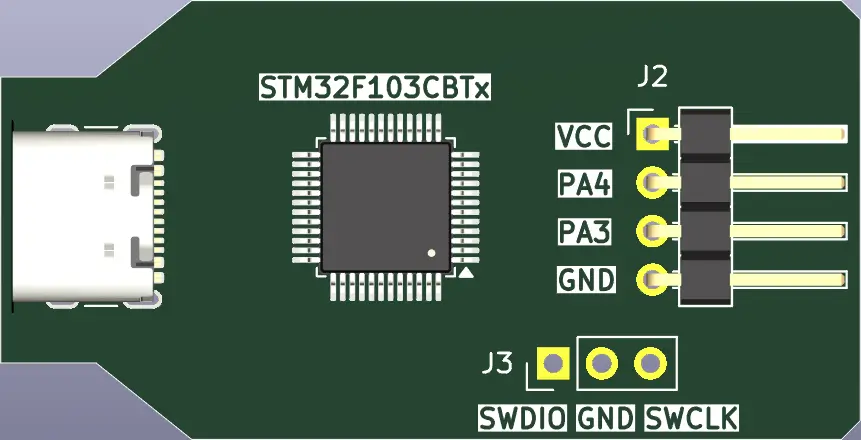

<!-- Copyright 2015-2026 Zephyr Project members and individual contributors. -->
<!-- SPDX-License-Identifier: Apache-2.0 -->
<!-- 中文翻译；编号、导航与译注为本地新增。 -->

<a id="stm32_debug_probe"></a>

# 第17章\_STM32调试探针（Debug Probe）

原文：[官方页面](https://docs.zephyrproject.org/latest/boards/others/stm32_debug_probe/doc/index.html)。读取日期：2026-10-16；来源摘要见[来源记录](../SOURCES.md)。

开发板概览（Board Overview）

<a id="id1"></a>

[](images/stm32_debug_probe.webp)

STM32调试探针（Debug Probe）

名称（Name）：

`stm32_debug_probe`

厂商（Vendor）：

[其他／未知厂商（Other/Unknown）](https://docs.zephyrproject.org/latest/boards/index.html#vendor=others)

状态（Status）：

当前未积极维护（Not Actively Maintained）

架构（Architecture）：


片上系统（SoC）：

[stm32f103xb](https://docs.zephyrproject.org/latest/boards/index.html#soc=stm32f103xb)

<a id="board-github-link"></a>

[浏览开发板源码（Browse Board Sources）](https://github.com/zephyrproject-rtos/zephyr/blob/main//boards/others/stm32_debug_probe/doc/index.rst/../..)<a id="overview"></a>

## 概述（Overview）

STM32 Debug Probe是基于[STM32F103xb](https://www.st.com/resource/en/datasheet/stm32f103rb.pdf) MCU的低成本板卡。

<a id="pin-mapping"></a>

### 引脚映射（Pin Mapping）

STM32 Debug Probe引脚图如下：

<a id="id2"></a>



STM32 Debug Probe引脚图

<a id="stlinkv2-connection"></a>

### STLinkV2连接：

可通过STLinkV2烧录，接线如下。

<table>
<tr>
<th>引脚（Pin）</th>
<th>STLINKv2</th>
</tr>
<tr>
<td>串行线时钟（SWCLK）</td>
<td>时钟（Clock）</td>
</tr>
<tr>
<td>地（GND）</td>
<td>地（GND）</td>
</tr>
<tr>
<td>串行线调试数据（SWDIO）</td>
<td>SW IO</td>
</tr>
</table>

<a id="supported-features"></a>

### 支持的功能（Supported Features）

`stm32_debug_probe`开发板支持下表所列的硬件功能。

片上／板载（On-Chip / On-Board）

功能集成在片上系统（SoC）内／位于开发板上。

2 / 2

分别表示已启用／已禁用的实例数。点击数量标签，可查看开发板或SoC设备树源码（DTS）中该功能的第一个实例。

`vnd,foo`

与此功能匹配的设备树绑定兼容字符串（Compatible String）；点击链接可查看绑定文档。

<a id="stm32_debug_probe-hw-features"></a>

<a id="system-clock"></a>

#### 系统时钟（System Clock）

板载8 MHz晶体通过PLL生成72 MHz系统时钟。

<a id="serial-port"></a>

#### 串口（Serial Port）

Zephyr控制台输出分配给UART_2，默认115200、8N1。

<a id="on-board-leds"></a>

#### 板载LED（On-Board LEDs）

板载LED连接PB12。

<a id="programming-and-debugging"></a>

## 烧录与调试（Programming and Debugging）

`stm32_debug_probe`开发板支持下表所列的运行工具（Runners）及相关west命令。

<table>
<tr>
<th></th>
<th>烧录（flash）</th>
<th>调试（debug）</th>
</tr>
</table>

stm32_debug_probe应用可按常规方法构建并烧录，详情见“构建应用”及“运行应用”。（[构建应用（Building an Application）](../application/P001_应用开发.md#build-an-application)；[运行应用（Run an Application）](https://docs.zephyrproject.org/latest/develop/application/index.html#application-run)）

<a id="flashing"></a>

### 烧录（Flashing）

以下以[Blinky](../getting_started/P004_LED闪烁示例.md#blinky)应用为例。

```text
# From the root of the zephyr repository
west build -b stm32_debug_probe samples/basic/blinky
west flash
```

<a id="debugging"></a>

### 调试（Debugging）

可以按常规方式调试应用。下面以[Hello World](../getting_started/P005_HelloWorld示例.md#hello_world)应用为例。

```text
# From the root of the zephyr repository
west build -b stm32_debug_probe samples/hello_world
west debug
```

## 译注

STM32 Debug Probe在此页是Zephyr运行目标；控制台UART2，板载LED PB12。

## 原文外链核对

2026-10-16核对并重试以下原文外链时未能确认可访问性，保留原始目标，不将访问失败解释为原文内容有误。

- [stm32f103rb.pdf](https://www.st.com/resource/en/datasheet/stm32f103rb.pdf)：HTTP Error 567: Unknown Status。

---

[上一章](P016_Arturo182_Serpente.md) · [返回大纲](大纲.md) · [全站翻译进度](../PROGRESS.md) · [下一章](P018_STM32_Minimum_Development_Board.md)
