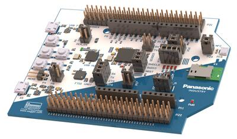

<!-- Copyright 2015-2026 Zephyr Project members and individual contributors. -->
<!-- SPDX-License-Identifier: Apache-2.0 -->
<!-- 中文翻译；编号、导航与译注为本地新增。 -->

# 第3章\_PAN1780评估板

原文：[官方页面](https://docs.zephyrproject.org/latest/boards/panasonic/pan1780_evb/doc/index.html)。读取日期：2026-10-16；来源摘要见[来源记录](../SOURCES.md)。

开发板概览（Board Overview）

PAN1780评估板

名称（Name）：

`pan1780_evb`

厂商（Vendor）：

[松下（Panasonic Corporation）](https://docs.zephyrproject.org/latest/boards/index.html#vendor=panasonic)

状态（Status）：

维护中（Maintained）

架构（Architecture）：

[arm](https://docs.zephyrproject.org/latest/boards/index.html#arch=arm)

片上系统（SoC）：

[nrf52840](https://docs.zephyrproject.org/latest/boards/index.html#soc=nrf52840)

[浏览开发板源码（Browse Board Sources）](https://github.com/zephyrproject-rtos/zephyr/blob/main//boards/panasonic/pan1780_evb/doc/index.rst/../..)

## 概述（Overview）

PAN1780评估板是PAN1780模块的开发工具，该模块基于Nordic Semiconductor nRF52840芯片。

它基本上是Nordic官方nRF52840开发套件PCA10056的兼容板，更多信息参见[nRF52840 DK](../boards_nordic/P006_nRF52840_DK.md#nrf52840dk)。

PAN1780模块及评估板的更多信息见[产品网站](https://pideu.panasonic.de/development-hub/pan1780/)[注1](#id2)。

PAN1780评估板与以下评估板密切相关：

- [PAN1781评估板](P004_PAN1781_Evaluation_Board.md#pan1781_evb)
- [PAN1782评估板](P005_PAN1782_Evaluation_Board.md#pan1782_evb)

## 用途（Usage）

PAN1780[用户指南](https://pideu.panasonic.de/development-hub/pan1780/evaluation_board/user_guide/)[注3](#id7)位于松下无线连接开发中心[注2](#id4)。（[松下无线连接开发中心（Panasonic Wireless Connectivity Development Hub）](https://pideu.panasonic.de/development-hub/)）

用户指南详细介绍以下内容及其他事项：

- 引脚映射（Pin Mapping）
- 供电选项（Powering Options）
- 引出排针接口（Breakout Pin Header Interface）
- 电流消耗测量（Current Consumption Measurement）
- 软件开发（Software Development）

以及其他事项。

PAN1780原理图位于松下无线连接开发中心[注2](#id4)的[下载区](https://pideu.panasonic.de/development-hub/pan1780/downloads/)[注4](#id9)。（[松下无线连接开发中心（Panasonic Wireless Connectivity Development Hub）](https://pideu.panasonic.de/development-hub/)）

## 烧录与调试（Programming and Debugging）

`pan1780_evb`开发板支持下表所列的运行工具（Runners）及相关west命令。

<table>
<tr>
<th></th>
<th>烧录（flash）</th>
<th>调试（debug）</th>
<th>连接调试会话（attach）</th>
<th>实时传输（rtt）</th>
<th>复位（reset）</th>
<th>调试服务器（debugserver）</th>
</tr>
<tr>
<td><a href="https://docs.zephyrproject.org/latest/develop/flash_debug/host-tools.html#runner-jlink">jlink</a></td>
<td>✅</td>
<td>✅（默认 / default）</td>
<td>✅</td>
<td>✅</td>
<td>✅</td>
<td>✅</td>
</tr>
<tr>
<td>nrfjprog</td>
<td>✅</td>
<td></td>
<td></td>
<td></td>
<td></td>
<td></td>
</tr>
<tr>
<td>nrfutil</td>
<td>✅（默认 / default）</td>
<td></td>
<td></td>
<td></td>
<td></td>
<td></td>
</tr>
<tr>
<td><a href="https://docs.zephyrproject.org/latest/develop/flash_debug/host-tools.html#runner-pyocd">pyocd</a></td>
<td>✅</td>
<td>✅</td>
<td>✅</td>
<td>✅</td>
<td>✅</td>
<td>✅</td>
</tr>
</table>

构建及运行应用时，使用pan1780_evb开发板配置。（[构建应用（Building an Application）](../application/P001_应用开发.md#build-an-application)；[运行应用（Run an Application）](https://docs.zephyrproject.org/latest/develop/application/index.html#application-run)）

〔[1](#id3)〕 [https://pideu.panasonic.de/development-hub/pan1780/](https://pideu.panasonic.de/development-hub/pan1780/)

〔2〕 ([1](#id5),[2](#id6)) [https://pideu.panasonic.de/development-hub/](https://pideu.panasonic.de/development-hub/)

〔[3](#id8)〕 [https://pideu.panasonic.de/development-hub/pan1780/evaluation_board/user_guide/](https://pideu.panasonic.de/development-hub/pan1780/evaluation_board/user_guide/)

〔[4](#id10)〕 [https://pideu.panasonic.de/development-hub/pan1780/downloads/](https://pideu.panasonic.de/development-hub/pan1780/downloads/)

## 译注

PAN1780同样基于nRF52840，与PAN1770、PAN1781和PAN1782的关联入口保留。

---

[上一章](P002_PAN1770_Evaluation_Board.md) · [返回大纲](大纲.md) · [全站翻译进度](../PROGRESS.md) · [下一章](P004_PAN1781_Evaluation_Board.md)
