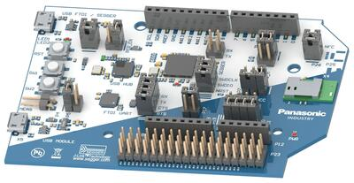

<!-- Copyright 2015-2026 Zephyr Project members and individual contributors. -->
<!-- SPDX-License-Identifier: Apache-2.0 -->
<!-- 中文翻译；编号、导航与译注为本地新增。 -->

# 第5章\_PAN1782评估板

原文：[官方页面](https://docs.zephyrproject.org/latest/boards/panasonic/pan1782_evb/doc/index.html)。读取日期：2026-10-16；来源摘要见[来源记录](../SOURCES.md)。

开发板概览（Board Overview）

PAN1782评估板

名称（Name）：

`pan1782_evb`

厂商（Vendor）：

[松下（Panasonic Corporation）](https://docs.zephyrproject.org/latest/boards/index.html#vendor=panasonic)

状态（Status）：

维护中（Maintained）

架构（Architecture）：

[arm](https://docs.zephyrproject.org/latest/boards/index.html#arch=arm)

片上系统（SoC）：

[nrf52833](https://docs.zephyrproject.org/latest/boards/index.html#soc=nrf52833)

[浏览开发板源码（Browse Board Sources）](https://github.com/zephyrproject-rtos/zephyr/blob/main//boards/panasonic/pan1782_evb/doc/index.rst/../..)

## 概述（Overview）

PAN1782评估板是PAN1782模块的开发工具，该模块基于Nordic Semiconductor nRF52833芯片。

PAN1782模块及评估板的更多信息见[产品网站](https://industry.panasonic.eu/products/devices/wireless-connectivity/bluetooth-low-energy-modules/pan1782-nrf52833)[注1](#id2)。

有关Nordic nRF52833开发套件的一般信息，也请参阅[nRF52833 DK](../boards_nordic/P005_nRF52833_DK.md#nrf52833dk)。

PAN1782评估板与以下评估板密切相关：

- [PAN1780评估板](P003_PAN1780_Evaluation_Board.md#pan1780_evb)
- [PAN1781评估板](P004_PAN1781_Evaluation_Board.md#pan1781_evb)

## 用途（Usage）

PAN1782[用户指南](https://pideu.panasonic.de/development-hub/pan1782/evaluation_board/user_guide/)[注3](#id7)位于松下无线连接开发中心[注2](#id4)。（[松下无线连接开发中心（Panasonic Wireless Connectivity Development Hub）](https://pideu.panasonic.de/development-hub/)）

用户指南详细介绍以下内容及其他事项：

- 引脚映射（Pin Mapping）
- 供电选项（Powering Options）
- 引出排针接口（Breakout Pin Header Interface）
- 电流消耗测量（Current Consumption Measurement）
- 软件开发（Software Development）

以及其他事项。

PAN1782原理图位于松下无线连接开发中心[注2](#id4)的[下载区](https://pideu.panasonic.de/development-hub/pan1782/downloads/)[注4](#id9)。（[松下无线连接开发中心（Panasonic Wireless Connectivity Development Hub）](https://pideu.panasonic.de/development-hub/)）

## 烧录与调试（Programming and Debugging）

`pan1782_evb`开发板支持下表所列的运行工具（Runners）及相关west命令。

<table>
<tr>
<th></th>
<th>烧录（flash）</th>
<th>调试（debug）</th>
<th>连接调试会话（attach）</th>
<th>实时传输（rtt）</th>
<th>复位（reset）</th>
<th>调试服务器（debugserver）</th>
</tr>
<tr>
<td><a href="https://docs.zephyrproject.org/latest/develop/flash_debug/host-tools.html#runner-jlink">jlink</a></td>
<td>✅</td>
<td>✅（默认 / default）</td>
<td>✅</td>
<td>✅</td>
<td>✅</td>
<td>✅</td>
</tr>
<tr>
<td>nrfjprog</td>
<td>✅</td>
<td></td>
<td></td>
<td></td>
<td></td>
<td></td>
</tr>
<tr>
<td>nrfutil</td>
<td>✅（默认 / default）</td>
<td></td>
<td></td>
<td></td>
<td></td>
<td></td>
</tr>
<tr>
<td><a href="https://docs.zephyrproject.org/latest/develop/flash_debug/host-tools.html#runner-pyocd">pyocd</a></td>
<td>✅</td>
<td>✅</td>
<td>✅</td>
<td>✅</td>
<td>✅</td>
<td>✅</td>
</tr>
</table>

构建及运行应用时，使用pan1782_evb开发板配置。（[构建应用（Building an Application）](../application/P001_应用开发.md#build-an-application)；[运行应用（Run an Application）](https://docs.zephyrproject.org/latest/develop/application/index.html#application-run)）

〔[1](#id3)〕 [https://industry.panasonic.eu/products/devices/wireless-connectivity/bluetooth-low-energy-modules/pan1782-nrf52833](https://industry.panasonic.eu/products/devices/wireless-connectivity/bluetooth-low-energy-modules/pan1782-nrf52833)

〔2〕 ([1](#id5),[2](#id6)) [https://pideu.panasonic.de/development-hub/](https://pideu.panasonic.de/development-hub/)

〔[3](#id8)〕 [https://pideu.panasonic.de/development-hub/pan1782/evaluation_board/user_guide/](https://pideu.panasonic.de/development-hub/pan1782/evaluation_board/user_guide/)

〔[4](#id10)〕 [https://pideu.panasonic.de/development-hub/pan1782/downloads/](https://pideu.panasonic.de/development-hub/pan1782/downloads/)

## 译注

PAN1782芯片为nRF52833，不与PAN1781混用。

---

[上一章](P004_PAN1781_Evaluation_Board.md) · [返回大纲](大纲.md) · [全站翻译进度](../PROGRESS.md) · [下一章](P006_PAN1783_Evaluation_Board.md)
