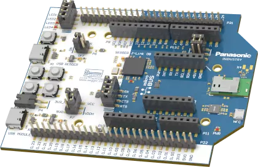

<!-- Copyright 2015-2026 Zephyr Project members and individual contributors. -->
<!-- SPDX-License-Identifier: Apache-2.0 -->
<!-- 中文翻译；编号、导航与译注为本地新增。 -->

# 第6章\_PAN1783评估板

原文：[官方页面](https://docs.zephyrproject.org/latest/boards/panasonic/pan1783/doc/index.html)。读取日期：2026-10-16；来源摘要见[来源记录](../SOURCES.md)。

开发板概览（Board Overview）

PAN1783评估板

名称（Name）：

`pan1783_evb`

厂商（Vendor）：

[松下（Panasonic Corporation）](https://docs.zephyrproject.org/latest/boards/index.html#vendor=panasonic)

状态（Status）：

维护中（Maintained）

架构（Architecture）：

[arm](https://docs.zephyrproject.org/latest/boards/index.html#arch=arm)

片上系统（SoC）：

[nrf5340](https://docs.zephyrproject.org/latest/boards/index.html#soc=nrf5340)

[浏览开发板源码（Browse Board Sources）](https://github.com/zephyrproject-rtos/zephyr/blob/main//boards/panasonic/pan1783/doc/index.rst/../..)

## 概述（Overview）

PAN1783、PAN1783A及PAN1783A-PA评估板，分别对应pan1783_evb、pan1783a_evb及pan1783a_pa_evb，是相应模块的开发工具，这些模块均基于Nordic Semiconductor nRF5340芯片。

上述模块及评估板的更多信息见[产品网站](https://pideu.panasonic.de/development-hub/pan1783/)[注1](#id2)。

## PAN1783评估板（EVB）

“开发板概述”（Board Overview）侧栏展示的是此变体。

## PAN1783A评估板

PAN1783A EVB外形与PAN1783 EVB基本相同，但在X4增加UFL连接器。

## PAN1783A-PA评估板

PAN1783A-PA EVB与PAN1783 EVB基本相似，增加了X4处UFL连接器及功率放大器（Power Amplifier）。

## 用途（Usage）

详细信息见松下无线连接开发中心[注2](#id4)的[pan1783_evb用户指南](https://pideu.panasonic.de/development-hub/pan1783/evaluation_board/user_guide/)[注3](#id7)、[pan1783a_evb用户指南](https://pideu.panasonic.de/development-hub/pan1783a/evaluation_board/user_guide/)[注4](#id9)及[pan1783a_pa_evb用户指南](https://pideu.panasonic.de/development-hub/pan1783a_pa/evaluation_board/user_guide/)[注5](#id11)。（[松下无线连接开发中心（Panasonic Wireless Connectivity Development Hub）](https://pideu.panasonic.de/development-hub/)）

用户指南详细介绍以下内容及其他事项：

- 引脚映射（Pin Mapping）
- 供电选项（Powering Options）
- 引出排针接口（Breakout Pin Header Interface）
- 电流消耗测量（Current Consumption Measurement）
- 软件开发（Software Development）

三款评估板原理图分别位于松下无线连接开发中心[注2](#id4)的[PAN1783下载区](https://pideu.panasonic.de/development-hub/pan1783/downloads/)[注6](#id13)、[PAN1783A下载区](https://pideu.panasonic.de/development-hub/pan1783a/downloads/)[注7](#id15)及[PAN1783A-PA下载区](https://pideu.panasonic.de/development-hub/pan1783a_pa/downloads/)[注8](#id17)。（[松下无线连接开发中心（Panasonic Wireless Connectivity Development Hub）](https://pideu.panasonic.de/development-hub/)）

## 烧录与调试（Programming and Debugging）

`pan1783_evb`开发板支持下表所列的运行工具（Runners）及相关west命令。

<table>
<tr>
<th></th>
<th>烧录（flash）</th>
<th>调试（debug）</th>
<th>连接调试会话（attach）</th>
<th>实时传输（rtt）</th>
<th>复位（reset）</th>
<th>调试服务器（debugserver）</th>
</tr>
<tr>
<td><a href="https://docs.zephyrproject.org/latest/develop/flash_debug/host-tools.html#runner-jlink">jlink</a></td>
<td>✅</td>
<td>✅（默认 / default）</td>
<td>✅</td>
<td>✅</td>
<td>✅</td>
<td>✅</td>
</tr>
<tr>
<td>nrfjprog</td>
<td>✅</td>
<td></td>
<td></td>
<td></td>
<td></td>
<td></td>
</tr>
<tr>
<td>nrfutil</td>
<td>✅（默认 / default）</td>
<td></td>
<td></td>
<td></td>
<td></td>
<td></td>
</tr>
</table>

构建及运行应用时，应用核使用pan1783_evb_cpuapp、pan1783a_evb_cpuapp或pan1783a_pa_evb_cpuapp配置；网络核使用pan1783_evb_cpunet、pan1783a_evb_cpunet或pan1783a_pa_evb_cpunet配置。这里保留原文配置名。（[构建应用（Building an Application）](../application/P001_应用开发.md#build-an-application)；[运行应用（Run an Application）](https://docs.zephyrproject.org/latest/develop/application/index.html#application-run)）

〔[1](#id3)〕 [https://pideu.panasonic.de/development-hub/pan1783/](https://pideu.panasonic.de/development-hub/pan1783/)

〔2〕 ([1](#id5),[2](#id6)) [https://pideu.panasonic.de/development-hub/](https://pideu.panasonic.de/development-hub/)

〔[3](#id8)〕 [https://pideu.panasonic.de/development-hub/pan1783/evaluation_board/user_guide/](https://pideu.panasonic.de/development-hub/pan1783/evaluation_board/user_guide/)

〔[4](#id10)〕 [https://pideu.panasonic.de/development-hub/pan1783a/evaluation_board/user_guide/](https://pideu.panasonic.de/development-hub/pan1783a/evaluation_board/user_guide/)

〔[5](#id12)〕 [https://pideu.panasonic.de/development-hub/pan1783a_pa/evaluation_board/user_guide/](https://pideu.panasonic.de/development-hub/pan1783a_pa/evaluation_board/user_guide/)

〔[6](#id14)〕 [https://pideu.panasonic.de/development-hub/pan1783/downloads/](https://pideu.panasonic.de/development-hub/pan1783/downloads/)

〔[7](#id16)〕 [https://pideu.panasonic.de/development-hub/pan1783a/downloads/](https://pideu.panasonic.de/development-hub/pan1783a/downloads/)

〔[8](#id18)〕 [https://pideu.panasonic.de/development-hub/pan1783a_pa/downloads/](https://pideu.panasonic.de/development-hub/pan1783a_pa/downloads/)

## 译注

PAN1783系列基于nRF5340，A版增加X4 UFL连接器，A-PA版另加功率放大器。原文编程段使用下划线形式的旧配置名称，正文与原始代码照录，未擅自改写。

## 原文外链核对

2026-10-16核对并重试以下原文外链时未能确认可访问性，保留原始目标，不将访问失败解释为原文内容有误。

- ：HTTP Error 404: Not Found。
- ：HTTP Error 404: Not Found。

---

[上一章](P005_PAN1782_Evaluation_Board.md) · [返回大纲](大纲.md) · [全站翻译进度](../PROGRESS.md) · [下一章](P007_PAN_B611_Evaluation_Board.md)
