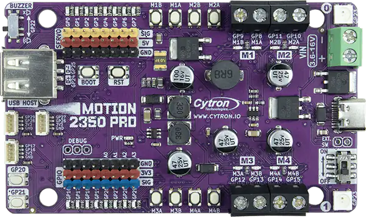
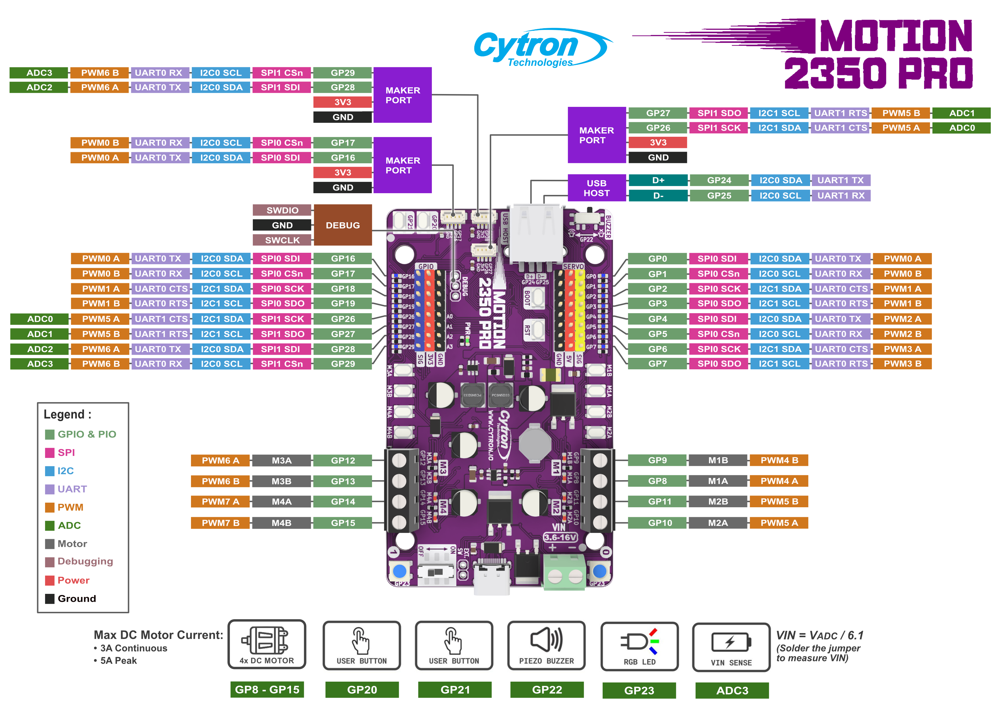

<!-- Copyright 2015-2026 Zephyr Project members and individual contributors. -->
<!-- SPDX-License-Identifier: Apache-2.0 -->
<!-- 中文翻译；编号、导航与译注为本地新增。 -->

<a id="motion_2350_pro"></a>

# 第1章\_Motion 2350 Pro

原文：[官方页面](https://docs.zephyrproject.org/latest/boards/cytron/motion_2350_pro/doc/index.html)。读取日期：2026-10-17；来源摘要见[来源记录](../SOURCES.md)。

> 译注：本页正文已译完，但下列原始图片文件仍未取得，完整交付状态保持待完成。原始地址保留在文末[缺失媒体清单](../MISSING_MEDIA.md)。

开发板概览（Board Overview）

<a id="id1"></a>

[](images/motion_2350_pro.webp)

Motion 2350 Pro

名称（Name）：

`motion_2350_pro`

厂商（Vendor）：

[Cytron Technologies公司](https://docs.zephyrproject.org/latest/boards/index.html#vendor=cytron)

状态（Status）：

当前未积极维护（Not Actively Maintained）

架构（Architecture）：

RISC-V、Arm架构（[riscv](https://docs.zephyrproject.org/latest/boards/index.html#arch=riscv), [arm](https://docs.zephyrproject.org/latest/boards/index.html#arch=arm)）

片上系统（SoC）：

[rp2350a](https://docs.zephyrproject.org/latest/boards/index.html#soc=rp2350a)

<a id="board-github-link"></a>

[浏览开发板源码（Browse Board Sources）](https://github.com/zephyrproject-rtos/zephyr/blob/main//boards/cytron/motion_2350_pro/doc/index.rst/../..)<a id="overview"></a>

## 概述（Overview）

<a id="id3"></a>

[Cytron Motion 2350 Pro](https://www.cytron.io/p-motion-2350-pro) [注1](#id2) 开发板基于 Raspberry Pi Ltd. 的 RP2350A 微控制器，配备电机驱动器、舵机排针、Maker 连接器和 USB Type-C 连接器。

<a id="hardware"></a>

## 硬件（Hardware）


- Raspberry Pi RP2350A微控制器，最高频率150 MHz
- 双ARM Cortex-M33内核及双RISC-V Hazard3内核
- 520 kByte SRAM
- 2 Mbyte QSPI闪存
- 12个通用输入输出（GPIO）引脚
- 4个模数转换器（ADC）引脚
- 集成电路间总线（I2C）
- 通用异步收发器（UART）
- USB Type-C接口
- USB 主机（USB Type-A 连接器）
- 复位、启动及两个用户按键
- 两个RGB LED，Neopixels
- 带静音开关的压电蜂鸣器（Piezo Buzzer）
- 8 个舵机端口
- 4 路电机驱动器，带 8 个手动测试按键
- 3 个 Maker 连接器，其中一个可作为 Qwiic／Stemma QT／zephyr_i2c 连接器使用
- 16 个数字引脚状态指示灯

<a id="default-zephyr-peripheral-mapping"></a>

### Zephyr默认外设映射（Default Peripheral Mapping）

<table>
<tr>
<th>说明（Description）</th>
<th>引脚（Pin）</th>
<th>默认引脚复用（Default Pin Mux）</th>
<th>Zephyr PWM名称（Name）</th>
</tr>
<tr>
<td>按键1（Button 1）</td>
<td>GPIO20</td>
<td>别名（Alias）<code>sw0</code></td>
<td></td>
</tr>
<tr>
<td>按键2（Button 2）</td>
<td>GPIO21</td>
<td>别名（Alias）<code>sw1</code></td>
<td></td>
</tr>
<tr>
<td>蜂鸣器（Buzzer）</td>
<td>GPIO22</td>
<td>PWM3A（也用于舵机）</td>
<td>6</td>
</tr>
<tr>
<td>RGB彩色LED</td>
<td>GPIO23</td>
<td>PIO0</td>
<td></td>
</tr>
<tr>
<td>USB 主机 D+</td>
<td>GPIO24</td>
<td></td>
<td></td>
</tr>
<tr>
<td>USB 主机 D−</td>
<td>GPIO25</td>
<td></td>
<td></td>
</tr>
</table>

GPIO排针（Header）：

<table>
<tr>
<th>标签（Label）</th>
<th>引脚（Pin）</th>
<th>默认引脚复用（Default Pin Mux）</th>
<th>同时位于连接器（Also in Connector）</th>
</tr>
<tr>
<td>GP16</td>
<td>GPIO16</td>
<td>I2C0串行数据（SDA）</td>
<td>Maker 端口 GP16+GP17</td>
</tr>
<tr>
<td>GP17</td>
<td>GPIO17</td>
<td>I2C0串行时钟（SCL）</td>
<td>Maker 端口 GP16+GP17</td>
</tr>
<tr>
<td>GP18</td>
<td>GPIO18</td>
<td>别名（Alias）<code>led0</code></td>
<td></td>
</tr>
<tr>
<td>GP19</td>
<td>GPIO19</td>
<td>（别名 led1）</td>
<td></td>
</tr>
<tr>
<td>GP26</td>
<td>GPIO26</td>
<td>ADC0</td>
<td>Maker 端口 GP26+GP27</td>
</tr>
<tr>
<td>GP27</td>
<td>GPIO27</td>
<td>ADC1</td>
<td>Maker 端口 GP26+GP27</td>
</tr>
<tr>
<td>GP28</td>
<td>GPIO28</td>
<td>UART0发送（TX）</td>
<td>Maker 端口 GP28+GP29</td>
</tr>
<tr>
<td>GP29</td>
<td>GPIO29</td>
<td>UART0接收（RX）</td>
<td>Maker 端口 GP28+GP29</td>
</tr>
</table>

舵机排针（注意，PWM3A 也用于蜂鸣器）：

<table>
<tr>
<th>标签（Label）</th>
<th>引脚（Pin）</th>
<th>默认引脚复用（Default Pin Mux）</th>
<th>Zephyr PWM名称（Name）</th>
</tr>
<tr>
<td>GP0</td>
<td>GPIO0</td>
<td>PWM0A</td>
<td>0</td>
</tr>
<tr>
<td>GP1</td>
<td>GPIO1</td>
<td>PWM0B</td>
<td>1</td>
</tr>
<tr>
<td>GP2</td>
<td>GPIO2</td>
<td>PWM1A</td>
<td>2</td>
</tr>
<tr>
<td>GP3</td>
<td>GPIO3</td>
<td>PWM1B</td>
<td>3</td>
</tr>
<tr>
<td>GP4</td>
<td>GPIO4</td>
<td>PWM2A</td>
<td>4</td>
</tr>
<tr>
<td>GP5</td>
<td>GPIO5</td>
<td>PWM2B</td>
<td>5</td>
</tr>
<tr>
<td>GP6</td>
<td>GPIO6</td>
<td>PWM3A</td>
<td>6</td>
</tr>
<tr>
<td>GP7</td>
<td>GPIO7</td>
<td>PWM3B</td>
<td>7</td>
</tr>
</table>

电机驱动器（Motor Drivers）：

<table>
<tr>
<th>标签（Label）</th>
<th>引脚（Pin）</th>
<th>默认引脚复用（Default Pin Mux）</th>
<th>Zephyr PWM名称（Name）</th>
</tr>
<tr>
<td>M1A</td>
<td>GPIO8</td>
<td>PWM4A</td>
<td>8</td>
</tr>
<tr>
<td>M1B</td>
<td>GPIO9</td>
<td>PWM4B</td>
<td>9</td>
</tr>
<tr>
<td>M2A</td>
<td>GPIO10</td>
<td>PWM5A</td>
<td>10</td>
</tr>
<tr>
<td>M2B</td>
<td>GPIO11</td>
<td>PWM5B</td>
<td>11</td>
</tr>
<tr>
<td>M3A</td>
<td>GPIO12</td>
<td>PWM6A</td>
<td>12</td>
</tr>
<tr>
<td>M3B</td>
<td>GPIO13</td>
<td>PWM6B</td>
<td>13</td>
</tr>
<tr>
<td>M4A</td>
<td>GPIO14</td>
<td>PWM7A</td>
<td>14</td>
</tr>
<tr>
<td>M4B</td>
<td>GPIO15</td>
<td>PWM7B</td>
<td>15</td>
</tr>
</table>

GP16+GP17 连接器：

将使用 I2C 的 Qwiic／Stemma QT 传感器连接到此连接器。

这些引脚也可通过 GPIO 排针使用。

<table>
<tr>
<th>标签（Label）</th>
<th>引脚（Pin）</th>
<th>默认引脚复用（Default Pin Mux）</th>
</tr>
<tr>
<td>GP16</td>
<td>GPIO16</td>
<td>I2C0串行数据（SDA）</td>
</tr>
<tr>
<td>GP17</td>
<td>GPIO17</td>
<td>I2C0串行时钟（SCL）</td>
</tr>
</table>

GP26+GP27 连接器：

这些引脚也可通过 GPIO 排针使用。

<table>
<tr>
<th>标签（Label）</th>
<th>引脚（Pin）</th>
<th>默认引脚复用（Default Pin Mux）</th>
</tr>
<tr>
<td>GP26</td>
<td>GPIO26</td>
<td>ADC0</td>
</tr>
<tr>
<td>GP27</td>
<td>GPIO27</td>
<td>ADC1</td>
</tr>
</table>

GP28+GP29 连接器：

这些引脚也可通过 GPIO 排针使用。

<table>
<tr>
<th>标签（Label）</th>
<th>引脚（Pin）</th>
<th>默认引脚复用（Default Pin Mux）</th>
</tr>
<tr>
<td>GP28</td>
<td>GPIO28</td>
<td>UART0发送（TX）</td>
</tr>
<tr>
<td>GP29</td>
<td>GPIO29</td>
<td>UART0接收（RX）</td>
</tr>
</table>

<a id="id5"></a>

另见引脚分配图（Pinout）[注2](#id4)。（[引脚分配（Pinout）](https://static.cytron.io/image/catalog/products/MOTION-2350-PRO/pinout-diagram-motion-2350-pro3.png)）

<a id="supported-features"></a>

### 支持的功能（Supported Features）

注意，目前尚不支持 USB 主机功能，即较大的 USB Type-A 连接器。

`motion_2350_pro` 开发板支持下列硬件功能（Hardware Features）。

片上／板载（On-Chip / On-Board）

功能集成在片上系统（SoC）内／位于开发板上。

2 / 2

分别表示已启用／已禁用的实例数。点击数量标签，可查看开发板或SoC设备树源码（DTS）中该功能的第一个实例。

`vnd,foo`

与此功能匹配的设备树绑定兼容字符串（Compatible String）；点击链接可查看绑定文档。

<a id="motion_2350_pro-hw-features"></a>

<a id="motion_2350_pro-motion_2350_pro/rp2350a/hazard3_0-hw-features-section"></a>

#### `motion_2350_pro/rp2350a/hazard3_0` 目标（Target）

<a id="motion_2350_pro-motion_2350_pro/rp2350a/hazard3_0-hw-features-panel"></a>

<a id="motion_2350_pro-motion_2350_pro/rp2350a/hazard3_0-hw-features-memory"></a>

该开发板目标的片上存储容量：520 KiB RAM、2 MiB Flash。

<a id="motion_2350_pro-motion_2350_pro/rp2350a/hazard3_0-hw-features-table"></a>

<table>
<tr>
<th>类型（Type）</th>
<th>位置（Location）</th>
<th>说明（Description）</th>
<th>兼容字符串（Compatible）</th>
</tr>
<tr>
<td rowspan="1">中央处理器（CPU）</td>
<td>片上（On-Chip）</td>
<td>通用RISC-V处理器（CPU）（<a href="https://github.com/zephyrproject-rtos/zephyr/blob/main/dts/vendor/raspberrypi/rpi_pico/rp2350.dtsi?plain=1#L37">已启用：2</a>）</td>
<td><a href="../cpu_vendor_multiarc_binding_reference/P034_riscv.md#std-dtcompatible-riscv"><code>riscv</code></a></td>
</tr>
<tr>
<td rowspan="1">模数转换器（ADC）</td>
<td>片上（On-Chip）</td>
<td>Raspberry Pi Pico模数转换器（ADC）（<a href="https://github.com/zephyrproject-rtos/zephyr/blob/main/dts/vendor/raspberrypi/rpi_pico/rp2350.dtsi?plain=1#L342">已启用：1</a>）</td>
<td><a href="../hardware/P894_RaspberryPiPico模数转换器绑定.md#dtbinding-raspberrypi-pico-adc"><code>raspberrypi,pico-adc</code></a></td>
</tr>
<tr>
<td rowspan="5">时钟控制（Clock Control）</td>
<td>片上（On-Chip）</td>
<td>Raspberry Pi Pico时钟（Clock）的表示（<a href="https://github.com/zephyrproject-rtos/zephyr/blob/main/dts/vendor/raspberrypi/rpi_pico/rp2350.dtsi?plain=1#L47">已启用：11</a>；<a href="https://github.com/zephyrproject-rtos/zephyr/blob/main/dts/vendor/raspberrypi/rpi_pico/rp2350.dtsi?plain=1#L174">已禁用：2</a>）</td>
<td><a href="../clock_nxp_pico_realtek_renesas_binding_reference/P017_raspberrypi_pico-clock.md#std-dtcompatible-raspberrypi-pico-clock"><code>raspberrypi,pico-clock</code></a></td>
</tr>
<tr>
<td>片上（On-Chip）</td>
<td>Raspberry Pi Pico锁相环（PLL）的表示（<a href="https://github.com/zephyrproject-rtos/zephyr/blob/main/dts/vendor/raspberrypi/rpi_pico/rp2350.dtsi?plain=1#L128">已启用：2</a>）</td>
<td><a href="../clock_nxp_pico_realtek_renesas_binding_reference/P018_raspberrypi_pico-pll.md#std-dtcompatible-raspberrypi-pico-pll"><code>raspberrypi,pico-pll</code></a></td>
</tr>
<tr>
<td>片上（On-Chip）</td>
<td>Raspberry Pi Pico环形振荡器（Ring Oscillator）的表示（<a href="https://github.com/zephyrproject-rtos/zephyr/blob/main/dts/vendor/raspberrypi/rpi_pico/rp2350.dtsi?plain=1#L150">已启用：1</a>）</td>
<td><a href="../clock_nxp_pico_realtek_renesas_binding_reference/P019_raspberrypi_pico-rosc.md#std-dtcompatible-raspberrypi-pico-rosc"><code>raspberrypi,pico-rosc</code></a></td>
</tr>
<tr>
<td>片上（On-Chip）</td>
<td>Raspberry Pi Pico外部振荡器（External Oscillator）的表示（<a href="https://github.com/zephyrproject-rtos/zephyr/blob/main/dts/vendor/raspberrypi/rpi_pico/rp2350.dtsi?plain=1#L168">已启用：1</a>）</td>
<td><a href="../clock_nxp_pico_realtek_renesas_binding_reference/P020_raspberrypi_pico-xosc.md#std-dtcompatible-raspberrypi-pico-xosc"><code>raspberrypi,pico-xosc</code></a></td>
</tr>
<tr>
<td>片上（On-Chip）</td>
<td>Raspberry Pi Pico时钟控制器（Clock Controller）节点（<a href="https://github.com/zephyrproject-rtos/zephyr/blob/main/dts/vendor/raspberrypi/rpi_pico/rp2350.dtsi?plain=1#L220">已启用：1</a>）</td>
<td><a href="../clock_nxp_pico_realtek_renesas_binding_reference/P016_raspberrypi_pico-clock-controller.md#std-dtcompatible-raspberrypi-pico-clock-controller"><code>raspberrypi,pico-clock-controller</code></a></td>
</tr>
<tr>
<td rowspan="1">计数器（Counter）</td>
<td>片上（On-Chip）</td>
<td>Raspberry Pi Pico定时器（Timer）（<a href="https://github.com/zephyrproject-rtos/zephyr/blob/main/dts/vendor/raspberrypi/rpi_pico/rp2350.dtsi?plain=1#L366">已启用：1</a>；<a href="https://github.com/zephyrproject-rtos/zephyr/blob/main/dts/vendor/raspberrypi/rpi_pico/rp2350.dtsi?plain=1#L382">已禁用：1</a>）</td>
<td><a href="../renesas_realtek_counter_binding_reference/P008_raspberrypi_pico-timer.md#std-dtcompatible-raspberrypi-pico-timer"><code>raspberrypi,pico-timer</code></a></td>
</tr>
<tr>
<td rowspan="1">密码学加速器（Cryptographic Accelerator）</td>
<td>片上（On-Chip）</td>
<td>Raspberry Pi Pico SHA-256硬件加速器（Accelerator）（<a href="https://github.com/zephyrproject-rtos/zephyr/blob/main/dts/vendor/raspberrypi/rpi_pico/rp2350.dtsi?plain=1#L405">已禁用：1</a>）</td>
<td><a href="../crypto_secure_engine_st_ti_binding_reference/P006_raspberrypi_pico-sha256.md#std-dtcompatible-raspberrypi-pico-sha256"><code>raspberrypi,pico-sha256</code></a></td>
</tr>
<tr>
<td rowspan="1">直接存储器访问（DMA）</td>
<td>片上（On-Chip）</td>
<td>Raspberry Pi Pico直接存储器访问（DMA）（<a href="https://github.com/zephyrproject-rtos/zephyr/blob/main/dts/vendor/raspberrypi/rpi_pico/rp2350.dtsi?plain=1#L425">已禁用：1</a>）</td>
<td><a href="../nxp_realtek_renesas_dma_binding_reference/P009_raspberrypi_pico-dma.md#std-dtcompatible-raspberrypi-pico-dma"><code>raspberrypi,pico-dma</code></a></td>
</tr>
<tr>
<td rowspan="1">闪存控制器（Flash Controller）</td>
<td>片上（On-Chip）</td>
<td>Raspberry Pi Pico闪存控制器（Flash Controller）（<a href="https://github.com/zephyrproject-rtos/zephyr/blob/main/dts/vendor/raspberrypi/rpi_pico/rp2350.dtsi?plain=1#L197">已启用：1</a>）</td>
<td><a href="../flash_nuvoton_nxp_renesas_binding_reference/P021_raspberrypi_pico-flash-controller.md#std-dtcompatible-raspberrypi-pico-flash-controller"><code>raspberrypi,pico-flash-controller</code></a></td>
</tr>
<tr>
<td rowspan="3">通用输入输出与接插件（GPIO &amp; Headers）</td>
<td>片上（On-Chip）</td>
<td>Raspberry Pi Pico通用输入输出（GPIO）（<a href="https://github.com/zephyrproject-rtos/zephyr/blob/main/dts/vendor/raspberrypi/rpi_pico/rp2350.dtsi?plain=1#L242">已启用：1</a>）</td>
<td><a href="../gpio_raspberrypi_renesas_binding_reference/P006_raspberrypi_pico-gpio.md#std-dtcompatible-raspberrypi-pico-gpio"><code>raspberrypi,pico-gpio</code></a></td>
</tr>
<tr>
<td>片上（On-Chip）</td>
<td>Raspberry Pi Pico GPIO端口（Port）（<a href="https://github.com/zephyrproject-rtos/zephyr/blob/main/dts/vendor/raspberrypi/rpi_pico/rp2350.dtsi?plain=1#L255">已启用：1</a>；<a href="https://github.com/zephyrproject-rtos/zephyr/blob/main/dts/vendor/raspberrypi/rpi_pico/rp2350.dtsi?plain=1#L264">已禁用：1</a>）</td>
<td><a href="../gpio_raspberrypi_renesas_binding_reference/P005_raspberrypi_pico-gpio-port.md#std-dtcompatible-raspberrypi-pico-gpio-port"><code>raspberrypi,pico-gpio-port</code></a></td>
</tr>
<tr>
<td>板载（On-Board）</td>
<td>STEMMA QT是一种用于I2C设备的4针JST-SH接口。（<a href="https://github.com/zephyrproject-rtos/zephyr/blob/main/boards/cytron/motion_2350_pro/motion_2350_pro.dtsi?plain=1#L69">已启用：1</a>）</td>
<td><a href="../gpio_ti_xilinx_sdl_binding_reference/P005_stemma-qt-connector.md#std-dtcompatible-stemma-qt-connector"><code>stemma-qt-connector</code></a></td>
</tr>
<tr>
<td rowspan="1">集成电路间总线（I2C）</td>
<td>片上（On-Chip）</td>
<td>Raspberry Pi Pico I2C控制器（<a href="https://github.com/zephyrproject-rtos/zephyr/blob/main/dts/vendor/raspberrypi/rpi_pico/rp2350.dtsi?plain=1#L318">已启用：1</a>；<a href="https://github.com/zephyrproject-rtos/zephyr/blob/main/dts/vendor/raspberrypi/rpi_pico/rp2350.dtsi?plain=1#L330">已禁用：1</a>）</td>
<td><a href="../i2c_nxp_pico_renesas_binding_reference/P008_raspberrypi_pico-i2c.md#std-dtcompatible-raspberrypi-pico-i2c"><code>raspberrypi,pico-i2c</code></a></td>
</tr>
<tr>
<td rowspan="1">输入（Input）</td>
<td>板载（On-Board）</td>
<td>一组绑定到 GPIO 的输入按键（GPIO-Bound Input Keys）（<a href="https://github.com/zephyrproject-rtos/zephyr/blob/main/boards/cytron/motion_2350_pro/motion_2350_pro.dtsi?plain=1#L39">已启用：1</a>）</td>
<td><a href="../hardware/P563_GPIO按键绑定.md#std-dtcompatible-gpio-keys"><code>gpio-keys</code></a></td>
</tr>
<tr>
<td rowspan="1">中断控制器（Interrupt Controller）</td>
<td>片上（On-Chip）</td>
<td>Hazard3中断控制器（Interrupt Controller）（<a href="https://github.com/zephyrproject-rtos/zephyr/blob/main/dts/riscv/raspberrypi/hazard3.dtsi?plain=1#L17">已启用：1</a>）</td>
<td><a href="../riscv_interrupt_binding_reference/P003_hazard3_hazard3-intc.md#std-dtcompatible-hazard3-hazard3-intc"><code>hazard3,hazard3-intc</code></a></td>
</tr>
<tr>
<td rowspan="1">发光二极管（LED）</td>
<td>板载（On-Board）</td>
<td>一组由 GPIO 控制的 LED（GPIO-Controlled LEDs）（<a href="https://github.com/zephyrproject-rtos/zephyr/blob/main/boards/cytron/motion_2350_pro/motion_2350_pro.dtsi?plain=1#L55">已启用：1</a>）</td>
<td><a href="../hardware/P564_GPIO指示灯绑定.md#dtbinding-gpio-leds"><code>gpio-leds</code></a></td>
</tr>
<tr>
<td rowspan="1">灯带（LED Strip）</td>
<td>板载（On-Board）</td>
<td>配置用于WS2812的可编程输入输出（PIO）节点（<a href="https://github.com/zephyrproject-rtos/zephyr/blob/main/boards/cytron/motion_2350_pro/motion_2350_pro.dtsi?plain=1#L145">已启用：1</a>）</td>
<td><a href="../led_strip_binding_reference/P011_worldsemi_ws2812-rpi_pico-pio.md#std-dtcompatible-worldsemi-ws2812-rpi_pico-pio"><code>worldsemi,ws2812-rpi_pico-pio</code></a></td>
</tr>
<tr>
<td rowspan="1">邮箱（Mailbox）</td>
<td>片上（On-Chip）</td>
<td>Raspberry Pi Pico处理器间邮箱（Interprocessor Mailbox）（<a href="https://github.com/zephyrproject-rtos/zephyr/blob/main/dts/vendor/raspberrypi/rpi_pico/rp2350.dtsi?plain=1#L494">已禁用：1</a>）</td>
<td><a href="../intercore_reference/P050_Pico邮箱绑定.md#dtbinding-raspberrypi-pico-mbox"><code>raspberrypi,pico-mbox</code></a></td>
</tr>
<tr>
<td rowspan="3">其他绑定（Miscellaneous）</td>
<td>片上（On-Chip）</td>
<td>Raspberry Pi Pico电源管理器（POWMAN / Power Manager）（<a href="https://github.com/zephyrproject-rtos/zephyr/blob/main/dts/vendor/raspberrypi/rpi_pico/rp2350.dtsi?plain=1#L418">已启用：1</a>）</td>
<td><a href="../misc_nxp_renesas_zephyr_binding_reference/P012_raspberrypi_pico-powman.md#std-dtcompatible-raspberrypi-pico-powman"><code>raspberrypi,pico-powman</code></a></td>
</tr>
<tr>
<td>片上（On-Chip）</td>
<td>Raspberry Pi Pico可编程输入输出（PIO）（<a href="https://github.com/zephyrproject-rtos/zephyr/blob/main/dts/vendor/raspberrypi/rpi_pico/rp2350.dtsi?plain=1#L451">已启用：1</a>；<a href="https://github.com/zephyrproject-rtos/zephyr/blob/main/dts/vendor/raspberrypi/rpi_pico/rp2350.dtsi?plain=1#L462">已禁用：2</a>）</td>
<td><a href="../misc_nxp_renesas_zephyr_binding_reference/P011_raspberrypi_pico-pio.md#std-dtcompatible-raspberrypi-pico-pio"><code>raspberrypi,pico-pio</code></a></td>
</tr>
<tr>
<td>片上（On-Chip）</td>
<td>Raspberry Pi Pico单周期输入输出（SIO）（<a href="https://github.com/zephyrproject-rtos/zephyr/blob/main/dts/vendor/raspberrypi/rpi_pico/rp2350.dtsi?plain=1#L490">已启用：1</a>）</td>
<td><a href="../misc_nxp_renesas_zephyr_binding_reference/P013_raspberrypi_pico-sio.md#std-dtcompatible-raspberrypi-pico-sio"><code>raspberrypi,pico-sio</code></a></td>
</tr>
<tr>
<td rowspan="1">存储技术设备（MTD）</td>
<td>片上（On-Chip）</td>
<td>闪存（Flash）节点（<a href="https://github.com/zephyrproject-rtos/zephyr/blob/main/dts/vendor/raspberrypi/rpi_pico/rp2350.dtsi?plain=1#L205">已启用：1</a>）</td>
<td><a href="../mtd_nxp_st_ti_partition_binding_reference/P013_soc-nv-flash.md#std-dtcompatible-soc-nv-flash"><code>soc-nv-flash</code></a></td>
</tr>
<tr>
<td rowspan="1">引脚控制（Pin Control）</td>
<td>片上（On-Chip）</td>
<td>Raspberry Pi Pico引脚控制器（Pin Controller）（<a href="https://github.com/zephyrproject-rtos/zephyr/blob/main/dts/vendor/raspberrypi/rpi_pico/rp2350.dtsi?plain=1#L518">已启用：1</a>）</td>
<td><a href="../pinctrl_nxp_pico_binding_reference/P025_raspberrypi_pico-pinctrl.md#std-dtcompatible-raspberrypi-pico-pinctrl"><code>raspberrypi,pico-pinctrl</code></a></td>
</tr>
<tr>
<td rowspan="1">脉宽调制（PWM）</td>
<td>片上（On-Chip）</td>
<td>Raspberry Pi Pico脉宽调制（PWM）（<a href="https://github.com/zephyrproject-rtos/zephyr/blob/main/dts/vendor/raspberrypi/rpi_pico/rp2350.dtsi?plain=1#L353">已启用：1</a>）</td>
<td><a href="../pwm_nxp_renesas_binding_reference/P014_raspberrypi_pico-pwm.md#std-dtcompatible-raspberrypi-pico-pwm"><code>raspberrypi,pico-pwm</code></a></td>
</tr>
<tr>
<td rowspan="1">稳压器（Regulator）</td>
<td>片上（On-Chip）</td>
<td>Raspberry Pi Pico内核电源稳压器（Core Supply Regulator）（<a href="https://github.com/zephyrproject-rtos/zephyr/blob/main/dts/vendor/raspberrypi/rpi_pico/rp2350.dtsi?plain=1#L411">已启用：1</a>）</td>
<td><a href="../hardware/P654_RaspberryPi内核供电稳压器绑定.md#dtbinding-raspberrypi-core-supply-regulator"><code>raspberrypi,core-supply-regulator</code></a></td>
</tr>
<tr>
<td rowspan="1">复位控制器（Reset Controller）</td>
<td>片上（On-Chip）</td>
<td>Raspberry Pi Pico复位控制器（Reset Controller）（<a href="https://github.com/zephyrproject-rtos/zephyr/blob/main/dts/vendor/raspberrypi/rpi_pico/rp2350.dtsi?plain=1#L214">已启用：1</a>）</td>
<td><a href="../reset_controller_binding_reference/P012_raspberrypi_pico-reset.md#std-dtcompatible-raspberrypi-pico-reset"><code>raspberrypi,pico-reset</code></a></td>
</tr>
<tr>
<td rowspan="1">随机数生成器（RNG）</td>
<td>片上（On-Chip）</td>
<td>Raspberry Pi Pico随机数发生器／熵源（RNG / Entropy）（<a href="https://github.com/zephyrproject-rtos/zephyr/blob/main/dts/vendor/raspberrypi/rpi_pico/rp2350.dtsi?plain=1#L484">已禁用：1</a>）</td>
<td><a href="../soc_rng_binding_reference/P001_raspberrypi_pico-rng.md#std-dtcompatible-raspberrypi-pico-rng"><code>raspberrypi,pico-rng</code></a></td>
</tr>
<tr>
<td rowspan="1">传感器（Sensors）</td>
<td>片上（On-Chip）</td>
<td>Raspberry Pi Pico系列温度传感器（Temperature Sensor）节点（<a href="https://github.com/zephyrproject-rtos/zephyr/blob/main/dts/vendor/raspberrypi/rpi_pico/rp2350.dtsi?plain=1#L523">已启用：1</a>）</td>
<td><a href="../sensor_realtek_rohm_sensirion_binding_reference/P003_raspberrypi_pico-temp.md#std-dtcompatible-raspberrypi-pico-temp"><code>raspberrypi,pico-temp</code></a></td>
</tr>
<tr>
<td rowspan="1">串行控制器（Serial Controller）</td>
<td>片上（On-Chip）</td>
<td>Raspberry Pi Pico通用异步收发器（UART）（<a href="https://github.com/zephyrproject-rtos/zephyr/blob/main/dts/vendor/raspberrypi/rpi_pico/rp2350.dtsi?plain=1#L274">已启用：1</a>；<a href="https://github.com/zephyrproject-rtos/zephyr/blob/main/dts/vendor/raspberrypi/rpi_pico/rp2350.dtsi?plain=1#L284">已禁用：1</a>）</td>
<td><a href="../uart_raspberrypi_realtek_renesas_binding_reference/P002_raspberrypi_pico-uart.md#std-dtcompatible-raspberrypi-pico-uart"><code>raspberrypi,pico-uart</code></a></td>
</tr>
<tr>
<td rowspan="1">串行外设接口（SPI）</td>
<td>片上（On-Chip）</td>
<td>Raspberry Pi Pico串行外设接口（SPI）（<a href="https://github.com/zephyrproject-rtos/zephyr/blob/main/dts/vendor/raspberrypi/rpi_pico/rp2350.dtsi?plain=1#L294">已禁用：2</a>）</td>
<td><a href="../spi_flexspi_nxp_renesas_binding_reference/P010_raspberrypi_pico-spi.md#std-dtcompatible-raspberrypi-pico-spi"><code>raspberrypi,pico-spi</code></a></td>
</tr>
<tr>
<td rowspan="1">静态随机存储器（SRAM）</td>
<td>片上（On-Chip）</td>
<td>通用片上静态随机存储器（SRAM）（<a href="https://github.com/zephyrproject-rtos/zephyr/blob/main/dts/vendor/raspberrypi/rpi_pico/rp2350.dtsi?plain=1#L192">已启用：1</a>）</td>
<td><a href="../hardware/P567_内存映射SRAM绑定.md#dtbinding-mmio-sram"><code>mmio-sram</code></a></td>
</tr>
<tr>
<td rowspan="1">定时器（Timer）</td>
<td>片上（On-Chip）</td>
<td>RISC-V机器模式定时器（Machine Timer）（<a href="https://github.com/zephyrproject-rtos/zephyr/blob/main/dts/riscv/raspberrypi/hazard3.dtsi?plain=1#L23">已启用：1</a>）</td>
<td><a href="../interrupt_fabric_binding_reference/P011_riscv_machine-timer.md#std-dtcompatible-riscv-machine-timer"><code>riscv,machine-timer</code></a></td>
</tr>
<tr>
<td rowspan="1">通用串行总线（USB）</td>
<td>片上（On-Chip）</td>
<td>Raspberry Pi Pico USB设备控制器（USB Device Controller）（<a href="https://github.com/zephyrproject-rtos/zephyr/blob/main/dts/vendor/raspberrypi/rpi_pico/rp2350.dtsi?plain=1#L440">已启用：1</a>）</td>
<td><a href="../usb_soc_binding_reference/P014_raspberrypi_pico-usbd.md#std-dtcompatible-raspberrypi-pico-usbd"><code>raspberrypi,pico-usbd</code></a></td>
</tr>
<tr>
<td rowspan="1">看门狗（Watchdog）</td>
<td>片上（On-Chip）</td>
<td>Raspberry Pi Pico看门狗（Watchdog）（<a href="https://github.com/zephyrproject-rtos/zephyr/blob/main/dts/vendor/raspberrypi/rpi_pico/rp2350.dtsi?plain=1#L398">已启用：1</a>）</td>
<td><a href="../nxp_nordic_nuvoton_watchdog_binding_reference/P015_raspberrypi_pico-watchdog.md#std-dtcompatible-raspberrypi-pico-watchdog"><code>raspberrypi,pico-watchdog</code></a></td>
</tr>
</table>

<a id="motion_2350_pro-motion_2350_pro/rp2350a/m33_0-hw-features-section"></a>

#### `motion_2350_pro/rp2350a/m33_0` 目标（Target）

<a id="motion_2350_pro-motion_2350_pro/rp2350a/m33_0-hw-features-panel"></a>

<a id="motion_2350_pro-motion_2350_pro/rp2350a/m33_0-hw-features-memory"></a>

该开发板目标的片上存储容量：520 KiB RAM、2 MiB Flash。

<a id="motion_2350_pro-motion_2350_pro/rp2350a/m33_0-hw-features-table"></a>

<table>
<tr>
<th>类型（Type）</th>
<th>位置（Location）</th>
<th>说明（Description）</th>
<th>兼容字符串（Compatible）</th>
</tr>
<tr>
<td rowspan="1">中央处理器（CPU）</td>
<td>片上（On-Chip）</td>
<td>ARM Cortex-M33处理器（CPU）（<a href="https://github.com/zephyrproject-rtos/zephyr/blob/main/dts/vendor/raspberrypi/rpi_pico/rp2350.dtsi?plain=1#L37">已启用：2</a>）</td>
<td><a href="../cpu_arm_riscv_binding_reference/P022_arm_cortex-m33.md#std-dtcompatible-arm-cortex-m33"><code>arm,cortex-m33</code></a></td>
</tr>
<tr>
<td rowspan="1">模数转换器（ADC）</td>
<td>片上（On-Chip）</td>
<td>Raspberry Pi Pico模数转换器（ADC）（<a href="https://github.com/zephyrproject-rtos/zephyr/blob/main/dts/vendor/raspberrypi/rpi_pico/rp2350.dtsi?plain=1#L342">已启用：1</a>）</td>
<td><a href="../hardware/P894_RaspberryPiPico模数转换器绑定.md#dtbinding-raspberrypi-pico-adc"><code>raspberrypi,pico-adc</code></a></td>
</tr>
<tr>
<td rowspan="5">时钟控制（Clock Control）</td>
<td>片上（On-Chip）</td>
<td>Raspberry Pi Pico时钟（Clock）的表示（<a href="https://github.com/zephyrproject-rtos/zephyr/blob/main/dts/vendor/raspberrypi/rpi_pico/rp2350.dtsi?plain=1#L47">已启用：11</a>；<a href="https://github.com/zephyrproject-rtos/zephyr/blob/main/dts/vendor/raspberrypi/rpi_pico/rp2350.dtsi?plain=1#L174">已禁用：2</a>）</td>
<td><a href="../clock_nxp_pico_realtek_renesas_binding_reference/P017_raspberrypi_pico-clock.md#std-dtcompatible-raspberrypi-pico-clock"><code>raspberrypi,pico-clock</code></a></td>
</tr>
<tr>
<td>片上（On-Chip）</td>
<td>Raspberry Pi Pico锁相环（PLL）的表示（<a href="https://github.com/zephyrproject-rtos/zephyr/blob/main/dts/vendor/raspberrypi/rpi_pico/rp2350.dtsi?plain=1#L128">已启用：2</a>）</td>
<td><a href="../clock_nxp_pico_realtek_renesas_binding_reference/P018_raspberrypi_pico-pll.md#std-dtcompatible-raspberrypi-pico-pll"><code>raspberrypi,pico-pll</code></a></td>
</tr>
<tr>
<td>片上（On-Chip）</td>
<td>Raspberry Pi Pico环形振荡器（Ring Oscillator）的表示（<a href="https://github.com/zephyrproject-rtos/zephyr/blob/main/dts/vendor/raspberrypi/rpi_pico/rp2350.dtsi?plain=1#L150">已启用：1</a>）</td>
<td><a href="../clock_nxp_pico_realtek_renesas_binding_reference/P019_raspberrypi_pico-rosc.md#std-dtcompatible-raspberrypi-pico-rosc"><code>raspberrypi,pico-rosc</code></a></td>
</tr>
<tr>
<td>片上（On-Chip）</td>
<td>Raspberry Pi Pico外部振荡器（External Oscillator）的表示（<a href="https://github.com/zephyrproject-rtos/zephyr/blob/main/dts/vendor/raspberrypi/rpi_pico/rp2350.dtsi?plain=1#L168">已启用：1</a>）</td>
<td><a href="../clock_nxp_pico_realtek_renesas_binding_reference/P020_raspberrypi_pico-xosc.md#std-dtcompatible-raspberrypi-pico-xosc"><code>raspberrypi,pico-xosc</code></a></td>
</tr>
<tr>
<td>片上（On-Chip）</td>
<td>Raspberry Pi Pico时钟控制器（Clock Controller）节点（<a href="https://github.com/zephyrproject-rtos/zephyr/blob/main/dts/vendor/raspberrypi/rpi_pico/rp2350.dtsi?plain=1#L220">已启用：1</a>）</td>
<td><a href="../clock_nxp_pico_realtek_renesas_binding_reference/P016_raspberrypi_pico-clock-controller.md#std-dtcompatible-raspberrypi-pico-clock-controller"><code>raspberrypi,pico-clock-controller</code></a></td>
</tr>
<tr>
<td rowspan="1">计数器（Counter）</td>
<td>片上（On-Chip）</td>
<td>Raspberry Pi Pico定时器（Timer）（<a href="https://github.com/zephyrproject-rtos/zephyr/blob/main/dts/vendor/raspberrypi/rpi_pico/rp2350.dtsi?plain=1#L366">已启用：1</a>；<a href="https://github.com/zephyrproject-rtos/zephyr/blob/main/dts/vendor/raspberrypi/rpi_pico/rp2350.dtsi?plain=1#L382">已禁用：1</a>）</td>
<td><a href="../renesas_realtek_counter_binding_reference/P008_raspberrypi_pico-timer.md#std-dtcompatible-raspberrypi-pico-timer"><code>raspberrypi,pico-timer</code></a></td>
</tr>
<tr>
<td rowspan="1">密码学加速器（Cryptographic Accelerator）</td>
<td>片上（On-Chip）</td>
<td>Raspberry Pi Pico SHA-256硬件加速器（Accelerator）（<a href="https://github.com/zephyrproject-rtos/zephyr/blob/main/dts/vendor/raspberrypi/rpi_pico/rp2350.dtsi?plain=1#L405">已禁用：1</a>）</td>
<td><a href="../crypto_secure_engine_st_ti_binding_reference/P006_raspberrypi_pico-sha256.md#std-dtcompatible-raspberrypi-pico-sha256"><code>raspberrypi,pico-sha256</code></a></td>
</tr>
<tr>
<td rowspan="1">直接存储器访问（DMA）</td>
<td>片上（On-Chip）</td>
<td>Raspberry Pi Pico直接存储器访问（DMA）（<a href="https://github.com/zephyrproject-rtos/zephyr/blob/main/dts/vendor/raspberrypi/rpi_pico/rp2350.dtsi?plain=1#L425">已禁用：1</a>）</td>
<td><a href="../nxp_realtek_renesas_dma_binding_reference/P009_raspberrypi_pico-dma.md#std-dtcompatible-raspberrypi-pico-dma"><code>raspberrypi,pico-dma</code></a></td>
</tr>
<tr>
<td rowspan="1">闪存控制器（Flash Controller）</td>
<td>片上（On-Chip）</td>
<td>Raspberry Pi Pico闪存控制器（Flash Controller）（<a href="https://github.com/zephyrproject-rtos/zephyr/blob/main/dts/vendor/raspberrypi/rpi_pico/rp2350.dtsi?plain=1#L197">已启用：1</a>）</td>
<td><a href="../flash_nuvoton_nxp_renesas_binding_reference/P021_raspberrypi_pico-flash-controller.md#std-dtcompatible-raspberrypi-pico-flash-controller"><code>raspberrypi,pico-flash-controller</code></a></td>
</tr>
<tr>
<td rowspan="3">通用输入输出与接插件（GPIO &amp; Headers）</td>
<td>片上（On-Chip）</td>
<td>Raspberry Pi Pico通用输入输出（GPIO）（<a href="https://github.com/zephyrproject-rtos/zephyr/blob/main/dts/vendor/raspberrypi/rpi_pico/rp2350.dtsi?plain=1#L242">已启用：1</a>）</td>
<td><a href="../gpio_raspberrypi_renesas_binding_reference/P006_raspberrypi_pico-gpio.md#std-dtcompatible-raspberrypi-pico-gpio"><code>raspberrypi,pico-gpio</code></a></td>
</tr>
<tr>
<td>片上（On-Chip）</td>
<td>Raspberry Pi Pico GPIO端口（Port）（<a href="https://github.com/zephyrproject-rtos/zephyr/blob/main/dts/vendor/raspberrypi/rpi_pico/rp2350.dtsi?plain=1#L255">已启用：1</a>；<a href="https://github.com/zephyrproject-rtos/zephyr/blob/main/dts/vendor/raspberrypi/rpi_pico/rp2350.dtsi?plain=1#L264">已禁用：1</a>）</td>
<td><a href="../gpio_raspberrypi_renesas_binding_reference/P005_raspberrypi_pico-gpio-port.md#std-dtcompatible-raspberrypi-pico-gpio-port"><code>raspberrypi,pico-gpio-port</code></a></td>
</tr>
<tr>
<td>板载（On-Board）</td>
<td>STEMMA QT是一种用于I2C设备的4针JST-SH接口。（<a href="https://github.com/zephyrproject-rtos/zephyr/blob/main/boards/cytron/motion_2350_pro/motion_2350_pro.dtsi?plain=1#L69">已启用：1</a>）</td>
<td><a href="../gpio_ti_xilinx_sdl_binding_reference/P005_stemma-qt-connector.md#std-dtcompatible-stemma-qt-connector"><code>stemma-qt-connector</code></a></td>
</tr>
<tr>
<td rowspan="1">集成电路间总线（I2C）</td>
<td>片上（On-Chip）</td>
<td>Raspberry Pi Pico I2C控制器（<a href="https://github.com/zephyrproject-rtos/zephyr/blob/main/dts/vendor/raspberrypi/rpi_pico/rp2350.dtsi?plain=1#L318">已启用：1</a>；<a href="https://github.com/zephyrproject-rtos/zephyr/blob/main/dts/vendor/raspberrypi/rpi_pico/rp2350.dtsi?plain=1#L330">已禁用：1</a>）</td>
<td><a href="../i2c_nxp_pico_renesas_binding_reference/P008_raspberrypi_pico-i2c.md#std-dtcompatible-raspberrypi-pico-i2c"><code>raspberrypi,pico-i2c</code></a></td>
</tr>
<tr>
<td rowspan="1">输入（Input）</td>
<td>板载（On-Board）</td>
<td>一组绑定到 GPIO 的输入按键（GPIO-Bound Input Keys）（<a href="https://github.com/zephyrproject-rtos/zephyr/blob/main/boards/cytron/motion_2350_pro/motion_2350_pro.dtsi?plain=1#L39">已启用：1</a>）</td>
<td><a href="../hardware/P563_GPIO按键绑定.md#std-dtcompatible-gpio-keys"><code>gpio-keys</code></a></td>
</tr>
<tr>
<td rowspan="1">中断控制器（Interrupt Controller）</td>
<td>片上（On-Chip）</td>
<td>ARMv8-M嵌套向量中断控制器（NVIC / Nested Vectored Interrupt Controller）（<a href="https://github.com/zephyrproject-rtos/zephyr/blob/main/dts/arm/armv8-m.dtsi?plain=1#L13">已启用：1</a>）</td>
<td><a href="../arm_interrupt_timer_binding_reference/P003_ARMv8_M_NVIC.md#std-dtcompatible-arm-v8m-nvic"><code>arm,v8m-nvic</code></a></td>
</tr>
<tr>
<td rowspan="1">发光二极管（LED）</td>
<td>板载（On-Board）</td>
<td>一组由 GPIO 控制的 LED（GPIO-Controlled LEDs）（<a href="https://github.com/zephyrproject-rtos/zephyr/blob/main/boards/cytron/motion_2350_pro/motion_2350_pro.dtsi?plain=1#L55">已启用：1</a>）</td>
<td><a href="../hardware/P564_GPIO指示灯绑定.md#dtbinding-gpio-leds"><code>gpio-leds</code></a></td>
</tr>
<tr>
<td rowspan="1">灯带（LED Strip）</td>
<td>板载（On-Board）</td>
<td>配置用于WS2812的可编程输入输出（PIO）节点（<a href="https://github.com/zephyrproject-rtos/zephyr/blob/main/boards/cytron/motion_2350_pro/motion_2350_pro.dtsi?plain=1#L145">已启用：1</a>）</td>
<td><a href="../led_strip_binding_reference/P011_worldsemi_ws2812-rpi_pico-pio.md#std-dtcompatible-worldsemi-ws2812-rpi_pico-pio"><code>worldsemi,ws2812-rpi_pico-pio</code></a></td>
</tr>
<tr>
<td rowspan="1">邮箱（Mailbox）</td>
<td>片上（On-Chip）</td>
<td>Raspberry Pi Pico处理器间邮箱（Interprocessor Mailbox）（<a href="https://github.com/zephyrproject-rtos/zephyr/blob/main/dts/vendor/raspberrypi/rpi_pico/rp2350.dtsi?plain=1#L494">已禁用：1</a>）</td>
<td><a href="../intercore_reference/P050_Pico邮箱绑定.md#dtbinding-raspberrypi-pico-mbox"><code>raspberrypi,pico-mbox</code></a></td>
</tr>
<tr>
<td rowspan="3">其他绑定（Miscellaneous）</td>
<td>片上（On-Chip）</td>
<td>Raspberry Pi Pico电源管理器（POWMAN / Power Manager）（<a href="https://github.com/zephyrproject-rtos/zephyr/blob/main/dts/vendor/raspberrypi/rpi_pico/rp2350.dtsi?plain=1#L418">已启用：1</a>）</td>
<td><a href="../misc_nxp_renesas_zephyr_binding_reference/P012_raspberrypi_pico-powman.md#std-dtcompatible-raspberrypi-pico-powman"><code>raspberrypi,pico-powman</code></a></td>
</tr>
<tr>
<td>片上（On-Chip）</td>
<td>Raspberry Pi Pico可编程输入输出（PIO）（<a href="https://github.com/zephyrproject-rtos/zephyr/blob/main/dts/vendor/raspberrypi/rpi_pico/rp2350.dtsi?plain=1#L451">已启用：1</a>；<a href="https://github.com/zephyrproject-rtos/zephyr/blob/main/dts/vendor/raspberrypi/rpi_pico/rp2350.dtsi?plain=1#L462">已禁用：2</a>）</td>
<td><a href="../misc_nxp_renesas_zephyr_binding_reference/P011_raspberrypi_pico-pio.md#std-dtcompatible-raspberrypi-pico-pio"><code>raspberrypi,pico-pio</code></a></td>
</tr>
<tr>
<td>片上（On-Chip）</td>
<td>Raspberry Pi Pico单周期输入输出（SIO）（<a href="https://github.com/zephyrproject-rtos/zephyr/blob/main/dts/vendor/raspberrypi/rpi_pico/rp2350.dtsi?plain=1#L490">已启用：1</a>）</td>
<td><a href="../misc_nxp_renesas_zephyr_binding_reference/P013_raspberrypi_pico-sio.md#std-dtcompatible-raspberrypi-pico-sio"><code>raspberrypi,pico-sio</code></a></td>
</tr>
<tr>
<td rowspan="1">存储技术设备（MTD）</td>
<td>片上（On-Chip）</td>
<td>闪存（Flash）节点（<a href="https://github.com/zephyrproject-rtos/zephyr/blob/main/dts/vendor/raspberrypi/rpi_pico/rp2350.dtsi?plain=1#L205">已启用：1</a>）</td>
<td><a href="../mtd_nxp_st_ti_partition_binding_reference/P013_soc-nv-flash.md#std-dtcompatible-soc-nv-flash"><code>soc-nv-flash</code></a></td>
</tr>
<tr>
<td rowspan="1">引脚控制（Pin Control）</td>
<td>片上（On-Chip）</td>
<td>Raspberry Pi Pico引脚控制器（Pin Controller）（<a href="https://github.com/zephyrproject-rtos/zephyr/blob/main/dts/vendor/raspberrypi/rpi_pico/rp2350.dtsi?plain=1#L518">已启用：1</a>）</td>
<td><a href="../pinctrl_nxp_pico_binding_reference/P025_raspberrypi_pico-pinctrl.md#std-dtcompatible-raspberrypi-pico-pinctrl"><code>raspberrypi,pico-pinctrl</code></a></td>
</tr>
<tr>
<td rowspan="1">脉宽调制（PWM）</td>
<td>片上（On-Chip）</td>
<td>Raspberry Pi Pico脉宽调制（PWM）（<a href="https://github.com/zephyrproject-rtos/zephyr/blob/main/dts/vendor/raspberrypi/rpi_pico/rp2350.dtsi?plain=1#L353">已启用：1</a>）</td>
<td><a href="../pwm_nxp_renesas_binding_reference/P014_raspberrypi_pico-pwm.md#std-dtcompatible-raspberrypi-pico-pwm"><code>raspberrypi,pico-pwm</code></a></td>
</tr>
<tr>
<td rowspan="1">稳压器（Regulator）</td>
<td>片上（On-Chip）</td>
<td>Raspberry Pi Pico内核电源稳压器（Core Supply Regulator）（<a href="https://github.com/zephyrproject-rtos/zephyr/blob/main/dts/vendor/raspberrypi/rpi_pico/rp2350.dtsi?plain=1#L411">已启用：1</a>）</td>
<td><a href="../hardware/P654_RaspberryPi内核供电稳压器绑定.md#dtbinding-raspberrypi-core-supply-regulator"><code>raspberrypi,core-supply-regulator</code></a></td>
</tr>
<tr>
<td rowspan="1">复位控制器（Reset Controller）</td>
<td>片上（On-Chip）</td>
<td>Raspberry Pi Pico复位控制器（Reset Controller）（<a href="https://github.com/zephyrproject-rtos/zephyr/blob/main/dts/vendor/raspberrypi/rpi_pico/rp2350.dtsi?plain=1#L214">已启用：1</a>）</td>
<td><a href="../reset_controller_binding_reference/P012_raspberrypi_pico-reset.md#std-dtcompatible-raspberrypi-pico-reset"><code>raspberrypi,pico-reset</code></a></td>
</tr>
<tr>
<td rowspan="1">随机数生成器（RNG）</td>
<td>片上（On-Chip）</td>
<td>Raspberry Pi Pico随机数发生器／熵源（RNG / Entropy）（<a href="https://github.com/zephyrproject-rtos/zephyr/blob/main/dts/vendor/raspberrypi/rpi_pico/rp2350.dtsi?plain=1#L484">已禁用：1</a>）</td>
<td><a href="../soc_rng_binding_reference/P001_raspberrypi_pico-rng.md#std-dtcompatible-raspberrypi-pico-rng"><code>raspberrypi,pico-rng</code></a></td>
</tr>
<tr>
<td rowspan="1">传感器（Sensors）</td>
<td>片上（On-Chip）</td>
<td>Raspberry Pi Pico系列温度传感器（Temperature Sensor）节点（<a href="https://github.com/zephyrproject-rtos/zephyr/blob/main/dts/vendor/raspberrypi/rpi_pico/rp2350.dtsi?plain=1#L523">已启用：1</a>）</td>
<td><a href="../sensor_realtek_rohm_sensirion_binding_reference/P003_raspberrypi_pico-temp.md#std-dtcompatible-raspberrypi-pico-temp"><code>raspberrypi,pico-temp</code></a></td>
</tr>
<tr>
<td rowspan="1">串行控制器（Serial Controller）</td>
<td>片上（On-Chip）</td>
<td>Raspberry Pi Pico通用异步收发器（UART）（<a href="https://github.com/zephyrproject-rtos/zephyr/blob/main/dts/vendor/raspberrypi/rpi_pico/rp2350.dtsi?plain=1#L274">已启用：1</a>；<a href="https://github.com/zephyrproject-rtos/zephyr/blob/main/dts/vendor/raspberrypi/rpi_pico/rp2350.dtsi?plain=1#L284">已禁用：1</a>）</td>
<td><a href="../uart_raspberrypi_realtek_renesas_binding_reference/P002_raspberrypi_pico-uart.md#std-dtcompatible-raspberrypi-pico-uart"><code>raspberrypi,pico-uart</code></a></td>
</tr>
<tr>
<td rowspan="1">串行外设接口（SPI）</td>
<td>片上（On-Chip）</td>
<td>Raspberry Pi Pico串行外设接口（SPI）（<a href="https://github.com/zephyrproject-rtos/zephyr/blob/main/dts/vendor/raspberrypi/rpi_pico/rp2350.dtsi?plain=1#L294">已禁用：2</a>）</td>
<td><a href="../spi_flexspi_nxp_renesas_binding_reference/P010_raspberrypi_pico-spi.md#std-dtcompatible-raspberrypi-pico-spi"><code>raspberrypi,pico-spi</code></a></td>
</tr>
<tr>
<td rowspan="1">静态随机存储器（SRAM）</td>
<td>片上（On-Chip）</td>
<td>通用片上静态随机存储器（SRAM）（<a href="https://github.com/zephyrproject-rtos/zephyr/blob/main/dts/vendor/raspberrypi/rpi_pico/rp2350.dtsi?plain=1#L192">已启用：1</a>）</td>
<td><a href="../hardware/P567_内存映射SRAM绑定.md#dtbinding-mmio-sram"><code>mmio-sram</code></a></td>
</tr>
<tr>
<td rowspan="1">定时器（Timer）</td>
<td>片上（On-Chip）</td>
<td>ARMv8-M系统节拍（System Tick）（<a href="https://github.com/zephyrproject-rtos/zephyr/blob/main/dts/arm/armv8-m.dtsi?plain=1#L21">已启用：1</a>）</td>
<td><a href="../arm_interrupt_timer_binding_reference/P007_ARMv8_M_SysTick.md#std-dtcompatible-arm-armv8m-systick"><code>arm,armv8m-systick</code></a></td>
</tr>
<tr>
<td rowspan="1">通用串行总线（USB）</td>
<td>片上（On-Chip）</td>
<td>Raspberry Pi Pico USB设备控制器（USB Device Controller）（<a href="https://github.com/zephyrproject-rtos/zephyr/blob/main/dts/vendor/raspberrypi/rpi_pico/rp2350.dtsi?plain=1#L440">已启用：1</a>）</td>
<td><a href="../usb_soc_binding_reference/P014_raspberrypi_pico-usbd.md#std-dtcompatible-raspberrypi-pico-usbd"><code>raspberrypi,pico-usbd</code></a></td>
</tr>
<tr>
<td rowspan="1">看门狗（Watchdog）</td>
<td>片上（On-Chip）</td>
<td>Raspberry Pi Pico看门狗（Watchdog）（<a href="https://github.com/zephyrproject-rtos/zephyr/blob/main/dts/vendor/raspberrypi/rpi_pico/rp2350.dtsi?plain=1#L398">已启用：1</a>）</td>
<td><a href="../nxp_nordic_nuvoton_watchdog_binding_reference/P015_raspberrypi_pico-watchdog.md#std-dtcompatible-raspberrypi-pico-watchdog"><code>raspberrypi,pico-watchdog</code></a></td>
</tr>
</table>

<a id="programming-and-debugging"></a>

## 烧录与调试（Programming and Debugging）

`motion_2350_pro` 开发板支持下列运行工具（Runner）及对应的 west 命令。

<table>
<tr>
<th></th>
<th>烧录（flash）</th>
<th>调试（debug）</th>
<th>连接调试会话（attach）</th>
<th>实时传输（rtt）</th>
<th>调试服务器（debugserver）</th>
<th>复位（reset）</th>
</tr>
<tr>
<td><a href="https://docs.zephyrproject.org/latest/develop/flash_debug/host-tools.html#runner-jlink">jlink</a></td>
<td>✅</td>
<td>✅</td>
<td>✅</td>
<td>✅</td>
<td>✅</td>
<td>✅</td>
</tr>
<tr>
<td><a href="https://docs.zephyrproject.org/latest/develop/flash_debug/host-tools.html#runner-openocd">openocd</a></td>
<td>✅</td>
<td>✅（默认 / default）</td>
<td>✅</td>
<td>✅</td>
<td>✅</td>
<td></td>
</tr>
<tr>
<td>probe-rs</td>
<td>✅</td>
<td>✅</td>
<td></td>
<td>✅</td>
<td>✅</td>
<td></td>
</tr>
<tr>
<td><a href="https://docs.zephyrproject.org/latest/develop/flash_debug/host-tools.html#runner-uf2">uf2</a></td>
<td>✅（默认 / default）</td>
<td></td>
<td></td>
<td></td>
<td></td>
<td></td>
</tr>
</table>

默认通过USB接口编程。按住BOOT按键，再按RST按键，设备便会显示为USB大容量存储设备（USB Mass Storage Unit）。构建应用后会生成`build/zephyr/zephyr.uf2`文件，将该文件拖放到USB存储设备中，即可重新编程开发板。

也可通过 DEBUG 连接器中的 SWDIO 和 SWCLK 引脚进行编程与调试。要使用此功能，必须先在板上焊接一个 3 针排针。还需要独立的编程硬件工具，并可使用 OpenOCD 等软件；可能需要采用 Raspberry Pi 的 OpenOCD 分支版本。通常应在构建时设置 `OPENOCD` 和 `OPENOCD_DEFAULT_PATH`，并在烧录时传入 `--runner openocd`。有关 RP2040 和 RP2350 开发板编程的更多信息，参见编程与调试（[Programming and Debugging](../boards_rak_raspberry_raytac/P012_Raspberry_Pi_Pico.md#rpi-pico-programming-and-debugging)）。

<a id="flashing-the-m33-core"></a>

### 烧录M33内核（Flashing the M33 Core）

运行[闪灯（Blinky）](../getting_started/P004_LED闪烁示例.md#blinky)示例：

```text
# From the root of the zephyr repository
west build -b motion_2350_pro/rp2350a/m33_0 samples/basic/blinky/
west flash
```

也可尝试LED灯带、[Hello World](../getting_started/P005_HelloWorld示例.md#hello_world)、[Button](../basic_samples/P003_按钮输入.md#button)、[Input dump](../interaction/P014_输入事件转储示例.md#input-dump)，以及使用设备树的模数转换器（ADC）示例。（[灯带（LED Strip）](../hardware/P191_LED灯带示例.md#led-strip)；[使用设备树的模数转换器（ADC with Devicetree）](../hardware/P439_ADC设备树示例.md#adc_dt)）

以下结合通用光照传感器轮询示例（[Generic Light Sensor Polling](../sensors/P019_光照传感器轮询示例.md#light_sensor_polling)）与独立扩展板（Shield），展示 Maker／Qwiic／Stemma QT I2C 连接器（GP16+GP17）的使用方法：

```text
# From the root of the zephyr repository
west build -b motion_2350_pro/rp2350a/m33_0 --shield adafruit_veml7700 samples/sensor/light_polling
west flash
```

使用Shell控制GPIO引脚：

```text
# From the root of the zephyr repository
west build -b motion_2350_pro/rp2350a/m33_0 samples/sensor/sensor_shell -- -DCONFIG_GPIO=y -DCONFIG_GPIO_SHELL=y
west flash
```

在Shell中执行以下命令，将某个GPIO引脚设为高电平，并观察指示LED：

```text
gpio conf gpio0 18 o
gpio set gpio0 18 1
```

舵机通过 PWM 输出控制。舵机示例（[Servomotor](../basic_samples/P007_舵机控制.md#servo-motor)）通过覆盖文件（Overlay File）为 GP0 输出设置舵机位置对应的脉冲时序：

```text
# From the root of the zephyr repository
west build -b motion_2350_pro/rp2350a/m33_0 samples/basic/servo_motor/
west flash
```

也可通过PWM Shell控制舵机：

```text
# From the root of the zephyr repository
west build -b motion_2350_pro/rp2350a/m33_0 samples/sensor/sensor_shell -- -DCONFIG_PWM=y -DCONFIG_PWM_SHELL=y
west flash
```

使用Shell命令设置舵机位置。多数舵机可处理800至2000微秒的脉冲宽度：

```text
pwm usec pwm@400a8000 0 20000 800
pwm usec pwm@400a8000 0 20000 2000
```

使用蜂鸣器时，必须打开开发板短边上的蜂鸣器开关，然后使用上述相同命令构建`sensor_shell`。用以下Shell命令打开和关闭蜂鸣器：

```text
pwm usec pwm@400a8000 6 1000 500
pwm usec pwm@400a8000 6 1000 0
```

也可通过Shell控制电机输出。以下命令分别将电机1的速度设置为100%、50%、20%和0%：

```text
pwm usec pwm@400a8000 8 1000 1000
pwm usec pwm@400a8000 8 1000 500
pwm usec pwm@400a8000 8 1000 200
pwm usec pwm@400a8000 8 1000 0
```

要让电机以 80% 速度反向运转，执行：

```text
pwm usec pwm@400a8000 9 1000 800
```

<a id="flashing-the-hazard3-core"></a>

### 烧录Hazard3内核（Flashing the Hazard3 Core）

RP2350A 微控制器有两个 Arm M33 内核和两个 RISC-V Hazard3 内核。要为其中一个 Hazard3 内核烧录，使用开发板参数 `motion_2350_pro/rp2350a/hazard3_0`。原文说明，[Blinky](../getting_started/P004_LED闪烁示例.md#blinky) 和 [Input dump](../interaction/P014_输入事件转储示例.md#input-dump) 示例已经在此内核上验证。请使用上文描述的 USB 大容量存储烧录方式。

<a id="references"></a>

## 参考资料（References）

<a id="id2"></a>

〔[1](#id3)〕 [https://www.cytron.io/p-motion-2350-pro](https://www.cytron.io/p-motion-2350-pro)

<a id="id4"></a>

〔[2](#id5)〕 [https://static.cytron.io/image/catalog/products/MOTION-2350-PRO/pinout-diagram-motion-2350-pro3.png](https://static.cytron.io/image/catalog/products/MOTION-2350-PRO/pinout-diagram-motion-2350-pro3.png)

## 译注

正文已完整翻译。此页引用的部分原始图片尚未取得：原地址返回404、403或HTML访问验证页；缺项在原引用位置标明，并保留原地址。未以缩略图、其他型号图或自行重绘冒充原件，因此此页仍在完整交付清单中保留待完成状态。

### 厂商官方补充原图

以下文件直接保存自[厂商官方仓库](https://raw.githubusercontent.com/CytronTechnologies/Cytron-MOTION-2350-PRO/main/images/Pinout_Diagram_MOTION-2350-Pro.png)，未经修改；尚无法确认它与 Zephyr 引用的失效图片字节相同，因此原始引用仍列为缺项。



## 原图文件缺项

- [pinout-diagram-motion-2350-pro3.png](https://static.cytron.io/image/catalog/products/MOTION-2350-PRO/pinout-diagram-motion-2350-pro3.png)：原件尚未取得。


---

[返回大纲](大纲.md) · [全站翻译进度](../PROGRESS.md) · [下一章](P002_CANBed_RP2040.md)
