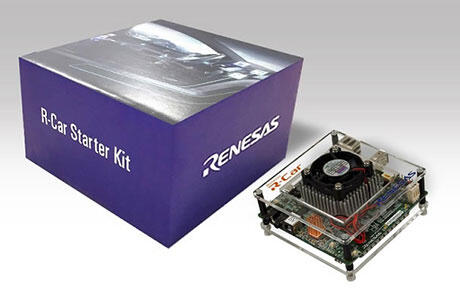
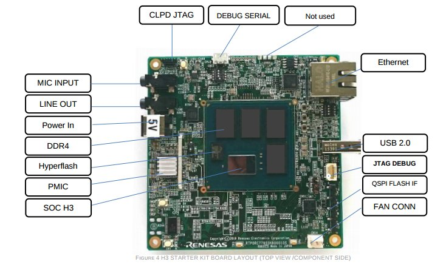
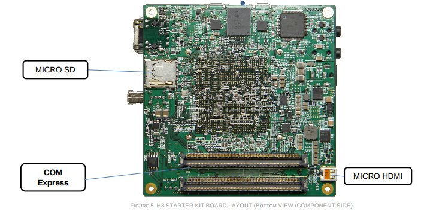
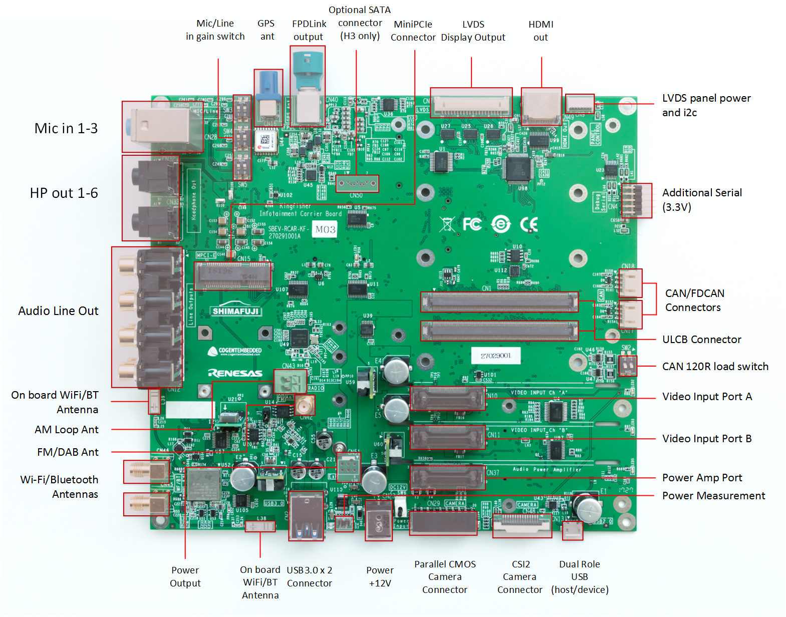
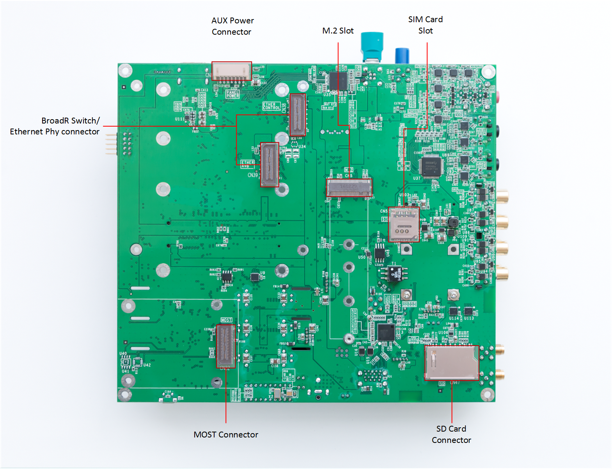

<!-- Copyright 2015-2026 Zephyr Project members and individual contributors. -->
<!-- SPDX-License-Identifier: Apache-2.0 -->
<!-- 中文翻译；编号、导航与译注为本地新增。 -->

<a id="rcar_h3ulcb"></a>

# 第3章\_R-Car H3ULCB开发板

原文：[官方页面](https://docs.zephyrproject.org/latest/boards/renesas/rcar_h3ulcb/doc/index.html)。读取日期：2026-10-17；来源摘要见[来源记录](../SOURCES.md)。

> 译注：本页正文和全部原始图片已补齐。2026-10-18 从原始地址取得外链原图，原始字节及格式保持不变，本地引用使用相对路径。

开发板概览（Board Overview）

<a id="id2"></a>

[](images/rcar_h3ulcb.jpg)

R-Car H3ULCB开发板

名称（Name）：

`rcar_h3ulcb`

厂商（Vendor）：

[瑞萨电子（Renesas Electronics Corporation）](https://docs.zephyrproject.org/latest/boards/index.html#vendor=renesas)

状态（Status）：

维护中（Maintained）

架构（Architecture）：

[arm](https://docs.zephyrproject.org/latest/boards/index.html#arch=arm)、[arm64](https://docs.zephyrproject.org/latest/boards/index.html#arch=arm64)

片上系统（SoC）：

[r8a77951](https://docs.zephyrproject.org/latest/boards/index.html#soc=r8a77951)

<a id="board-github-link"></a>

[浏览开发板源码（Browse Board Sources）](https://github.com/zephyrproject-rtos/zephyr/blob/main//boards/renesas/rcar_h3ulcb/doc/index.rst/../..)<a id="overview"></a>

## 概述（Overview）

R-Car H3ULCB 入门套件开发板基于 R-Car H3 片上系统（SoC），具备下一代车载导航系统所需的基本功能。该 SoC 包含四核 Cortex®-A57、四核 Cortex®-A53 集群，以及双核锁步 Cortex®-R7（Dual Lockstep）。

Zephyr 操作系统同时支持 Cortex®-A 内核和 Cortex®-R7 内核。

有关 H3 SoC 的更多信息，参见 Renesas R-Car H3 芯片页面。（[瑞萨R-Car H3芯片](https://www.renesas.com/eu/en/products/automotive-products/automotive-system-chips-socs/r-car-h3-high-end-automotive-system-chip-soc-vehicle-infotainment-and-driving-safety-support)）

<a id="hardware"></a>

## 硬件（Hardware）


- H3ULCB 特性：


  - 存储（Storage）：


    - 384 KB 系统 RAM
    - 4／8 GB 低功耗双倍数据率 4 代内存（LPDDR4）
    - 64 MB HyperFlash 闪存（512 Mbit、160 MHz、320 MB/s）
    - 16 MB QSPI 闪存（128 Mbit、80 MHz、80 MB/s），1 个排针式 QSPI 模块
    - 8／32／64／128 GB 嵌入式多媒体卡（eMMC），HS400 模式为 240 MB/s
    - microSD 卡槽（SDR104 模式，100 MB/s）
  - 连接器（Connectors）


    - CN1 440 针 COM Express 型连接器
    - CN2 QSPI 闪存模块
    - CN3 调试 JTAG 接口
    - CN4 HDMI (HDMI-0)（接口或信号标识沿用原图）
    - CN5 USB 2.0 (USB2.0-1)（接口或信号标识沿用原图）
    - CN6 推拉式 microSD 卡座（SDHI-0）
    - CN7 RJ45 以太网连接器
    - CN8 线路输出（Line Out）
    - CN9 麦克风输入（MIC Input）
    - CN10 调试串口（Debug Serial，未焊装）
    - CN11 CPLD 编程 JTAG 接口
    - CN12 调试串口（Debug Serial，串行）
    - CN13 主电源输入（5 V 直流）
    - CN14 CPU 风扇
  - 输入（Input）


    - SW1 HyperFlash 闪存
    - SW2 软件可读取的拨码开关（DIP Switch，4 位）
    - SW3 软件可读取的按键（Push Button）
    - SW4 软件可读取的按键（Push Button）
    - SW5 软件可读取的按键（Push Button）
    - SW6 模式设置（Mode Settings）
    - SW7 CPLD 复位（Reset）
    - SW8 电源（Power）
    - SW9 复位（Reset）
  - Output


    - LED1 HDMI／热插拔同步检测（Hot Plug Sync Detect）
    - LED4 软件可控制的发光二极管（LED）
    - LED5 软件可控制的发光二极管（LED）
    - LED6 软件可控制的发光二极管（LED）
    - LED9 5 V 主电源
    - LED14 备用 LED（Backup LED）
    - LED15 系统复位（System Reset）

H3ULCB 开发板的完整功能列表见该板的 [eLinux H3SK 页面](https://elinux.org/R-Car/Boards/H3SK)。

有关开发板的更多信息，参见 [Renesas R-Car 入门套件网站](https://www.renesas.com/br/en/products/automotive-products/automotive-system-chips-socs/r-car-h3-m3-starter-kit)。

<a id="supported-features"></a>

### 支持的功能（Supported Features）

`rcar_h3ulcb` 开发板支持下列硬件功能（Hardware Features）。

片上／板载（On-Chip / On-Board）

功能集成在片上系统（SoC）内／位于开发板上。

2 / 2

分别表示已启用／已禁用的实例数。点击数量标签，可查看开发板或SoC设备树源码（DTS）中该功能的第一个实例。

`vnd,foo`

与此功能匹配的设备树绑定兼容字符串（Compatible String）；点击链接可查看绑定文档。

<a id="rcar_h3ulcb-hw-features"></a>

<a id="rcar_h3ulcb-rcar_h3ulcb/r8a77951/a57-hw-features-section"></a>

#### `rcar_h3ulcb/r8a77951/a57` 目标（Target）

<a id="rcar_h3ulcb-rcar_h3ulcb/r8a77951/a57-hw-features-panel"></a>

<a id="rcar_h3ulcb-rcar_h3ulcb/r8a77951/a57-hw-features-memory"></a>

该开发板目标的片上存储容量：512 MiB RAM、N/A Flash。

<a id="rcar_h3ulcb-rcar_h3ulcb/r8a77951/a57-hw-features-table"></a>

<table>
<tr>
<th>类型（Type）</th>
<th>位置（Location）</th>
<th>说明（Description）</th>
<th>兼容字符串（Compatible）</th>
</tr>
<tr>
<td rowspan="1">中央处理器（CPU）</td>
<td>片上（On-Chip）</td>
<td>Arm Cortex-A57处理器（CPU）（<a href="https://github.com/zephyrproject-rtos/zephyr/blob/main/dts/arm64/renesas/r8a77951.dtsi?plain=1#L17">已启用：1</a>）</td>
<td><a href="../cpu_arm_riscv_binding_reference/P010_arm_cortex-a57.md#std-dtcompatible-arm-cortex-a57"><code>arm,cortex-a57</code></a></td>
</tr>
<tr>
<td rowspan="1">时钟控制（Clock Control）</td>
<td>片上（On-Chip）</td>
<td>瑞萨R8A7795 SoC时钟脉冲发生器（CPG）、模块待机及软件复位（<a href="https://github.com/zephyrproject-rtos/zephyr/blob/main/dts/arm64/renesas/rcar_gen3_ca57.dtsi?plain=1#L69">已启用：1</a>）</td>
<td><a href="../clock_nxp_pico_realtek_renesas_binding_reference/P025_renesas_r8a7795-cpg-mssr.md#std-dtcompatible-renesas-r8a7795-cpg-mssr"><code>renesas,r8a7795-cpg-mssr</code></a></td>
</tr>
<tr>
<td rowspan="1">通用输入输出与接插件（GPIO &amp; Headers）</td>
<td>片上（On-Chip）</td>
<td>Renesas R-Car通用输入输出（GPIO）（<a href="https://github.com/zephyrproject-rtos/zephyr/blob/main/dts/arm64/renesas/rcar_gen3_ca57.dtsi?plain=1#L76">已启用：1</a>）</td>
<td><a href="../gpio_raspberrypi_renesas_binding_reference/P017_renesas_rcar-gpio.md#std-dtcompatible-renesas-rcar-gpio"><code>renesas,rcar-gpio</code></a></td>
</tr>
<tr>
<td rowspan="1">中断控制器（Interrupt Controller）</td>
<td>片上（On-Chip）</td>
<td>ARM通用中断控制器（GIC）v2（<a href="https://github.com/zephyrproject-rtos/zephyr/blob/main/dts/arm64/renesas/rcar_gen3_ca57.dtsi?plain=1#L51">已启用：1</a>）</td>
<td><a href="../interrupt_fabric_binding_reference/P003_arm_gic-v2.md#std-dtcompatible-arm-gic-v2"><code>arm,gic-v2</code></a></td>
</tr>
<tr>
<td rowspan="1">引脚控制（Pin Control）</td>
<td>片上（On-Chip）</td>
<td>Renesas R-Car Gen3／Gen4引脚功能控制器（Pin Function Controller）（<a href="https://github.com/zephyrproject-rtos/zephyr/blob/main/dts/arm64/renesas/rcar_gen3_ca57.dtsi?plain=1#L109">已启用：1</a>）</td>
<td><a href="../pinctrl_renesas_silabs_binding_reference/P009_renesas_rcar-pfc.md#std-dtcompatible-renesas-rcar-pfc"><code>renesas,rcar-pfc</code></a></td>
</tr>
<tr>
<td rowspan="1">电源管理 CPU 操作（Power Management CPU Operations）</td>
<td>片上（On-Chip）</td>
<td>电源状态协调接口（PSCI / Power State Coordination Interface）0.2版（<a href="https://github.com/zephyrproject-rtos/zephyr/blob/main/dts/arm64/renesas/rcar_gen3_ca57.dtsi?plain=1#L17">已启用：1</a>）</td>
<td><a href="https://docs.zephyrproject.org/latest/build/dts/api/bindings/pm_cpu_ops/arm%2Cpsci-0.2.html#std-dtcompatible-arm-psci-0.2"><code>arm,psci-0.2</code></a></td>
</tr>
<tr>
<td rowspan="2">稳压器（Regulator）</td>
<td>片上（On-Chip）</td>
<td>固定电压稳压器（Fixed Voltage Regulators）（<a href="https://github.com/zephyrproject-rtos/zephyr/blob/main/dts/arm64/renesas/rcar_gen3_ca57.dtsi?plain=1#L31">已启用：3</a>）</td>
<td><a href="../hardware/P635_固定稳压器设备树绑定.md#dtbinding-regulator-fixed"><code>regulator-fixed</code></a></td>
</tr>
<tr>
<td>板载（On-Board）</td>
<td>通过 GPIO 控制的稳压器电压（<a href="https://github.com/zephyrproject-rtos/zephyr/blob/main/boards/renesas/rcar_h3ulcb/rcar_h3ulcb_r8a77951_a57.dts?plain=1#L48">已启用：1</a>）</td>
<td><a href="../hardware/P636_GPIO稳压器设备树绑定.md#dtbinding-regulator-gpio"><code>regulator-gpio</code></a></td>
</tr>
<tr>
<td rowspan="1">SD 主机控制器（SDHC）</td>
<td>片上（On-Chip）</td>
<td>瑞萨R-Car嵌入式多媒体卡（eMMC）（<a href="https://github.com/zephyrproject-rtos/zephyr/blob/main/dts/arm64/renesas/rcar_gen3_ca57.dtsi?plain=1#L87">已启用：1</a>；<a href="https://github.com/zephyrproject-rtos/zephyr/blob/main/dts/arm64/renesas/rcar_gen3_ca57.dtsi?plain=1#L97">已禁用：1</a>）</td>
<td><a href="../sdhc_binding_reference/P018_renesas_rcar-mmc.md#std-dtcompatible-renesas-rcar-mmc"><code>renesas,rcar-mmc</code></a></td>
</tr>
<tr>
<td rowspan="1">串行控制器（Serial Controller）</td>
<td>片上（On-Chip）</td>
<td>瑞萨R-Car UART控制器（<a href="https://github.com/zephyrproject-rtos/zephyr/blob/main/dts/arm64/renesas/rcar_gen3_ca57.dtsi?plain=1#L114">已启用：1</a>）</td>
<td><a href="../uart_raspberrypi_realtek_renesas_binding_reference/P010_renesas_rcar-scif.md#std-dtcompatible-renesas-rcar-scif"><code>renesas,rcar-scif</code></a></td>
</tr>
<tr>
<td rowspan="1">定时器（Timer）</td>
<td>片上（On-Chip）</td>
<td>每个内核独立的ARM架构定时器（Architected Timer）（<a href="https://github.com/zephyrproject-rtos/zephyr/blob/main/dts/arm64/renesas/rcar_gen3_ca57.dtsi?plain=1#L22">已启用：1</a>）</td>
<td><a href="../arm_interrupt_timer_binding_reference/P010_ARMv8架构定时器.md#std-dtcompatible-arm-armv8-timer"><code>arm,armv8-timer</code></a></td>
</tr>
</table>

<a id="rcar_h3ulcb-rcar_h3ulcb/r8a77951/r7-hw-features-section"></a>

#### `rcar_h3ulcb/r8a77951/r7` 目标（Target）

<a id="rcar_h3ulcb-rcar_h3ulcb/r8a77951/r7-hw-features-panel"></a>

<a id="rcar_h3ulcb-rcar_h3ulcb/r8a77951/r7-hw-features-memory"></a>

此开发板目标的存储器：32512 KiB RAM；闪存容量不适用（N/A）。

<a id="rcar_h3ulcb-rcar_h3ulcb/r8a77951/r7-hw-features-table"></a>

<table>
<tr>
<th>类型（Type）</th>
<th>位置（Location）</th>
<th>说明（Description）</th>
<th>兼容字符串（Compatible）</th>
</tr>
<tr>
<td rowspan="1">中央处理器（CPU）</td>
<td>片上（On-Chip）</td>
<td>Arm Cortex-R7处理器（CPU）（<a href="https://github.com/zephyrproject-rtos/zephyr/blob/main/dts/arm/renesas/rcar/gen3/rcar_gen3_cr7.dtsi?plain=1#L20">已启用：1</a>）</td>
<td><a href="../cpu_cortex_xtensa_binding_reference/P013_arm_cortex-r7.md#std-dtcompatible-arm-cortex-r7"><code>arm,cortex-r7</code></a></td>
</tr>
<tr>
<td rowspan="1">控制器局域网（CAN）</td>
<td>片上（On-Chip）</td>
<td>瑞萨R-Car CAN控制器（<a href="https://github.com/zephyrproject-rtos/zephyr/blob/main/dts/arm/renesas/rcar/gen3/rcar_gen3_cr7.dtsi?plain=1#L91">已启用：1</a>）</td>
<td><a href="../can_nxp_renesas_stm32_ti_binding_reference/P006_renesas_rcar-can.md#std-dtcompatible-renesas-rcar-can"><code>renesas,rcar-can</code></a></td>
</tr>
<tr>
<td rowspan="1">时钟控制（Clock Control）</td>
<td>片上（On-Chip）</td>
<td>瑞萨R8A7795 SoC时钟脉冲发生器（CPG）、模块待机及软件复位（<a href="https://github.com/zephyrproject-rtos/zephyr/blob/main/dts/arm/renesas/rcar/gen3/r8a77951.dtsi?plain=1#L12">已启用：1</a>）</td>
<td><a href="../clock_nxp_pico_realtek_renesas_binding_reference/P025_renesas_r8a7795-cpg-mssr.md#std-dtcompatible-renesas-r8a7795-cpg-mssr"><code>renesas,r8a7795-cpg-mssr</code></a></td>
</tr>
<tr>
<td rowspan="1">通用输入输出与接插件（GPIO &amp; Headers）</td>
<td>片上（On-Chip）</td>
<td>Renesas R-Car通用输入输出（GPIO）（<a href="https://github.com/zephyrproject-rtos/zephyr/blob/main/dts/arm/renesas/rcar/gen3/rcar_gen3_cr7.dtsi?plain=1#L55">已启用：1</a>；<a href="https://github.com/zephyrproject-rtos/zephyr/blob/main/dts/arm/renesas/rcar/gen3/rcar_gen3_cr7.dtsi?plain=1#L44">已禁用：1</a>）</td>
<td><a href="../gpio_raspberrypi_renesas_binding_reference/P017_renesas_rcar-gpio.md#std-dtcompatible-renesas-rcar-gpio"><code>renesas,rcar-gpio</code></a></td>
</tr>
<tr>
<td rowspan="1">集成电路间总线（I2C）</td>
<td>片上（On-Chip）</td>
<td>瑞萨R-Car I2C控制器（<a href="https://github.com/zephyrproject-rtos/zephyr/blob/main/dts/arm/renesas/rcar/gen3/rcar_gen3_cr7.dtsi?plain=1#L100">已启用：2</a>）</td>
<td><a href="../i2c_nxp_pico_renesas_binding_reference/P015_renesas_rcar-i2c.md#std-dtcompatible-renesas-rcar-i2c"><code>renesas,rcar-i2c</code></a></td>
</tr>
<tr>
<td rowspan="1">输入（Input）</td>
<td>板载（On-Board）</td>
<td>一组绑定到 GPIO 的输入按键（GPIO-Bound Input Keys）（<a href="https://github.com/zephyrproject-rtos/zephyr/blob/main/boards/renesas/rcar_h3ulcb/rcar_h3ulcb_r8a77951_r7.dts?plain=1#L38">已启用：1</a>）</td>
<td><a href="../hardware/P563_GPIO按键绑定.md#std-dtcompatible-gpio-keys"><code>gpio-keys</code></a></td>
</tr>
<tr>
<td rowspan="1">中断控制器（Interrupt Controller）</td>
<td>片上（On-Chip）</td>
<td>ARM通用中断控制器（GIC）v2（<a href="https://github.com/zephyrproject-rtos/zephyr/blob/main/dts/arm/renesas/rcar/gen3/rcar_gen3_cr7.dtsi?plain=1#L33">已启用：1</a>）</td>
<td><a href="../interrupt_fabric_binding_reference/P003_arm_gic-v2.md#std-dtcompatible-arm-gic-v2"><code>arm,gic-v2</code></a></td>
</tr>
<tr>
<td rowspan="1">发光二极管（LED）</td>
<td>板载（On-Board）</td>
<td>一组由 GPIO 控制的 LED（GPIO-Controlled LEDs）（<a href="https://github.com/zephyrproject-rtos/zephyr/blob/main/boards/renesas/rcar_h3ulcb/rcar_h3ulcb_r8a77951_r7.dts?plain=1#L29">已启用：1</a>）</td>
<td><a href="../hardware/P564_GPIO指示灯绑定.md#dtbinding-gpio-leds"><code>gpio-leds</code></a></td>
</tr>
<tr>
<td rowspan="1">引脚控制（Pin Control）</td>
<td>片上（On-Chip）</td>
<td>Renesas R-Car Gen3／Gen4引脚功能控制器（Pin Function Controller）（<a href="https://github.com/zephyrproject-rtos/zephyr/blob/main/dts/arm/renesas/rcar/gen3/rcar_gen3_cr7.dtsi?plain=1#L66">已启用：1</a>）</td>
<td><a href="../pinctrl_renesas_silabs_binding_reference/P009_renesas_rcar-pfc.md#std-dtcompatible-renesas-rcar-pfc"><code>renesas,rcar-pfc</code></a></td>
</tr>
<tr>
<td rowspan="1">脉宽调制（PWM）</td>
<td>片上（On-Chip）</td>
<td>瑞萨R-Car脉宽调制（PWM）控制器（<a href="https://github.com/zephyrproject-rtos/zephyr/blob/main/dts/arm/renesas/rcar/gen3/rcar_gen3_cr7.dtsi?plain=1#L71">已禁用：1</a>）</td>
<td><a href="../pwm_nxp_renesas_binding_reference/P018_renesas_pwm-rcar.md#std-dtcompatible-renesas-pwm-rcar"><code>renesas,pwm-rcar</code></a></td>
</tr>
<tr>
<td rowspan="1">串行控制器（Serial Controller）</td>
<td>片上（On-Chip）</td>
<td>瑞萨R-Car UART控制器（<a href="https://github.com/zephyrproject-rtos/zephyr/blob/main/dts/arm/renesas/rcar/gen3/rcar_gen3_cr7.dtsi?plain=1#L126">已启用：1</a>；<a href="https://github.com/zephyrproject-rtos/zephyr/blob/main/dts/arm/renesas/rcar/gen3/rcar_gen3_cr7.dtsi?plain=1#L136">已禁用：1</a>）</td>
<td><a href="../uart_raspberrypi_realtek_renesas_binding_reference/P010_renesas_rcar-scif.md#std-dtcompatible-renesas-rcar-scif"><code>renesas,rcar-scif</code></a></td>
</tr>
<tr>
<td rowspan="1">静态随机存储器（SRAM）</td>
<td>片上（On-Chip）</td>
<td>通用片上静态随机存储器（SRAM）（<a href="https://github.com/zephyrproject-rtos/zephyr/blob/main/dts/arm/renesas/rcar/gen3/rcar_gen3_cr7.dtsi?plain=1#L28">已启用：1</a>）</td>
<td><a href="../hardware/P567_内存映射SRAM绑定.md#dtbinding-mmio-sram"><code>mmio-sram</code></a></td>
</tr>
<tr>
<td rowspan="1">定时器（Timer）</td>
<td>片上（On-Chip）</td>
<td>瑞萨R-Car比较匹配定时器（CMT）（<a href="https://github.com/zephyrproject-rtos/zephyr/blob/main/dts/arm/renesas/rcar/gen3/rcar_gen3_cr7.dtsi?plain=1#L78">已启用：1</a>）</td>
<td><a href="../renesas_timer_binding_reference/P002_renesas_rcar-cmt.md#std-dtcompatible-renesas-rcar-cmt"><code>renesas,rcar-cmt</code></a></td>
</tr>
</table>

注意（Note）

建议在Linux主机端禁用由R7内核使用的外设。

<a id="connections-and-ios"></a>

### 连接与输入输出（Connections and IOs）

H3ULCB 入门套件可以插接到 Kingfisher 子板上。

<a id="h3ulcb-board"></a>

#### H3ULCB 开发板

以下是 eLinux 提供的 H3ULCB 开发板官方输入输出接口（IOs）图：

[](images/R-Car-H3-topview.jpg)

[](images/R-Car-H3-bottomview.jpg)

<a id="kingfisher-infotainment-daughter-board"></a>

#### Kingfisher 信息娱乐子板（Infotainment Daughter Board）

通过 COM Express 连接器接到 Kingfisher 信息娱乐板后，可使用更多输入输出接口（IOs）。

以下是 eLinux 提供的 Kingfisher 信息娱乐板官方输入输出接口（IOs）图：

[](images/Kfisher_top_specs.png)

[](images/Kfisher_bot_specs.png)

<a id="gpio"></a>

#### 通用输入输出（GPIO）

在 H3ULCB 上运行 Zephyr 时，可将软件可读取的按键 `SW3` 用作输入，将软件可控制的 LED `LED5` 用作输出。

<a id="uart"></a>

#### 通用异步收发器（UART）

H3ULCB 提供两个串口，通常只能直接使用板上的一个；另一个可通过焊接组件，或将开发板插到 Kingfisher 信息娱乐子板（Infotainment Daughter Board）上来使用。

这些串口的信息如下：

<table>
<tr>
<th>物理接口（Physical Interface）</th>
<th>物理位置（Physical Location）</th>
<th>软件接口（Software Interface）</th>
<th>转换器（Converter）</th>
<th>更多信息（Further Information）</th>
</tr>
<tr>
<td>CN12 调试串口（Debug Serial）</td>
<td>ULCB 开发板</td>
<td>SCIF2</td>
<td>FT232RQ</td>
<td>由 U-Boot 和 Linux 使用</td>
</tr>
<tr>
<td>CN10 调试串口（Debug Serial）</td>
<td>ULCB 开发板</td>
<td>SCIF1</td>
<td>CP2102</td>
<td>Non-welded</td>
</tr>
<tr>
<td>CN04 调试串口（Debug Serial）</td>
<td>Kingfisher</td>
<td>SCIF1</td>
<td></td>
<td>第二路 UART／通过 COM Express 连接器</td>
</tr>
</table>

H3ULCB 的 A53 支持使用 SCIF2 作为 UART，R7 支持则使用 SCIF1。两种情况下，控制台默认均为 115200、8N1，不使用硬件流控（Hardware Flow Control）。

要通过 CN04 UART 接口访问 SCIF1，请按 Kingfisher 开发板版本使用以下引脚分配：

<table>
<tr>
<th>信号（Signal）</th>
<th>KF03 引脚</th>
<th>KF04 引脚</th>
</tr>
<tr>
<td>接收数据（RXD）</td>
<td>3</td>
<td>4</td>
</tr>
<tr>
<td>发送数据（TXD）</td>
<td>5</td>
<td>2</td>
</tr>
<tr>
<td>请求发送（RTS）</td>
<td>4</td>
<td>1</td>
</tr>
<tr>
<td>允许发送（CTS）</td>
<td>6</td>
<td>3</td>
</tr>
<tr>
<td>地（GND）</td>
<td>9</td>
<td>6</td>
</tr>
</table>

<a id="can"></a>

#### 控制器局域网（CAN）

H3ULCB 提供两个 CAN 接口，两者均可在 Kingfisher 子板上使用。

<table>
<tr>
<th>物理接口（Physical Interface）</th>
<th>软件接口（Software Interface）</th>
<th>Transceiver</th>
</tr>
<tr>
<td>CN17</td>
<td>CAN0</td>
<td>TCAN332GDCNT</td>
</tr>
<tr>
<td>CN18</td>
<td>CAN1</td>
<td>TCAN332GDCNT</td>
</tr>
</table>

注意（Note）

接口默认设置为 125 kbit/s。

下表列出 CAN 物理接口的引脚分配（Pinout）：

<table>
<tr>
<th>引脚（Pin）</th>
<th>信号（Signal）</th>
</tr>
<tr>
<td>1</td>
<td>CAN高线（CANH）</td>
</tr>
<tr>
<td>2</td>
<td>CAN低线（CANL）</td>
</tr>
<tr>
<td>3</td>
<td>地（GND）</td>
</tr>
</table>

<a id="i2c"></a>

#### 集成电路间总线（I2C）

H3ULCB 提供两条 I2C 总线，但无法通过连接器直接访问这些总线。

I2C 主要用于管理 H3ULCB 与 Kingfisher 子板上的多个芯片，并为这些芯片上电。

尚不支持板载 I2C 器件和输入输出扩展器（I/O Expander）。因此，目前的 I2C 支持尚未向用户提供可用器件。

<a id="pwm"></a>

#### 脉宽调制（PWM）

ULCB 开发板提供一个脉宽调制（PWM）控制器，最多具有 7 个通道，编号为 [0..6]。H3ULCB 的 `pwm0` 仅通过测试点 CP8 引出。

插接 Kingfisher 子板后，可通过 CN7 低压差分信号（LVDS）连接器使用 `pwm4` 通道。

<a id="programming-and-debugging-a53"></a>

## A53编程与调试（Programming and Debugging）

<a id="flashing"></a>

### 烧录（Flashing）

原文所述阶段，此 Zephyr 移植尚未正式支持任何烧录方式。

<a id="programming-and-debugging-r7"></a>

## 编程与调试（Programming and Debugging，R7）

`rcar_h3ulcb` 开发板支持下列运行工具（Runner）及对应的 west 命令。

<table>
<tr>
<th></th>
<th>烧录（flash）</th>
<th>调试（debug）</th>
<th>连接调试会话（attach）</th>
<th>实时传输（rtt）</th>
<th>调试服务器（debugserver）</th>
</tr>
<tr>
<td><a href="https://docs.zephyrproject.org/latest/develop/flash_debug/host-tools.html#runner-openocd">openocd</a></td>
<td>✅（默认 / default）</td>
<td>✅（默认 / default）</td>
<td>✅</td>
<td>✅</td>
<td>✅</td>
</tr>
</table>

按通常方式构建并烧录应用，详见“构建应用”（[Building an Application](../application/P001_应用开发.md#build-an-application)）与“运行应用”（[Run an Application](https://docs.zephyrproject.org/latest/develop/application/index.html#application-run)）。

<a id="supported-debug-probe"></a>

### 支持的调试探针（Debug Probe）

原文唯一正式支持的探针为Olimex ARM-USB-OCD-H，Zephyr SDK随附的OpenOCD支持此探针。

Olimex ARM-USB-OCD-H 探针需要通过 SICA20I2P 转接器连接到 H3ULCB 的 CN3。

注意（Note）

若遇到 JTAG 问题，请参阅 [eLinux Kingfisher 页面](https://elinux.org/R-Car/Boards/Kingfisher)中的“已知问题”（Known Issues）章节。

<a id="configuring-a-console"></a>

### 配置控制台（Configuring a Console）

使用 USB 线缆，将计算机连接到 Kingfisher 子板的 CN04。

在串口终端中使用以下设置，例如minicom或PuTTY：


- 速率（Speed）：115200波特率
- 数据位（Data）：8位
- 奇偶校验（Parity）：无（None）
- 停止位（Stop Bits）：1位

<a id="id1"></a>

### 烧录（Flashing）

首先打开串口终端。

可按通常方式为 `rcar_h3ulcb/r8a77951/r7` 开发板配置构建应用，更多信息参见[构建应用（Building an Application）](../application/P001_应用开发.md#build-an-application)。

```text
# From the root of the zephyr repository
west build -b rcar_h3ulcb/r8a77951/r7 samples/hello_world
west flash
```

终端中应出现以下消息：

```text
*** Booting Zephyr OS build v2.6.0-rc1 ***
Hello World! rcar_h3ulcb
```

<a id="debugging"></a>

### 调试（Debugging）

首先打开串口终端。

下面以[Hello World](../getting_started/P005_HelloWorld示例.md#hello_world)应用为例。

```text
# From the root of the zephyr repository
west build -b rcar_h3ulcb/r8a77951/r7 samples/hello_world
west debug
```

随后可进入GDB会话进行调试。

继续运行应用后，终端应显示以下消息：

```text
*** Booting Zephyr OS build v2.6.0-rc1 ***
Hello World! rcar_h3ulcb
```

<a id="references"></a>

## 参考资料（References）


- [Renesas R-Car 入门套件网站](https://www.renesas.com/br/en/products/automotive-products/automotive-system-chips-socs/r-car-h3-m3-starter-kit)
- [瑞萨R-Car H3芯片](https://www.renesas.com/eu/en/products/automotive-products/automotive-system-chips-socs/r-car-h3-high-end-automotive-system-chip-soc-vehicle-infotainment-and-driving-safety-support)
- [eLinux H3SK 页面](https://elinux.org/R-Car/Boards/H3SK)
- [eLinux Kingfisher 页面](https://elinux.org/R-Car/Boards/Kingfisher)

## 译注

正文及原始图片已完整保留。原页通过链接引用的图片在本译文中直接展示，点击可打开原尺寸文件；来源与摘要见[原图清单](../official-images.json)。

## 外链原图来源

- [Kfisher_bot_specs.png](https://elinux.org/images/0/06/Kfisher_bot_specs.png)；[本地原件](images/Kfisher_bot_specs.png)。
- [Kfisher_top_specs.png](https://elinux.org/images/0/08/Kfisher_top_specs.png)；[本地原件](images/Kfisher_top_specs.png)。
- [R-Car-H3-topview.jpg](https://elinux.org/images/1/1f/R-Car-H3-topview.jpg)；[本地原件](images/R-Car-H3-topview.jpg)。
- [R-Car-H3-bottomview.jpg](https://elinux.org/images/c/c2/R-Car-H3-bottomview.jpg)；[本地原件](images/R-Car-H3-bottomview.jpg)。

---

[上一章](P002_CANBed_RP2040.md) · [返回大纲](大纲.md) · [全站翻译进度](../PROGRESS.md) · [下一章](P004_R-Car_Spider.md)
