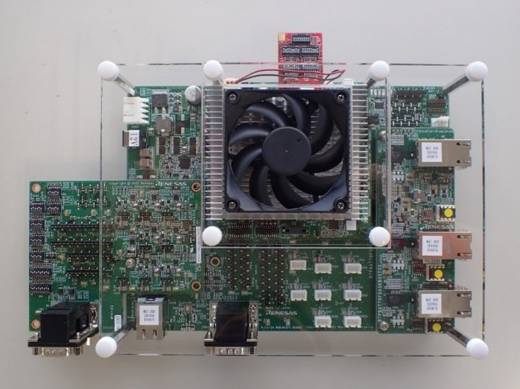
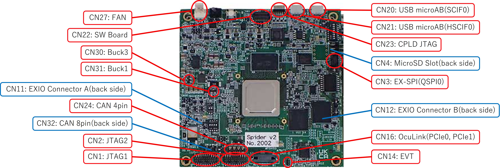
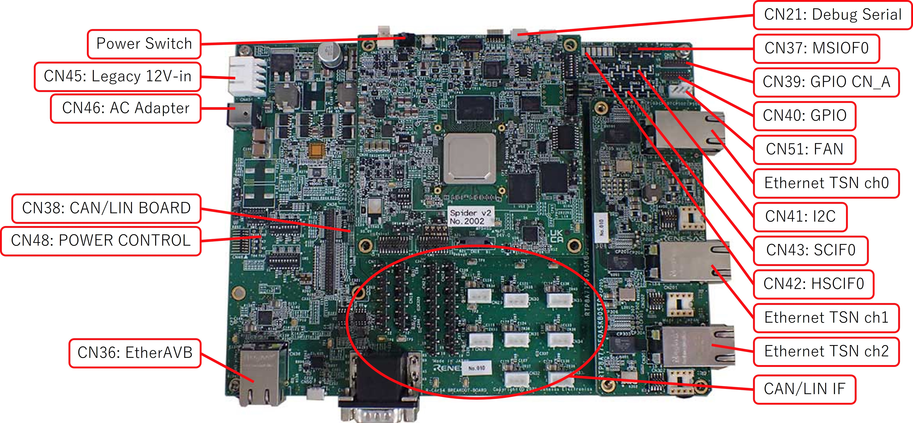

<!-- Copyright 2015-2026 Zephyr Project members and individual contributors. -->
<!-- SPDX-License-Identifier: Apache-2.0 -->
<!-- 中文翻译；编号、导航与译注为本地新增。 -->

<a id="rcar_spider_s4"></a>

# 第4章\_R-Car Spider开发板

原文：[官方页面](https://docs.zephyrproject.org/latest/boards/renesas/rcar_spider_s4/doc/index.html)。读取日期：2026-10-17；来源摘要见[来源记录](../SOURCES.md)。

> 译注：本页正文和全部原始图片已补齐。2026-10-18 从原始地址取得外链原图，原始字节及格式保持不变，本地引用使用相对路径。

开发板概览（Board Overview）

<a id="id1"></a>

[](images/rcar_spider_s4.jpg)

R-Car Spider开发板

名称（Name）：

`rcar_spider_s4`

厂商（Vendor）：

[瑞萨电子（Renesas Electronics Corporation）](https://docs.zephyrproject.org/latest/boards/index.html#vendor=renesas)

状态（Status）：

维护中（Maintained）

架构（Architecture）：

[arm](https://docs.zephyrproject.org/latest/boards/index.html#arch=arm)、[arm64](https://docs.zephyrproject.org/latest/boards/index.html#arch=arm64)

片上系统（SoC）：

[r8a779f0](https://docs.zephyrproject.org/latest/boards/index.html#soc=r8a779f0)

<a id="board-github-link"></a>

[浏览开发板源码（Browse Board Sources）](https://github.com/zephyrproject-rtos/zephyr/blob/main//boards/renesas/rcar_spider_s4/doc/index.rst/../..)<a id="overview"></a>

## 概述（Overview）

R-Car S4 Spider 开发板基于面向车载服务器／通信网关（Car Server／Communication Gateway）的 R-Car S4 SoC，其中包含八核 Cortex®-A55、双核锁步 Cortex®-R52，以及两组双核锁步 G4MH。

随着汽车电子电气架构（E/E Architecture）向域（Domain）与区域（Zone）架构演进，R-Car S4 SoC 可支持推出具备所需高性能、高速联网、高信息安全性和高功能安全等级的车载服务器／通信网关（Car Server／CoGW）。

R-Car S4 方案允许设计者复用为第三代 R-Car SoC 和 RH850 MCU 应用开发的软件代码，复用比例最高可达 88%。软件包提供各种驱动以及 Linux 板级支持包（BSP）、虚拟机监控器（Hypervisor）等基础软件，并支持实时内核。

Renesas R-Car Spider 是 Renesas R-Car S4 的参考板，用于评估该 SoC 的功能与性能。

Zephyr 操作系统同时支持 Cortex®-A 内核和 Cortex®-R52 内核。

有关 S4 SoC 的更多信息，参见 [Renesas R-Car S4 芯片](https://www.renesas.com/us/en/products/automotive-products/automotive-system-chips-socs/r-car-s4-automotive-system-chip-soc-car-servercommunication-gateway)页面。

<a id="hardware"></a>

## 硬件（Hardware）


- Spider 特性：


  - 连接器（Connectors）


    - CPU 板（CPU Board）：


      - CN1 JTAG1（接口或信号标识沿用原图）
      - CN2 JTAG2（接口或信号标识沿用原图）
      - CN3 EX-SPI (QSPI0)（接口或信号标识沿用原图）
      - CN4 microSD 插槽（背面）
      - CN11 EXIO 连接器 A（背面）
      - CN12 EXIO 连接器 B（背面）
      - CN14 EVT（接口或信号标识沿用原图）
      - CN16 OcuLink (PCIe0,PCIe1)（接口或信号标识沿用原图）
      - CN24 4 针 CAN 接口
      - CN20 USB micro-AB 端口（SCIF0）
      - CN21 USB micro-AB 端口（HSCIF0）
      - CN22 SW 开关板
      - CN23 CPLD JTAG 接口
      - CN27 风扇（FAN）
      - CN30 Buck3（接口或信号标识沿用原图）
      - CN31 Buck1（接口或信号标识沿用原图）
      - CN32 8 针 CAN 接口（背面）
    - 接口扩展板（Breakout Board）：


      - CN11 EXIO 连接器 A
      - CN12 EXIO 连接器 B
      - CN13 CAN 0/1（接口或信号标识沿用原图）
      - CN15 CAN 3/4/5（接口或信号标识沿用原图）
      - CN18 CAN 6/7/8（接口或信号标识沿用原图）
      - CN21 CAN 2/9/10/11（接口或信号标识沿用原图）
      - CN24 CAN 12/13/14/15（接口或信号标识沿用原图）
      - CN28 LIN0（接口或信号标识沿用原图）
      - CN29 LIN1（接口或信号标识沿用原图）
      - CN30 LIN2（接口或信号标识沿用原图）
      - CN31 LIN3（接口或信号标识沿用原图）
      - CN32 LIN4（接口或信号标识沿用原图）
      - CN33 LIN5（接口或信号标识沿用原图）
      - CN34 LIN6（接口或信号标识沿用原图）
      - CN35 LIN7（接口或信号标识沿用原图）
      - CN36 EtherTS（接口或信号标识沿用原图）
      - CN37 MSIOF0（接口或信号标识沿用原图）
      - CN38 CAN／LIN 板连接器
      - CN39 GPIO CN_A（接口或信号标识沿用原图）
      - CN40 GPIO（接口或信号标识沿用原图）
      - CN41 I2C（接口或信号标识沿用原图）
      - CN42 HSCIF0（接口或信号标识沿用原图）
      - CN43 SCIF0（接口或信号标识沿用原图）
      - CN44 TSN_CN（接口或信号标识沿用原图）
      - CN45 传统 12 V 输入（Legacy 12V-in）
      - CN46 交流电源适配器（AC Adapter）
      - CN48 电源控制（Power Control）
      - CN50 调试串口（Debug Serial）
      - CN51 风扇（FAN）
  - 输入（Input）


    - SW1 （SPI 闪存／EX-SPI 连接器）
    - SW2 （HyperFlash 闪存／SPI 闪存）
    - SW3 （microSD 卡槽／eMMC 存储器）
    - SW4 (PRESETn)（接口或信号标识沿用原图）
    - SW6 （MMC／JTAG2 接口电压设置）
    - SW8 模式设置（Mode Setting）
    - SW10 （软件开关）
    - SW11 （开发板供电电路控制）
    - SW12 (AURORES#)（接口或信号标识沿用原图）
    - SW13 (CANFD0 RX)（接口或信号标识沿用原图）
    - SW14 (CANFD0 TX)（接口或信号标识沿用原图）
    - SW15 （系统复位开关）
  - Output


    - LED7 软件可控制的发光二极管（LED）
    - LED8 软件可控制的发光二极管（LED）

<a id="supported-features"></a>

### 支持的功能（Supported Features）

`rcar_spider_s4` 开发板支持下列硬件功能（Hardware Features）。

片上／板载（On-Chip / On-Board）

功能集成在片上系统（SoC）内／位于开发板上。

2 / 2

分别表示已启用／已禁用的实例数。点击数量标签，可查看开发板或SoC设备树源码（DTS）中该功能的第一个实例。

`vnd,foo`

与此功能匹配的设备树绑定兼容字符串（Compatible String）；点击链接可查看绑定文档。

<a id="rcar_spider_s4-hw-features"></a>

<a id="rcar_spider_s4-rcar_spider_s4/r8a779f0/a55-hw-features-section"></a>

#### `rcar_spider_s4/r8a779f0/a55` 目标（Target）

<a id="rcar_spider_s4-rcar_spider_s4/r8a779f0/a55-hw-features-panel"></a>

<a id="rcar_spider_s4-rcar_spider_s4/r8a779f0/a55-hw-features-memory"></a>

该开发板目标的片上存储容量：512 MiB RAM、N/A Flash。

<a id="rcar_spider_s4-rcar_spider_s4/r8a779f0/a55-hw-features-table"></a>

<table>
<tr>
<th>类型（Type）</th>
<th>位置（Location）</th>
<th>说明（Description）</th>
<th>兼容字符串（Compatible）</th>
</tr>
<tr>
<td rowspan="1">中央处理器（CPU）</td>
<td>片上（On-Chip）</td>
<td>通用ARMv8-A处理器（CPU）（<a href="https://github.com/zephyrproject-rtos/zephyr/blob/main/dts/arm64/renesas/r8a779f0.dtsi?plain=1#L23">已启用：1</a>）</td>
<td><a href="../cpu_arm_riscv_binding_reference/P004_arm_armv8.md#std-dtcompatible-arm-armv8"><code>arm,armv8</code></a></td>
</tr>
<tr>
<td rowspan="1">时钟控制（Clock Control）</td>
<td>片上（On-Chip）</td>
<td>Renesas R8A779F0 SoC 时钟脉冲发生器（Clock Pulse Generator）／模块待机与软件复位（Module Standby and Software Reset）（<a href="https://github.com/zephyrproject-rtos/zephyr/blob/main/dts/arm64/renesas/r8a779f0.dtsi?plain=1#L83">已启用：1</a>）</td>
<td><a href="../clock_nxp_pico_realtek_renesas_binding_reference/P026_renesas_r8a779f0-cpg-mssr.md#std-dtcompatible-renesas-r8a779f0-cpg-mssr"><code>renesas,r8a779f0-cpg-mssr</code></a></td>
</tr>
<tr>
<td rowspan="1">中断控制器（Interrupt Controller）</td>
<td>片上（On-Chip）</td>
<td>ARM通用中断控制器（GIC）v3（<a href="https://github.com/zephyrproject-rtos/zephyr/blob/main/dts/arm64/renesas/r8a779f0.dtsi?plain=1#L73">已启用：1</a>）</td>
<td><a href="../interrupt_fabric_binding_reference/P004_arm_gic-v3.md#std-dtcompatible-arm-gic-v3"><code>arm,gic-v3</code></a></td>
</tr>
<tr>
<td rowspan="1">引脚控制（Pin Control）</td>
<td>片上（On-Chip）</td>
<td>Renesas R-Car Gen3／Gen4引脚功能控制器（Pin Function Controller）（<a href="https://github.com/zephyrproject-rtos/zephyr/blob/main/dts/arm64/renesas/r8a779f0.dtsi?plain=1#L102">已启用：1</a>）</td>
<td><a href="../pinctrl_renesas_silabs_binding_reference/P009_renesas_rcar-pfc.md#std-dtcompatible-renesas-rcar-pfc"><code>renesas,rcar-pfc</code></a></td>
</tr>
<tr>
<td rowspan="1">电源管理 CPU 操作（Power Management CPU Operations）</td>
<td>片上（On-Chip）</td>
<td>电源状态协调接口（PSCI / Power State Coordination Interface）0.2版（<a href="https://github.com/zephyrproject-rtos/zephyr/blob/main/dts/arm64/renesas/r8a779f0.dtsi?plain=1#L31">已启用：1</a>）</td>
<td><a href="https://docs.zephyrproject.org/latest/build/dts/api/bindings/pm_cpu_ops/arm%2Cpsci-0.2.html#std-dtcompatible-arm-psci-0.2"><code>arm,psci-0.2</code></a></td>
</tr>
<tr>
<td rowspan="1">稳压器（Regulator）</td>
<td>片上（On-Chip）</td>
<td>固定电压稳压器（Fixed Voltage Regulators）（<a href="https://github.com/zephyrproject-rtos/zephyr/blob/main/dts/arm64/renesas/r8a779f0.dtsi?plain=1#L45">已启用：2</a>）</td>
<td><a href="../hardware/P635_固定稳压器设备树绑定.md#dtbinding-regulator-fixed"><code>regulator-fixed</code></a></td>
</tr>
<tr>
<td rowspan="1">SD 主机控制器（SDHC）</td>
<td>片上（On-Chip）</td>
<td>瑞萨R-Car嵌入式多媒体卡（eMMC）（<a href="https://github.com/zephyrproject-rtos/zephyr/blob/main/dts/arm64/renesas/r8a779f0.dtsi?plain=1#L91">已启用：1</a>）</td>
<td><a href="../sdhc_binding_reference/P018_renesas_rcar-mmc.md#std-dtcompatible-renesas-rcar-mmc"><code>renesas,rcar-mmc</code></a></td>
</tr>
<tr>
<td rowspan="1">串行控制器（Serial Controller）</td>
<td>片上（On-Chip）</td>
<td>Renesas R-Car高速串行通信接口（HSCIF）控制器（<a href="https://github.com/zephyrproject-rtos/zephyr/blob/main/dts/arm64/renesas/r8a779f0.dtsi?plain=1#L110">已启用：1</a>）</td>
<td><a href="../uart_raspberrypi_realtek_renesas_binding_reference/P009_renesas_rcar-hscif.md#std-dtcompatible-renesas-rcar-hscif"><code>renesas,rcar-hscif</code></a></td>
</tr>
<tr>
<td rowspan="1">定时器（Timer）</td>
<td>片上（On-Chip）</td>
<td>每个内核独立的ARM架构定时器（Architected Timer）（<a href="https://github.com/zephyrproject-rtos/zephyr/blob/main/dts/arm64/renesas/r8a779f0.dtsi?plain=1#L36">已启用：1</a>）</td>
<td><a href="../arm_interrupt_timer_binding_reference/P010_ARMv8架构定时器.md#std-dtcompatible-arm-armv8-timer"><code>arm,armv8-timer</code></a></td>
</tr>
</table>

<a id="rcar_spider_s4-rcar_spider_s4/r8a779f0/r52-hw-features-section"></a>

#### `rcar_spider_s4/r8a779f0/r52` 目标（Target）

<a id="rcar_spider_s4-rcar_spider_s4/r8a779f0/r52-hw-features-panel"></a>

<a id="rcar_spider_s4-rcar_spider_s4/r8a779f0/r52-hw-features-memory"></a>

该开发板目标的片上存储容量：1 MiB RAM、N/A Flash。

<a id="rcar_spider_s4-rcar_spider_s4/r8a779f0/r52-hw-features-table"></a>

<table>
<tr>
<th>类型（Type）</th>
<th>位置（Location）</th>
<th>说明（Description）</th>
<th>兼容字符串（Compatible）</th>
</tr>
<tr>
<td rowspan="1">中央处理器（CPU）</td>
<td>片上（On-Chip）</td>
<td>ARM Cortex-R52处理器（CPU）（<a href="https://github.com/zephyrproject-rtos/zephyr/blob/main/dts/arm/renesas/rcar/gen4/rcar_gen4_cr52.dtsi?plain=1#L17">已启用：1</a>）</td>
<td><a href="../cpu_cortex_xtensa_binding_reference/P011_arm_cortex-r52.md#std-dtcompatible-arm-cortex-r52"><code>arm,cortex-r52</code></a></td>
</tr>
<tr>
<td rowspan="1">时钟控制（Clock Control）</td>
<td>片上（On-Chip）</td>
<td>Renesas R8A779F0 SoC 时钟脉冲发生器（Clock Pulse Generator）／模块待机与软件复位（Module Standby and Software Reset）（<a href="https://github.com/zephyrproject-rtos/zephyr/blob/main/dts/arm/renesas/rcar/gen4/r8a779f0.dtsi?plain=1#L28">已启用：1</a>）</td>
<td><a href="../clock_nxp_pico_realtek_renesas_binding_reference/P026_renesas_r8a779f0-cpg-mssr.md#std-dtcompatible-renesas-r8a779f0-cpg-mssr"><code>renesas,r8a779f0-cpg-mssr</code></a></td>
</tr>
<tr>
<td rowspan="1">通用输入输出与接插件（GPIO &amp; Headers）</td>
<td>片上（On-Chip）</td>
<td>Renesas R-Car通用输入输出（GPIO）（<a href="https://github.com/zephyrproject-rtos/zephyr/blob/main/dts/arm/renesas/rcar/gen4/r8a779f0.dtsi?plain=1#L34">已启用：2</a>）</td>
<td><a href="../gpio_raspberrypi_renesas_binding_reference/P017_renesas_rcar-gpio.md#std-dtcompatible-renesas-rcar-gpio"><code>renesas,rcar-gpio</code></a></td>
</tr>
<tr>
<td rowspan="1">输入（Input）</td>
<td>板载（On-Board）</td>
<td>一组绑定到 GPIO 的输入按键（GPIO-Bound Input Keys）（<a href="https://github.com/zephyrproject-rtos/zephyr/blob/main/boards/renesas/rcar_spider_s4/rcar_spider_s4_r8a779f0_r52.dts?plain=1#L37">已启用：1</a>）</td>
<td><a href="../hardware/P563_GPIO按键绑定.md#std-dtcompatible-gpio-keys"><code>gpio-keys</code></a></td>
</tr>
<tr>
<td rowspan="1">中断控制器（Interrupt Controller）</td>
<td>片上（On-Chip）</td>
<td>ARM通用中断控制器（GIC）v3（<a href="https://github.com/zephyrproject-rtos/zephyr/blob/main/dts/arm/renesas/rcar/gen4/rcar_gen4_cr52.dtsi?plain=1#L45">已启用：1</a>）</td>
<td><a href="../interrupt_fabric_binding_reference/P004_arm_gic-v3.md#std-dtcompatible-arm-gic-v3"><code>arm,gic-v3</code></a></td>
</tr>
<tr>
<td rowspan="1">发光二极管（LED）</td>
<td>板载（On-Board）</td>
<td>一组由 GPIO 控制的 LED（GPIO-Controlled LEDs）（<a href="https://github.com/zephyrproject-rtos/zephyr/blob/main/boards/renesas/rcar_spider_s4/rcar_spider_s4_r8a779f0_r52.dts?plain=1#L28">已启用：1</a>）</td>
<td><a href="../hardware/P564_GPIO指示灯绑定.md#dtbinding-gpio-leds"><code>gpio-leds</code></a></td>
</tr>
<tr>
<td rowspan="1">引脚控制（Pin Control）</td>
<td>片上（On-Chip）</td>
<td>Renesas R-Car Gen3／Gen4引脚功能控制器（Pin Function Controller）（<a href="https://github.com/zephyrproject-rtos/zephyr/blob/main/dts/arm/renesas/rcar/gen4/r8a779f0.dtsi?plain=1#L17">已启用：1</a>）</td>
<td><a href="../pinctrl_renesas_silabs_binding_reference/P009_renesas_rcar-pfc.md#std-dtcompatible-renesas-rcar-pfc"><code>renesas,rcar-pfc</code></a></td>
</tr>
<tr>
<td rowspan="1">串行控制器（Serial Controller）</td>
<td>片上（On-Chip）</td>
<td>瑞萨R-Car UART控制器（<a href="https://github.com/zephyrproject-rtos/zephyr/blob/main/dts/arm/renesas/rcar/gen4/rcar_gen4_cr52.dtsi?plain=1#L54">已启用：1</a>；<a href="https://github.com/zephyrproject-rtos/zephyr/blob/main/dts/arm/renesas/rcar/gen4/rcar_gen4_cr52.dtsi?plain=1#L61">已禁用：1</a>）</td>
<td><a href="../uart_raspberrypi_realtek_renesas_binding_reference/P010_renesas_rcar-scif.md#std-dtcompatible-renesas-rcar-scif"><code>renesas,rcar-scif</code></a></td>
</tr>
<tr>
<td rowspan="1">静态随机存储器（SRAM）</td>
<td>片上（On-Chip）</td>
<td>通用片上静态随机存储器（SRAM）（<a href="https://github.com/zephyrproject-rtos/zephyr/blob/main/dts/arm/renesas/rcar/gen4/rcar_gen4_cr52.dtsi?plain=1#L40">已启用：1</a>）</td>
<td><a href="../hardware/P567_内存映射SRAM绑定.md#dtbinding-mmio-sram"><code>mmio-sram</code></a></td>
</tr>
<tr>
<td rowspan="1">定时器（Timer）</td>
<td>片上（On-Chip）</td>
<td>每个内核独立的ARM架构定时器（Architected Timer）（<a href="https://github.com/zephyrproject-rtos/zephyr/blob/main/dts/arm/renesas/rcar/gen4/rcar_gen4_cr52.dtsi?plain=1#L24">已启用：1</a>）</td>
<td><a href="../arm_interrupt_timer_binding_reference/P010_ARMv8架构定时器.md#std-dtcompatible-arm-armv8-timer"><code>arm,armv8-timer</code></a></td>
</tr>
</table>

注意（Note）

建议在Linux主机端禁用由R52内核使用的外设。

<a id="connections-and-ios"></a>

### 连接与输入输出（Connections and IOs）

Spider 开发板由插接在接口扩展板（Breakout Board）上方的 CPU 板组成。

以下是 eLinux 提供的 S4 开发板官方输入输出接口（IOs）图：

[](images/Rcar_s4_spider_cpu_board.jpg)

[](images/Rcar_s4_spider_breakout_board.jpg)

<a id="gpio"></a>

#### 通用输入输出（GPIO）

在 S4 Spider 上运行 Zephyr 时，可将软件可控制的 LED `LED8` 用作输出。

<a id="uart"></a>

#### 通用异步收发器（UART）

S4 Spider 开发板提供的两个串口信息如下：

<table>
<tr>
<th>物理接口（Physical Interface）</th>
<th>位置（Location）</th>
<th>软件接口（Software Interface）</th>
<th>转换器（Converter）</th>
<th>更多信息（Further Information）</th>
</tr>
<tr>
<td>CN20 USB 端口</td>
<td>CPU 板（CPU Board）</td>
<td>SCIF0/HSCIF1</td>
<td>FT232HQ</td>
<td>Zephyr 默认串口（Serial）</td>
</tr>
<tr>
<td>CN21 USB 端口</td>
<td>CPU 板（CPU Board）</td>
<td>SCIF3/HSCIF0</td>
<td>FT2232H-56Q</td>
<td>由 U-Boot 和 Linux 使用</td>
</tr>
</table>

注意（Note）

Zephyr 控制台输出分配到 SCIF0，即 CN20 USB 端口；默认设置为 115200、8N1，不使用硬件流控（Hardware Flow Control）。

<a id="i2c"></a>

#### 集成电路间总线（I2C）

I2C 主要用于管理 S4 Spider 开发板上的部分芯片，并为这些芯片上电。

尚不支持板载 I2C 器件和输入输出扩展器（I/O Expander）。因此，目前的 I2C 支持尚未向用户提供可用器件。

<a id="programming-and-debugging-a55"></a>

## A55编程与调试（Programming and Debugging）

原文所述阶段，此 Zephyr 移植尚未正式支持直接烧录方式。不过，可以使用 U-Boot 命令加载 Zephyr 二进制文件。

下面展示一种加载 Zephyr 的方式。

```text
tftp 0x48000000 <tftp_server_path/zephyr.bin>
booti 0x48000000
```

下面以[Hello World](../getting_started/P005_HelloWorld示例.md#hello_world)应用为例。

```text
# From the root of the zephyr repository
west build -b rcar_spider_s4/r8a779f0/a55 samples/hello_world
```

<a id="programming-and-debugging-r52"></a>

## 编程与调试：R52

`rcar_spider_s4` 开发板支持下列运行工具（Runner）及对应的 west 命令。

<table>
<tr>
<th></th>
<th>烧录（flash）</th>
<th>调试（debug）</th>
<th>连接调试会话（attach）</th>
<th>实时传输（rtt）</th>
<th>调试服务器（debugserver）</th>
</tr>
<tr>
<td><a href="https://docs.zephyrproject.org/latest/develop/flash_debug/host-tools.html#runner-openocd">openocd</a></td>
<td>✅（默认 / default）</td>
<td>✅（默认 / default）</td>
<td>✅</td>
<td>✅</td>
<td>✅</td>
</tr>
</table>

按通常方式构建并烧录应用，详见“构建应用”（[Building an Application](../application/P001_应用开发.md#build-an-application)）与“运行应用”（[Run an Application](https://docs.zephyrproject.org/latest/develop/application/index.html#application-run)）。

<a id="supported-debug-probe"></a>

### 支持的调试探针（Debug Probe）

原文所述唯一正式支持的调试探针为 Olimex ARM-USB-OCD-H。

Zephyr SDK 附带的 OpenOCD 支持此探针。

Olimex ARM-USB-OCD-H 探针需要通过 CoreSight 20 针转接器连接到 Spider 开发板的 CN1。

<a id="configuring-a-console"></a>

### 配置控制台（Configuring a Console）

使用 USB 线缆，将计算机连接到 Spider 开发板的 CN20 USB 端口。

在串口终端中使用以下设置，例如minicom或PuTTY：


- 速率（Speed）：115200波特率
- 数据位（Data）：8位
- 奇偶校验（Parity）：无（None）
- 停止位（Stop Bits）：1位

<a id="flashing"></a>

### 烧录（Flashing）

首先打开串口终端。

可按通常方式为 `rcar_spider_s4/r8a779f0/r52` 开发板配置构建应用，更多信息参见[构建应用（Building an Application）](../application/P001_应用开发.md#build-an-application)。

```text
# From the root of the zephyr repository
west build -b rcar_spider_s4/r8a779f0/r52 samples/hello_world
west flash
```

终端中应出现以下消息：

```text
*** Booting Zephyr OS build v3.3.0-rc2 ***
Hello World! rcar_spider_s4
```

<a id="debugging"></a>

### 调试（Debugging）

首先打开串口终端。

下面以[Hello World](../getting_started/P005_HelloWorld示例.md#hello_world)应用为例。

```text
# From the root of the zephyr repository
west build -b rcar_spider_s4/r8a779f0/r52 samples/hello_world
west debug
```

随后即可进入 GDB 会话进行调试。

继续运行应用后，终端应显示以下消息：

```text
*** Booting Zephyr OS build v3.3.0-rc2 ***
Hello World! rcar_spider_s4
```

<a id="references"></a>

## 参考资料（References）


- [Renesas R-Car S4 Spider](https://www.renesas.com/us/en/products/automotive-products/automotive-system-chips-socs/rtp8a779f0askb0sp2s-r-car-s4-reference-boardspider)
- [Renesas R-Car S4 芯片](https://www.renesas.com/us/en/products/automotive-products/automotive-system-chips-socs/r-car-s4-automotive-system-chip-soc-car-servercommunication-gateway)
- [eLinux S4 Spider 页面](https://elinux.org/R-Car/Boards/Spider)

## 译注

正文及原始图片已完整保留。原页通过链接引用的图片在本译文中直接展示，点击可打开原尺寸文件；来源与摘要见[原图清单](../official-images.json)。

## 外链原图来源

- [Rcar_s4_spider_breakout_board.jpg](https://elinux.org/images/2/29/Rcar_s4_spider_breakout_board.jpg)；[本地原件](images/Rcar_s4_spider_breakout_board.jpg)。
- [Rcar_s4_spider_cpu_board.jpg](https://elinux.org/images/6/6d/Rcar_s4_spider_cpu_board.jpg)；[本地原件](images/Rcar_s4_spider_cpu_board.jpg)。

---

[上一章](P003_R-Car_H3ULCB.md) · [返回大纲](大纲.md) · [全站翻译进度](../PROGRESS.md)
