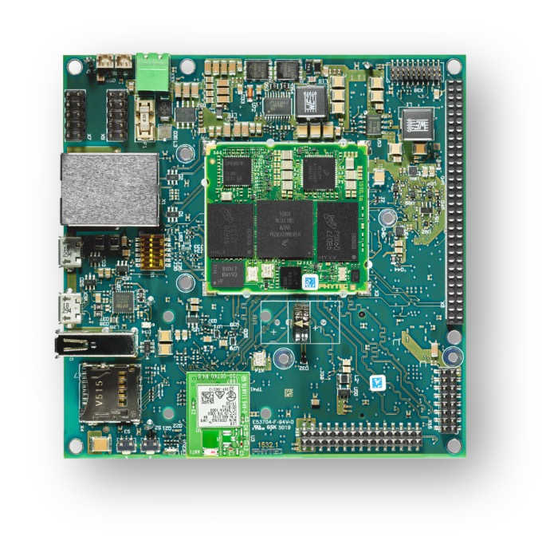
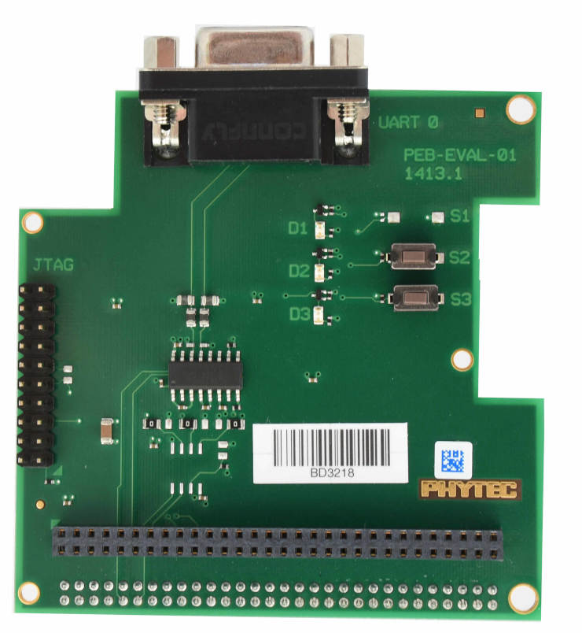

<!-- Copyright 2015-2026 Zephyr Project members and individual contributors. -->
<!-- SPDX-License-Identifier: Apache-2.0 -->
<!-- 中文翻译；编号、导航与译注为本地新增。 -->

<a id="phyboard_polis"></a>

# 第7章\_phyBOARD-Polis i.MX8M Mini

原文：[官方页面](https://docs.zephyrproject.org/latest/boards/phytec/phyboard_polis/doc/index.html)。读取日期：2026-10-16；来源摘要见[来源记录](../SOURCES.md)。

开发板概览（Board Overview）

<a id="id1"></a>

[](images/phyboard_polis.jpg)

phyBOARD-Polis i.MX8M Mini

名称（Name）：

`phyboard_polis`

厂商（Vendor）：

[PHYTEC](https://docs.zephyrproject.org/latest/boards/index.html#vendor=phytec)

状态（Status）：

维护中（Maintained）

架构（Architecture）：

[arm](https://docs.zephyrproject.org/latest/boards/index.html#arch=arm)、[arm64](https://docs.zephyrproject.org/latest/boards/index.html#arch=arm64)

片上系统（SoC）：

[mimx8mm6](https://docs.zephyrproject.org/latest/boards/index.html#soc=mimx8mm6)

<a id="board-github-link"></a>

[浏览开发板源码（Browse Board Sources）](https://github.com/zephyrproject-rtos/zephyr/blob/main//boards/phytec/phyboard_polis/doc/index.rst/../..)<a id="phyboard-polis-i-mx8m-mini"></a>

## phyBOARD-Polis i.MX8M Mini

<a id="overview"></a>

### 概述（Overview）

phyBOARD-Polis既可作为phyCORE-i.MX 8M Mini／Nano开发平台，也可作为性能强、适合工业应用的单板计算机，用于实现产品。在开发阶段，它为定制应用提供参考设计，使软件及phyCORE载板可并行开发。

phyBOARD-Polis包含一个四Cortex-A53集群及一个Cortex-M4核，Zephyr同时支持这两部分处理器。

作为工业单板计算机（SBC），phyBOARD-Polis通过标准连接器、插座或排针提供多种接口。CAN FD、无线局域网（WLAN）及集成可信平台模块（TPM）进一步扩展phyCORE-i.MX 8M Mini／Nano的应用范围。


- 开发板特性（Board Features）：


  - RAM：512 MB—4 GB LPDDR4
  - 存储（Storage）：


    - 4—128 GB eMMC
    - 8—128 MB SPI NOR闪存
    - MicroSD接口
    - 4 KB EEPROM
  - 无线（Wireless）：


    - Wi-Fi：802.11 b/g/n (ac)，2.4 GHz／5 GHz
    - 低功耗蓝牙（BLE）4.2
  - 通用串行总线（USB）：


    - 一路USB 2.0 OTG
    - 一路USB 2.0
  - 以太网：一路10／100／1000BASE-T
  - 接口：一路RS232／RS485、两路UART、三路I2C、两路SPI、最多四路PWM、四路SAI、一路MIPI CSI-2、一路MIPI DSI-2、两路MMC／SD／SDIO及一路mini PCIe。
  - 发光二极管（LED）：


    - 一个三色状态LED
    - 一个调试UART指示LED
  - 调试（Debug）


    - 20引脚JTAG连接器
    - Micro-USB用于UART调试，提供分别用于A53和M4的两个COM端口

[](images/phyboard_polis1.jpg)

开发板更多信息见[PHYTEC网站](https://www.phytec.de/produkte/single-board-computer/phyboard-polis-imx8m-mini/)。

<a id="supported-features"></a>

#### 支持的功能（Supported Features）

`phyboard_polis`开发板支持下表所列的硬件功能。

片上／板载（On-Chip / On-Board）

功能集成在片上系统（SoC）内／位于开发板上。

2 / 2

分别表示已启用／已禁用的实例数。点击数量标签，可查看开发板或SoC设备树源码（DTS）中该功能的第一个实例。

`vnd,foo`

与此功能匹配的设备树绑定兼容字符串（Compatible String）；点击链接可查看绑定文档。

<a id="phyboard_polis-hw-features"></a>

<a id="phyboard_polis-phyboard_polis/mimx8mm6/a53-hw-features-section"></a>

##### `phyboard_polis/mimx8mm6/a53`目标（Target）

<a id="phyboard_polis-phyboard_polis/mimx8mm6/a53-hw-features-panel"></a>

<a id="phyboard_polis-phyboard_polis/mimx8mm6/a53-hw-features-memory"></a>

该开发板目标的片上存储容量：1 MiB RAM、N/A Flash。

<a id="phyboard_polis-phyboard_polis/mimx8mm6/a53-hw-features-table"></a>

<table>
<tr>
<th>类型（Type）</th>
<th>位置（Location）</th>
<th>说明（Description）</th>
<th>兼容字符串（Compatible）</th>
</tr>
<tr>
<td rowspan="1">中央处理器（CPU）</td>
<td>片上（On-Chip）</td>
<td>ARM Cortex-A53处理器（CPU）（<a href="https://github.com/zephyrproject-rtos/zephyr/blob/main/dts/arm64/nxp/nxp_mimx8mm_a53.dtsi?plain=1#L28">已启用：1</a>；<a href="https://github.com/zephyrproject-rtos/zephyr/blob/main/dts/arm64/nxp/nxp_mimx8mm_a53.dtsi?plain=1#L34">已禁用：3</a>）</td>
<td><a href="../cpu_arm_riscv_binding_reference/P008_arm_cortex-a53.md#std-dtcompatible-arm-cortex-a53"><code>arm,cortex-a53</code></a></td>
</tr>
<tr>
<td rowspan="1">时钟控制（Clock Control）</td>
<td>片上（On-Chip）</td>
<td>i.MX时钟控制模块（CCM / Clock Controller Module）IP节点（<a href="https://github.com/zephyrproject-rtos/zephyr/blob/main/dts/arm64/nxp/nxp_mimx8mm_a53.dtsi?plain=1#L195">已启用：1</a>）</td>
<td><a href="../clock_nordic_nuvoton_nxp_binding_reference/P021_nxp_imx-ccm.md#std-dtcompatible-nxp-imx-ccm"><code>nxp,imx-ccm</code></a></td>
</tr>
<tr>
<td rowspan="1">计数器（Counter）</td>
<td>片上（On-Chip）</td>
<td>NXP MCUX通用定时器（GPT / General-Purpose Timer）（<a href="https://github.com/zephyrproject-rtos/zephyr/blob/main/dts/arm64/nxp/nxp_mimx8mm_a53.dtsi?plain=1#L153">已禁用：2</a>）</td>
<td><a href="../nxp_nuvoton_counter_binding_reference/P004_nxp_imx-gpt.md#std-dtcompatible-nxp-imx-gpt"><code>nxp,imx-gpt</code></a></td>
</tr>
<tr>
<td rowspan="4">以太网（Ethernet）</td>
<td>片上（On-Chip）</td>
<td>NXP ENET以太网IP模块（<a href="https://github.com/zephyrproject-rtos/zephyr/blob/main/dts/arm64/nxp/nxp_mimx8mm_a53.dtsi?plain=1#L334">已禁用：1</a>）</td>
<td><a href="../ethernet_nxp_phy_binding_reference/P004_nxp_enet.md#std-dtcompatible-nxp-enet"><code>nxp,enet</code></a></td>
</tr>
<tr>
<td>片上（On-Chip）</td>
<td>NXP ENET MAC／二层（L2）设备（<a href="https://github.com/zephyrproject-rtos/zephyr/blob/main/dts/arm64/nxp/nxp_mimx8mm_a53.dtsi?plain=1#L341">已禁用：1</a>）</td>
<td><a href="../ethernet_nxp_phy_binding_reference/P001_nxp_enet-mac.md#std-dtcompatible-nxp-enet-mac"><code>nxp,enet-mac</code></a></td>
</tr>
<tr>
<td>片上（On-Chip）</td>
<td>NXP ENET管理数据输入输出（MDIO）功能（<a href="https://github.com/zephyrproject-rtos/zephyr/blob/main/dts/arm64/nxp/nxp_mimx8mm_a53.dtsi?plain=1#L351">已禁用：1</a>）</td>
<td><a href="../ethernet_mdio_microchip_binding_reference/P002_nxp_enet-mdio.md#std-dtcompatible-nxp-enet-mdio"><code>nxp,enet-mdio</code></a></td>
</tr>
<tr>
<td>片上（On-Chip）</td>
<td>NXP ENET精确时间协议（PTP / Precision Time Protocol）时钟（<a href="https://github.com/zephyrproject-rtos/zephyr/blob/main/dts/arm64/nxp/nxp_mimx8mm_a53.dtsi?plain=1#L358">已禁用：1</a>）</td>
<td><a href="../ethernet_nxp_phy_binding_reference/P002_nxp_enet-ptp-clock.md#std-dtcompatible-nxp-enet-ptp-clock"><code>nxp,enet-ptp-clock</code></a></td>
</tr>
<tr>
<td rowspan="1">通用输入输出与接插件（GPIO &amp; Headers）</td>
<td>片上（On-Chip）</td>
<td>i.MX通用输入输出（GPIO）（<a href="https://github.com/zephyrproject-rtos/zephyr/blob/main/dts/arm64/nxp/nxp_mimx8mm_a53.dtsi?plain=1#L75">已启用：1</a>；<a href="https://github.com/zephyrproject-rtos/zephyr/blob/main/dts/arm64/nxp/nxp_mimx8mm_a53.dtsi?plain=1#L89">已禁用：4</a>）</td>
<td><a href="../gpio_microchip_nordic_nuvoton_binding_reference/P030_nxp_imx-gpio.md#std-dtcompatible-nxp-imx-gpio"><code>nxp,imx-gpio</code></a></td>
</tr>
<tr>
<td rowspan="1">集成电路间总线（I2C）</td>
<td>片上（On-Chip）</td>
<td>NXP II2C控制器（<a href="https://github.com/zephyrproject-rtos/zephyr/blob/main/dts/arm64/nxp/nxp_mimx8mm_a53.dtsi?plain=1#L237">已禁用：4</a>）</td>
<td><a href="../i2c_nxp_pico_renesas_binding_reference/P001_nxp_ii2c.md#std-dtcompatible-nxp-ii2c"><code>nxp,ii2c</code></a></td>
</tr>
<tr>
<td rowspan="1">中断控制器（Interrupt Controller）</td>
<td>片上（On-Chip）</td>
<td>ARM通用中断控制器（GIC）v3（<a href="https://github.com/zephyrproject-rtos/zephyr/blob/main/dts/arm64/nxp/nxp_mimx8mm_a53.dtsi?plain=1#L66">已启用：1</a>）</td>
<td><a href="../interrupt_fabric_binding_reference/P004_arm_gic-v3.md#std-dtcompatible-arm-gic-v3"><code>arm,gic-v3</code></a></td>
</tr>
<tr>
<td rowspan="1">发光二极管（LED）</td>
<td>板载（On-Board）</td>
<td>一组由 GPIO 控制的 LED（GPIO-Controlled LEDs）（<a href="https://github.com/zephyrproject-rtos/zephyr/blob/main/boards/phytec/phyboard_polis/phyboard_polis_mimx8mm6_a53.dts?plain=1#L47">已启用：1</a>）</td>
<td><a href="../hardware/P564_GPIO指示灯绑定.md#dtbinding-gpio-leds"><code>gpio-leds</code></a></td>
</tr>
<tr>
<td rowspan="1">其他绑定（Miscellaneous）</td>
<td>片上（On-Chip）</td>
<td>NXP i.MX资源域控制器（RDC / Resource Domain Controller）（<a href="https://github.com/zephyrproject-rtos/zephyr/blob/main/dts/arm64/nxp/nxp_mimx8mm_a53.dtsi?plain=1#L285">已启用：1</a>）</td>
<td><a href="../misc_nxp_renesas_zephyr_binding_reference/P003_nxp_rdc.md#std-dtcompatible-nxp-rdc"><code>nxp,rdc</code></a></td>
</tr>
<tr>
<td rowspan="2">引脚控制（Pin Control）</td>
<td>片上（On-Chip）</td>
<td>这个兼容性绑定（Compatible Binding）应应用于设备的<code>iomuxc</code>设备树源文件（DTS）节点。（<a href="https://github.com/zephyrproject-rtos/zephyr/blob/main/dts/arm64/nxp/nxp_mimx8mm_a53.dtsi?plain=1#L179">已启用：1</a>）</td>
<td><a href="../pinctrl_infineon_nordic_nxp_binding_reference/P023_nxp_imx-iomuxc.md#std-dtcompatible-nxp-imx-iomuxc"><code>nxp,imx-iomuxc</code></a></td>
</tr>
<tr>
<td>片上（On-Chip）</td>
<td>MCUX片上系统（SoC）的设备树（Devicetree）为该节点设置了<code>pinctrl</code>节点标签。（<a href="https://github.com/zephyrproject-rtos/zephyr/blob/main/dts/arm64/nxp/nxp_mimx8mm_a53.dtsi?plain=1#L184">已启用：1</a>）</td>
<td><a href="../pinctrl_nxp_pico_binding_reference/P002_nxp_imx8mp-pinctrl.md#std-dtcompatible-nxp-imx8mp-pinctrl"><code>nxp,imx8mp-pinctrl</code></a></td>
</tr>
<tr>
<td rowspan="1">脉宽调制（PWM）</td>
<td>片上（On-Chip）</td>
<td>NXP i.MX脉宽调制（PWM）控制器（<a href="https://github.com/zephyrproject-rtos/zephyr/blob/main/dts/arm64/nxp/nxp_mimx8mm_a53.dtsi?plain=1#L290">已禁用：4</a>）</td>
<td><a href="../pwm_nxp_renesas_binding_reference/P006_nxp_ipwm.md#std-dtcompatible-nxp-ipwm"><code>nxp,ipwm</code></a></td>
</tr>
<tr>
<td rowspan="1">串行控制器（Serial Controller）</td>
<td>片上（On-Chip）</td>
<td>此绑定（Binding）提供NXP i.MX IUART的基本描述（<a href="https://github.com/zephyrproject-rtos/zephyr/blob/main/dts/arm64/nxp/nxp_mimx8mm_a53.dtsi?plain=1#L213">已启用：1</a>；<a href="https://github.com/zephyrproject-rtos/zephyr/blob/main/dts/arm64/nxp/nxp_mimx8mm_a53.dtsi?plain=1#L201">已禁用：2</a>）</td>
<td><a href="../uart_microchip_nordic_nxp_binding_reference/P010_nxp_imx-iuart.md#std-dtcompatible-nxp-imx-iuart"><code>nxp,imx-iuart</code></a></td>
</tr>
<tr>
<td rowspan="1">定时器（Timer）</td>
<td>片上（On-Chip）</td>
<td>每个内核独立的ARM架构定时器（Architected Timer）（<a href="https://github.com/zephyrproject-rtos/zephyr/blob/main/dts/arm64/nxp/nxp_mimx8mm_a53.dtsi?plain=1#L53">已启用：1</a>）</td>
<td><a href="../arm_interrupt_timer_binding_reference/P010_ARMv8架构定时器.md#std-dtcompatible-arm-armv8-timer"><code>arm,armv8-timer</code></a></td>
</tr>
<tr>
<td rowspan="1">看门狗（Watchdog）</td>
<td>片上（On-Chip）</td>
<td>i.MX RT看门狗（Watchdog）（<a href="https://github.com/zephyrproject-rtos/zephyr/blob/main/dts/arm64/nxp/nxp_mimx8mm_a53.dtsi?plain=1#L145">已禁用：1</a>）</td>
<td><a href="../nxp_nordic_nuvoton_watchdog_binding_reference/P009_nxp_imx-wdog.md#std-dtcompatible-nxp-imx-wdog"><code>nxp,imx-wdog</code></a></td>
</tr>
</table>

<a id="phyboard_polis-phyboard_polis/mimx8mm6/a53/smp-hw-features-section"></a>

##### `phyboard_polis/mimx8mm6/a53/smp`目标（Target）

<a id="phyboard_polis-phyboard_polis/mimx8mm6/a53/smp-hw-features-panel"></a>

<a id="phyboard_polis-phyboard_polis/mimx8mm6/a53/smp-hw-features-memory"></a>

该开发板目标的片上存储容量：1 MiB RAM、N/A Flash。

<a id="phyboard_polis-phyboard_polis/mimx8mm6/a53/smp-hw-features-table"></a>

<table>
<tr>
<th>类型（Type）</th>
<th>位置（Location）</th>
<th>说明（Description）</th>
<th>兼容字符串（Compatible）</th>
</tr>
<tr>
<td rowspan="1">中央处理器（CPU）</td>
<td>片上（On-Chip）</td>
<td>ARM Cortex-A53处理器（CPU）（<a href="https://github.com/zephyrproject-rtos/zephyr/blob/main/dts/arm64/nxp/nxp_mimx8mm_a53.dtsi?plain=1#L28">已启用：4</a>）</td>
<td><a href="../cpu_arm_riscv_binding_reference/P008_arm_cortex-a53.md#std-dtcompatible-arm-cortex-a53"><code>arm,cortex-a53</code></a></td>
</tr>
<tr>
<td rowspan="1">时钟控制（Clock Control）</td>
<td>片上（On-Chip）</td>
<td>i.MX时钟控制模块（CCM / Clock Controller Module）IP节点（<a href="https://github.com/zephyrproject-rtos/zephyr/blob/main/dts/arm64/nxp/nxp_mimx8mm_a53.dtsi?plain=1#L195">已启用：1</a>）</td>
<td><a href="../clock_nordic_nuvoton_nxp_binding_reference/P021_nxp_imx-ccm.md#std-dtcompatible-nxp-imx-ccm"><code>nxp,imx-ccm</code></a></td>
</tr>
<tr>
<td rowspan="1">计数器（Counter）</td>
<td>片上（On-Chip）</td>
<td>NXP MCUX通用定时器（GPT / General-Purpose Timer）（<a href="https://github.com/zephyrproject-rtos/zephyr/blob/main/dts/arm64/nxp/nxp_mimx8mm_a53.dtsi?plain=1#L153">已禁用：2</a>）</td>
<td><a href="../nxp_nuvoton_counter_binding_reference/P004_nxp_imx-gpt.md#std-dtcompatible-nxp-imx-gpt"><code>nxp,imx-gpt</code></a></td>
</tr>
<tr>
<td rowspan="4">以太网（Ethernet）</td>
<td>片上（On-Chip）</td>
<td>NXP ENET以太网IP模块（<a href="https://github.com/zephyrproject-rtos/zephyr/blob/main/dts/arm64/nxp/nxp_mimx8mm_a53.dtsi?plain=1#L334">已禁用：1</a>）</td>
<td><a href="../ethernet_nxp_phy_binding_reference/P004_nxp_enet.md#std-dtcompatible-nxp-enet"><code>nxp,enet</code></a></td>
</tr>
<tr>
<td>片上（On-Chip）</td>
<td>NXP ENET MAC／二层（L2）设备（<a href="https://github.com/zephyrproject-rtos/zephyr/blob/main/dts/arm64/nxp/nxp_mimx8mm_a53.dtsi?plain=1#L341">已禁用：1</a>）</td>
<td><a href="../ethernet_nxp_phy_binding_reference/P001_nxp_enet-mac.md#std-dtcompatible-nxp-enet-mac"><code>nxp,enet-mac</code></a></td>
</tr>
<tr>
<td>片上（On-Chip）</td>
<td>NXP ENET管理数据输入输出（MDIO）功能（<a href="https://github.com/zephyrproject-rtos/zephyr/blob/main/dts/arm64/nxp/nxp_mimx8mm_a53.dtsi?plain=1#L351">已禁用：1</a>）</td>
<td><a href="../ethernet_mdio_microchip_binding_reference/P002_nxp_enet-mdio.md#std-dtcompatible-nxp-enet-mdio"><code>nxp,enet-mdio</code></a></td>
</tr>
<tr>
<td>片上（On-Chip）</td>
<td>NXP ENET精确时间协议（PTP / Precision Time Protocol）时钟（<a href="https://github.com/zephyrproject-rtos/zephyr/blob/main/dts/arm64/nxp/nxp_mimx8mm_a53.dtsi?plain=1#L358">已禁用：1</a>）</td>
<td><a href="../ethernet_nxp_phy_binding_reference/P002_nxp_enet-ptp-clock.md#std-dtcompatible-nxp-enet-ptp-clock"><code>nxp,enet-ptp-clock</code></a></td>
</tr>
<tr>
<td rowspan="1">通用输入输出与接插件（GPIO &amp; Headers）</td>
<td>片上（On-Chip）</td>
<td>i.MX通用输入输出（GPIO）（<a href="https://github.com/zephyrproject-rtos/zephyr/blob/main/dts/arm64/nxp/nxp_mimx8mm_a53.dtsi?plain=1#L75">已启用：1</a>；<a href="https://github.com/zephyrproject-rtos/zephyr/blob/main/dts/arm64/nxp/nxp_mimx8mm_a53.dtsi?plain=1#L89">已禁用：4</a>）</td>
<td><a href="../gpio_microchip_nordic_nuvoton_binding_reference/P030_nxp_imx-gpio.md#std-dtcompatible-nxp-imx-gpio"><code>nxp,imx-gpio</code></a></td>
</tr>
<tr>
<td rowspan="1">集成电路间总线（I2C）</td>
<td>片上（On-Chip）</td>
<td>NXP II2C控制器（<a href="https://github.com/zephyrproject-rtos/zephyr/blob/main/dts/arm64/nxp/nxp_mimx8mm_a53.dtsi?plain=1#L237">已禁用：4</a>）</td>
<td><a href="../i2c_nxp_pico_renesas_binding_reference/P001_nxp_ii2c.md#std-dtcompatible-nxp-ii2c"><code>nxp,ii2c</code></a></td>
</tr>
<tr>
<td rowspan="1">中断控制器（Interrupt Controller）</td>
<td>片上（On-Chip）</td>
<td>ARM通用中断控制器（GIC）v3（<a href="https://github.com/zephyrproject-rtos/zephyr/blob/main/dts/arm64/nxp/nxp_mimx8mm_a53.dtsi?plain=1#L66">已启用：1</a>）</td>
<td><a href="../interrupt_fabric_binding_reference/P004_arm_gic-v3.md#std-dtcompatible-arm-gic-v3"><code>arm,gic-v3</code></a></td>
</tr>
<tr>
<td rowspan="1">发光二极管（LED）</td>
<td>板载（On-Board）</td>
<td>一组由 GPIO 控制的 LED（GPIO-Controlled LEDs）（<a href="https://github.com/zephyrproject-rtos/zephyr/blob/main/boards/phytec/phyboard_polis/phyboard_polis_mimx8mm6_a53_smp.dts?plain=1#L33">已启用：1</a>）</td>
<td><a href="../hardware/P564_GPIO指示灯绑定.md#dtbinding-gpio-leds"><code>gpio-leds</code></a></td>
</tr>
<tr>
<td rowspan="1">其他绑定（Miscellaneous）</td>
<td>片上（On-Chip）</td>
<td>NXP i.MX资源域控制器（RDC / Resource Domain Controller）（<a href="https://github.com/zephyrproject-rtos/zephyr/blob/main/dts/arm64/nxp/nxp_mimx8mm_a53.dtsi?plain=1#L285">已启用：1</a>）</td>
<td><a href="../misc_nxp_renesas_zephyr_binding_reference/P003_nxp_rdc.md#std-dtcompatible-nxp-rdc"><code>nxp,rdc</code></a></td>
</tr>
<tr>
<td rowspan="2">引脚控制（Pin Control）</td>
<td>片上（On-Chip）</td>
<td>这个兼容性绑定（Compatible Binding）应应用于设备的<code>iomuxc</code>设备树源文件（DTS）节点。（<a href="https://github.com/zephyrproject-rtos/zephyr/blob/main/dts/arm64/nxp/nxp_mimx8mm_a53.dtsi?plain=1#L179">已启用：1</a>）</td>
<td><a href="../pinctrl_infineon_nordic_nxp_binding_reference/P023_nxp_imx-iomuxc.md#std-dtcompatible-nxp-imx-iomuxc"><code>nxp,imx-iomuxc</code></a></td>
</tr>
<tr>
<td>片上（On-Chip）</td>
<td>MCUX片上系统（SoC）的设备树（Devicetree）为该节点设置了<code>pinctrl</code>节点标签。（<a href="https://github.com/zephyrproject-rtos/zephyr/blob/main/dts/arm64/nxp/nxp_mimx8mm_a53.dtsi?plain=1#L184">已启用：1</a>）</td>
<td><a href="../pinctrl_nxp_pico_binding_reference/P002_nxp_imx8mp-pinctrl.md#std-dtcompatible-nxp-imx8mp-pinctrl"><code>nxp,imx8mp-pinctrl</code></a></td>
</tr>
<tr>
<td rowspan="1">电源管理 CPU 操作（Power Management CPU Operations）</td>
<td>板载（On-Board）</td>
<td>电源状态协调接口（PSCI / Power State Coordination Interface）1.1版（<a href="https://github.com/zephyrproject-rtos/zephyr/blob/main/boards/phytec/phyboard_polis/phyboard_polis_mimx8mm6_a53_smp.dts?plain=1#L41">已启用：1</a>）</td>
<td><a href="https://docs.zephyrproject.org/latest/build/dts/api/bindings/pm_cpu_ops/arm%2Cpsci-1.1.html#std-dtcompatible-arm-psci-1.1"><code>arm,psci-1.1</code></a></td>
</tr>
<tr>
<td rowspan="1">脉宽调制（PWM）</td>
<td>片上（On-Chip）</td>
<td>NXP i.MX脉宽调制（PWM）控制器（<a href="https://github.com/zephyrproject-rtos/zephyr/blob/main/dts/arm64/nxp/nxp_mimx8mm_a53.dtsi?plain=1#L290">已禁用：4</a>）</td>
<td><a href="../pwm_nxp_renesas_binding_reference/P006_nxp_ipwm.md#std-dtcompatible-nxp-ipwm"><code>nxp,ipwm</code></a></td>
</tr>
<tr>
<td rowspan="1">串行控制器（Serial Controller）</td>
<td>片上（On-Chip）</td>
<td>此绑定（Binding）提供NXP i.MX IUART的基本描述（<a href="https://github.com/zephyrproject-rtos/zephyr/blob/main/dts/arm64/nxp/nxp_mimx8mm_a53.dtsi?plain=1#L213">已启用：1</a>；<a href="https://github.com/zephyrproject-rtos/zephyr/blob/main/dts/arm64/nxp/nxp_mimx8mm_a53.dtsi?plain=1#L201">已禁用：2</a>）</td>
<td><a href="../uart_microchip_nordic_nxp_binding_reference/P010_nxp_imx-iuart.md#std-dtcompatible-nxp-imx-iuart"><code>nxp,imx-iuart</code></a></td>
</tr>
<tr>
<td rowspan="1">定时器（Timer）</td>
<td>片上（On-Chip）</td>
<td>每个内核独立的ARM架构定时器（Architected Timer）（<a href="https://github.com/zephyrproject-rtos/zephyr/blob/main/dts/arm64/nxp/nxp_mimx8mm_a53.dtsi?plain=1#L53">已启用：1</a>）</td>
<td><a href="../arm_interrupt_timer_binding_reference/P010_ARMv8架构定时器.md#std-dtcompatible-arm-armv8-timer"><code>arm,armv8-timer</code></a></td>
</tr>
<tr>
<td rowspan="1">看门狗（Watchdog）</td>
<td>片上（On-Chip）</td>
<td>i.MX RT看门狗（Watchdog）（<a href="https://github.com/zephyrproject-rtos/zephyr/blob/main/dts/arm64/nxp/nxp_mimx8mm_a53.dtsi?plain=1#L145">已禁用：1</a>）</td>
<td><a href="../nxp_nordic_nuvoton_watchdog_binding_reference/P009_nxp_imx-wdog.md#std-dtcompatible-nxp-imx-wdog"><code>nxp,imx-wdog</code></a></td>
</tr>
</table>

<a id="phyboard_polis-phyboard_polis/mimx8mm6/m4-hw-features-section"></a>

##### `phyboard_polis/mimx8mm6/m4`目标（Target）

<a id="phyboard_polis-phyboard_polis/mimx8mm6/m4-hw-features-panel"></a>

<a id="phyboard_polis-phyboard_polis/mimx8mm6/m4-hw-features-memory"></a>

该开发板目标的片上存储容量：128 KiB RAM、128 KiB Flash。

<a id="phyboard_polis-phyboard_polis/mimx8mm6/m4-hw-features-table"></a>

<table>
<tr>
<th>类型（Type）</th>
<th>位置（Location）</th>
<th>说明（Description）</th>
<th>兼容字符串（Compatible）</th>
</tr>
<tr>
<td rowspan="1">中央处理器（CPU）</td>
<td>片上（On-Chip）</td>
<td>ARM Cortex-M4 处理器（CPU）（<a href="https://github.com/zephyrproject-rtos/zephyr/blob/main/dts/arm/nxp/imx/nxp_imx8m_m4.dtsi?plain=1#L19">已启用：1</a>）</td>
<td><a href="../cpu_arm_riscv_binding_reference/P024_arm_cortex-m4.md#std-dtcompatible-arm-cortex-m4"><code>arm,cortex-m4</code></a></td>
</tr>
<tr>
<td rowspan="2">ARM 架构（ARM Architecture）</td>
<td>片上（On-Chip）</td>
<td>i.MX指令紧耦合存储器（ITCM / Instruction Tightly Coupled Memory）（<a href="https://github.com/zephyrproject-rtos/zephyr/blob/main/dts/arm/nxp/imx/nxp_imx8m_m4.dtsi?plain=1#L27">已启用：1</a>）</td>
<td><a href="../arm_nordic_nxp_control_binding_reference/P014_nxp_imx-itcm.md#std-dtcompatible-nxp-imx-itcm"><code>nxp,imx-itcm</code></a></td>
</tr>
<tr>
<td>片上（On-Chip）</td>
<td>i.MX数据紧耦合存储器（DTCM / Data Tightly Coupled Memory）（<a href="https://github.com/zephyrproject-rtos/zephyr/blob/main/dts/arm/nxp/imx/nxp_imx8m_m4.dtsi?plain=1#L32">已启用：1</a>）</td>
<td><a href="../arm_nordic_nxp_control_binding_reference/P012_nxp_imx-dtcm.md#std-dtcompatible-nxp-imx-dtcm"><code>nxp,imx-dtcm</code></a></td>
</tr>
<tr>
<td rowspan="1">控制器局域网（CAN）</td>
<td>板载（On-Board）</td>
<td>Microchip MCP251XFD SPI CAN FD控制器（<a href="https://github.com/zephyrproject-rtos/zephyr/blob/main/boards/phytec/phyboard_polis/phyboard_polis_mimx8mm6_m4.dts?plain=1#L58">已禁用：1</a>）</td>
<td><a href="../can_adi_atmel_nxp_binding_reference/P013_microchip_mcp251xfd.md#std-dtcompatible-microchip-mcp251xfd"><code>microchip,mcp251xfd</code></a></td>
</tr>
<tr>
<td rowspan="1">时钟控制（Clock Control）</td>
<td>片上（On-Chip）</td>
<td>i.MX时钟控制模块（CCM / Clock Controller Module）IP节点（<a href="https://github.com/zephyrproject-rtos/zephyr/blob/main/dts/arm/nxp/imx/nxp_imx8m_m4.dtsi?plain=1#L133">已启用：1</a>）</td>
<td><a href="../clock_nordic_nuvoton_nxp_binding_reference/P021_nxp_imx-ccm.md#std-dtcompatible-nxp-imx-ccm"><code>nxp,imx-ccm</code></a></td>
</tr>
<tr>
<td rowspan="1">通用输入输出与接插件（GPIO &amp; Headers）</td>
<td>片上（On-Chip）</td>
<td>i.MX通用输入输出（GPIO）（<a href="https://github.com/zephyrproject-rtos/zephyr/blob/main/dts/arm/nxp/imx/nxp_imx8m_m4.dtsi?plain=1#L59">已启用：1</a>；<a href="https://github.com/zephyrproject-rtos/zephyr/blob/main/dts/arm/nxp/imx/nxp_imx8m_m4.dtsi?plain=1#L70">已禁用：4</a>）</td>
<td><a href="../gpio_microchip_nordic_nuvoton_binding_reference/P030_nxp_imx-gpio.md#std-dtcompatible-nxp-imx-gpio"><code>nxp,imx-gpio</code></a></td>
</tr>
<tr>
<td rowspan="1">中断控制器（Interrupt Controller）</td>
<td>片上（On-Chip）</td>
<td>ARMv7-M 嵌套向量中断控制器（Nested Vectored Interrupt Controller，NVIC）（<a href="https://github.com/zephyrproject-rtos/zephyr/blob/main/dts/arm/armv7-m.dtsi?plain=1#L13">已启用：1</a>）</td>
<td><a href="../arm_interrupt_timer_binding_reference/P002_ARMv7_M_NVIC.md#std-dtcompatible-arm-v7m-nvic"><code>arm,v7m-nvic</code></a></td>
</tr>
<tr>
<td rowspan="1">处理器间消息（IPM）</td>
<td>片上（On-Chip）</td>
<td>i.MX消息单元（Messaging Unit）（<a href="https://github.com/zephyrproject-rtos/zephyr/blob/main/dts/arm/nxp/imx/nxp_imx8m_m4.dtsi?plain=1#L201">已启用：1</a>）</td>
<td><a href="../intercore_reference/P072_NXPiMX消息单元绑定.md#dtbinding-nxp-imx-mu"><code>nxp,imx-mu</code></a></td>
</tr>
<tr>
<td rowspan="1">发光二极管（LED）</td>
<td>板载（On-Board）</td>
<td>一组由 GPIO 控制的 LED（GPIO-Controlled LEDs）（<a href="https://github.com/zephyrproject-rtos/zephyr/blob/main/boards/phytec/phyboard_polis/phyboard_polis_mimx8mm6_m4.dts?plain=1#L32">已启用：1</a>）</td>
<td><a href="../hardware/P564_GPIO指示灯绑定.md#dtbinding-gpio-leds"><code>gpio-leds</code></a></td>
</tr>
<tr>
<td rowspan="2">引脚控制（Pin Control）</td>
<td>片上（On-Chip）</td>
<td>这个兼容性绑定（Compatible Binding）应应用于设备的<code>iomuxc</code>设备树源文件（DTS）节点。（<a href="https://github.com/zephyrproject-rtos/zephyr/blob/main/dts/arm/nxp/imx/nxp_imx8m_m4.dtsi?plain=1#L122">已启用：1</a>）</td>
<td><a href="../pinctrl_infineon_nordic_nxp_binding_reference/P023_nxp_imx-iomuxc.md#std-dtcompatible-nxp-imx-iomuxc"><code>nxp,imx-iomuxc</code></a></td>
</tr>
<tr>
<td>片上（On-Chip）</td>
<td>MCUX片上系统（SoC）的设备树（Devicetree）为该节点设置了<code>pinctrl</code>节点标签。（<a href="https://github.com/zephyrproject-rtos/zephyr/blob/main/dts/arm/nxp/imx/nxp_imx8m_m4.dtsi?plain=1#L127">已启用：1</a>）</td>
<td><a href="../pinctrl_nxp_pico_binding_reference/P002_nxp_imx8mp-pinctrl.md#std-dtcompatible-nxp-imx8mp-pinctrl"><code>nxp,imx8mp-pinctrl</code></a></td>
</tr>
<tr>
<td rowspan="1">串行控制器（Serial Controller）</td>
<td>片上（On-Chip）</td>
<td>此绑定（Binding）提供NXP i.MX IUART的基本描述（<a href="https://github.com/zephyrproject-rtos/zephyr/blob/main/dts/arm/nxp/imx/nxp_imx8m_m4.dtsi?plain=1#L193">已启用：1</a>；<a href="https://github.com/zephyrproject-rtos/zephyr/blob/main/dts/arm/nxp/imx/nxp_imx8m_m4.dtsi?plain=1#L169">已禁用：3</a>）</td>
<td><a href="../uart_microchip_nordic_nxp_binding_reference/P010_nxp_imx-iuart.md#std-dtcompatible-nxp-imx-iuart"><code>nxp,imx-iuart</code></a></td>
</tr>
<tr>
<td rowspan="1">串行外设接口（SPI）</td>
<td>片上（On-Chip）</td>
<td>NXP i.MX增强型可配置串行外设接口（ECSPI）控制器（<a href="https://github.com/zephyrproject-rtos/zephyr/blob/main/dts/arm/nxp/imx/nxp_imx8m_m4.dtsi?plain=1#L139">已禁用：3</a>）</td>
<td><a href="../spi_microchip_nordic_nxp_binding_reference/P020_nxp_imx-ecspi.md#std-dtcompatible-nxp-imx-ecspi"><code>nxp,imx-ecspi</code></a></td>
</tr>
<tr>
<td rowspan="1">定时器（Timer）</td>
<td>片上（On-Chip）</td>
<td>ARMv7-M 系统节拍（System Tick）（<a href="https://github.com/zephyrproject-rtos/zephyr/blob/main/dts/arm/armv7-m.dtsi?plain=1#L21">已启用：1</a>）</td>
<td><a href="../arm_interrupt_timer_binding_reference/P006_ARMv7_M_SysTick.md#std-dtcompatible-arm-armv7m-systick"><code>arm,armv7m-systick</code></a></td>
</tr>
</table>

<a id="connections-and-ios"></a>

#### 连接与输入输出（Connections and IOs）

原文说明以下组件已经测试且工作正常。

<a id="uart"></a>

##### 通用异步收发器（UART）：

UART4只能由phyBOARD-Polis的M4核访问。为减少两部分处理器同时运行时的冲突，Zephyr默认将UART4用于M4，UART3用于Cortex-A53。

<table>
<tr>
<th>开发板名称（Board Name）</th>
<th>SoM名称</th>
<th>用途（Usage）</th>
</tr>
<tr>
<td>RS232/485</td>
<td>UART1</td>
<td>带流控制的RS232／RS485</td>
</tr>
<tr>
<td>连接Wi-Fi模块</td>
<td>UART2</td>
<td>连接Wi-Fi／BLE模块的UART</td>
</tr>
<tr>
<td>A53调试USB</td>
<td>UART3</td>
<td>通过USB访问UART调试控制台</td>
</tr>
<tr>
<td>M4调试USB</td>
<td>UART4</td>
<td>通过USB访问UART调试控制台</td>
</tr>
</table>

注意（Note）

连接UART2的Wi-Fi／BLE模块目前尚不能用于Zephyr。

警告（Warning）

版本1532.1的板上，UART4未连接调试USB，而是连接X8排针第10脚RX及第12脚TX。

<a id="spi"></a>

##### 串行外设接口（SPI）：

ECSPI默认禁用。此板SoC的ECSPI3不可用；ECSPI1通过一个片选连接MCP2518 CAN控制器，还可经X8第5、6、7、8脚连接其他器件，分别为CS、MOSI、MISO、SCLK。ECSPI2连接TPM模块，但该TPM目前尚不受Zephyr支持。

注意（Note）

在M4上使用ECSPI1前，必须在Linux设备树中禁用它，详情见“在Linux中禁用接口”。

<a id="leds"></a>

##### 发光二极管（LED）：

Zephyr已配置三色状态LED，标准led0别名对应蓝色，也可控制红色和绿色。

<a id="gpio"></a>

##### 通用输入输出（GPIO）：

GPIO引脚复用采用NXP的mimx8mm设备树默认配置，文件见：

<a id="can"></a>

##### 控制器局域网（CAN）：

MCP2518连接ECSPI1。为避免与A53上的Linux冲突，CAN默认禁用；使用CAN前需在Linux设备树中禁用ECSPI。

警告（Warning）

原文记载MCP2518驱动存在未设置收发器使能引脚的问题，因此发送CAN帧时报ENETDOWN错误；只听（Listen-only）模式仍可接收CAN帧。

phyBOARD-Polis引脚图见：

[PHYTEC网站](https://www.phytec.de/produkte/single-board-computer/phyboard-polis-imx8m-mini/)

<a id="system-clock"></a>

#### 系统时钟（System Clock）

M4核配置为以400 MHz运行。

<a id="programming-and-debugging-a53"></a>

### A53编程与调试（Programming and Debugging）

<a id="starting-the-a53-core-via-u-boot"></a>

#### 通过U-Boot启动A53核

例如，可构建基本同步（[Basic Synchronization](../basic_samples/P029_基本同步示例.md#synchronization)）示例镜像：

```text
# From the root of the zephyr repository
west build -b phyboard_polis/mimx8mm6/a53 samples/synchronization
```

将zephyr.bin加载到内存地址0x93c00000，输出应类似于：

```text
u-boot=> tftp 0x93c00000 192.168.3.10:zephyr.bin
Using ethernet@30be0000 device
TFTP from server 192.168.3.10; our IP address is 192.168.3.11
Filename 'zephyr.bin'.
Load address: 0x93c000000
Loading: ##########
         9.4 MiB/s
done
Bytes transferred = 49288 (c088 hex)
```

使用以下命令在core0上启动Zephyr：

```text
u-boot=> dcache off; icache flush; go 0x93c00000;
```

A53核启动运行后，UART3控制台输出如下：

```text
## Starting application at 0x93C00000 ...
*** Booting Zephyr OS build v4.3.0-7560-g0dff993ff889 ***
thread_a: Hello World from cpu 0 on phyboard_polis!
thread_b: Hello World from cpu 0 on phyboard_polis!
thread_a: Hello World from cpu 0 on phyboard_polis!
thread_b: Hello World from cpu 0 on phyboard_polis!
```

<a id="cortex-a53-smp"></a>

#### Cortex-A53对称多处理（SMP）

默认SMP变体使用全部4个Cortex-A核。可在DTS中禁用部分A53节点，并将[CONFIG_MP_MAX_NUM_CPUS](https://docs.zephyrproject.org/latest/kconfig.html#CONFIG_MP_MAX_NUM_CPUS)设为仍启用的A53核数。

构建SMP内核，以下以基本同步示例为例：（[基础同步（Basic Synchronization）](../basic_samples/P029_基本同步示例.md#synchronization)）

```text
# From the root of the zephyr repository
west build -b phyboard_polis/mimx8mm6/a53/smp samples/synchronization
```

运行后的UART3控制台输出如下：

```text
## Starting application at 0x93C00000 ...
*** Booting Zephyr OS build v4.3.0-7560-g0dff993ff889 ***
Secondary CPU core 1 (MPID:0x1) is up
Secondary CPU core 2 (MPID:0x2) is up
Secondary CPU core 3 (MPID:0x3) is up
thread_a: Hello World from cpu 0 on phyboard_polis!
thread_b: Hello World from cpu 1 on phyboard_polis!
thread_a: Hello World from cpu 0 on phyboard_polis!
thread_b: Hello World from cpu 1 on phyboard_polis!
```

<a id="programming-and-debugging-m4"></a>

### M4编程与调试（Programming and Debugging）

i.MX8MM没有独立供M4使用的闪存，因此A53必须将M4程序加载到正确地址，设置程序计数器（PC）并启动M4。可用U-Boot或PHYTEC Linux BSP中的remoteproc完成。

由于PHYTEC BSP的remoteproc只写入紧耦合存储器（TCM），原文的全部测试都在此区域进行。

PHYTEC BSP中的remoteproc详情见[Remoteproc BSP](https://wiki.phytec.com/pages/releaseview.action?pageId=472257137#L1002e.A3i.MX8MMini/NanoBSPManual-RunningExamplesfromLinuxusingRemoteproc)。

A53及M4的内存映射如下：

<table>
<tr>
<th>区域（Region）</th>
<th>Cortex-A53</th>
<th>Cortex-M4（系统总线 / System Bus）</th>
<th>Cortex-M4（代码总线 / Code Bus）</th>
<th>大小（Size）</th>
</tr>
<tr>
<td>片上RAM（OCRAM）</td>
<td>0x00900000-0x0093FFFF</td>
<td>0x20200000-0x2023FFFF</td>
<td>0x00900000-0x0093FFFF</td>
<td>256KB</td>
</tr>
<tr>
<td>高地址紧耦合存储器（TCMU）</td>
<td>0x00800000-0x0081FFFF</td>
<td>0x20000000-0x2001FFFF</td>
<td></td>
<td>128KB</td>
</tr>
<tr>
<td>低地址紧耦合存储器（TCML）</td>
<td>0x007E0000-0x007FFFFF</td>
<td></td>
<td>0x1FFE0000-0x1FFFFFFF</td>
<td>128KB</td>
</tr>
<tr>
<td>OCRAM_S</td>
<td>0x00180000-0x00187FFF</td>
<td>0x20180000-0x20187FFF</td>
<td>0x00180000-0x00187FFF</td>
<td>32KB</td>
</tr>
</table>

内存映射的更多信息见《[i.MX 8M应用处理器参考手册](https://www.nxp.com/webapp/Download?colCode=IMX8MMRM)》（Applications Processor Reference Manual）第2.1.2及2.1.3节。

编译时需选择所用RAM，通过[boards/phytec/phyboard_polis/phyboard_polis_mimx8mm6_m4.dts](https://github.com/zephyrproject-rtos/zephyr/blob/main/boards/phytec/phyboard_polis/phyboard_polis_mimx8mm6_m4.dts)中的zephyr,flash及zephyr,sram属性配置。

可为flash及sram选定节点（Chosen Nodes）使用以下配置，改变所用内存区域：

```text
"zephyr,flash"
- &tcml_code
- &ocram_code
- &ocram_s_code

"zephyr,sram"
- &tcmu_sys
- &ocram_sys
- &ocram_s_sys
```

默认使用TCM且禁用CONFIG_XIP；若要使用片上RAM（OCRAM），需启用CONFIG_XIP。

<a id="starting-the-m4-core-via-u-boot"></a>

#### 通过U-Boot启动M4核

将zephyr.bin加载到地址0x4800000，输出应类似于：

```text
u-boot=> tftp 0x48000000 192.168.3.10:zephyr.bin
Using ethernet@30be0000 device
TFTP from server 192.168.3.10; our IP address is 192.168.3.11
Filename 'zephyr.bin'.
Load address: 0x48000000
Loading: ##
         2 KiB/s
done
Bytes transferred = 27240 (6a68 hex)
```

由于不能直接加载到TCM，需再复制二进制。最后一个参数为文件字节数，可从上一条命令输出中取得。

```text
u-boot=> cp.b 0x48000000 0x7e0000 27240
```

最后在正确的地址启动M4：

```text
u-boot=> bootaux 0x7e0000
## Starting auxiliary core stack = 0x20003A58, pc = 0x1FFE1905...
```

<a id="starting-the-m4-core-via-remoteproc"></a>

#### 通过remoteproc启动M4核

将zephyr.elf复制到目标的/lib/firmware目录。原文说明未来BSP可能附带Zephyr示例。

注意（Note）

使用remoteproc前，需在/boot/bootenv.txt相应行末添加imx8mm-phycore-rpmsg.dtbo，再重启目标。

警告（Warning）

remoteproc只从/lib/firmware读取固件；尝试从其他目录加载会产生意外错误。

使用以下命令加载并启动固件：

```text
target$ echo /lib/firmware/zephyr.elf > /sys/class/remoteproc/remoteproc0/firmware
target$ echo start > /sys/class/remoteproc/remoteproc0/state
[   90.700611] remoteproc remoteproc0: powering up imx-rproc
[   90.706114] remoteproc remoteproc0: Direct firmware load for /lib/firmware/zephyr.elf failed w2
[   90.716571] remoteproc remoteproc0: Falling back to sysfs fallback for: /lib/firmware/zephyr.elf
[   90.739280] remoteproc remoteproc0: Booting fw image /lib/firmware/zephyr.elf, size 599356
[   90.804448] remoteproc remoteproc0: remote processor imx-rproc is now up
```

M4启动运行后，可在UART4查看Zephyr输出。

<a id="debugging"></a>

#### 调试（Debugging）

可通过JTAG调试phyBOARD-Polis。最方便的方法是使用SEGGER J-Link及PHYTEC PEB-EVAL-01扩展板，后者可直接连接J-Link。[J-Link软件](https://www.segger.com/downloads/jlink/)包见相应链接。

<a id="id2"></a>

[](images/PEB-EVAL-01.jpg)

`PEB-EVAL-01`

为提高调试效率，建议使用多个终端：

也可使用west debug。

接好设备并使用west构建后，在先前程序目录中运行以下命令，启动调试服务器：

```text
host$ west debugserver
```

west自动通过J-Link连接目标，并保持调试服务器运行。

在另一终端启动GDB、连接目标并加载Zephyr：

```text
host$ gdb-multiarch build/zephyr/zephyr.elf -tui
(gdb) targ rem :2331
Remote debugging using :2331
0x1ffe0008 in _vector_table ()
(gdb) mon halt
(gdb) mon reset
(gdb) c
Continuing.
```

随后使用常规GDB方法调试程序。

<a id="disabling-interfaces-in-linux"></a>

#### 在Linux中禁用接口（Disabling Interfaces in Linux）

当M4运行Zephyr、A53运行Linux时，建议在Linux中禁用M4所用接口，避免冲突。GPIO等简单接口可同时启用，但仍可能发生冲突。

SPI等较复杂接口必须在Linux设备树中禁用，否则Linux可能发生内核崩溃（Panic），复位整个SoC。以下以禁用Linux中的ECSPI1、供M4上的Zephyr使用为例：


1. 创建disable_spi.dts，内容如下：

> ```text
> /dts-v1/;
> /plugin/;
>
> / {
>    fragment@0 {
>       target = <&ecspi1>;
>       __overlay__ {
>             status = "disabled";
>       };
>    };
> };
> ```


1. 使用dtc编译器生成设备树二进制（DTB）：

> ```text
> $ dtc -@ -I dts -O dtb -o imx8mm-phyboard-polis-disable-spi.dtbo disable_spi.dts;
> ```


1. 将生成文件复制到目标启动分区。
2. 在/boot/bootenv.txt相应行末添加文件名。
3. 重启后，SPI接口在Linux中即被禁用。

## 译注

Polis的A53使用UART3，M4使用UART4；1532.1版UART4只引出到X8。SPI／CAN与Linux共享需先在Linux禁用；MCP2518发送ENETDOWN限制、TCM与OCRAM的XIP要求、SMP核数及固件目录规则均保留。

## 原文外链核对

2026-10-16核对并重试以下原文外链时未能确认可访问性，保留原始目标，不将访问失败解释为原文内容有误。

- [releaseview.action?pageId=472257137](https://wiki.phytec.com/pages/releaseview.action?pageId=472257137#L1002e.A3i.MX8MMini/NanoBSPManual-RunningExamplesfromLinuxusingRemoteproc)：HTTP Error 418: I'm a teapot。
- [Download?colCode=IMX8MMRM](https://www.nxp.com/webapp/Download?colCode=IMX8MMRM)：HTTP Error 404: Not Found。

---

[上一章](P006_phyBOARD-Nash_i.MX93.md) · [返回大纲](大纲.md) · [全站翻译进度](../PROGRESS.md) · [下一章](P008_phyBOARD-Pollux_i.MX8M_Plus.md)
