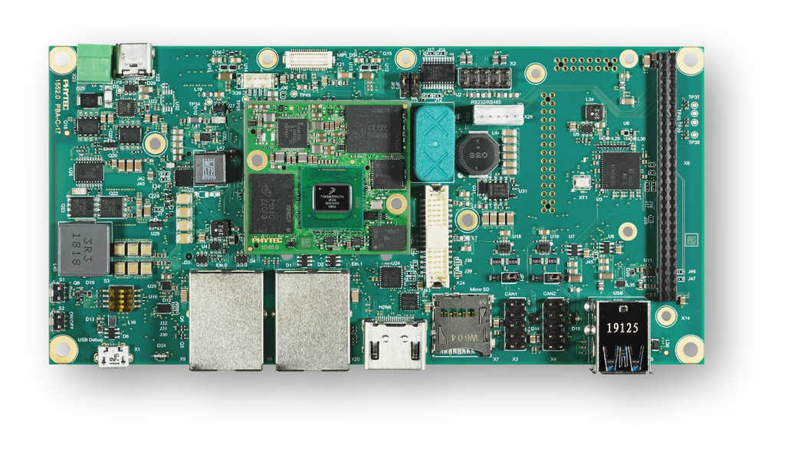
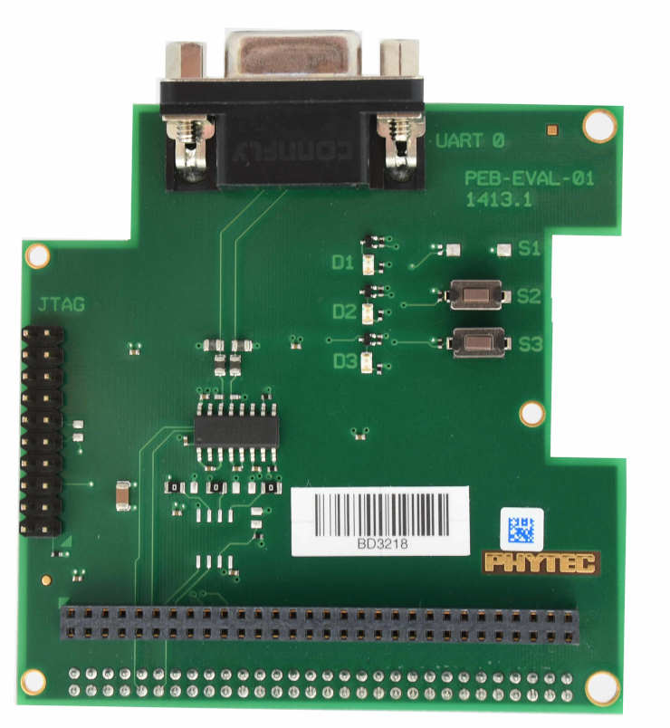

<!-- Copyright 2015-2026 Zephyr Project members and individual contributors. -->
<!-- SPDX-License-Identifier: Apache-2.0 -->
<!-- 中文翻译；编号、导航与译注为本地新增。 -->

<a id="phyboard_pollux"></a>

# 第8章\_phyBOARD-Pollux i.MX8M Plus

原文：[官方页面](https://docs.zephyrproject.org/latest/boards/phytec/phyboard_pollux/doc/index.html)。读取日期：2026-10-16；来源摘要见[来源记录](../SOURCES.md)。

开发板概览（Board Overview）

<a id="id1"></a>

[](images/Phyboard_Pollux.jpg)

phyBOARD-Pollux i.MX8M Plus

名称（Name）：

`phyboard_pollux`

厂商（Vendor）：

[PHYTEC](https://docs.zephyrproject.org/latest/boards/index.html#vendor=phytec)

状态（Status）：

维护中（Maintained）

架构（Architecture）：

[arm](https://docs.zephyrproject.org/latest/boards/index.html#arch=arm)

片上系统（SoC）：

[mimx8ml8](https://docs.zephyrproject.org/latest/boards/index.html#soc=mimx8ml8)

<a id="board-github-link"></a>

[浏览开发板源码（Browse Board Sources）](https://github.com/zephyrproject-rtos/zephyr/blob/main//boards/phytec/phyboard_pollux/doc/index.rst/../..)<a id="phyboard-pollux-i-mx8m-plus"></a>

## phyBOARD-Pollux i.MX8M Plus

<a id="overview"></a>

### 概述（Overview）

phyBOARD-Pollux基于phyCORE-i.MX8M Plus SoM及NXP i.MX8M Plus SoC，包含4个Cortex-A53核及1个供Zephyr等实时应用使用的Cortex-M7核。板上接口丰富、计算能力较强，可用于智能家居、工业4.0及物联网，也可作为参考、开发平台或最终产品。

开发板特性（Board Features）：


- 存储器（Memory）：

  > - RAM：256 MB—8 GB LPDDR4
  > - EEPROM：4—32 KB
  > - eMMC：4—64 GB，eMMC 5.1
  > - SPI NOR闪存：4—256 MB
- 接口（Interfaces）：

  > - 以太网：两路10／100／1000BASE-T，其中一路支持TSN
  > - USB：两路USB 3.0主机
  > - 串口：一路RS232／RS485，支持全双工／半双工
  > - CAN：两路CAN FD
  > - 数字I/O：通过扩展连接器
  > - PCIe：一路mini PCIe
  > - MMX／SD／SDIO：MicroSD卡槽，MMX拼写按原文保留
  > - 显示：LVDS，1×4或1×8；MIPI DSI，1×4；以及HDMI
  > - 音频：串行音频接口（SAI）
  > - 摄像头：两路MIPI CSI-2，phyCAM-M
  > - 扩展总线：I2C、SPI、SDIO、UART及USB
  > - JTAG：通过PEB-EVAL-01
- 发光二极管（LED）：

  > - 一个通过I2C控制的多色状态LED

[](images/Phyboard_Pollux1.jpg)

开发板更多信息见[PHYTEC网站](https://www.phytec.de/produkte/single-board-computer/phyboard-pollux/)。

<a id="supported-features"></a>

#### 支持的功能（Supported Features）

`phyboard_pollux`开发板支持下表所列的硬件功能。

片上／板载（On-Chip / On-Board）

功能集成在片上系统（SoC）内／位于开发板上。

2 / 2

分别表示已启用／已禁用的实例数。点击数量标签，可查看开发板或SoC设备树源码（DTS）中该功能的第一个实例。

`vnd,foo`

与此功能匹配的设备树绑定兼容字符串（Compatible String）；点击链接可查看绑定文档。

<a id="phyboard_pollux-hw-features"></a>

<a id="phyboard_pollux-phyboard_pollux/mimx8ml8/m7-hw-features-section"></a>

##### `phyboard_pollux/mimx8ml8/m7`目标（Target）

<a id="phyboard_pollux-phyboard_pollux/mimx8ml8/m7-hw-features-panel"></a>

<a id="phyboard_pollux-phyboard_pollux/mimx8ml8/m7-hw-features-memory"></a>

该开发板目标的片上存储容量：128 KiB RAM、128 KiB Flash。

<a id="phyboard_pollux-phyboard_pollux/mimx8ml8/m7-hw-features-table"></a>

<table>
<tr>
<th>类型（Type）</th>
<th>位置（Location）</th>
<th>说明（Description）</th>
<th>兼容字符串（Compatible）</th>
</tr>
<tr>
<td rowspan="1">中央处理器（CPU）</td>
<td>片上（On-Chip）</td>
<td>ARM Cortex-M7处理器（CPU）（<a href="https://github.com/zephyrproject-rtos/zephyr/blob/main/dts/arm/nxp/imx/nxp_imx8ml_m7.dtsi?plain=1#L19">已启用：1</a>）</td>
<td><a href="../cpu_cortex_xtensa_binding_reference/P005_arm_cortex-m7.md#std-dtcompatible-arm-cortex-m7"><code>arm,cortex-m7</code></a></td>
</tr>
<tr>
<td rowspan="2">ARM 架构（ARM Architecture）</td>
<td>片上（On-Chip）</td>
<td>i.MX指令紧耦合存储器（ITCM / Instruction Tightly Coupled Memory）（<a href="https://github.com/zephyrproject-rtos/zephyr/blob/main/dts/arm/nxp/imx/nxp_imx8ml_m7.dtsi?plain=1#L40">已启用：1</a>）</td>
<td><a href="../arm_nordic_nxp_control_binding_reference/P014_nxp_imx-itcm.md#std-dtcompatible-nxp-imx-itcm"><code>nxp,imx-itcm</code></a></td>
</tr>
<tr>
<td>片上（On-Chip）</td>
<td>i.MX数据紧耦合存储器（DTCM / Data Tightly Coupled Memory）（<a href="https://github.com/zephyrproject-rtos/zephyr/blob/main/dts/arm/nxp/imx/nxp_imx8ml_m7.dtsi?plain=1#L45">已启用：1</a>）</td>
<td><a href="../arm_nordic_nxp_control_binding_reference/P012_nxp_imx-dtcm.md#std-dtcompatible-nxp-imx-dtcm"><code>nxp,imx-dtcm</code></a></td>
</tr>
<tr>
<td rowspan="2">时钟控制（Clock Control）</td>
<td>片上（On-Chip）</td>
<td>i.MX时钟控制模块（CCM / Clock Controller Module）IP节点（<a href="https://github.com/zephyrproject-rtos/zephyr/blob/main/dts/arm/nxp/imx/nxp_imx8ml_m7.dtsi?plain=1#L84">已启用：1</a>）</td>
<td><a href="../clock_nordic_nuvoton_nxp_binding_reference/P021_nxp_imx-ccm.md#std-dtcompatible-nxp-imx-ccm"><code>nxp,imx-ccm</code></a></td>
</tr>
<tr>
<td>片上（On-Chip）</td>
<td>通用固定频率时钟提供者（Fixed-Rate Clock Provider）（<a href="https://github.com/zephyrproject-rtos/zephyr/blob/main/dts/arm/nxp/imx/nxp_imx8ml_m7.dtsi?plain=1#L33">已启用：1</a>）</td>
<td><a href="../hardware/P566_固定时钟绑定.md#dtbinding-fixed-clock"><code>fixed-clock</code></a></td>
</tr>
<tr>
<td rowspan="1">数字音频接口（DAI）</td>
<td>片上（On-Chip）</td>
<td>NXP同步音频接口（SAI / Synchronous Audio Interface）（<a href="https://github.com/zephyrproject-rtos/zephyr/blob/main/dts/arm/nxp/imx/nxp_imx8ml_m7.dtsi?plain=1#L315">已禁用：1</a>）</td>
<td><a href="../dai_binding_reference/P008_nxp_dai-sai.md#std-dtcompatible-nxp-dai-sai"><code>nxp,dai-sai</code></a></td>
</tr>
<tr>
<td rowspan="1">直接存储器访问（DMA）</td>
<td>片上（On-Chip）</td>
<td>NXP智能直接存储器访问（SDMA）（<a href="https://github.com/zephyrproject-rtos/zephyr/blob/main/dts/arm/nxp/imx/nxp_imx8ml_m7.dtsi?plain=1#L307">已禁用：1</a>）</td>
<td><a href="../nxp_realtek_renesas_dma_binding_reference/P006_nxp_sdma.md#std-dtcompatible-nxp-sdma"><code>nxp,sdma</code></a></td>
</tr>
<tr>
<td rowspan="1">通用输入输出与接插件（GPIO &amp; Headers）</td>
<td>片上（On-Chip）</td>
<td>i.MX通用输入输出（GPIO）（<a href="https://github.com/zephyrproject-rtos/zephyr/blob/main/dts/arm/nxp/imx/nxp_imx8ml_m7.dtsi?plain=1#L101">已禁用：5</a>）</td>
<td><a href="../gpio_microchip_nordic_nuvoton_binding_reference/P030_nxp_imx-gpio.md#std-dtcompatible-nxp-imx-gpio"><code>nxp,imx-gpio</code></a></td>
</tr>
<tr>
<td rowspan="1">集成电路间总线（I2C）</td>
<td>片上（On-Chip）</td>
<td>NXP II2C控制器（<a href="https://github.com/zephyrproject-rtos/zephyr/blob/main/dts/arm/nxp/imx/nxp_imx8ml_m7.dtsi?plain=1#L182">已禁用：6</a>）</td>
<td><a href="../i2c_nxp_pico_renesas_binding_reference/P001_nxp_ii2c.md#std-dtcompatible-nxp-ii2c"><code>nxp,ii2c</code></a></td>
</tr>
<tr>
<td rowspan="1">中断控制器（Interrupt Controller）</td>
<td>片上（On-Chip）</td>
<td>ARMv7-M 嵌套向量中断控制器（Nested Vectored Interrupt Controller，NVIC）（<a href="https://github.com/zephyrproject-rtos/zephyr/blob/main/dts/arm/armv7-m.dtsi?plain=1#L13">已启用：1</a>）</td>
<td><a href="../arm_interrupt_timer_binding_reference/P002_ARMv7_M_NVIC.md#std-dtcompatible-arm-v7m-nvic"><code>arm,v7m-nvic</code></a></td>
</tr>
<tr>
<td rowspan="1">处理器间消息（IPM）</td>
<td>片上（On-Chip）</td>
<td>i.MX消息单元（Messaging Unit）（<a href="https://github.com/zephyrproject-rtos/zephyr/blob/main/dts/arm/nxp/imx/nxp_imx8ml_m7.dtsi?plain=1#L266">已启用：1</a>）</td>
<td><a href="../intercore_reference/P072_NXPiMX消息单元绑定.md#dtbinding-nxp-imx-mu"><code>nxp,imx-mu</code></a></td>
</tr>
<tr>
<td rowspan="1">内存管理单元／内存保护单元（MMU / MPU）</td>
<td>片上（On-Chip）</td>
<td>ARMv7-M存储器保护单元（MPU / Memory Protection Unit）（<a href="https://github.com/zephyrproject-rtos/zephyr/blob/main/dts/arm/nxp/imx/nxp_imx8ml_m7.dtsi?plain=1#L26">已启用：1</a>）</td>
<td><a href="../memory_protection_binding_reference/P005_arm_armv7m-mpu.md#std-dtcompatible-arm-armv7m-mpu"><code>arm,armv7m-mpu</code></a></td>
</tr>
<tr>
<td rowspan="2">引脚控制（Pin Control）</td>
<td>片上（On-Chip）</td>
<td>这个兼容性绑定（Compatible Binding）应应用于设备的<code>iomuxc</code>设备树源文件（DTS）节点。（<a href="https://github.com/zephyrproject-rtos/zephyr/blob/main/dts/arm/nxp/imx/nxp_imx8ml_m7.dtsi?plain=1#L90">已启用：1</a>）</td>
<td><a href="../pinctrl_infineon_nordic_nxp_binding_reference/P023_nxp_imx-iomuxc.md#std-dtcompatible-nxp-imx-iomuxc"><code>nxp,imx-iomuxc</code></a></td>
</tr>
<tr>
<td>片上（On-Chip）</td>
<td>MCUX片上系统（SoC）的设备树（Devicetree）为该节点设置了<code>pinctrl</code>节点标签。（<a href="https://github.com/zephyrproject-rtos/zephyr/blob/main/dts/arm/nxp/imx/nxp_imx8ml_m7.dtsi?plain=1#L95">已启用：1</a>）</td>
<td><a href="../pinctrl_nxp_pico_binding_reference/P002_nxp_imx8mp-pinctrl.md#std-dtcompatible-nxp-imx8mp-pinctrl"><code>nxp,imx8mp-pinctrl</code></a></td>
</tr>
<tr>
<td rowspan="1">脉宽调制（PWM）</td>
<td>片上（On-Chip）</td>
<td>NXP i.MX脉宽调制（PWM）控制器（<a href="https://github.com/zephyrproject-rtos/zephyr/blob/main/dts/arm/nxp/imx/nxp_imx8ml_m7.dtsi?plain=1#L328">已禁用：4</a>）</td>
<td><a href="../pwm_nxp_renesas_binding_reference/P006_nxp_ipwm.md#std-dtcompatible-nxp-ipwm"><code>nxp,ipwm</code></a></td>
</tr>
<tr>
<td rowspan="1">串行控制器（Serial Controller）</td>
<td>片上（On-Chip）</td>
<td>此绑定（Binding）提供NXP i.MX IUART的基本描述（<a href="https://github.com/zephyrproject-rtos/zephyr/blob/main/dts/arm/nxp/imx/nxp_imx8ml_m7.dtsi?plain=1#L174">已启用：1</a>；<a href="https://github.com/zephyrproject-rtos/zephyr/blob/main/dts/arm/nxp/imx/nxp_imx8ml_m7.dtsi?plain=1#L166">已禁用：2</a>）</td>
<td><a href="../uart_microchip_nordic_nxp_binding_reference/P010_nxp_imx-iuart.md#std-dtcompatible-nxp-imx-iuart"><code>nxp,imx-iuart</code></a></td>
</tr>
<tr>
<td rowspan="1">串行外设接口（SPI）</td>
<td>片上（On-Chip）</td>
<td>NXP i.MX增强型可配置串行外设接口（ECSPI）控制器（<a href="https://github.com/zephyrproject-rtos/zephyr/blob/main/dts/arm/nxp/imx/nxp_imx8ml_m7.dtsi?plain=1#L277">已禁用：3</a>）</td>
<td><a href="../spi_microchip_nordic_nxp_binding_reference/P020_nxp_imx-ecspi.md#std-dtcompatible-nxp-imx-ecspi"><code>nxp,imx-ecspi</code></a></td>
</tr>
<tr>
<td rowspan="1">定时器（Timer）</td>
<td>片上（On-Chip）</td>
<td>ARMv7-M 系统节拍（System Tick）（<a href="https://github.com/zephyrproject-rtos/zephyr/blob/main/dts/arm/armv7-m.dtsi?plain=1#L21">已启用：1</a>）</td>
<td><a href="../arm_interrupt_timer_binding_reference/P006_ARMv7_M_SysTick.md#std-dtcompatible-arm-armv7m-systick"><code>arm,armv7m-systick</code></a></td>
</tr>
</table>

建议在运行Linux的主机侧禁用M7所使用的外设。

<a id="connections-and-ios"></a>

#### 连接与输入输出（Connections and IOs）

原文说明以下组件已经测试且工作正常。

<a id="uart"></a>

##### 通用异步收发器（UART）

<table>
<tr>
<th>开发板名称（Board Name）</th>
<th>SoM名称</th>
<th>用途（Usage）</th>
</tr>
<tr>
<td>A53调试USB</td>
<td>UART1</td>
<td>通过USB访问UART调试控制台</td>
</tr>
<tr>
<td>连接Wi-Fi模块；原文此项为“Wo WiFi Module”</td>
<td>UART3</td>
<td>连接Wi-Fi／BLE模块的UART</td>
</tr>
<tr>
<td>M7调试USB</td>
<td>UART4</td>
<td>通过USB访问UART调试控制台</td>
</tr>
</table>

注意（Note）

连接UART3的Wi-Fi／BLE模块目前尚不能用于Zephyr。UART3也可通过X6第31脚RX及第33脚TX访问。

<a id="gpio"></a>

##### 通用输入输出（GPIO）

GPIO引脚复用采用NXP的mimx8mp设备树默认配置，位于[dts/arm/nxp/imx/nxp_imx8ml_m7.dtsi](https://github.com/zephyrproject-rtos/zephyr/blob/main/dts/arm/nxp/imx/nxp_imx8ml_m7.dtsi)。原文此处将引脚图板名写为phyBOARD-Polis，并指向[PHYTEC网站](https://www.phytec.de/produkte/single-board-computer/phyboard-pollux/)，照录保留。

<a id="i2c"></a>

##### 集成电路间总线（I2C）

板上多个器件已连接I2C总线。当A53运行PHYTEC BSP时，M7不应使用其中部分器件。

板载I2C器件概览如下：

<table>
<tr>
<th>I2C器件（Device）</th>
<th>地址（Address）</th>
<th>用途（Usage）</th>
<th>M7是否可用？</th>
</tr>
<tr>
<td>电源管理芯片（PMIC）</td>
<td>i2c1上的0x25</td>
<td>电源管理（Power Management）</td>
<td>不应使用</td>
</tr>
<tr>
<td>EEPROM，Atmel 24C32</td>
<td>i2c1上的0x51</td>
<td>EEPROM，存储U-Boot配置</td>
<td>不应使用</td>
</tr>
<tr>
<td>实时时钟RV3028</td>
<td>i2c1上的0x51</td>
<td>实时时钟（RTC）</td>
<td>不应使用</td>
</tr>
<tr>
<td>EEPROM，Atmel 24C02</td>
<td>i2c2上的0x51</td>
<td>载板上的EEPROM</td>
<td>是（yes）</td>
</tr>
<tr>
<td>PCA9553</td>
<td>i2c2上的0x62</td>
<td>RGB发光二极管（LED）</td>
<td>是（yes）</td>
</tr>
</table>

注意（Note）

A53使用i2c1与电源管理芯片（PMIC）通信。PMIC对系统至关重要，因此i2c1应由A53独占，以避免冲突。

<a id="programming-and-debugging"></a>

### 烧录与调试（Programming and Debugging）

i.MX8MP没有独立供M7使用的闪存，因此A53必须将M7程序加载到正确地址，设置PC并启动M7。

M7最多可使用3种RAM，目前仅支持指令紧耦合存储器（ITCM）及DDR两种配置。A53与M7的内存映射如下：

<table>
<tr>
<th>区域（Region）</th>
<th>Cortex-A53</th>
<th>Cortex-M7系统总线（System Bus）</th>
<th>Cortex-M7代码总线（Code Bus）</th>
<th>大小（Size）</th>
</tr>
<tr>
<td>片上RAM（OCRAM）</td>
<td>0x00900000-0x0098FFFF</td>
<td>0x20200000-0x2028FFFF</td>
<td>0x00900000-0x0098FFFF</td>
<td>576KB</td>
</tr>
<tr>
<td>数据紧耦合存储器（DTCM）</td>
<td>0x00800000-0x0081FFFF</td>
<td>0x20000000-0x2001FFFF</td>
<td></td>
<td>128KB</td>
</tr>
<tr>
<td>指令紧耦合存储器（ITCM）</td>
<td>0x007E0000-0x007FFFFF</td>
<td></td>
<td>0x00000000-0x0001FFFF</td>
<td>128KB</td>
</tr>
<tr>
<td>OCRAM_S</td>
<td>0x00180000-0x00188FFF</td>
<td>0x20180000-0x20188FFF</td>
<td>0x00180000-0x00188FFF</td>
<td>36KB</td>
</tr>
<tr>
<td>双倍数据率存储器（DDR）</td>
<td>0x80000000-0x803FFFFF</td>
<td>0x80200000-0x803FFFFF</td>
<td>0x80000000-0x801FFFFF</td>
<td>2MB</td>
</tr>
</table>

内存映射详情见《[i.MX 8M Plus应用处理器参考手册](https://www.nxp.com/webapp/Download?colCode=IMX8MPRM)》第2.1—2.3节。

编译时需选择所用内存区域，在设备树及defconfig或应用配置中设置。

Zephyr默认使用TCM，也可配置为DDR，通过设备树覆盖文件选择。

```text
chosen {
   /* TCM */
   zephyr,flash = &itcm;
   zephyr,sram = &dtcm;
};
```

```text
chosen {
   /* DDR */
   zephyr,flash = &ddr_code;
   zephyr,sram = &ddr_sys;
};
```

prj.conf中使用DDR区域的配置如下：

```text
CONFIG_CODE_DDR=y
CONFIG_CODE_ITCM=n
```

<a id="connecting-to-the-serial-console"></a>

#### 连接串口控制台

应用CPU及Cortex-M7协处理器的控制台通过板载双USB转UART转换器提供。Linux下可用root权限创建udev规则，解决普通用户烧录时的权限问题。

```text
# echo 'ATTR{idProduct}=="0a70", ATTR{idVendor}=="10c4", MODE="0666", GROUP="plugdev"' > /etc/udev/rules.d/50-usb-uart.rules
```

重新加载规则，并重新插拔设备。

```text
$ sudo udevadm control --reload-rules
```

最后再次插拔开发板，使规则生效。

用所选终端程序连接控制台，例如：

```text
$ minicom -D /dev/ttyUSB1 -b 115200
```

<a id="flashing-and-debugging-via-jtag"></a>

#### 通过JTAG烧录及调试

phyBOARD-Pollux支持JTAG或SWD调试适配器。Segger J-Link可连接PHYTEC PEB-EVAL-01扩展板上兼容的JTAG连接器。

<a id="id2"></a>

[](images/PEB-EVAL-011.jpg)

`PEB-EVAL-01`

通过JTAG烧录或调试前，必须先开启M7核：

```text
u-boot=> bootaux 0x7e0000
```

下面是[Hello World](../getting_started/P005_HelloWorld示例.md#hello_world)应用示例：

```text
# From the root of the zephyr repository
west build -b phyboard_pollux/mimx8ml8/m7 samples/hello_world
west flash
```

控制台此时应显示应用输出：

```text
*** Booting Zephyr OS build v3.7.0 ***
Hello World! phyboard_pollux/mimx8ml8/m7
```

启动调试会话的方式与烧录类似：

```text
# From the root of the zephyr repository
west build -b phyboard_pollux/mimx8ml8/m7 samples/hello_world
west debug
```

<a id="starting-the-m7-core-from-u-boot-and-linux"></a>

#### 从U-Boot及Linux启动M7核

可通过Linux remoteproc加载并启动M7，也可在U-Boot中直接复制固件二进制。详情见[phyCORE-i.MX 8M Plus BSP手册](https://phytec.github.io/doc-bsp-yocto/bsp/imx8/imx8mp/imx8mp.html)。

<a id="references"></a>

#### 参考资料（References）


- [i.MX 8M Plus应用处理器参考手册](https://www.nxp.com/webapp/Download?colCode=IMX8MPRM)
- [phyCORE-i.MX 8M Plus BSP手册](https://phytec.github.io/doc-bsp-yocto/bsp/imx8/imx8mp/imx8mp.html)

## 译注

Pollux的PMIC所在i2c1应由A53独占。原文在引脚图段误称Polis、Wi-Fi列写Wo，均注明。JTAG烧录前需开启M7，TCM与DDR配置分开说明。

## 原文外链核对

2026-10-16核对并重试以下原文外链时未能确认可访问性，保留原始目标，不将访问失败解释为原文内容有误。

- [imx8mp.html](https://phytec.github.io/doc-bsp-yocto/bsp/imx8/imx8mp/imx8mp.html)：HTTP Error 404: Not Found。
- [Download?colCode=IMX8MPRM](https://www.nxp.com/webapp/Download?colCode=IMX8MPRM)：HTTP Error 404: Not Found。

---

[上一章](P007_phyBOARD-Polis_i.MX8M_Mini.md) · [返回大纲](大纲.md) · [全站翻译进度](../PROGRESS.md) · [下一章](P009_reel_board.md)
