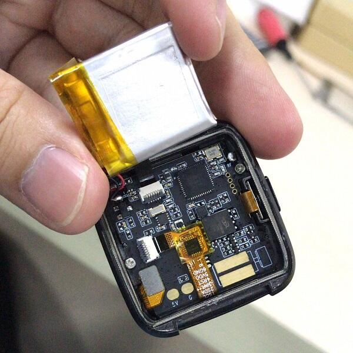
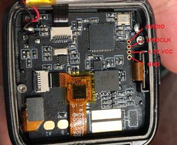

<!-- Copyright 2015-2026 Zephyr Project members and individual contributors. -->
<!-- SPDX-License-Identifier: Apache-2.0 -->
<!-- 中文翻译；编号、导航与译注为本地新增。 -->

<a id="pinetime_devkit0"></a>

# 第6章\_PineTime DevKit0

原文：[官方页面](https://docs.zephyrproject.org/latest/boards/pine64/pinetime_devkit0/doc/index.html)。读取日期：2026-10-16；来源摘要见[来源记录](../SOURCES.md)。

开发板概览（Board Overview）

<a id="id2"></a>

[](images/pinetime_devkit0.jpg)

PineTime DevKit0

名称（Name）：

`pinetime_devkit0`

厂商（Vendor）：

[Pine64](https://docs.zephyrproject.org/latest/boards/index.html#vendor=pine64)

状态（Status）：

当前未积极维护（Not Actively Maintained）

架构（Architecture）：

[arm](https://docs.zephyrproject.org/latest/boards/index.html#arch=arm)

片上系统（SoC）：

[nrf52832](https://docs.zephyrproject.org/latest/boards/index.html#soc=nrf52832)

<a id="board-github-link"></a>

[浏览开发板源码（Browse Board Sources）](https://github.com/zephyrproject-rtos/zephyr/blob/main//boards/pine64/pinetime_devkit0/doc/index.rst/../..)<a id="overview"></a>

## 概述（Overview）

Pine64的PineTime开源智能手表由社区共同开发，并与可穿戴实时操作系统及Linux应用开发者和社区合作。

<a id="hardware"></a>

## 硬件（Hardware）

PineTime基于Nordic nRF52832，提供以下功能：


- CPU：64 MHz Cortex-M4，带浮点单元（FPU）
- RAM：64 KB SRAM
- 闪存：512 KB片上闪存，另有4 MB XT25F32B SPI NOR
- 显示：1.3英寸，即33 mm，240×240像素，采用ST7789驱动
- 触摸屏：CST816S电容式触摸
- 电池：170—180 mAh、3.8 V锂聚合物电池（LiPo）
- BMA421三轴加速度传感器
- HRS3300光电容积脉搏波（PPG）心率传感器
- 振动电机（Vibration Motor）

<a id="pinetime-schematics"></a>

### PineTime原理图

<a id="id4"></a>

[PineTime原理图](http://files.pine64.org/doc/PineTime/PineTime%20Schematic-V1.0a-20191103.pdf)[注1](#id3)位于Pine64网站，以下为nRF52端口分配概览。

<table>
<tr>
<th>nRF52引脚</th>
<th>功能（Function）</th>
<th>方向（Direction）</th>
</tr>
<tr>
<td>P0.00/XL1</td>
<td>32.768 kHz，XL1</td>
<td></td>
</tr>
<tr>
<td>P0.01/XL2</td>
<td>32.768 kHz，XL2</td>
<td></td>
</tr>
<tr>
<td>P0.02/AIN0</td>
<td>SPI-SCK、LCD_SCK</td>
<td>输出（OUT）</td>
</tr>
<tr>
<td>P0.03/AIN1</td>
<td>SPI-MOSI、LCD_SDI</td>
<td>输出（OUT）</td>
</tr>
<tr>
<td>P0.04/AIN2</td>
<td>SPI-MISO</td>
<td>输入（IN）</td>
</tr>
<tr>
<td>P0.05/AIN3</td>
<td>SPI-CE#，SPI NOR片选</td>
<td>输出（OUT）</td>
</tr>
<tr>
<td>P0.06</td>
<td>BMA421-SDA、HRS3300-SDA、TP-SDA</td>
<td>输入输出（I/O）</td>
</tr>
<tr>
<td>P0.07</td>
<td>BMA421-SCL、HRS3300-SCL、TP-SCL</td>
<td>输出（OUT）</td>
</tr>
<tr>
<td>P0.08</td>
<td>BMA421-INT</td>
<td>输入（IN）</td>
</tr>
<tr>
<td>P0.09/NFC1</td>
<td>LCD_DET</td>
<td>输出（OUT）</td>
</tr>
<tr>
<td>P0.10/NFC2</td>
<td>TP_RESET</td>
<td>输出（OUT）</td>
</tr>
<tr>
<td>P0.11</td>
<td></td>
<td></td>
</tr>
<tr>
<td>P0.12</td>
<td>充电指示（CHARGE INDICATION）</td>
<td>输入（IN）</td>
</tr>
<tr>
<td>P0.13</td>
<td>按键输入（PUSH BUTTON_IN）</td>
<td>输入（IN）</td>
</tr>
<tr>
<td>P0.14/TRACEDATA3</td>
<td>LCD_BACKLIGHT_LOW</td>
<td>输出（OUT）</td>
</tr>
<tr>
<td>P0.15/TRACEDATA2</td>
<td>按键输出（PUSH BUTTON_OUT）</td>
<td>输出（OUT）</td>
</tr>
<tr>
<td>P0.16/TRACEDATA1</td>
<td>振动器输出（VIBRATOR OUT）</td>
<td>输出（OUT）</td>
</tr>
<tr>
<td>P0.17</td>
<td></td>
<td></td>
</tr>
<tr>
<td>P0.18/TRACEDATA0/SWO</td>
<td>LCD_RS输出</td>
<td></td>
</tr>
<tr>
<td>P0.19</td>
<td>外部电源存在指示（POWER PRESENCE INDICATION）</td>
<td>输入（IN）</td>
</tr>
<tr>
<td>P0.20/TRACECLK</td>
<td></td>
<td></td>
</tr>
<tr>
<td>P0.21/nRESET</td>
<td></td>
<td></td>
</tr>
<tr>
<td>P0.22</td>
<td>LCD_BACKLIGHT_MID</td>
<td>输出（OUT）</td>
</tr>
<tr>
<td>P0.23</td>
<td>LCD_BACKLIGHT_HIGH</td>
<td>输出（OUT）</td>
</tr>
<tr>
<td>P0.24</td>
<td>3.3 V电源控制（3V3 POWER CONTROL）</td>
<td>输出（OUT）</td>
</tr>
<tr>
<td>P0.25</td>
<td>LCD_CS</td>
<td>输出（OUT）</td>
</tr>
<tr>
<td>P0.26</td>
<td>LCD_RESET</td>
<td>输出（OUT）</td>
</tr>
<tr>
<td>P0.27</td>
<td>状态LED，原文附注“NOT STAFF”</td>
<td>输出（OUT）</td>
</tr>
<tr>
<td>P0.28/AIN4</td>
<td>TP_INT</td>
<td>输入（IN）</td>
</tr>
<tr>
<td>P0.29/AIN5</td>
<td></td>
<td></td>
</tr>
<tr>
<td>P0.30/AIN6</td>
<td>HRS3300-TEST</td>
<td>输入（IN）</td>
</tr>
<tr>
<td>P0.31/AIN7</td>
<td>电池电压，模拟信号（Analog）</td>
<td>输入（IN）</td>
</tr>
</table>

<a id="building"></a>

## 构建（Building）

可先运行基本Button按键示例，开始使用PineTime上的Zephyr：

```text
# From the root of the zephyr repository
west build -b pinetime_devkit0 samples/basic/button
```

<a id="programming-and-debugging"></a>

## 烧录与调试（Programming and Debugging）

`pinetime_devkit0`开发板支持下表所列的运行工具（Runners）及相关west命令。

<table>
<tr>
<th></th>
<th>烧录（flash）</th>
<th>调试（debug）</th>
<th>连接调试会话（attach）</th>
<th>实时传输（rtt）</th>
<th>复位（reset）</th>
<th>调试服务器（debugserver）</th>
</tr>
<tr>
<td><a href="https://docs.zephyrproject.org/latest/develop/flash_debug/host-tools.html#runner-blackmagicprobe">blackmagicprobe</a></td>
<td>✅</td>
<td>✅</td>
<td>✅</td>
<td></td>
<td></td>
<td></td>
</tr>
<tr>
<td><a href="https://docs.zephyrproject.org/latest/develop/flash_debug/host-tools.html#runner-pyocd">pyocd</a></td>
<td>✅（默认 / default）</td>
<td>✅（默认 / default）</td>
<td>✅</td>
<td>✅</td>
<td>✅</td>
<td>✅</td>
</tr>
</table>

PineTime开发套件背盖未粘合，便于重新编程。

套件不附带硬件编程器，可使用已有的SWD调试器。

调试需要以下步骤：


- 解锁器件
- 上传新软件
- 运行调试器

<a id="id6"></a>

更多信息见Wiki“重新编程PineTime”[注2](#id5)。（[Wiki：重新编程PineTime](https://wiki.pine64.org/index.php/Reprogramming_the_PineTime)）

<a id="debugger-connection"></a>

### 调试器连接（Debugger Connection）

开发套件引出SWD引脚，用于烧录及调试。

只有少数开发者在这些引脚上焊线，多数通过接触压力使编程线与焊盘接触。

引脚排列如下：



<a id="unlocking-the-flash-memory"></a>

### 解锁闪存（Unlocking the Flash Memory）

解锁是一次性操作，用于启用调试端口并完全访问器件；会擦除内部闪存中全部现有软件。

2020年9月20日之后出货的PineTime已解锁，无需再执行解锁。

```text
$ nrfjprog -f NRF52 --recover
```

<a id="flashing"></a>

### 烧录（Flashing）

使用nrfjprog烧录的命令如下：

```text
$ nrfjprog -f NRF52 --program firmware.hex --sectorerase
```

<a id="debugging"></a>

### 调试（Debugging）

使用Segger Ozone可简化调试及烧录。

加载最终固件ELF，将调试器设为通过USB使用SWD连接nRF52832_xxAA。可通过Tools/J-Link Settings菜单配置，或在调试器控制台输入以下命令：

```text
$ Project.SetDevice ("nRF52832_xxAA");
$ Project.SetHostIF ("USB", "");
$ Project.SetTargetIF ("SWD");
$ Project.SetTIFSpeed ("4 MHz");
$ File.Open ("path/to/your/build/zephyr/zephyr.elf");
```

<a id="references"></a>

## 参考资料（References）

<a id="id3"></a>

〔[1](#id4)〕 [http://files.pine64.org/doc/PineTime/PineTime%20Schematic-V1.0a-20191103.pdf](http://files.pine64.org/doc/PineTime/PineTime%20Schematic-V1.0a-20191103.pdf)

<a id="id5"></a>

〔[2](#id6)〕 [https://wiki.pine64.org/index.php/Reprogramming_the_PineTime](https://wiki.pine64.org/index.php/Reprogramming_the_PineTime)

## 译注

PineTime解锁会擦除内部闪存已有软件；2020年9月20日后出货器件原文称已解锁。保留SWD接触方式及Ozone芯片型号，原表中NOT STAFF字样按原文注明。

---

[上一章](P005_PineCone_BL602_Evaluation_Board.md) · [返回大纲](大纲.md) · [全站翻译进度](../PROGRESS.md) · [下一章](P007_PJRC.md)
