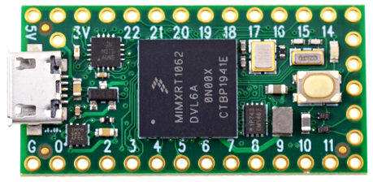
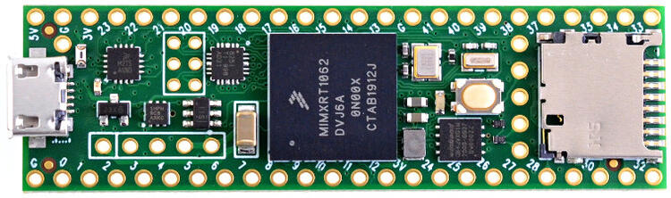
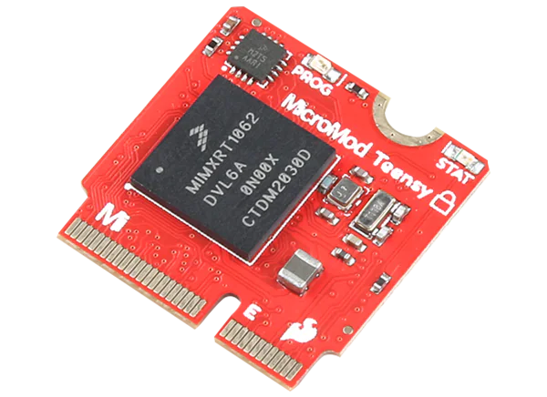

<!-- Copyright 2015-2026 Zephyr Project members and individual contributors. -->
<!-- SPDX-License-Identifier: Apache-2.0 -->
<!-- 中文翻译；编号、导航与译注为本地新增。 -->

<a id="teensy40"></a>

# 第8章\_Teensy 4.0

原文：[官方页面](https://docs.zephyrproject.org/latest/boards/pjrc/teensy4/doc/index.html)。读取日期：2026-10-16；来源摘要见[来源记录](../SOURCES.md)。

开发板概览（Board Overview）

<a id="id1"></a>

[](images/teensy40.jpg)

Teensy 4.0

名称（Name）：

`teensy40`

厂商（Vendor）：

[PJRC](https://docs.zephyrproject.org/latest/boards/index.html#vendor=pjrc)

状态（Status）：

当前未积极维护（Not Actively Maintained）

架构（Architecture）：

[arm](https://docs.zephyrproject.org/latest/boards/index.html#arch=arm)

片上系统（SoC）：

[mimxrt1062](https://docs.zephyrproject.org/latest/boards/index.html#soc=mimxrt1062)

<a id="board-github-link"></a>

[浏览开发板源码（Browse Board Sources）](https://github.com/zephyrproject-rtos/zephyr/blob/main//boards/pjrc/teensy4/doc/index.rst/../..)<a id="pjrc-teensy-4"></a>

## PJRC TEENSY 4

<a id="overview"></a>

### 概述（Overview）

Teensy是一套外形很小的完整USB微控制器开发系统，可用于多种工程，全部编程通过USB完成。

<a id="tab-0-VGVlbnN5IDQuMA=="></a>

<a id="tab-0-VGVlbnN5IDQuMQ=="></a>

<a id="tab-0-U3BhcmtmdW4gVGVlbnN5IE1pY3JvbW9k"></a>

<a id="panel-0-VGVlbnN5IDQuMA=="></a>

**Teensy 4.0**

<a id="id2"></a>


图片来源：[https://www.pjrc.com](https://www.pjrc.com)

<a id="panel-0-VGVlbnN5IDQuMQ=="></a>

**Teensy 4.1**

<a id="id3"></a>



图片来源：[https://www.pjrc.com](https://www.pjrc.com)

<a id="panel-0-U3BhcmtmdW4gVGVlbnN5IE1pY3JvbW9k"></a>

**SparkFun Teensy Micromod**

<a id="id4"></a>



图片来源：[https://www.sparkfun.com](https://www.sparkfun.com)

<a id="hardware"></a>

### 硬件（Hardware）

<a id="tab-1-VGVlbnN5IDQuMA=="></a>

<a id="tab-1-VGVlbnN5IDQuMQ=="></a>

<a id="tab-1-U3BhcmtmdW4gVGVlbnN5IE1pY3JvbW9k"></a>

<a id="panel-1-VGVlbnN5IDQuMA=="></a>

**Teensy 4.0**


- MIMXRT1062DVL6A微控制器，600 MHz、1024 KB片上存储器
- 16 Mbit QSPI闪存
- 用户LED（User LED）
- USB 2.0主机连接器

<a id="id6"></a>

完整硬件说明见[Teensy 4.0网站](https://www.pjrc.com/store/teensy40.html)[注1](#id5)。

<a id="panel-1-VGVlbnN5IDQuMQ=="></a>

**Teensy 4.1**


- MIMXRT1062DVJ6A MCU，600 MHz及1024 KB片上存储器
- 64 Mbit四线SPI（QSPI）闪存
- 用户LED（User LED）
- USB 2.0主机连接器
- USB 2.0 OTG连接器
- 10／100 Mbit/s以太网收发器
- SD卡TF插槽

<a id="id10"></a>

连接以太网线需要额外的[Teensy 4.1 Ethernet Kit](https://www.pjrc.com/store/ethernet_kit.html) [注3](#id9)。

<a id="id8"></a>

完整硬件说明见[Teensy 4.1网站](https://www.pjrc.com/store/teensy41.html)[注2](#id7)。

<a id="panel-1-U3BhcmtmdW4gVGVlbnN5IE1pY3JvbW9k"></a>

**SparkFun Teensy Micromod**


- MIMXRT1062DVJ6A MCU，600 MHz及1024 KB片上存储器
- 128 Mbit QSPI闪存
- 用户LED（User LED）
- USB 2.0主机连接器
- USB 2.0 OTG连接器
- SD卡TF插槽

<a id="id12"></a>

完整硬件说明见[Teensy Micromod网站](https://www.sparkfun.com/sparkfun-micromod-teensy-processor.html)[注4](#id11)。

<a id="id14"></a>

更多信息见i.MX RT1060数据手册[注5](#id13)。（[i.MX RT1060 数据手册（Datasheet）](https://www.nxp.com/docs/en/nxp/data-sheets/IMXRT1060CEC.pdf)）

<a id="supported-features"></a>

#### 支持的功能（Supported Features）

`teensy40`开发板支持下表所列的硬件功能。

片上／板载（On-Chip / On-Board）

功能集成在片上系统（SoC）内／位于开发板上。

2 / 2

分别表示已启用／已禁用的实例数。点击数量标签，可查看开发板或SoC设备树源码（DTS）中该功能的第一个实例。

`vnd,foo`

与此功能匹配的设备树绑定兼容字符串（Compatible String）；点击链接可查看绑定文档。

<a id="teensy40-hw-features"></a>

<a id="teensy40-teensy40/mimxrt1062-hw-features-section"></a>

##### `teensy40/mimxrt1062`目标（Target）

<a id="teensy40-teensy40/mimxrt1062-hw-features-panel"></a>

<a id="teensy40-teensy40/mimxrt1062-hw-features-memory"></a>

该开发板目标的片上存储容量：256 KiB RAM、2 MiB Flash。

<a id="teensy40-teensy40/mimxrt1062-hw-features-table"></a>

<table>
<tr>
<th>类型（Type）</th>
<th>位置（Location）</th>
<th>说明（Description）</th>
<th>兼容字符串（Compatible）</th>
</tr>
<tr>
<td rowspan="1">中央处理器（CPU）</td>
<td>片上（On-Chip）</td>
<td>ARM Cortex-M7处理器（CPU）（<a href="https://github.com/zephyrproject-rtos/zephyr/blob/main/dts/arm/nxp/imxrt/imxrt10xx/nxp_rt10xx.dtsi?plain=1#L30">已启用：1</a>）</td>
<td><a href="../cpu_cortex_xtensa_binding_reference/P005_arm_cortex-m7.md#std-dtcompatible-arm-cortex-m7"><code>arm,cortex-m7</code></a></td>
</tr>
<tr>
<td rowspan="1">模数转换器（ADC）</td>
<td>片上（On-Chip）</td>
<td>NXP MCUA 12B1MSPS逐次逼近模数转换器（SAR ADC），MCUA拼写沿用原文（<a href="https://github.com/zephyrproject-rtos/zephyr/blob/main/dts/arm/nxp/imxrt/imxrt10xx/nxp_rt10xx.dtsi?plain=1#L631">已禁用：2</a>）</td>
<td><a href="../hardware/P852_NXPMCUX12位逐次逼近ADC绑定.md#dtbinding-nxp-mcux-12b1msps-sar"><code>nxp,mcux-12b1msps-sar</code></a></td>
</tr>
<tr>
<td rowspan="1">ARM 架构（ARM Architecture）</td>
<td>片上（On-Chip）</td>
<td>NXP MCUX交叉开关（XBAR / Crossbar Switch）（<a href="https://github.com/zephyrproject-rtos/zephyr/blob/main/dts/arm/nxp/imxrt/imxrt10xx/nxp_rt10xx.dtsi?plain=1#L1169">已禁用：3</a>）</td>
<td><a href="../arm_nordic_nxp_control_binding_reference/P016_nxp_mcux-xbar.md#std-dtcompatible-nxp-mcux-xbar"><code>nxp,mcux-xbar</code></a></td>
</tr>
<tr>
<td rowspan="2">控制器局域网（CAN）</td>
<td>片上（On-Chip）</td>
<td>NXP FlexCAN控制器（<a href="https://github.com/zephyrproject-rtos/zephyr/blob/main/dts/arm/nxp/imxrt/imxrt10xx/nxp_rt10xx.dtsi?plain=1#L978">已启用：1</a>；<a href="https://github.com/zephyrproject-rtos/zephyr/blob/main/dts/arm/nxp/imxrt/imxrt10xx/nxp_rt10xx.dtsi?plain=1#L988">已禁用：1</a>）</td>
<td><a href="../can_adi_atmel_nxp_binding_reference/P017_nxp_flexcan.md#std-dtcompatible-nxp-flexcan"><code>nxp,flexcan</code></a></td>
</tr>
<tr>
<td>片上（On-Chip）</td>
<td>NXP FlexCAN CAN FD控制器（<a href="https://github.com/zephyrproject-rtos/zephyr/blob/main/dts/arm/nxp/imxrt/imxrt10xx/nxp_rt10xx.dtsi?plain=1#L998">已禁用：1</a>）</td>
<td><a href="../can_adi_atmel_nxp_binding_reference/P016_nxp_flexcan-fd.md#std-dtcompatible-nxp-flexcan-fd"><code>nxp,flexcan-fd</code></a></td>
</tr>
<tr>
<td rowspan="5">时钟控制（Clock Control）</td>
<td>片上（On-Chip）</td>
<td>i.MX时钟控制模块（CCM / Clock Controller Module）IP节点（<a href="https://github.com/zephyrproject-rtos/zephyr/blob/main/dts/arm/nxp/imxrt/imxrt10xx/nxp_rt10xx.dtsi?plain=1#L311">已启用：1</a>）</td>
<td><a href="../clock_nordic_nuvoton_nxp_binding_reference/P021_nxp_imx-ccm.md#std-dtcompatible-nxp-imx-ccm"><code>nxp,imx-ccm</code></a></td>
</tr>
<tr>
<td>片上（On-Chip）</td>
<td>通用固定比例时钟提供器（Fixed Factor Clock Provider）（<a href="https://github.com/zephyrproject-rtos/zephyr/blob/main/dts/arm/nxp/imxrt/imxrt10xx/nxp_rt10xx.dtsi?plain=1#L317">已启用：3</a>）</td>
<td><a href="../timer_reference/P110_固定比例时钟绑定.md#dtbinding-fixed-factor-clock"><code>fixed-factor-clock</code></a></td>
</tr>
<tr>
<td>片上（On-Chip）</td>
<td>i.MX CCM分数锁相环（Fractional PLL）（<a href="https://github.com/zephyrproject-rtos/zephyr/blob/main/dts/arm/nxp/imxrt/imxrt10xx/nxp_rt10xx.dtsi?plain=1#L335">已启用：1</a>）</td>
<td><a href="../clock_nordic_nuvoton_nxp_binding_reference/P017_nxp_imx-ccm-fnpll.md#std-dtcompatible-nxp-imx-ccm-fnpll"><code>nxp,imx-ccm-fnpll</code></a></td>
</tr>
<tr>
<td>片上（On-Chip）</td>
<td>i.MX模拟时钟控制模块（ANATOP / Analog Clock Controller Module）IP节点（<a href="https://github.com/zephyrproject-rtos/zephyr/blob/main/dts/arm/nxp/imxrt/imxrt10xx/nxp_rt10xx.dtsi?plain=1#L1022">已启用：1</a>）</td>
<td><a href="../clock_nordic_nuvoton_nxp_binding_reference/P016_nxp_imx-anatop.md#std-dtcompatible-nxp-imx-anatop"><code>nxp,imx-anatop</code></a></td>
</tr>
<tr>
<td>片上（On-Chip）</td>
<td>通用固定频率时钟提供者（Fixed-Rate Clock Provider）（<a href="https://github.com/zephyrproject-rtos/zephyr/blob/main/dts/arm/nxp/imxrt/imxrt10xx/nxp_rt10xx.dtsi?plain=1#L75">已启用：4</a>）</td>
<td><a href="../hardware/P566_固定时钟绑定.md#dtbinding-fixed-clock"><code>fixed-clock</code></a></td>
</tr>
<tr>
<td rowspan="6">计数器（Counter）</td>
<td>片上（On-Chip）</td>
<td>NXP MCUX通用定时器（GPT / General-Purpose Timer）（<a href="https://github.com/zephyrproject-rtos/zephyr/blob/main/dts/arm/nxp/imxrt/imxrt10xx/nxp_rt10xx.dtsi?plain=1#L176">已启用：1</a>）</td>
<td><a href="../nxp_nuvoton_counter_binding_reference/P004_nxp_imx-gpt.md#std-dtcompatible-nxp-imx-gpt"><code>nxp,imx-gpt</code></a></td>
</tr>
<tr>
<td>片上（On-Chip）</td>
<td>NXP MCUX四通道定时器（QTMR / Quad Timer）（<a href="https://github.com/zephyrproject-rtos/zephyr/blob/main/dts/arm/nxp/imxrt/imxrt10xx/nxp_rt10xx.dtsi?plain=1#L187">已启用：4</a>）</td>
<td><a href="../nxp_nuvoton_counter_binding_reference/P005_nxp_imx-qtmr.md#std-dtcompatible-nxp-imx-qtmr"><code>nxp,imx-qtmr</code></a></td>
</tr>
<tr>
<td>片上（On-Chip）</td>
<td>NXP MCUX四通道定时器通道（Quad Timer Channel）（<a href="https://github.com/zephyrproject-rtos/zephyr/blob/main/dts/arm/nxp/imxrt/imxrt10xx/nxp_rt10xx.dtsi?plain=1#L193">已禁用：16</a>）</td>
<td><a href="../nxp_nuvoton_counter_binding_reference/P007_nxp_imx-tmr.md#std-dtcompatible-nxp-imx-tmr"><code>nxp,imx-tmr</code></a></td>
</tr>
<tr>
<td>片上（On-Chip）</td>
<td>NXP SNVS低功耗／高功耗域实时时钟计数器（LP/HP Realtime Counter）（<a href="https://github.com/zephyrproject-rtos/zephyr/blob/main/dts/arm/nxp/imxrt/imxrt10xx/nxp_rt10xx.dtsi?plain=1#L351">已启用：1</a>）</td>
<td><a href="../nxp_nuvoton_counter_binding_reference/P006_nxp_imx-snvs-rtc.md#std-dtcompatible-nxp-imx-snvs-rtc"><code>nxp,imx-snvs-rtc</code></a></td>
</tr>
<tr>
<td>片上（On-Chip）</td>
<td>NXP周期中断定时器（PIT / Periodic Interrupt Timer）（<a href="https://github.com/zephyrproject-rtos/zephyr/blob/main/dts/arm/nxp/imxrt/imxrt10xx/nxp_rt10xx.dtsi?plain=1#L1210">已禁用：1</a>）</td>
<td><a href="../nxp_nuvoton_counter_binding_reference/P017_nxp_pit.md#std-dtcompatible-nxp-pit"><code>nxp,pit</code></a></td>
</tr>
<tr>
<td>片上（On-Chip）</td>
<td>周期中断定时器节点的子节点，用于表示单个定时器通道（<a href="https://github.com/zephyrproject-rtos/zephyr/blob/main/dts/arm/nxp/imxrt/imxrt10xx/nxp_rt10xx.dtsi?plain=1#L1220">已禁用：4</a>）</td>
<td><a href="../nxp_nuvoton_counter_binding_reference/P016_nxp_pit-channel.md#std-dtcompatible-nxp-pit-channel"><code>nxp,pit-channel</code></a></td>
</tr>
<tr>
<td rowspan="1">密码学加速器（Cryptographic Accelerator）</td>
<td>片上（On-Chip）</td>
<td>NXP数据协处理器（DCP / Data Co-Processor）密码加速器（<a href="https://github.com/zephyrproject-rtos/zephyr/blob/main/dts/arm/nxp/imxrt/imxrt10xx/nxp_rt10xx.dtsi?plain=1#L1197">已启用：1</a>）</td>
<td><a href="../crypto_secure_engine_st_ti_binding_reference/P004_nxp_mcux-dcp.md#std-dtcompatible-nxp-mcux-dcp"><code>nxp,mcux-dcp</code></a></td>
</tr>
<tr>
<td rowspan="1">调试（Debug）</td>
<td>片上（On-Chip）</td>
<td>ARMv7仪器化跟踪宏单元（ITM / Instrumentation Trace Macrocell）（<a href="https://github.com/zephyrproject-rtos/zephyr/blob/main/dts/arm/nxp/imxrt/imxrt10xx/nxp_rt10xx.dtsi?plain=1#L44">已启用：1</a>）</td>
<td><a href="../debug_binding_reference/P001_ARMv7M_ITM调试绑定.md#std-dtcompatible-arm-armv7m-itm"><code>arm,armv7m-itm</code></a></td>
</tr>
<tr>
<td rowspan="1">显示（Display）</td>
<td>片上（On-Chip）</td>
<td>NXP i.MX增强型LCD接口（eLCDIF / Enhanced LCD Interface）控制器（<a href="https://github.com/zephyrproject-rtos/zephyr/blob/main/dts/arm/nxp/imxrt/imxrt10xx/nxp_rt10xx.dtsi?plain=1#L495">已禁用：1</a>）</td>
<td><a href="../display_ilitek_matrix_nxp_binding_reference/P018_nxp_imx-elcdif.md#std-dtcompatible-nxp-imx-elcdif"><code>nxp,imx-elcdif</code></a></td>
</tr>
<tr>
<td rowspan="2">直接存储器访问（DMA）</td>
<td>片上（On-Chip）</td>
<td>NXP MCUX增强型DMA（EDMA）控制器（<a href="https://github.com/zephyrproject-rtos/zephyr/blob/main/dts/arm/nxp/imxrt/imxrt10xx/nxp_rt10xx.dtsi?plain=1#L958">已启用：1</a>）</td>
<td><a href="../nxp_realtek_renesas_dma_binding_reference/P004_nxp_mcux-edma.md#std-dtcompatible-nxp-mcux-edma"><code>nxp,mcux-edma</code></a></td>
</tr>
<tr>
<td>片上（On-Chip）</td>
<td>NXP PXP二维DMA引擎（2D DMA Engine）（<a href="https://github.com/zephyrproject-rtos/zephyr/blob/main/dts/arm/nxp/imxrt/imxrt10xx/nxp_rt10xx.dtsi?plain=1#L1035">已禁用：1</a>）</td>
<td><a href="../nxp_realtek_renesas_dma_binding_reference/P005_nxp_pxp.md#std-dtcompatible-nxp-pxp"><code>nxp,pxp</code></a></td>
</tr>
<tr>
<td rowspan="4">以太网（Ethernet）</td>
<td>片上（On-Chip）</td>
<td>NXP ENET以太网IP模块（<a href="https://github.com/zephyrproject-rtos/zephyr/blob/main/dts/arm/nxp/imxrt/imxrt10xx/nxp_rt10xx.dtsi?plain=1#L835">已启用：2</a>）</td>
<td><a href="../ethernet_nxp_phy_binding_reference/P004_nxp_enet.md#std-dtcompatible-nxp-enet"><code>nxp,enet</code></a></td>
</tr>
<tr>
<td>片上（On-Chip）</td>
<td>NXP ENET MAC／二层（L2）设备（<a href="https://github.com/zephyrproject-rtos/zephyr/blob/main/dts/arm/nxp/imxrt/imxrt10xx/nxp_rt10xx.dtsi?plain=1#L840">已禁用：2</a>）</td>
<td><a href="../ethernet_nxp_phy_binding_reference/P001_nxp_enet-mac.md#std-dtcompatible-nxp-enet-mac"><code>nxp,enet-mac</code></a></td>
</tr>
<tr>
<td>片上（On-Chip）</td>
<td>NXP ENET管理数据输入输出（MDIO）功能（<a href="https://github.com/zephyrproject-rtos/zephyr/blob/main/dts/arm/nxp/imxrt/imxrt10xx/nxp_rt10xx.dtsi?plain=1#L849">已禁用：2</a>）</td>
<td><a href="../ethernet_mdio_microchip_binding_reference/P002_nxp_enet-mdio.md#std-dtcompatible-nxp-enet-mdio"><code>nxp,enet-mdio</code></a></td>
</tr>
<tr>
<td>片上（On-Chip）</td>
<td>NXP ENET精确时间协议（PTP / Precision Time Protocol）时钟（<a href="https://github.com/zephyrproject-rtos/zephyr/blob/main/dts/arm/nxp/imxrt/imxrt10xx/nxp_rt10xx.dtsi?plain=1#L856">已禁用：2</a>）</td>
<td><a href="../ethernet_nxp_phy_binding_reference/P002_nxp_enet-ptp-clock.md#std-dtcompatible-nxp-enet-ptp-clock"><code>nxp,enet-ptp-clock</code></a></td>
</tr>
<tr>
<td rowspan="1">通用输入输出与接插件（GPIO &amp; Headers）</td>
<td>片上（On-Chip）</td>
<td>i.MX通用输入输出（GPIO）（<a href="https://github.com/zephyrproject-rtos/zephyr/blob/main/dts/arm/nxp/imxrt/imxrt10xx/nxp_rt10xx.dtsi?plain=1#L368">已启用：9</a>）</td>
<td><a href="../gpio_microchip_nordic_nuvoton_binding_reference/P030_nxp_imx-gpio.md#std-dtcompatible-nxp-imx-gpio"><code>nxp,imx-gpio</code></a></td>
</tr>
<tr>
<td rowspan="1">集成电路间总线（I2C）</td>
<td>片上（On-Chip）</td>
<td>NXP低功耗I2C（LPI2C）控制器（<a href="https://github.com/zephyrproject-rtos/zephyr/blob/main/dts/arm/nxp/imxrt/imxrt10xx/nxp_rt10xx.dtsi?plain=1#L440">已禁用：4</a>）</td>
<td><a href="../i2c_nxp_pico_renesas_binding_reference/P005_nxp_lpi2c.md#std-dtcompatible-nxp-lpi2c"><code>nxp,lpi2c</code></a></td>
</tr>
<tr>
<td rowspan="1">集成电路间音频总线（I2S）</td>
<td>片上（On-Chip）</td>
<td>NXP MCUX串行音频接口（SAI）I2S控制器（<a href="https://github.com/zephyrproject-rtos/zephyr/blob/main/dts/arm/nxp/imxrt/imxrt10xx/nxp_rt10xx.dtsi?plain=1#L1043">已禁用：3</a>）</td>
<td><a href="../i2s_binding_reference/P013_nxp_mcux-i2s.md#std-dtcompatible-nxp-mcux-i2s"><code>nxp,mcux-i2s</code></a></td>
</tr>
<tr>
<td rowspan="1">中断控制器（Interrupt Controller）</td>
<td>片上（On-Chip）</td>
<td>ARMv7-M 嵌套向量中断控制器（Nested Vectored Interrupt Controller，NVIC）（<a href="https://github.com/zephyrproject-rtos/zephyr/blob/main/dts/arm/armv7-m.dtsi?plain=1#L13">已启用：1</a>）</td>
<td><a href="../arm_interrupt_timer_binding_reference/P002_ARMv7_M_NVIC.md#std-dtcompatible-arm-v7m-nvic"><code>arm,v7m-nvic</code></a></td>
</tr>
<tr>
<td rowspan="1">发光二极管（LED）</td>
<td>板载（On-Board）</td>
<td>一组由 GPIO 控制的 LED（GPIO-Controlled LEDs）（<a href="https://github.com/zephyrproject-rtos/zephyr/blob/main/boards/pjrc/teensy4/teensy40.dts?plain=1#L33">已启用：1</a>）</td>
<td><a href="../hardware/P564_GPIO指示灯绑定.md#dtbinding-gpio-leds"><code>gpio-leds</code></a></td>
</tr>
<tr>
<td rowspan="3">存储器控制器（Memory Controller）</td>
<td>片上（On-Chip）</td>
<td>NXP FlexRAM片上RAM控制器（<a href="https://github.com/zephyrproject-rtos/zephyr/blob/main/dts/arm/nxp/imxrt/imxrt10xx/nxp_rt10xx.dtsi?plain=1#L101">已启用：1</a>）</td>
<td><a href="../memory_controller_hyperbus_smc_binding_reference/P015_nxp_flexram.md#std-dtcompatible-nxp-flexram"><code>nxp,flexram</code></a></td>
</tr>
<tr>
<td>片上（On-Chip）</td>
<td>NXP智能外部存储器控制器（SEMC / Smart External Memory Controller）（<a href="https://github.com/zephyrproject-rtos/zephyr/blob/main/dts/arm/nxp/imxrt/imxrt10xx/nxp_rt10xx.dtsi?plain=1#L160">已启用：1</a>）</td>
<td><a href="../memory_controller_hyperbus_smc_binding_reference/P016_nxp_imx-semc.md#std-dtcompatible-nxp-imx-semc"><code>nxp,imx-semc</code></a></td>
</tr>
<tr>
<td>片上（On-Chip）</td>
<td>NXP i.MX SNVS低功耗通用寄存器，用作电池后备RAM（Battery-Backed RAM）（<a href="https://github.com/zephyrproject-rtos/zephyr/blob/main/dts/arm/nxp/imxrt/imxrt10xx/nxp_rt10xx.dtsi?plain=1#L363">已启用：1</a>）</td>
<td><a href="../memory_controller_sdram_psram_binding_reference/P001_nxp_imx-snvs-gpr.md#std-dtcompatible-nxp-imx-snvs-gpr"><code>nxp,imx-snvs-gpr</code></a></td>
</tr>
<tr>
<td rowspan="1">其他绑定（Miscellaneous）</td>
<td>片上（On-Chip）</td>
<td>NXP FlexIO控制器（<a href="https://github.com/zephyrproject-rtos/zephyr/blob/main/dts/arm/nxp/imxrt/imxrt10xx/nxp_rt10xx.dtsi?plain=1#L1245">已禁用：3</a>）</td>
<td><a href="../misc_adi_nordic_binding_reference/P024_nxp_flexio.md#std-dtcompatible-nxp-flexio"><code>nxp,flexio</code></a></td>
</tr>
<tr>
<td rowspan="1">内存管理单元／内存保护单元（MMU / MPU）</td>
<td>片上（On-Chip）</td>
<td>ARMv7-M存储器保护单元（MPU / Memory Protection Unit）（<a href="https://github.com/zephyrproject-rtos/zephyr/blob/main/dts/arm/nxp/imxrt/imxrt10xx/nxp_rt10xx.dtsi?plain=1#L39">已启用：1</a>）</td>
<td><a href="../memory_protection_binding_reference/P005_arm_armv7m-mpu.md#std-dtcompatible-arm-armv7m-mpu"><code>arm,armv7m-mpu</code></a></td>
</tr>
<tr>
<td rowspan="2">存储技术设备（MTD）</td>
<td>板载（On-Board）</td>
<td>NXP FlexSPI NOR闪存（<a href="https://github.com/zephyrproject-rtos/zephyr/blob/main/boards/pjrc/teensy4/teensy40.dts?plain=1#L49">已启用：1</a>）</td>
<td><a href="../mtd_microchip_nordic_nxp_binding_reference/P023_nxp_imx-flexspi-nor.md#std-dtcompatible-nxp-imx-flexspi-nor"><code>nxp,imx-flexspi-nor</code></a></td>
</tr>
<tr>
<td>板载（On-Board）</td>
<td>闪存（Flash）节点（<a href="https://github.com/zephyrproject-rtos/zephyr/blob/main/boards/pjrc/teensy4/teensy40.dts?plain=1#L61">已启用：1</a>）</td>
<td><a href="../mtd_nxp_st_ti_partition_binding_reference/P013_soc-nv-flash.md#std-dtcompatible-soc-nv-flash"><code>soc-nv-flash</code></a></td>
</tr>
<tr>
<td rowspan="1">一次性可编程存储器（OTP Memory）</td>
<td>片上（On-Chip）</td>
<td>NXP片上一次性可编程存储器（OCOTP）（<a href="https://github.com/zephyrproject-rtos/zephyr/blob/main/dts/arm/nxp/imxrt/imxrt10xx/nxp_rt10xx.dtsi?plain=1#L1253">已禁用：1</a>）</td>
<td><a href="../otp_binding_reference/P004_nxp_ocotp.md#std-dtcompatible-nxp-ocotp"><code>nxp,ocotp</code></a></td>
</tr>
<tr>
<td rowspan="3">引脚控制（Pin Control）</td>
<td>片上（On-Chip）</td>
<td>这个兼容性绑定（Compatible Binding）应应用于设备的<code>iomuxc</code>设备树源文件（DTS）节点。（<a href="https://github.com/zephyrproject-rtos/zephyr/blob/main/dts/arm/nxp/imxrt/imxrt10xx/nxp_rt10xx.dtsi?plain=1#L484">已启用：1</a>）</td>
<td><a href="../pinctrl_infineon_nordic_nxp_binding_reference/P023_nxp_imx-iomuxc.md#std-dtcompatible-nxp-imx-iomuxc"><code>nxp,imx-iomuxc</code></a></td>
</tr>
<tr>
<td>片上（On-Chip）</td>
<td>该节点在MCUX RT SoC设备树中设置了pinctrl节点标签（<a href="https://github.com/zephyrproject-rtos/zephyr/blob/main/dts/arm/nxp/imxrt/imxrt10xx/nxp_rt10xx.dtsi?plain=1#L489">已启用：1</a>）</td>
<td><a href="../pinctrl_nxp_pico_binding_reference/P012_nxp_mcux-rt-pinctrl.md#std-dtcompatible-nxp-mcux-rt-pinctrl"><code>nxp,mcux-rt-pinctrl</code></a></td>
</tr>
<tr>
<td>片上（On-Chip）</td>
<td>i.MX I/O复用控制器（IOMUXC）（<a href="https://github.com/zephyrproject-rtos/zephyr/blob/main/dts/arm/nxp/imxrt/imxrt10xx/nxp_rt10xx.dtsi?plain=1#L1029">已启用：1</a>）</td>
<td><a href="../pinctrl_infineon_nordic_nxp_binding_reference/P021_nxp_imx-gpr.md#std-dtcompatible-nxp-imx-gpr"><code>nxp,imx-gpr</code></a></td>
</tr>
<tr>
<td rowspan="2">脉宽调制（PWM）</td>
<td>片上（On-Chip）</td>
<td>包含mcux-pwm子模块的NXP eFLEX PWM模块（<a href="https://github.com/zephyrproject-rtos/zephyr/blob/main/dts/arm/nxp/imxrt/imxrt10xx/nxp_rt10xx.dtsi?plain=1#L651">已启用：4</a>）</td>
<td><a href="../pwm_nxp_renesas_binding_reference/P003_nxp_flexpwm.md#std-dtcompatible-nxp-flexpwm"><code>nxp,flexpwm</code></a></td>
</tr>
<tr>
<td>片上（On-Chip）</td>
<td>NXP MCUX脉宽调制（PWM）（<a href="https://github.com/zephyrproject-rtos/zephyr/blob/main/dts/arm/nxp/imxrt/imxrt10xx/nxp_rt10xx.dtsi?plain=1#L656">已禁用：16</a>）</td>
<td><a href="../pwm_nxp_renesas_binding_reference/P005_nxp_imx-pwm.md#std-dtcompatible-nxp-imx-pwm"><code>nxp,imx-pwm</code></a></td>
</tr>
<tr>
<td rowspan="1">随机数生成器（RNG）</td>
<td>片上（On-Chip）</td>
<td>Kinetis真随机数发生器（TRNG / True Random Number Generator）（<a href="https://github.com/zephyrproject-rtos/zephyr/blob/main/dts/arm/nxp/imxrt/imxrt10xx/nxp_rt10xx.dtsi?plain=1#L870">已启用：1</a>）</td>
<td><a href="../rng_binding_reference/P020_nxp_kinetis-trng.md#std-dtcompatible-nxp-kinetis-trng"><code>nxp,kinetis-trng</code></a></td>
</tr>
<tr>
<td rowspan="1">SD 主机控制器（SDHC）</td>
<td>片上（On-Chip）</td>
<td>NXP i.MX USDHC控制器（<a href="https://github.com/zephyrproject-rtos/zephyr/blob/main/dts/arm/nxp/imxrt/imxrt10xx/nxp_rt10xx.dtsi?plain=1#L927">已禁用：2</a>）</td>
<td><a href="../sdhc_binding_reference/P014_nxp_imx-usdhc.md#std-dtcompatible-nxp-imx-usdhc"><code>nxp,imx-usdhc</code></a></td>
</tr>
<tr>
<td rowspan="2">传感器（Sensors）</td>
<td>片上（On-Chip）</td>
<td>NXP MCUX正交解码器（QDEC）（<a href="https://github.com/zephyrproject-rtos/zephyr/blob/main/dts/arm/nxp/imxrt/imxrt10xx/nxp_rt10xx.dtsi?plain=1#L1141">已禁用：4</a>）</td>
<td><a href="../sensor_nxp_qdec_optical_binding_reference/P008_nxp_mcux-qdec.md#std-dtcompatible-nxp-mcux-qdec"><code>nxp,mcux-qdec</code></a></td>
</tr>
<tr>
<td>片上（On-Chip）</td>
<td>NXP片上温度监视器（On-Die Temperature Monitor）（<a href="https://github.com/zephyrproject-rtos/zephyr/blob/main/dts/arm/nxp/imxrt/imxrt10xx/nxp_rt10xx.dtsi?plain=1#L1204">已禁用：1</a>）</td>
<td><a href="../sensor_nxp_qdec_optical_binding_reference/P013_nxp_tempmon.md#std-dtcompatible-nxp-tempmon"><code>nxp,tempmon</code></a></td>
</tr>
<tr>
<td rowspan="1">串行控制器（Serial Controller）</td>
<td>片上（On-Chip）</td>
<td>NXP低功耗UART（LPUART）（<a href="https://github.com/zephyrproject-rtos/zephyr/blob/main/dts/arm/nxp/imxrt/imxrt10xx/nxp_rt10xx.dtsi?plain=1#L601">已启用：1</a>；<a href="https://github.com/zephyrproject-rtos/zephyr/blob/main/dts/arm/nxp/imxrt/imxrt10xx/nxp_rt10xx.dtsi?plain=1#L551">已禁用：7</a>）</td>
<td><a href="../uart_microchip_nordic_nxp_binding_reference/P017_nxp_lpuart.md#std-dtcompatible-nxp-lpuart"><code>nxp,lpuart</code></a></td>
</tr>
<tr>
<td rowspan="2">串行外设接口（SPI）</td>
<td>片上（On-Chip）</td>
<td>NXP FlexSPI控制器（<a href="https://github.com/zephyrproject-rtos/zephyr/blob/main/dts/arm/nxp/imxrt/imxrt10xx/nxp_rt10xx.dtsi?plain=1#L132">已启用：1</a>；<a href="https://github.com/zephyrproject-rtos/zephyr/blob/main/dts/arm/nxp/imxrt/imxrt10xx/nxp_rt10xx.dtsi?plain=1#L146">已禁用：1</a>）</td>
<td><a href="../spi_flexspi_nxp_renesas_binding_reference/P001_nxp_imx-flexspi.md#std-dtcompatible-nxp-imx-flexspi"><code>nxp,imx-flexspi</code></a></td>
</tr>
<tr>
<td>片上（On-Chip）</td>
<td>NXP低功耗SPI（LPSPI）控制器（<a href="https://github.com/zephyrproject-rtos/zephyr/blob/main/dts/arm/nxp/imxrt/imxrt10xx/nxp_rt10xx.dtsi?plain=1#L503">已禁用：4</a>）</td>
<td><a href="../spi_flexspi_nxp_renesas_binding_reference/P004_nxp_lpspi.md#std-dtcompatible-nxp-lpspi"><code>nxp,lpspi</code></a></td>
</tr>
<tr>
<td rowspan="2">定时器（Timer）</td>
<td>片上（On-Chip）</td>
<td>ARMv7-M 系统节拍（System Tick）（<a href="https://github.com/zephyrproject-rtos/zephyr/blob/main/dts/arm/armv7-m.dtsi?plain=1#L21">已启用：1</a>）</td>
<td><a href="../arm_interrupt_timer_binding_reference/P006_ARMv7_M_SysTick.md#std-dtcompatible-arm-armv7m-systick"><code>arm,armv7m-systick</code></a></td>
</tr>
<tr>
<td>片上（On-Chip）</td>
<td>NXP MCUX通用硬件定时器（GPT / General-Purpose HW Timer）（<a href="https://github.com/zephyrproject-rtos/zephyr/blob/main/dts/arm/nxp/imxrt/imxrt10xx/nxp_rt10xx.dtsi?plain=1#L169">已禁用：1</a>）</td>
<td><a href="../microchip_nordic_nxp_realtek_timer_binding_reference/P007_nxp_gpt-hw-timer.md#std-dtcompatible-nxp-gpt-hw-timer"><code>nxp,gpt-hw-timer</code></a></td>
</tr>
<tr>
<td rowspan="3">通用串行总线（USB）</td>
<td>片上（On-Chip）</td>
<td>NXP EHCI USB设备模式（Device Mode）（<a href="https://github.com/zephyrproject-rtos/zephyr/blob/main/dts/arm/nxp/imxrt/imxrt10xx/nxp_rt10xx.dtsi?plain=1#L877">已启用：1</a>；<a href="https://github.com/zephyrproject-rtos/zephyr/blob/main/dts/arm/nxp/imxrt/imxrt10xx/nxp_rt10xx.dtsi?plain=1#L887">已禁用：1</a>）</td>
<td><a href="../usb_soc_binding_reference/P006_nxp_ehci.md#std-dtcompatible-nxp-ehci"><code>nxp,ehci</code></a></td>
</tr>
<tr>
<td>片上（On-Chip）</td>
<td>NXP EHCI USB主机控制器（Host Controller）（<a href="https://github.com/zephyrproject-rtos/zephyr/blob/main/dts/arm/nxp/imxrt/imxrt10xx/nxp_rt10xx.dtsi?plain=1#L897">已禁用：2</a>）</td>
<td><a href="../usb_soc_binding_reference/P009_nxp_uhc-ehci.md#std-dtcompatible-nxp-uhc-ehci"><code>nxp,uhc-ehci</code></a></td>
</tr>
<tr>
<td>片上（On-Chip）</td>
<td>NXP USB高速物理层（High Speed PHY）（<a href="https://github.com/zephyrproject-rtos/zephyr/blob/main/dts/arm/nxp/imxrt/imxrt10xx/nxp_rt10xx.dtsi?plain=1#L915">已禁用：2</a>）</td>
<td><a href="../usb_soc_binding_reference/P013_nxp_usbphy.md#std-dtcompatible-nxp-usbphy"><code>nxp,usbphy</code></a></td>
</tr>
<tr>
<td rowspan="1">视频（Video）</td>
<td>片上（On-Chip）</td>
<td>NXP MCUX CMOS传感器接口（Sensor Interface）（<a href="https://github.com/zephyrproject-rtos/zephyr/blob/main/dts/arm/nxp/imxrt/imxrt10xx/nxp_rt10xx.dtsi?plain=1#L951">已禁用：1</a>）</td>
<td><a href="../video_camera_endpoint_binding_reference/P008_nxp_imx-csi.md#std-dtcompatible-nxp-imx-csi"><code>nxp,imx-csi</code></a></td>
</tr>
<tr>
<td rowspan="1">看门狗（Watchdog）</td>
<td>片上（On-Chip）</td>
<td>i.MX RT看门狗（Watchdog）（<a href="https://github.com/zephyrproject-rtos/zephyr/blob/main/dts/arm/nxp/imxrt/imxrt10xx/nxp_rt10xx.dtsi?plain=1#L1008">已禁用：2</a>）</td>
<td><a href="../nxp_nordic_nuvoton_watchdog_binding_reference/P009_nxp_imx-wdog.md#std-dtcompatible-nxp-imx-wdog"><code>nxp,imx-wdog</code></a></td>
</tr>
</table>

<a id="connections-and-ios"></a>

#### 连接与输入输出（Connections and IOs）

Teensy引脚到MIMXRT1062 SoC的映射。

<table>
<tr>
<th>引脚（Pin）</th>
<th>焊盘标识（Pad ID）</th>
<th>用途（Usage）</th>
</tr>
<tr>
<td>0</td>
<td>AD_B0_03</td>
<td>GPIO1_3 / UART6_RX / CAN2_RX</td>
</tr>
<tr>
<td>1</td>
<td>AD_B0_02</td>
<td>GPIO1_2 / UART6_TX / CAN2_TX</td>
</tr>
<tr>
<td>2</td>
<td>EMC_04</td>
<td>GPIO4_4</td>
</tr>
<tr>
<td>3</td>
<td>EMC_05</td>
<td>GPIO4_5</td>
</tr>
<tr>
<td>4</td>
<td>EMC_06</td>
<td>GPIO4_6</td>
</tr>
<tr>
<td>5</td>
<td>EMC_08</td>
<td>GPIO4_8</td>
</tr>
<tr>
<td>6</td>
<td>B0_10</td>
<td>GPIO2_10</td>
</tr>
<tr>
<td>7</td>
<td>B1_01</td>
<td>GPIO2_17 / UART4_RX</td>
</tr>
<tr>
<td>8</td>
<td>B1_00</td>
<td>GPIO2_16 / UART4_TX</td>
</tr>
<tr>
<td>9</td>
<td>B0_11</td>
<td>GPIO2_11</td>
</tr>
<tr>
<td>10</td>
<td>B0_00</td>
<td>GPIO2_0</td>
</tr>
<tr>
<td>11</td>
<td>B0_02</td>
<td>GPIO2_2</td>
</tr>
<tr>
<td>12</td>
<td>B0_01</td>
<td>GPIO2_1</td>
</tr>
<tr>
<td>13</td>
<td>B0_03</td>
<td>GPIO2_3 / LED</td>
</tr>
<tr>
<td>14</td>
<td>AD_B1_02</td>
<td>GPIO1_18 / UART2_TX</td>
</tr>
<tr>
<td>15</td>
<td>AD_B1_03</td>
<td>GPIO1_19 / UART2_RX</td>
</tr>
<tr>
<td>16</td>
<td>AD_B1_07</td>
<td>GPIO1_23 / UART3_RX / I2C3_SCL</td>
</tr>
<tr>
<td>17</td>
<td>AD_B1_06</td>
<td>GPIO1_22 / UART3_TX / I2C3_SDA</td>
</tr>
<tr>
<td>18</td>
<td>AD_B1_01</td>
<td>GPIO1_17 / I2C1_SDA</td>
</tr>
<tr>
<td>19</td>
<td>AD_B1_00</td>
<td>GPIO1_16 / I2C1_SCL</td>
</tr>
<tr>
<td>20</td>
<td>AD_B1_10</td>
<td>GPIO1_26 / UART8_TX</td>
</tr>
<tr>
<td>21</td>
<td>AD_B1_11</td>
<td>GPIO1_27 / UART8_RX</td>
</tr>
<tr>
<td>22</td>
<td>AD_B1_08</td>
<td>GPIO1_24 / CAN1_TX</td>
</tr>
<tr>
<td>23</td>
<td>AD_B1_09</td>
<td>GPIO1_25 / CAN1_RX</td>
</tr>
<tr>
<td>24</td>
<td>AD_B0_12</td>
<td>GPIO1_12 / UART1_TX / I2C4_SCL</td>
</tr>
<tr>
<td>25</td>
<td>AD_B0_13</td>
<td>GPIO1_13 / UART1_RX / I2C4_SDA</td>
</tr>
<tr>
<td>26</td>
<td>AD_B1_14</td>
<td>GPIO1_30 / SPI3_MOSI</td>
</tr>
<tr>
<td>27</td>
<td>AD_B1_15</td>
<td>GPIO1_31 / SPI3_SCK</td>
</tr>
<tr>
<td>28</td>
<td>EMC_32</td>
<td>GPIO3_18 / UART7_RX</td>
</tr>
<tr>
<td>29</td>
<td>EMC_31</td>
<td>GPIO4_31 / UART7_TX</td>
</tr>
<tr>
<td>30</td>
<td>EMC_37</td>
<td>GPIO3_23 / CAN3_RX</td>
</tr>
<tr>
<td>31</td>
<td>EMC_36</td>
<td>GPIO3_22 / CAN3_TX</td>
</tr>
<tr>
<td>32</td>
<td>B0_12</td>
<td>GPIO2_12</td>
</tr>
<tr>
<td>33</td>
<td>EMC_07</td>
<td>GPIO4_7</td>
</tr>
</table>

仅Teensy 4.0及Teensy Micromod：

<table>
<tr>
<td>34</td>
<td>SD_B0_03</td>
<td>GPIO3_15</td>
</tr>
<tr>
<td>35</td>
<td>SD_B0_02</td>
<td>GPIO3_14</td>
</tr>
<tr>
<td>36</td>
<td>SD_B0_01</td>
<td>GPIO3_13</td>
</tr>
<tr>
<td>37</td>
<td>SD_B0_00</td>
<td>GPIO3_12</td>
</tr>
<tr>
<td>38</td>
<td>SD_B0_05</td>
<td>GPIO3_17</td>
</tr>
<tr>
<td>39</td>
<td>SD_B0_04</td>
<td>GPIO3_16</td>
</tr>
</table>

仅Teensy Micromod

<table>
<tr>
<td>40</td>
<td>B0_04</td>
<td>GPIO2_4 / I2C2 SCL</td>
</tr>
<tr>
<td>41</td>
<td>B0_05</td>
<td>GPIO2_5 / I2C2 SDA</td>
</tr>
<tr>
<td>42</td>
<td>B0_06</td>
<td>GPIO2_6</td>
</tr>
<tr>
<td>43</td>
<td>B0_07</td>
<td>GPIO2_7</td>
</tr>
<tr>
<td>44</td>
<td>B0_08</td>
<td>GPIO2_8 / UART3 TX</td>
</tr>
<tr>
<td>45</td>
<td>B0_09</td>
<td>GPIO2_9 / UART3 RX</td>
</tr>
</table>

仅Teensy 4.1：

<table>
<tr>
<td>34</td>
<td>B1_13</td>
<td>GPIO2_29 / UART5_RX</td>
</tr>
<tr>
<td>35</td>
<td>B1_12</td>
<td>GPIO2_28 / UART5_TX</td>
</tr>
<tr>
<td>36</td>
<td>B1_02</td>
<td>GPIO2_18</td>
</tr>
<tr>
<td>37</td>
<td>B1_03</td>
<td>GPIO2_19</td>
</tr>
<tr>
<td>38</td>
<td>AD_B1_12</td>
<td>GPIO1_28 / SPI3_CS</td>
</tr>
<tr>
<td>39</td>
<td>AD_B1_13</td>
<td>GPIO1_29 / SPI3_MISO</td>
</tr>
<tr>
<td>40</td>
<td>AD_B1_04</td>
<td>GPIO1_20</td>
</tr>
<tr>
<td>41</td>
<td>AD_B1_05</td>
<td>GPIO1_21 / UART3_RX</td>
</tr>
</table>

Teensy Micromod引脚到MIMXRT1062 SoC的映射。

仅Teensy Micromod：

<table>
<tr>
<th>MMOD</th>
<th>MMC</th>
<th>引脚（Pin）</th>
<th>焊盘标识（Pad ID）</th>
<th>用途（Usage）</th>
</tr>
<tr>
<td>8</td>
<td>16</td>
<td>27</td>
<td>AD_B1_15</td>
<td>&lt;gpio1 31&gt; / SPI3_SCK</td>
</tr>
<tr>
<td>10</td>
<td>2</td>
<td>4</td>
<td>EMC_06</td>
<td>&lt;gpio4 6&gt;</td>
</tr>
<tr>
<td>12</td>
<td></td>
<td>18</td>
<td>AD_B1_01</td>
<td>&lt;gpio1 17&gt; / I2C1_SDA</td>
</tr>
<tr>
<td>14</td>
<td></td>
<td>19</td>
<td>AD_B1_00</td>
<td>&lt;gpio1 16&gt; / I2C1_SCL</td>
</tr>
<tr>
<td>16</td>
<td>4</td>
<td>29</td>
<td>EMC_31</td>
<td>&lt;gpio4 31&gt; / UART7_TX</td>
</tr>
<tr>
<td>17</td>
<td></td>
<td>1</td>
<td>AD_B0_02</td>
<td>&lt;gpio1 2&gt; / UART6_TX / CAN2_TX</td>
</tr>
<tr>
<td>18</td>
<td>3</td>
<td>5</td>
<td>EMC_08</td>
<td>&lt;gpio4 8&gt;</td>
</tr>
<tr>
<td>19</td>
<td></td>
<td>0</td>
<td>AD_B0_03</td>
<td>&lt;gpio1 3&gt; / UART6_RX / CAN2_RX</td>
</tr>
<tr>
<td>20</td>
<td></td>
<td>16</td>
<td>AD_B1_07</td>
<td>&lt;gpio1 23&gt; / UART3_RX / I2C3_SCL</td>
</tr>
<tr>
<td>22</td>
<td></td>
<td>17</td>
<td>AD_B1_06</td>
<td>&lt;gpio1 22&gt; / UART3_TX / I2C3_SDA</td>
</tr>
<tr>
<td>32</td>
<td></td>
<td>3</td>
<td>EMC_05</td>
<td>&lt;gpio4 5&gt;</td>
</tr>
<tr>
<td>34</td>
<td>0</td>
<td>14</td>
<td>AD_B1_02</td>
<td>&lt;gpio1 18&gt; / UART2_TX</td>
</tr>
<tr>
<td>38</td>
<td>1</td>
<td>15</td>
<td>AD_B1_03</td>
<td>&lt;gpio1 19&gt; / UART2_RX</td>
</tr>
<tr>
<td>4</td>
<td></td>
<td>28</td>
<td>EMC_32</td>
<td>&lt;gpio3 18&gt; / UART7_RX</td>
</tr>
<tr>
<td>40</td>
<td>5</td>
<td>40</td>
<td>B0_04</td>
<td>&lt;gpio2 04&gt; / I2C2 SCL</td>
</tr>
<tr>
<td>41</td>
<td></td>
<td>30</td>
<td>EMC_37</td>
<td>&lt;gpio3 23&gt; / CAN3_RX</td>
</tr>
<tr>
<td>42</td>
<td>6</td>
<td>41</td>
<td>B0_05</td>
<td>&lt;gpio2 05&gt; / I2C2 SDA</td>
</tr>
<tr>
<td>43</td>
<td></td>
<td>31</td>
<td>EMC_36</td>
<td>&lt;gpio3 22&gt; / CAN3_TX</td>
</tr>
<tr>
<td>44</td>
<td>7</td>
<td>42</td>
<td>B0_06</td>
<td>&lt;gpio2 06&gt;</td>
</tr>
<tr>
<td>46</td>
<td>8</td>
<td>43</td>
<td>B0_07</td>
<td>&lt;gpio2 07&gt;</td>
</tr>
<tr>
<td>47</td>
<td></td>
<td>2</td>
<td>EMC_04</td>
<td>&lt;gpio4 4&gt;</td>
</tr>
<tr>
<td>48</td>
<td>9</td>
<td>44</td>
<td>B0_08</td>
<td>&lt;gpio2 08&gt; / UART3 TX</td>
</tr>
<tr>
<td>49</td>
<td></td>
<td>22</td>
<td>AD_B1_08</td>
<td>&lt;gpio1 24&gt; / CAN1_TX</td>
</tr>
<tr>
<td>50</td>
<td></td>
<td>21</td>
<td>AD_B1_11</td>
<td>&lt;gpio1 27&gt; / UART8_RX</td>
</tr>
<tr>
<td>51</td>
<td></td>
<td>25</td>
<td>AD_B0_13</td>
<td>&lt;gpio1 13&gt; / UART1_RX / I2C4_SDA</td>
</tr>
<tr>
<td>52</td>
<td></td>
<td>20</td>
<td>AD_B1_10</td>
<td>&lt;gpio1 26&gt; / UART8_TX</td>
</tr>
<tr>
<td>53</td>
<td></td>
<td>24</td>
<td>AD_B0_12</td>
<td>&lt;gpio1 12&gt; / UART1_TX / I2C4_SCL</td>
</tr>
<tr>
<td>54</td>
<td></td>
<td>8</td>
<td>B1_00</td>
<td>&lt;gpio2 16&gt; / UART4_TX</td>
</tr>
<tr>
<td>55</td>
<td>17</td>
<td>10</td>
<td>B0_00</td>
<td>&lt;gpio2 0&gt;</td>
</tr>
<tr>
<td>56</td>
<td></td>
<td>7</td>
<td>B1_01</td>
<td>&lt;gpio2 17&gt; / UART4_RX</td>
</tr>
<tr>
<td>57</td>
<td></td>
<td>13</td>
<td>B0_03</td>
<td>&lt;gpio2 3&gt; / LED</td>
</tr>
<tr>
<td>58</td>
<td></td>
<td>23</td>
<td>AD_B1_09</td>
<td>&lt;gpio1 25&gt; / CAN1_RX</td>
</tr>
<tr>
<td>59</td>
<td></td>
<td>11</td>
<td>B0_02</td>
<td>&lt;gpio2 2&gt;</td>
</tr>
<tr>
<td>60</td>
<td></td>
<td>36</td>
<td>SD_B0_01</td>
<td>&lt;gpio3 13&gt;</td>
</tr>
<tr>
<td>61</td>
<td></td>
<td>12</td>
<td>B0_01</td>
<td>&lt;gpio2 1&gt;</td>
</tr>
<tr>
<td>62</td>
<td></td>
<td>37</td>
<td>SD_B0_00</td>
<td>&lt;gpio3 12&gt;</td>
</tr>
<tr>
<td>63</td>
<td>15</td>
<td>33</td>
<td>EMC_07</td>
<td>&lt;gpio4 7&gt;</td>
</tr>
<tr>
<td>64</td>
<td></td>
<td>35</td>
<td>SD_B0_02</td>
<td>&lt;gpio3 14&gt;</td>
</tr>
<tr>
<td>65</td>
<td>14</td>
<td>32</td>
<td>B0_12</td>
<td>&lt;gpio2 12&gt;</td>
</tr>
<tr>
<td>66</td>
<td></td>
<td>34</td>
<td>SD_B0_03</td>
<td>&lt;gpio3 15&gt;</td>
</tr>
<tr>
<td>67</td>
<td>13</td>
<td>26</td>
<td>AD_B1_14</td>
<td>&lt;gpio1 30&gt; / SPI3_MOSI</td>
</tr>
<tr>
<td>68</td>
<td></td>
<td>38</td>
<td>SD_B0_05</td>
<td>&lt;gpio3 16&gt;</td>
</tr>
<tr>
<td>69</td>
<td>12</td>
<td>9</td>
<td>B0_11</td>
<td>&lt;gpio2 11&gt;</td>
</tr>
<tr>
<td>70</td>
<td></td>
<td>39</td>
<td>SD_B0_04</td>
<td>&lt;gpio3 17&gt;</td>
</tr>
<tr>
<td>71</td>
<td>11</td>
<td>6</td>
<td>B0_10</td>
<td>&lt;gpio2 10&gt;</td>
</tr>
<tr>
<td>73</td>
<td>10</td>
<td>45</td>
<td>B0_09</td>
<td>&lt;gpio2 09&gt; / UART3 RX</td>
</tr>
</table>

MMOD为Micromod物理引脚编号；MMC为Zephyr micromod_header连接器引脚编号；Pin为Arduino引脚编号；Pad ID为MIMXRT1062焊盘标识；Usage为该引脚的部分用途。

<a id="programming-and-debugging"></a>

### 烧录与调试（Programming and Debugging）

<a id="flashing"></a>

#### 烧录（Flashing）

Teensy 4.0、4.1及Micromod带有专用引导加载芯片，支持通过USB方便地写入新镜像，但不支持调试器件。


1. 构建Zephyr内核和[闪灯（Blinky）](../getting_started/P004_LED闪烁示例.md#blinky)示例应用。

<a id="tab-2-VGVlbnN5IDQuMA=="></a>

<a id="tab-2-VGVlbnN5IDQuMQ=="></a>

<a id="tab-2-VGVlbnN5IE1pY3JvbW9k"></a>

<a id="panel-2-VGVlbnN5IDQuMA=="></a>

**Teensy 4.0**

```text
west build -b teensy40 samples/basic/blinky
```

<a id="panel-2-VGVlbnN5IDQuMQ=="></a>

**Teensy 4.1**

```text
west build -b teensy41 samples/basic/blinky
```

<a id="panel-2-VGVlbnN5IE1pY3JvbW9k"></a>

**Teensy Micromod**

```text
west build -b teensymm samples/basic/blinky
```


1. 通过USB将开发板连接主机。
2. 按复位键进入引导模式，红色LED闪烁。
3. 烧录镜像（Flash the Image）。

<a id="tab-3-VGVlbnN5IDQuMA=="></a>

<a id="tab-3-VGVlbnN5IDQuMQ=="></a>

<a id="tab-3-VGVlbnN5IE1pY3JvbW9k"></a>

<a id="panel-3-VGVlbnN5IDQuMA=="></a>

**Teensy 4.0**

```text
west build -b teensy40 samples/basic/blinky
west flash
```

<a id="panel-3-VGVlbnN5IDQuMQ=="></a>

**Teensy 4.1**

```text
west build -b teensy41 samples/basic/blinky
west flash
```

<a id="panel-3-VGVlbnN5IE1pY3JvbW9k"></a>

**Teensy Micromod**

```text
west build -b teensymm samples/basic/blinky
west flash
```


1. 应看到橙色LED闪烁。

<a id="configuring-a-console"></a>

#### 配置控制台（Configuring a Console）

<a id="tab-4-VUFSVC1Db25zb2xl"></a>

<a id="tab-4-VVNCLUNvbnNvbGU="></a>

<a id="panel-4-VUFSVC1Db25zb2xl"></a>

**UART控制台（UART-Console）**

默认控制台映射到Teensy第0脚RX1及第1脚TX1，需连接USB转串口适配器。终端设置如下：


- 速率（Speed）：115200波特率
- 数据位（Data）：8位
- 奇偶校验（Parity）：无（None）
- 停止位（Stop Bits）：1位

<a id="panel-4-VVNCLUNvbnNvbGU="></a>

**USB控制台（USB-Console）**

也可将控制台映射到USB，以省去USB转串口适配器。使用CDC-ACM控制台配置片段cdc-acm-console及一个配置选项即可启用。（[CDC-ACM控制台配置片段（cdc-acm-console）](../snippets/P009_USB_CDC_ACM控制台配置片段.md#snippet-cdc-acm-console)）


1. 构建应用时加入此配置片段，它会自动初始化USB设备支持。

  ```text
  west build -b teensy41 -S cdc-acm-console samples/basic/blinky
  west flash
  ```
2. 应用启动后，主机应出现类似tty.usbmodem14203的串口设备，可使用VS Code Serial Monitor插件等工具查看。

<a id="references"></a>

### 参考资料（References）

<a id="id5"></a>

〔[1](#id6)〕 [https://www.pjrc.com/store/teensy40.html](https://www.pjrc.com/store/teensy40.html)

<a id="id7"></a>

〔[2](#id8)〕 [https://www.pjrc.com/store/teensy41.html](https://www.pjrc.com/store/teensy41.html)

<a id="id9"></a>

〔[3](#id10)〕 [https://www.pjrc.com/store/ethernet_kit.html](https://www.pjrc.com/store/ethernet_kit.html)

<a id="id11"></a>

〔[4](#id12)〕 [https://www.sparkfun.com/sparkfun-micromod-teensy-processor.html](https://www.sparkfun.com/sparkfun-micromod-teensy-processor.html)

<a id="id13"></a>

〔[5](#id14)〕 [https://www.nxp.com/docs/en/nxp/data-sheets/IMXRT1060CEC.pdf](https://www.nxp.com/docs/en/nxp/data-sheets/IMXRT1060CEC.pdf)

## 译注

Teensy 4.0、4.1及Micromod的引脚表分别保留，MMOD、MMC、Arduino编号及SoC焊盘编号不可互换。USB引导芯片支持写入镜像，但不支持调试；默认控制台在引脚0／1，可通过CDC-ACM配置片段切换USB控制台。

## 原文外链核对

2026-10-16核对并重试以下原文外链时未能确认可访问性，保留原始目标，不将访问失败解释为原文内容有误。

- [IMXRT1060CEC.pdf](https://www.nxp.com/docs/en/nxp/data-sheets/IMXRT1060CEC.pdf)：HTTP Error 404: Not Found。

---

[上一章](P007_PJRC.md) · [返回大纲](大纲.md) · [全站翻译进度](../PROGRESS.md) · [下一章](P009_Qualcomm_Technologies_Inc..md)
