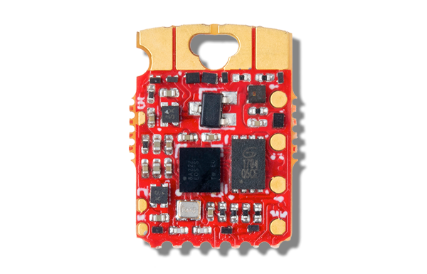

<!-- Copyright 2015-2026 Zephyr Project members and individual contributors. -->
<!-- SPDX-License-Identifier: Apache-2.0 -->
<!-- 中文翻译；编号、导航与译注为本地新增。 -->

<a id="qomu"></a>

# 第15章\_Qomu

原文：[官方页面](https://docs.zephyrproject.org/latest/boards/quicklogic/qomu/doc/index.html)。读取日期：2026-10-16；来源摘要见[来源记录](../SOURCES.md)。

开发板概览（Board Overview）

<a id="id1"></a>

[](images/qomu-board.png)

Qomu

名称（Name）：

`qomu`

厂商（Vendor）：

[QuickLogic Corp.](https://docs.zephyrproject.org/latest/boards/index.html#vendor=quicklogic)

状态（Status）：

当前未积极维护（Not Actively Maintained）

架构（Architecture）：

[arm](https://docs.zephyrproject.org/latest/boards/index.html#arch=arm)

片上系统（SoC）：

[quicklogic_eos_s3](https://docs.zephyrproject.org/latest/boards/index.html#soc=quicklogic_eos_s3)

<a id="board-github-link"></a>

[浏览开发板源码（Browse Board Sources）](https://github.com/zephyrproject-rtos/zephyr/blob/main//boards/quicklogic/qomu/doc/index.rst/../..)<a id="overview"></a>

## 概述（Overview）

Qomu板搭载QuickLogic EOS S3传感器处理平台（Sensor Processing Platform）。

<a id="hardware"></a>

## 硬件（Hardware）


- QuickLogic EOS S3 MCU平台
- 16 Mbit板载闪存
- 4个触摸焊盘（Touchpad）
- RGB发光二极管（LED）
- 通过USB供电

<a id="id3"></a>

<a id="id5"></a>

详细板卡资料见[Qomu仓库](https://github.com/QuickLogic-Corp/qomu-dev-board)[注1](#id2)及[Qomu用户指南](https://github.com/QuickLogic-Corp/qomu-dev-board/blob/master/doc/Qomu_UserGuide.pdf)[注2](#id4)。

<a id="connections-and-ios"></a>

### 连接与输入输出（Connections and IOs）

<a id="id7"></a>

详细引脚排列见原理图文档[注3](#id6)。（[原理图文档（Schematics）](https://github.com/QuickLogic-Corp/qomu-dev-board/blob/master/doc/qomu-board.pdf)）

<a id="programming"></a>

## 编程（Programming）

Qomu平台默认从闪存启动。

以下为运行Qomu示例应用的步骤：


1. 按常规方式构建示例：

  ```text
  # From the root of the zephyr repository
  west build -b qomu samples/boards/quicklogic/qomu
  ```
2. 从USB端口拔下Qomu板。
3. 将Qomu板插入USB端口。
4. 蓝色LED闪烁期间，即插入后的5秒内，用手指触摸触摸焊盘。成功后绿色LED开始闪烁。
5. 使用TinyFpgaProgrammer应用加载目标程序：

  ```text
  python3 /path/to/TinyFPGA-Programmer-Application/tinyfpga-programmer-gui.py --mode m4 --m4app build/zephyr/zephyr.bin --reset
  ```

  <a id="id9"></a>

  安装及用法详情见[TinyFPGA Programmer Application仓库](https://github.com/QuickLogic-Corp/TinyFPGA-Programmer-Application)[注4](#id8)。

<a id="references"></a>

## 参考资料（References）

<a id="id2"></a>

〔[1](#id3)〕 [https://github.com/QuickLogic-Corp/qomu-dev-board](https://github.com/QuickLogic-Corp/qomu-dev-board)

<a id="id4"></a>

〔[2](#id5)〕 [https://github.com/QuickLogic-Corp/qomu-dev-board/blob/master/doc/Qomu_UserGuide.pdf](https://github.com/QuickLogic-Corp/qomu-dev-board/blob/master/doc/Qomu_UserGuide.pdf)

<a id="id6"></a>

〔[3](#id7)〕 [https://github.com/QuickLogic-Corp/qomu-dev-board/blob/master/doc/qomu-board.pdf](https://github.com/QuickLogic-Corp/qomu-dev-board/blob/master/doc/qomu-board.pdf)

<a id="id8"></a>

〔[4](#id9)〕 [https://github.com/QuickLogic-Corp/TinyFPGA-Programmer-Application](https://github.com/QuickLogic-Corp/TinyFPGA-Programmer-Application)

## 译注

Qomu默认从闪存启动。插入后蓝灯闪烁的5秒内触摸焊盘，绿灯闪烁后使用TinyFpgaProgrammer加载。

---

[上一章](P014_QuickLogic_Corp..md) · [返回大纲](大纲.md) · [全站翻译进度](../PROGRESS.md) · [下一章](P016_QuickFeather.md)
