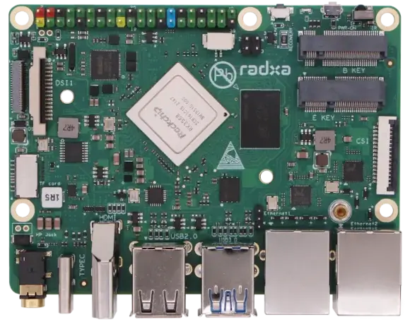

<!-- Copyright 2015-2026 Zephyr Project members and individual contributors. -->
<!-- SPDX-License-Identifier: Apache-2.0 -->
<!-- 中文翻译；编号、导航与译注为本地新增。 -->

<a id="rock_3b"></a>

# 第18章\_Radxa ROCK 3B

原文：[官方页面](https://docs.zephyrproject.org/latest/boards/radxa/rock_3b/doc/index.html)。读取日期：2026-10-16；来源摘要见[来源记录](../SOURCES.md)。

开发板概览（Board Overview）

<a id="id1"></a>

[](images/rock_3b.webp)

Radxa ROCK 3B

名称（Name）：

`rock_3b`

厂商（Vendor）：

[Radxa](https://docs.zephyrproject.org/latest/boards/index.html#vendor=radxa)

状态（Status）：

当前未积极维护（Not Actively Maintained）

架构（Architecture）：

[arm64](https://docs.zephyrproject.org/latest/boards/index.html#arch=arm64)

片上系统（SoC）：

[rk3568](https://docs.zephyrproject.org/latest/boards/index.html#soc=rk3568)

<a id="board-github-link"></a>

[浏览开发板源码（Browse Board Sources）](https://github.com/zephyrproject-rtos/zephyr/blob/main//boards/radxa/rock_3b/doc/index.rst/../..)<a id="overview"></a>

## 概述（Overview）

<a id="id3"></a>

[Radxa ROCK 3B](https://radxa.com/products/rock3/3b/) [注1](#id2)是一款基于Rockchip RK3568 SoC的单板计算机（Single-board Computer），配有四核Arm Cortex-A55 CPU、LPDDR4内存、双千兆以太网，以及USB、显示、存储及扩展接口。

<a id="hardware"></a>

## 硬件（Hardware）

ROCK 3B具有以下硬件功能：


- Rockchip RK3568片上系统（SoC）
- 四核Arm Cortex-A55 CPU，最高2 GHz
- Arm Mali-G52图形处理器（GPU）
- 64位LPDDR4 RAM，常见容量为2 GB、4 GB及8 GB
- 可选eMMC存储
- microSD卡槽（Card Slot）
- HDMI、MIPI DSI及eDP显示接口
- MIPI CSI摄像头接口
- 两个千兆以太网端口
- 两个USB 2.0主机端口（Host Port）
- 一个USB 3.0主机端口（Host Port）
- 一个USB 3.0 OTG端口
- M.2 M Key插槽，提供PCIe 3.0 x2，用于NVMe固态硬盘（SSD）
- M.2 E Key插槽，用于无线模块
- M.2 B Key插槽及SIM卡槽，用于蜂窝通信模块（Cellular Module）
- 兼容Raspberry Pi的40引脚扩展排针
- 2引脚5 V风扇连接器

<a id="id5"></a>

<a id="id7"></a>

更多详情见[Rockchip RK3568技术参考手册（TRM）第一部分](https://dl.radxa.com/rock3/docs/hw/datasheet/Rockchip%20RK3568%20TRM%20Part1%20V1.1-20210301.pdf)[注2](#id4)及第二部分[注3](#id6)。（[Rockchip RK3568技术参考手册（TRM）第二部分](https://dl.radxa.com/rock3/docs/hw/datasheet/Rockchip%20RK3568%20TRM%20Part2%20V1.1-20210301.pdf)）

<a id="supported-features"></a>

### 支持的功能（Supported Features）

`rock_3b`开发板支持下表所列的硬件功能。

片上／板载（On-Chip / On-Board）

功能集成在片上系统（SoC）内／位于开发板上。

2 / 2

分别表示已启用／已禁用的实例数。点击数量标签，可查看开发板或SoC设备树源码（DTS）中该功能的第一个实例。

`vnd,foo`

与此功能匹配的设备树绑定兼容字符串（Compatible String）；点击链接可查看绑定文档。

<a id="rock_3b-hw-features"></a>

<a id="rock_3b-rock_3b/rk3568-hw-features-section"></a>

#### `rock_3b/rk3568`目标（Target）

<a id="rock_3b-rock_3b/rk3568-hw-features-panel"></a>

<a id="rock_3b-rock_3b/rk3568-hw-features-memory"></a>

该开发板目标的片上存储容量：1 MiB RAM、N/A Flash。

<a id="rock_3b-rock_3b/rk3568-hw-features-table"></a>

<table>
<tr>
<th>类型（Type）</th>
<th>位置（Location）</th>
<th>说明（Description）</th>
<th>兼容字符串（Compatible）</th>
</tr>
<tr>
<td rowspan="1">中央处理器（CPU）</td>
<td>片上（On-Chip）</td>
<td>Arm Cortex-A55 CPU（<a href="https://github.com/zephyrproject-rtos/zephyr/blob/main/dts/arm64/rockchip/rk3568.dtsi?plain=1#L26">已启用：4</a>）</td>
<td><a href="../cpu_arm_riscv_binding_reference/P009_arm_cortex-a55.md#std-dtcompatible-arm-cortex-a55"><code>arm,cortex-a55</code></a></td>
</tr>
<tr>
<td rowspan="1">中断控制器（Interrupt Controller）</td>
<td>片上（On-Chip）</td>
<td>ARM通用中断控制器（GIC）v3（<a href="https://github.com/zephyrproject-rtos/zephyr/blob/main/dts/arm64/rockchip/rk3568.dtsi?plain=1#L55">已启用：1</a>）</td>
<td><a href="../interrupt_fabric_binding_reference/P004_arm_gic-v3.md#std-dtcompatible-arm-gic-v3"><code>arm,gic-v3</code></a></td>
</tr>
<tr>
<td rowspan="1">电源管理 CPU 操作（Power Management CPU Operations）</td>
<td>片上（On-Chip）</td>
<td>电源状态协调接口（PSCI / Power State Coordination Interface）0.2版（<a href="https://github.com/zephyrproject-rtos/zephyr/blob/main/dts/arm64/rockchip/rk3568.dtsi?plain=1#L66">已启用：1</a>）</td>
<td><a href="https://docs.zephyrproject.org/latest/build/dts/api/bindings/pm_cpu_ops/arm%2Cpsci-0.2.html#std-dtcompatible-arm-psci-0.2"><code>arm,psci-0.2</code></a></td>
</tr>
<tr>
<td rowspan="1">串行控制器（Serial Controller）</td>
<td>片上（On-Chip）</td>
<td>ns16550通用异步收发器（UART）（<a href="https://github.com/zephyrproject-rtos/zephyr/blob/main/dts/arm64/rockchip/rk3568.dtsi?plain=1#L80">已启用：1</a>）</td>
<td><a href="../uart_microchip_nordic_nxp_binding_reference/P005_ns16550.md#std-dtcompatible-ns16550"><code>ns16550</code></a></td>
</tr>
<tr>
<td rowspan="1">静态随机存储器（SRAM）</td>
<td>板载（On-Board）</td>
<td>通用片上静态随机存储器（SRAM）（<a href="https://github.com/zephyrproject-rtos/zephyr/blob/main/boards/radxa/rock_3b/rock_3b.dts?plain=1#L23">已启用：1</a>）</td>
<td><a href="../hardware/P567_内存映射SRAM绑定.md#dtbinding-mmio-sram"><code>mmio-sram</code></a></td>
</tr>
<tr>
<td rowspan="1">定时器（Timer）</td>
<td>片上（On-Chip）</td>
<td>每个内核独立的ARM架构定时器（Architected Timer）（<a href="https://github.com/zephyrproject-rtos/zephyr/blob/main/dts/arm64/rockchip/rk3568.dtsi?plain=1#L71">已启用：1</a>）</td>
<td><a href="../arm_interrupt_timer_binding_reference/P010_ARMv8架构定时器.md#std-dtcompatible-arm-armv8-timer"><code>arm,armv8-timer</code></a></td>
</tr>
</table>

<a id="rock_3b-rock_3b/rk3568/smp-hw-features-section"></a>

#### `rock_3b/rk3568/smp`目标（Target）

<a id="rock_3b-rock_3b/rk3568/smp-hw-features-panel"></a>

<a id="rock_3b-rock_3b/rk3568/smp-hw-features-memory"></a>

该开发板目标的片上存储容量：1 MiB RAM、N/A Flash。

<a id="rock_3b-rock_3b/rk3568/smp-hw-features-table"></a>

<table>
<tr>
<th>类型（Type）</th>
<th>位置（Location）</th>
<th>说明（Description）</th>
<th>兼容字符串（Compatible）</th>
</tr>
<tr>
<td rowspan="1">中央处理器（CPU）</td>
<td>片上（On-Chip）</td>
<td>Arm Cortex-A55 CPU（<a href="https://github.com/zephyrproject-rtos/zephyr/blob/main/dts/arm64/rockchip/rk3568.dtsi?plain=1#L26">已启用：4</a>）</td>
<td><a href="../cpu_arm_riscv_binding_reference/P009_arm_cortex-a55.md#std-dtcompatible-arm-cortex-a55"><code>arm,cortex-a55</code></a></td>
</tr>
<tr>
<td rowspan="1">中断控制器（Interrupt Controller）</td>
<td>片上（On-Chip）</td>
<td>ARM通用中断控制器（GIC）v3（<a href="https://github.com/zephyrproject-rtos/zephyr/blob/main/dts/arm64/rockchip/rk3568.dtsi?plain=1#L55">已启用：1</a>）</td>
<td><a href="../interrupt_fabric_binding_reference/P004_arm_gic-v3.md#std-dtcompatible-arm-gic-v3"><code>arm,gic-v3</code></a></td>
</tr>
<tr>
<td rowspan="1">电源管理 CPU 操作（Power Management CPU Operations）</td>
<td>片上（On-Chip）</td>
<td>电源状态协调接口（PSCI / Power State Coordination Interface）0.2版（<a href="https://github.com/zephyrproject-rtos/zephyr/blob/main/dts/arm64/rockchip/rk3568.dtsi?plain=1#L66">已启用：1</a>）</td>
<td><a href="https://docs.zephyrproject.org/latest/build/dts/api/bindings/pm_cpu_ops/arm%2Cpsci-0.2.html#std-dtcompatible-arm-psci-0.2"><code>arm,psci-0.2</code></a></td>
</tr>
<tr>
<td rowspan="1">串行控制器（Serial Controller）</td>
<td>片上（On-Chip）</td>
<td>ns16550通用异步收发器（UART）（<a href="https://github.com/zephyrproject-rtos/zephyr/blob/main/dts/arm64/rockchip/rk3568.dtsi?plain=1#L80">已启用：1</a>）</td>
<td><a href="../uart_microchip_nordic_nxp_binding_reference/P005_ns16550.md#std-dtcompatible-ns16550"><code>ns16550</code></a></td>
</tr>
<tr>
<td rowspan="1">静态随机存储器（SRAM）</td>
<td>板载（On-Board）</td>
<td>通用片上静态随机存储器（SRAM）（<a href="https://github.com/zephyrproject-rtos/zephyr/blob/main/boards/radxa/rock_3b/rock_3b.dts?plain=1#L23">已启用：1</a>）</td>
<td><a href="../hardware/P567_内存映射SRAM绑定.md#dtbinding-mmio-sram"><code>mmio-sram</code></a></td>
</tr>
<tr>
<td rowspan="1">定时器（Timer）</td>
<td>片上（On-Chip）</td>
<td>每个内核独立的ARM架构定时器（Architected Timer）（<a href="https://github.com/zephyrproject-rtos/zephyr/blob/main/dts/arm64/rockchip/rk3568.dtsi?plain=1#L71">已启用：1</a>）</td>
<td><a href="../arm_interrupt_timer_binding_reference/P010_ARMv8架构定时器.md#std-dtcompatible-arm-armv8-timer"><code>arm,armv8-timer</code></a></td>
</tr>
</table>

<a id="programming-and-debugging"></a>

## 编程与调试（Programming and Debugging）

`rock_3b`开发板支持下表所列的运行工具（Runners）及相关west命令。

<table>
<tr>
<th></th>
<th>烧录（flash）</th>
<th>调试（debug）</th>
</tr>
</table>

<a id="run-program-from-u-boot"></a>

### 从U-Boot运行程序（Run Program from U-Boot）

程序需由U-Boot载入内存后执行。以下说明如何通过U-Boot控制台从SD卡加载镜像并运行。UART控制台可连接40引脚连接器上的第8脚及第10脚。

```text
=> setenv zephyr_addr 0x40000000
=> load mmc 1:1 ${zephyr_addr} /zephyr.bin
reading /zephyr.bin
36988 bytes read in 7 ms (5 MiB/s)
=> echo ${filesize}
0x907c
=> go ${zephyr_addr}
## Starting application at 0x40000000 ...
```

<a id="building-flashing"></a>

### 构建与烧录（Building & Flashing）

可按以下步骤构建[Hello World](../getting_started/P005_HelloWorld示例.md#hello_world)示例。

```text
# From the root of the zephyr repository
west build -b rock_3b samples/hello_world
```

按上述流程从U-Boot启动程序后，将看到类似以下内容的输出。

```text
*** Booting Zephyr OS build v4.4.0-6528-g087c82b397b6 ***
Hello World! rock_3b/rk3568
```

注意（Note）

目前不支持通过west命令调试及烧录。

同时支持rock_3b//smp目标，可使用该配置运行对称多处理（SMP）应用。

```text
# From the root of the zephyr repository
west build -b rock_3b//smp samples/synchronization
```

<a id="id2"></a>

〔[1](#id3)〕 [https://radxa.com/products/rock3/3b/](https://radxa.com/products/rock3/3b/)

<a id="id4"></a>

〔[2](#id5)〕 [https://dl.radxa.com/rock3/docs/hw/datasheet/Rockchip%20RK3568%20TRM%20Part1%20V1.1-20210301.pdf](https://dl.radxa.com/rock3/docs/hw/datasheet/Rockchip%20RK3568%20TRM%20Part1%20V1.1-20210301.pdf)

<a id="id6"></a>

〔[3](#id7)〕 [https://dl.radxa.com/rock3/docs/hw/datasheet/Rockchip%20RK3568%20TRM%20Part2%20V1.1-20210301.pdf](https://dl.radxa.com/rock3/docs/hw/datasheet/Rockchip%20RK3568%20TRM%20Part2%20V1.1-20210301.pdf)

## 译注

ROCK 3B通过U-Boot加载SD卡中的镜像运行，目前不支持west烧录或调试；SMP配置另列。控制台使用40引脚连接器第8、10脚。

---

[上一章](P017_Radxa.md) · [返回大纲](大纲.md) · [全站翻译进度](../PROGRESS.md) · [下一章](P019_ROCK_5B.md)
