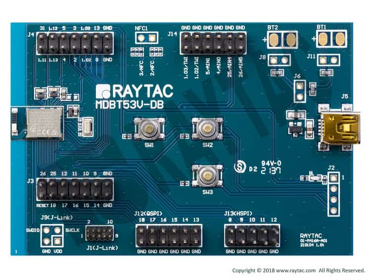

<!-- Copyright 2015-2026 Zephyr Project members and individual contributors. -->
<!-- SPDX-License-Identifier: Apache-2.0 -->
<!-- 中文翻译；编号、导航与译注为本地新增。 -->

<a id="raytac_mdbt53v_db_40"></a>

# 第23章\_MDBT53V-DB-40

原文：[官方页面](https://docs.zephyrproject.org/latest/boards/raytac/mdbt53v_db_40/doc/index.html)。读取日期：2026-10-16；来源摘要见[来源记录](../SOURCES.md)。

开发板概览（Board Overview）

<a id="id1"></a>

[](images/MDBT53V-DB-40.jpg)

MDBT53V-DB-40

名称（Name）：

`raytac_mdbt53v_db_40`

厂商（Vendor）：

[Raytac Corporation](https://docs.zephyrproject.org/latest/boards/index.html#vendor=raytac)

状态（Status）：

当前未积极维护（Not Actively Maintained）

架构（Architecture）：

[arm](https://docs.zephyrproject.org/latest/boards/index.html#arch=arm)

片上系统（SoC）：

[nrf5340](https://docs.zephyrproject.org/latest/boards/index.html#soc=nrf5340)

<a id="board-github-link"></a>

[浏览开发板源码（Browse Board Sources）](https://github.com/zephyrproject-rtos/zephyr/blob/main//boards/raytac/mdbt53v_db_40/doc/index.rst/../..)<a id="overview"></a>

## 概述（Overview）

Raytac MDBT53V-DB-40演示板基于Raytac MDBT53V-1M模块，采用Nordic Semiconductor nRF5340 Arm Cortex-M33 SoC。设计将模块全部引脚接到2.54 mm排针，便于开发者验证模块与外设或传感器的连接，作为软件开发工具。

MDBT53V-1M模块内的nRF5340是基于Arm Cortex-M33架构的双核SoC，具有：


- 功能完整的Arm Cortex-M33F内核，支持数字信号处理指令（DSP）、浮点单元（FPU）和Armv8-M安全扩展（Security Extension），最高128 MHz，称为应用核（Application Core）。
- 功能精简的次级Arm Cortex-M33内核，固定运行于64 MHz，称为网络核（Network Core）。

原文将raytac_mdbt53v_db_40_nrf5340_cpuapp分别写为应用核和网络核的构建目标；此处保留原文，注意下方生成目标表将网络核列为raytac_mdbt53v_db_40/nrf5340/cpunet。

nRF5340 SoC支持以下设备：


- 模数转换器（ADC）
- 时钟（CLOCK）
- 闪存（FLASH）
- 通用输入输出（GPIO）
- 实现定义的归属单元（IDAU）
- 集成电路间总线（I2C）
- 存储器保护单元（MPU）
- 嵌套向量中断控制器（NVIC）
- 脉宽调制（PWM）
- 无线电（RADIO），支持低功耗蓝牙（Bluetooth Low Energy）和IEEE 802.15.4
- 实时时钟（RTC）
- Segger实时传输（RTT，RTT控制台 / RTT Console）
- 串行外设接口（SPI）
- 带EasyDMA的通用异步收发器（UARTE）
- 看门狗定时器（WDT）

<a id="id5"></a>

<a id="id8"></a>

<a id="id11"></a>

板卡信息见[MDBT53V-DB-40网站](https://www.raytac.com/product/ins.php?index_id=140)[注2](#id4)，数据手册见MDBT53V-DB-40规范[注3](#id7)，原理图见MDBT53V-DB-40原理图[注4](#id10)。（[MDBT53V-DB-40规范（Specification）](https://www.raytac.com/download/index.php?index_id=62)；[MDBT53V-DB-40原理图（Schematic）](images/mdbt53v-db-40-schematic-m1.jpg)）

<a id="hardware"></a>

## 硬件（Hardware）


- 基于MDBT53V-1M构建的模块演示板
- Nordic nRF5340 SoC方案
- Nordic Semiconductor推荐的第三方模块
- 双核Arm Cortex-M33
- 1 MB／256 KB闪存；512 KB／64 KB RAM
- 支持Bluetooth 5远距离（Long Range）功能
- Bluetooth规范v5.2
- 支持Bluetooth 5远距离（Long Range）功能
- 支持蓝牙测向（Direction Finding）及Mesh网状网络
- 支持低功耗蓝牙音频（Bluetooth LE Audio）
- 认证：FCC、IC、CE、Telec（MIC）、KC、SRRC、NCC、RCM及WPC
- 符合RoHS及REACH要求
- 25个GPIO
- 芯片天线（Chip Antenna）
- 接口：SPI、UART、I2C、I2S、PWM、ADC及NFC
- 高度灵活的多协议SoC，适用于Bluetooth Low Energy、ANT+、Zigbee及Thread（802.15.4）等超低功耗无线应用。
- 1个用户LED
- 3个用户按键
- 一个Mini-USB连接器，用于供电
- SWD连接器，用于固件（FW）编程
- J-Link接口，用于固件（FW）编程

<a id="supported-features"></a>

### 支持的功能（Supported Features）

`raytac_mdbt53v_db_40`开发板支持下表所列的硬件功能。

片上／板载（On-Chip / On-Board）

功能集成在片上系统（SoC）内／位于开发板上。

2 / 2

分别表示已启用／已禁用的实例数。点击数量标签，可查看开发板或SoC设备树源码（DTS）中该功能的第一个实例。

`vnd,foo`

与此功能匹配的设备树绑定兼容字符串（Compatible String）；点击链接可查看绑定文档。

<a id="raytac_mdbt53v_db_40-hw-features"></a>

<a id="raytac_mdbt53v_db_40-raytac_mdbt53v_db_40/nrf5340/cpuapp-hw-features-section"></a>

#### `raytac_mdbt53v_db_40/nrf5340/cpuapp`目标（Target）

<a id="raytac_mdbt53v_db_40-raytac_mdbt53v_db_40/nrf5340/cpuapp-hw-features-panel"></a>

<a id="raytac_mdbt53v_db_40-raytac_mdbt53v_db_40/nrf5340/cpuapp-hw-features-memory"></a>

该开发板目标的片上存储容量：448 KiB RAM、1 MiB Flash。

<a id="raytac_mdbt53v_db_40-raytac_mdbt53v_db_40/nrf5340/cpuapp-hw-features-table"></a>

<table>
<tr>
<th>类型（Type）</th>
<th>位置（Location）</th>
<th>说明（Description）</th>
<th>兼容字符串（Compatible）</th>
</tr>
<tr>
<td rowspan="1">中央处理器（CPU）</td>
<td>片上（On-Chip）</td>
<td>ARM Cortex-M33F处理器（CPU）（<a href="https://github.com/zephyrproject-rtos/zephyr/blob/main/dts/arm/nordic/nrf5340_cpuapp.dtsi?plain=1#L16">已启用：1</a>）</td>
<td><a href="../cpu_arm_riscv_binding_reference/P023_arm_cortex-m33f.md#std-dtcompatible-arm-cortex-m33f"><code>arm,cortex-m33f</code></a></td>
</tr>
<tr>
<td rowspan="1">模数转换器（ADC）</td>
<td>片上（On-Chip）</td>
<td>Nordic Semiconductor nRF系列逐次逼近模数转换器（SAADC）节点（<a href="https://github.com/zephyrproject-rtos/zephyr/blob/main/dts/arm/nordic/nrf5340_cpuapp_peripherals.dtsi?plain=1#L305">已启用：1</a>）</td>
<td><a href="../hardware/P846_NordicNRF逐次逼近ADC绑定.md#dtbinding-nordic-nrf-saadc"><code>nordic,nrf-saadc</code></a></td>
</tr>
<tr>
<td rowspan="8">ARM 架构（ARM Architecture）</td>
<td>片上（On-Chip）</td>
<td>Nordic用户信息配置寄存器（UICR / User Information Configuration Registers）（<a href="https://github.com/zephyrproject-rtos/zephyr/blob/main/dts/arm/nordic/nrf5340_cpuapp.dtsi?plain=1#L51">已启用：1</a>）</td>
<td><a href="../arm_nordic_nxp_control_binding_reference/P007_nordic_nrf-uicr.md#std-dtcompatible-nordic-nrf-uicr"><code>nordic,nrf-uicr</code></a></td>
</tr>
<tr>
<td>片上（On-Chip）</td>
<td>Nordic nRF系列域配置（DCNF / Domain Configuration）（<a href="https://github.com/zephyrproject-rtos/zephyr/blob/main/dts/arm/nordic/nrf5340_cpuapp_peripherals.dtsi?plain=1#L9">已启用：1</a>）</td>
<td><a href="../arm_timing_ethosu_control_binding_reference/P017_nordic_nrf-dcnf.md#std-dtcompatible-nordic-nrf-dcnf"><code>nordic,nrf-dcnf</code></a></td>
</tr>
<tr>
<td>片上（On-Chip）</td>
<td>Nordic nRF系列复位控制（RESET / Reset Control）（<a href="https://github.com/zephyrproject-rtos/zephyr/blob/main/dts/arm/nordic/nrf5340_cpuapp_peripherals.dtsi?plain=1#L117">已启用：1</a>）</td>
<td><a href="../arm_nordic_nxp_control_binding_reference/P002_nordic_nrf-reset.md#std-dtcompatible-nordic-nrf-reset"><code>nordic,nrf-reset</code></a></td>
</tr>
<tr>
<td>片上（On-Chip）</td>
<td>Nordic nRF系列控制访问端口（CTRL-AP / Control Access Port）（<a href="https://github.com/zephyrproject-rtos/zephyr/blob/main/dts/arm/nordic/nrf5340_cpuapp_peripherals.dtsi?plain=1#L123">已启用：1</a>）</td>
<td><a href="../arm_timing_ethosu_control_binding_reference/P016_nordic_nrf-ctrlapperi.md#std-dtcompatible-nordic-nrf-ctrlapperi"><code>nordic,nrf-ctrlapperi</code></a></td>
</tr>
<tr>
<td>片上（On-Chip）</td>
<td>Nordic事件发生器单元（EGU / Event Generator Unit）（<a href="https://github.com/zephyrproject-rtos/zephyr/blob/main/dts/arm/nordic/nrf5340_cpuapp_peripherals.dtsi?plain=1#L399">已启用：6</a>）</td>
<td><a href="../arm_timing_ethosu_control_binding_reference/P018_nordic_nrf-egu.md#std-dtcompatible-nordic-nrf-egu"><code>nordic,nrf-egu</code></a></td>
</tr>
<tr>
<td>片上（On-Chip）</td>
<td>Nordic nRF系列互斥外设（MUTEX / Mutual Exclusive Peripheral）（<a href="https://github.com/zephyrproject-rtos/zephyr/blob/main/dts/arm/nordic/nrf5340_cpuapp_peripherals.dtsi?plain=1#L516">已启用：1</a>）</td>
<td><a href="../arm_timing_ethosu_control_binding_reference/P021_nordic_nrf-mutex.md#std-dtcompatible-nordic-nrf-mutex"><code>nordic,nrf-mutex</code></a></td>
</tr>
<tr>
<td>片上（On-Chip）</td>
<td>Nordic密钥管理单元（KMU / Key Management Unit）（<a href="https://github.com/zephyrproject-rtos/zephyr/blob/main/dts/arm/nordic/nrf5340_cpuapp_peripherals.dtsi?plain=1#L555">已启用：1</a>）</td>
<td><a href="../arm_timing_ethosu_control_binding_reference/P019_nordic_nrf-kmu.md#std-dtcompatible-nordic-nrf-kmu"><code>nordic,nrf-kmu</code></a></td>
</tr>
<tr>
<td>片上（On-Chip）</td>
<td>Nordic系统保护单元（SPU / System Protection Unit）（<a href="https://github.com/zephyrproject-rtos/zephyr/blob/main/dts/arm/nordic/nrf5340_cpuapp.dtsi?plain=1#L98">已启用：1</a>）</td>
<td><a href="../arm_nordic_nxp_control_binding_reference/P004_nordic_nrf-spu.md#std-dtcompatible-nordic-nrf-spu"><code>nordic,nrf-spu</code></a></td>
</tr>
<tr>
<td rowspan="1">音频（Audio）</td>
<td>片上（On-Chip）</td>
<td>Nordic脉冲密度调制接口（PDM / Pulse Density Modulation Interface）（<a href="https://github.com/zephyrproject-rtos/zephyr/blob/main/dts/arm/nordic/nrf5340_cpuapp_peripherals.dtsi?plain=1#L473">已禁用：1</a>）</td>
<td><a href="../audio_pdm_codec_binding_reference/P012_nordic_nrf-pdm.md#std-dtcompatible-nordic-nrf-pdm"><code>nordic,nrf-pdm</code></a></td>
</tr>
<tr>
<td rowspan="8">时钟控制（Clock Control）</td>
<td>片上（On-Chip）</td>
<td>Nordic nRF53X振荡器控制（OSCILLATORS / Oscillator Control）（<a href="https://github.com/zephyrproject-rtos/zephyr/blob/main/dts/arm/nordic/nrf5340_cpuapp_peripherals.dtsi?plain=1#L15">已启用：1</a>）</td>
<td><a href="../clock_sam_nordic_binding_reference/P025_nordic_nrf53-oscillators.md#std-dtcompatible-nordic-nrf53-oscillators"><code>nordic,nrf53-oscillators</code></a></td>
</tr>
<tr>
<td>片上（On-Chip）</td>
<td>Nordic nRF低频晶体振荡器（Low-Frequency Crystal Oscillator），nRF53系列（<a href="https://github.com/zephyrproject-rtos/zephyr/blob/main/dts/arm/nordic/nrf5340_cpuapp_peripherals.dtsi?plain=1#L19">已启用：1</a>）</td>
<td><a href="../clock_sam_nordic_binding_reference/P024_nordic_nrf53-lfxo.md#std-dtcompatible-nordic-nrf53-lfxo"><code>nordic,nrf53-lfxo</code></a></td>
</tr>
<tr>
<td>片上（On-Chip）</td>
<td>Nordic nRF高频晶体振荡器（High-Frequency Crystal Oscillator），nRF53系列（<a href="https://github.com/zephyrproject-rtos/zephyr/blob/main/dts/arm/nordic/nrf5340_cpuapp_peripherals.dtsi?plain=1#L25">已启用：1</a>）</td>
<td><a href="../clock_sam_nordic_binding_reference/P023_nordic_nrf53-hfxo.md#std-dtcompatible-nordic-nrf53-hfxo"><code>nordic,nrf53-hfxo</code></a></td>
</tr>
<tr>
<td>片上（On-Chip）</td>
<td>Nordic nRF时钟控制（Clock Control）节点（<a href="https://github.com/zephyrproject-rtos/zephyr/blob/main/dts/arm/nordic/nrf5340_cpuapp_peripherals.dtsi?plain=1#L64">已启用：1</a>）</td>
<td><a href="../clock_sam_nordic_binding_reference/P015_nordic_nrf-clock.md#std-dtcompatible-nordic-nrf-clock"><code>nordic,nrf-clock</code></a></td>
</tr>
<tr>
<td>片上（On-Chip）</td>
<td>Nordic nRF高频时钟（HFCLK）控制节点（<a href="https://github.com/zephyrproject-rtos/zephyr/blob/main/dts/arm/nordic/nrf5340_cpuapp_peripherals.dtsi?plain=1#L70">已启用：1</a>）</td>
<td><a href="../clock_sam_nordic_binding_reference/P009_nordic_nrf-clock-hfclk.md#std-dtcompatible-nordic-nrf-clock-hfclk"><code>nordic,nrf-clock-hfclk</code></a></td>
</tr>
<tr>
<td>片上（On-Chip）</td>
<td>Nordic nRF低频时钟（LFCLK）控制节点（<a href="https://github.com/zephyrproject-rtos/zephyr/blob/main/dts/arm/nordic/nrf5340_cpuapp_peripherals.dtsi?plain=1#L75">已启用：1</a>）</td>
<td><a href="../clock_sam_nordic_binding_reference/P012_nordic_nrf-clock-lfclk.md#std-dtcompatible-nordic-nrf-clock-lfclk"><code>nordic,nrf-clock-lfclk</code></a></td>
</tr>
<tr>
<td>片上（On-Chip）</td>
<td>Nordic nRF HFCLK192M时钟控制节点（<a href="https://github.com/zephyrproject-rtos/zephyr/blob/main/dts/arm/nordic/nrf5340_cpuapp_peripherals.dtsi?plain=1#L80">已启用：1</a>）</td>
<td><a href="../clock_sam_nordic_binding_reference/P010_nordic_nrf-clock-hfclk192m.md#std-dtcompatible-nordic-nrf-clock-hfclk192m"><code>nordic,nrf-clock-hfclk192m</code></a></td>
</tr>
<tr>
<td>片上（On-Chip）</td>
<td>Nordic nRF HFCLKAUDIO时钟控制节点（<a href="https://github.com/zephyrproject-rtos/zephyr/blob/main/dts/arm/nordic/nrf5340_cpuapp_peripherals.dtsi?plain=1#L85">已启用：1</a>）</td>
<td><a href="../clock_sam_nordic_binding_reference/P011_nordic_nrf-clock-hfclkaudio.md#std-dtcompatible-nordic-nrf-clock-hfclkaudio"><code>nordic,nrf-clock-hfclkaudio</code></a></td>
</tr>
<tr>
<td rowspan="1">比较器（Comparator）</td>
<td>片上（On-Chip）</td>
<td>Nordic nRF模拟比较器（COMP / Analog Comparator）（<a href="https://github.com/zephyrproject-rtos/zephyr/blob/main/dts/arm/nordic/nrf5340_cpuapp_peripherals.dtsi?plain=1#L388">已禁用：1</a>）</td>
<td><a href="../hardware/P752_NordicnRF比较器绑定.md#dtbinding-nordic-nrf-comp"><code>nordic,nrf-comp</code></a></td>
</tr>
<tr>
<td rowspan="1">计数器（Counter）</td>
<td>片上（On-Chip）</td>
<td>Nordic nRF定时器（Timer）节点（<a href="https://github.com/zephyrproject-rtos/zephyr/blob/main/dts/arm/nordic/nrf5340_cpuapp_peripherals.dtsi?plain=1#L316">已禁用：3</a>）</td>
<td><a href="../microchip_soc_counter_binding_reference/P017_nordic_nrf-timer.md#std-dtcompatible-nordic-nrf-timer"><code>nordic,nrf-timer</code></a></td>
</tr>
<tr>
<td rowspan="1">密码学加速器（Cryptographic Accelerator）</td>
<td>片上（On-Chip）</td>
<td>Arm TrustZone CryptoCell 312密码模块（<a href="https://github.com/zephyrproject-rtos/zephyr/blob/main/dts/arm/nordic/nrf5340_cpuapp.dtsi?plain=1#L127">已禁用：1</a>）</td>
<td><a href="../crypto_aes_sha_ccm_binding_reference/P002_arm_cryptocell-312.md#std-dtcompatible-arm-cryptocell-312"><code>arm,cryptocell-312</code></a></td>
</tr>
<tr>
<td rowspan="1">调试（Debug）</td>
<td>片上（On-Chip）</td>
<td>ARMv8仪器跟踪宏单元（Instrumentation Trace Macrocell）（<a href="https://github.com/zephyrproject-rtos/zephyr/blob/main/dts/arm/nordic/nrf5340_cpuapp.dtsi?plain=1#L23">已启用：1</a>）</td>
<td><a href="../debug_binding_reference/P002_ARMv8M_ITM调试绑定.md#std-dtcompatible-arm-armv8m-itm"><code>arm,armv8m-itm</code></a></td>
</tr>
<tr>
<td rowspan="2">闪存控制器（Flash Controller）</td>
<td>片上（On-Chip）</td>
<td>定义Nordic四线SPI外设（QSPI Peripheral）接口的属性（<a href="https://github.com/zephyrproject-rtos/zephyr/blob/main/dts/arm/nordic/nrf5340_cpuapp_peripherals.dtsi?plain=1#L499">已启用：1</a>）</td>
<td><a href="../flash_adi_microchip_nordic_binding_reference/P028_nordic_nrf-qspi.md#std-dtcompatible-nordic-nrf-qspi"><code>nordic,nrf-qspi</code></a></td>
</tr>
<tr>
<td>片上（On-Chip）</td>
<td>Nordic非易失性存储器控制器（NVMC / Non-Volatile Memory Controller）（<a href="https://github.com/zephyrproject-rtos/zephyr/blob/main/dts/arm/nordic/nrf5340_cpuapp.dtsi?plain=1#L76">已启用：1</a>）</td>
<td><a href="../flash_nuvoton_nxp_renesas_binding_reference/P001_nordic_nrf53-flash-controller.md#std-dtcompatible-nordic-nrf53-flash-controller"><code>nordic,nrf53-flash-controller</code></a></td>
</tr>
<tr>
<td rowspan="3">通用输入输出与接插件（GPIO &amp; Headers）</td>
<td>片上（On-Chip）</td>
<td>NRF5通用输入输出（GPIO）（<a href="https://github.com/zephyrproject-rtos/zephyr/blob/main/dts/arm/nordic/nrf5340_cpuapp_peripherals.dtsi?plain=1#L568">已启用：2</a>）</td>
<td><a href="../gpio_microchip_nordic_nuvoton_binding_reference/P016_nordic_nrf-gpio.md#std-dtcompatible-nordic-nrf-gpio"><code>nordic,nrf-gpio</code></a></td>
</tr>
<tr>
<td>片上（On-Chip）</td>
<td>NRF5 GPIO任务与事件（GPIOTE）（<a href="https://github.com/zephyrproject-rtos/zephyr/blob/main/dts/arm/nordic/nrf5340_cpuapp.dtsi?plain=1#L110">已启用：1</a>；<a href="https://github.com/zephyrproject-rtos/zephyr/blob/main/dts/arm/nordic/nrf5340_cpuapp.dtsi?plain=1#L119">已禁用：1</a>）</td>
<td><a href="../gpio_microchip_nordic_nuvoton_binding_reference/P017_nordic_nrf-gpiote.md#std-dtcompatible-nordic-nrf-gpiote"><code>nordic,nrf-gpiote</code></a></td>
</tr>
<tr>
<td>板载（On-Board）</td>
<td>负责在内核之间转发引脚的抽象设备（Abstract Device）（<a href="https://github.com/zephyrproject-rtos/zephyr/blob/main/boards/raytac/mdbt53v_db_40/raytac_mdbt53v_db_40_nrf5340_cpuapp_common.dtsi?plain=1#L60">已启用：1</a>）</td>
<td><a href="../gpio_microchip_nordic_nuvoton_binding_reference/P015_nordic_nrf-gpio-forwarder.md#std-dtcompatible-nordic-nrf-gpio-forwarder"><code>nordic,nrf-gpio-forwarder</code></a></td>
</tr>
<tr>
<td rowspan="1">集成电路间总线（I2C）</td>
<td>片上（On-Chip）</td>
<td>Nordic nRF系列TWIM（带EasyDMA的TWI主机）（<a href="https://github.com/zephyrproject-rtos/zephyr/blob/main/dts/arm/nordic/nrf5340_cpuapp_peripherals.dtsi?plain=1#L169">已启用：1</a>；<a href="https://github.com/zephyrproject-rtos/zephyr/blob/main/dts/arm/nordic/nrf5340_cpuapp_peripherals.dtsi?plain=1#L129">已禁用：3</a>）</td>
<td><a href="../i2c_infineon_ite_nordic_binding_reference/P016_nordic_nrf-twim.md#std-dtcompatible-nordic-nrf-twim"><code>nordic,nrf-twim</code></a></td>
</tr>
<tr>
<td rowspan="1">集成电路间音频总线（I2S）</td>
<td>片上（On-Chip）</td>
<td>Nordic芯片间音频接口（I2S / Inter-IC Sound Interface）（<a href="https://github.com/zephyrproject-rtos/zephyr/blob/main/dts/arm/nordic/nrf5340_cpuapp_peripherals.dtsi?plain=1#L480">已禁用：1</a>）</td>
<td><a href="../i2s_binding_reference/P010_nordic_nrf-i2s.md#std-dtcompatible-nordic-nrf-i2s"><code>nordic,nrf-i2s</code></a></td>
</tr>
<tr>
<td rowspan="1">低速率无线个域网（IEEE 802.15.4）</td>
<td>片上（On-Chip）</td>
<td>Nordic nRF IEEE 802.15.4节点（<a href="https://github.com/zephyrproject-rtos/zephyr/blob/main/dts/arm/nordic/nrf5340_cpuapp_peripherals.dtsi?plain=1#L589">已启用：1</a>）</td>
<td><a href="../lora_ieee802154_binding_reference/P005_nordic_nrf-ieee802154.md#std-dtcompatible-nordic-nrf-ieee802154"><code>nordic,nrf-ieee802154</code></a></td>
</tr>
<tr>
<td rowspan="1">输入（Input）</td>
<td>板载（On-Board）</td>
<td>一组绑定到 GPIO 的输入按键（GPIO-Bound Input Keys）（<a href="https://github.com/zephyrproject-rtos/zephyr/blob/main/boards/raytac/mdbt53v_db_40/raytac_mdbt53v_db_40_nrf5340_cpuapp_common.dtsi?plain=1#L38">已启用：1</a>）</td>
<td><a href="../hardware/P563_GPIO按键绑定.md#std-dtcompatible-gpio-keys"><code>gpio-keys</code></a></td>
</tr>
<tr>
<td rowspan="1">中断控制器（Interrupt Controller）</td>
<td>片上（On-Chip）</td>
<td>ARMv8-M嵌套向量中断控制器（NVIC / Nested Vectored Interrupt Controller）（<a href="https://github.com/zephyrproject-rtos/zephyr/blob/main/dts/arm/armv8-m.dtsi?plain=1#L13">已启用：1</a>）</td>
<td><a href="../arm_interrupt_timer_binding_reference/P003_ARMv8_M_NVIC.md#std-dtcompatible-arm-v8m-nvic"><code>arm,v8m-nvic</code></a></td>
</tr>
<tr>
<td rowspan="2">发光二极管（LED）</td>
<td>板载（On-Board）</td>
<td>一组由 GPIO 控制的 LED（GPIO-Controlled LEDs）（<a href="https://github.com/zephyrproject-rtos/zephyr/blob/main/boards/raytac/mdbt53v_db_40/raytac_mdbt53v_db_40_nrf5340_cpuapp_common.dtsi?plain=1#L21">已启用：1</a>）</td>
<td><a href="../hardware/P564_GPIO指示灯绑定.md#dtbinding-gpio-leds"><code>gpio-leds</code></a></td>
</tr>
<tr>
<td>板载（On-Board）</td>
<td>一组由脉宽调制（PWM）控制的LED（<a href="https://github.com/zephyrproject-rtos/zephyr/blob/main/boards/raytac/mdbt53v_db_40/raytac_mdbt53v_db_40_nrf5340_cpuapp_common.dtsi?plain=1#L30">已启用：1</a>）</td>
<td><a href="../hardware/P565_PWM指示灯绑定.md#dtbinding-pwm-leds"><code>pwm-leds</code></a></td>
</tr>
<tr>
<td rowspan="1">邮箱（Mailbox）</td>
<td>片上（On-Chip）</td>
<td>Nordic nRF系列核间通信（IPC），邮箱接口（MBOX）（<a href="https://github.com/zephyrproject-rtos/zephyr/blob/main/dts/arm/nordic/nrf5340_cpuapp_peripherals.dtsi?plain=1#L489">已启用：1</a>）</td>
<td><a href="../intercore_reference/P040_NordicIPC邮箱绑定.md#dtbinding-nordic-mbox-nrf-ipc"><code>nordic,mbox-nrf-ipc</code></a></td>
</tr>
<tr>
<td rowspan="2">其他绑定（Miscellaneous）</td>
<td>片上（On-Chip）</td>
<td>Nordic工厂信息配置寄存器（FICR / Factory Information Configuration Registers）（<a href="https://github.com/zephyrproject-rtos/zephyr/blob/main/dts/arm/nordic/nrf5340_cpuapp.dtsi?plain=1#L44">已启用：1</a>）</td>
<td><a href="../misc_adi_nordic_binding_reference/P018_nordic_nrf-ficr.md#std-dtcompatible-nordic-nrf-ficr"><code>nordic,nrf-ficr</code></a></td>
</tr>
<tr>
<td>片上（On-Chip）</td>
<td>Nordic分布式可编程外设互连控制器（DPPIC / Distributed Programmable Peripheral Interconnect Controller）（<a href="https://github.com/zephyrproject-rtos/zephyr/blob/main/dts/arm/nordic/nrf5340_cpuapp_peripherals.dtsi?plain=1#L366">已启用：1</a>）</td>
<td><a href="../misc_adi_nordic_binding_reference/P017_nordic_nrf-dppic.md#std-dtcompatible-nordic-nrf-dppic"><code>nordic,nrf-dppic</code></a></td>
</tr>
<tr>
<td rowspan="1">内存管理单元／内存保护单元（MMU / MPU）</td>
<td>片上（On-Chip）</td>
<td>ARMv8-M存储器保护单元（MPU / Memory Protection Unit）（<a href="https://github.com/zephyrproject-rtos/zephyr/blob/main/dts/arm/nordic/nrf5340_cpuapp.dtsi?plain=1#L29">已启用：1</a>）</td>
<td><a href="../memory_protection_binding_reference/P007_arm_armv8m-mpu.md#std-dtcompatible-arm-armv8m-mpu"><code>arm,armv8m-mpu</code></a></td>
</tr>
<tr>
<td rowspan="1">存储技术设备（MTD）</td>
<td>片上（On-Chip）</td>
<td>闪存（Flash）节点（<a href="https://github.com/zephyrproject-rtos/zephyr/blob/main/dts/arm/nordic/nrf5340_cpuapp.dtsi?plain=1#L84">已启用：1</a>）</td>
<td><a href="../mtd_nxp_st_ti_partition_binding_reference/P013_soc-nv-flash.md#std-dtcompatible-soc-nv-flash"><code>soc-nv-flash</code></a></td>
</tr>
<tr>
<td rowspan="1">网络（Networking）</td>
<td>片上（On-Chip）</td>
<td>Nordic nRF系列近场通信标签（NFCT / Near Field Communication Tag）（<a href="https://github.com/zephyrproject-rtos/zephyr/blob/main/dts/arm/nordic/nrf5340_cpuapp_peripherals.dtsi?plain=1#L509">已禁用：1</a>）</td>
<td><a href="../network_radio_frontend_binding_reference/P008_nordic_nrf-nfct.md#std-dtcompatible-nordic-nrf-nfct"><code>nordic,nrf-nfct</code></a></td>
</tr>
<tr>
<td rowspan="1">引脚控制（Pin Control）</td>
<td>片上（On-Chip）</td>
<td>Nordic nRF系列引脚控制器（Pin Controller）（<a href="https://github.com/zephyrproject-rtos/zephyr/blob/main/dts/vendor/nordic/nrf_common.dtsi?plain=1#L26">已启用：1</a>）</td>
<td><a href="../pinctrl_infineon_nordic_nxp_binding_reference/P009_nordic_nrf-pinctrl.md#std-dtcompatible-nordic-nrf-pinctrl"><code>nordic,nrf-pinctrl</code></a></td>
</tr>
<tr>
<td rowspan="3">电源管理（Power Management）</td>
<td>片上（On-Chip）</td>
<td>Nordic nRF电源控制（Power Control）节点（<a href="https://github.com/zephyrproject-rtos/zephyr/blob/main/dts/arm/nordic/nrf5340_cpuapp_peripherals.dtsi?plain=1#L91">已启用：1</a>）</td>
<td><a href="../power_control_binding_reference/P008_nordic_nrf-power.md#std-dtcompatible-nordic-nrf-power"><code>nordic,nrf-power</code></a></td>
</tr>
<tr>
<td>片上（On-Chip）</td>
<td>Nordic nRF系列USB稳压器控制（USBREG / USB Regulator Control）（<a href="https://github.com/zephyrproject-rtos/zephyr/blob/main/dts/arm/nordic/nrf5340_cpuapp_peripherals.dtsi?plain=1#L548">已启用：1</a>）</td>
<td><a href="../power_control_binding_reference/P009_nordic_nrf-usbreg.md#std-dtcompatible-nordic-nrf-usbreg"><code>nordic,nrf-usbreg</code></a></td>
</tr>
<tr>
<td>片上（On-Chip）</td>
<td>Nordic易失性存储器控制器（VMC / Volatile Memory Controller）（<a href="https://github.com/zephyrproject-rtos/zephyr/blob/main/dts/arm/nordic/nrf5340_cpuapp_peripherals.dtsi?plain=1#L562">已启用：1</a>）</td>
<td><a href="../power_control_binding_reference/P010_nordic_nrf-vmc.md#std-dtcompatible-nordic-nrf-vmc"><code>nordic,nrf-vmc</code></a></td>
</tr>
<tr>
<td rowspan="2">脉宽调制（PWM）</td>
<td>片上（On-Chip）</td>
<td>nRF脉宽调制（PWM）（<a href="https://github.com/zephyrproject-rtos/zephyr/blob/main/dts/arm/nordic/nrf5340_cpuapp_peripherals.dtsi?plain=1#L441">已启用：1</a>；<a href="https://github.com/zephyrproject-rtos/zephyr/blob/main/dts/arm/nordic/nrf5340_cpuapp_peripherals.dtsi?plain=1#L449">已禁用：3</a>）</td>
<td><a href="../pwm_intel_microchip_nxp_binding_reference/P015_nordic_nrf-pwm.md#std-dtcompatible-nordic-nrf-pwm"><code>nordic,nrf-pwm</code></a></td>
</tr>
<tr>
<td>片上（On-Chip）</td>
<td>nRFx软件脉宽调制（S/W PWM）（<a href="https://github.com/zephyrproject-rtos/zephyr/blob/main/dts/vendor/nordic/nrf_common.dtsi?plain=1#L39">已禁用：1</a>）</td>
<td><a href="../pwm_intel_microchip_nxp_binding_reference/P016_nordic_nrf-sw-pwm.md#std-dtcompatible-nordic-nrf-sw-pwm"><code>nordic,nrf-sw-pwm</code></a></td>
</tr>
<tr>
<td rowspan="3">稳压器（Regulator）</td>
<td>片上（On-Chip）</td>
<td>nRF53X上的Nordic电压稳压器控制模块（REGULATORS）（<a href="https://github.com/zephyrproject-rtos/zephyr/blob/main/dts/arm/nordic/nrf5340_cpuapp_peripherals.dtsi?plain=1#L33">已启用：1</a>）</td>
<td><a href="../hardware/P641_nRF53稳压器集合绑定.md#dtbinding-nordic-nrf53x-regulators"><code>nordic,nrf53x-regulators</code></a></td>
</tr>
<tr>
<td>片上（On-Chip）</td>
<td>Nordic nRF5X稳压器（Regulator，内核供电的固定级）（<a href="https://github.com/zephyrproject-rtos/zephyr/blob/main/dts/arm/nordic/nrf5340_cpuapp_peripherals.dtsi?plain=1#L40">已启用：2</a>）</td>
<td><a href="../hardware/P643_nRF5X稳压器绑定.md#dtbinding-nordic-nrf5x-regulator"><code>nordic,nrf5x-regulator</code></a></td>
</tr>
<tr>
<td>片上（On-Chip）</td>
<td>Nordic nRF53X稳压器，主电源的高压级（High Voltage Stage）（<a href="https://github.com/zephyrproject-rtos/zephyr/blob/main/dts/arm/nordic/nrf5340_cpuapp_peripherals.dtsi?plain=1#L56">已启用：1</a>）</td>
<td><a href="../hardware/P640_nRF53高压稳压器绑定.md#dtbinding-nordic-nrf53x-regulator-hv"><code>nordic,nrf53x-regulator-hv</code></a></td>
</tr>
<tr>
<td rowspan="1">保持存储器（Retained Memory）</td>
<td>片上（On-Chip）</td>
<td>Nordic通用保持寄存器（GPREGRET / General Purpose Register Retention）设备（<a href="https://github.com/zephyrproject-rtos/zephyr/blob/main/dts/arm/nordic/nrf5340_cpuapp_peripherals.dtsi?plain=1#L100">已启用：2</a>）</td>
<td><a href="../hardware/P627_Nordic通用保留寄存器绑定.md#dtbinding-nordic-nrf-gpregret"><code>nordic,nrf-gpregret</code></a></td>
</tr>
<tr>
<td rowspan="1">实时时钟（RTC）</td>
<td>片上（On-Chip）</td>
<td>Nordic nRF实时时间计数器（RTC / Real-Time Counter）（<a href="https://github.com/zephyrproject-rtos/zephyr/blob/main/dts/arm/nordic/nrf5340_cpuapp_peripherals.dtsi?plain=1#L346">已禁用：2</a>）</td>
<td><a href="../microchip_microcrystal_nxp_rtc_binding_reference/P010_nordic_nrf-rtc.md#std-dtcompatible-nordic-nrf-rtc"><code>nordic,nrf-rtc</code></a></td>
</tr>
<tr>
<td rowspan="1">传感器（Sensors）</td>
<td>片上（On-Chip）</td>
<td>Nordic nRF正交解码器（QDEC / Quadrature Decoder）节点（<a href="https://github.com/zephyrproject-rtos/zephyr/blob/main/dts/arm/nordic/nrf5340_cpuapp_peripherals.dtsi?plain=1#L522">已禁用：2</a>）</td>
<td><a href="../sensor_microchip_nordic_nxp_binding_reference/P021_nordic_nrf-qdec.md#std-dtcompatible-nordic-nrf-qdec"><code>nordic,nrf-qdec</code></a></td>
</tr>
<tr>
<td rowspan="1">串行控制器（Serial Controller）</td>
<td>片上（On-Chip）</td>
<td>Nordic nRF系列UARTE（带EasyDMA的UART）（<a href="https://github.com/zephyrproject-rtos/zephyr/blob/main/dts/arm/nordic/nrf5340_cpuapp_peripherals.dtsi?plain=1#L162">已启用：1</a>；<a href="https://github.com/zephyrproject-rtos/zephyr/blob/main/dts/arm/nordic/nrf5340_cpuapp_peripherals.dtsi?plain=1#L203">已禁用：3</a>）</td>
<td><a href="../uart_microchip_nordic_nxp_binding_reference/P004_nordic_nrf-uarte.md#std-dtcompatible-nordic-nrf-uarte"><code>nordic,nrf-uarte</code></a></td>
</tr>
<tr>
<td rowspan="1">串行外设接口（SPI）</td>
<td>片上（On-Chip）</td>
<td>Nordic nRF系列SPIM（带EasyDMA的SPI控制器）（<a href="https://github.com/zephyrproject-rtos/zephyr/blob/main/dts/arm/nordic/nrf5340_cpuapp_peripherals.dtsi?plain=1#L210">已启用：1</a>；<a href="https://github.com/zephyrproject-rtos/zephyr/blob/main/dts/arm/nordic/nrf5340_cpuapp_peripherals.dtsi?plain=1#L145">已禁用：4</a>）</td>
<td><a href="../spi_microchip_nordic_nxp_binding_reference/P013_nordic_nrf-spim.md#std-dtcompatible-nordic-nrf-spim"><code>nordic,nrf-spim</code></a></td>
</tr>
<tr>
<td rowspan="1">静态随机存储器（SRAM）</td>
<td>片上（On-Chip）</td>
<td>通用片上静态随机存储器（SRAM）（<a href="https://github.com/zephyrproject-rtos/zephyr/blob/main/dts/arm/nordic/nrf5340_cpuapp.dtsi?plain=1#L60">已启用：1</a>）</td>
<td><a href="../hardware/P567_内存映射SRAM绑定.md#dtbinding-mmio-sram"><code>mmio-sram</code></a></td>
</tr>
<tr>
<td rowspan="1">定时器（Timer）</td>
<td>片上（On-Chip）</td>
<td>ARMv8-M系统节拍（System Tick）（<a href="https://github.com/zephyrproject-rtos/zephyr/blob/main/dts/arm/armv8-m.dtsi?plain=1#L21">已禁用：1</a>）</td>
<td><a href="../arm_interrupt_timer_binding_reference/P007_ARMv8_M_SysTick.md#std-dtcompatible-arm-armv8m-systick"><code>arm,armv8m-systick</code></a></td>
</tr>
<tr>
<td rowspan="1">通用串行总线（USB）</td>
<td>片上（On-Chip）</td>
<td>Nordic nRF52 USB设备控制器（USB Device Controller）（<a href="https://github.com/zephyrproject-rtos/zephyr/blob/main/dts/arm/nordic/nrf5340_cpuapp_peripherals.dtsi?plain=1#L536">已禁用：1</a>）</td>
<td><a href="../usb_controller_binding_reference/P018_nordic_nrf-usbd.md#std-dtcompatible-nordic-nrf-usbd"><code>nordic,nrf-usbd</code></a></td>
</tr>
<tr>
<td rowspan="1">看门狗（Watchdog）</td>
<td>片上（On-Chip）</td>
<td>Nordic nRF系列看门狗定时器（WDT / Watchdog Timer）（<a href="https://github.com/zephyrproject-rtos/zephyr/blob/main/dts/arm/nordic/nrf5340_cpuapp_peripherals.dtsi?plain=1#L374">已启用：1</a>；<a href="https://github.com/zephyrproject-rtos/zephyr/blob/main/dts/arm/nordic/nrf5340_cpuapp_peripherals.dtsi?plain=1#L381">已禁用：1</a>）</td>
<td><a href="../nxp_nordic_nuvoton_watchdog_binding_reference/P002_nordic_nrf-wdt.md#std-dtcompatible-nordic-nrf-wdt"><code>nordic,nrf-wdt</code></a></td>
</tr>
</table>

<a id="raytac_mdbt53v_db_40-raytac_mdbt53v_db_40/nrf5340/cpuapp/ns-hw-features-section"></a>

#### `raytac_mdbt53v_db_40/nrf5340/cpuapp/ns`目标（Target）

<a id="raytac_mdbt53v_db_40-raytac_mdbt53v_db_40/nrf5340/cpuapp/ns-hw-features-panel"></a>

<a id="raytac_mdbt53v_db_40-raytac_mdbt53v_db_40/nrf5340/cpuapp/ns-hw-features-memory"></a>

该开发板目标的片上存储容量：192 KiB RAM、1 MiB Flash。

<a id="raytac_mdbt53v_db_40-raytac_mdbt53v_db_40/nrf5340/cpuapp/ns-hw-features-table"></a>

<table>
<tr>
<th>类型（Type）</th>
<th>位置（Location）</th>
<th>说明（Description）</th>
<th>兼容字符串（Compatible）</th>
</tr>
<tr>
<td rowspan="1">中央处理器（CPU）</td>
<td>片上（On-Chip）</td>
<td>ARM Cortex-M33F处理器（CPU）（<a href="https://github.com/zephyrproject-rtos/zephyr/blob/main/dts/arm/nordic/nrf5340_cpuapp_ns.dtsi?plain=1#L18">已启用：1</a>）</td>
<td><a href="../cpu_arm_riscv_binding_reference/P023_arm_cortex-m33f.md#std-dtcompatible-arm-cortex-m33f"><code>arm,cortex-m33f</code></a></td>
</tr>
<tr>
<td rowspan="1">模数转换器（ADC）</td>
<td>片上（On-Chip）</td>
<td>Nordic Semiconductor nRF系列逐次逼近模数转换器（SAADC）节点（<a href="https://github.com/zephyrproject-rtos/zephyr/blob/main/dts/arm/nordic/nrf5340_cpuapp_peripherals.dtsi?plain=1#L305">已启用：1</a>）</td>
<td><a href="../hardware/P846_NordicNRF逐次逼近ADC绑定.md#dtbinding-nordic-nrf-saadc"><code>nordic,nrf-saadc</code></a></td>
</tr>
<tr>
<td rowspan="6">ARM 架构（ARM Architecture）</td>
<td>片上（On-Chip）</td>
<td>Nordic nRF系列域配置（DCNF / Domain Configuration）（<a href="https://github.com/zephyrproject-rtos/zephyr/blob/main/dts/arm/nordic/nrf5340_cpuapp_peripherals.dtsi?plain=1#L9">已启用：1</a>）</td>
<td><a href="../arm_timing_ethosu_control_binding_reference/P017_nordic_nrf-dcnf.md#std-dtcompatible-nordic-nrf-dcnf"><code>nordic,nrf-dcnf</code></a></td>
</tr>
<tr>
<td>片上（On-Chip）</td>
<td>Nordic nRF系列复位控制（RESET / Reset Control）（<a href="https://github.com/zephyrproject-rtos/zephyr/blob/main/dts/arm/nordic/nrf5340_cpuapp_peripherals.dtsi?plain=1#L117">已启用：1</a>）</td>
<td><a href="../arm_nordic_nxp_control_binding_reference/P002_nordic_nrf-reset.md#std-dtcompatible-nordic-nrf-reset"><code>nordic,nrf-reset</code></a></td>
</tr>
<tr>
<td>片上（On-Chip）</td>
<td>Nordic nRF系列控制访问端口（CTRL-AP / Control Access Port）（<a href="https://github.com/zephyrproject-rtos/zephyr/blob/main/dts/arm/nordic/nrf5340_cpuapp_peripherals.dtsi?plain=1#L123">已启用：1</a>）</td>
<td><a href="../arm_timing_ethosu_control_binding_reference/P016_nordic_nrf-ctrlapperi.md#std-dtcompatible-nordic-nrf-ctrlapperi"><code>nordic,nrf-ctrlapperi</code></a></td>
</tr>
<tr>
<td>片上（On-Chip）</td>
<td>Nordic事件发生器单元（EGU / Event Generator Unit）（<a href="https://github.com/zephyrproject-rtos/zephyr/blob/main/dts/arm/nordic/nrf5340_cpuapp_peripherals.dtsi?plain=1#L399">已启用：6</a>）</td>
<td><a href="../arm_timing_ethosu_control_binding_reference/P018_nordic_nrf-egu.md#std-dtcompatible-nordic-nrf-egu"><code>nordic,nrf-egu</code></a></td>
</tr>
<tr>
<td>片上（On-Chip）</td>
<td>Nordic nRF系列互斥外设（MUTEX / Mutual Exclusive Peripheral）（<a href="https://github.com/zephyrproject-rtos/zephyr/blob/main/dts/arm/nordic/nrf5340_cpuapp_peripherals.dtsi?plain=1#L516">已启用：1</a>）</td>
<td><a href="../arm_timing_ethosu_control_binding_reference/P021_nordic_nrf-mutex.md#std-dtcompatible-nordic-nrf-mutex"><code>nordic,nrf-mutex</code></a></td>
</tr>
<tr>
<td>片上（On-Chip）</td>
<td>Nordic密钥管理单元（KMU / Key Management Unit）（<a href="https://github.com/zephyrproject-rtos/zephyr/blob/main/dts/arm/nordic/nrf5340_cpuapp_peripherals.dtsi?plain=1#L555">已启用：1</a>）</td>
<td><a href="../arm_timing_ethosu_control_binding_reference/P019_nordic_nrf-kmu.md#std-dtcompatible-nordic-nrf-kmu"><code>nordic,nrf-kmu</code></a></td>
</tr>
<tr>
<td rowspan="1">音频（Audio）</td>
<td>片上（On-Chip）</td>
<td>Nordic脉冲密度调制接口（PDM / Pulse Density Modulation Interface）（<a href="https://github.com/zephyrproject-rtos/zephyr/blob/main/dts/arm/nordic/nrf5340_cpuapp_peripherals.dtsi?plain=1#L473">已禁用：1</a>）</td>
<td><a href="../audio_pdm_codec_binding_reference/P012_nordic_nrf-pdm.md#std-dtcompatible-nordic-nrf-pdm"><code>nordic,nrf-pdm</code></a></td>
</tr>
<tr>
<td rowspan="8">时钟控制（Clock Control）</td>
<td>片上（On-Chip）</td>
<td>Nordic nRF53X振荡器控制（OSCILLATORS / Oscillator Control）（<a href="https://github.com/zephyrproject-rtos/zephyr/blob/main/dts/arm/nordic/nrf5340_cpuapp_peripherals.dtsi?plain=1#L15">已启用：1</a>）</td>
<td><a href="../clock_sam_nordic_binding_reference/P025_nordic_nrf53-oscillators.md#std-dtcompatible-nordic-nrf53-oscillators"><code>nordic,nrf53-oscillators</code></a></td>
</tr>
<tr>
<td>片上（On-Chip）</td>
<td>Nordic nRF低频晶体振荡器（Low-Frequency Crystal Oscillator），nRF53系列（<a href="https://github.com/zephyrproject-rtos/zephyr/blob/main/dts/arm/nordic/nrf5340_cpuapp_peripherals.dtsi?plain=1#L19">已启用：1</a>）</td>
<td><a href="../clock_sam_nordic_binding_reference/P024_nordic_nrf53-lfxo.md#std-dtcompatible-nordic-nrf53-lfxo"><code>nordic,nrf53-lfxo</code></a></td>
</tr>
<tr>
<td>片上（On-Chip）</td>
<td>Nordic nRF高频晶体振荡器（High-Frequency Crystal Oscillator），nRF53系列（<a href="https://github.com/zephyrproject-rtos/zephyr/blob/main/dts/arm/nordic/nrf5340_cpuapp_peripherals.dtsi?plain=1#L25">已启用：1</a>）</td>
<td><a href="../clock_sam_nordic_binding_reference/P023_nordic_nrf53-hfxo.md#std-dtcompatible-nordic-nrf53-hfxo"><code>nordic,nrf53-hfxo</code></a></td>
</tr>
<tr>
<td>片上（On-Chip）</td>
<td>Nordic nRF时钟控制（Clock Control）节点（<a href="https://github.com/zephyrproject-rtos/zephyr/blob/main/dts/arm/nordic/nrf5340_cpuapp_peripherals.dtsi?plain=1#L64">已启用：1</a>）</td>
<td><a href="../clock_sam_nordic_binding_reference/P015_nordic_nrf-clock.md#std-dtcompatible-nordic-nrf-clock"><code>nordic,nrf-clock</code></a></td>
</tr>
<tr>
<td>片上（On-Chip）</td>
<td>Nordic nRF高频时钟（HFCLK）控制节点（<a href="https://github.com/zephyrproject-rtos/zephyr/blob/main/dts/arm/nordic/nrf5340_cpuapp_peripherals.dtsi?plain=1#L70">已启用：1</a>）</td>
<td><a href="../clock_sam_nordic_binding_reference/P009_nordic_nrf-clock-hfclk.md#std-dtcompatible-nordic-nrf-clock-hfclk"><code>nordic,nrf-clock-hfclk</code></a></td>
</tr>
<tr>
<td>片上（On-Chip）</td>
<td>Nordic nRF低频时钟（LFCLK）控制节点（<a href="https://github.com/zephyrproject-rtos/zephyr/blob/main/dts/arm/nordic/nrf5340_cpuapp_peripherals.dtsi?plain=1#L75">已启用：1</a>）</td>
<td><a href="../clock_sam_nordic_binding_reference/P012_nordic_nrf-clock-lfclk.md#std-dtcompatible-nordic-nrf-clock-lfclk"><code>nordic,nrf-clock-lfclk</code></a></td>
</tr>
<tr>
<td>片上（On-Chip）</td>
<td>Nordic nRF HFCLK192M时钟控制节点（<a href="https://github.com/zephyrproject-rtos/zephyr/blob/main/dts/arm/nordic/nrf5340_cpuapp_peripherals.dtsi?plain=1#L80">已启用：1</a>）</td>
<td><a href="../clock_sam_nordic_binding_reference/P010_nordic_nrf-clock-hfclk192m.md#std-dtcompatible-nordic-nrf-clock-hfclk192m"><code>nordic,nrf-clock-hfclk192m</code></a></td>
</tr>
<tr>
<td>片上（On-Chip）</td>
<td>Nordic nRF HFCLKAUDIO时钟控制节点（<a href="https://github.com/zephyrproject-rtos/zephyr/blob/main/dts/arm/nordic/nrf5340_cpuapp_peripherals.dtsi?plain=1#L85">已启用：1</a>）</td>
<td><a href="../clock_sam_nordic_binding_reference/P011_nordic_nrf-clock-hfclkaudio.md#std-dtcompatible-nordic-nrf-clock-hfclkaudio"><code>nordic,nrf-clock-hfclkaudio</code></a></td>
</tr>
<tr>
<td rowspan="1">比较器（Comparator）</td>
<td>片上（On-Chip）</td>
<td>Nordic nRF模拟比较器（COMP / Analog Comparator）（<a href="https://github.com/zephyrproject-rtos/zephyr/blob/main/dts/arm/nordic/nrf5340_cpuapp_peripherals.dtsi?plain=1#L388">已禁用：1</a>）</td>
<td><a href="../hardware/P752_NordicnRF比较器绑定.md#dtbinding-nordic-nrf-comp"><code>nordic,nrf-comp</code></a></td>
</tr>
<tr>
<td rowspan="1">计数器（Counter）</td>
<td>片上（On-Chip）</td>
<td>Nordic nRF定时器（Timer）节点（<a href="https://github.com/zephyrproject-rtos/zephyr/blob/main/dts/arm/nordic/nrf5340_cpuapp_peripherals.dtsi?plain=1#L316">已禁用：3</a>）</td>
<td><a href="../microchip_soc_counter_binding_reference/P017_nordic_nrf-timer.md#std-dtcompatible-nordic-nrf-timer"><code>nordic,nrf-timer</code></a></td>
</tr>
<tr>
<td rowspan="2">闪存控制器（Flash Controller）</td>
<td>片上（On-Chip）</td>
<td>定义Nordic四线SPI外设（QSPI Peripheral）接口的属性（<a href="https://github.com/zephyrproject-rtos/zephyr/blob/main/dts/arm/nordic/nrf5340_cpuapp_peripherals.dtsi?plain=1#L499">已启用：1</a>）</td>
<td><a href="../flash_adi_microchip_nordic_binding_reference/P028_nordic_nrf-qspi.md#std-dtcompatible-nordic-nrf-qspi"><code>nordic,nrf-qspi</code></a></td>
</tr>
<tr>
<td>片上（On-Chip）</td>
<td>Nordic非易失性存储器控制器（NVMC / Non-Volatile Memory Controller）（<a href="https://github.com/zephyrproject-rtos/zephyr/blob/main/dts/arm/nordic/nrf5340_cpuapp_ns.dtsi?plain=1#L55">已启用：1</a>）</td>
<td><a href="../flash_nuvoton_nxp_renesas_binding_reference/P001_nordic_nrf53-flash-controller.md#std-dtcompatible-nordic-nrf53-flash-controller"><code>nordic,nrf53-flash-controller</code></a></td>
</tr>
<tr>
<td rowspan="3">通用输入输出与接插件（GPIO &amp; Headers）</td>
<td>片上（On-Chip）</td>
<td>NRF5通用输入输出（GPIO）（<a href="https://github.com/zephyrproject-rtos/zephyr/blob/main/dts/arm/nordic/nrf5340_cpuapp_peripherals.dtsi?plain=1#L568">已启用：2</a>）</td>
<td><a href="../gpio_microchip_nordic_nuvoton_binding_reference/P016_nordic_nrf-gpio.md#std-dtcompatible-nordic-nrf-gpio"><code>nordic,nrf-gpio</code></a></td>
</tr>
<tr>
<td>片上（On-Chip）</td>
<td>NRF5 GPIO任务与事件（GPIOTE）（<a href="https://github.com/zephyrproject-rtos/zephyr/blob/main/dts/arm/nordic/nrf5340_cpuapp_ns.dtsi?plain=1#L80">已启用：1</a>）</td>
<td><a href="../gpio_microchip_nordic_nuvoton_binding_reference/P017_nordic_nrf-gpiote.md#std-dtcompatible-nordic-nrf-gpiote"><code>nordic,nrf-gpiote</code></a></td>
</tr>
<tr>
<td>板载（On-Board）</td>
<td>负责在内核之间转发引脚的抽象设备（Abstract Device）（<a href="https://github.com/zephyrproject-rtos/zephyr/blob/main/boards/raytac/mdbt53v_db_40/raytac_mdbt53v_db_40_nrf5340_cpuapp_common.dtsi?plain=1#L60">已启用：1</a>）</td>
<td><a href="../gpio_microchip_nordic_nuvoton_binding_reference/P015_nordic_nrf-gpio-forwarder.md#std-dtcompatible-nordic-nrf-gpio-forwarder"><code>nordic,nrf-gpio-forwarder</code></a></td>
</tr>
<tr>
<td rowspan="1">集成电路间总线（I2C）</td>
<td>片上（On-Chip）</td>
<td>Nordic nRF系列TWIM（带EasyDMA的TWI主机）（<a href="https://github.com/zephyrproject-rtos/zephyr/blob/main/dts/arm/nordic/nrf5340_cpuapp_peripherals.dtsi?plain=1#L169">已启用：1</a>；<a href="https://github.com/zephyrproject-rtos/zephyr/blob/main/dts/arm/nordic/nrf5340_cpuapp_peripherals.dtsi?plain=1#L129">已禁用：3</a>）</td>
<td><a href="../i2c_infineon_ite_nordic_binding_reference/P016_nordic_nrf-twim.md#std-dtcompatible-nordic-nrf-twim"><code>nordic,nrf-twim</code></a></td>
</tr>
<tr>
<td rowspan="1">集成电路间音频总线（I2S）</td>
<td>片上（On-Chip）</td>
<td>Nordic芯片间音频接口（I2S / Inter-IC Sound Interface）（<a href="https://github.com/zephyrproject-rtos/zephyr/blob/main/dts/arm/nordic/nrf5340_cpuapp_peripherals.dtsi?plain=1#L480">已禁用：1</a>）</td>
<td><a href="../i2s_binding_reference/P010_nordic_nrf-i2s.md#std-dtcompatible-nordic-nrf-i2s"><code>nordic,nrf-i2s</code></a></td>
</tr>
<tr>
<td rowspan="1">低速率无线个域网（IEEE 802.15.4）</td>
<td>片上（On-Chip）</td>
<td>Nordic nRF IEEE 802.15.4节点（<a href="https://github.com/zephyrproject-rtos/zephyr/blob/main/dts/arm/nordic/nrf5340_cpuapp_peripherals.dtsi?plain=1#L589">已启用：1</a>）</td>
<td><a href="../lora_ieee802154_binding_reference/P005_nordic_nrf-ieee802154.md#std-dtcompatible-nordic-nrf-ieee802154"><code>nordic,nrf-ieee802154</code></a></td>
</tr>
<tr>
<td rowspan="1">输入（Input）</td>
<td>板载（On-Board）</td>
<td>一组绑定到 GPIO 的输入按键（GPIO-Bound Input Keys）（<a href="https://github.com/zephyrproject-rtos/zephyr/blob/main/boards/raytac/mdbt53v_db_40/raytac_mdbt53v_db_40_nrf5340_cpuapp_common.dtsi?plain=1#L38">已启用：1</a>）</td>
<td><a href="../hardware/P563_GPIO按键绑定.md#std-dtcompatible-gpio-keys"><code>gpio-keys</code></a></td>
</tr>
<tr>
<td rowspan="1">中断控制器（Interrupt Controller）</td>
<td>片上（On-Chip）</td>
<td>ARMv8-M嵌套向量中断控制器（NVIC / Nested Vectored Interrupt Controller）（<a href="https://github.com/zephyrproject-rtos/zephyr/blob/main/dts/arm/armv8-m.dtsi?plain=1#L13">已启用：1</a>）</td>
<td><a href="../arm_interrupt_timer_binding_reference/P003_ARMv8_M_NVIC.md#std-dtcompatible-arm-v8m-nvic"><code>arm,v8m-nvic</code></a></td>
</tr>
<tr>
<td rowspan="2">发光二极管（LED）</td>
<td>板载（On-Board）</td>
<td>一组由 GPIO 控制的 LED（GPIO-Controlled LEDs）（<a href="https://github.com/zephyrproject-rtos/zephyr/blob/main/boards/raytac/mdbt53v_db_40/raytac_mdbt53v_db_40_nrf5340_cpuapp_common.dtsi?plain=1#L21">已启用：1</a>）</td>
<td><a href="../hardware/P564_GPIO指示灯绑定.md#dtbinding-gpio-leds"><code>gpio-leds</code></a></td>
</tr>
<tr>
<td>板载（On-Board）</td>
<td>一组由脉宽调制（PWM）控制的LED（<a href="https://github.com/zephyrproject-rtos/zephyr/blob/main/boards/raytac/mdbt53v_db_40/raytac_mdbt53v_db_40_nrf5340_cpuapp_common.dtsi?plain=1#L30">已启用：1</a>）</td>
<td><a href="../hardware/P565_PWM指示灯绑定.md#dtbinding-pwm-leds"><code>pwm-leds</code></a></td>
</tr>
<tr>
<td rowspan="1">邮箱（Mailbox）</td>
<td>片上（On-Chip）</td>
<td>Nordic nRF系列核间通信（IPC），邮箱接口（MBOX）（<a href="https://github.com/zephyrproject-rtos/zephyr/blob/main/dts/arm/nordic/nrf5340_cpuapp_peripherals.dtsi?plain=1#L489">已启用：1</a>）</td>
<td><a href="../intercore_reference/P040_NordicIPC邮箱绑定.md#dtbinding-nordic-mbox-nrf-ipc"><code>nordic,mbox-nrf-ipc</code></a></td>
</tr>
<tr>
<td rowspan="1">其他绑定（Miscellaneous）</td>
<td>片上（On-Chip）</td>
<td>Nordic分布式可编程外设互连控制器（DPPIC / Distributed Programmable Peripheral Interconnect Controller）（<a href="https://github.com/zephyrproject-rtos/zephyr/blob/main/dts/arm/nordic/nrf5340_cpuapp_peripherals.dtsi?plain=1#L366">已启用：1</a>）</td>
<td><a href="../misc_adi_nordic_binding_reference/P017_nordic_nrf-dppic.md#std-dtcompatible-nordic-nrf-dppic"><code>nordic,nrf-dppic</code></a></td>
</tr>
<tr>
<td rowspan="1">内存管理单元／内存保护单元（MMU / MPU）</td>
<td>片上（On-Chip）</td>
<td>ARMv8-M存储器保护单元（MPU / Memory Protection Unit）（<a href="https://github.com/zephyrproject-rtos/zephyr/blob/main/dts/arm/nordic/nrf5340_cpuapp_ns.dtsi?plain=1#L25">已启用：1</a>）</td>
<td><a href="../memory_protection_binding_reference/P007_arm_armv8m-mpu.md#std-dtcompatible-arm-armv8m-mpu"><code>arm,armv8m-mpu</code></a></td>
</tr>
<tr>
<td rowspan="3">存储技术设备（MTD）</td>
<td>片上（On-Chip）</td>
<td>闪存（Flash）节点（<a href="https://github.com/zephyrproject-rtos/zephyr/blob/main/dts/arm/nordic/nrf5340_cpuapp_ns.dtsi?plain=1#L63">已启用：1</a>）</td>
<td><a href="../mtd_nxp_st_ti_partition_binding_reference/P013_soc-nv-flash.md#std-dtcompatible-soc-nv-flash"><code>soc-nv-flash</code></a></td>
</tr>
<tr>
<td>片上（On-Chip）</td>
<td>在Nordic片上系统（SoC）的ARM TrustZone-M布局中标记安全闪存分区（Secure Flash Partitions）。（<a href="https://github.com/zephyrproject-rtos/zephyr/blob/main/dts/vendor/nordic/nrf5340_cpuapp_ns_partition.dtsi?plain=1#L110">已启用：1</a>）</td>
<td><a href="../mtd_microchip_nordic_nxp_binding_reference/P014_nordic_tz-secure.md#std-dtcompatible-nordic-tz-secure"><code>nordic,tz-secure</code></a></td>
</tr>
<tr>
<td>片上（On-Chip）</td>
<td>在Nordic片上系统（SoC）的ARM TrustZone-M布局中标记非安全闪存分区（Non-secure Flash Partitions）。（<a href="https://github.com/zephyrproject-rtos/zephyr/blob/main/dts/vendor/nordic/nrf5340_cpuapp_ns_partition.dtsi?plain=1#L119">已启用：1</a>）</td>
<td><a href="../mtd_microchip_nordic_nxp_binding_reference/P013_nordic_tz-nonsecure.md#std-dtcompatible-nordic-tz-nonsecure"><code>nordic,tz-nonsecure</code></a></td>
</tr>
<tr>
<td rowspan="1">网络（Networking）</td>
<td>片上（On-Chip）</td>
<td>Nordic nRF系列近场通信标签（NFCT / Near Field Communication Tag）（<a href="https://github.com/zephyrproject-rtos/zephyr/blob/main/dts/arm/nordic/nrf5340_cpuapp_peripherals.dtsi?plain=1#L509">已禁用：1</a>）</td>
<td><a href="../network_radio_frontend_binding_reference/P008_nordic_nrf-nfct.md#std-dtcompatible-nordic-nrf-nfct"><code>nordic,nrf-nfct</code></a></td>
</tr>
<tr>
<td rowspan="1">引脚控制（Pin Control）</td>
<td>片上（On-Chip）</td>
<td>Nordic nRF系列引脚控制器（Pin Controller）（<a href="https://github.com/zephyrproject-rtos/zephyr/blob/main/dts/vendor/nordic/nrf_common.dtsi?plain=1#L26">已启用：1</a>）</td>
<td><a href="../pinctrl_infineon_nordic_nxp_binding_reference/P009_nordic_nrf-pinctrl.md#std-dtcompatible-nordic-nrf-pinctrl"><code>nordic,nrf-pinctrl</code></a></td>
</tr>
<tr>
<td rowspan="3">电源管理（Power Management）</td>
<td>片上（On-Chip）</td>
<td>Nordic nRF电源控制（Power Control）节点（<a href="https://github.com/zephyrproject-rtos/zephyr/blob/main/dts/arm/nordic/nrf5340_cpuapp_peripherals.dtsi?plain=1#L91">已启用：1</a>）</td>
<td><a href="../power_control_binding_reference/P008_nordic_nrf-power.md#std-dtcompatible-nordic-nrf-power"><code>nordic,nrf-power</code></a></td>
</tr>
<tr>
<td>片上（On-Chip）</td>
<td>Nordic nRF系列USB稳压器控制（USBREG / USB Regulator Control）（<a href="https://github.com/zephyrproject-rtos/zephyr/blob/main/dts/arm/nordic/nrf5340_cpuapp_peripherals.dtsi?plain=1#L548">已启用：1</a>）</td>
<td><a href="../power_control_binding_reference/P009_nordic_nrf-usbreg.md#std-dtcompatible-nordic-nrf-usbreg"><code>nordic,nrf-usbreg</code></a></td>
</tr>
<tr>
<td>片上（On-Chip）</td>
<td>Nordic易失性存储器控制器（VMC / Volatile Memory Controller）（<a href="https://github.com/zephyrproject-rtos/zephyr/blob/main/dts/arm/nordic/nrf5340_cpuapp_peripherals.dtsi?plain=1#L562">已启用：1</a>）</td>
<td><a href="../power_control_binding_reference/P010_nordic_nrf-vmc.md#std-dtcompatible-nordic-nrf-vmc"><code>nordic,nrf-vmc</code></a></td>
</tr>
<tr>
<td rowspan="2">脉宽调制（PWM）</td>
<td>片上（On-Chip）</td>
<td>nRF脉宽调制（PWM）（<a href="https://github.com/zephyrproject-rtos/zephyr/blob/main/dts/arm/nordic/nrf5340_cpuapp_peripherals.dtsi?plain=1#L441">已启用：1</a>；<a href="https://github.com/zephyrproject-rtos/zephyr/blob/main/dts/arm/nordic/nrf5340_cpuapp_peripherals.dtsi?plain=1#L449">已禁用：3</a>）</td>
<td><a href="../pwm_intel_microchip_nxp_binding_reference/P015_nordic_nrf-pwm.md#std-dtcompatible-nordic-nrf-pwm"><code>nordic,nrf-pwm</code></a></td>
</tr>
<tr>
<td>片上（On-Chip）</td>
<td>nRFx软件脉宽调制（S/W PWM）（<a href="https://github.com/zephyrproject-rtos/zephyr/blob/main/dts/vendor/nordic/nrf_common.dtsi?plain=1#L39">已禁用：1</a>）</td>
<td><a href="../pwm_intel_microchip_nxp_binding_reference/P016_nordic_nrf-sw-pwm.md#std-dtcompatible-nordic-nrf-sw-pwm"><code>nordic,nrf-sw-pwm</code></a></td>
</tr>
<tr>
<td rowspan="3">稳压器（Regulator）</td>
<td>片上（On-Chip）</td>
<td>nRF53X上的Nordic电压稳压器控制模块（REGULATORS）（<a href="https://github.com/zephyrproject-rtos/zephyr/blob/main/dts/arm/nordic/nrf5340_cpuapp_peripherals.dtsi?plain=1#L33">已启用：1</a>）</td>
<td><a href="../hardware/P641_nRF53稳压器集合绑定.md#dtbinding-nordic-nrf53x-regulators"><code>nordic,nrf53x-regulators</code></a></td>
</tr>
<tr>
<td>片上（On-Chip）</td>
<td>Nordic nRF5X稳压器（Regulator，内核供电的固定级）（<a href="https://github.com/zephyrproject-rtos/zephyr/blob/main/dts/arm/nordic/nrf5340_cpuapp_peripherals.dtsi?plain=1#L40">已启用：2</a>）</td>
<td><a href="../hardware/P643_nRF5X稳压器绑定.md#dtbinding-nordic-nrf5x-regulator"><code>nordic,nrf5x-regulator</code></a></td>
</tr>
<tr>
<td>片上（On-Chip）</td>
<td>Nordic nRF53X稳压器，主电源的高压级（High Voltage Stage）（<a href="https://github.com/zephyrproject-rtos/zephyr/blob/main/dts/arm/nordic/nrf5340_cpuapp_peripherals.dtsi?plain=1#L56">已启用：1</a>）</td>
<td><a href="../hardware/P640_nRF53高压稳压器绑定.md#dtbinding-nordic-nrf53x-regulator-hv"><code>nordic,nrf53x-regulator-hv</code></a></td>
</tr>
<tr>
<td rowspan="1">保持存储器（Retained Memory）</td>
<td>片上（On-Chip）</td>
<td>Nordic通用保持寄存器（GPREGRET / General Purpose Register Retention）设备（<a href="https://github.com/zephyrproject-rtos/zephyr/blob/main/dts/arm/nordic/nrf5340_cpuapp_peripherals.dtsi?plain=1#L100">已启用：2</a>）</td>
<td><a href="../hardware/P627_Nordic通用保留寄存器绑定.md#dtbinding-nordic-nrf-gpregret"><code>nordic,nrf-gpregret</code></a></td>
</tr>
<tr>
<td rowspan="1">实时时钟（RTC）</td>
<td>片上（On-Chip）</td>
<td>Nordic nRF实时时间计数器（RTC / Real-Time Counter）（<a href="https://github.com/zephyrproject-rtos/zephyr/blob/main/dts/arm/nordic/nrf5340_cpuapp_peripherals.dtsi?plain=1#L346">已禁用：2</a>）</td>
<td><a href="../microchip_microcrystal_nxp_rtc_binding_reference/P010_nordic_nrf-rtc.md#std-dtcompatible-nordic-nrf-rtc"><code>nordic,nrf-rtc</code></a></td>
</tr>
<tr>
<td rowspan="1">传感器（Sensors）</td>
<td>片上（On-Chip）</td>
<td>Nordic nRF正交解码器（QDEC / Quadrature Decoder）节点（<a href="https://github.com/zephyrproject-rtos/zephyr/blob/main/dts/arm/nordic/nrf5340_cpuapp_peripherals.dtsi?plain=1#L522">已禁用：2</a>）</td>
<td><a href="../sensor_microchip_nordic_nxp_binding_reference/P021_nordic_nrf-qdec.md#std-dtcompatible-nordic-nrf-qdec"><code>nordic,nrf-qdec</code></a></td>
</tr>
<tr>
<td rowspan="1">串行控制器（Serial Controller）</td>
<td>片上（On-Chip）</td>
<td>Nordic nRF系列UARTE（带EasyDMA的UART）（<a href="https://github.com/zephyrproject-rtos/zephyr/blob/main/dts/arm/nordic/nrf5340_cpuapp_peripherals.dtsi?plain=1#L162">已启用：1</a>；<a href="https://github.com/zephyrproject-rtos/zephyr/blob/main/dts/arm/nordic/nrf5340_cpuapp_peripherals.dtsi?plain=1#L203">已禁用：3</a>）</td>
<td><a href="../uart_microchip_nordic_nxp_binding_reference/P004_nordic_nrf-uarte.md#std-dtcompatible-nordic-nrf-uarte"><code>nordic,nrf-uarte</code></a></td>
</tr>
<tr>
<td rowspan="1">串行外设接口（SPI）</td>
<td>片上（On-Chip）</td>
<td>Nordic nRF系列SPIM（带EasyDMA的SPI控制器）（<a href="https://github.com/zephyrproject-rtos/zephyr/blob/main/dts/arm/nordic/nrf5340_cpuapp_peripherals.dtsi?plain=1#L210">已启用：1</a>；<a href="https://github.com/zephyrproject-rtos/zephyr/blob/main/dts/arm/nordic/nrf5340_cpuapp_peripherals.dtsi?plain=1#L145">已禁用：4</a>）</td>
<td><a href="../spi_microchip_nordic_nxp_binding_reference/P013_nordic_nrf-spim.md#std-dtcompatible-nordic-nrf-spim"><code>nordic,nrf-spim</code></a></td>
</tr>
<tr>
<td rowspan="1">静态随机存储器（SRAM）</td>
<td>片上（On-Chip）</td>
<td>通用片上静态随机存储器（SRAM）（<a href="https://github.com/zephyrproject-rtos/zephyr/blob/main/dts/arm/nordic/nrf5340_cpuapp_ns.dtsi?plain=1#L40">已启用：1</a>）</td>
<td><a href="../hardware/P567_内存映射SRAM绑定.md#dtbinding-mmio-sram"><code>mmio-sram</code></a></td>
</tr>
<tr>
<td rowspan="1">定时器（Timer）</td>
<td>片上（On-Chip）</td>
<td>ARMv8-M系统节拍（System Tick）（<a href="https://github.com/zephyrproject-rtos/zephyr/blob/main/dts/arm/armv8-m.dtsi?plain=1#L21">已禁用：1</a>）</td>
<td><a href="../arm_interrupt_timer_binding_reference/P007_ARMv8_M_SysTick.md#std-dtcompatible-arm-armv8m-systick"><code>arm,armv8m-systick</code></a></td>
</tr>
<tr>
<td rowspan="1">通用串行总线（USB）</td>
<td>片上（On-Chip）</td>
<td>Nordic nRF52 USB设备控制器（USB Device Controller）（<a href="https://github.com/zephyrproject-rtos/zephyr/blob/main/dts/arm/nordic/nrf5340_cpuapp_peripherals.dtsi?plain=1#L536">已禁用：1</a>）</td>
<td><a href="../usb_controller_binding_reference/P018_nordic_nrf-usbd.md#std-dtcompatible-nordic-nrf-usbd"><code>nordic,nrf-usbd</code></a></td>
</tr>
<tr>
<td rowspan="1">看门狗（Watchdog）</td>
<td>片上（On-Chip）</td>
<td>Nordic nRF系列看门狗定时器（WDT / Watchdog Timer）（<a href="https://github.com/zephyrproject-rtos/zephyr/blob/main/dts/arm/nordic/nrf5340_cpuapp_peripherals.dtsi?plain=1#L374">已启用：1</a>；<a href="https://github.com/zephyrproject-rtos/zephyr/blob/main/dts/arm/nordic/nrf5340_cpuapp_peripherals.dtsi?plain=1#L381">已禁用：1</a>）</td>
<td><a href="../nxp_nordic_nuvoton_watchdog_binding_reference/P002_nordic_nrf-wdt.md#std-dtcompatible-nordic-nrf-wdt"><code>nordic,nrf-wdt</code></a></td>
</tr>
</table>

<a id="raytac_mdbt53v_db_40-raytac_mdbt53v_db_40/nrf5340/cpunet-hw-features-section"></a>

#### `raytac_mdbt53v_db_40/nrf5340/cpunet`目标（Target）

<a id="raytac_mdbt53v_db_40-raytac_mdbt53v_db_40/nrf5340/cpunet-hw-features-panel"></a>

<a id="raytac_mdbt53v_db_40-raytac_mdbt53v_db_40/nrf5340/cpunet-hw-features-memory"></a>

该开发板目标的片上存储容量：64 KiB RAM、256 KiB Flash。

<a id="raytac_mdbt53v_db_40-raytac_mdbt53v_db_40/nrf5340/cpunet-hw-features-table"></a>

<table>
<tr>
<th>类型（Type）</th>
<th>位置（Location）</th>
<th>说明（Description）</th>
<th>兼容字符串（Compatible）</th>
</tr>
<tr>
<td rowspan="1">中央处理器（CPU）</td>
<td>片上（On-Chip）</td>
<td>ARM Cortex-M33处理器（CPU）（<a href="https://github.com/zephyrproject-rtos/zephyr/blob/main/dts/arm/nordic/nrf5340_cpunet.dtsi?plain=1#L21">已启用：1</a>）</td>
<td><a href="../cpu_arm_riscv_binding_reference/P022_arm_cortex-m33.md#std-dtcompatible-arm-cortex-m33"><code>arm,cortex-m33</code></a></td>
</tr>
<tr>
<td rowspan="4">ARM 架构（ARM Architecture）</td>
<td>片上（On-Chip）</td>
<td>Nordic用户信息配置寄存器（UICR / User Information Configuration Registers）（<a href="https://github.com/zephyrproject-rtos/zephyr/blob/main/dts/arm/nordic/nrf5340_cpunet.dtsi?plain=1#L45">已启用：1</a>）</td>
<td><a href="../arm_nordic_nxp_control_binding_reference/P007_nordic_nrf-uicr.md#std-dtcompatible-nordic-nrf-uicr"><code>nordic,nrf-uicr</code></a></td>
</tr>
<tr>
<td>片上（On-Chip）</td>
<td>Nordic事件发生器单元（EGU / Event Generator Unit）（<a href="https://github.com/zephyrproject-rtos/zephyr/blob/main/dts/arm/nordic/nrf5340_cpunet.dtsi?plain=1#L255">已启用：1</a>）</td>
<td><a href="../arm_timing_ethosu_control_binding_reference/P018_nordic_nrf-egu.md#std-dtcompatible-nordic-nrf-egu"><code>nordic,nrf-egu</code></a></td>
</tr>
<tr>
<td>片上（On-Chip）</td>
<td>Nordic nRF系列软件中断（SWI / Software Interrupt）（<a href="https://github.com/zephyrproject-rtos/zephyr/blob/main/dts/arm/nordic/nrf5340_cpunet.dtsi?plain=1#L291">已启用：4</a>）</td>
<td><a href="../arm_nordic_nxp_control_binding_reference/P005_nordic_nrf-swi.md#std-dtcompatible-nordic-nrf-swi"><code>nordic,nrf-swi</code></a></td>
</tr>
<tr>
<td>片上（On-Chip）</td>
<td>Nordic nRF系列访问控制列表（ACL / Access Control List）（<a href="https://github.com/zephyrproject-rtos/zephyr/blob/main/dts/arm/nordic/nrf5340_cpunet.dtsi?plain=1#L319">已启用：1</a>）</td>
<td><a href="../arm_timing_ethosu_control_binding_reference/P014_nordic_nrf-acl.md#std-dtcompatible-nordic-nrf-acl"><code>nordic,nrf-acl</code></a></td>
</tr>
<tr>
<td rowspan="3">时钟控制（Clock Control）</td>
<td>片上（On-Chip）</td>
<td>Nordic nRF时钟控制（Clock Control）节点（<a href="https://github.com/zephyrproject-rtos/zephyr/blob/main/dts/arm/nordic/nrf5340_cpunet.dtsi?plain=1#L67">已启用：1</a>）</td>
<td><a href="../clock_sam_nordic_binding_reference/P015_nordic_nrf-clock.md#std-dtcompatible-nordic-nrf-clock"><code>nordic,nrf-clock</code></a></td>
</tr>
<tr>
<td>片上（On-Chip）</td>
<td>Nordic nRF高频时钟（HFCLK）控制节点（<a href="https://github.com/zephyrproject-rtos/zephyr/blob/main/dts/arm/nordic/nrf5340_cpunet.dtsi?plain=1#L73">已启用：1</a>）</td>
<td><a href="../clock_sam_nordic_binding_reference/P009_nordic_nrf-clock-hfclk.md#std-dtcompatible-nordic-nrf-clock-hfclk"><code>nordic,nrf-clock-hfclk</code></a></td>
</tr>
<tr>
<td>片上（On-Chip）</td>
<td>Nordic nRF低频时钟（LFCLK）控制节点（<a href="https://github.com/zephyrproject-rtos/zephyr/blob/main/dts/arm/nordic/nrf5340_cpunet.dtsi?plain=1#L78">已启用：1</a>）</td>
<td><a href="../clock_sam_nordic_binding_reference/P012_nordic_nrf-clock-lfclk.md#std-dtcompatible-nordic-nrf-clock-lfclk"><code>nordic,nrf-clock-lfclk</code></a></td>
</tr>
<tr>
<td rowspan="1">计数器（Counter）</td>
<td>片上（On-Chip）</td>
<td>Nordic nRF定时器（Timer）节点（<a href="https://github.com/zephyrproject-rtos/zephyr/blob/main/dts/arm/nordic/nrf5340_cpunet.dtsi?plain=1#L155">已启用：3</a>）</td>
<td><a href="../microchip_soc_counter_binding_reference/P017_nordic_nrf-timer.md#std-dtcompatible-nordic-nrf-timer"><code>nordic,nrf-timer</code></a></td>
</tr>
<tr>
<td rowspan="2">密码学加速器（Cryptographic Accelerator）</td>
<td>片上（On-Chip）</td>
<td>Nordic ECB（AES电子密码本模式加密 / Electronic Codebook Mode Encryption）（<a href="https://github.com/zephyrproject-rtos/zephyr/blob/main/dts/arm/nordic/nrf5340_cpunet.dtsi?plain=1#L165">已启用：1</a>）</td>
<td><a href="../crypto_secure_engine_st_ti_binding_reference/P001_nordic_nrf-ecb.md#std-dtcompatible-nordic-nrf-ecb"><code>nordic,nrf-ecb</code></a></td>
</tr>
<tr>
<td>片上（On-Chip）</td>
<td>Nordic nRF系列CCM（AES CCM模式加密 / CCM Mode Encryption）（<a href="https://github.com/zephyrproject-rtos/zephyr/blob/main/dts/arm/nordic/nrf5340_cpunet.dtsi?plain=1#L172">已启用：1</a>）</td>
<td><a href="../crypto_aes_sha_ccm_binding_reference/P020_nordic_nrf-ccm.md#std-dtcompatible-nordic-nrf-ccm"><code>nordic,nrf-ccm</code></a></td>
</tr>
<tr>
<td rowspan="1">闪存控制器（Flash Controller）</td>
<td>片上（On-Chip）</td>
<td>Nordic非易失性存储器控制器（NVMC / Non-Volatile Memory Controller）（<a href="https://github.com/zephyrproject-rtos/zephyr/blob/main/dts/arm/nordic/nrf5340_cpunet.dtsi?plain=1#L325">已启用：1</a>）</td>
<td><a href="../flash_nuvoton_nxp_renesas_binding_reference/P001_nordic_nrf53-flash-controller.md#std-dtcompatible-nordic-nrf53-flash-controller"><code>nordic,nrf53-flash-controller</code></a></td>
</tr>
<tr>
<td rowspan="2">通用输入输出与接插件（GPIO &amp; Headers）</td>
<td>片上（On-Chip）</td>
<td>NRF5 GPIO任务与事件（GPIOTE）（<a href="https://github.com/zephyrproject-rtos/zephyr/blob/main/dts/arm/nordic/nrf5340_cpunet.dtsi?plain=1#L140">已启用：1</a>）</td>
<td><a href="../gpio_microchip_nordic_nuvoton_binding_reference/P017_nordic_nrf-gpiote.md#std-dtcompatible-nordic-nrf-gpiote"><code>nordic,nrf-gpiote</code></a></td>
</tr>
<tr>
<td>片上（On-Chip）</td>
<td>NRF5通用输入输出（GPIO）（<a href="https://github.com/zephyrproject-rtos/zephyr/blob/main/dts/arm/nordic/nrf5340_cpunet.dtsi?plain=1#L351">已启用：2</a>）</td>
<td><a href="../gpio_microchip_nordic_nuvoton_binding_reference/P016_nordic_nrf-gpio.md#std-dtcompatible-nordic-nrf-gpio"><code>nordic,nrf-gpio</code></a></td>
</tr>
<tr>
<td rowspan="1">集成电路间总线（I2C）</td>
<td>片上（On-Chip）</td>
<td>Nordic nRF系列TWIM（带EasyDMA的TWI主机）（<a href="https://github.com/zephyrproject-rtos/zephyr/blob/main/dts/arm/nordic/nrf5340_cpunet.dtsi?plain=1#L214">已禁用：1</a>）</td>
<td><a href="../i2c_infineon_ite_nordic_binding_reference/P016_nordic_nrf-twim.md#std-dtcompatible-nordic-nrf-twim"><code>nordic,nrf-twim</code></a></td>
</tr>
<tr>
<td rowspan="1">低速率无线个域网（IEEE 802.15.4）</td>
<td>片上（On-Chip）</td>
<td>Nordic nRF IEEE 802.15.4节点（<a href="https://github.com/zephyrproject-rtos/zephyr/blob/main/dts/arm/nordic/nrf5340_cpunet.dtsi?plain=1#L119">已禁用：1</a>）</td>
<td><a href="../lora_ieee802154_binding_reference/P005_nordic_nrf-ieee802154.md#std-dtcompatible-nordic-nrf-ieee802154"><code>nordic,nrf-ieee802154</code></a></td>
</tr>
<tr>
<td rowspan="1">中断控制器（Interrupt Controller）</td>
<td>片上（On-Chip）</td>
<td>ARMv8-M嵌套向量中断控制器（NVIC / Nested Vectored Interrupt Controller）（<a href="https://github.com/zephyrproject-rtos/zephyr/blob/main/dts/arm/armv8-m.dtsi?plain=1#L13">已启用：1</a>）</td>
<td><a href="../arm_interrupt_timer_binding_reference/P003_ARMv8_M_NVIC.md#std-dtcompatible-arm-v8m-nvic"><code>arm,v8m-nvic</code></a></td>
</tr>
<tr>
<td rowspan="1">邮箱（Mailbox）</td>
<td>片上（On-Chip）</td>
<td>Nordic nRF系列核间通信（IPC），邮箱接口（MBOX）（<a href="https://github.com/zephyrproject-rtos/zephyr/blob/main/dts/arm/nordic/nrf5340_cpunet.dtsi?plain=1#L204">已启用：1</a>）</td>
<td><a href="../intercore_reference/P040_NordicIPC邮箱绑定.md#dtbinding-nordic-mbox-nrf-ipc"><code>nordic,mbox-nrf-ipc</code></a></td>
</tr>
<tr>
<td rowspan="2">其他绑定（Miscellaneous）</td>
<td>片上（On-Chip）</td>
<td>Nordic工厂信息配置寄存器（FICR / Factory Information Configuration Registers）（<a href="https://github.com/zephyrproject-rtos/zephyr/blob/main/dts/arm/nordic/nrf5340_cpunet.dtsi?plain=1#L38">已启用：1</a>）</td>
<td><a href="../misc_adi_nordic_binding_reference/P018_nordic_nrf-ficr.md#std-dtcompatible-nordic-nrf-ficr"><code>nordic,nrf-ficr</code></a></td>
</tr>
<tr>
<td>片上（On-Chip）</td>
<td>Nordic分布式可编程外设互连控制器（DPPIC / Distributed Programmable Peripheral Interconnect Controller）（<a href="https://github.com/zephyrproject-rtos/zephyr/blob/main/dts/arm/nordic/nrf5340_cpunet.dtsi?plain=1#L181">已启用：1</a>）</td>
<td><a href="../misc_adi_nordic_binding_reference/P017_nordic_nrf-dppic.md#std-dtcompatible-nordic-nrf-dppic"><code>nordic,nrf-dppic</code></a></td>
</tr>
<tr>
<td rowspan="1">内存管理单元／内存保护单元（MMU / MPU）</td>
<td>片上（On-Chip）</td>
<td>ARMv8-M存储器保护单元（MPU / Memory Protection Unit）（<a href="https://github.com/zephyrproject-rtos/zephyr/blob/main/dts/arm/nordic/nrf5340_cpunet.dtsi?plain=1#L28">已启用：1</a>）</td>
<td><a href="../memory_protection_binding_reference/P007_arm_armv8m-mpu.md#std-dtcompatible-arm-armv8m-mpu"><code>arm,armv8m-mpu</code></a></td>
</tr>
<tr>
<td rowspan="1">存储技术设备（MTD）</td>
<td>片上（On-Chip）</td>
<td>闪存（Flash）节点（<a href="https://github.com/zephyrproject-rtos/zephyr/blob/main/dts/arm/nordic/nrf5340_cpunet.dtsi?plain=1#L333">已启用：1</a>）</td>
<td><a href="../mtd_nxp_st_ti_partition_binding_reference/P013_soc-nv-flash.md#std-dtcompatible-soc-nv-flash"><code>soc-nv-flash</code></a></td>
</tr>
<tr>
<td rowspan="1">网络（Networking）</td>
<td>片上（On-Chip）</td>
<td>Nordic nRF系列无线电（RADIO）外设（<a href="https://github.com/zephyrproject-rtos/zephyr/blob/main/dts/arm/nordic/nrf5340_cpunet.dtsi?plain=1#L109">已启用：1</a>）</td>
<td><a href="../network_radio_frontend_binding_reference/P009_nordic_nrf-radio.md#std-dtcompatible-nordic-nrf-radio"><code>nordic,nrf-radio</code></a></td>
</tr>
<tr>
<td rowspan="1">引脚控制（Pin Control）</td>
<td>片上（On-Chip）</td>
<td>Nordic nRF系列引脚控制器（Pin Controller）（<a href="https://github.com/zephyrproject-rtos/zephyr/blob/main/dts/vendor/nordic/nrf_common.dtsi?plain=1#L26">已启用：1</a>）</td>
<td><a href="../pinctrl_infineon_nordic_nxp_binding_reference/P009_nordic_nrf-pinctrl.md#std-dtcompatible-nordic-nrf-pinctrl"><code>nordic,nrf-pinctrl</code></a></td>
</tr>
<tr>
<td rowspan="2">电源管理（Power Management）</td>
<td>片上（On-Chip）</td>
<td>Nordic nRF电源控制（Power Control）节点（<a href="https://github.com/zephyrproject-rtos/zephyr/blob/main/dts/arm/nordic/nrf5340_cpunet.dtsi?plain=1#L84">已启用：1</a>）</td>
<td><a href="../power_control_binding_reference/P008_nordic_nrf-power.md#std-dtcompatible-nordic-nrf-power"><code>nordic,nrf-power</code></a></td>
</tr>
<tr>
<td>片上（On-Chip）</td>
<td>Nordic易失性存储器控制器（VMC / Volatile Memory Controller）（<a href="https://github.com/zephyrproject-rtos/zephyr/blob/main/dts/arm/nordic/nrf5340_cpunet.dtsi?plain=1#L345">已启用：1</a>）</td>
<td><a href="../power_control_binding_reference/P010_nordic_nrf-vmc.md#std-dtcompatible-nordic-nrf-vmc"><code>nordic,nrf-vmc</code></a></td>
</tr>
<tr>
<td rowspan="1">脉宽调制（PWM）</td>
<td>片上（On-Chip）</td>
<td>nRFx软件脉宽调制（S/W PWM）（<a href="https://github.com/zephyrproject-rtos/zephyr/blob/main/dts/vendor/nordic/nrf_common.dtsi?plain=1#L39">已禁用：1</a>）</td>
<td><a href="../pwm_intel_microchip_nxp_binding_reference/P016_nordic_nrf-sw-pwm.md#std-dtcompatible-nordic-nrf-sw-pwm"><code>nordic,nrf-sw-pwm</code></a></td>
</tr>
<tr>
<td rowspan="1">保持存储器（Retained Memory）</td>
<td>片上（On-Chip）</td>
<td>Nordic通用保持寄存器（GPREGRET / General Purpose Register Retention）设备（<a href="https://github.com/zephyrproject-rtos/zephyr/blob/main/dts/arm/nordic/nrf5340_cpunet.dtsi?plain=1#L92">已启用：2</a>）</td>
<td><a href="../hardware/P627_Nordic通用保留寄存器绑定.md#dtbinding-nordic-nrf-gpregret"><code>nordic,nrf-gpregret</code></a></td>
</tr>
<tr>
<td rowspan="1">随机数生成器（RNG）</td>
<td>片上（On-Chip）</td>
<td>Nordic nRF系列随机数发生器（RNG / Random Number Generator）（<a href="https://github.com/zephyrproject-rtos/zephyr/blob/main/dts/arm/nordic/nrf5340_cpunet.dtsi?plain=1#L133">已启用：1</a>）</td>
<td><a href="../rng_binding_reference/P014_nordic_nrf-rng.md#std-dtcompatible-nordic-nrf-rng"><code>nordic,nrf-rng</code></a></td>
</tr>
<tr>
<td rowspan="1">实时时钟（RTC）</td>
<td>片上（On-Chip）</td>
<td>Nordic nRF实时时间计数器（RTC / Real-Time Counter）（<a href="https://github.com/zephyrproject-rtos/zephyr/blob/main/dts/arm/nordic/nrf5340_cpunet.dtsi?plain=1#L196">已禁用：2</a>）</td>
<td><a href="../microchip_microcrystal_nxp_rtc_binding_reference/P010_nordic_nrf-rtc.md#std-dtcompatible-nordic-nrf-rtc"><code>nordic,nrf-rtc</code></a></td>
</tr>
<tr>
<td rowspan="1">传感器（Sensors）</td>
<td>片上（On-Chip）</td>
<td>Nordic nRF系列温度（TEMP）节点（<a href="https://github.com/zephyrproject-rtos/zephyr/blob/main/dts/arm/nordic/nrf5340_cpunet.dtsi?plain=1#L189">已启用：1</a>）</td>
<td><a href="../sensor_microchip_nordic_nxp_binding_reference/P023_nordic_nrf-temp.md#std-dtcompatible-nordic-nrf-temp"><code>nordic,nrf-temp</code></a></td>
</tr>
<tr>
<td rowspan="1">串行控制器（Serial Controller）</td>
<td>片上（On-Chip）</td>
<td>Nordic nRF系列UARTE（带EasyDMA的UART）（<a href="https://github.com/zephyrproject-rtos/zephyr/blob/main/dts/arm/nordic/nrf5340_cpunet.dtsi?plain=1#L248">已启用：1</a>）</td>
<td><a href="../uart_microchip_nordic_nxp_binding_reference/P004_nordic_nrf-uarte.md#std-dtcompatible-nordic-nrf-uarte"><code>nordic,nrf-uarte</code></a></td>
</tr>
<tr>
<td rowspan="1">串行外设接口（SPI）</td>
<td>片上（On-Chip）</td>
<td>Nordic nRF系列SPIM（带EasyDMA的SPI控制器）（<a href="https://github.com/zephyrproject-rtos/zephyr/blob/main/dts/arm/nordic/nrf5340_cpunet.dtsi?plain=1#L231">已禁用：1</a>）</td>
<td><a href="../spi_microchip_nordic_nxp_binding_reference/P013_nordic_nrf-spim.md#std-dtcompatible-nordic-nrf-spim"><code>nordic,nrf-spim</code></a></td>
</tr>
<tr>
<td rowspan="1">静态随机存储器（SRAM）</td>
<td>片上（On-Chip）</td>
<td>通用片上静态随机存储器（SRAM）（<a href="https://github.com/zephyrproject-rtos/zephyr/blob/main/dts/arm/nordic/nrf5340_cpunet.dtsi?plain=1#L54">已启用：1</a>）</td>
<td><a href="../hardware/P567_内存映射SRAM绑定.md#dtbinding-mmio-sram"><code>mmio-sram</code></a></td>
</tr>
<tr>
<td rowspan="1">定时器（Timer）</td>
<td>片上（On-Chip）</td>
<td>ARMv8-M系统节拍（System Tick）（<a href="https://github.com/zephyrproject-rtos/zephyr/blob/main/dts/arm/armv8-m.dtsi?plain=1#L21">已禁用：1</a>）</td>
<td><a href="../arm_interrupt_timer_binding_reference/P007_ARMv8_M_SysTick.md#std-dtcompatible-arm-armv8m-systick"><code>arm,armv8m-systick</code></a></td>
</tr>
<tr>
<td rowspan="1">看门狗（Watchdog）</td>
<td>片上（On-Chip）</td>
<td>Nordic nRF系列看门狗定时器（WDT / Watchdog Timer）（<a href="https://github.com/zephyrproject-rtos/zephyr/blob/main/dts/arm/nordic/nrf5340_cpunet.dtsi?plain=1#L148">已启用：1</a>）</td>
<td><a href="../nxp_nordic_nuvoton_watchdog_binding_reference/P002_nordic_nrf-wdt.md#std-dtcompatible-nordic-nrf-wdt"><code>nordic,nrf-wdt</code></a></td>
</tr>
</table>

<a id="id6"></a>

<a id="id9"></a>

MDBT53V-DB-40的完整硬件功能列表见板卡网站[注2](#id4)及规范[注3](#id7)。（[MDBT53V-DB-40网站](https://www.raytac.com/product/ins.php?index_id=140)；[MDBT53V-DB-40规范（Specification）](https://www.raytac.com/download/index.php?index_id=62)）

<a id="connections-and-ios"></a>

### 连接与输入输出（Connections and IOs）

<a id="led"></a>

#### 发光二极管（LED）


- LED1（绿色）= P0.31

<a id="push-buttons"></a>

#### 按键（Push Buttons）


- 按键1（BUTTON1）= SW1 = P1.13
- 按键2（BUTTON2）= SW2 = P0.25
- 按键3（BUTTON3）= SW3 = P0.26

<a id="hspi"></a>

#### 高速SPI（HSPI）


- 主出从入（MOSI）= P0.9
- 主入从出（MISO）= P0.10
- 串行时钟（SCK）= P0.8
- 片选（CSN）= P0.11
- 数据／命令（DCX）= P0.12

<a id="qspi"></a>

#### 四线串行外设接口（QSPI）


- 串行时钟（SCK）= P0.17
- 片选（CSN）= P0.18
- 数据0（DATA0）= P0.13
- 数据1（DATA1）= P0.14
- 数据2（DATA2）= P0.15
- 数据3（DATA3）= P0.16

<a id="security-components"></a>

### 安全组件（Security Components）


- <a id="id3"></a>

  应用核具有实现定义归属单元（[IDAU](https://developer.arm.com/docs/100690/latest/attribution-units-sau-and-idau) / Implementation Defined Attribution Unit，[注1](#id2)）。IDAU通过系统保护单元（SPU / System Protection Unit）实现，用于定义安全及非安全内存映射。默认全部地址空间，包括Flash、SRAM和外设地址空间，均仅允许安全访问。
- 安全启动（Secure Boot）。

<a id="programming-and-debugging"></a>

## 烧录与调试（Programming and Debugging）

`raytac_mdbt53v_db_40`开发板支持下表所列的运行工具（Runners）及相关west命令。

<table>
<tr>
<th></th>
<th>烧录（flash）</th>
<th>调试（debug）</th>
<th>连接调试会话（attach）</th>
<th>实时传输（rtt）</th>
<th>复位（reset）</th>
<th>调试服务器（debugserver）</th>
</tr>
<tr>
<td><a href="https://docs.zephyrproject.org/latest/develop/flash_debug/host-tools.html#runner-jlink"><code>jlink</code></a></td>
<td>✅</td>
<td>✅（默认 / default）</td>
<td>✅</td>
<td>✅</td>
<td>✅</td>
<td>✅</td>
</tr>
<tr>
<td>nrfjprog</td>
<td>✅</td>
<td></td>
<td></td>
<td></td>
<td></td>
<td></td>
</tr>
<tr>
<td><code>nrfutil</code></td>
<td>✅（默认 / default）</td>
<td></td>
<td></td>
<td></td>
<td></td>
<td></td>
</tr>
</table>

nRF5340应用核支持Armv8-M安全扩展（Security Extension）。为raytac_mdbt53v_db_40_nrf5340_cpuapp构建的应用默认以安全状态（Secure State）启动。

nRF5340网络核不支持Armv8-M安全扩展。nRF5340的实现定义属性单元（IDAU）可将网络核总线访问配置为带安全（Secure）属性，因此可在该SoC上构建并运行仅安全应用（Secure-only Applications）。

raytac_mdbt53v_db_40_nrf5340板级配置的应用可按常规方式构建、烧录及调试，详情见“构建应用”及“运行应用”。（[构建应用（Building an Application）](../application/P001_应用开发.md#build-an-application)；[运行应用（Run an Application）](https://docs.zephyrproject.org/latest/develop/application/index.html#application-run)）

注意（Note）

向raytac_mdbt53v_db_40_nrf5340烧录Zephyr及调试需要外部J-Link编程器，连接至J1或J9 SWD连接器。

<a id="flashing"></a>

### 烧录（Flashing）

按照[Nordic nRF5x Segger J-Link](../debugging/P005_Nordic_Segger_JLink.md#nordic-segger)页面安装并配置所需软件，更多信息见[烧录（Flashing）](../debugging/P005_Nordic_Segger_JLink.md#nordic-segger-flashing)。随后按常规方式构建和烧录应用；详见[构建应用（Building an Application）](../application/P001_应用开发.md#build-an-application)和[运行应用（Run an Application）](https://docs.zephyrproject.org/latest/develop/application/index.html#application-run)。

下面以[Hello World](../getting_started/P005_HelloWorld示例.md#hello_world)应用为例。

通过USB转TTL转换器，将电脑连接到raytac_mdbt53v_db_40_nrf5340的J13连接器第8脚RX、第9脚TX及GND，再运行常用终端程序接收输出。

```text
$ minicom -D <tty_device> -b 115200
```

将<tty_device>替换为USB转TTL转换器对应的端口，例如Linux下的/dev/ttyUSB0。

随后按通常方式构建并烧录应用。

```text
# From the root of the zephyr repository
west build -b raytac_mdbt53v_db_40_nrf5340 samples/hello_world
west flash
```

<a id="debugging"></a>

### 调试（Debugging）

raytac_mdbt53v_db_40_nrf5340没有板载J-Link调试芯片，但“Nordic nRF5x SEGGER J-Link”页面的说明同样适用。可将nRF52x DK的Debug out连接器接到本板J1，通过SEGGER J-Link OB IF调试。（[Nordic nRF5x Segger J-Link](../debugging/P005_Nordic_Segger_JLink.md#nordic-segger)）

<a id="references"></a>

## 参考资料（References）

<a id="id2"></a>

〔[1](#id3)〕 [https://developer.arm.com/docs/100690/latest/attribution-units-sau-and-idau](https://developer.arm.com/docs/100690/latest/attribution-units-sau-and-idau)

<a id="id4"></a>

〔2〕 ([1](#id5),[2](#id6)) [https://www.raytac.com/product/ins.php?index_id=140](https://www.raytac.com/product/ins.php?index_id=140)

<a id="id7"></a>

〔3〕 ([1](#id8),[2](#id9)) [https://www.raytac.com/download/index.php?index_id=62](https://www.raytac.com/download/index.php?index_id=62)

<a id="id10"></a>

〔[4](#id11)〕 [https://www.raytac.com/upload/catalog_b/f2c33d52dca8cd6546c95938bc0cb295.jpg](images/mdbt53v-db-40-schematic-m1.jpg)

## 译注

MDBT53V-DB-40概览把网络核重复写成cpuapp，已标注生成目标表中的cpunet；控制台为J13第8脚RX、第9脚TX及GND。正文旧目标名保留。

原理图来源说明：Zephyr引用的[旧图链接](https://www.raytac.com/upload/catalog_b/f2c33d52dca8cd6546c95938bc0cb295.jpg)返回404。本页收录[厂商现行产品页](https://www.raytac.com/product/ins.php?index_id=140)发布的同型号[原理图原件](images/mdbt53v-db-40-schematic-m1.jpg)，图面版本为M1，日期2022-06-29。文件按[现行图片地址](https://www.raytac.com/upload/catalog_b/2d0c3192dac8bd118117e0a5687b7c82.jpg)原样下载，未作修改；旧文件无法取得，因此未确认新旧图字节或内容完全一致。

## 原文外链核对

2026-10-16核对并重试以下原文外链时未能确认可访问性，保留原始目标，不将访问失败解释为原文内容有误。

- [attribution-units-sau-and-idau](https://developer.arm.com/docs/100690/latest/attribution-units-sau-and-idau)：<urlopen error [SSL: CERTIFICATE_VERIFY_FAILED] certificate verify failed: unable to get local issuer certificate (_ssl.c:1010)>。

---

[上一章](P022_MDBT53-DB-40.md) · [返回大纲](大纲.md) · [全站翻译进度](../PROGRESS.md)
