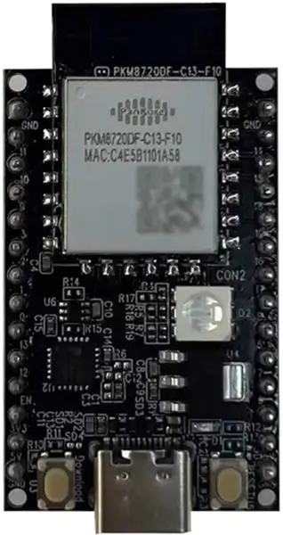

<!-- Copyright 2015-2026 Zephyr Project members and individual contributors. -->
<!-- SPDX-License-Identifier: Apache-2.0 -->
<!-- 中文翻译；编号、导航与译注为本地新增。 -->

<a id="rtl872xd_evb"></a>

# 第4章\_RTL872xD评估板（Evaluation Board）

原文：[官方页面](https://docs.zephyrproject.org/latest/boards/realtek/rtl872xd_evb/doc/index.html)。读取日期：2026-10-16；来源摘要见[来源记录](../SOURCES.md)。

开发板概览（Board Overview）

<a id="id1"></a>

[](images/rtl872xd_evb.webp)

RTL872xD评估板（Evaluation Board）

名称（Name）：

`rtl872xd_evb`

厂商（Vendor）：

[Realtek Semiconductor Corp.](https://docs.zephyrproject.org/latest/boards/index.html#vendor=realtek)

状态（Status）：

维护中（Maintained）

架构（Architecture）：

[arm](https://docs.zephyrproject.org/latest/boards/index.html#arch=arm)

片上系统（SoC）：

[rtl872xd](https://docs.zephyrproject.org/latest/boards/index.html#soc=rtl872xd)

<a id="board-github-link"></a>

[浏览开发板源码（Browse Board Sources）](https://github.com/zephyrproject-rtos/zephyr/blob/main//boards/realtek/rtl872xd_evb/doc/index.rst/../..)<a id="overview"></a>

## 概述（Overview）

Realtek RTL872xD系列是一款支持双频Wi-Fi 4，即2.4 GHz及5 GHz，以及BLE 5.0的组合SoC。它具备超低功耗、完整的加密方案及丰富外设，可用于家电控制面板、智能门、智能玩具、智能语音、智能遥控器、蓝牙网关、耳机、Wi-Fi游戏手柄及智能POS等。更多信息见[RTL872XD-EVB](https://www.realmcu.com/en/Home/Products/RTL872xCS-RTL872xD-Series)。

其特性包括：


- 双核：Real-M300及Real-M200
- 512 KB加64 KB片上SRAM
- 802.11 a/b/g/n，1×1，2.4 GHz及5 GHz
- 支持BLE 5.0
- 外设接口（Peripheral Interface）：


  - 多种通信接口：2路SPI、4路UART及一路I2C
  - 硬件按键扫描（Key-scan）接口支持最多36个按键
  - 硬件正交解码器（Quadrature Decoder）支持统计及比较功能
  - 硬件红外收发器可方便地适配多种红外协议
  - SDIO／USB高速接口，支持主机及从机模式（Host／Slave）
  - 支持实时时钟及18通道PWM输出
  - 支持5通道触摸焊盘及6通道GDMA
  - 支持7通道普通12位ADC及一路VBAT电池电压通道
  - 集成LCD控制器（LCDC），同时支持RGB及I8080接口
  - 集成硬件密码引擎，支持AES-256／192／128及SHA-256
  - 集成音频编解码器（Audio Codec）

更多信息可根据所用芯片，在[RTL872xCS/D Series](https://www.realmcu.com)资料页获取应用笔记及数据手册。

<a id="supported-features"></a>

### 支持的功能（Supported Features）

`rtl872xd_evb`开发板支持下表所列的硬件功能。

片上／板载（On-Chip / On-Board）

功能集成在片上系统（SoC）内／位于开发板上。

2 / 2

分别表示已启用／已禁用的实例数。点击数量标签，可查看开发板或SoC设备树源码（DTS）中该功能的第一个实例。

`vnd,foo`

与此功能匹配的设备树绑定兼容字符串（Compatible String）；点击链接可查看绑定文档。

<a id="rtl872xd_evb-hw-features"></a>

<a id="rtl872xd_evb-rtl872xd_evb/rtl872xd-hw-features-section"></a>

#### `rtl872xd_evb/rtl872xd`目标（Target）

<a id="rtl872xd_evb-rtl872xd_evb/rtl872xd-hw-features-panel"></a>

<a id="rtl872xd_evb-rtl872xd_evb/rtl872xd-hw-features-memory"></a>

该开发板目标的片上存储容量：464 KiB RAM、4 MiB Flash。

<a id="rtl872xd_evb-rtl872xd_evb/rtl872xd-hw-features-table"></a>

<table>
<tr>
<th>类型（Type）</th>
<th>位置（Location）</th>
<th>说明（Description）</th>
<th>兼容字符串（Compatible）</th>
</tr>
<tr>
<td rowspan="1">中央处理器（CPU）</td>
<td>片上（On-Chip）</td>
<td>ARM Cortex-M33处理器（CPU）（<a href="https://github.com/zephyrproject-rtos/zephyr/blob/main/dts/arm/realtek/amebad/amebad.dtsi?plain=1#L21">已启用：1</a>）</td>
<td><a href="../cpu_arm_riscv_binding_reference/P022_arm_cortex-m33.md#std-dtcompatible-arm-cortex-m33"><code>arm,cortex-m33</code></a></td>
</tr>
<tr>
<td rowspan="1">模数转换器（ADC）</td>
<td>片上（On-Chip）</td>
<td>Ameba模数转换器（ADC）（<a href="https://github.com/zephyrproject-rtos/zephyr/blob/main/dts/arm/realtek/amebad/amebad.dtsi?plain=1#L224">已禁用：1</a>）</td>
<td><a href="../hardware/P895_RealtekAmeba模数转换器绑定.md#dtbinding-realtek-ameba-adc"><code>realtek,ameba-adc</code></a></td>
</tr>
<tr>
<td rowspan="1">蓝牙（Bluetooth）</td>
<td>片上（On-Chip）</td>
<td>Realtek Ameba蓝牙主机控制器接口（HCI）（<a href="https://github.com/zephyrproject-rtos/zephyr/blob/main/dts/arm/realtek/amebad/amebad.dtsi?plain=1#L252">已禁用：1</a>）</td>
<td><a href="../bluetooth_vendor_hci_binding_reference/P010_realtek_ameba-bt-hci.md#std-dtcompatible-realtek-ameba-bt-hci"><code>realtek,ameba-bt-hci</code></a></td>
</tr>
<tr>
<td rowspan="2">时钟控制（Clock Control）</td>
<td>片上（On-Chip）</td>
<td>通用固定频率时钟提供者（Fixed-Rate Clock Provider）（<a href="https://github.com/zephyrproject-rtos/zephyr/blob/main/dts/arm/realtek/amebad/amebad.dtsi?plain=1#L35">已启用：1</a>）</td>
<td><a href="../hardware/P566_固定时钟绑定.md#dtbinding-fixed-clock"><code>fixed-clock</code></a></td>
</tr>
<tr>
<td>片上（On-Chip）</td>
<td>Ameba复位与时钟控制器节点（Reset and Clock Controller）（<a href="https://github.com/zephyrproject-rtos/zephyr/blob/main/dts/arm/realtek/amebad/amebad.dtsi?plain=1#L41">已启用：1</a>）</td>
<td><a href="../clock_nxp_pico_realtek_renesas_binding_reference/P021_realtek_ameba-rcc.md#std-dtcompatible-realtek-ameba-rcc"><code>realtek,ameba-rcc</code></a></td>
</tr>
<tr>
<td rowspan="1">计数器（Counter）</td>
<td>片上（On-Chip）</td>
<td>Ameba计数器（Counters）（<a href="https://github.com/zephyrproject-rtos/zephyr/blob/main/dts/arm/realtek/amebad/amebad.dtsi?plain=1#L66">已禁用：4</a>）</td>
<td><a href="../renesas_realtek_counter_binding_reference/P009_realtek_ameba-counter.md#std-dtcompatible-realtek-ameba-counter"><code>realtek,ameba-counter</code></a></td>
</tr>
<tr>
<td rowspan="1">直接存储器访问（DMA）</td>
<td>片上（On-Chip）</td>
<td>Realtek通用直接存储器访问（GDMA）外设（<a href="https://github.com/zephyrproject-rtos/zephyr/blob/main/dts/arm/realtek/amebad/amebad.dtsi?plain=1#L133">已禁用：1</a>）</td>
<td><a href="../nxp_realtek_renesas_dma_binding_reference/P010_realtek_ameba-gdma.md#std-dtcompatible-realtek-ameba-gdma"><code>realtek,ameba-gdma</code></a></td>
</tr>
<tr>
<td rowspan="1">闪存控制器（Flash Controller）</td>
<td>片上（On-Chip）</td>
<td>Ameba系列闪存控制器（<a href="https://github.com/zephyrproject-rtos/zephyr/blob/main/dts/arm/realtek/amebad/amebad.dtsi?plain=1#L234">已禁用：1</a>）</td>
<td><a href="../flash_nuvoton_nxp_renesas_binding_reference/P022_realtek_ameba-flash-controller.md#std-dtcompatible-realtek-ameba-flash-controller"><code>realtek,ameba-flash-controller</code></a></td>
</tr>
<tr>
<td rowspan="1">通用输入输出与接插件（GPIO &amp; Headers）</td>
<td>片上（On-Chip）</td>
<td>Realtek Ameba通用输入输出（GPIO）控制器（<a href="https://github.com/zephyrproject-rtos/zephyr/blob/main/dts/arm/realtek/amebad/amebad.dtsi?plain=1#L206">已启用：2</a>）</td>
<td><a href="../gpio_raspberrypi_renesas_binding_reference/P010_realtek_ameba-gpio.md#std-dtcompatible-realtek-ameba-gpio"><code>realtek,ameba-gpio</code></a></td>
</tr>
<tr>
<td rowspan="1">集成电路间总线（I2C）</td>
<td>片上（On-Chip）</td>
<td>Ameba I2C控制器（<a href="https://github.com/zephyrproject-rtos/zephyr/blob/main/dts/arm/realtek/amebad/amebad.dtsi?plain=1#L183">已禁用：1</a>）</td>
<td><a href="../i2c_nxp_pico_renesas_binding_reference/P009_realtek_ameba-i2c.md#std-dtcompatible-realtek-ameba-i2c"><code>realtek,ameba-i2c</code></a></td>
</tr>
<tr>
<td rowspan="1">中断控制器（Interrupt Controller）</td>
<td>片上（On-Chip）</td>
<td>ARMv8-M嵌套向量中断控制器（NVIC / Nested Vectored Interrupt Controller）（<a href="https://github.com/zephyrproject-rtos/zephyr/blob/main/dts/arm/armv8-m.dtsi?plain=1#L13">已启用：1</a>）</td>
<td><a href="../arm_interrupt_timer_binding_reference/P003_ARMv8_M_NVIC.md#std-dtcompatible-arm-v8m-nvic"><code>arm,v8m-nvic</code></a></td>
</tr>
<tr>
<td rowspan="1">存储技术设备（MTD）</td>
<td>片上（On-Chip）</td>
<td>闪存（Flash）节点（<a href="https://github.com/zephyrproject-rtos/zephyr/blob/main/dts/arm/realtek/amebad/amebad.dtsi?plain=1#L243">已启用：1</a>）</td>
<td><a href="../mtd_nxp_st_ti_partition_binding_reference/P013_soc-nv-flash.md#std-dtcompatible-soc-nv-flash"><code>soc-nv-flash</code></a></td>
</tr>
<tr>
<td rowspan="1">引脚控制（Pin Control）</td>
<td>片上（On-Chip）</td>
<td>Realtek Ameba的pinctrl为单例节点（Singleton Node），负责引脚功能选择及属性控制。（<a href="https://github.com/zephyrproject-rtos/zephyr/blob/main/dts/arm/realtek/amebad/amebad.dtsi?plain=1#L162">已启用：1</a>）</td>
<td><a href="../pinctrl_renesas_silabs_binding_reference/P002_realtek_ameba-pinctrl.md#std-dtcompatible-realtek-ameba-pinctrl"><code>realtek,ameba-pinctrl</code></a></td>
</tr>
<tr>
<td rowspan="1">脉宽调制（PWM）</td>
<td>片上（On-Chip）</td>
<td>Ameba脉宽调制（PWM）（<a href="https://github.com/zephyrproject-rtos/zephyr/blob/main/dts/arm/realtek/amebad/amebad.dtsi?plain=1#L103">已禁用：1</a>）</td>
<td><a href="../pwm_nxp_renesas_binding_reference/P015_realtek_ameba-pwm.md#std-dtcompatible-realtek-ameba-pwm"><code>realtek,ameba-pwm</code></a></td>
</tr>
<tr>
<td rowspan="1">随机数生成器（RNG）</td>
<td>片上（On-Chip）</td>
<td>Ameba真随机数发生器（TRNG）（<a href="https://github.com/zephyrproject-rtos/zephyr/blob/main/dts/arm/realtek/amebad/amebad.dtsi?plain=1#L167">已禁用：1</a>）</td>
<td><a href="../soc_rng_binding_reference/P002_realtek_ameba-trng.md#std-dtcompatible-realtek-ameba-trng"><code>realtek,ameba-trng</code></a></td>
</tr>
<tr>
<td rowspan="1">实时时钟（RTC）</td>
<td>片上（On-Chip）</td>
<td>Ameba实时时钟（RTC）（<a href="https://github.com/zephyrproject-rtos/zephyr/blob/main/dts/arm/realtek/amebad/amebad.dtsi?plain=1#L174">已禁用：1</a>）</td>
<td><a href="../soc_rtc_binding_reference/P004_realtek_ameba-rtc.md#std-dtcompatible-realtek-ameba-rtc"><code>realtek,ameba-rtc</code></a></td>
</tr>
<tr>
<td rowspan="1">串行控制器（Serial Controller）</td>
<td>片上（On-Chip）</td>
<td>Ameba日志串口（LOGUART）（<a href="https://github.com/zephyrproject-rtos/zephyr/blob/main/dts/arm/realtek/amebad/amebad.dtsi?plain=1#L197">已启用：1</a>）</td>
<td><a href="../uart_raspberrypi_realtek_renesas_binding_reference/P003_realtek_ameba-loguart.md#std-dtcompatible-realtek-ameba-loguart"><code>realtek,ameba-loguart</code></a></td>
</tr>
<tr>
<td rowspan="1">串行外设接口（SPI）</td>
<td>片上（On-Chip）</td>
<td>Ameba SPI控制器（<a href="https://github.com/zephyrproject-rtos/zephyr/blob/main/dts/arm/realtek/amebad/amebad.dtsi?plain=1#L123">已禁用：2</a>）</td>
<td><a href="../spi_flexspi_nxp_renesas_binding_reference/P011_realtek_ameba-spi.md#std-dtcompatible-realtek-ameba-spi"><code>realtek,ameba-spi</code></a></td>
</tr>
<tr>
<td rowspan="1">静态随机存储器（SRAM）</td>
<td>片上（On-Chip）</td>
<td>通用片上静态随机存储器（SRAM）（<a href="https://github.com/zephyrproject-rtos/zephyr/blob/main/dts/arm/realtek/amebad/amebad.dtsi?plain=1#L55">已启用：1</a>）</td>
<td><a href="../hardware/P567_内存映射SRAM绑定.md#dtbinding-mmio-sram"><code>mmio-sram</code></a></td>
</tr>
<tr>
<td rowspan="1">定时器（Timer）</td>
<td>片上（On-Chip）</td>
<td>ARMv8-M系统节拍（System Tick）（<a href="https://github.com/zephyrproject-rtos/zephyr/blob/main/dts/arm/armv8-m.dtsi?plain=1#L21">已启用：1</a>）</td>
<td><a href="../arm_interrupt_timer_binding_reference/P007_ARMv8_M_SysTick.md#std-dtcompatible-arm-armv8m-systick"><code>arm,armv8m-systick</code></a></td>
</tr>
<tr>
<td rowspan="1">看门狗（Watchdog）</td>
<td>片上（On-Chip）</td>
<td>Ameba看门狗（Watchdog）（<a href="https://github.com/zephyrproject-rtos/zephyr/blob/main/dts/arm/realtek/amebad/amebad.dtsi?plain=1#L115">已禁用：1</a>）</td>
<td><a href="../realtek_renesas_silabs_watchdog_binding_reference/P001_realtek_ameba-watchdog.md#std-dtcompatible-realtek-ameba-watchdog"><code>realtek,ameba-watchdog</code></a></td>
</tr>
<tr>
<td rowspan="1">无线局域网（Wi-Fi）</td>
<td>片上（On-Chip）</td>
<td>Realtek Ameba SoC的Wi-Fi功能（<a href="https://github.com/zephyrproject-rtos/zephyr/blob/main/dts/arm/realtek/amebad/amebad.dtsi?plain=1#L60">已启用：2</a>）</td>
<td><a href="../wifi_nordic_nxp_simulation_binding_reference/P011_realtek_ameba-wifi.md#std-dtcompatible-realtek-ameba-wifi"><code>realtek,ameba-wifi</code></a></td>
</tr>
</table>

<a id="prerequisites"></a>

## 前置条件（Prerequisites）

Realtek硬件抽象层（HAL）需要二进制文件（Blobs）才能工作，运行以下命令获取。

```text
west blobs fetch hal_realtek
```

注意（Note）

建议在 `west update` 之后运行上述命令。

<a id="building"></a>

## 构建（Building）

以下以构建 [Hello World](../getting_started/P005_HelloWorld示例.md#hello_world) 应用为例。

```text
# From the root of the zephyr repository
west build -b rtl872xd_evb samples/hello_world
```

<a id="flashing"></a>

## 烧录（Flashing）

构建完成后，通过[AmebaImageTool](https://github.com/Ameba-AIoT/ameba-rtos/blob/master/tools/ameba/ImageTool/AmebaImageTool.exe)将镜像下载到闪存：

更多细节见资料链接中Application Note的Image Tool章节。


1. 原文环境要求示例：Windows XP、Windows 7或更新版本，以及Microsoft .NET Framework 4.0。
2. 通过USB线缆连接芯片与电脑。
3. 根据所用芯片选择设备配置（Device Profiles）。
4. 选择对应串口及传输波特率，默认波特率为1500000。
5. 选择待编程镜像，并根据闪存布局设置起始及结束地址，参见ameba_flashcfg.c中的Flash_layout。
6. 点击Download开始下载。进度条显示各镜像的下载进度，日志窗口显示操作状态。

注意（Note）

对于空白芯片，需要下载引导加载器（Bootloader）及应用镜像。

<a id="debugging"></a>

## 调试（Debugging）

通过PB3（SWD_CLK）及PA27（SWD_DAT）使用SWD。

<a id="references"></a>

## 参考资料（References）

## 译注

RTL872xD使用AmebaImageTool按Flash_layout写入镜像，空白芯片需引导及应用两部分；原文Windows XP／7及.NET 4.0为该工具历史环境要求，不作为本翻译集统一环境。SWD为PB3／PA27。

---

[上一章](P003_RTL8721F_Evaluation_Board.md) · [返回大纲](大纲.md) · [全站翻译进度](../PROGRESS.md) · [下一章](P005_RTL8721Dx_Evaluation_Board.md)
