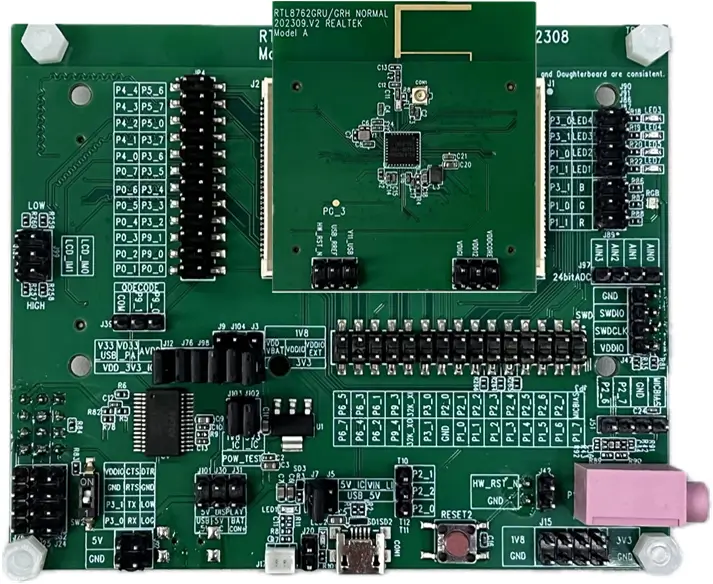
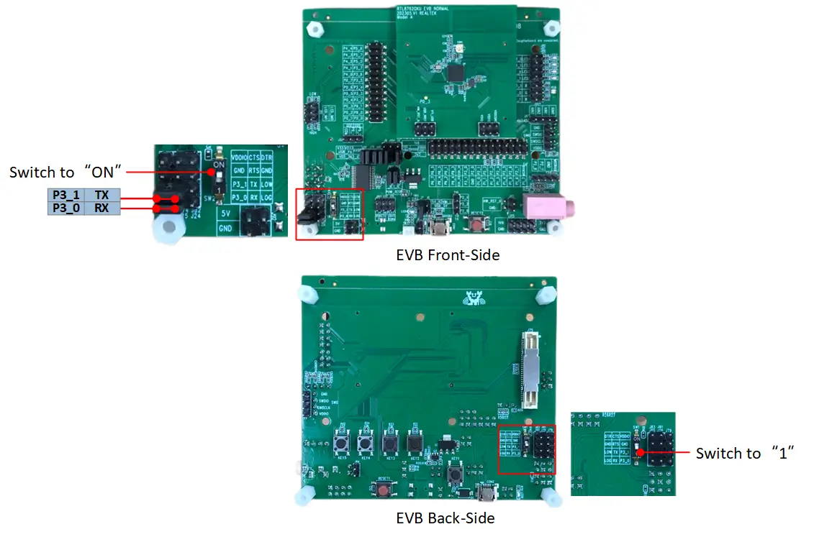
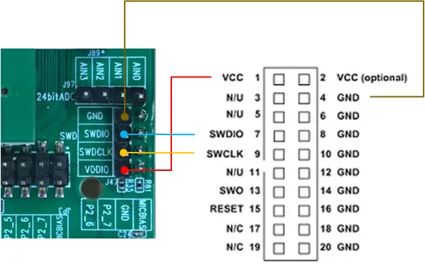

<!-- Copyright 2015-2026 Zephyr Project members and individual contributors. -->
<!-- SPDX-License-Identifier: Apache-2.0 -->
<!-- 中文翻译；编号、导航与译注为本地新增。 -->

<a id="rtl87x2g_evb_a"></a>

# 第7章\_RTL87x2G Model A评估板（Evaluation Board）

原文：[官方页面](https://docs.zephyrproject.org/latest/boards/realtek/rtl87x2g_evb_a/doc/index.html)。读取日期：2026-10-16；来源摘要见[来源记录](../SOURCES.md)。

开发板概览（Board Overview）

<a id="id1"></a>

[](images/rtl87x2g_evb_a.webp)

RTL87x2G Model A评估板（Evaluation Board）

名称（Name）：

`rtl87x2g_evb_a`

厂商（Vendor）：

[Realtek Semiconductor Corp.](https://docs.zephyrproject.org/latest/boards/index.html#vendor=realtek)

状态（Status）：

维护中（Maintained）

架构（Architecture）：

[arm](https://docs.zephyrproject.org/latest/boards/index.html#arch=arm)

片上系统（SoC）：

[rtl8762gkh](https://docs.zephyrproject.org/latest/boards/index.html#soc=rtl8762gkh)、[rtl8762gru](https://docs.zephyrproject.org/latest/boards/index.html#soc=rtl8762gru)、[rtl8762grh](https://docs.zephyrproject.org/latest/boards/index.html#soc=rtl8762grh)及[rtl8762gku](https://docs.zephyrproject.org/latest/boards/index.html#soc=rtl8762gku)

<a id="board-github-link"></a>

[浏览开发板源码（Browse Board Sources）](https://github.com/zephyrproject-rtos/zephyr/blob/main//boards/realtek/rtl87x2g_evb_a/doc/index.rst/../..)<a id="overview"></a>

## 概述（Overview）

RTL87x2G Model A评估板配合可更换子板使用，子板搭载RTL87x2G系列SoC。

RTL87x2G Model A评估板兼容以下子板：


- RTL8762GRU／GRH子板（Daughter Board）
- RTL8762GKU／GKH子板（Daughter Board）
- RTL8762GC子板（Daughter Board）

注意（Note）

Zephyr目前不支持RTL8762GC，因为它依赖外部闪存，导致闪存容量配置可变。

<a id="hardware"></a>

## 硬件（Hardware）

<a id="soc-series"></a>

### 片上系统系列（SoC Series）

RTL87x2G系列包含多种芯片，各型号支持的硬件功能不同。

以下为RTL87x2G系列共有的硬件功能：


- 兼容Arm Cortex-M55的Realtek KM4核，运行于40 MHz，最高125 MHz
- M-profile向量扩展（MVE），用于向量计算
- 32 KB指令缓存（I-Cache）、16 KB数据缓存（D-Cache）及384 KB SRAM
- 部分型号包含4 MB多芯片模块（MCM）PSRAM
- 硬件按键扫描（Keyscan）及正交解码（Quad Decode）
- 闪存即时解密（On-The-Fly Decryption）
- 内置红外发送／接收（IR TX／RX）
- ISO 7816接口
- SPIC、SPI_m、SPI_s、SDIO及SD（eMMC）接口
- 低功耗比较器（Low Power Comparator）
- 8通道辅助ADC（AUXADC）
- 24位高清ADC（HD ADC）
- 控制器局域网总线（CAN Bus）
- 以太网简化媒体独立接口（RMII）
- I2S／数模转换（DAC）／模拟麦克风（AMIC）／数字麦克风（DMIC）／脉冲密度调制（PDM）
- SPIC、RGB888及SEGCOM显示接口
- USB 2.0高速接口（High-Speed Interface）

<a id="id3"></a>

各具体型号的详细硬件信息见[RTL87x2G介绍](https://www.realmcu.com/en/Home/Product/RTL8762G-RTL877xG-Series)[注1](#id2)。

<a id="board"></a>

### 开发板（Board）

RTL87x2G Model A评估板支持以下功能：


- 5 V转3.3 V及1.8 V低压差稳压器（LDO）电源模块
- 支持QSPI第1组（Group1）显示接口
- 支持模拟麦克风（AMIC）及数字麦克风（DMIC）音频模块接口
- 红色LED及RGB LED模块
- 板载FT232RL USB转UART转换器

<a id="supported-features"></a>

### 支持的功能（Supported Features）

`rtl87x2g_evb_a`开发板支持下表所列的硬件功能。

片上／板载（On-Chip / On-Board）

功能集成在片上系统（SoC）内／位于开发板上。

2 / 2

分别表示已启用／已禁用的实例数。点击数量标签，可查看开发板或SoC设备树源码（DTS）中该功能的第一个实例。

`vnd,foo`

与此功能匹配的设备树绑定兼容字符串（Compatible String）；点击链接可查看绑定文档。

<a id="rtl87x2g_evb_a-hw-features"></a>

<a id="rtl87x2g_evb_a-rtl87x2g_evb_a/rtl8762gkh-hw-features-section"></a>

#### `rtl87x2g_evb_a/rtl8762gkh`目标（Target）

<a id="rtl87x2g_evb_a-rtl87x2g_evb_a/rtl8762gkh-hw-features-panel"></a>

<a id="rtl87x2g_evb_a-rtl87x2g_evb_a/rtl8762gkh-hw-features-memory"></a>

该开发板目标的片上存储容量：176 KiB RAM、1 MiB Flash。

<a id="rtl87x2g_evb_a-rtl87x2g_evb_a/rtl8762gkh-hw-features-table"></a>

<table>
<tr>
<th>类型（Type）</th>
<th>位置（Location）</th>
<th>说明（Description）</th>
<th>兼容字符串（Compatible）</th>
</tr>
<tr>
<td rowspan="1">中央处理器（CPU）</td>
<td>片上（On-Chip）</td>
<td>ARM Cortex-M55处理器（CPU）（<a href="https://github.com/zephyrproject-rtos/zephyr/blob/main/dts/arm/realtek/bee/rtl87x2g.dtsi?plain=1#L27">已启用：1</a>）</td>
<td><a href="../cpu_cortex_xtensa_binding_reference/P003_arm_cortex-m55.md#std-dtcompatible-arm-cortex-m55"><code>arm,cortex-m55</code></a></td>
</tr>
<tr>
<td rowspan="1">模数转换器（ADC）</td>
<td>片上（On-Chip）</td>
<td>Bee模数转换器（ADC）控制器（<a href="https://github.com/zephyrproject-rtos/zephyr/blob/main/dts/arm/realtek/bee/rtl87x2g.dtsi?plain=1#L604">已禁用：1</a>）</td>
<td><a href="../hardware/P896_RealtekBee模数转换器绑定.md#dtbinding-realtek-bee-adc"><code>realtek,bee-adc</code></a></td>
</tr>
<tr>
<td rowspan="1">蓝牙（Bluetooth）</td>
<td>片上（On-Chip）</td>
<td>Realtek Bee SoC的蓝牙主机控制器接口（HCI）（<a href="https://github.com/zephyrproject-rtos/zephyr/blob/main/dts/arm/realtek/bee/rtl87x2g.dtsi?plain=1#L111">已启用：1</a>）</td>
<td><a href="../bluetooth_vendor_hci_binding_reference/P011_realtek_bee-bt-hci.md#std-dtcompatible-realtek-bee-bt-hci"><code>realtek,bee-bt-hci</code></a></td>
</tr>
<tr>
<td rowspan="1">控制器局域网（CAN）</td>
<td>片上（On-Chip）</td>
<td>Bee控制器局域网（CAN）控制器（<a href="https://github.com/zephyrproject-rtos/zephyr/blob/main/dts/arm/realtek/bee/rtl87x2g.dtsi?plain=1#L596">已启用：1</a>）</td>
<td><a href="../can_nxp_renesas_stm32_ti_binding_reference/P003_realtek_bee-can.md#std-dtcompatible-realtek-bee-can"><code>realtek,bee-can</code></a></td>
</tr>
<tr>
<td rowspan="2">时钟控制（Clock Control）</td>
<td>片上（On-Chip）</td>
<td>Bee时钟控制器（Clock Controller）（<a href="https://github.com/zephyrproject-rtos/zephyr/blob/main/dts/arm/realtek/bee/rtl87x2g.dtsi?plain=1#L195">已启用：1</a>）</td>
<td><a href="../clock_nxp_pico_realtek_renesas_binding_reference/P022_realtek_bee-cctl.md#std-dtcompatible-realtek-bee-cctl"><code>realtek,bee-cctl</code></a></td>
</tr>
<tr>
<td>片上（On-Chip）</td>
<td>通用固定频率时钟提供者（Fixed-Rate Clock Provider）（<a href="https://github.com/zephyrproject-rtos/zephyr/blob/main/dts/arm/realtek/bee/rtl87x2g.dtsi?plain=1#L103">已启用：1</a>）</td>
<td><a href="../hardware/P566_固定时钟绑定.md#dtbinding-fixed-clock"><code>fixed-clock</code></a></td>
</tr>
<tr>
<td rowspan="2">计数器（Counter）</td>
<td>片上（On-Chip）</td>
<td>Realtek Bee定时器，用作计数器（Counter）（<a href="https://github.com/zephyrproject-rtos/zephyr/blob/main/dts/arm/realtek/bee/rtl87x2g.dtsi?plain=1#L284">已禁用：10</a>）</td>
<td><a href="../renesas_realtek_counter_binding_reference/P011_realtek_bee-counter-timer.md#std-dtcompatible-realtek-bee-counter-timer"><code>realtek,bee-counter-timer</code></a></td>
</tr>
<tr>
<td>片上（On-Chip）</td>
<td>Realtek Bee实时时钟（RTC）计数器（<a href="https://github.com/zephyrproject-rtos/zephyr/blob/main/dts/arm/realtek/bee/rtl87x2g.dtsi?plain=1#L527">已禁用：1</a>）</td>
<td><a href="../renesas_realtek_counter_binding_reference/P010_realtek_bee-counter-rtc.md#std-dtcompatible-realtek-bee-counter-rtc"><code>realtek,bee-counter-rtc</code></a></td>
</tr>
<tr>
<td rowspan="2">密码学加速器（Cryptographic Accelerator）</td>
<td>片上（On-Chip）</td>
<td>Realtek Bee系列AES硬件加速器（<a href="https://github.com/zephyrproject-rtos/zephyr/blob/main/dts/arm/realtek/bee/rtl87x2g.dtsi?plain=1#L535">已禁用：1</a>）</td>
<td><a href="../crypto_secure_engine_st_ti_binding_reference/P007_realtek_bee-aes.md#std-dtcompatible-realtek-bee-aes"><code>realtek,bee-aes</code></a></td>
</tr>
<tr>
<td>片上（On-Chip）</td>
<td>Realtek Bee系列SHA-256硬件加速器（<a href="https://github.com/zephyrproject-rtos/zephyr/blob/main/dts/arm/realtek/bee/rtl87x2g.dtsi?plain=1#L541">已禁用：1</a>）</td>
<td><a href="../crypto_secure_engine_st_ti_binding_reference/P008_realtek_bee-sha256.md#std-dtcompatible-realtek-bee-sha256"><code>realtek,bee-sha256</code></a></td>
</tr>
<tr>
<td rowspan="1">直接存储器访问（DMA）</td>
<td>片上（On-Chip）</td>
<td>Bee直接存储器访问（DMA）控制器（<a href="https://github.com/zephyrproject-rtos/zephyr/blob/main/dts/arm/realtek/bee/rtl87x2g.dtsi?plain=1#L553">已禁用：1</a>）</td>
<td><a href="../nxp_realtek_renesas_dma_binding_reference/P011_realtek_bee-dma.md#std-dtcompatible-realtek-bee-dma"><code>realtek,bee-dma</code></a></td>
</tr>
<tr>
<td rowspan="1">闪存控制器（Flash Controller）</td>
<td>片上（On-Chip）</td>
<td>Realtek Bee NOR闪存控制器（<a href="https://github.com/zephyrproject-rtos/zephyr/blob/main/dts/arm/realtek/bee/rtl87x2g.dtsi?plain=1#L117">已启用：1</a>）</td>
<td><a href="../flash_nuvoton_nxp_renesas_binding_reference/P023_realtek_bee-nor-flash-controller.md#std-dtcompatible-realtek-bee-nor-flash-controller"><code>realtek,bee-nor-flash-controller</code></a></td>
</tr>
<tr>
<td rowspan="1">通用输入输出与接插件（GPIO &amp; Headers）</td>
<td>片上（On-Chip）</td>
<td>Bee通用输入输出（GPIO）控制器（<a href="https://github.com/zephyrproject-rtos/zephyr/blob/main/dts/arm/realtek/bee/rtl87x2g.dtsi?plain=1#L207">已启用：1</a>；<a href="https://github.com/zephyrproject-rtos/zephyr/blob/main/dts/arm/realtek/bee/rtl87x2g.dtsi?plain=1#L217">已禁用：1</a>）</td>
<td><a href="../gpio_raspberrypi_renesas_binding_reference/P011_realtek_bee-gpio.md#std-dtcompatible-realtek-bee-gpio"><code>realtek,bee-gpio</code></a></td>
</tr>
<tr>
<td rowspan="1">集成电路间总线（I2C）</td>
<td>片上（On-Chip）</td>
<td>Bee I2C控制器（<a href="https://github.com/zephyrproject-rtos/zephyr/blob/main/dts/arm/realtek/bee/rtl87x2g.dtsi?plain=1#L483">已禁用：4</a>）</td>
<td><a href="../i2c_nxp_pico_renesas_binding_reference/P010_realtek_bee-i2c.md#std-dtcompatible-realtek-bee-i2c"><code>realtek,bee-i2c</code></a></td>
</tr>
<tr>
<td rowspan="2">输入（Input）</td>
<td>片上（On-Chip）</td>
<td>Bee按键扫描（Keyscan）（<a href="https://github.com/zephyrproject-rtos/zephyr/blob/main/dts/arm/realtek/bee/rtl87x2g.dtsi?plain=1#L468">已禁用：1</a>）</td>
<td><a href="../input_keyboard_optical_ctsu_binding_reference/P016_realtek_bee-keyscan.md#std-dtcompatible-realtek-bee-keyscan"><code>realtek,bee-keyscan</code></a></td>
</tr>
<tr>
<td>板载（On-Board）</td>
<td>一组绑定到 GPIO 的输入按键（GPIO-Bound Input Keys）（<a href="https://github.com/zephyrproject-rtos/zephyr/blob/main/boards/realtek/rtl87x2g_evb_a/rtl87x2g_evb_a_rtl8762gkh.dts?plain=1#L20">已启用：1</a>）</td>
<td><a href="../hardware/P563_GPIO按键绑定.md#std-dtcompatible-gpio-keys"><code>gpio-keys</code></a></td>
</tr>
<tr>
<td rowspan="1">中断控制器（Interrupt Controller）</td>
<td>片上（On-Chip）</td>
<td>ARMv8.1-M嵌套向量中断控制器（NVIC / Nested Vectored Interrupt Controller）（<a href="https://github.com/zephyrproject-rtos/zephyr/blob/main/dts/arm/armv8.1-m.dtsi?plain=1#L17">已启用：1</a>）</td>
<td><a href="../arm_interrupt_timer_binding_reference/P004_ARMv8_1_M_NVIC.md#std-dtcompatible-arm-v8.1m-nvic"><code>arm,v8.1m-nvic</code></a></td>
</tr>
<tr>
<td rowspan="1">发光二极管（LED）</td>
<td>板载（On-Board）</td>
<td>一组由 GPIO 控制的 LED（GPIO-Controlled LEDs）（<a href="https://github.com/zephyrproject-rtos/zephyr/blob/main/boards/realtek/rtl87x2g_evb_a/rtl87x2g_evb_a_common.dtsi?plain=1#L25">已启用：1</a>）</td>
<td><a href="../hardware/P564_GPIO指示灯绑定.md#dtbinding-gpio-leds"><code>gpio-leds</code></a></td>
</tr>
<tr>
<td rowspan="1">存储技术设备（MTD）</td>
<td>片上（On-Chip）</td>
<td>Realtek Bee NOR闪存（<a href="https://github.com/zephyrproject-rtos/zephyr/blob/main/dts/arm/realtek/bee/rtl87x2g.dtsi?plain=1#L125">已启用：1</a>）</td>
<td><a href="../mtd_nxp_st_ti_partition_binding_reference/P008_realtek_bee-nor-flash.md#std-dtcompatible-realtek-bee-nor-flash"><code>realtek,bee-nor-flash</code></a></td>
</tr>
<tr>
<td rowspan="1">引脚控制（Pin Control）</td>
<td>片上（On-Chip）</td>
<td>Bee引脚控制器（Pin Controller）（<a href="https://github.com/zephyrproject-rtos/zephyr/blob/main/dts/arm/realtek/bee/rtl87x2g.dtsi?plain=1#L202">已启用：1</a>）</td>
<td><a href="../pinctrl_renesas_silabs_binding_reference/P003_realtek_bee-pinctrl.md#std-dtcompatible-realtek-bee-pinctrl"><code>realtek,bee-pinctrl</code></a></td>
</tr>
<tr>
<td rowspan="1">脉宽调制（PWM）</td>
<td>片上（On-Chip）</td>
<td>Realtek Bee定时器，用作脉宽调制（PWM）（<a href="https://github.com/zephyrproject-rtos/zephyr/blob/main/dts/arm/realtek/bee/rtl87x2g.dtsi?plain=1#L289">已禁用：10</a>）</td>
<td><a href="../pwm_nxp_renesas_binding_reference/P016_realtek_bee-pwm.md#std-dtcompatible-realtek-bee-pwm"><code>realtek,bee-pwm</code></a></td>
</tr>
<tr>
<td rowspan="1">随机数生成器（RNG）</td>
<td>片上（On-Chip）</td>
<td>Realtek Bee真随机数发生器（TRNG）（<a href="https://github.com/zephyrproject-rtos/zephyr/blob/main/dts/arm/realtek/bee/rtl87x2g.dtsi?plain=1#L547">已启用：1</a>）</td>
<td><a href="../soc_rng_binding_reference/P003_realtek_bee-trng.md#std-dtcompatible-realtek-bee-trng"><code>realtek,bee-trng</code></a></td>
</tr>
<tr>
<td rowspan="1">传感器（Sensors）</td>
<td>片上（On-Chip）</td>
<td>Bee常开域正交解码器（AON_QDEC）（<a href="https://github.com/zephyrproject-rtos/zephyr/blob/main/dts/arm/realtek/bee/rtl87x2g.dtsi?plain=1#L476">已禁用：1</a>）</td>
<td><a href="../sensor_realtek_rohm_sensirion_binding_reference/P004_realtek_bee-aon-qdec.md#std-dtcompatible-realtek-bee-aon-qdec"><code>realtek,bee-aon-qdec</code></a></td>
</tr>
<tr>
<td rowspan="1">串行控制器（Serial Controller）</td>
<td>片上（On-Chip）</td>
<td>Bee通用异步收发器（UART）（<a href="https://github.com/zephyrproject-rtos/zephyr/blob/main/dts/arm/realtek/bee/rtl87x2g.dtsi?plain=1#L244">已启用：1</a>；<a href="https://github.com/zephyrproject-rtos/zephyr/blob/main/dts/arm/realtek/bee/rtl87x2g.dtsi?plain=1#L227">已禁用：5</a>）</td>
<td><a href="../uart_raspberrypi_realtek_renesas_binding_reference/P004_realtek_bee-uart.md#std-dtcompatible-realtek-bee-uart"><code>realtek,bee-uart</code></a></td>
</tr>
<tr>
<td rowspan="1">串行外设接口（SPI）</td>
<td>片上（On-Chip）</td>
<td>Bee串行外设接口（SPI）（<a href="https://github.com/zephyrproject-rtos/zephyr/blob/main/dts/arm/realtek/bee/rtl87x2g.dtsi?plain=1#L565">已禁用：3</a>）</td>
<td><a href="../spi_flexspi_nxp_renesas_binding_reference/P012_realtek_bee-spi.md#std-dtcompatible-realtek-bee-spi"><code>realtek,bee-spi</code></a></td>
</tr>
<tr>
<td rowspan="2">定时器（Timer）</td>
<td>片上（On-Chip）</td>
<td>ARMv8.1-M系统节拍（System Tick）（<a href="https://github.com/zephyrproject-rtos/zephyr/blob/main/dts/arm/armv8.1-m.dtsi?plain=1#L25">已启用：1</a>）</td>
<td><a href="../arm_interrupt_timer_binding_reference/P008_ARMv8_1_M_SysTick.md#std-dtcompatible-arm-armv8.1m-systick"><code>arm,armv8.1m-systick</code></a></td>
</tr>
<tr>
<td>片上（On-Chip）</td>
<td>Realtek Bee定时器（Timer）（<a href="https://github.com/zephyrproject-rtos/zephyr/blob/main/dts/arm/realtek/bee/rtl87x2g.dtsi?plain=1#L277">已禁用：10</a>）</td>
<td><a href="../microchip_nordic_nxp_realtek_timer_binding_reference/P011_realtek_bee-timer.md#std-dtcompatible-realtek-bee-timer"><code>realtek,bee-timer</code></a></td>
</tr>
<tr>
<td rowspan="1">看门狗（Watchdog）</td>
<td>片上（On-Chip）</td>
<td>Realtek Bee内核看门狗定时器（Core Watchdog Timer）（<a href="https://github.com/zephyrproject-rtos/zephyr/blob/main/dts/arm/realtek/bee/rtl87x2g.dtsi?plain=1#L188">已禁用：1</a>）</td>
<td><a href="../realtek_renesas_silabs_watchdog_binding_reference/P002_realtek_bee-core-wdt.md#std-dtcompatible-realtek-bee-core-wdt"><code>realtek,bee-core-wdt</code></a></td>
</tr>
</table>

<a id="rtl87x2g_evb_a-rtl87x2g_evb_a/rtl8762gku-hw-features-section"></a>

#### `rtl87x2g_evb_a/rtl8762gku`目标（Target）

<a id="rtl87x2g_evb_a-rtl87x2g_evb_a/rtl8762gku-hw-features-panel"></a>

<a id="rtl87x2g_evb_a-rtl87x2g_evb_a/rtl8762gku-hw-features-memory"></a>

该开发板目标的片上存储容量：176 KiB RAM、1 MiB Flash。

<a id="rtl87x2g_evb_a-rtl87x2g_evb_a/rtl8762gku-hw-features-table"></a>

<table>
<tr>
<th>类型（Type）</th>
<th>位置（Location）</th>
<th>说明（Description）</th>
<th>兼容字符串（Compatible）</th>
</tr>
<tr>
<td rowspan="1">中央处理器（CPU）</td>
<td>片上（On-Chip）</td>
<td>ARM Cortex-M55处理器（CPU）（<a href="https://github.com/zephyrproject-rtos/zephyr/blob/main/dts/arm/realtek/bee/rtl87x2g.dtsi?plain=1#L27">已启用：1</a>）</td>
<td><a href="../cpu_cortex_xtensa_binding_reference/P003_arm_cortex-m55.md#std-dtcompatible-arm-cortex-m55"><code>arm,cortex-m55</code></a></td>
</tr>
<tr>
<td rowspan="1">模数转换器（ADC）</td>
<td>片上（On-Chip）</td>
<td>Bee模数转换器（ADC）控制器（<a href="https://github.com/zephyrproject-rtos/zephyr/blob/main/dts/arm/realtek/bee/rtl87x2g.dtsi?plain=1#L604">已禁用：1</a>）</td>
<td><a href="../hardware/P896_RealtekBee模数转换器绑定.md#dtbinding-realtek-bee-adc"><code>realtek,bee-adc</code></a></td>
</tr>
<tr>
<td rowspan="1">蓝牙（Bluetooth）</td>
<td>片上（On-Chip）</td>
<td>Realtek Bee SoC的蓝牙主机控制器接口（HCI）（<a href="https://github.com/zephyrproject-rtos/zephyr/blob/main/dts/arm/realtek/bee/rtl87x2g.dtsi?plain=1#L111">已启用：1</a>）</td>
<td><a href="../bluetooth_vendor_hci_binding_reference/P011_realtek_bee-bt-hci.md#std-dtcompatible-realtek-bee-bt-hci"><code>realtek,bee-bt-hci</code></a></td>
</tr>
<tr>
<td rowspan="1">控制器局域网（CAN）</td>
<td>片上（On-Chip）</td>
<td>Bee控制器局域网（CAN）控制器（<a href="https://github.com/zephyrproject-rtos/zephyr/blob/main/dts/arm/realtek/bee/rtl87x2g.dtsi?plain=1#L596">已启用：1</a>）</td>
<td><a href="../can_nxp_renesas_stm32_ti_binding_reference/P003_realtek_bee-can.md#std-dtcompatible-realtek-bee-can"><code>realtek,bee-can</code></a></td>
</tr>
<tr>
<td rowspan="2">时钟控制（Clock Control）</td>
<td>片上（On-Chip）</td>
<td>Bee时钟控制器（Clock Controller）（<a href="https://github.com/zephyrproject-rtos/zephyr/blob/main/dts/arm/realtek/bee/rtl87x2g.dtsi?plain=1#L195">已启用：1</a>）</td>
<td><a href="../clock_nxp_pico_realtek_renesas_binding_reference/P022_realtek_bee-cctl.md#std-dtcompatible-realtek-bee-cctl"><code>realtek,bee-cctl</code></a></td>
</tr>
<tr>
<td>片上（On-Chip）</td>
<td>通用固定频率时钟提供者（Fixed-Rate Clock Provider）（<a href="https://github.com/zephyrproject-rtos/zephyr/blob/main/dts/arm/realtek/bee/rtl87x2g.dtsi?plain=1#L103">已启用：1</a>）</td>
<td><a href="../hardware/P566_固定时钟绑定.md#dtbinding-fixed-clock"><code>fixed-clock</code></a></td>
</tr>
<tr>
<td rowspan="2">计数器（Counter）</td>
<td>片上（On-Chip）</td>
<td>Realtek Bee定时器，用作计数器（Counter）（<a href="https://github.com/zephyrproject-rtos/zephyr/blob/main/dts/arm/realtek/bee/rtl87x2g.dtsi?plain=1#L284">已禁用：10</a>）</td>
<td><a href="../renesas_realtek_counter_binding_reference/P011_realtek_bee-counter-timer.md#std-dtcompatible-realtek-bee-counter-timer"><code>realtek,bee-counter-timer</code></a></td>
</tr>
<tr>
<td>片上（On-Chip）</td>
<td>Realtek Bee实时时钟（RTC）计数器（<a href="https://github.com/zephyrproject-rtos/zephyr/blob/main/dts/arm/realtek/bee/rtl87x2g.dtsi?plain=1#L527">已禁用：1</a>）</td>
<td><a href="../renesas_realtek_counter_binding_reference/P010_realtek_bee-counter-rtc.md#std-dtcompatible-realtek-bee-counter-rtc"><code>realtek,bee-counter-rtc</code></a></td>
</tr>
<tr>
<td rowspan="2">密码学加速器（Cryptographic Accelerator）</td>
<td>片上（On-Chip）</td>
<td>Realtek Bee系列AES硬件加速器（<a href="https://github.com/zephyrproject-rtos/zephyr/blob/main/dts/arm/realtek/bee/rtl87x2g.dtsi?plain=1#L535">已禁用：1</a>）</td>
<td><a href="../crypto_secure_engine_st_ti_binding_reference/P007_realtek_bee-aes.md#std-dtcompatible-realtek-bee-aes"><code>realtek,bee-aes</code></a></td>
</tr>
<tr>
<td>片上（On-Chip）</td>
<td>Realtek Bee系列SHA-256硬件加速器（<a href="https://github.com/zephyrproject-rtos/zephyr/blob/main/dts/arm/realtek/bee/rtl87x2g.dtsi?plain=1#L541">已禁用：1</a>）</td>
<td><a href="../crypto_secure_engine_st_ti_binding_reference/P008_realtek_bee-sha256.md#std-dtcompatible-realtek-bee-sha256"><code>realtek,bee-sha256</code></a></td>
</tr>
<tr>
<td rowspan="1">直接存储器访问（DMA）</td>
<td>片上（On-Chip）</td>
<td>Bee直接存储器访问（DMA）控制器（<a href="https://github.com/zephyrproject-rtos/zephyr/blob/main/dts/arm/realtek/bee/rtl87x2g.dtsi?plain=1#L553">已禁用：1</a>）</td>
<td><a href="../nxp_realtek_renesas_dma_binding_reference/P011_realtek_bee-dma.md#std-dtcompatible-realtek-bee-dma"><code>realtek,bee-dma</code></a></td>
</tr>
<tr>
<td rowspan="1">闪存控制器（Flash Controller）</td>
<td>片上（On-Chip）</td>
<td>Realtek Bee NOR闪存控制器（<a href="https://github.com/zephyrproject-rtos/zephyr/blob/main/dts/arm/realtek/bee/rtl87x2g.dtsi?plain=1#L117">已启用：1</a>）</td>
<td><a href="../flash_nuvoton_nxp_renesas_binding_reference/P023_realtek_bee-nor-flash-controller.md#std-dtcompatible-realtek-bee-nor-flash-controller"><code>realtek,bee-nor-flash-controller</code></a></td>
</tr>
<tr>
<td rowspan="1">通用输入输出与接插件（GPIO &amp; Headers）</td>
<td>片上（On-Chip）</td>
<td>Bee通用输入输出（GPIO）控制器（<a href="https://github.com/zephyrproject-rtos/zephyr/blob/main/dts/arm/realtek/bee/rtl87x2g.dtsi?plain=1#L207">已启用：1</a>；<a href="https://github.com/zephyrproject-rtos/zephyr/blob/main/dts/arm/realtek/bee/rtl87x2g.dtsi?plain=1#L217">已禁用：1</a>）</td>
<td><a href="../gpio_raspberrypi_renesas_binding_reference/P011_realtek_bee-gpio.md#std-dtcompatible-realtek-bee-gpio"><code>realtek,bee-gpio</code></a></td>
</tr>
<tr>
<td rowspan="1">集成电路间总线（I2C）</td>
<td>片上（On-Chip）</td>
<td>Bee I2C控制器（<a href="https://github.com/zephyrproject-rtos/zephyr/blob/main/dts/arm/realtek/bee/rtl87x2g.dtsi?plain=1#L483">已禁用：4</a>）</td>
<td><a href="../i2c_nxp_pico_renesas_binding_reference/P010_realtek_bee-i2c.md#std-dtcompatible-realtek-bee-i2c"><code>realtek,bee-i2c</code></a></td>
</tr>
<tr>
<td rowspan="2">输入（Input）</td>
<td>片上（On-Chip）</td>
<td>Bee按键扫描（Keyscan）（<a href="https://github.com/zephyrproject-rtos/zephyr/blob/main/dts/arm/realtek/bee/rtl87x2g.dtsi?plain=1#L468">已禁用：1</a>）</td>
<td><a href="../input_keyboard_optical_ctsu_binding_reference/P016_realtek_bee-keyscan.md#std-dtcompatible-realtek-bee-keyscan"><code>realtek,bee-keyscan</code></a></td>
</tr>
<tr>
<td>板载（On-Board）</td>
<td>一组绑定到 GPIO 的输入按键（GPIO-Bound Input Keys）（<a href="https://github.com/zephyrproject-rtos/zephyr/blob/main/boards/realtek/rtl87x2g_evb_a/rtl87x2g_evb_a_rtl8762gku.dts?plain=1#L20">已启用：1</a>）</td>
<td><a href="../hardware/P563_GPIO按键绑定.md#std-dtcompatible-gpio-keys"><code>gpio-keys</code></a></td>
</tr>
<tr>
<td rowspan="1">中断控制器（Interrupt Controller）</td>
<td>片上（On-Chip）</td>
<td>ARMv8.1-M嵌套向量中断控制器（NVIC / Nested Vectored Interrupt Controller）（<a href="https://github.com/zephyrproject-rtos/zephyr/blob/main/dts/arm/armv8.1-m.dtsi?plain=1#L17">已启用：1</a>）</td>
<td><a href="../arm_interrupt_timer_binding_reference/P004_ARMv8_1_M_NVIC.md#std-dtcompatible-arm-v8.1m-nvic"><code>arm,v8.1m-nvic</code></a></td>
</tr>
<tr>
<td rowspan="1">发光二极管（LED）</td>
<td>板载（On-Board）</td>
<td>一组由 GPIO 控制的 LED（GPIO-Controlled LEDs）（<a href="https://github.com/zephyrproject-rtos/zephyr/blob/main/boards/realtek/rtl87x2g_evb_a/rtl87x2g_evb_a_common.dtsi?plain=1#L25">已启用：1</a>）</td>
<td><a href="../hardware/P564_GPIO指示灯绑定.md#dtbinding-gpio-leds"><code>gpio-leds</code></a></td>
</tr>
<tr>
<td rowspan="1">存储技术设备（MTD）</td>
<td>片上（On-Chip）</td>
<td>Realtek Bee NOR闪存（<a href="https://github.com/zephyrproject-rtos/zephyr/blob/main/dts/arm/realtek/bee/rtl87x2g.dtsi?plain=1#L125">已启用：1</a>）</td>
<td><a href="../mtd_nxp_st_ti_partition_binding_reference/P008_realtek_bee-nor-flash.md#std-dtcompatible-realtek-bee-nor-flash"><code>realtek,bee-nor-flash</code></a></td>
</tr>
<tr>
<td rowspan="1">引脚控制（Pin Control）</td>
<td>片上（On-Chip）</td>
<td>Bee引脚控制器（Pin Controller）（<a href="https://github.com/zephyrproject-rtos/zephyr/blob/main/dts/arm/realtek/bee/rtl87x2g.dtsi?plain=1#L202">已启用：1</a>）</td>
<td><a href="../pinctrl_renesas_silabs_binding_reference/P003_realtek_bee-pinctrl.md#std-dtcompatible-realtek-bee-pinctrl"><code>realtek,bee-pinctrl</code></a></td>
</tr>
<tr>
<td rowspan="1">脉宽调制（PWM）</td>
<td>片上（On-Chip）</td>
<td>Realtek Bee定时器，用作脉宽调制（PWM）（<a href="https://github.com/zephyrproject-rtos/zephyr/blob/main/dts/arm/realtek/bee/rtl87x2g.dtsi?plain=1#L289">已禁用：10</a>）</td>
<td><a href="../pwm_nxp_renesas_binding_reference/P016_realtek_bee-pwm.md#std-dtcompatible-realtek-bee-pwm"><code>realtek,bee-pwm</code></a></td>
</tr>
<tr>
<td rowspan="1">随机数生成器（RNG）</td>
<td>片上（On-Chip）</td>
<td>Realtek Bee真随机数发生器（TRNG）（<a href="https://github.com/zephyrproject-rtos/zephyr/blob/main/dts/arm/realtek/bee/rtl87x2g.dtsi?plain=1#L547">已启用：1</a>）</td>
<td><a href="../soc_rng_binding_reference/P003_realtek_bee-trng.md#std-dtcompatible-realtek-bee-trng"><code>realtek,bee-trng</code></a></td>
</tr>
<tr>
<td rowspan="1">传感器（Sensors）</td>
<td>片上（On-Chip）</td>
<td>Bee常开域正交解码器（AON_QDEC）（<a href="https://github.com/zephyrproject-rtos/zephyr/blob/main/dts/arm/realtek/bee/rtl87x2g.dtsi?plain=1#L476">已禁用：1</a>）</td>
<td><a href="../sensor_realtek_rohm_sensirion_binding_reference/P004_realtek_bee-aon-qdec.md#std-dtcompatible-realtek-bee-aon-qdec"><code>realtek,bee-aon-qdec</code></a></td>
</tr>
<tr>
<td rowspan="1">串行控制器（Serial Controller）</td>
<td>片上（On-Chip）</td>
<td>Bee通用异步收发器（UART）（<a href="https://github.com/zephyrproject-rtos/zephyr/blob/main/dts/arm/realtek/bee/rtl87x2g.dtsi?plain=1#L244">已启用：1</a>；<a href="https://github.com/zephyrproject-rtos/zephyr/blob/main/dts/arm/realtek/bee/rtl87x2g.dtsi?plain=1#L227">已禁用：5</a>）</td>
<td><a href="../uart_raspberrypi_realtek_renesas_binding_reference/P004_realtek_bee-uart.md#std-dtcompatible-realtek-bee-uart"><code>realtek,bee-uart</code></a></td>
</tr>
<tr>
<td rowspan="1">串行外设接口（SPI）</td>
<td>片上（On-Chip）</td>
<td>Bee串行外设接口（SPI）（<a href="https://github.com/zephyrproject-rtos/zephyr/blob/main/dts/arm/realtek/bee/rtl87x2g.dtsi?plain=1#L565">已禁用：3</a>）</td>
<td><a href="../spi_flexspi_nxp_renesas_binding_reference/P012_realtek_bee-spi.md#std-dtcompatible-realtek-bee-spi"><code>realtek,bee-spi</code></a></td>
</tr>
<tr>
<td rowspan="2">定时器（Timer）</td>
<td>片上（On-Chip）</td>
<td>ARMv8.1-M系统节拍（System Tick）（<a href="https://github.com/zephyrproject-rtos/zephyr/blob/main/dts/arm/armv8.1-m.dtsi?plain=1#L25">已启用：1</a>）</td>
<td><a href="../arm_interrupt_timer_binding_reference/P008_ARMv8_1_M_SysTick.md#std-dtcompatible-arm-armv8.1m-systick"><code>arm,armv8.1m-systick</code></a></td>
</tr>
<tr>
<td>片上（On-Chip）</td>
<td>Realtek Bee定时器（Timer）（<a href="https://github.com/zephyrproject-rtos/zephyr/blob/main/dts/arm/realtek/bee/rtl87x2g.dtsi?plain=1#L277">已禁用：10</a>）</td>
<td><a href="../microchip_nordic_nxp_realtek_timer_binding_reference/P011_realtek_bee-timer.md#std-dtcompatible-realtek-bee-timer"><code>realtek,bee-timer</code></a></td>
</tr>
<tr>
<td rowspan="1">看门狗（Watchdog）</td>
<td>片上（On-Chip）</td>
<td>Realtek Bee内核看门狗定时器（Core Watchdog Timer）（<a href="https://github.com/zephyrproject-rtos/zephyr/blob/main/dts/arm/realtek/bee/rtl87x2g.dtsi?plain=1#L188">已禁用：1</a>）</td>
<td><a href="../realtek_renesas_silabs_watchdog_binding_reference/P002_realtek_bee-core-wdt.md#std-dtcompatible-realtek-bee-core-wdt"><code>realtek,bee-core-wdt</code></a></td>
</tr>
</table>

<a id="rtl87x2g_evb_a-rtl87x2g_evb_a/rtl8762grh-hw-features-section"></a>

#### `rtl87x2g_evb_a/rtl8762grh`目标（Target）

<a id="rtl87x2g_evb_a-rtl87x2g_evb_a/rtl8762grh-hw-features-panel"></a>

<a id="rtl87x2g_evb_a-rtl87x2g_evb_a/rtl8762grh-hw-features-memory"></a>

该开发板目标的片上存储容量：176 KiB RAM、512 KiB Flash。

<a id="rtl87x2g_evb_a-rtl87x2g_evb_a/rtl8762grh-hw-features-table"></a>

<table>
<tr>
<th>类型（Type）</th>
<th>位置（Location）</th>
<th>说明（Description）</th>
<th>兼容字符串（Compatible）</th>
</tr>
<tr>
<td rowspan="1">中央处理器（CPU）</td>
<td>片上（On-Chip）</td>
<td>ARM Cortex-M55处理器（CPU）（<a href="https://github.com/zephyrproject-rtos/zephyr/blob/main/dts/arm/realtek/bee/rtl87x2g.dtsi?plain=1#L27">已启用：1</a>）</td>
<td><a href="../cpu_cortex_xtensa_binding_reference/P003_arm_cortex-m55.md#std-dtcompatible-arm-cortex-m55"><code>arm,cortex-m55</code></a></td>
</tr>
<tr>
<td rowspan="1">模数转换器（ADC）</td>
<td>片上（On-Chip）</td>
<td>Bee模数转换器（ADC）控制器（<a href="https://github.com/zephyrproject-rtos/zephyr/blob/main/dts/arm/realtek/bee/rtl87x2g.dtsi?plain=1#L604">已禁用：1</a>）</td>
<td><a href="../hardware/P896_RealtekBee模数转换器绑定.md#dtbinding-realtek-bee-adc"><code>realtek,bee-adc</code></a></td>
</tr>
<tr>
<td rowspan="1">蓝牙（Bluetooth）</td>
<td>片上（On-Chip）</td>
<td>Realtek Bee SoC的蓝牙主机控制器接口（HCI）（<a href="https://github.com/zephyrproject-rtos/zephyr/blob/main/dts/arm/realtek/bee/rtl87x2g.dtsi?plain=1#L111">已启用：1</a>）</td>
<td><a href="../bluetooth_vendor_hci_binding_reference/P011_realtek_bee-bt-hci.md#std-dtcompatible-realtek-bee-bt-hci"><code>realtek,bee-bt-hci</code></a></td>
</tr>
<tr>
<td rowspan="1">控制器局域网（CAN）</td>
<td>片上（On-Chip）</td>
<td>Bee控制器局域网（CAN）控制器（<a href="https://github.com/zephyrproject-rtos/zephyr/blob/main/dts/arm/realtek/bee/rtl87x2g.dtsi?plain=1#L596">已禁用：1</a>）</td>
<td><a href="../can_nxp_renesas_stm32_ti_binding_reference/P003_realtek_bee-can.md#std-dtcompatible-realtek-bee-can"><code>realtek,bee-can</code></a></td>
</tr>
<tr>
<td rowspan="2">时钟控制（Clock Control）</td>
<td>片上（On-Chip）</td>
<td>Bee时钟控制器（Clock Controller）（<a href="https://github.com/zephyrproject-rtos/zephyr/blob/main/dts/arm/realtek/bee/rtl87x2g.dtsi?plain=1#L195">已启用：1</a>）</td>
<td><a href="../clock_nxp_pico_realtek_renesas_binding_reference/P022_realtek_bee-cctl.md#std-dtcompatible-realtek-bee-cctl"><code>realtek,bee-cctl</code></a></td>
</tr>
<tr>
<td>片上（On-Chip）</td>
<td>通用固定频率时钟提供者（Fixed-Rate Clock Provider）（<a href="https://github.com/zephyrproject-rtos/zephyr/blob/main/dts/arm/realtek/bee/rtl87x2g.dtsi?plain=1#L103">已启用：1</a>）</td>
<td><a href="../hardware/P566_固定时钟绑定.md#dtbinding-fixed-clock"><code>fixed-clock</code></a></td>
</tr>
<tr>
<td rowspan="2">计数器（Counter）</td>
<td>片上（On-Chip）</td>
<td>Realtek Bee定时器，用作计数器（Counter）（<a href="https://github.com/zephyrproject-rtos/zephyr/blob/main/dts/arm/realtek/bee/rtl87x2g.dtsi?plain=1#L284">已禁用：10</a>）</td>
<td><a href="../renesas_realtek_counter_binding_reference/P011_realtek_bee-counter-timer.md#std-dtcompatible-realtek-bee-counter-timer"><code>realtek,bee-counter-timer</code></a></td>
</tr>
<tr>
<td>片上（On-Chip）</td>
<td>Realtek Bee实时时钟（RTC）计数器（<a href="https://github.com/zephyrproject-rtos/zephyr/blob/main/dts/arm/realtek/bee/rtl87x2g.dtsi?plain=1#L527">已禁用：1</a>）</td>
<td><a href="../renesas_realtek_counter_binding_reference/P010_realtek_bee-counter-rtc.md#std-dtcompatible-realtek-bee-counter-rtc"><code>realtek,bee-counter-rtc</code></a></td>
</tr>
<tr>
<td rowspan="2">密码学加速器（Cryptographic Accelerator）</td>
<td>片上（On-Chip）</td>
<td>Realtek Bee系列AES硬件加速器（<a href="https://github.com/zephyrproject-rtos/zephyr/blob/main/dts/arm/realtek/bee/rtl87x2g.dtsi?plain=1#L535">已禁用：1</a>）</td>
<td><a href="../crypto_secure_engine_st_ti_binding_reference/P007_realtek_bee-aes.md#std-dtcompatible-realtek-bee-aes"><code>realtek,bee-aes</code></a></td>
</tr>
<tr>
<td>片上（On-Chip）</td>
<td>Realtek Bee系列SHA-256硬件加速器（<a href="https://github.com/zephyrproject-rtos/zephyr/blob/main/dts/arm/realtek/bee/rtl87x2g.dtsi?plain=1#L541">已禁用：1</a>）</td>
<td><a href="../crypto_secure_engine_st_ti_binding_reference/P008_realtek_bee-sha256.md#std-dtcompatible-realtek-bee-sha256"><code>realtek,bee-sha256</code></a></td>
</tr>
<tr>
<td rowspan="1">直接存储器访问（DMA）</td>
<td>片上（On-Chip）</td>
<td>Bee直接存储器访问（DMA）控制器（<a href="https://github.com/zephyrproject-rtos/zephyr/blob/main/dts/arm/realtek/bee/rtl87x2g.dtsi?plain=1#L553">已禁用：1</a>）</td>
<td><a href="../nxp_realtek_renesas_dma_binding_reference/P011_realtek_bee-dma.md#std-dtcompatible-realtek-bee-dma"><code>realtek,bee-dma</code></a></td>
</tr>
<tr>
<td rowspan="1">闪存控制器（Flash Controller）</td>
<td>片上（On-Chip）</td>
<td>Realtek Bee NOR闪存控制器（<a href="https://github.com/zephyrproject-rtos/zephyr/blob/main/dts/arm/realtek/bee/rtl87x2g.dtsi?plain=1#L117">已启用：1</a>）</td>
<td><a href="../flash_nuvoton_nxp_renesas_binding_reference/P023_realtek_bee-nor-flash-controller.md#std-dtcompatible-realtek-bee-nor-flash-controller"><code>realtek,bee-nor-flash-controller</code></a></td>
</tr>
<tr>
<td rowspan="1">通用输入输出与接插件（GPIO &amp; Headers）</td>
<td>片上（On-Chip）</td>
<td>Bee通用输入输出（GPIO）控制器（<a href="https://github.com/zephyrproject-rtos/zephyr/blob/main/dts/arm/realtek/bee/rtl87x2g.dtsi?plain=1#L207">已启用：1</a>；<a href="https://github.com/zephyrproject-rtos/zephyr/blob/main/dts/arm/realtek/bee/rtl87x2g.dtsi?plain=1#L217">已禁用：1</a>）</td>
<td><a href="../gpio_raspberrypi_renesas_binding_reference/P011_realtek_bee-gpio.md#std-dtcompatible-realtek-bee-gpio"><code>realtek,bee-gpio</code></a></td>
</tr>
<tr>
<td rowspan="1">集成电路间总线（I2C）</td>
<td>片上（On-Chip）</td>
<td>Bee I2C控制器（<a href="https://github.com/zephyrproject-rtos/zephyr/blob/main/dts/arm/realtek/bee/rtl87x2g.dtsi?plain=1#L483">已禁用：4</a>）</td>
<td><a href="../i2c_nxp_pico_renesas_binding_reference/P010_realtek_bee-i2c.md#std-dtcompatible-realtek-bee-i2c"><code>realtek,bee-i2c</code></a></td>
</tr>
<tr>
<td rowspan="1">输入（Input）</td>
<td>片上（On-Chip）</td>
<td>Bee按键扫描（Keyscan）（<a href="https://github.com/zephyrproject-rtos/zephyr/blob/main/dts/arm/realtek/bee/rtl87x2g.dtsi?plain=1#L468">已禁用：1</a>）</td>
<td><a href="../input_keyboard_optical_ctsu_binding_reference/P016_realtek_bee-keyscan.md#std-dtcompatible-realtek-bee-keyscan"><code>realtek,bee-keyscan</code></a></td>
</tr>
<tr>
<td rowspan="1">中断控制器（Interrupt Controller）</td>
<td>片上（On-Chip）</td>
<td>ARMv8.1-M嵌套向量中断控制器（NVIC / Nested Vectored Interrupt Controller）（<a href="https://github.com/zephyrproject-rtos/zephyr/blob/main/dts/arm/armv8.1-m.dtsi?plain=1#L17">已启用：1</a>）</td>
<td><a href="../arm_interrupt_timer_binding_reference/P004_ARMv8_1_M_NVIC.md#std-dtcompatible-arm-v8.1m-nvic"><code>arm,v8.1m-nvic</code></a></td>
</tr>
<tr>
<td rowspan="1">发光二极管（LED）</td>
<td>板载（On-Board）</td>
<td>一组由 GPIO 控制的 LED（GPIO-Controlled LEDs）（<a href="https://github.com/zephyrproject-rtos/zephyr/blob/main/boards/realtek/rtl87x2g_evb_a/rtl87x2g_evb_a_common.dtsi?plain=1#L25">已启用：1</a>）</td>
<td><a href="../hardware/P564_GPIO指示灯绑定.md#dtbinding-gpio-leds"><code>gpio-leds</code></a></td>
</tr>
<tr>
<td rowspan="1">存储技术设备（MTD）</td>
<td>片上（On-Chip）</td>
<td>Realtek Bee NOR闪存（<a href="https://github.com/zephyrproject-rtos/zephyr/blob/main/dts/arm/realtek/bee/rtl87x2g.dtsi?plain=1#L125">已启用：1</a>）</td>
<td><a href="../mtd_nxp_st_ti_partition_binding_reference/P008_realtek_bee-nor-flash.md#std-dtcompatible-realtek-bee-nor-flash"><code>realtek,bee-nor-flash</code></a></td>
</tr>
<tr>
<td rowspan="1">引脚控制（Pin Control）</td>
<td>片上（On-Chip）</td>
<td>Bee引脚控制器（Pin Controller）（<a href="https://github.com/zephyrproject-rtos/zephyr/blob/main/dts/arm/realtek/bee/rtl87x2g.dtsi?plain=1#L202">已启用：1</a>）</td>
<td><a href="../pinctrl_renesas_silabs_binding_reference/P003_realtek_bee-pinctrl.md#std-dtcompatible-realtek-bee-pinctrl"><code>realtek,bee-pinctrl</code></a></td>
</tr>
<tr>
<td rowspan="1">脉宽调制（PWM）</td>
<td>片上（On-Chip）</td>
<td>Realtek Bee定时器，用作脉宽调制（PWM）（<a href="https://github.com/zephyrproject-rtos/zephyr/blob/main/dts/arm/realtek/bee/rtl87x2g.dtsi?plain=1#L289">已禁用：10</a>）</td>
<td><a href="../pwm_nxp_renesas_binding_reference/P016_realtek_bee-pwm.md#std-dtcompatible-realtek-bee-pwm"><code>realtek,bee-pwm</code></a></td>
</tr>
<tr>
<td rowspan="1">随机数生成器（RNG）</td>
<td>片上（On-Chip）</td>
<td>Realtek Bee真随机数发生器（TRNG）（<a href="https://github.com/zephyrproject-rtos/zephyr/blob/main/dts/arm/realtek/bee/rtl87x2g.dtsi?plain=1#L547">已启用：1</a>）</td>
<td><a href="../soc_rng_binding_reference/P003_realtek_bee-trng.md#std-dtcompatible-realtek-bee-trng"><code>realtek,bee-trng</code></a></td>
</tr>
<tr>
<td rowspan="1">传感器（Sensors）</td>
<td>片上（On-Chip）</td>
<td>Bee常开域正交解码器（AON_QDEC）（<a href="https://github.com/zephyrproject-rtos/zephyr/blob/main/dts/arm/realtek/bee/rtl87x2g.dtsi?plain=1#L476">已禁用：1</a>）</td>
<td><a href="../sensor_realtek_rohm_sensirion_binding_reference/P004_realtek_bee-aon-qdec.md#std-dtcompatible-realtek-bee-aon-qdec"><code>realtek,bee-aon-qdec</code></a></td>
</tr>
<tr>
<td rowspan="1">串行控制器（Serial Controller）</td>
<td>片上（On-Chip）</td>
<td>Bee通用异步收发器（UART）（<a href="https://github.com/zephyrproject-rtos/zephyr/blob/main/dts/arm/realtek/bee/rtl87x2g.dtsi?plain=1#L244">已启用：1</a>；<a href="https://github.com/zephyrproject-rtos/zephyr/blob/main/dts/arm/realtek/bee/rtl87x2g.dtsi?plain=1#L227">已禁用：5</a>）</td>
<td><a href="../uart_raspberrypi_realtek_renesas_binding_reference/P004_realtek_bee-uart.md#std-dtcompatible-realtek-bee-uart"><code>realtek,bee-uart</code></a></td>
</tr>
<tr>
<td rowspan="1">串行外设接口（SPI）</td>
<td>片上（On-Chip）</td>
<td>Bee串行外设接口（SPI）（<a href="https://github.com/zephyrproject-rtos/zephyr/blob/main/dts/arm/realtek/bee/rtl87x2g.dtsi?plain=1#L565">已禁用：3</a>）</td>
<td><a href="../spi_flexspi_nxp_renesas_binding_reference/P012_realtek_bee-spi.md#std-dtcompatible-realtek-bee-spi"><code>realtek,bee-spi</code></a></td>
</tr>
<tr>
<td rowspan="2">定时器（Timer）</td>
<td>片上（On-Chip）</td>
<td>ARMv8.1-M系统节拍（System Tick）（<a href="https://github.com/zephyrproject-rtos/zephyr/blob/main/dts/arm/armv8.1-m.dtsi?plain=1#L25">已启用：1</a>）</td>
<td><a href="../arm_interrupt_timer_binding_reference/P008_ARMv8_1_M_SysTick.md#std-dtcompatible-arm-armv8.1m-systick"><code>arm,armv8.1m-systick</code></a></td>
</tr>
<tr>
<td>片上（On-Chip）</td>
<td>Realtek Bee定时器（Timer）（<a href="https://github.com/zephyrproject-rtos/zephyr/blob/main/dts/arm/realtek/bee/rtl87x2g.dtsi?plain=1#L277">已禁用：10</a>）</td>
<td><a href="../microchip_nordic_nxp_realtek_timer_binding_reference/P011_realtek_bee-timer.md#std-dtcompatible-realtek-bee-timer"><code>realtek,bee-timer</code></a></td>
</tr>
<tr>
<td rowspan="1">看门狗（Watchdog）</td>
<td>片上（On-Chip）</td>
<td>Realtek Bee内核看门狗定时器（Core Watchdog Timer）（<a href="https://github.com/zephyrproject-rtos/zephyr/blob/main/dts/arm/realtek/bee/rtl87x2g.dtsi?plain=1#L188">已禁用：1</a>）</td>
<td><a href="../realtek_renesas_silabs_watchdog_binding_reference/P002_realtek_bee-core-wdt.md#std-dtcompatible-realtek-bee-core-wdt"><code>realtek,bee-core-wdt</code></a></td>
</tr>
</table>

<a id="rtl87x2g_evb_a-rtl87x2g_evb_a/rtl8762gru-hw-features-section"></a>

#### `rtl87x2g_evb_a/rtl8762gru`目标（Target）

<a id="rtl87x2g_evb_a-rtl87x2g_evb_a/rtl8762gru-hw-features-panel"></a>

<a id="rtl87x2g_evb_a-rtl87x2g_evb_a/rtl8762gru-hw-features-memory"></a>

该开发板目标的片上存储容量：176 KiB RAM、512 KiB Flash。

<a id="rtl87x2g_evb_a-rtl87x2g_evb_a/rtl8762gru-hw-features-table"></a>

<table>
<tr>
<th>类型（Type）</th>
<th>位置（Location）</th>
<th>说明（Description）</th>
<th>兼容字符串（Compatible）</th>
</tr>
<tr>
<td rowspan="1">中央处理器（CPU）</td>
<td>片上（On-Chip）</td>
<td>ARM Cortex-M55处理器（CPU）（<a href="https://github.com/zephyrproject-rtos/zephyr/blob/main/dts/arm/realtek/bee/rtl87x2g.dtsi?plain=1#L27">已启用：1</a>）</td>
<td><a href="../cpu_cortex_xtensa_binding_reference/P003_arm_cortex-m55.md#std-dtcompatible-arm-cortex-m55"><code>arm,cortex-m55</code></a></td>
</tr>
<tr>
<td rowspan="1">模数转换器（ADC）</td>
<td>片上（On-Chip）</td>
<td>Bee模数转换器（ADC）控制器（<a href="https://github.com/zephyrproject-rtos/zephyr/blob/main/dts/arm/realtek/bee/rtl87x2g.dtsi?plain=1#L604">已禁用：1</a>）</td>
<td><a href="../hardware/P896_RealtekBee模数转换器绑定.md#dtbinding-realtek-bee-adc"><code>realtek,bee-adc</code></a></td>
</tr>
<tr>
<td rowspan="1">蓝牙（Bluetooth）</td>
<td>片上（On-Chip）</td>
<td>Realtek Bee SoC的蓝牙主机控制器接口（HCI）（<a href="https://github.com/zephyrproject-rtos/zephyr/blob/main/dts/arm/realtek/bee/rtl87x2g.dtsi?plain=1#L111">已启用：1</a>）</td>
<td><a href="../bluetooth_vendor_hci_binding_reference/P011_realtek_bee-bt-hci.md#std-dtcompatible-realtek-bee-bt-hci"><code>realtek,bee-bt-hci</code></a></td>
</tr>
<tr>
<td rowspan="1">控制器局域网（CAN）</td>
<td>片上（On-Chip）</td>
<td>Bee控制器局域网（CAN）控制器（<a href="https://github.com/zephyrproject-rtos/zephyr/blob/main/dts/arm/realtek/bee/rtl87x2g.dtsi?plain=1#L596">已禁用：1</a>）</td>
<td><a href="../can_nxp_renesas_stm32_ti_binding_reference/P003_realtek_bee-can.md#std-dtcompatible-realtek-bee-can"><code>realtek,bee-can</code></a></td>
</tr>
<tr>
<td rowspan="2">时钟控制（Clock Control）</td>
<td>片上（On-Chip）</td>
<td>Bee时钟控制器（Clock Controller）（<a href="https://github.com/zephyrproject-rtos/zephyr/blob/main/dts/arm/realtek/bee/rtl87x2g.dtsi?plain=1#L195">已启用：1</a>）</td>
<td><a href="../clock_nxp_pico_realtek_renesas_binding_reference/P022_realtek_bee-cctl.md#std-dtcompatible-realtek-bee-cctl"><code>realtek,bee-cctl</code></a></td>
</tr>
<tr>
<td>片上（On-Chip）</td>
<td>通用固定频率时钟提供者（Fixed-Rate Clock Provider）（<a href="https://github.com/zephyrproject-rtos/zephyr/blob/main/dts/arm/realtek/bee/rtl87x2g.dtsi?plain=1#L103">已启用：1</a>）</td>
<td><a href="../hardware/P566_固定时钟绑定.md#dtbinding-fixed-clock"><code>fixed-clock</code></a></td>
</tr>
<tr>
<td rowspan="2">计数器（Counter）</td>
<td>片上（On-Chip）</td>
<td>Realtek Bee定时器，用作计数器（Counter）（<a href="https://github.com/zephyrproject-rtos/zephyr/blob/main/dts/arm/realtek/bee/rtl87x2g.dtsi?plain=1#L284">已禁用：10</a>）</td>
<td><a href="../renesas_realtek_counter_binding_reference/P011_realtek_bee-counter-timer.md#std-dtcompatible-realtek-bee-counter-timer"><code>realtek,bee-counter-timer</code></a></td>
</tr>
<tr>
<td>片上（On-Chip）</td>
<td>Realtek Bee实时时钟（RTC）计数器（<a href="https://github.com/zephyrproject-rtos/zephyr/blob/main/dts/arm/realtek/bee/rtl87x2g.dtsi?plain=1#L527">已禁用：1</a>）</td>
<td><a href="../renesas_realtek_counter_binding_reference/P010_realtek_bee-counter-rtc.md#std-dtcompatible-realtek-bee-counter-rtc"><code>realtek,bee-counter-rtc</code></a></td>
</tr>
<tr>
<td rowspan="2">密码学加速器（Cryptographic Accelerator）</td>
<td>片上（On-Chip）</td>
<td>Realtek Bee系列AES硬件加速器（<a href="https://github.com/zephyrproject-rtos/zephyr/blob/main/dts/arm/realtek/bee/rtl87x2g.dtsi?plain=1#L535">已禁用：1</a>）</td>
<td><a href="../crypto_secure_engine_st_ti_binding_reference/P007_realtek_bee-aes.md#std-dtcompatible-realtek-bee-aes"><code>realtek,bee-aes</code></a></td>
</tr>
<tr>
<td>片上（On-Chip）</td>
<td>Realtek Bee系列SHA-256硬件加速器（<a href="https://github.com/zephyrproject-rtos/zephyr/blob/main/dts/arm/realtek/bee/rtl87x2g.dtsi?plain=1#L541">已禁用：1</a>）</td>
<td><a href="../crypto_secure_engine_st_ti_binding_reference/P008_realtek_bee-sha256.md#std-dtcompatible-realtek-bee-sha256"><code>realtek,bee-sha256</code></a></td>
</tr>
<tr>
<td rowspan="1">直接存储器访问（DMA）</td>
<td>片上（On-Chip）</td>
<td>Bee直接存储器访问（DMA）控制器（<a href="https://github.com/zephyrproject-rtos/zephyr/blob/main/dts/arm/realtek/bee/rtl87x2g.dtsi?plain=1#L553">已禁用：1</a>）</td>
<td><a href="../nxp_realtek_renesas_dma_binding_reference/P011_realtek_bee-dma.md#std-dtcompatible-realtek-bee-dma"><code>realtek,bee-dma</code></a></td>
</tr>
<tr>
<td rowspan="1">闪存控制器（Flash Controller）</td>
<td>片上（On-Chip）</td>
<td>Realtek Bee NOR闪存控制器（<a href="https://github.com/zephyrproject-rtos/zephyr/blob/main/dts/arm/realtek/bee/rtl87x2g.dtsi?plain=1#L117">已启用：1</a>）</td>
<td><a href="../flash_nuvoton_nxp_renesas_binding_reference/P023_realtek_bee-nor-flash-controller.md#std-dtcompatible-realtek-bee-nor-flash-controller"><code>realtek,bee-nor-flash-controller</code></a></td>
</tr>
<tr>
<td rowspan="1">通用输入输出与接插件（GPIO &amp; Headers）</td>
<td>片上（On-Chip）</td>
<td>Bee通用输入输出（GPIO）控制器（<a href="https://github.com/zephyrproject-rtos/zephyr/blob/main/dts/arm/realtek/bee/rtl87x2g.dtsi?plain=1#L207">已启用：1</a>；<a href="https://github.com/zephyrproject-rtos/zephyr/blob/main/dts/arm/realtek/bee/rtl87x2g.dtsi?plain=1#L217">已禁用：1</a>）</td>
<td><a href="../gpio_raspberrypi_renesas_binding_reference/P011_realtek_bee-gpio.md#std-dtcompatible-realtek-bee-gpio"><code>realtek,bee-gpio</code></a></td>
</tr>
<tr>
<td rowspan="1">集成电路间总线（I2C）</td>
<td>片上（On-Chip）</td>
<td>Bee I2C控制器（<a href="https://github.com/zephyrproject-rtos/zephyr/blob/main/dts/arm/realtek/bee/rtl87x2g.dtsi?plain=1#L483">已禁用：4</a>）</td>
<td><a href="../i2c_nxp_pico_renesas_binding_reference/P010_realtek_bee-i2c.md#std-dtcompatible-realtek-bee-i2c"><code>realtek,bee-i2c</code></a></td>
</tr>
<tr>
<td rowspan="1">输入（Input）</td>
<td>片上（On-Chip）</td>
<td>Bee按键扫描（Keyscan）（<a href="https://github.com/zephyrproject-rtos/zephyr/blob/main/dts/arm/realtek/bee/rtl87x2g.dtsi?plain=1#L468">已禁用：1</a>）</td>
<td><a href="../input_keyboard_optical_ctsu_binding_reference/P016_realtek_bee-keyscan.md#std-dtcompatible-realtek-bee-keyscan"><code>realtek,bee-keyscan</code></a></td>
</tr>
<tr>
<td rowspan="1">中断控制器（Interrupt Controller）</td>
<td>片上（On-Chip）</td>
<td>ARMv8.1-M嵌套向量中断控制器（NVIC / Nested Vectored Interrupt Controller）（<a href="https://github.com/zephyrproject-rtos/zephyr/blob/main/dts/arm/armv8.1-m.dtsi?plain=1#L17">已启用：1</a>）</td>
<td><a href="../arm_interrupt_timer_binding_reference/P004_ARMv8_1_M_NVIC.md#std-dtcompatible-arm-v8.1m-nvic"><code>arm,v8.1m-nvic</code></a></td>
</tr>
<tr>
<td rowspan="1">发光二极管（LED）</td>
<td>板载（On-Board）</td>
<td>一组由 GPIO 控制的 LED（GPIO-Controlled LEDs）（<a href="https://github.com/zephyrproject-rtos/zephyr/blob/main/boards/realtek/rtl87x2g_evb_a/rtl87x2g_evb_a_common.dtsi?plain=1#L25">已启用：1</a>）</td>
<td><a href="../hardware/P564_GPIO指示灯绑定.md#dtbinding-gpio-leds"><code>gpio-leds</code></a></td>
</tr>
<tr>
<td rowspan="1">存储技术设备（MTD）</td>
<td>片上（On-Chip）</td>
<td>Realtek Bee NOR闪存（<a href="https://github.com/zephyrproject-rtos/zephyr/blob/main/dts/arm/realtek/bee/rtl87x2g.dtsi?plain=1#L125">已启用：1</a>）</td>
<td><a href="../mtd_nxp_st_ti_partition_binding_reference/P008_realtek_bee-nor-flash.md#std-dtcompatible-realtek-bee-nor-flash"><code>realtek,bee-nor-flash</code></a></td>
</tr>
<tr>
<td rowspan="1">引脚控制（Pin Control）</td>
<td>片上（On-Chip）</td>
<td>Bee引脚控制器（Pin Controller）（<a href="https://github.com/zephyrproject-rtos/zephyr/blob/main/dts/arm/realtek/bee/rtl87x2g.dtsi?plain=1#L202">已启用：1</a>）</td>
<td><a href="../pinctrl_renesas_silabs_binding_reference/P003_realtek_bee-pinctrl.md#std-dtcompatible-realtek-bee-pinctrl"><code>realtek,bee-pinctrl</code></a></td>
</tr>
<tr>
<td rowspan="1">脉宽调制（PWM）</td>
<td>片上（On-Chip）</td>
<td>Realtek Bee定时器，用作脉宽调制（PWM）（<a href="https://github.com/zephyrproject-rtos/zephyr/blob/main/dts/arm/realtek/bee/rtl87x2g.dtsi?plain=1#L289">已禁用：10</a>）</td>
<td><a href="../pwm_nxp_renesas_binding_reference/P016_realtek_bee-pwm.md#std-dtcompatible-realtek-bee-pwm"><code>realtek,bee-pwm</code></a></td>
</tr>
<tr>
<td rowspan="1">随机数生成器（RNG）</td>
<td>片上（On-Chip）</td>
<td>Realtek Bee真随机数发生器（TRNG）（<a href="https://github.com/zephyrproject-rtos/zephyr/blob/main/dts/arm/realtek/bee/rtl87x2g.dtsi?plain=1#L547">已启用：1</a>）</td>
<td><a href="../soc_rng_binding_reference/P003_realtek_bee-trng.md#std-dtcompatible-realtek-bee-trng"><code>realtek,bee-trng</code></a></td>
</tr>
<tr>
<td rowspan="1">传感器（Sensors）</td>
<td>片上（On-Chip）</td>
<td>Bee常开域正交解码器（AON_QDEC）（<a href="https://github.com/zephyrproject-rtos/zephyr/blob/main/dts/arm/realtek/bee/rtl87x2g.dtsi?plain=1#L476">已禁用：1</a>）</td>
<td><a href="../sensor_realtek_rohm_sensirion_binding_reference/P004_realtek_bee-aon-qdec.md#std-dtcompatible-realtek-bee-aon-qdec"><code>realtek,bee-aon-qdec</code></a></td>
</tr>
<tr>
<td rowspan="1">串行控制器（Serial Controller）</td>
<td>片上（On-Chip）</td>
<td>Bee通用异步收发器（UART）（<a href="https://github.com/zephyrproject-rtos/zephyr/blob/main/dts/arm/realtek/bee/rtl87x2g.dtsi?plain=1#L244">已启用：1</a>；<a href="https://github.com/zephyrproject-rtos/zephyr/blob/main/dts/arm/realtek/bee/rtl87x2g.dtsi?plain=1#L227">已禁用：5</a>）</td>
<td><a href="../uart_raspberrypi_realtek_renesas_binding_reference/P004_realtek_bee-uart.md#std-dtcompatible-realtek-bee-uart"><code>realtek,bee-uart</code></a></td>
</tr>
<tr>
<td rowspan="1">串行外设接口（SPI）</td>
<td>片上（On-Chip）</td>
<td>Bee串行外设接口（SPI）（<a href="https://github.com/zephyrproject-rtos/zephyr/blob/main/dts/arm/realtek/bee/rtl87x2g.dtsi?plain=1#L565">已禁用：3</a>）</td>
<td><a href="../spi_flexspi_nxp_renesas_binding_reference/P012_realtek_bee-spi.md#std-dtcompatible-realtek-bee-spi"><code>realtek,bee-spi</code></a></td>
</tr>
<tr>
<td rowspan="2">定时器（Timer）</td>
<td>片上（On-Chip）</td>
<td>ARMv8.1-M系统节拍（System Tick）（<a href="https://github.com/zephyrproject-rtos/zephyr/blob/main/dts/arm/armv8.1-m.dtsi?plain=1#L25">已启用：1</a>）</td>
<td><a href="../arm_interrupt_timer_binding_reference/P008_ARMv8_1_M_SysTick.md#std-dtcompatible-arm-armv8.1m-systick"><code>arm,armv8.1m-systick</code></a></td>
</tr>
<tr>
<td>片上（On-Chip）</td>
<td>Realtek Bee定时器（Timer）（<a href="https://github.com/zephyrproject-rtos/zephyr/blob/main/dts/arm/realtek/bee/rtl87x2g.dtsi?plain=1#L277">已禁用：10</a>）</td>
<td><a href="../microchip_nordic_nxp_realtek_timer_binding_reference/P011_realtek_bee-timer.md#std-dtcompatible-realtek-bee-timer"><code>realtek,bee-timer</code></a></td>
</tr>
<tr>
<td rowspan="1">看门狗（Watchdog）</td>
<td>片上（On-Chip）</td>
<td>Realtek Bee内核看门狗定时器（Core Watchdog Timer）（<a href="https://github.com/zephyrproject-rtos/zephyr/blob/main/dts/arm/realtek/bee/rtl87x2g.dtsi?plain=1#L188">已禁用：1</a>）</td>
<td><a href="../realtek_renesas_silabs_watchdog_binding_reference/P002_realtek_bee-core-wdt.md#std-dtcompatible-realtek-bee-core-wdt"><code>realtek,bee-core-wdt</code></a></td>
</tr>
</table>

<a id="connections-and-ios"></a>

### 连接与输入输出（Connections and IOs）

<a id="id5"></a>

详细板卡接口信息见[RTL87x2G Model A EVB接口分布说明](https://docs.realmcu.com/sdk/rtl87x2g/common/en/latest/doc/evb_guide/text_en/model_a.html#interfaces-distribution)[注2](#id4)。

<a id="system-clock"></a>

### 系统时钟（System Clock）

RTL87x2G系列SoC配置为使用内部32 kHz时钟作为系统时钟来源。

<a id="serial-port"></a>

### 串口（Serial Port）

RTL87x2G系列SoC具有6路UART，默认UART2用于控制台及日志输出。

<a id="flashing"></a>

## 烧录（Flashing）

烧录前请确认已安装Realtek Bee Flash Programmer（MPCli）主机工具，它是RTL87x2G系列SoC的默认烧录运行工具。（[Realtek Bee闪存编程主机工具（MPCli）](https://docs.zephyrproject.org/latest/develop/flash_debug/host-tools.html#runner-mpcli)）

<a id="flashing-realtek-images"></a>

### 烧录Realtek镜像（Flashing Realtek Images）

要在RTL87x2G板上正常运行Zephyr，除Zephyr镜像外，还必须写入Realtek提供的6份必要镜像。

运行以下命令获取这些必要镜像：

```text
west blobs fetch hal_realtek --allow-regex 'bee/rtl87x2g/.*'
```

进入下载模式（Download Mode）

开发板通过板载FT232RL USB转UART转换器提供的串口烧录。按以下步骤配置硬件并进入下载模式：


1. USB连接：将USB线缆连接至评估板左下方的COM2端口。
2. 跳线配置：将P3_1接TX，P3_0接RX，以使用板载FT232RL USB转UART转换器。
3. 拨码开关：将位于评估板正面或背面的拨码开关拨至ON，使P0_3接地。
4. 重启：按一次Reset使SoC重启，进入下载模式。



进入下载模式后，从包含build文件夹的目录运行以下命令：

```text
west flash --port <port_name> --mp-json <zephyr workspace>/modules/hal/realtek/bee/tools/mpcli/configs/rtl87x2g_essential_images.json
```

注意（Note）


- west flash默认从包含build目录的根目录执行；若在其他目录运行，需要用--build-dir或-d指定构建目录。
- 烧录前确认串口可用，且未被串口控制台等其他应用占用。

<a id="flashing-zephyr"></a>

### 烧录Zephyr（Flashing Zephyr）

按以下步骤构建并烧录[Hello World](../getting_started/P005_HelloWorld示例.md#hello_world)应用。

> ```text
> # From the root of the zephyr repository
> west build -b rtl87x2g_evb_a/rtl8762gru samples/hello_world
> west flash --port <port_name>
> ```

进入正常模式（Normal Mode）

成功烧录Zephyr镜像后：


1. 将拨码开关拨回标有1的位置，即OFF。
2. 按一次Reset重启SoC，设备随后进入正常模式并执行固件。

<a id="visualizing-the-message"></a>

## 查看输出消息（Visualizing the Message）

Zephyr控制台与烧录使用同一UART接口，USB线缆及跳线应保持上述连接。


1. 打开串口终端（Serial Terminal）：


  - 打开常用串行通信工具，例如PuTTY或Tera Term。
  - 连接对应COM端口。
  - 将波特率配置为115200。
2. 复位开发板：


  - 按评估板上的复位键。
  - 应在终端中看到Hello World! rtl87x2g_evb_a/rtl8762gru。

<a id="debugging"></a>

## 调试（Debugging）

可使用J-Link调试器按常规方式调试应用。

<a id="id7"></a>

J-Link配置详情见[RTL87x2G J-Link设置指南](https://github.com/rtkconnectivity/realtek-zephyr-project/wiki/J%E2%80%90Link-Setup-Guide)[注3](#id6)。接线图如下：



下面以[Hello World](../getting_started/P005_HelloWorld示例.md#hello_world)应用为例。

```text
# From the root of the zephyr repository
west build -b rtl87x2g_evb_a/rtl8762gru samples/hello_world
west debug
```

<a id="references"></a>

## 参考资料（References）

<a id="id2"></a>

〔[1](#id3)〕 [https://www.realmcu.com/en/Home/Product/RTL8762G-RTL877xG-Series](https://www.realmcu.com/en/Home/Product/RTL8762G-RTL877xG-Series)

<a id="id4"></a>

〔[2](#id5)〕 [https://docs.realmcu.com/sdk/rtl87x2g/common/en/latest/doc/evb_guide/text_en/model_a.html#interfaces-distribution](https://docs.realmcu.com/sdk/rtl87x2g/common/en/latest/doc/evb_guide/text_en/model_a.html#interfaces-distribution)

<a id="id6"></a>

〔[3](#id7)〕 [https://github.com/rtkconnectivity/realtek-zephyr-project/wiki/J%E2%80%90Link-Setup-Guide](https://github.com/rtkconnectivity/realtek-zephyr-project/wiki/J%E2%80%90Link-Setup-Guide)

## 译注

RTL87x2G在Zephyr镜像之外还需6份厂商镜像。拨码ON使P0_3接地进入下载，结束后拨回1（OFF）；RTL8762GC因外部闪存容量配置问题尚不支持。

## 原文外链核对

2026-10-16核对并重试以下原文外链时未能确认可访问性，保留原始目标，不将访问失败解释为原文内容有误。

- [model_a.html](https://docs.realmcu.com/sdk/rtl87x2g/common/en/latest/doc/evb_guide/text_en/model_a.html#interfaces-distribution)：页面可访问，但未确认目标片段。

---

[上一章](P006_RTL8752H_Evaluation_Board.md) · [返回大纲](大纲.md) · [全站翻译进度](../PROGRESS.md) · [下一章](P008_RTS5817_MAA_Evaluation_Board.md)
