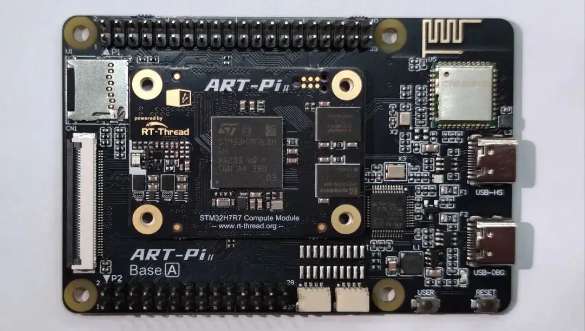

<!-- Copyright 2015-2026 Zephyr Project members and individual contributors. -->
<!-- SPDX-License-Identifier: Apache-2.0 -->
<!-- 中文翻译；编号、导航与译注为本地新增。 -->

<a id="art_pi2"></a>

# 第11章\_ART-Pi2

原文：[官方页面](https://docs.zephyrproject.org/latest/boards/ruiside/art_pi2/doc/index.html)。读取日期：2026-10-16；来源摘要见[来源记录](../SOURCES.md)。

开发板概览（Board Overview）

<a id="id1"></a>

[](images/art_pi2.webp)

ART-Pi2

名称（Name）：

`art_pi2`

厂商（Vendor）：

[上海睿赛德电子科技有限公司（Shanghai Ruiside Electronic Technology Co., Ltd.）](https://docs.zephyrproject.org/latest/boards/index.html#vendor=ruiside)

状态（Status）：

当前未积极维护（Not Actively Maintained）

架构（Architecture）：

[arm](https://docs.zephyrproject.org/latest/boards/index.html#arch=arm)

片上系统（SoC）：

[stm32h7r7xx](https://docs.zephyrproject.org/latest/boards/index.html#soc=stm32h7r7xx)

<a id="board-github-link"></a>

[浏览开发板源码（Browse Board Sources）](https://github.com/zephyrproject-rtos/zephyr/blob/main//boards/ruiside/art_pi2/doc/index.rst/../..)<a id="overview"></a>

## 概述（Overview）

ART-Pi2是RT-Thread团队面向嵌入式软件工程师及开源创客设计的开源硬件平台，为自主制作（DIY）项目提供丰富的扩展能力。

主要特性（Key Features）


- STM32H7R7L8HxH微控制器，64 KB闪存及620 KB SRAM，TFBGA225封装
- 板载ST-LINK/V2.1调试器／编程器
- SDIO TF卡槽
- SDIO Wi-Fi：CYWL6208
- HDC UART蓝牙：CYWL6208；HDC及原文BuleTooth拼写按来源说明
- 32 MB HyperRAM
- 64 MB HyperFlash
- 一个蓝色电源LED，指示3.3 V上电
- 两个用户LED，蓝色及红色
- 两个ST-LINK LED，蓝色及红色
- 两个按键，分别为用户及复位
- 开发板连接器（Board Connectors）：


  - USB OTG，配Type-C连接器
  - RGB888柔性印制电路（FPC）连接器

<a id="id3"></a>

更多板卡信息见[ART-Pi2网站](https://github.com/RT-Thread-Studio/sdk-bsp-stm32h7r-realthread-artpi2)[注1](#id2)。

<a id="hardware"></a>

## 硬件（Hardware）

ART-Pi2提供以下硬件组件：

STM32H7R7xx属于STM32H7高性能微控制器系列，基于高性能32位Arm Cortex-M7 RISC核，最高运行频率600 MHz。

STM32H7R7的更多信息见：


- <a id="id5"></a>

  www.st.com上的STM32H7R7L8资料[注2](#id4)（[ST网站上的STM32H7R7L8资料](https://www.st.com/en/microcontrollers-microprocessors/stm32h7r7l8.html)）
- <a id="id7"></a>

  [STM32H7Rx参考手册](https://www.st.com/resource/en/reference_manual/rm0477-stm32h7rx7sx-armbased-32bit-mcus-stmicroelectronics.pdf)[注3](#id6)

<a id="supported-features"></a>

### 支持的功能（Supported Features）

`art_pi2`开发板支持下表所列的硬件功能。

片上／板载（On-Chip / On-Board）

功能集成在片上系统（SoC）内／位于开发板上。

2 / 2

分别表示已启用／已禁用的实例数。点击数量标签，可查看开发板或SoC设备树源码（DTS）中该功能的第一个实例。

`vnd,foo`

与此功能匹配的设备树绑定兼容字符串（Compatible String）；点击链接可查看绑定文档。

<a id="art_pi2-hw-features"></a>

<a id="art_pi2-art_pi2/stm32h7r7xx-hw-features-section"></a>

#### `art_pi2/stm32h7r7xx`目标（Target）

<a id="art_pi2-art_pi2/stm32h7r7xx-hw-features-panel"></a>

<a id="art_pi2-art_pi2/stm32h7r7xx-hw-features-memory"></a>

该开发板目标的片上存储容量：456 KiB RAM、64 KiB Flash。

<a id="art_pi2-art_pi2/stm32h7r7xx-hw-features-table"></a>

<table>
<tr>
<th>类型（Type）</th>
<th>位置（Location）</th>
<th>说明（Description）</th>
<th>兼容字符串（Compatible）</th>
</tr>
<tr>
<td rowspan="1">中央处理器（CPU）</td>
<td>片上（On-Chip）</td>
<td>ARM Cortex-M7处理器（CPU）（<a href="https://github.com/zephyrproject-rtos/zephyr/blob/main/dts/arm/st/h7rs/stm32h7rs.dtsi?plain=1#L41">已启用：1</a>）</td>
<td><a href="../cpu_cortex_xtensa_binding_reference/P005_arm_cortex-m7.md#std-dtcompatible-arm-cortex-m7"><code>arm,cortex-m7</code></a></td>
</tr>
<tr>
<td rowspan="1">模数转换器（ADC）</td>
<td>片上（On-Chip）</td>
<td>STM32模数转换器（ADC）（<a href="https://github.com/zephyrproject-rtos/zephyr/blob/main/dts/arm/st/h7rs/stm32h7rs.dtsi?plain=1#L1088">已禁用：1</a>）</td>
<td><a href="../hardware/P839_STM32模数转换器绑定.md#dtbinding-st-stm32-adc"><code>st,stm32-adc</code></a></td>
</tr>
<tr>
<td rowspan="1">控制器局域网（CAN）</td>
<td>片上（On-Chip）</td>
<td>STM32 FDCAN灵活数据速率CAN控制器（CAN FD Controller）（<a href="https://github.com/zephyrproject-rtos/zephyr/blob/main/dts/arm/st/h7rs/stm32h7rs.dtsi?plain=1#L664">已禁用：2</a>）</td>
<td><a href="../can_nxp_renesas_stm32_ti_binding_reference/P012_st_stm32-fdcan.md#std-dtcompatible-st-stm32-fdcan"><code>st,stm32-fdcan</code></a></td>
</tr>
<tr>
<td rowspan="8">时钟控制（Clock Control）</td>
<td>片上（On-Chip）</td>
<td>STM32H7RS复位与时钟控制器（RCC）（<a href="https://github.com/zephyrproject-rtos/zephyr/blob/main/dts/arm/st/h7rs/stm32h7rs.dtsi?plain=1#L237">已启用：1</a>）</td>
<td><a href="../timer_reference/P169_STM32H7RS复位与时钟控制绑定.md#dtbinding-st-stm32h7rs-rcc"><code>st,stm32h7rs-rcc</code></a></td>
</tr>
<tr>
<td>片上（On-Chip）</td>
<td>STM32 外部高速时钟（HSE Clock）（<a href="https://github.com/zephyrproject-rtos/zephyr/blob/main/dts/arm/st/h7rs/stm32h7rs.dtsi?plain=1#L100">已启用：1</a>）</td>
<td><a href="../timer_reference/P129_STM32高速外部时钟绑定.md#dtbinding-st-stm32-hse-clock"><code>st,stm32-hse-clock</code></a></td>
</tr>
<tr>
<td>片上（On-Chip）</td>
<td>STM32高速内部时钟（HSI）（<a href="https://github.com/zephyrproject-rtos/zephyr/blob/main/dts/arm/st/h7rs/stm32h7rs.dtsi?plain=1#L107">已禁用：1</a>）</td>
<td><a href="../timer_reference/P146_STM32H7内部高速时钟绑定.md#dtbinding-st-stm32h7-hsi-clock"><code>st,stm32h7-hsi-clock</code></a></td>
</tr>
<tr>
<td>片上（On-Chip）</td>
<td>通用固定频率时钟提供者（Fixed-Rate Clock Provider）（<a href="https://github.com/zephyrproject-rtos/zephyr/blob/main/dts/arm/st/h7rs/stm32h7rs.dtsi?plain=1#L115">已启用：1</a>；<a href="https://github.com/zephyrproject-rtos/zephyr/blob/main/dts/arm/st/h7rs/stm32h7rs.dtsi?plain=1#L122">已禁用：2</a>）</td>
<td><a href="../hardware/P566_固定时钟绑定.md#dtbinding-fixed-clock"><code>fixed-clock</code></a></td>
</tr>
<tr>
<td>片上（On-Chip）</td>
<td>STM32低速外部时钟（LSE Clock）（<a href="https://github.com/zephyrproject-rtos/zephyr/blob/main/dts/arm/st/h7rs/stm32h7rs.dtsi?plain=1#L129">已禁用：1</a>）</td>
<td><a href="../timer_reference/P130_STM32低速外部时钟绑定.md#dtbinding-st-stm32-lse-clock"><code>st,stm32-lse-clock</code></a></td>
</tr>
<tr>
<td>片上（On-Chip）</td>
<td>STM32H7RS主锁相环（PLL）（<a href="https://github.com/zephyrproject-rtos/zephyr/blob/main/dts/arm/st/h7rs/stm32h7rs.dtsi?plain=1#L144">已启用：1</a>；<a href="https://github.com/zephyrproject-rtos/zephyr/blob/main/dts/arm/st/h7rs/stm32h7rs.dtsi?plain=1#L151">已禁用：2</a>）</td>
<td><a href="../timer_reference/P155_STM32H7RS锁相环时钟绑定.md#dtbinding-st-stm32h7rs-pll-clock"><code>st,stm32h7rs-pll-clock</code></a></td>
</tr>
<tr>
<td>片上（On-Chip）</td>
<td>STM32 时钟多路复用器（Clock Multiplexer）（<a href="https://github.com/zephyrproject-rtos/zephyr/blob/main/dts/arm/st/h7rs/stm32h7rs.dtsi?plain=1#L165">已禁用：1</a>）</td>
<td><a href="../timer_reference/P133_STM32时钟多路复用绑定.md#dtbinding-st-stm32-clock-mux"><code>st,stm32-clock-mux</code></a></td>
</tr>
<tr>
<td>片上（On-Chip）</td>
<td>STM32 微控制器时钟输出（Microcontroller Clock Output，MCO）（<a href="https://github.com/zephyrproject-rtos/zephyr/blob/main/dts/arm/st/h7rs/stm32h7rs.dtsi?plain=1#L173">已禁用：2</a>）</td>
<td><a href="../timer_reference/P134_STM32时钟输出绑定.md#dtbinding-st-stm32-clock-mco"><code>st,stm32-clock-mco</code></a></td>
</tr>
<tr>
<td rowspan="1">计数器（Counter）</td>
<td>片上（On-Chip）</td>
<td>STM32 计数器（Counters）（<a href="https://github.com/zephyrproject-rtos/zephyr/blob/main/dts/arm/st/h7rs/stm32h7rs.dtsi?plain=1#L753">已禁用：14</a>）</td>
<td><a href="../stm32_ti_xilinx_counter_binding_reference/P007_st_stm32-counter.md#std-dtcompatible-st-stm32-counter"><code>st,stm32-counter</code></a></td>
</tr>
<tr>
<td rowspan="1">循环冗余校验（CRC）</td>
<td>片上（On-Chip）</td>
<td>STM32 CRC 计算单元（Calculation Unit）（<a href="https://github.com/zephyrproject-rtos/zephyr/blob/main/dts/arm/st/h7rs/stm32h7rs.dtsi?plain=1#L1318">已禁用：1</a>）</td>
<td><a href="../crc_clock_monitor_binding_reference/P011_st_stm32-crc.md#std-dtcompatible-st-stm32-crc"><code>st,stm32-crc</code></a></td>
</tr>
<tr>
<td rowspan="1">密码学加速器（Cryptographic Accelerator）</td>
<td>片上（On-Chip）</td>
<td>STM32哈希处理器（HASH Processor）（<a href="https://github.com/zephyrproject-rtos/zephyr/blob/main/dts/arm/st/h7rs/stm32h7rs.dtsi?plain=1#L1131">已禁用：1</a>）</td>
<td><a href="../crypto_secure_engine_st_ti_binding_reference/P017_st_stm32-hash.md#std-dtcompatible-st-stm32-hash"><code>st,stm32-hash</code></a></td>
</tr>
<tr>
<td rowspan="3">显示（Display）</td>
<td>片上（On-Chip）</td>
<td>STM32 LCD-TFT 显示控制器（Display Controller）（<a href="https://github.com/zephyrproject-rtos/zephyr/blob/main/dts/arm/st/h7rs/stm32h7rs.dtsi?plain=1#L1276">已禁用：1</a>）</td>
<td><a href="../display_st_ultrachip_zephyr_binding_reference/P004_st_stm32-ltdc.md#std-dtcompatible-st-stm32-ltdc"><code>st,stm32-ltdc</code></a></td>
</tr>
<tr>
<td>片上（On-Chip）</td>
<td>STM32 NeoChrom-GPU2D加速器（<a href="https://github.com/zephyrproject-rtos/zephyr/blob/main/dts/arm/st/h7rs/stm32h7rs.dtsi?plain=1#L1308">已禁用：1</a>）</td>
<td><a href="../display_st_ultrachip_zephyr_binding_reference/P002_st_neochrom-gpu2d.md#std-dtcompatible-st-neochrom-gpu2d"><code>st,neochrom-gpu2d</code></a></td>
</tr>
<tr>
<td>片上（On-Chip）</td>
<td>STM32 Chrom-ART 图形加速器（Accelerator，DMA2D）（<a href="https://github.com/zephyrproject-rtos/zephyr/blob/main/dts/arm/st/h7rs/stm32h7rs.dtsi?plain=1#L1335">已禁用：1</a>）</td>
<td><a href="../display_st_ultrachip_zephyr_binding_reference/P003_st_stm32-dma2d.md#std-dtcompatible-st-stm32-dma2d"><code>st,stm32-dma2d</code></a></td>
</tr>
<tr>
<td rowspan="1">直接存储器访问（DMA）</td>
<td>片上（On-Chip）</td>
<td>STM32U5直接存储器访问（DMA）控制器（<a href="https://github.com/zephyrproject-rtos/zephyr/blob/main/dts/arm/st/h7rs/stm32h7rs.dtsi?plain=1#L1193">已禁用：2</a>）</td>
<td><a href="../stm32_ti_xilinx_dma_binding_reference/P012_st_stm32u5-dma.md#std-dtcompatible-st-stm32u5-dma"><code>st,stm32u5-dma</code></a></td>
</tr>
<tr>
<td rowspan="3">以太网（Ethernet）</td>
<td>片上（On-Chip）</td>
<td>ST STM32 以太网媒体访问控制器（Ethernet MAC）（<a href="https://github.com/zephyrproject-rtos/zephyr/blob/main/dts/arm/st/h7rs/stm32h7rs.dtsi?plain=1#L1140">已禁用：1</a>）</td>
<td><a href="../ethernet_synopsys_st_xilinx_binding_reference/P011_st_stm32h7-ethernet.md#std-dtcompatible-st-stm32h7-ethernet"><code>st,stm32h7-ethernet</code></a></td>
</tr>
<tr>
<td>片上（On-Chip）</td>
<td>Synopsys DesignWare MAC 的管理数据输入输出控制器（MDIO Controller）（<a href="https://github.com/zephyrproject-rtos/zephyr/blob/main/dts/arm/st/h7rs/stm32h7rs.dtsi?plain=1#L1154">已禁用：1</a>）</td>
<td><a href="../ethernet_mdio_microchip_binding_reference/P010_snps_dwmac-mdio.md#std-dtcompatible-snps-dwmac-mdio"><code>snps,dwmac-mdio</code></a></td>
</tr>
<tr>
<td>片上（On-Chip）</td>
<td>Synopsys DesignWare MAC 精确时间协议时钟（Precision Time Protocol，PTP Clock）（<a href="https://github.com/zephyrproject-rtos/zephyr/blob/main/dts/arm/st/h7rs/stm32h7rs.dtsi?plain=1#L1161">已启用：1</a>）</td>
<td><a href="../ethernet_synopsys_st_xilinx_binding_reference/P006_snps_dwmac-ptp-clock.md#std-dtcompatible-snps-dwmac-ptp-clock"><code>snps,dwmac-ptp-clock</code></a></td>
</tr>
<tr>
<td rowspan="1">闪存控制器（Flash Controller）</td>
<td>片上（On-Chip）</td>
<td>STM32 系列闪存控制器（Flash Controller）（<a href="https://github.com/zephyrproject-rtos/zephyr/blob/main/dts/arm/st/h7rs/stm32h7rs.dtsi?plain=1#L187">已启用：1</a>）</td>
<td><a href="../flash_renesas_st_ti_binding_reference/P011_st_stm32-flash-controller.md#std-dtcompatible-st-stm32-flash-controller"><code>st,stm32-flash-controller</code></a></td>
</tr>
<tr>
<td rowspan="1">通用输入输出与接插件（GPIO &amp; Headers）</td>
<td>片上（On-Chip）</td>
<td>STM32 通用输入输出控制器（GPIO Controller）（<a href="https://github.com/zephyrproject-rtos/zephyr/blob/main/dts/arm/st/h7rs/stm32h7rs.dtsi?plain=1#L298">已启用：12</a>）</td>
<td><a href="../gpio_silabs_st_connectors_binding_reference/P029_st_stm32-gpio.md#std-dtcompatible-st-stm32-gpio"><code>st,stm32-gpio</code></a></td>
</tr>
<tr>
<td rowspan="1">集成电路间总线（I2C）</td>
<td>片上（On-Chip）</td>
<td>STM32 I2C V2 控制器（Controller）（<a href="https://github.com/zephyrproject-rtos/zephyr/blob/main/dts/arm/st/h7rs/stm32h7rs.dtsi?plain=1#L484">已禁用：3</a>）</td>
<td><a href="../i2c_stm32_ti_mux_binding_reference/P008_st_stm32-i2c-v2.md#std-dtcompatible-st-stm32-i2c-v2"><code>st,stm32-i2c-v2</code></a></td>
</tr>
<tr>
<td rowspan="2">集成电路间音频总线（I2S）</td>
<td>片上（On-Chip）</td>
<td>STM32H7 I2S控制器（<a href="https://github.com/zephyrproject-rtos/zephyr/blob/main/dts/arm/st/h7rs/stm32h7rs.dtsi?plain=1#L534">已禁用：4</a>）</td>
<td><a href="../i2s_binding_reference/P018_st_stm32h7-i2s.md#std-dtcompatible-st-stm32h7-i2s"><code>st,stm32h7-i2s</code></a></td>
</tr>
<tr>
<td>片上（On-Chip）</td>
<td>STM32 串行音频接口块控制器（SAI Block Controller）（<a href="https://github.com/zephyrproject-rtos/zephyr/blob/main/dts/arm/st/h7rs/stm32h7rs.dtsi?plain=1#L1220">已禁用：2</a>）</td>
<td><a href="../i2s_binding_reference/P017_st_stm32-sai.md#std-dtcompatible-st-stm32-sai"><code>st,stm32-sai</code></a></td>
</tr>
<tr>
<td rowspan="1">输入（Input）</td>
<td>板载（On-Board）</td>
<td>一组绑定到 GPIO 的输入按键（GPIO-Bound Input Keys）（<a href="https://github.com/zephyrproject-rtos/zephyr/blob/main/boards/ruiside/art_pi2/art_pi2.dts?plain=1#L37">已启用：1</a>）</td>
<td><a href="../hardware/P563_GPIO按键绑定.md#std-dtcompatible-gpio-keys"><code>gpio-keys</code></a></td>
</tr>
<tr>
<td rowspan="2">中断控制器（Interrupt Controller）</td>
<td>片上（On-Chip）</td>
<td>ARMv7-M 嵌套向量中断控制器（Nested Vectored Interrupt Controller，NVIC）（<a href="https://github.com/zephyrproject-rtos/zephyr/blob/main/dts/arm/armv7-m.dtsi?plain=1#L13">已启用：1</a>）</td>
<td><a href="../arm_interrupt_timer_binding_reference/P002_ARMv7_M_NVIC.md#std-dtcompatible-arm-v7m-nvic"><code>arm,v7m-nvic</code></a></td>
</tr>
<tr>
<td>片上（On-Chip）</td>
<td>STM32H7RS外部中断控制器（External Interrupt Controller）（<a href="https://github.com/zephyrproject-rtos/zephyr/blob/main/dts/arm/st/h7rs/stm32h7rs.dtsi?plain=1#L268">已启用：1</a>）</td>
<td><a href="../mcu_external_interrupt_binding_reference/P003_st_stm32h7rs-exti.md#std-dtcompatible-st-stm32h7rs-exti"><code>st,stm32h7rs-exti</code></a></td>
</tr>
<tr>
<td rowspan="1">发光二极管（LED）</td>
<td>板载（On-Board）</td>
<td>一组由 GPIO 控制的 LED（GPIO-Controlled LEDs）（<a href="https://github.com/zephyrproject-rtos/zephyr/blob/main/boards/ruiside/art_pi2/art_pi2.dts?plain=1#L23">已启用：1</a>）</td>
<td><a href="../hardware/P564_GPIO指示灯绑定.md#dtbinding-gpio-leds"><code>gpio-leds</code></a></td>
</tr>
<tr>
<td rowspan="1">存储器控制器（Memory Controller）</td>
<td>片上（On-Chip）</td>
<td>STM32 电池备份 RAM（Battery-Backed RAM）（<a href="https://github.com/zephyrproject-rtos/zephyr/blob/main/dts/arm/st/h7rs/stm32h7rs.dtsi?plain=1#L477">已禁用：1</a>）</td>
<td><a href="../memory_controller_sdram_psram_binding_reference/P010_st_stm32-bbram.md#std-dtcompatible-st-stm32-bbram"><code>st,stm32-bbram</code></a></td>
</tr>
<tr>
<td rowspan="1">内存管理单元／内存保护单元（MMU / MPU）</td>
<td>片上（On-Chip）</td>
<td>ARMv7-M存储器保护单元（MPU / Memory Protection Unit）（<a href="https://github.com/zephyrproject-rtos/zephyr/blob/main/dts/arm/st/h7rs/stm32h7rs.dtsi?plain=1#L48">已启用：1</a>）</td>
<td><a href="../memory_protection_binding_reference/P005_arm_armv7m-mpu.md#std-dtcompatible-arm-armv7m-mpu"><code>arm,armv7m-mpu</code></a></td>
</tr>
<tr>
<td rowspan="1">存储技术设备（MTD）</td>
<td>片上（On-Chip）</td>
<td>STM32闪存（Flash Memory）（<a href="https://github.com/zephyrproject-rtos/zephyr/blob/main/dts/arm/st/h7rs/stm32h7rs.dtsi?plain=1#L196">已启用：1</a>）</td>
<td><a href="../mtd_nxp_st_ti_partition_binding_reference/P016_st_stm32-nv-flash.md#std-dtcompatible-st-stm32-nv-flash"><code>st,stm32-nv-flash</code></a></td>
</tr>
<tr>
<td rowspan="1">非易失存储器（NVMEM）</td>
<td>片上（On-Chip）</td>
<td>非易失存储器固定布局（Fixed Layout for Non-Volatile Memory）（<a href="https://github.com/zephyrproject-rtos/zephyr/blob/main/dts/arm/st/h7rs/stm32h7rs.dtsi?plain=1#L211">已启用：1</a>）</td>
<td><a href="../memory_protection_binding_reference/P009_fixed-layout.md#std-dtcompatible-fixed-layout"><code>fixed-layout</code></a></td>
</tr>
<tr>
<td rowspan="1">一次性可编程存储器（OTP Memory）</td>
<td>片上（On-Chip）</td>
<td>STM32 嵌入式非易失一次性可编程存储器（NVM OTP）（<a href="https://github.com/zephyrproject-rtos/zephyr/blob/main/dts/arm/st/h7rs/stm32h7rs.dtsi?plain=1#L207">已启用：1</a>）</td>
<td><a href="../otp_binding_reference/P010_st_stm32-nvm-otp.md#std-dtcompatible-st-stm32-nvm-otp"><code>st,stm32-nvm-otp</code></a></td>
</tr>
<tr>
<td rowspan="2">物理层（PHY）</td>
<td>片上（On-Chip）</td>
<td>用于所有内置于 USB IP 的 USB 收发器（USB Transceivers）的绑定。（<a href="https://github.com/zephyrproject-rtos/zephyr/blob/main/dts/arm/st/h7rs/stm32h7rs.dtsi?plain=1#L1360">已启用：1</a>）</td>
<td><a href="../phy_binding_reference/P008_usb-nop-xceiv.md#std-dtcompatible-usb-nop-xceiv"><code>usb-nop-xceiv</code></a></td>
</tr>
<tr>
<td>片上（On-Chip）</td>
<td>STM32 USB高速物理层控制器（USBPHYC）（<a href="https://github.com/zephyrproject-rtos/zephyr/blob/main/dts/arm/st/h7rs/stm32h7rs.dtsi?plain=1#L1365">已禁用：1</a>）</td>
<td><a href="../phy_binding_reference/P004_st_stm32-usbphyc.md#std-dtcompatible-st-stm32-usbphyc"><code>st,stm32-usbphyc</code></a></td>
</tr>
<tr>
<td rowspan="1">引脚控制（Pin Control）</td>
<td>片上（On-Chip）</td>
<td>STM32 引脚控制器（Pin Controller）（<a href="https://github.com/zephyrproject-rtos/zephyr/blob/main/dts/arm/st/h7rs/stm32h7rs.dtsi?plain=1#L291">已启用：1</a>）</td>
<td><a href="../pinctrl_stm32_ti_xilinx_binding_reference/P004_st_stm32-pinctrl.md#std-dtcompatible-st-stm32-pinctrl"><code>st,stm32-pinctrl</code></a></td>
</tr>
<tr>
<td rowspan="2">电源管理（Power Management）</td>
<td>片上（On-Chip）</td>
<td>STM32H7R/S电源控制器（<a href="https://github.com/zephyrproject-rtos/zephyr/blob/main/dts/arm/st/h7rs/stm32h7rs.dtsi?plain=1#L259">已启用：1</a>）</td>
<td><a href="../stm32_soc_power_binding_reference/P015_st_stm32h7rs-pwr.md#std-dtcompatible-st-stm32h7rs-pwr"><code>st,stm32h7rs-pwr</code></a></td>
</tr>
<tr>
<td>片上（On-Chip）</td>
<td>STM32输入输出单元（I/O Cell）控制器（<a href="https://github.com/zephyrproject-rtos/zephyr/blob/main/dts/arm/st/h7rs/stm32h7rs.dtsi?plain=1#L1343">已启用：1</a>）</td>
<td><a href="../stm32_soc_power_binding_reference/P008_st_stm32-iocell.md#std-dtcompatible-st-stm32-iocell"><code>st,stm32-iocell</code></a></td>
</tr>
<tr>
<td rowspan="1">脉宽调制（PWM）</td>
<td>片上（On-Chip）</td>
<td>STM32 脉宽调制（PWM）（<a href="https://github.com/zephyrproject-rtos/zephyr/blob/main/dts/arm/st/h7rs/stm32h7rs.dtsi?plain=1#L747">已禁用：12</a>）</td>
<td><a href="../pwm_stm32_ti_generic_binding_reference/P011_st_stm32-pwm.md#std-dtcompatible-st-stm32-pwm"><code>st,stm32-pwm</code></a></td>
</tr>
<tr>
<td rowspan="1">复位控制器（Reset Controller）</td>
<td>片上（On-Chip）</td>
<td>STM32 复位与时钟控制器（Reset and Clock Control，RCC）（<a href="https://github.com/zephyrproject-rtos/zephyr/blob/main/dts/arm/st/h7rs/stm32h7rs.dtsi?plain=1#L243">已启用：1</a>）</td>
<td><a href="../reset_controller_binding_reference/P017_st_stm32-rcc-rctl.md#std-dtcompatible-st-stm32-rcc-rctl"><code>st,stm32-rcc-rctl</code></a></td>
</tr>
<tr>
<td rowspan="1">随机数生成器（RNG）</td>
<td>片上（On-Chip）</td>
<td>STM32 随机数生成器（Random Number Generator）（<a href="https://github.com/zephyrproject-rtos/zephyr/blob/main/dts/arm/st/h7rs/stm32h7rs.dtsi?plain=1#L1121">已启用：1</a>）</td>
<td><a href="../soc_rng_binding_reference/P016_st_stm32-rng.md#std-dtcompatible-st-stm32-rng"><code>st,stm32-rng</code></a></td>
</tr>
<tr>
<td rowspan="1">实时时钟（RTC）</td>
<td>片上（On-Chip）</td>
<td>STM32 实时时钟（RTC）（<a href="https://github.com/zephyrproject-rtos/zephyr/blob/main/dts/arm/st/h7rs/stm32h7rs.dtsi?plain=1#L467">已禁用：1</a>）</td>
<td><a href="../soc_rtc_binding_reference/P014_st_stm32-rtc.md#std-dtcompatible-st-stm32-rtc"><code>st,stm32-rtc</code></a></td>
</tr>
<tr>
<td rowspan="1">SD 主机控制器（SDHC）</td>
<td>片上（On-Chip）</td>
<td>STM32 SDMMC 主机控制器（Host Controller）（<a href="https://github.com/zephyrproject-rtos/zephyr/blob/main/dts/arm/st/h7rs/stm32h7rs.dtsi?plain=1#L249">已禁用：1</a>）</td>
<td><a href="../sdhc_binding_reference/P019_st_stm32-sdmmc.md#std-dtcompatible-st-stm32-sdmmc"><code>st,stm32-sdmmc</code></a></td>
</tr>
<tr>
<td rowspan="5">传感器（Sensors）</td>
<td>片上（On-Chip）</td>
<td>STM32 正交解码器（Quadrature Decoder）（<a href="https://github.com/zephyrproject-rtos/zephyr/blob/main/dts/arm/st/h7rs/stm32h7rs.dtsi?plain=1#L758">已禁用：5</a>）</td>
<td><a href="../sensor_st_lsm_stm32_binding_reference/P028_st_stm32-qdec.md#std-dtcompatible-st-stm32-qdec"><code>st,stm32-qdec</code></a></td>
</tr>
<tr>
<td>片上（On-Chip）</td>
<td>STM32 系列温度节点（TEMP），用于以两个温度点完成生产校准的传感器。（<a href="https://github.com/zephyrproject-rtos/zephyr/blob/main/dts/arm/st/h7rs/stm32h7rs.dtsi?plain=1#L1375">已禁用：1</a>）</td>
<td><a href="../sensor_st_lsm_stm32_binding_reference/P029_st_stm32-temp-cal.md#std-dtcompatible-st-stm32-temp-cal"><code>st,stm32-temp-cal</code></a></td>
</tr>
<tr>
<td>片上（On-Chip）</td>
<td>STM32 电池电压（VBAT）（<a href="https://github.com/zephyrproject-rtos/zephyr/blob/main/dts/arm/st/h7rs/stm32h7rs.dtsi?plain=1#L1387">已启用：1</a>）</td>
<td><a href="../sensor_st_ti_power_capacitance_binding_reference/P001_st_stm32-vbat.md#std-dtcompatible-st-stm32-vbat"><code>st,stm32-vbat</code></a></td>
</tr>
<tr>
<td>片上（On-Chip）</td>
<td>STM32 参考电压（VREF+）（<a href="https://github.com/zephyrproject-rtos/zephyr/blob/main/dts/arm/st/h7rs/stm32h7rs.dtsi?plain=1#L1394">已启用：1</a>）</td>
<td><a href="../sensor_st_ti_power_capacitance_binding_reference/P003_st_stm32-vref.md#std-dtcompatible-st-stm32-vref"><code>st,stm32-vref</code></a></td>
</tr>
<tr>
<td>片上（On-Chip）</td>
<td>STM32内核供电（Vddcore）（<a href="https://github.com/zephyrproject-rtos/zephyr/blob/main/dts/arm/st/h7rs/stm32h7rs.dtsi?plain=1#L1402">已禁用：1</a>）</td>
<td><a href="../sensor_st_ti_power_capacitance_binding_reference/P002_st_stm32-vddcore.md#std-dtcompatible-st-stm32-vddcore"><code>st,stm32-vddcore</code></a></td>
</tr>
<tr>
<td rowspan="3">串行控制器（Serial Controller）</td>
<td>片上（On-Chip）</td>
<td>STM32 通用同步／异步收发器（USART）（<a href="https://github.com/zephyrproject-rtos/zephyr/blob/main/dts/arm/st/h7rs/stm32h7rs.dtsi?plain=1#L395">已禁用：3</a>）</td>
<td><a href="../uart_silabs_stm32_ti_binding_reference/P016_st_stm32-usart.md#std-dtcompatible-st-stm32-usart"><code>st,stm32-usart</code></a></td>
</tr>
<tr>
<td>片上（On-Chip）</td>
<td>STM32 通用异步收发器（UART）（<a href="https://github.com/zephyrproject-rtos/zephyr/blob/main/dts/arm/st/h7rs/stm32h7rs.dtsi?plain=1#L422">已启用：1</a>；<a href="https://github.com/zephyrproject-rtos/zephyr/blob/main/dts/arm/st/h7rs/stm32h7rs.dtsi?plain=1#L431">已禁用：3</a>）</td>
<td><a href="../uart_silabs_stm32_ti_binding_reference/P015_st_stm32-uart.md#std-dtcompatible-st-stm32-uart"><code>st,stm32-uart</code></a></td>
</tr>
<tr>
<td>片上（On-Chip）</td>
<td>STM32低功耗通用异步收发器（LPUART）（<a href="https://github.com/zephyrproject-rtos/zephyr/blob/main/dts/arm/st/h7rs/stm32h7rs.dtsi?plain=1#L458">已禁用：1</a>）</td>
<td><a href="../uart_silabs_stm32_ti_binding_reference/P014_st_stm32-lpuart.md#std-dtcompatible-st-stm32-lpuart"><code>st,stm32-lpuart</code></a></td>
</tr>
<tr>
<td rowspan="1">串行外设接口（SPI）</td>
<td>片上（On-Chip）</td>
<td>STM32H7 串行外设接口控制器（SPI Controller）（<a href="https://github.com/zephyrproject-rtos/zephyr/blob/main/dts/arm/st/h7rs/stm32h7rs.dtsi?plain=1#L520">已禁用：6</a>）</td>
<td><a href="../spi_stm32_ti_xilinx_binding_reference/P013_st_stm32h7-spi.md#std-dtcompatible-st-stm32h7-spi"><code>st,stm32h7-spi</code></a></td>
</tr>
<tr>
<td rowspan="3">定时器（Timer）</td>
<td>片上（On-Chip）</td>
<td>ARMv7-M 系统节拍（System Tick）（<a href="https://github.com/zephyrproject-rtos/zephyr/blob/main/dts/arm/armv7-m.dtsi?plain=1#L21">已启用：1</a>）</td>
<td><a href="../arm_interrupt_timer_binding_reference/P006_ARMv7_M_SysTick.md#std-dtcompatible-arm-armv7m-systick"><code>arm,armv7m-systick</code></a></td>
</tr>
<tr>
<td>片上（On-Chip）</td>
<td>STM32 定时器（Timers）（<a href="https://github.com/zephyrproject-rtos/zephyr/blob/main/dts/arm/st/h7rs/stm32h7rs.dtsi?plain=1#L736">已禁用：14</a>）</td>
<td><a href="../stm32_ti_silabs_timer_binding_reference/P008_st_stm32-timers.md#std-dtcompatible-st-stm32-timers"><code>st,stm32-timers</code></a></td>
</tr>
<tr>
<td>片上（On-Chip）</td>
<td>STM32U5低功耗定时器（LPTIM）（<a href="https://github.com/zephyrproject-rtos/zephyr/blob/main/dts/arm/st/h7rs/stm32h7rs.dtsi?plain=1#L1076">已禁用：1</a>）</td>
<td><a href="../stm32_ti_silabs_timer_binding_reference/P009_st_stm32u5-lptim.md#std-dtcompatible-st-stm32u5-lptim"><code>st,stm32u5-lptim</code></a></td>
</tr>
<tr>
<td rowspan="2">通用串行总线（USB）</td>
<td>片上（On-Chip）</td>
<td>STM32 全速 USB OTG 控制器（OTGFS Controller）（<a href="https://github.com/zephyrproject-rtos/zephyr/blob/main/dts/arm/st/h7rs/stm32h7rs.dtsi?plain=1#L1166">已禁用：1</a>）</td>
<td><a href="../usb_stm32_audio_binding_reference/P004_st_stm32-otgfs.md#std-dtcompatible-st-stm32-otgfs"><code>st,stm32-otgfs</code></a></td>
</tr>
<tr>
<td>片上（On-Chip）</td>
<td>STM32 高速 USB OTG 控制器（OTGHS Controller）（<a href="https://github.com/zephyrproject-rtos/zephyr/blob/main/dts/arm/st/h7rs/stm32h7rs.dtsi?plain=1#L1180">已禁用：1</a>）</td>
<td><a href="../usb_stm32_audio_binding_reference/P005_st_stm32-otghs.md#std-dtcompatible-st-stm32-otghs"><code>st,stm32-otghs</code></a></td>
</tr>
<tr>
<td rowspan="2">视频（Video）</td>
<td>片上（On-Chip）</td>
<td>STM32数字摄像头接口像素处理器（DCMIPP）（<a href="https://github.com/zephyrproject-rtos/zephyr/blob/main/dts/arm/st/h7rs/stm32h7rs.dtsi?plain=1#L1287">已禁用：1</a>）</td>
<td><a href="../video_st_sony_emulation_binding_reference/P005_st_stm32-dcmipp.md#std-dtcompatible-st-stm32-dcmipp"><code>st,stm32-dcmipp</code></a></td>
</tr>
<tr>
<td>片上（On-Chip）</td>
<td>STM32 JPEG硬件编解码器（HW Codec）（<a href="https://github.com/zephyrproject-rtos/zephyr/blob/main/dts/arm/st/h7rs/stm32h7rs.dtsi?plain=1#L1326">已禁用：1</a>）</td>
<td><a href="../video_st_sony_emulation_binding_reference/P006_st_stm32-jpeg.md#std-dtcompatible-st-stm32-jpeg"><code>st,stm32-jpeg</code></a></td>
</tr>
<tr>
<td rowspan="2">看门狗（Watchdog）</td>
<td>片上（On-Chip）</td>
<td>STM32 看门狗（Watchdog）（<a href="https://github.com/zephyrproject-rtos/zephyr/blob/main/dts/arm/st/h7rs/stm32h7rs.dtsi?plain=1#L721">已启用：1</a>）</td>
<td><a href="../stm32_ti_xilinx_watchdog_binding_reference/P001_st_stm32-watchdog.md#std-dtcompatible-st-stm32-watchdog"><code>st,stm32-watchdog</code></a></td>
</tr>
<tr>
<td>片上（On-Chip）</td>
<td>STM32 系统窗口看门狗（System Window Watchdog）（<a href="https://github.com/zephyrproject-rtos/zephyr/blob/main/dts/arm/st/h7rs/stm32h7rs.dtsi?plain=1#L728">已启用：1</a>）</td>
<td><a href="../stm32_ti_xilinx_watchdog_binding_reference/P002_st_stm32-window-watchdog.md#std-dtcompatible-st-stm32-window-watchdog"><code>st,stm32-window-watchdog</code></a></td>
</tr>
<tr>
<td rowspan="2">扩展串行外设接口（xSPI）</td>
<td>片上（On-Chip）</td>
<td>STM32扩展SPI（XSPI）控制器管理器（<a href="https://github.com/zephyrproject-rtos/zephyr/blob/main/dts/arm/st/h7rs/stm32h7rs.dtsi?plain=1#L690">已禁用：1</a>）</td>
<td><a href="../qspi_ospi_xspi_binding_reference/P017_st_stm32-xspim.md#std-dtcompatible-st-stm32-xspim"><code>st,stm32-xspim</code></a></td>
</tr>
<tr>
<td>片上（On-Chip）</td>
<td>STM32扩展SPI（XSPI）控制器（<a href="https://github.com/zephyrproject-rtos/zephyr/blob/main/dts/arm/st/h7rs/stm32h7rs.dtsi?plain=1#L699">已禁用：2</a>）</td>
<td><a href="../qspi_ospi_xspi_binding_reference/P016_st_stm32-xspi.md#std-dtcompatible-st-stm32-xspi"><code>st,stm32-xspi</code></a></td>
</tr>
</table>

<a id="default-zephyr-peripheral-mapping"></a>

#### Zephyr 默认外设映射（Peripheral Mapping）：

ART-Pi2配有板载ST-LINK/V2.1调试器／编程器，板级配置如下：


- UART4发送／接收（TX／RX）：PD1／PD0，连接ST-LINK虚拟COM端口
- LED1，红色：PO1
- LED2，蓝色：PO5
- 用户按键（USER PUSH-BUTTON）：PC13

<a id="system-clock"></a>

#### 系统时钟（System Clock）

ART-Pi2系统时钟可由内部振荡器、外部振荡器或主PLL提供。默认使用24 MHz高速外部时钟驱动PLL，产生250 MHz系统时钟。

<a id="serial-port"></a>

#### 串口（Serial Port）

ART-Pi2具有4路UART、3路USART及一路低功耗UART。Zephyr控制台使用UART4，默认设置为115200、8N1。

<a id="backup-sram"></a>

#### 备份SRAM（Backup SRAM）

测试备份SRAM时，可能需要断开VBAT与VDD；可移除开发板背面的SB13跳线实现。

<a id="programming-and-debugging"></a>

## 烧录与调试（Programming and Debugging）

`art_pi2`开发板支持下表所列的运行工具（Runners）及相关west命令。

<table>
<tr>
<th></th>
<th>烧录（flash）</th>
<th>调试（debug）</th>
<th>连接调试会话（attach）</th>
<th>实时传输（rtt）</th>
<th>复位（reset）</th>
<th>调试服务器（debugserver）</th>
</tr>
<tr>
<td><a href="https://docs.zephyrproject.org/latest/develop/flash_debug/host-tools.html#runner-pyocd">pyocd</a></td>
<td>✅</td>
<td>✅（默认 / default）</td>
<td>✅</td>
<td>✅</td>
<td>✅</td>
<td>✅</td>
</tr>
<tr>
<td><a href="https://docs.zephyrproject.org/latest/develop/flash_debug/host-tools.html#runner-stm32cubeprogrammer">stm32cubeprogrammer</a></td>
<td>✅（默认 / default）</td>
<td></td>
<td></td>
<td></td>
<td></td>
<td></td>
</tr>
</table>

ART-Pi2带有ST-LINK/V2.1嵌入式调试工具接口。

注意（Note）

<a id="id9"></a>

检查ST-LINK V2.1固件是否为最新版本，可使用[STM32CubeProgrammer](https://www.st.com/en/development-tools/stm32cubeprog.html) [注4](#id8)完成。

<a id="flashing"></a>

### 烧录（Flashing）

<a id="id10"></a>

开发板配置为使用west的[STM32CubeProgrammer](https://www.st.com/en/development-tools/stm32cubeprog.html) [注4](#id8)运行工具烧录，因此需先安装STM32CubeProgrammer。（[installation](https://docs.zephyrproject.org/latest/develop/flash_debug/host-tools.html#stm32cubeprog-flash-host-tools)）

<a id="flashing-an-application-to-art-pi2"></a>

#### 向ART-Pi2烧录应用

首先通过USB端口将art_pi2连接主机，做好烧录准备，再构建并烧录应用。

下面以[Hello World](../getting_started/P005_HelloWorld示例.md#hello_world)应用为例。

在主机运行串口程序连接art_pi2开发板。

```text
$ minicom -b 115200 -D /dev/ttyACM0
```

或使用`screen`：

```text
$ screen /dev/ttyACM0 115200
```

构建并烧录应用：

```text
# From the root of the zephyr repository
west build -b art_pi2 samples/hello_world
west flash
```

控制台上应显示以下消息：

```text
*** Booting Zephyr OS build v4.1.0-1907-g415ab379a8af ***
Hello World! art_pi2/stm32h7r7xx
```

也可使用Blinky示例：

```text
# From the root of the zephyr repository
west build -b art_pi2 samples/basic/blinky
west flash
```

<a id="debugging"></a>

### 调试（Debugging）

可以按常规方式调试应用。下面以[Hello World](../getting_started/P005_HelloWorld示例.md#hello_world)应用为例。

```text
# From the root of the zephyr repository
west build -b art_pi2 samples/hello_world
west debug
```

<a id="references"></a>

## 参考资料（References）

<a id="id2"></a>

〔[1](#id3)〕 [https://github.com/RT-Thread-Studio/sdk-bsp-stm32h7r-realthread-artpi2](https://github.com/RT-Thread-Studio/sdk-bsp-stm32h7r-realthread-artpi2)

<a id="id4"></a>

〔[2](#id5)〕 [https://www.st.com/en/microcontrollers-microprocessors/stm32h7r7l8.html](https://www.st.com/en/microcontrollers-microprocessors/stm32h7r7l8.html)

<a id="id6"></a>

〔[3](#id7)〕 [https://www.st.com/resource/en/reference_manual/rm0477-stm32h7rx7sx-armbased-32bit-mcus-stmicroelectronics.pdf](https://www.st.com/resource/en/reference_manual/rm0477-stm32h7rx7sx-armbased-32bit-mcus-stmicroelectronics.pdf)

<a id="id8"></a>

〔4〕 ([1](#id9),[2](#id10)) [https://www.st.com/en/development-tools/stm32cubeprog.html](https://www.st.com/en/development-tools/stm32cubeprog.html)

## 译注

ART-Pi2硬件最高600 MHz，原文默认系统时钟却为24 MHz外部源驱动PLL生成250 MHz，两者代表不同条件。UART4位于PD1／PD0；备份SRAM测试可移除SB13断开VBAT与VDD。

## 原文外链核对

2026-10-16核对并重试以下原文外链时未能确认可访问性，保留原始目标，不将访问失败解释为原文内容有误。

- [stm32cubeprog.html](https://www.st.com/en/development-tools/stm32cubeprog.html)：HTTP Error 567: Unknown Status。
- [stm32h7r7l8.html](https://www.st.com/en/microcontrollers-microprocessors/stm32h7r7l8.html)：HTTP Error 567: Unknown Status。
- [rm0477-stm32h7rx7sx-armbased-32bit-mcus-stmicroelectronics.pdf](https://www.st.com/resource/en/reference_manual/rm0477-stm32h7rx7sx-armbased-32bit-mcus-stmicroelectronics.pdf)：HTTP Error 567: Unknown Status。

---

[上一章](P010_ART-Pi.md) · [返回大纲](大纲.md) · [全站翻译进度](../PROGRESS.md) · [下一章](P012_Ruiside.md)
