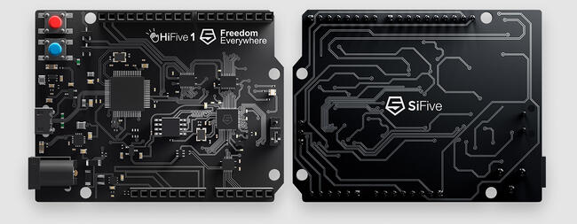

<!-- Copyright 2015-2026 Zephyr Project members and individual contributors. -->
<!-- SPDX-License-Identifier: Apache-2.0 -->
<!-- 中文翻译；编号、导航与译注为本地新增。 -->

<a id="hifive1"></a>

# 第16章\_HiFive1

原文：[官方页面](https://docs.zephyrproject.org/latest/boards/sifive/hifive1/doc/hifive1.html)。读取日期：2026-10-16；来源摘要见[来源记录](../SOURCES.md)。

开发板概览（Board Overview）

<a id="id1"></a>

[](images/hifive1.jpg)

HiFive1

名称（Name）：

`hifive1`

厂商（Vendor）：

[SiFive, Inc.](https://docs.zephyrproject.org/latest/boards/index.html#vendor=sifive)

状态（Status）：

维护中（Maintained）

架构（Architecture）：

[riscv](https://docs.zephyrproject.org/latest/boards/index.html#arch=riscv)

片上系统（SoC）：

[fe310_g000](https://docs.zephyrproject.org/latest/boards/index.html#soc=fe310_g000)

<a id="board-github-link"></a>

[浏览开发板源码（Browse Board Sources）](https://github.com/zephyrproject-rtos/zephyr/blob/main//boards/sifive/hifive1/doc/hifive1.rst/../..)<a id="overview"></a>

## 概述（Overview）

HiFive1是一款兼容Arduino的开发板，采用FE310-G000 RISC-V SoC。

<a id="id2"></a>


SiFive HiFive1开发板，图片由SiFive提供

<a id="programming-and-debugging"></a>

## 编程与调试（Programming and Debugging）

`hifive1`开发板支持下表所列的运行工具（Runners）及相关west命令。

<table>
<tr>
<th></th>
<th>烧录（flash）</th>
<th>调试（debug）</th>
<th>robot</th>
<th>simulate</th>
<th>连接调试会话（attach）</th>
<th>实时传输（rtt）</th>
<th>调试服务器（debugserver）</th>
</tr>
<tr>
<td><code>hifive1</code></td>
<td>✅（默认 / default）</td>
<td></td>
<td></td>
<td></td>
<td></td>
<td></td>
<td></td>
</tr>
<tr>
<td><a href="https://docs.zephyrproject.org/latest/develop/flash_debug/host-tools.html#runner-openocd">openocd</a></td>
<td>✅</td>
<td>✅（默认 / default）</td>
<td></td>
<td></td>
<td>✅</td>
<td>✅</td>
<td>✅</td>
</tr>
<tr>
<td>renode</td>
<td></td>
<td></td>
<td></td>
<td>✅</td>
<td></td>
<td></td>
<td></td>
</tr>
<tr>
<td>renode-robot</td>
<td></td>
<td></td>
<td>✅</td>
<td></td>
<td></td>
<td></td>
<td></td>
</tr>
</table>

<a id="building"></a>

### 构建（Building）

HiFive1板级配置的应用可使用对应开发板名称按常规方式构建，见“构建应用”：（[构建应用（Building an Application）](../application/P001_应用开发.md#build-an-application)）

```text
west build -b hifive1
```

<a id="flashing"></a>

### 烧录（Flashing）

向设备上传应用需要支持RISC-V的OpenOCD。请从[SiFive网站](https://www.sifive.com/boards)下载对应操作系统的tar归档并解压。

Zephyr SDK默认使用随附的OpenOCD。构建时添加-DOPENOCD=<path/to/riscv-openocd/bin/openocd>可覆盖这一行为：

```text
west build -b hifive1 -- -DOPENOCD=<path/to/riscv-openocd/bin/openocd>
```

使用自定义工具链时，将下载的OpenOCD可执行文件加入PATH通常即可。

现在可以按常规方式烧录应用，详情见“构建应用”及“运行应用”：（[构建应用（Building an Application）](../application/P001_应用开发.md#build-an-application)；[运行应用（Run an Application）](https://docs.zephyrproject.org/latest/develop/application/index.html#application-run)）

```text
west flash
```

根据操作系统，可能需要以超级用户（Superuser）身份执行烧录命令。

<a id="debugging"></a>

### 调试（Debugging）

详细概述见[应用调试（Application Debugging）](https://docs.zephyrproject.org/latest/develop/debug/index.html#application-debugging)。

## 译注

HiFive1为FE310-G000，使用支持RISC-V的OpenOCD；可用构建参数覆盖SDK随附OpenOCD。

---

[上一章](P015_RA8P1_Titan_Mini.md) · [返回大纲](大纲.md) · [全站翻译进度](../PROGRESS.md) · [下一章](P017_HiFive1_Rev_B.md)
