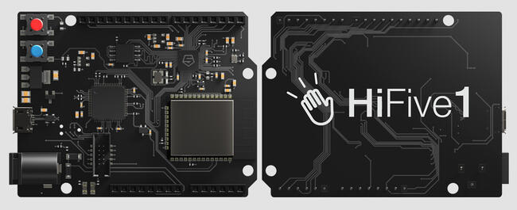

<!-- Copyright 2015-2026 Zephyr Project members and individual contributors. -->
<!-- SPDX-License-Identifier: Apache-2.0 -->
<!-- 中文翻译；编号、导航与译注为本地新增。 -->

<a id="hifive1_revb"></a>

# 第17章\_HiFive1 Rev B

原文：[官方页面](https://docs.zephyrproject.org/latest/boards/sifive/hifive1/doc/hifive1_revb.html)。读取日期：2026-10-16；来源摘要见[来源记录](../SOURCES.md)。

开发板概览（Board Overview）

<a id="id1"></a>

[](images/hifive1_revb.jpg)

HiFive1 Rev B

名称（Name）：

`hifive1_revb`

厂商（Vendor）：

[SiFive, Inc.](https://docs.zephyrproject.org/latest/boards/index.html#vendor=sifive)

状态（Status）：

维护中（Maintained）

架构（Architecture）：

[riscv](https://docs.zephyrproject.org/latest/boards/index.html#arch=riscv)

片上系统（SoC）：

[fe310_g002](https://docs.zephyrproject.org/latest/boards/index.html#soc=fe310_g002)

<a id="board-github-link"></a>

[浏览开发板源码（Browse Board Sources）](https://github.com/zephyrproject-rtos/zephyr/blob/main//boards/sifive/hifive1/doc/hifive1_revb.rst/../..)<a id="overview"></a>

## 概述（Overview）

HiFive1 Rev B是一款兼容Arduino的开发板，采用FE310-G002 RISC-V SoC。

<a id="id2"></a>



SiFive HiFive1 Rev B开发板，图片由SiFive提供

<a id="programming-and-debugging"></a>

## 编程与调试（Programming and Debugging）

`hifive1_revb`开发板支持下表所列的运行工具（Runners）及相关west命令。

<table>
<tr>
<th></th>
<th>烧录（flash）</th>
<th>调试（debug）</th>
<th>连接调试会话（attach）</th>
<th>实时传输（rtt）</th>
<th>复位（reset）</th>
<th>调试服务器（debugserver）</th>
<th>robot</th>
<th>simulate</th>
</tr>
<tr>
<td><a href="https://docs.zephyrproject.org/latest/develop/flash_debug/host-tools.html#runner-jlink">jlink</a></td>
<td>✅（默认 / default）</td>
<td>✅（默认 / default）</td>
<td>✅</td>
<td>✅</td>
<td>✅</td>
<td>✅</td>
<td></td>
<td></td>
</tr>
<tr>
<td>renode</td>
<td></td>
<td></td>
<td></td>
<td></td>
<td></td>
<td></td>
<td></td>
<td>✅</td>
</tr>
<tr>
<td>renode-robot</td>
<td></td>
<td></td>
<td></td>
<td></td>
<td></td>
<td></td>
<td>✅</td>
<td></td>
</tr>
</table>

<a id="building"></a>

### 构建（Building）

HiFive1 Rev B板级配置的应用可使用对应开发板名称按常规方式构建，见“构建应用”：（[构建应用（Building an Application）](../application/P001_应用开发.md#build-an-application)）

```text
west build -b hifive1_revb
```

<a id="flashing"></a>

### 烧录（Flashing）

HiFive1 Rev B使用SEGGER J-Link OB烧录及调试。需要安装SEGGER J-Link Software and Documentation Pack，版本为V6.46a或更新；提供Windows、Linux及macOS下载。（[SEGGER J-Link软件及文档包](https://www.segger.com/downloads/jlink#J-LinkSoftwareAndDocumentationPack)）

现在可以按常规方式烧录应用，详情见“构建应用”及“运行应用”：（[构建应用（Building an Application）](../application/P001_应用开发.md#build-an-application)；[运行应用（Run an Application）](https://docs.zephyrproject.org/latest/develop/application/index.html#application-run)）

```text
west flash
```

根据操作系统，可能需要以超级用户（Superuser）身份执行烧录命令。

<a id="debugging"></a>

### 调试（Debugging）

详细概述见[应用调试（Application Debugging）](https://docs.zephyrproject.org/latest/develop/debug/index.html#application-debugging)。

## 译注

HiFive1 Rev B为FE310-G002，使用J-Link OB，原文要求J-Link工具V6.46a或更新。

## 原文外链核对

2026-10-16核对并重试以下原文外链时未能确认可访问性，保留原始目标，不将访问失败解释为原文内容有误。

- [jlink](https://www.segger.com/downloads/jlink#J-LinkSoftwareAndDocumentationPack)：页面可访问，但未确认目标片段。

---

[上一章](P016_HiFive1.md) · [返回大纲](大纲.md) · [全站翻译进度](../PROGRESS.md) · [下一章](P018_HiFive_Unleashed.md)
