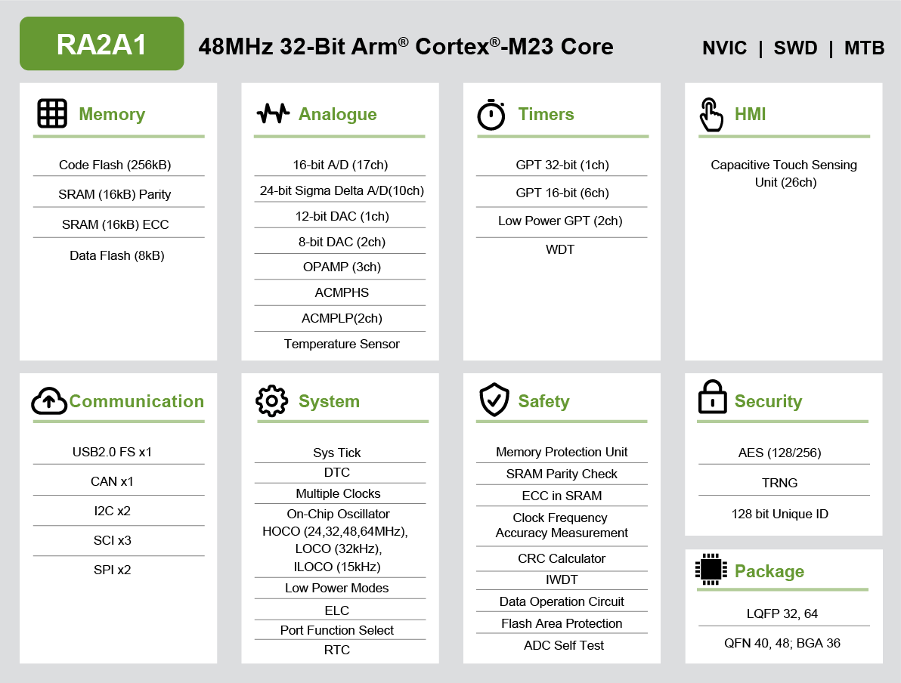

<!-- Copyright 2015-2026 Zephyr Project members and individual contributors. -->
<!-- SPDX-License-Identifier: Apache-2.0 -->
<!-- 中文翻译；编号、导航与译注为本地新增。 -->

<a id="ek_ra2a1"></a>

# 第5章\_RA2A1评估套件（Evaluation Kit）

原文：[官方页面](https://docs.zephyrproject.org/latest/boards/renesas/ek_ra2a1/doc/index.html)。读取日期：2026-10-16；来源摘要见[来源记录](../SOURCES.md)。

开发板概览（Board Overview）

<a id="id1"></a>

[](images/ek_ra2a1.webp)

RA2A1评估套件（Evaluation Kit）

名称（Name）：

`ek_ra2a1`

厂商（Vendor）：

[瑞萨电子（Renesas Electronics Corporation）](https://docs.zephyrproject.org/latest/boards/index.html#vendor=renesas)

状态（Status）：

维护中（Maintained）

架构（Architecture）：

[arm](https://docs.zephyrproject.org/latest/boards/index.html#arch=arm)

片上系统（SoC）：

[r7fa2a1ab3cfm](https://docs.zephyrproject.org/latest/boards/index.html#soc=r7fa2a1ab3cfm)

<a id="board-github-link"></a>

[浏览开发板源码（Browse Board Sources）](https://github.com/zephyrproject-rtos/zephyr/blob/main//boards/renesas/ek_ra2a1/doc/index.rst/../..)<a id="overview"></a>

## 概述（Overview）

EK-RA2A1是瑞萨RA2A1微控制器组的评估套件。

瑞萨RA2A1微控制器组具有以下功能：


- 48 MHz Arm Cortex-M23内核
- 256 kB代码闪存、8 kB数据闪存、32 kB SRAM
- USB 2.0全速；原文拼作Full-Sppeed
- 3路串行通信接口（SCI）
- 2路SPI
- 2路I2C
- 1路CAN
- 16位模数转换器（A/D Converter）
- 24位Σ-Δ模数转换器（Sigma-Delta ADC）
- 12位数模转换器（D/A Converter）
- 2个8位数模转换器
- 高速模拟比较器
- 低功耗模拟比较器
- 3个运算放大器（OPAMP）
- 温度传感器（Temperature Sensor）
- 1个32位通用PWM定时器
- 6个16位通用PWM定时器
- 2个低功耗异步通用定时器
- 看门狗定时器（Watchdog Timer）
- 49个输入输出引脚

<a id="hardware"></a>

## 硬件（Hardware）

<a id="id4"></a>

RA2A1 MCU硬件详情见[RA2A1组用户手册硬件篇](https://www.renesas.com/en/document/mah/renesas-ra2a1-group-users-manual-hardware)[注1](#id3)。

<a id="id2"></a>

[](images/ra2a1_block_diagram.webp)

RA2A1框图，图片来源：瑞萨电子

<a id="id5"></a>

EK-RA2A1硬件详情见用户手册[注1](#id3)。（[EK-RA2A1用户手册](https://www.renesas.com/en/document/mah/renesas-ra2a1-group-users-manual-hardware)）

EK-RA2A1具有以下功能：


- 四组40针公排针，直接访问MCU引脚
- MCU电流测量点
- 板载SEGGER J-Link编程器及调试器
- 两个Digilent Pmod接口，SPI及UART
- 用户LED（User LED）
- 机械式用户按键
- 电容式用户按键

<a id="supported-features"></a>

### 支持的功能（Supported Features）

`ek_ra2a1`开发板支持下表所列的硬件功能。

片上／板载（On-Chip / On-Board）

功能集成在片上系统（SoC）内／位于开发板上。

2 / 2

分别表示已启用／已禁用的实例数。点击数量标签，可查看开发板或SoC设备树源码（DTS）中该功能的第一个实例。

`vnd,foo`

与此功能匹配的设备树绑定兼容字符串（Compatible String）；点击链接可查看绑定文档。

<a id="ek_ra2a1-hw-features"></a>

<a id="ek_ra2a1-ek_ra2a1/r7fa2a1ab3cfm-hw-features-section"></a>

#### `ek_ra2a1/r7fa2a1ab3cfm`目标（Target）

<a id="ek_ra2a1-ek_ra2a1/r7fa2a1ab3cfm-hw-features-panel"></a>

<a id="ek_ra2a1-ek_ra2a1/r7fa2a1ab3cfm-hw-features-memory"></a>

该开发板目标的片上存储容量：32 KiB RAM、256 KiB Flash。

<a id="ek_ra2a1-ek_ra2a1/r7fa2a1ab3cfm-hw-features-table"></a>

<table>
<tr>
<th>类型（Type）</th>
<th>位置（Location）</th>
<th>说明（Description）</th>
<th>兼容字符串（Compatible）</th>
</tr>
<tr>
<td rowspan="1">中央处理器（CPU）</td>
<td>片上（On-Chip）</td>
<td>Arm Cortex-M23 CPU（<a href="https://github.com/zephyrproject-rtos/zephyr/blob/main/dts/arm/renesas/ra/ra2/ra2xx.dtsi?plain=1#L21">已启用：1</a>）</td>
<td><a href="../cpu_arm_riscv_binding_reference/P020_arm_cortex-m23.md#std-dtcompatible-arm-cortex-m23"><code>arm,cortex-m23</code></a></td>
</tr>
<tr>
<td rowspan="1">模数转换器（ADC）</td>
<td>片上（On-Chip）</td>
<td>瑞萨RA 16位分辨率ADC（ADC16）（<a href="https://github.com/zephyrproject-rtos/zephyr/blob/main/dts/arm/renesas/ra/ra2/ra2xx.dtsi?plain=1#L331">已启用：1</a>）</td>
<td><a href="../hardware/P869_RenesasRAADC16绑定.md#dtbinding-renesas-ra-adc16"><code>renesas,ra-adc16</code></a></td>
</tr>
<tr>
<td rowspan="5">时钟控制（Clock Control）</td>
<td>片上（On-Chip）</td>
<td>Renesas RA时钟生成电路（Clock Generation Circuit）的外部时钟配置（<a href="https://github.com/zephyrproject-rtos/zephyr/blob/main/dts/arm/renesas/ra/ra2/r7fa2a1xh.dtsi?plain=1#L134">已启用：1</a>）</td>
<td><a href="../clock_nxp_pico_realtek_renesas_binding_reference/P029_renesas_ra-cgc-external-clock.md#std-dtcompatible-renesas-ra-cgc-external-clock"><code>renesas,ra-cgc-external-clock</code></a></td>
</tr>
<tr>
<td>片上（On-Chip）</td>
<td>通用固定频率时钟提供者（Fixed-Rate Clock Provider）（<a href="https://github.com/zephyrproject-rtos/zephyr/blob/main/dts/arm/renesas/ra/ra2/r7fa2a1xh.dtsi?plain=1#L141">已启用：3</a>）</td>
<td><a href="../hardware/P566_固定时钟绑定.md#dtbinding-fixed-clock"><code>fixed-clock</code></a></td>
</tr>
<tr>
<td>片上（On-Chip）</td>
<td>Renesas RA子时钟（Sub-Clock）（<a href="https://github.com/zephyrproject-rtos/zephyr/blob/main/dts/arm/renesas/ra/ra2/r7fa2a1xh.dtsi?plain=1#L159">已启用：1</a>）</td>
<td><a href="../clock_renesas_rockchip_sifli_silabs_binding_reference/P004_renesas_ra-cgc-subclk.md#std-dtcompatible-renesas-ra-cgc-subclk"><code>renesas,ra-cgc-subclk</code></a></td>
</tr>
<tr>
<td>片上（On-Chip）</td>
<td>Renesas RA时钟控制节点的pclk模块（<a href="https://github.com/zephyrproject-rtos/zephyr/blob/main/dts/arm/renesas/ra/ra2/r7fa2a1xh.dtsi?plain=1#L166">已启用：1</a>）</td>
<td><a href="../clock_nxp_pico_realtek_renesas_binding_reference/P030_renesas_ra-cgc-pclk-block.md#std-dtcompatible-renesas-ra-cgc-pclk-block"><code>renesas,ra-cgc-pclk-block</code></a></td>
</tr>
<tr>
<td>片上（On-Chip）</td>
<td>Renesas RA时钟控制外设时钟（Peripheral Clock）（<a href="https://github.com/zephyrproject-rtos/zephyr/blob/main/dts/arm/renesas/ra/ra2/r7fa2a1xh.dtsi?plain=1#L176">已启用：4</a>；<a href="https://github.com/zephyrproject-rtos/zephyr/blob/main/dts/arm/renesas/ra/ra2/r7fa2a1xh.dtsi?plain=1#L205">已禁用：3</a>）</td>
<td><a href="../clock_renesas_rockchip_sifli_silabs_binding_reference/P001_renesas_ra-cgc-pclk.md#std-dtcompatible-renesas-ra-cgc-pclk"><code>renesas,ra-cgc-pclk</code></a></td>
</tr>
<tr>
<td rowspan="1">计数器（Counter）</td>
<td>片上（On-Chip）</td>
<td>用作计数器的Renesas RA异步通用定时器（AGT）（<a href="https://github.com/zephyrproject-rtos/zephyr/blob/main/dts/arm/renesas/ra/ra2/ra2xx.dtsi?plain=1#L352">已禁用：2</a>）</td>
<td><a href="../renesas_realtek_counter_binding_reference/P014_renesas_ra-agt-counter.md#std-dtcompatible-renesas-ra-agt-counter"><code>renesas,ra-agt-counter</code></a></td>
</tr>
<tr>
<td rowspan="1">循环冗余校验（CRC）</td>
<td>片上（On-Chip）</td>
<td>Renesas RA循环冗余校验（CRC）设备（<a href="https://github.com/zephyrproject-rtos/zephyr/blob/main/dts/arm/renesas/ra/ra2/ra2xx.dtsi?plain=1#L373">已启用：1</a>）</td>
<td><a href="../crc_clock_monitor_binding_reference/P008_renesas_ra-crc.md#std-dtcompatible-renesas-ra-crc"><code>renesas,ra-crc</code></a></td>
</tr>
<tr>
<td rowspan="2">数模转换器（DAC）</td>
<td>片上（On-Chip）</td>
<td>Renesas RA数模转换器全局控制器（DAC Controller Global）（<a href="https://github.com/zephyrproject-rtos/zephyr/blob/main/dts/arm/renesas/ra/ra2/ra2xx.dtsi?plain=1#L462">已启用：1</a>）</td>
<td><a href="../hardware/P772_RenesasRA数模转换器全局绑定.md#dtbinding-renesas-ra-dac-global"><code>renesas,ra-dac-global</code></a></td>
</tr>
<tr>
<td>片上（On-Chip）</td>
<td>Renesas RA数模转换器（DAC）控制器（<a href="https://github.com/zephyrproject-rtos/zephyr/blob/main/dts/arm/renesas/ra/ra2/ra2xx.dtsi?plain=1#L468">已启用：1</a>）</td>
<td><a href="../hardware/P773_RenesasRA数模转换器绑定.md#dtbinding-renesas-ra-dac"><code>renesas,ra-dac</code></a></td>
</tr>
<tr>
<td rowspan="2">闪存控制器（Flash Controller）</td>
<td>片上（On-Chip）</td>
<td>Renesas RA闪存控制块（Flash Control Block）（<a href="https://github.com/zephyrproject-rtos/zephyr/blob/main/dts/arm/renesas/ra/ra2/ra2xx.dtsi?plain=1#L323">已启用：1</a>）</td>
<td><a href="../flash_nuvoton_nxp_renesas_binding_reference/P026_renesas_ra-fcb.md#std-dtcompatible-renesas-ra-fcb"><code>renesas,ra-fcb</code></a></td>
</tr>
<tr>
<td>片上（On-Chip）</td>
<td>Renesas RA系列低功耗闪存控制器（Flash Low-Power Controller）（<a href="https://github.com/zephyrproject-rtos/zephyr/blob/main/dts/arm/renesas/ra/ra2/r7fa2a1ab3cfm.dtsi?plain=1#L11">已启用：2</a>）</td>
<td><a href="../flash_nuvoton_nxp_renesas_binding_reference/P028_renesas_ra-flash-lp-controller.md#std-dtcompatible-renesas-ra-flash-lp-controller"><code>renesas,ra-flash-lp-controller</code></a></td>
</tr>
<tr>
<td rowspan="1">通用输入输出与接插件（GPIO &amp; Headers）</td>
<td>片上（On-Chip）</td>
<td>Renesas RA通用输入输出端口（GPIO I/O Port）（<a href="https://github.com/zephyrproject-rtos/zephyr/blob/main/dts/arm/renesas/ra/ra2/ra2xx.dtsi?plain=1#L47">已启用：3</a>；<a href="https://github.com/zephyrproject-rtos/zephyr/blob/main/dts/arm/renesas/ra/ra2/ra2xx.dtsi?plain=1#L37">已禁用：4</a>）</td>
<td><a href="../gpio_raspberrypi_renesas_binding_reference/P014_renesas_ra-gpio-ioport.md#std-dtcompatible-renesas-ra-gpio-ioport"><code>renesas,ra-gpio-ioport</code></a></td>
</tr>
<tr>
<td rowspan="2">集成电路间总线（I2C）</td>
<td>片上（On-Chip）</td>
<td>Renesas RA串行通信接口（SCI）I2C控制器（<a href="https://github.com/zephyrproject-rtos/zephyr/blob/main/dts/arm/renesas/ra/ra2/ra2xx.dtsi?plain=1#L157">已禁用：3</a>）</td>
<td><a href="../i2c_nxp_pico_renesas_binding_reference/P013_renesas_ra-i2c-sci.md#std-dtcompatible-renesas-ra-i2c-sci"><code>renesas,ra-i2c-sci</code></a></td>
</tr>
<tr>
<td>片上（On-Chip）</td>
<td>Renesas RA I2C控制器（<a href="https://github.com/zephyrproject-rtos/zephyr/blob/main/dts/arm/renesas/ra/ra2/ra2xx.dtsi?plain=1#L305">已启用：1</a>；<a href="https://github.com/zephyrproject-rtos/zephyr/blob/main/dts/arm/renesas/ra/ra2/ra2xx.dtsi?plain=1#L314">已禁用：1</a>）</td>
<td><a href="../i2c_nxp_pico_renesas_binding_reference/P014_renesas_ra-iic.md#std-dtcompatible-renesas-ra-iic"><code>renesas,ra-iic</code></a></td>
</tr>
<tr>
<td rowspan="3">输入（Input）</td>
<td>片上（On-Chip）</td>
<td>Renesas RA电容感应单元（Capacitive Sensing Unit）（<a href="https://github.com/zephyrproject-rtos/zephyr/blob/main/dts/arm/renesas/ra/ra2/r7fa2a1xh.dtsi?plain=1#L104">已启用：1</a>）</td>
<td><a href="../input_touch_lvgl_gesture_binding_reference/P001_renesas_ra-ctsu.md#std-dtcompatible-renesas-ra-ctsu"><code>renesas,ra-ctsu</code></a></td>
</tr>
<tr>
<td>板载（On-Board）</td>
<td>瑞萨RA电容触摸按键实例（<a href="https://github.com/zephyrproject-rtos/zephyr/blob/main/boards/renesas/ek_ra2a1/ek_ra2a1.dts?plain=1#L170">已启用：1</a>）</td>
<td><a href="../input_keyboard_optical_ctsu_binding_reference/P018_renesas_ra-ctsu-button.md#std-dtcompatible-renesas-ra-ctsu-button"><code>renesas,ra-ctsu-button</code></a></td>
</tr>
<tr>
<td>板载（On-Board）</td>
<td>一组绑定到 GPIO 的输入按键（GPIO-Bound Input Keys）（<a href="https://github.com/zephyrproject-rtos/zephyr/blob/main/boards/renesas/ek_ra2a1/ek_ra2a1.dts?plain=1#L38">已启用：1</a>）</td>
<td><a href="../hardware/P563_GPIO按键绑定.md#std-dtcompatible-gpio-keys"><code>gpio-keys</code></a></td>
</tr>
<tr>
<td rowspan="1">中断控制器（Interrupt Controller）</td>
<td>片上（On-Chip）</td>
<td>ARMv8-M嵌套向量中断控制器（NVIC / Nested Vectored Interrupt Controller）（<a href="https://github.com/zephyrproject-rtos/zephyr/blob/main/dts/arm/armv8-m.dtsi?plain=1#L13">已启用：1</a>）</td>
<td><a href="../arm_interrupt_timer_binding_reference/P003_ARMv8_M_NVIC.md#std-dtcompatible-arm-v8m-nvic"><code>arm,v8m-nvic</code></a></td>
</tr>
<tr>
<td rowspan="1">发光二极管（LED）</td>
<td>板载（On-Board）</td>
<td>一组由 GPIO 控制的 LED（GPIO-Controlled LEDs）（<a href="https://github.com/zephyrproject-rtos/zephyr/blob/main/boards/renesas/ek_ra2a1/ek_ra2a1.dts?plain=1#L29">已启用：1</a>）</td>
<td><a href="../hardware/P564_GPIO指示灯绑定.md#dtbinding-gpio-leds"><code>gpio-leds</code></a></td>
</tr>
<tr>
<td rowspan="4">其他绑定（Miscellaneous）</td>
<td>片上（On-Chip）</td>
<td>Renesas RA事件链接控制器（Event Link Controller）（<a href="https://github.com/zephyrproject-rtos/zephyr/blob/main/dts/arm/renesas/ra/ra2/ra2xx.dtsi?plain=1#L29">已禁用：1</a>）</td>
<td><a href="../misc_nxp_renesas_zephyr_binding_reference/P016_renesas_ra-elc.md#std-dtcompatible-renesas-ra-elc"><code>renesas,ra-elc</code></a></td>
</tr>
<tr>
<td>片上（On-Chip）</td>
<td>Renesas RA串行通信接口（SCI）控制器（<a href="https://github.com/zephyrproject-rtos/zephyr/blob/main/dts/arm/renesas/ra/ra2/ra2xx.dtsi?plain=1#L143">已启用：1</a>；<a href="https://github.com/zephyrproject-rtos/zephyr/blob/main/dts/arm/renesas/ra/ra2/ra2xx.dtsi?plain=1#L175">已禁用：2</a>）</td>
<td><a href="../misc_nxp_renesas_zephyr_binding_reference/P020_renesas_ra-sci.md#std-dtcompatible-renesas-ra-sci"><code>renesas,ra-sci</code></a></td>
</tr>
<tr>
<td>片上（On-Chip）</td>
<td>Renesas RA异步通用定时器（AGT）（<a href="https://github.com/zephyrproject-rtos/zephyr/blob/main/dts/arm/renesas/ra/ra2/ra2xx.dtsi?plain=1#L343">已禁用：2</a>）</td>
<td><a href="../misc_nxp_renesas_zephyr_binding_reference/P014_renesas_ra-agt.md#std-dtcompatible-renesas-ra-agt"><code>renesas,ra-agt</code></a></td>
</tr>
<tr>
<td>片上（On-Chip）</td>
<td>Renesas RA外部中断（External Interrupt）（<a href="https://github.com/zephyrproject-rtos/zephyr/blob/main/dts/arm/renesas/ra/ra2/ra2xx.dtsi?plain=1#L434">已启用：1</a>；<a href="https://github.com/zephyrproject-rtos/zephyr/blob/main/dts/arm/renesas/ra/ra2/ra2xx.dtsi?plain=1#L380">已禁用：7</a>）</td>
<td><a href="../misc_nxp_renesas_zephyr_binding_reference/P017_renesas_ra-external-interrupt.md#std-dtcompatible-renesas-ra-external-interrupt"><code>renesas,ra-external-interrupt</code></a></td>
</tr>
<tr>
<td rowspan="1">存储技术设备（MTD）</td>
<td>片上（On-Chip）</td>
<td>闪存（Flash）节点（<a href="https://github.com/zephyrproject-rtos/zephyr/blob/main/dts/arm/renesas/ra/ra2/r7fa2a1ab3cfm.dtsi?plain=1#L19">已启用：2</a>）</td>
<td><a href="../mtd_nxp_st_ti_partition_binding_reference/P013_soc-nv-flash.md#std-dtcompatible-soc-nv-flash"><code>soc-nv-flash</code></a></td>
</tr>
<tr>
<td rowspan="1">物理层（PHY）</td>
<td>片上（On-Chip）</td>
<td>用于所有内置于 USB IP 的 USB 收发器（USB Transceivers）的绑定。（<a href="https://github.com/zephyrproject-rtos/zephyr/blob/main/dts/arm/renesas/ra/ra2/r7fa2a1xh.dtsi?plain=1#L225">已启用：1</a>）</td>
<td><a href="../phy_binding_reference/P008_usb-nop-xceiv.md#std-dtcompatible-usb-nop-xceiv"><code>usb-nop-xceiv</code></a></td>
</tr>
<tr>
<td rowspan="1">引脚控制（Pin Control）</td>
<td>片上（On-Chip）</td>
<td>Renesas RA引脚控制器（Pin Controller）（<a href="https://github.com/zephyrproject-rtos/zephyr/blob/main/dts/arm/renesas/ra/ra2/ra2xx.dtsi?plain=1#L137">已启用：1</a>）</td>
<td><a href="../pinctrl_renesas_silabs_binding_reference/P006_renesas_ra-pinctrl-pfs.md#std-dtcompatible-renesas-ra-pinctrl-pfs"><code>renesas,ra-pinctrl-pfs</code></a></td>
</tr>
<tr>
<td rowspan="1">脉宽调制（PWM）</td>
<td>片上（On-Chip）</td>
<td>Renesas RA脉宽调制（PWM）（<a href="https://github.com/zephyrproject-rtos/zephyr/blob/main/dts/arm/renesas/ra/ra2/ra2xx.dtsi?plain=1#L452">已启用：1</a>；<a href="https://github.com/zephyrproject-rtos/zephyr/blob/main/dts/arm/renesas/ra/ra2/r7fa2a1xh.dtsi?plain=1#L32">已禁用：6</a>）</td>
<td><a href="../pwm_nxp_renesas_binding_reference/P019_renesas_ra-pwm.md#std-dtcompatible-renesas-ra-pwm"><code>renesas,ra-pwm</code></a></td>
</tr>
<tr>
<td rowspan="1">保留内存（Reserved Memory）</td>
<td>片上（On-Chip）</td>
<td>Renesas选项设置存储器（Option-Setting Memory）（<a href="https://github.com/zephyrproject-rtos/zephyr/blob/main/dts/arm/renesas/ra/ra2/ra2xx.dtsi?plain=1#L476">已启用：3</a>）</td>
<td><a href="../memory_protection_binding_reference/P011_renesas_ofs-memory.md#std-dtcompatible-renesas-ofs-memory"><code>renesas,ofs-memory</code></a></td>
</tr>
<tr>
<td rowspan="1">随机数生成器（RNG）</td>
<td>片上（On-Chip）</td>
<td>瑞萨RA真随机数发生器（TRNG）（<a href="https://github.com/zephyrproject-rtos/zephyr/blob/main/dts/arm/renesas/ra/ra2/r7fa2a1xh.dtsi?plain=1#L92">已启用：1</a>）</td>
<td><a href="../soc_rng_binding_reference/P009_renesas_ra-trng.md#std-dtcompatible-renesas-ra-trng"><code>renesas,ra-trng</code></a></td>
</tr>
<tr>
<td rowspan="1">串行控制器（Serial Controller）</td>
<td>片上（On-Chip）</td>
<td>Renesas RA SCI UART控制器（<a href="https://github.com/zephyrproject-rtos/zephyr/blob/main/dts/arm/renesas/ra/ra2/ra2xx.dtsi?plain=1#L151">已启用：1</a>；<a href="https://github.com/zephyrproject-rtos/zephyr/blob/main/dts/arm/renesas/ra/ra2/ra2xx.dtsi?plain=1#L183">已禁用：2</a>）</td>
<td><a href="../uart_raspberrypi_realtek_renesas_binding_reference/P006_renesas_ra-sci-uart.md#std-dtcompatible-renesas-ra-sci-uart"><code>renesas,ra-sci-uart</code></a></td>
</tr>
<tr>
<td rowspan="2">串行外设接口（SPI）</td>
<td>片上（On-Chip）</td>
<td>Renesas RA SCI SPI控制器（<a href="https://github.com/zephyrproject-rtos/zephyr/blob/main/dts/arm/renesas/ra/ra2/ra2xx.dtsi?plain=1#L165">已禁用：3</a>）</td>
<td><a href="../spi_flexspi_nxp_renesas_binding_reference/P016_renesas_ra-spi-sci.md#std-dtcompatible-renesas-ra-spi-sci"><code>renesas,ra-spi-sci</code></a></td>
</tr>
<tr>
<td>片上（On-Chip）</td>
<td>Renesas RA SPI控制器（<a href="https://github.com/zephyrproject-rtos/zephyr/blob/main/dts/arm/renesas/ra/ra2/ra2xx.dtsi?plain=1#L294">已启用：1</a>；<a href="https://github.com/zephyrproject-rtos/zephyr/blob/main/dts/arm/renesas/ra/ra2/ra2xx.dtsi?plain=1#L285">已禁用：1</a>）</td>
<td><a href="../spi_flexspi_nxp_renesas_binding_reference/P017_renesas_ra-spi.md#std-dtcompatible-renesas-ra-spi"><code>renesas,ra-spi</code></a></td>
</tr>
<tr>
<td rowspan="1">静态随机存储器（SRAM）</td>
<td>片上（On-Chip）</td>
<td>通用片上静态随机存储器（SRAM）（<a href="https://github.com/zephyrproject-rtos/zephyr/blob/main/dts/arm/renesas/ra/ra2/r7fa2a1xh.dtsi?plain=1#L21">已启用：1</a>）</td>
<td><a href="../hardware/P567_内存映射SRAM绑定.md#dtbinding-mmio-sram"><code>mmio-sram</code></a></td>
</tr>
<tr>
<td rowspan="1">定时器（Timer）</td>
<td>片上（On-Chip）</td>
<td>ARMv8-M系统节拍（System Tick）（<a href="https://github.com/zephyrproject-rtos/zephyr/blob/main/dts/arm/armv8-m.dtsi?plain=1#L21">已启用：1</a>）</td>
<td><a href="../arm_interrupt_timer_binding_reference/P007_ARMv8_M_SysTick.md#std-dtcompatible-arm-armv8m-systick"><code>arm,armv8m-systick</code></a></td>
</tr>
<tr>
<td rowspan="2">通用串行总线（USB）</td>
<td>片上（On-Chip）</td>
<td>Renesas RA USB全速控制器（Full-Speed Controller）（<a href="https://github.com/zephyrproject-rtos/zephyr/blob/main/dts/arm/renesas/ra/ra2/r7fa2a1xh.dtsi?plain=1#L112">已禁用：1</a>）</td>
<td><a href="../usb_soc_binding_reference/P018_renesas_ra-usbfs.md#std-dtcompatible-renesas-ra-usbfs"><code>renesas,ra-usbfs</code></a></td>
</tr>
<tr>
<td>片上（On-Chip）</td>
<td>Renesas RA USB设备控制器（Device Controller）（<a href="https://github.com/zephyrproject-rtos/zephyr/blob/main/dts/arm/renesas/ra/ra2/r7fa2a1xh.dtsi?plain=1#L123">已禁用：1</a>）</td>
<td><a href="../usb_soc_binding_reference/P016_renesas_ra-udc.md#std-dtcompatible-renesas-ra-udc"><code>renesas,ra-udc</code></a></td>
</tr>
<tr>
<td rowspan="1">看门狗（Watchdog）</td>
<td>片上（On-Chip）</td>
<td>Renesas RA看门狗（WDT）（<a href="https://github.com/zephyrproject-rtos/zephyr/blob/main/dts/arm/renesas/ra/ra2/r7fa2a1xh.dtsi?plain=1#L97">已启用：1</a>）</td>
<td><a href="../realtek_renesas_silabs_watchdog_binding_reference/P005_renesas_ra-wdt.md#std-dtcompatible-renesas-ra-wdt"><code>renesas,ra-wdt</code></a></td>
</tr>
</table>

<a id="programming-and-debugging"></a>

## 编程与调试（Programming and Debugging）

`ek_ra2a1`开发板支持下表所列的运行工具（Runners）及相关west命令。

<table>
<tr>
<th></th>
<th>烧录（flash）</th>
<th>调试（debug）</th>
<th>连接调试会话（attach）</th>
<th>实时传输（rtt）</th>
<th>复位（reset）</th>
<th>调试服务器（debugserver）</th>
</tr>
<tr>
<td><a href="https://docs.zephyrproject.org/latest/develop/flash_debug/host-tools.html#runner-jlink">jlink</a></td>
<td>✅（默认 / default）</td>
<td>✅（默认 / default）</td>
<td>✅</td>
<td>✅</td>
<td>✅</td>
<td>✅</td>
</tr>
<tr>
<td><a href="https://docs.zephyrproject.org/latest/develop/flash_debug/host-tools.html#runner-pyocd">pyocd</a></td>
<td>✅</td>
<td>✅</td>
<td>✅</td>
<td>✅</td>
<td>✅</td>
<td>✅</td>
</tr>
</table>

<a id="building-flashing"></a>

### 构建与烧录（Building & Flashing）

可通过板载J-Link构建并烧录应用，详见“构建应用”与“运行应用”。（[构建应用（Building an Application）](../application/P001_应用开发.md#build-an-application)；[运行应用（Run an Application）](https://docs.zephyrproject.org/latest/develop/application/index.html#application-run)）

以下以构建并烧录[Blinky](../getting_started/P004_LED闪烁示例.md#blinky)应用为例。

```text
# From the root of the zephyr repository
west build -b ek_ra2a1 samples/basic/blinky
west flash
```

<a id="debugging"></a>

### 调试（Debugging）

也可通过板载J-Link调试。以下命令调试[Blinky](../getting_started/P004_LED闪烁示例.md#blinky)，还应参考所用调试服务器的专门说明。

```text
# From the root of the zephyr repository
west build -b ek_ra2a1 samples/basic/blinky
west debug
```

<a id="references"></a>

## 参考资料（References）

<a id="id3"></a>

〔1〕 ([1](#id4),[2](#id5)) [https://www.renesas.com/en/document/mah/renesas-ra2a1-group-users-manual-hardware](https://www.renesas.com/en/document/mah/renesas-ra2a1-group-users-manual-hardware)

## 译注

RA2A1的24位Σ-ΔADC与16位ADC为不同外设，原文Full-Sppeed拼写已注明。

---

[上一章](P004_DA1469x_Development_Kit_Pro.md) · [返回大纲](大纲.md) · [全站翻译进度](../PROGRESS.md) · [下一章](P006_RA2L1_Evaluation_Kit.md)
