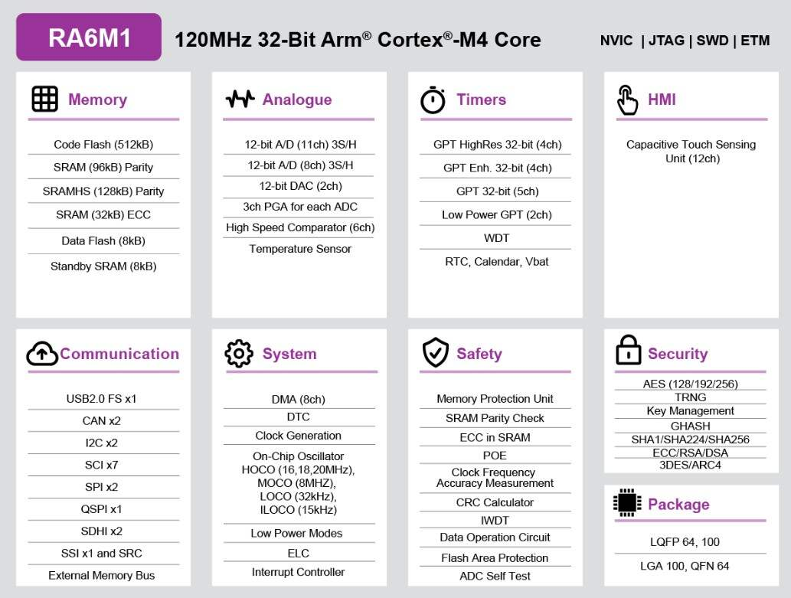

<!-- Copyright 2015-2026 Zephyr Project members and individual contributors. -->
<!-- SPDX-License-Identifier: Apache-2.0 -->
<!-- 中文翻译；编号、导航与译注为本地新增。 -->

<a id="ek_ra6m1"></a>

# 第15章\_RA6M1评估套件

原文：[官方页面](https://docs.zephyrproject.org/latest/boards/renesas/ek_ra6m1/doc/index.html)。读取日期：2026-10-16；来源摘要见[来源记录](../SOURCES.md)。

开发板概览（Board Overview）

<a id="id1"></a>

[](images/ek_ra6m1.webp)

RA6M1评估套件

名称（Name）：

`ek_ra6m1`

厂商（Vendor）：

[瑞萨电子（Renesas Electronics Corporation）](https://docs.zephyrproject.org/latest/boards/index.html#vendor=renesas)

状态（Status）：

维护中（Maintained）

架构（Architecture）：

[arm](https://docs.zephyrproject.org/latest/boards/index.html#arch=arm)

片上系统（SoC）：

[r7fa6m1ad3cfp](https://docs.zephyrproject.org/latest/boards/index.html#soc=r7fa6m1ad3cfp)

<a id="board-github-link"></a>

[浏览开发板源码（Browse Board Sources）](https://github.com/zephyrproject-rtos/zephyr/blob/main//boards/renesas/ek_ra6m1/doc/index.rst/../..)<a id="overview"></a>

## 概述（Overview）

RA6M1是瑞萨RA6产品系列的入门器件，面向要求高性能Arm Cortex-M4内核及有竞争力价格的应用。RA6M1采用高效40 nm工艺，支持开放灵活的生态系统：基于FreeRTOS的灵活配置软件包（FSP），并可扩展使用其他RTOS及中间件。它适合要求安全性、大容量片上RAM及低功耗的IoT应用。

EK-RA6M1主要功能分为以下三组：

直接访问MCU引脚（MCU Native Pin Access）


- R7FA6M1AD3CFP
- 100引脚LQFP封装
- 120 MHz Arm Cortex-M4内核，带浮点运算单元（FPU）
- 256 KB静态随机存取存储器（SRAM）
- 512 KB代码闪存
- 8 KB数据闪存（Data Flash）

连接能力（Connectivity）


- 连接主微控制器的USB设备连接器
- 基于S124 MCU的板载SEGGER J-Link接口，用于RA6M1调试及编程；另提供10针JTAG／SWD接口，可连接外部调试器及编程器。
- 两个Pmod连接器，可插接兼容外设模块以快速制作原型。
- 排针引出主MCU电源及信号

多种时钟源（Clock Sources）


- 主MCU晶体提供精确的12.000 MHz及32768 Hz外部参考时钟
- 主MCU内部还提供较低精度时钟

通用输入输出（GPIO）端口


- 一个跳线，用于测量主MCU电流
- PCB底部铜跳线，用于配置及访问部分MCU信号

工作电压（Operating Voltage）


- 通过原文称为Debug USB的连接器输入外部5 V，为板载稳压器供电，进而为板上逻辑及接口供电。也可通过板上其他位置输入外部5 V或3.3 V。
- 双色板状态LED，指示稳压电源及J-Link连接状态。
- 红色用户LED，由主MCU固件控制。
- 用户机械按键、电容触摸按键及可选电位器，均由主MCU固件处理。
- 微控制器复位按键（Reset）
- MCU启动配置跳线

<a id="hardware"></a>

## 硬件（Hardware）

RA6M1 MCU硬件详情见[RA6M1组用户手册硬件篇](https://www.renesas.com/us/en/document/mah/renesas-ra6m1-group-users-manual-hardware?r=1054156)。

<a id="id2"></a>

[](images/ra6m1_block_diagram.webp)

RA6M1框图，图片来源：瑞萨电子

EK-RA6M1硬件详情见其用户手册。（[EK-RA6M1用户手册](https://www.renesas.com/us/en/document/mat/ek-ra6m1-v1-users-manual)）

<a id="supported-features"></a>

### 支持的功能（Supported Features）

`ek_ra6m1`开发板支持下表所列的硬件功能。

片上／板载（On-Chip / On-Board）

功能集成在片上系统（SoC）内／位于开发板上。

2 / 2

分别表示已启用／已禁用的实例数。点击数量标签，可查看开发板或SoC设备树源码（DTS）中该功能的第一个实例。

`vnd,foo`

与此功能匹配的设备树绑定兼容字符串（Compatible String）；点击链接可查看绑定文档。

<a id="ek_ra6m1-hw-features"></a>

<a id="ek_ra6m1-ek_ra6m1/r7fa6m1ad3cfp-hw-features-section"></a>

#### `ek_ra6m1/r7fa6m1ad3cfp`目标（Target）

<a id="ek_ra6m1-ek_ra6m1/r7fa6m1ad3cfp-hw-features-panel"></a>

<a id="ek_ra6m1-ek_ra6m1/r7fa6m1ad3cfp-hw-features-memory"></a>

该开发板目标的片上存储容量：256 KiB RAM、512 KiB Flash。

<a id="ek_ra6m1-ek_ra6m1/r7fa6m1ad3cfp-hw-features-table"></a>

<table>
<tr>
<th>类型（Type）</th>
<th>位置（Location）</th>
<th>说明（Description）</th>
<th>兼容字符串（Compatible）</th>
</tr>
<tr>
<td rowspan="1">中央处理器（CPU）</td>
<td>片上（On-Chip）</td>
<td>ARM Cortex-M4 处理器（CPU）（<a href="https://github.com/zephyrproject-rtos/zephyr/blob/main/dts/arm/renesas/ra/ra6/ra6-cm4-common.dtsi?plain=1#L20">已启用：1</a>）</td>
<td><a href="../cpu_arm_riscv_binding_reference/P024_arm_cortex-m4.md#std-dtcompatible-arm-cortex-m4"><code>arm,cortex-m4</code></a></td>
</tr>
<tr>
<td rowspan="1">模数转换器（ADC）</td>
<td>片上（On-Chip）</td>
<td>Renesas RA 12位分辨率模数转换器（ADC12）（<a href="https://github.com/zephyrproject-rtos/zephyr/blob/main/dts/arm/renesas/ra/ra6/ra6-cm4-common.dtsi?plain=1#L423">已启用：1</a>；<a href="https://github.com/zephyrproject-rtos/zephyr/blob/main/dts/arm/renesas/ra/ra6/ra6-cm4-common.dtsi?plain=1#L434">已禁用：1</a>）</td>
<td><a href="../hardware/P868_RenesasRAADC12绑定.md#dtbinding-renesas-ra-adc12"><code>renesas,ra-adc12</code></a></td>
</tr>
<tr>
<td rowspan="7">时钟控制（Clock Control）</td>
<td>片上（On-Chip）</td>
<td>Renesas RA时钟生成电路（Clock Generation Circuit）的外部时钟配置（<a href="https://github.com/zephyrproject-rtos/zephyr/blob/main/dts/arm/renesas/ra/ra6/r7fa6m1ad3cfp.dtsi?plain=1#L104">已启用：1</a>）</td>
<td><a href="../clock_nxp_pico_realtek_renesas_binding_reference/P029_renesas_ra-cgc-external-clock.md#std-dtcompatible-renesas-ra-cgc-external-clock"><code>renesas,ra-cgc-external-clock</code></a></td>
</tr>
<tr>
<td>片上（On-Chip）</td>
<td>通用固定频率时钟提供者（Fixed-Rate Clock Provider）（<a href="https://github.com/zephyrproject-rtos/zephyr/blob/main/dts/arm/renesas/ra/ra6/r7fa6m1ad3cfp.dtsi?plain=1#L111">已启用：3</a>）</td>
<td><a href="../hardware/P566_固定时钟绑定.md#dtbinding-fixed-clock"><code>fixed-clock</code></a></td>
</tr>
<tr>
<td>片上（On-Chip）</td>
<td>Renesas RA子时钟（Sub-Clock）（<a href="https://github.com/zephyrproject-rtos/zephyr/blob/main/dts/arm/renesas/ra/ra6/r7fa6m1ad3cfp.dtsi?plain=1#L129">已启用：1</a>）</td>
<td><a href="../clock_renesas_rockchip_sifli_silabs_binding_reference/P004_renesas_ra-cgc-subclk.md#std-dtcompatible-renesas-ra-cgc-subclk"><code>renesas,ra-cgc-subclk</code></a></td>
</tr>
<tr>
<td>片上（On-Chip）</td>
<td>Renesas RA时钟生成电路的锁相环时钟（PLL Clock）（<a href="https://github.com/zephyrproject-rtos/zephyr/blob/main/dts/arm/renesas/ra/ra6/r7fa6m1ad3cfp.dtsi?plain=1#L136">已启用：1</a>）</td>
<td><a href="../clock_renesas_rockchip_sifli_silabs_binding_reference/P003_renesas_ra-cgc-pll.md#std-dtcompatible-renesas-ra-cgc-pll"><code>renesas,ra-cgc-pll</code></a></td>
</tr>
<tr>
<td>片上（On-Chip）</td>
<td>Renesas RA时钟控制节点的pclk模块（<a href="https://github.com/zephyrproject-rtos/zephyr/blob/main/dts/arm/renesas/ra/ra6/r7fa6m1ad3cfp.dtsi?plain=1#L147">已启用：1</a>）</td>
<td><a href="../clock_nxp_pico_realtek_renesas_binding_reference/P030_renesas_ra-cgc-pclk-block.md#std-dtcompatible-renesas-ra-cgc-pclk-block"><code>renesas,ra-cgc-pclk-block</code></a></td>
</tr>
<tr>
<td>片上（On-Chip）</td>
<td>Renesas RA时钟控制外设时钟（Peripheral Clock）（<a href="https://github.com/zephyrproject-rtos/zephyr/blob/main/dts/arm/renesas/ra/ra6/r7fa6m1ad3cfp.dtsi?plain=1#L157">已启用：8</a>；<a href="https://github.com/zephyrproject-rtos/zephyr/blob/main/dts/arm/renesas/ra/ra6/r7fa6m1ad3cfp.dtsi?plain=1#L221">已禁用：1</a>）</td>
<td><a href="../clock_renesas_rockchip_sifli_silabs_binding_reference/P001_renesas_ra-cgc-pclk.md#std-dtcompatible-renesas-ra-cgc-pclk"><code>renesas,ra-cgc-pclk</code></a></td>
</tr>
<tr>
<td>片上（On-Chip）</td>
<td>Renesas RA外部总线时钟（External Bus Clock）（<a href="https://github.com/zephyrproject-rtos/zephyr/blob/main/dts/arm/renesas/ra/ra6/r7fa6m1ad3cfp.dtsi?plain=1#L199">已启用：1</a>）</td>
<td><a href="../clock_nxp_pico_realtek_renesas_binding_reference/P028_renesas_ra-cgc-busclk.md#std-dtcompatible-renesas-ra-cgc-busclk"><code>renesas,ra-cgc-busclk</code></a></td>
</tr>
<tr>
<td rowspan="1">计数器（Counter）</td>
<td>片上（On-Chip）</td>
<td>用作计数器的Renesas RA异步通用定时器（AGT）（<a href="https://github.com/zephyrproject-rtos/zephyr/blob/main/dts/arm/renesas/ra/ra6/ra6-cm4-common.dtsi?plain=1#L402">已禁用：2</a>）</td>
<td><a href="../renesas_realtek_counter_binding_reference/P014_renesas_ra-agt-counter.md#std-dtcompatible-renesas-ra-agt-counter"><code>renesas,ra-agt-counter</code></a></td>
</tr>
<tr>
<td rowspan="1">循环冗余校验（CRC）</td>
<td>片上（On-Chip）</td>
<td>Renesas RA循环冗余校验（CRC）设备（<a href="https://github.com/zephyrproject-rtos/zephyr/blob/main/dts/arm/renesas/ra/ra6/ra6-cm4-common.dtsi?plain=1#L445">已启用：1</a>）</td>
<td><a href="../crc_clock_monitor_binding_reference/P008_renesas_ra-crc.md#std-dtcompatible-renesas-ra-crc"><code>renesas,ra-crc</code></a></td>
</tr>
<tr>
<td rowspan="2">数模转换器（DAC）</td>
<td>片上（On-Chip）</td>
<td>Renesas RA数模转换器全局控制器（DAC Controller Global）（<a href="https://github.com/zephyrproject-rtos/zephyr/blob/main/dts/arm/renesas/ra/ra6/ra6-cm4-common.dtsi?plain=1#L452">已启用：1</a>）</td>
<td><a href="../hardware/P772_RenesasRA数模转换器全局绑定.md#dtbinding-renesas-ra-dac-global"><code>renesas,ra-dac-global</code></a></td>
</tr>
<tr>
<td>片上（On-Chip）</td>
<td>Renesas RA数模转换器（DAC）控制器（<a href="https://github.com/zephyrproject-rtos/zephyr/blob/main/dts/arm/renesas/ra/ra6/ra6-cm4-common.dtsi?plain=1#L458">已启用：1</a>；<a href="https://github.com/zephyrproject-rtos/zephyr/blob/main/dts/arm/renesas/ra/ra6/ra6-cm4-common.dtsi?plain=1#L465">已禁用：1</a>）</td>
<td><a href="../hardware/P773_RenesasRA数模转换器绑定.md#dtbinding-renesas-ra-dac"><code>renesas,ra-dac</code></a></td>
</tr>
<tr>
<td rowspan="1">直接存储器访问（DMA）</td>
<td>片上（On-Chip）</td>
<td>Renesas RA直接存储器访问（DMA）控制器（<a href="https://github.com/zephyrproject-rtos/zephyr/blob/main/dts/arm/renesas/ra/ra6/ra6-cm4-common.dtsi?plain=1#L124">已禁用：1</a>）</td>
<td><a href="../nxp_realtek_renesas_dma_binding_reference/P012_renesas_ra-dma.md#std-dtcompatible-renesas-ra-dma"><code>renesas,ra-dma</code></a></td>
</tr>
<tr>
<td rowspan="2">闪存控制器（Flash Controller）</td>
<td>片上（On-Chip）</td>
<td>Renesas RA闪存应用命令接口（Flash Application Command Interface）（<a href="https://github.com/zephyrproject-rtos/zephyr/blob/main/dts/arm/renesas/ra/ra6/ra6-cm4-common.dtsi?plain=1#L785">已启用：1</a>）</td>
<td><a href="../flash_nuvoton_nxp_renesas_binding_reference/P025_renesas_ra-faci.md#std-dtcompatible-renesas-ra-faci"><code>renesas,ra-faci</code></a></td>
</tr>
<tr>
<td>片上（On-Chip）</td>
<td>Renesas RA系列高性能闪存控制器（Flash High-Performance Controller）（<a href="https://github.com/zephyrproject-rtos/zephyr/blob/main/dts/arm/renesas/ra/ra6/r7fa6m1ad3cfp.dtsi?plain=1#L22">已启用：2</a>）</td>
<td><a href="../flash_nuvoton_nxp_renesas_binding_reference/P027_renesas_ra-flash-hp-controller.md#std-dtcompatible-renesas-ra-flash-hp-controller"><code>renesas,ra-flash-hp-controller</code></a></td>
</tr>
<tr>
<td rowspan="1">通用输入输出与接插件（GPIO &amp; Headers）</td>
<td>片上（On-Chip）</td>
<td>Renesas RA通用输入输出端口（GPIO I/O Port）（<a href="https://github.com/zephyrproject-rtos/zephyr/blob/main/dts/arm/renesas/ra/ra6/ra6-cm4-common.dtsi?plain=1#L53">已启用：2</a>；<a href="https://github.com/zephyrproject-rtos/zephyr/blob/main/dts/arm/renesas/ra/ra6/ra6-cm4-common.dtsi?plain=1#L43">已禁用：6</a>）</td>
<td><a href="../gpio_raspberrypi_renesas_binding_reference/P014_renesas_ra-gpio-ioport.md#std-dtcompatible-renesas-ra-gpio-ioport"><code>renesas,ra-gpio-ioport</code></a></td>
</tr>
<tr>
<td rowspan="2">集成电路间总线（I2C）</td>
<td>片上（On-Chip）</td>
<td>Renesas RA串行通信接口（SCI）I2C控制器（<a href="https://github.com/zephyrproject-rtos/zephyr/blob/main/dts/arm/renesas/ra/ra6/ra6-cm4-common.dtsi?plain=1#L154">已禁用：7</a>）</td>
<td><a href="../i2c_nxp_pico_renesas_binding_reference/P013_renesas_ra-i2c-sci.md#std-dtcompatible-renesas-ra-i2c-sci"><code>renesas,ra-i2c-sci</code></a></td>
</tr>
<tr>
<td>片上（On-Chip）</td>
<td>Renesas RA I2C控制器（<a href="https://github.com/zephyrproject-rtos/zephyr/blob/main/dts/arm/renesas/ra/ra6/ra6-cm4-common.dtsi?plain=1#L356">已启用：1</a>；<a href="https://github.com/zephyrproject-rtos/zephyr/blob/main/dts/arm/renesas/ra/ra6/ra6-cm4-common.dtsi?plain=1#L364">已禁用：1</a>）</td>
<td><a href="../i2c_nxp_pico_renesas_binding_reference/P014_renesas_ra-iic.md#std-dtcompatible-renesas-ra-iic"><code>renesas,ra-iic</code></a></td>
</tr>
<tr>
<td rowspan="2">输入（Input）</td>
<td>片上（On-Chip）</td>
<td>Renesas RA电容感应单元（Capacitive Sensing Unit）（<a href="https://github.com/zephyrproject-rtos/zephyr/blob/main/dts/arm/renesas/ra/ra6/ra6-cm4-common.dtsi?plain=1#L800">已禁用：1</a>）</td>
<td><a href="../input_touch_lvgl_gesture_binding_reference/P001_renesas_ra-ctsu.md#std-dtcompatible-renesas-ra-ctsu"><code>renesas,ra-ctsu</code></a></td>
</tr>
<tr>
<td>板载（On-Board）</td>
<td>一组绑定到 GPIO 的输入按键（GPIO-Bound Input Keys）（<a href="https://github.com/zephyrproject-rtos/zephyr/blob/main/boards/renesas/ek_ra6m1/ek_ra6m1.dts?plain=1#L38">已启用：1</a>）</td>
<td><a href="../hardware/P563_GPIO按键绑定.md#std-dtcompatible-gpio-keys"><code>gpio-keys</code></a></td>
</tr>
<tr>
<td rowspan="1">中断控制器（Interrupt Controller）</td>
<td>片上（On-Chip）</td>
<td>ARMv7-M 嵌套向量中断控制器（Nested Vectored Interrupt Controller，NVIC）（<a href="https://github.com/zephyrproject-rtos/zephyr/blob/main/dts/arm/armv7-m.dtsi?plain=1#L13">已启用：1</a>）</td>
<td><a href="../arm_interrupt_timer_binding_reference/P002_ARMv7_M_NVIC.md#std-dtcompatible-arm-v7m-nvic"><code>arm,v7m-nvic</code></a></td>
</tr>
<tr>
<td rowspan="1">发光二极管（LED）</td>
<td>板载（On-Board）</td>
<td>一组由 GPIO 控制的 LED（GPIO-Controlled LEDs）（<a href="https://github.com/zephyrproject-rtos/zephyr/blob/main/boards/renesas/ek_ra6m1/ek_ra6m1.dts?plain=1#L29">已启用：1</a>）</td>
<td><a href="../hardware/P564_GPIO指示灯绑定.md#dtbinding-gpio-leds"><code>gpio-leds</code></a></td>
</tr>
<tr>
<td rowspan="4">其他绑定（Miscellaneous）</td>
<td>片上（On-Chip）</td>
<td>Renesas RA事件链接控制器（Event Link Controller）（<a href="https://github.com/zephyrproject-rtos/zephyr/blob/main/dts/arm/renesas/ra/ra6/ra6-cm4-common.dtsi?plain=1#L35">已禁用：1</a>）</td>
<td><a href="../misc_nxp_renesas_zephyr_binding_reference/P016_renesas_ra-elc.md#std-dtcompatible-renesas-ra-elc"><code>renesas,ra-elc</code></a></td>
</tr>
<tr>
<td>片上（On-Chip）</td>
<td>Renesas RA串行通信接口（SCI）控制器（<a href="https://github.com/zephyrproject-rtos/zephyr/blob/main/dts/arm/renesas/ra/ra6/ra6-cm4-common.dtsi?plain=1#L292">已启用：1</a>；<a href="https://github.com/zephyrproject-rtos/zephyr/blob/main/dts/arm/renesas/ra/ra6/ra6-cm4-common.dtsi?plain=1#L140">已禁用：6</a>）</td>
<td><a href="../misc_nxp_renesas_zephyr_binding_reference/P020_renesas_ra-sci.md#std-dtcompatible-renesas-ra-sci"><code>renesas,ra-sci</code></a></td>
</tr>
<tr>
<td>片上（On-Chip）</td>
<td>Renesas RA异步通用定时器（AGT）（<a href="https://github.com/zephyrproject-rtos/zephyr/blob/main/dts/arm/renesas/ra/ra6/ra6-cm4-common.dtsi?plain=1#L393">已禁用：2</a>）</td>
<td><a href="../misc_nxp_renesas_zephyr_binding_reference/P014_renesas_ra-agt.md#std-dtcompatible-renesas-ra-agt"><code>renesas,ra-agt</code></a></td>
</tr>
<tr>
<td>片上（On-Chip）</td>
<td>Renesas RA外部中断（External Interrupt）（<a href="https://github.com/zephyrproject-rtos/zephyr/blob/main/dts/arm/renesas/ra/ra6/ra6-cm4-common.dtsi?plain=1#L566">已启用：1</a>；<a href="https://github.com/zephyrproject-rtos/zephyr/blob/main/dts/arm/renesas/ra/ra6/ra6-cm4-common.dtsi?plain=1#L494">已禁用：15</a>）</td>
<td><a href="../misc_nxp_renesas_zephyr_binding_reference/P017_renesas_ra-external-interrupt.md#std-dtcompatible-renesas-ra-external-interrupt"><code>renesas,ra-external-interrupt</code></a></td>
</tr>
<tr>
<td rowspan="1">内存管理单元／内存保护单元（MMU / MPU）</td>
<td>片上（On-Chip）</td>
<td>ARMv7-M存储器保护单元（MPU / Memory Protection Unit）（<a href="https://github.com/zephyrproject-rtos/zephyr/blob/main/dts/arm/renesas/ra/ra6/ra6-cm4-common.dtsi?plain=1#L27">已启用：1</a>）</td>
<td><a href="../memory_protection_binding_reference/P005_arm_armv7m-mpu.md#std-dtcompatible-arm-armv7m-mpu"><code>arm,armv7m-mpu</code></a></td>
</tr>
<tr>
<td rowspan="1">存储技术设备（MTD）</td>
<td>片上（On-Chip）</td>
<td>闪存（Flash）节点（<a href="https://github.com/zephyrproject-rtos/zephyr/blob/main/dts/arm/renesas/ra/ra6/r7fa6m1ad3cfp.dtsi?plain=1#L30">已启用：2</a>）</td>
<td><a href="../mtd_nxp_st_ti_partition_binding_reference/P013_soc-nv-flash.md#std-dtcompatible-soc-nv-flash"><code>soc-nv-flash</code></a></td>
</tr>
<tr>
<td rowspan="1">物理层（PHY）</td>
<td>片上（On-Chip）</td>
<td>用于所有内置于 USB IP 的 USB 收发器（USB Transceivers）的绑定。（<a href="https://github.com/zephyrproject-rtos/zephyr/blob/main/dts/arm/renesas/ra/ra6/ra6-cm4-common.dtsi?plain=1#L817">已启用：1</a>）</td>
<td><a href="../phy_binding_reference/P008_usb-nop-xceiv.md#std-dtcompatible-usb-nop-xceiv"><code>usb-nop-xceiv</code></a></td>
</tr>
<tr>
<td rowspan="1">引脚控制（Pin Control）</td>
<td>片上（On-Chip）</td>
<td>Renesas RA引脚控制器（Pin Controller）（<a href="https://github.com/zephyrproject-rtos/zephyr/blob/main/dts/arm/renesas/ra/ra6/ra6-cm4-common.dtsi?plain=1#L134">已启用：1</a>）</td>
<td><a href="../pinctrl_renesas_silabs_binding_reference/P006_renesas_ra-pinctrl-pfs.md#std-dtcompatible-renesas-ra-pinctrl-pfs"><code>renesas,ra-pinctrl-pfs</code></a></td>
</tr>
<tr>
<td rowspan="1">脉宽调制（PWM）</td>
<td>片上（On-Chip）</td>
<td>Renesas RA脉宽调制（PWM）（<a href="https://github.com/zephyrproject-rtos/zephyr/blob/main/dts/arm/renesas/ra/ra6/ra6-cm4-common.dtsi?plain=1#L648">已启用：1</a>；<a href="https://github.com/zephyrproject-rtos/zephyr/blob/main/dts/arm/renesas/ra/ra6/ra6-cm4-common.dtsi?plain=1#L638">已禁用：12</a>）</td>
<td><a href="../pwm_nxp_renesas_binding_reference/P019_renesas_ra-pwm.md#std-dtcompatible-renesas-ra-pwm"><code>renesas,ra-pwm</code></a></td>
</tr>
<tr>
<td rowspan="1">保留内存（Reserved Memory）</td>
<td>片上（On-Chip）</td>
<td>Renesas选项设置存储器（Option-Setting Memory）（<a href="https://github.com/zephyrproject-rtos/zephyr/blob/main/dts/arm/renesas/ra/ra6/r7fa6m1ad3cfp.dtsi?plain=1#L74">已启用：3</a>）</td>
<td><a href="../memory_protection_binding_reference/P011_renesas_ofs-memory.md#std-dtcompatible-renesas-ofs-memory"><code>renesas,ofs-memory</code></a></td>
</tr>
<tr>
<td rowspan="1">随机数生成器（RNG）</td>
<td>片上（On-Chip）</td>
<td>瑞萨RA SCE7真随机数发生器（TRNG）（<a href="https://github.com/zephyrproject-rtos/zephyr/blob/main/dts/arm/renesas/ra/ra6/r7fa6m1ad3cfp.dtsi?plain=1#L61">已启用：1</a>）</td>
<td><a href="../soc_rng_binding_reference/P007_renesas_ra-sce7-rng.md#std-dtcompatible-renesas-ra-sce7-rng"><code>renesas,ra-sce7-rng</code></a></td>
</tr>
<tr>
<td rowspan="1">串行控制器（Serial Controller）</td>
<td>片上（On-Chip）</td>
<td>Renesas RA SCI UART控制器（<a href="https://github.com/zephyrproject-rtos/zephyr/blob/main/dts/arm/renesas/ra/ra6/ra6-cm4-common.dtsi?plain=1#L300">已启用：1</a>；<a href="https://github.com/zephyrproject-rtos/zephyr/blob/main/dts/arm/renesas/ra/ra6/ra6-cm4-common.dtsi?plain=1#L148">已禁用：6</a>）</td>
<td><a href="../uart_raspberrypi_realtek_renesas_binding_reference/P006_renesas_ra-sci-uart.md#std-dtcompatible-renesas-ra-sci-uart"><code>renesas,ra-sci-uart</code></a></td>
</tr>
<tr>
<td rowspan="2">串行外设接口（SPI）</td>
<td>片上（On-Chip）</td>
<td>Renesas RA SCI SPI控制器（<a href="https://github.com/zephyrproject-rtos/zephyr/blob/main/dts/arm/renesas/ra/ra6/ra6-cm4-common.dtsi?plain=1#L162">已禁用：7</a>）</td>
<td><a href="../spi_flexspi_nxp_renesas_binding_reference/P016_renesas_ra-spi-sci.md#std-dtcompatible-renesas-ra-spi-sci"><code>renesas,ra-spi-sci</code></a></td>
</tr>
<tr>
<td>片上（On-Chip）</td>
<td>Renesas RA SPI控制器（<a href="https://github.com/zephyrproject-rtos/zephyr/blob/main/dts/arm/renesas/ra/ra6/ra6-cm4-common.dtsi?plain=1#L373">已启用：1</a>；<a href="https://github.com/zephyrproject-rtos/zephyr/blob/main/dts/arm/renesas/ra/ra6/ra6-cm4-common.dtsi?plain=1#L384">已禁用：1</a>）</td>
<td><a href="../spi_flexspi_nxp_renesas_binding_reference/P017_renesas_ra-spi.md#std-dtcompatible-renesas-ra-spi"><code>renesas,ra-spi</code></a></td>
</tr>
<tr>
<td rowspan="1">静态随机存储器（SRAM）</td>
<td>片上（On-Chip）</td>
<td>通用片上静态随机存储器（SRAM）（<a href="https://github.com/zephyrproject-rtos/zephyr/blob/main/dts/arm/renesas/ra/ra6/r7fa6m1ad3cfp.dtsi?plain=1#L17">已启用：1</a>）</td>
<td><a href="../hardware/P567_内存映射SRAM绑定.md#dtbinding-mmio-sram"><code>mmio-sram</code></a></td>
</tr>
<tr>
<td rowspan="1">定时器（Timer）</td>
<td>片上（On-Chip）</td>
<td>ARMv7-M 系统节拍（System Tick）（<a href="https://github.com/zephyrproject-rtos/zephyr/blob/main/dts/arm/armv7-m.dtsi?plain=1#L21">已启用：1</a>）</td>
<td><a href="../arm_interrupt_timer_binding_reference/P006_ARMv7_M_SysTick.md#std-dtcompatible-arm-armv7m-systick"><code>arm,armv7m-systick</code></a></td>
</tr>
<tr>
<td rowspan="3">通用串行总线（USB）</td>
<td>片上（On-Chip）</td>
<td>Renesas RA USB全速控制器（Full-Speed Controller）（<a href="https://github.com/zephyrproject-rtos/zephyr/blob/main/dts/arm/renesas/ra/ra6/ra6-cm4-common.dtsi?plain=1#L473">已启用：1</a>）</td>
<td><a href="../usb_soc_binding_reference/P018_renesas_ra-usbfs.md#std-dtcompatible-renesas-ra-usbfs"><code>renesas,ra-usbfs</code></a></td>
</tr>
<tr>
<td>片上（On-Chip）</td>
<td>Renesas RA USB设备控制器（Device Controller）（<a href="https://github.com/zephyrproject-rtos/zephyr/blob/main/dts/arm/renesas/ra/ra6/ra6-cm4-common.dtsi?plain=1#L483">已启用：1</a>）</td>
<td><a href="../usb_soc_binding_reference/P016_renesas_ra-udc.md#std-dtcompatible-renesas-ra-udc"><code>renesas,ra-udc</code></a></td>
</tr>
<tr>
<td>片上（On-Chip）</td>
<td>Renesas RA USB主机控制器（Host Controller）（<a href="https://github.com/zephyrproject-rtos/zephyr/blob/main/dts/arm/renesas/ra/ra6/ra6-cm4-common.dtsi?plain=1#L488">已禁用：1</a>）</td>
<td><a href="../usb_soc_binding_reference/P017_renesas_ra-uhc.md#std-dtcompatible-renesas-ra-uhc"><code>renesas,ra-uhc</code></a></td>
</tr>
<tr>
<td rowspan="1">看门狗（Watchdog）</td>
<td>片上（On-Chip）</td>
<td>Renesas RA看门狗（WDT）（<a href="https://github.com/zephyrproject-rtos/zephyr/blob/main/dts/arm/renesas/ra/ra6/ra6-cm4-common.dtsi?plain=1#L793">已启用：1</a>）</td>
<td><a href="../realtek_renesas_silabs_watchdog_binding_reference/P005_renesas_ra-wdt.md#std-dtcompatible-renesas-ra-wdt"><code>renesas,ra-wdt</code></a></td>
</tr>
</table>

<a id="programming-and-debugging"></a>

## 烧录与调试（Programming and Debugging）

`ek_ra6m1`开发板支持下表所列的运行工具（Runners）及相关west命令。

<table>
<tr>
<th></th>
<th>烧录（flash）</th>
<th>调试（debug）</th>
<th>连接调试会话（attach）</th>
<th>实时传输（rtt）</th>
<th>复位（reset）</th>
<th>调试服务器（debugserver）</th>
</tr>
<tr>
<td><a href="https://docs.zephyrproject.org/latest/develop/flash_debug/host-tools.html#runner-jlink">jlink</a></td>
<td>✅（默认 / default）</td>
<td>✅（默认 / default）</td>
<td>✅</td>
<td>✅</td>
<td>✅</td>
<td>✅</td>
</tr>
<tr>
<td><a href="https://docs.zephyrproject.org/latest/develop/flash_debug/host-tools.html#runner-pyocd">pyocd</a></td>
<td>✅</td>
<td>✅</td>
<td>✅</td>
<td>✅</td>
<td>✅</td>
<td>✅</td>
</tr>
</table>

ek_ra6m1可按常规方式构建、烧录及调试，详见“构建应用”与“运行应用”。（[构建应用（Building an Application）](../application/P001_应用开发.md#build-an-application)；[运行应用（Run an Application）](https://docs.zephyrproject.org/latest/develop/application/index.html#application-run)）

<a id="flashing"></a>

### 烧录（Flashing）

EK-RA6M1可通过板载SEGGER J-Link烧录，驱动见[https://www.segger.com/downloads/jlink/](https://www.segger.com/downloads/jlink/)。

向开发板烧录程序：


1. 通过USB将J-Link OB连接主机；原文此处称OB，与前文外部调试器表述不同。
2. 确认J-Link OB跳线保持[EK-RA6M1用户手册](https://www.renesas.com/us/en/document/mat/ek-ra6m1-v1-users-manual)中的默认配置。
3. 执行west命令。

  > ```text
  > west flash -r jlink
  > ```

<a id="debugging"></a>

### 调试（Debugging）

可使用Segger Ozone提供图形调试界面，见[Segger Ozone下载页](https://www.segger.com/downloads/jlink#Ozone)。

下载并安装后打开Ozone，按以下参数配置调试项目：


- 目标器件：R7FA6M1AD
- 目标接口（Target Interface）：SWD
- 目标接口速度：4 MHz
- 主机接口（Host Interface）：USB
- 程序文件（Program File）：<path/to/your/build/zephyr.elf>

原文已验证Ozone v3.30d可正常调试，建议使用此版或更新版本；这里保留来源的版本范围。

<a id="references"></a>

## 参考资料（References）


- [EK-RA6M1网站](https://www.renesas.com/us/en/products/microcontrollers-microprocessors/ra-cortex-m-mcus/ek-ra6m1-evaluation-kit-ra6m1-mcu-group)
- [RA6M1 MCU组网站](https://www.renesas.com/us/en/products/microcontrollers-microprocessors/ra-cortex-m-mcus/ra6m1-32-bit-microcontrollers-120mhz-optimized-entry-point-ra6-series)

## 译注

RA6M1板载J-Link接口基于S124 MCU，另有10针JTAG／SWD外部探针接口。

## 原文外链核对

2026-10-16核对并重试以下原文外链时未能确认可访问性，保留原始目标，不将访问失败解释为原文内容有误。

- [renesas-ra6m1-group-users-manual-hardware?r=1054156](https://www.renesas.com/us/en/document/mah/renesas-ra6m1-group-users-manual-hardware?r=1054156)：HTTP Error 429: Too Many Requests。
- [ek-ra6m1-v1-users-manual](https://www.renesas.com/us/en/document/mat/ek-ra6m1-v1-users-manual)：HTTP Error 429: Too Many Requests。
- [ek-ra6m1-evaluation-kit-ra6m1-mcu-group](https://www.renesas.com/us/en/products/microcontrollers-microprocessors/ra-cortex-m-mcus/ek-ra6m1-evaluation-kit-ra6m1-mcu-group)：HTTP Error 429: Too Many Requests。
- [ra6m1-32-bit-microcontrollers-120mhz-optimized-entry-point-ra6-series](https://www.renesas.com/us/en/products/microcontrollers-microprocessors/ra-cortex-m-mcus/ra6m1-32-bit-microcontrollers-120mhz-optimized-entry-point-ra6-series)：HTTP Error 429: Too Many Requests。
- [jlink](https://www.segger.com/downloads/jlink#Ozone)：页面可访问，但未确认目标片段。

---

[上一章](P014_RA6E2_Evaluation_Kit.md) · [返回大纲](大纲.md) · [全站翻译进度](../PROGRESS.md) · [下一章](P016_RA6M2_Evaluation_Kit.md)
