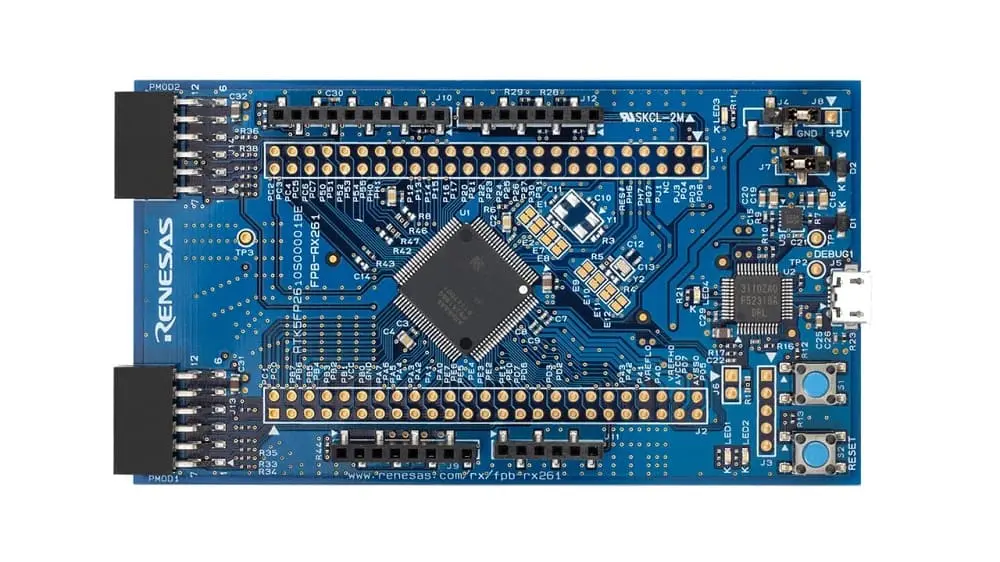

<!-- Copyright 2015-2026 Zephyr Project members and individual contributors. -->
<!-- SPDX-License-Identifier: Apache-2.0 -->
<!-- 中文翻译；编号、导航与译注为本地新增。 -->

<a id="fpb_rx261"></a>

# 第11章\_RX261快速原型板

原文：[官方页面](https://docs.zephyrproject.org/latest/boards/renesas/fpb_rx261/doc/index.html)。读取日期：2026-10-16；来源摘要见[来源记录](../SOURCES.md)。

开发板概览（Board Overview）

<a id="id1"></a>

[](images/fpb_rx261.webp)

RX261快速原型板

名称（Name）：

`fpb_rx261`

厂商（Vendor）：

[瑞萨电子（Renesas Electronics Corporation）](https://docs.zephyrproject.org/latest/boards/index.html#vendor=renesas)

状态（Status）：

维护中（Maintained）

架构（Architecture）：

[rx](https://docs.zephyrproject.org/latest/boards/index.html#arch=rx)

片上系统（SoC）：

[r5f52618bgfp](https://docs.zephyrproject.org/latest/boards/index.html#soc=r5f52618bgfp)

<a id="board-github-link"></a>

[浏览开发板源码（Browse Board Sources）](https://github.com/zephyrproject-rtos/zephyr/blob/main//boards/renesas/fpb_rx261/doc/index.rst/../..)<a id="overview"></a>

## 概述（Overview）

FPB-RX261是瑞萨RX261 MCU组快速原型板，用于评估RX261系列功能并加快嵌入式系统开发。板上提供MCU原生引脚访问、集成调试器、灵活供电方式及扩展连接器。

FPB-RX261主要功能分为以下两组：

直接访问MCU引脚（MCU Native Pin Access）


- R5F52618BGFP MCU
- 64 MHz瑞萨RXv3 RX261 MCU，100引脚LFQFP封装
- 512 KB代码闪存、8 KB数据闪存、128 KB RAM
- 两组50针公排针，直接访问MCU引脚，未安装
- MCU电流测量点，用于精确测量电流消耗
- 以RX MCU片上振荡器作为主时钟
- 提供32.768 kHz晶体振荡器作为子时钟

系统控制与生态接口（System Control and Ecosystem Access）


- 5 V输入源：


  - USB DEBUG1端口J5
  - 经两针排针J8输入外部5 V
- 板载E2 Emulator OB调试器，FINE接口
- 用户LED：


  - 2个绿色用户LED，PJ1及PC5
  - 1个绿色电源LED
  - 1个黄色调试LED
- 用户按键：


  - 1个用户开关，S1—P32
  - 1个复位开关S2
- 常见扩展连接器：


  - 2个Digilent Pmod连接器，J13及J14，UART／SPI／I2C
  - Arduino Uno R3兼容排针，J9～J12

<a id="hardware"></a>

## 硬件（Hardware）

硬件详情见RX261 MCU的[RX261组用户手册硬件篇](https://www.renesas.com/en/document/mah/rx260-group-rx261-group-users-manual-hardware?r=25565707)，以及FPB-RX261开发板的用户手册。（[FPB-RX261用户手册](http://renesas.com/en/document/mat/fpb-rx261-v1-users-manual?r=25565483)）

<a id="supported-features"></a>

### 支持的功能（Supported Features）

`fpb_rx261`开发板支持下表所列的硬件功能。

片上／板载（On-Chip / On-Board）

功能集成在片上系统（SoC）内／位于开发板上。

2 / 2

分别表示已启用／已禁用的实例数。点击数量标签，可查看开发板或SoC设备树源码（DTS）中该功能的第一个实例。

`vnd,foo`

与此功能匹配的设备树绑定兼容字符串（Compatible String）；点击链接可查看绑定文档。

<a id="fpb_rx261-hw-features"></a>

<a id="fpb_rx261-fpb_rx261/r5f52618bgfp-hw-features-section"></a>

#### `fpb_rx261/r5f52618bgfp`目标（Target）

<a id="fpb_rx261-fpb_rx261/r5f52618bgfp-hw-features-panel"></a>

<a id="fpb_rx261-fpb_rx261/r5f52618bgfp-hw-features-memory"></a>

该开发板目标的片上存储容量：128 KiB RAM、512 KiB Flash。

<a id="fpb_rx261-fpb_rx261/r5f52618bgfp-hw-features-table"></a>

<table>
<tr>
<th>类型（Type）</th>
<th>位置（Location）</th>
<th>说明（Description）</th>
<th>兼容字符串（Compatible）</th>
</tr>
<tr>
<td rowspan="1">中央处理器（CPU）</td>
<td>片上（On-Chip）</td>
<td>瑞萨RXv3处理器（CPU）（<a href="https://github.com/zephyrproject-rtos/zephyr/blob/main/dts/rx/renesas/rx261-common.dtsi?plain=1#L23">已启用：1</a>）</td>
<td><a href="../cpu_vendor_multiarc_binding_reference/P032_renesas_rxv3.md#std-dtcompatible-renesas-rxv3"><code>renesas,rxv3</code></a></td>
</tr>
<tr>
<td rowspan="1">模数转换器（ADC）</td>
<td>片上（On-Chip）</td>
<td>瑞萨RX模数转换器（ADC）（<a href="https://github.com/zephyrproject-rtos/zephyr/blob/main/dts/rx/renesas/rx261-common.dtsi?plain=1#L683">已启用：1</a>）</td>
<td><a href="../hardware/P870_RenesasRX模数转换器绑定.md#dtbinding-renesas-rx-adc"><code>renesas,rx-adc</code></a></td>
</tr>
<tr>
<td rowspan="4">时钟控制（Clock Control）</td>
<td>片上（On-Chip）</td>
<td>瑞萨RX根时钟生成电路（<a href="https://github.com/zephyrproject-rtos/zephyr/blob/main/dts/rx/renesas/r5f52618bgfp.dtsi?plain=1#L25">已启用：3</a>；<a href="https://github.com/zephyrproject-rtos/zephyr/blob/main/dts/rx/renesas/r5f52618bgfp.dtsi?plain=1#L16">已禁用：2</a>）</td>
<td><a href="../clock_renesas_rockchip_sifli_silabs_binding_reference/P010_renesas_rx-cgc-root-clock.md#std-dtcompatible-renesas-rx-cgc-root-clock"><code>renesas,rx-cgc-root-clock</code></a></td>
</tr>
<tr>
<td>片上（On-Chip）</td>
<td>瑞萨RX时钟生成电路的锁相环（PLL）时钟（<a href="https://github.com/zephyrproject-rtos/zephyr/blob/main/dts/rx/renesas/r5f52618bgfp.dtsi?plain=1#L55">已禁用：2</a>）</td>
<td><a href="../clock_renesas_rockchip_sifli_silabs_binding_reference/P008_renesas_rx-cgc-pll.md#std-dtcompatible-renesas-rx-cgc-pll"><code>renesas,rx-cgc-pll</code></a></td>
</tr>
<tr>
<td>片上（On-Chip）</td>
<td>瑞萨RX时钟控制节点的pclk模块（<a href="https://github.com/zephyrproject-rtos/zephyr/blob/main/dts/rx/renesas/r5f52618bgfp.dtsi?plain=1#L73">已启用：1</a>）</td>
<td><a href="../clock_renesas_rockchip_sifli_silabs_binding_reference/P006_renesas_rx-cgc-pclk-block.md#std-dtcompatible-renesas-rx-cgc-pclk-block"><code>renesas,rx-cgc-pclk-block</code></a></td>
</tr>
<tr>
<td>片上（On-Chip）</td>
<td>瑞萨RX时钟控制外设时钟（<a href="https://github.com/zephyrproject-rtos/zephyr/blob/main/dts/rx/renesas/r5f52618bgfp.dtsi?plain=1#L84">已启用：5</a>；<a href="https://github.com/zephyrproject-rtos/zephyr/blob/main/dts/rx/renesas/r5f52618bgfp.dtsi?plain=1#L120">已禁用：12</a>）</td>
<td><a href="../clock_renesas_rockchip_sifli_silabs_binding_reference/P007_renesas_rx-cgc-pclk.md#std-dtcompatible-renesas-rx-cgc-pclk"><code>renesas,rx-cgc-pclk</code></a></td>
</tr>
<tr>
<td rowspan="1">闪存控制器（Flash Controller）</td>
<td>片上（On-Chip）</td>
<td>瑞萨RX闪存控制器（<a href="https://github.com/zephyrproject-rtos/zephyr/blob/main/dts/rx/renesas/r5f52618bgfp.dtsi?plain=1#L214">已启用：1</a>）</td>
<td><a href="../flash_renesas_st_ti_binding_reference/P001_renesas_rx-flash.md#std-dtcompatible-renesas-rx-flash"><code>renesas,rx-flash</code></a></td>
</tr>
<tr>
<td rowspan="1">通用输入输出与接插件（GPIO &amp; Headers）</td>
<td>片上（On-Chip）</td>
<td>瑞萨RX系列通用输入输出（GPIO）（<a href="https://github.com/zephyrproject-rtos/zephyr/blob/main/dts/rx/renesas/rx261-common.dtsi?plain=1#L316">已启用：4</a>；<a href="https://github.com/zephyrproject-rtos/zephyr/blob/main/dts/rx/renesas/rx261-common.dtsi?plain=1#L250">已禁用：9</a>）</td>
<td><a href="../gpio_raspberrypi_renesas_binding_reference/P019_renesas_rx-gpio.md#std-dtcompatible-renesas-rx-gpio"><code>renesas,rx-gpio</code></a></td>
</tr>
<tr>
<td rowspan="1">集成电路间总线（I2C）</td>
<td>片上（On-Chip）</td>
<td>瑞萨RX I2C主控制器（<a href="https://github.com/zephyrproject-rtos/zephyr/blob/main/dts/rx/renesas/rx261-common.dtsi?plain=1#L602">已启用：1</a>）</td>
<td><a href="../i2c_nxp_pico_renesas_binding_reference/P016_renesas_rx-i2c.md#std-dtcompatible-renesas-rx-i2c"><code>renesas,rx-i2c</code></a></td>
</tr>
<tr>
<td rowspan="1">输入（Input）</td>
<td>板载（On-Board）</td>
<td>一组绑定到 GPIO 的输入按键（GPIO-Bound Input Keys）（<a href="https://github.com/zephyrproject-rtos/zephyr/blob/main/boards/renesas/fpb_rx261/fpb_rx261.dts?plain=1#L41">已启用：1</a>）</td>
<td><a href="../hardware/P563_GPIO按键绑定.md#std-dtcompatible-gpio-keys"><code>gpio-keys</code></a></td>
</tr>
<tr>
<td rowspan="1">中断控制器（Interrupt Controller）</td>
<td>片上（On-Chip）</td>
<td>瑞萨中断控制单元（ICU）（<a href="https://github.com/zephyrproject-rtos/zephyr/blob/main/dts/rx/renesas/rx261-common.dtsi?plain=1#L31">已启用：1</a>）</td>
<td><a href="../renesas_interrupt_binding_reference/P002_renesas_rx-icu.md#std-dtcompatible-renesas-rx-icu"><code>renesas,rx-icu</code></a></td>
</tr>
<tr>
<td rowspan="1">发光二极管（LED）</td>
<td>板载（On-Board）</td>
<td>一组由 GPIO 控制的 LED（GPIO-Controlled LEDs）（<a href="https://github.com/zephyrproject-rtos/zephyr/blob/main/boards/renesas/fpb_rx261/fpb_rx261.dts?plain=1#L27">已启用：1</a>）</td>
<td><a href="../hardware/P564_GPIO指示灯绑定.md#dtbinding-gpio-leds"><code>gpio-leds</code></a></td>
</tr>
<tr>
<td rowspan="3">其他绑定（Miscellaneous）</td>
<td>片上（On-Chip）</td>
<td>瑞萨RX数据传输控制器（Data Transfer Controller，DTC）（<a href="https://github.com/zephyrproject-rtos/zephyr/blob/main/dts/rx/renesas/rx261-common.dtsi?plain=1#L59">已启用：1</a>）</td>
<td><a href="../misc_nxp_renesas_zephyr_binding_reference/P022_renesas_rx-dtc.md#std-dtcompatible-renesas-rx-dtc"><code>renesas,rx-dtc</code></a></td>
</tr>
<tr>
<td>片上（On-Chip）</td>
<td>瑞萨RX外部中断（<a href="https://github.com/zephyrproject-rtos/zephyr/blob/main/dts/rx/renesas/rx261-common.dtsi?plain=1#L180">已启用：2</a>；<a href="https://github.com/zephyrproject-rtos/zephyr/blob/main/dts/rx/renesas/rx261-common.dtsi?plain=1#L170">已禁用：6</a>）</td>
<td><a href="../misc_nxp_renesas_zephyr_binding_reference/P023_renesas_rx-external-interrupt.md#std-dtcompatible-renesas-rx-external-interrupt"><code>renesas,rx-external-interrupt</code></a></td>
</tr>
<tr>
<td>片上（On-Chip）</td>
<td>瑞萨RX串行通信接口（SCI）控制器（<a href="https://github.com/zephyrproject-rtos/zephyr/blob/main/dts/rx/renesas/rx261-common.dtsi?plain=1#L554">已启用：1</a>；<a href="https://github.com/zephyrproject-rtos/zephyr/blob/main/dts/rx/renesas/rx261-common.dtsi?plain=1#L538">已禁用：3</a>）</td>
<td><a href="../misc_nxp_renesas_zephyr_binding_reference/P026_renesas_rx-sci.md#std-dtcompatible-renesas-rx-sci"><code>renesas,rx-sci</code></a></td>
</tr>
<tr>
<td rowspan="2">存储技术设备（MTD）</td>
<td>片上（On-Chip）</td>
<td>瑞萨RX系列闪存的设备树绑定（Binding）（<a href="https://github.com/zephyrproject-rtos/zephyr/blob/main/dts/rx/renesas/r5f52618bgfp.dtsi?plain=1#L222">已启用：2</a>）</td>
<td><a href="../mtd_nxp_st_ti_partition_binding_reference/P011_renesas_rx-nv-flash.md#std-dtcompatible-renesas-rx-nv-flash"><code>renesas,rx-nv-flash</code></a></td>
</tr>
<tr>
<td>板载（On-Board）</td>
<td>闪存或其他非易失性存储器的固定分区（Fixed Partitions）（<a href="https://github.com/zephyrproject-rtos/zephyr/blob/main/boards/renesas/fpb_rx261/fpb_rx261.dts?plain=1#L112">已启用：1</a>）</td>
<td><a href="../hardware/P568_固定分区绑定.md#dtbinding-fixed-partitions"><code>fixed-partitions</code></a></td>
</tr>
<tr>
<td rowspan="2">引脚控制（Pin Control）</td>
<td>片上（On-Chip）</td>
<td>瑞萨RX引脚控制器（<a href="https://github.com/zephyrproject-rtos/zephyr/blob/main/dts/rx/renesas/rx261-common.dtsi?plain=1#L73">已启用：1</a>）</td>
<td><a href="../pinctrl_renesas_silabs_binding_reference/P011_renesas_rx-pinctrl.md#std-dtcompatible-renesas-rx-pinctrl"><code>renesas,rx-pinctrl</code></a></td>
</tr>
<tr>
<td>片上（On-Chip）</td>
<td>瑞萨RX引脚复用，多功能引脚控制器（Multi Function Pin Controller，MPC）；原文厂商名拼作Rensas（<a href="https://github.com/zephyrproject-rtos/zephyr/blob/main/dts/rx/renesas/rx261-common.dtsi?plain=1#L79">已启用：13</a>）</td>
<td><a href="../pinctrl_renesas_silabs_binding_reference/P012_renesas_rx-pinmux.md#std-dtcompatible-renesas-rx-pinmux"><code>renesas,rx-pinmux</code></a></td>
</tr>
<tr>
<td rowspan="1">瑞萨 RX（Renesas RX）</td>
<td>片上（On-Chip）</td>
<td>瑞萨RX软件中断（Software Interrupt，SWINT）（<a href="https://github.com/zephyrproject-rtos/zephyr/blob/main/dts/rx/renesas/rx261-common.dtsi?plain=1#L50">已启用：1</a>）</td>
<td><a href="../platform_rmt_openthread_binding_reference/P012_renesas_rx-swint.md#std-dtcompatible-renesas-rx-swint"><code>renesas,rx-swint</code></a></td>
</tr>
<tr>
<td rowspan="1">串行控制器（Serial Controller）</td>
<td>片上（On-Chip）</td>
<td>瑞萨RX SCI UART控制器（<a href="https://github.com/zephyrproject-rtos/zephyr/blob/main/dts/rx/renesas/rx261-common.dtsi?plain=1#L564">已启用：1</a>；<a href="https://github.com/zephyrproject-rtos/zephyr/blob/main/dts/rx/renesas/rx261-common.dtsi?plain=1#L548">已禁用：3</a>）</td>
<td><a href="../uart_raspberrypi_realtek_renesas_binding_reference/P013_renesas_rx-uart-sci.md#std-dtcompatible-renesas-rx-uart-sci"><code>renesas,rx-uart-sci</code></a></td>
</tr>
<tr>
<td rowspan="1">串行外设接口（SPI）</td>
<td>片上（On-Chip）</td>
<td>瑞萨RX串行外设接口（RSPI）（<a href="https://github.com/zephyrproject-rtos/zephyr/blob/main/dts/rx/renesas/rx261-common.dtsi?plain=1#L670">已启用：1</a>）</td>
<td><a href="../spi_flexspi_nxp_renesas_binding_reference/P019_renesas_rx-rspi.md#std-dtcompatible-renesas-rx-rspi"><code>renesas,rx-rspi</code></a></td>
</tr>
<tr>
<td rowspan="1">静态随机存储器（SRAM）</td>
<td>片上（On-Chip）</td>
<td>通用片上静态随机存储器（SRAM）（<a href="https://github.com/zephyrproject-rtos/zephyr/blob/main/dts/rx/renesas/r5f52618bgfp.dtsi?plain=1#L208">已启用：1</a>）</td>
<td><a href="../hardware/P567_内存映射SRAM绑定.md#dtbinding-mmio-sram"><code>mmio-sram</code></a></td>
</tr>
<tr>
<td rowspan="2">定时器（Timer）</td>
<td>片上（On-Chip）</td>
<td>瑞萨RX定时器节点（<a href="https://github.com/zephyrproject-rtos/zephyr/blob/main/dts/rx/renesas/rx261-common.dtsi?plain=1#L615">已启用：1</a>）</td>
<td><a href="../renesas_timer_binding_reference/P003_renesas_rx-timer-cmt-start-control.md#std-dtcompatible-renesas-rx-timer-cmt-start-control"><code>renesas,rx-timer-cmt-start-control</code></a></td>
</tr>
<tr>
<td>片上（On-Chip）</td>
<td>瑞萨RX定时器节点（<a href="https://github.com/zephyrproject-rtos/zephyr/blob/main/dts/rx/renesas/rx261-common.dtsi?plain=1#L624">已启用：1</a>；<a href="https://github.com/zephyrproject-rtos/zephyr/blob/main/dts/rx/renesas/rx261-common.dtsi?plain=1#L637">已禁用：3</a>）</td>
<td><a href="../renesas_timer_binding_reference/P004_renesas_rx-timer-cmt.md#std-dtcompatible-renesas-rx-timer-cmt"><code>renesas,rx-timer-cmt</code></a></td>
</tr>
</table>

该移植目前尚不支持其他硬件功能。

<a id="programming-and-debugging"></a>

## 烧录与调试（Programming and Debugging）

`fpb_rx261`开发板支持下表所列的运行工具（Runners）及相关west命令。

<table>
<tr>
<th></th>
<th>烧录（flash）</th>
<th>调试（debug）</th>
<th>连接调试会话（attach）</th>
<th>实时传输（rtt）</th>
<th>复位（reset）</th>
<th>调试服务器（debugserver）</th>
</tr>
<tr>
<td><a href="https://docs.zephyrproject.org/latest/develop/flash_debug/host-tools.html#runner-jlink">jlink</a></td>
<td>✅</td>
<td>✅（默认 / default）</td>
<td>✅</td>
<td>✅</td>
<td>✅</td>
<td>✅</td>
</tr>
<tr>
<td><a href="https://docs.zephyrproject.org/latest/develop/flash_debug/host-tools.html#runner-rfp">rfp</a></td>
<td>✅（默认 / default）</td>
<td></td>
<td></td>
<td></td>
<td></td>
<td></td>
</tr>
</table>

fpb_rx261可按常规方式构建、烧录及调试，详见“构建应用”与“运行应用”。（[构建应用（Building an Application）](../application/P001_应用开发.md#build-an-application)；[运行应用（Run an Application）](https://docs.zephyrproject.org/latest/develop/application/index.html#application-run)）

<a id="flashing"></a>

### 烧录（Flashing）

FPB-RX261可通过板载E2 Emulator OB烧录。


- 板载调试器可搭配瑞萨闪存编程器（RFP）使用：[https://www.renesas.com/software-tool/renesas-flash-programmer-programming-gui](https://www.renesas.com/software-tool/renesas-flash-programmer-programming-gui)。


1. 连接开发板：


  - 通过USB DEBUG1端口J5将板载E2 Emulator连接到PC
2. 配置烧录跳线：


  - J4：短接2—3脚，启用E2 OB
  - J7：短接1—2脚，系统电压3.3 V
3. 运行烧录命令：

  ```text
  west flash
  ```

  也可使用瑞萨闪存编程器，设置为：调试器E2 Emulator Lite，接口FINE，MCU R5F52618。

<a id="debugging"></a>

### 调试（Debugging）

支持以下调试方式：


- 板载E2 Emulator OB，经USB DEBUG1端口J5连接

使用调试器时：


- J4：短接2—3脚，启用E2 OB
- J7：短接1—2脚，3.3 V
- 黄色LED4指示调试器状态

注意：使用E2 OB时，一台PC同一时间只能调试一块FPB-RX261。

<a id="references"></a>

## 参考资料（References）


- [FPB-RX261网站](https://www.renesas.com/en/design-resources/boards-kits/fpb-rx261)
- [RX261 MCU组网站](https://www.renesas.com/en/products/rx261)

## 译注

FPB-RX261烧录要求J4的2—3脚及J7的1—2脚短接；原文限制每台PC同时仅用E2 OB调试一块该板。

## 原文外链核对

2026-10-16核对并重试以下原文外链时未能确认可访问性，保留原始目标，不将访问失败解释为原文内容有误。

- [rx261](https://www.renesas.com/en/products/rx261)：HTTP Error 429: Too Many Requests。
- [renesas-flash-programmer-programming-gui](https://www.renesas.com/software-tool/renesas-flash-programmer-programming-gui)：HTTP Error 429: Too Many Requests。

---

[上一章](P010_RX14T_Fast_Prototyping_Board.md) · [返回大纲](大纲.md) · [全站翻译进度](../PROGRESS.md) · [下一章](P012_Renesas_Electronics_Corporation.md)
