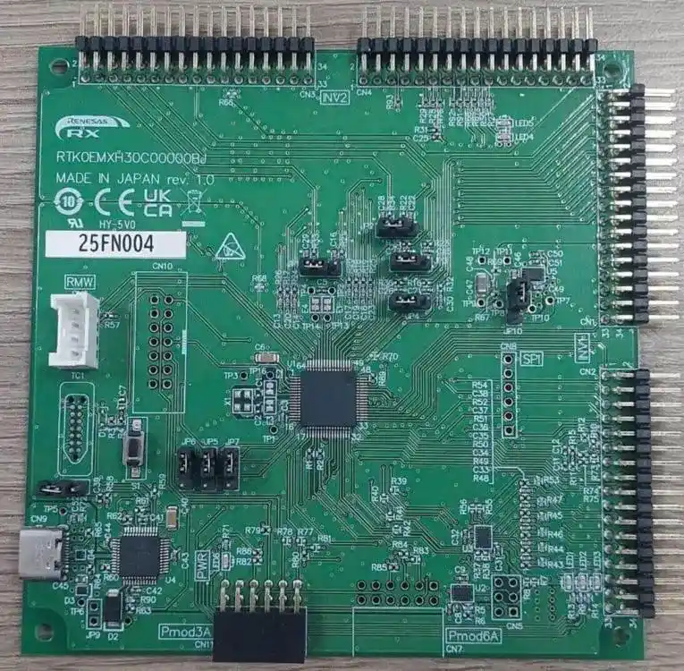

<!-- Copyright 2015-2026 Zephyr Project members and individual contributors. -->
<!-- SPDX-License-Identifier: Apache-2.0 -->
<!-- 中文翻译；编号、导航与译注为本地新增。 -->

<a id="mcb_rx14t"></a>

# 第13章\_RX14T电机控制板（Motor Control Board）

原文：[官方页面](https://docs.zephyrproject.org/latest/boards/renesas/mcb_rx14t/doc/index.html)。读取日期：2026-10-16；来源摘要见[来源记录](../SOURCES.md)。

开发板概览（Board Overview）

<a id="id1"></a>

[](images/mcb_rx14t.webp)

RX14T电机控制板（Motor Control Board）

名称（Name）：

`mcb_rx14t`

厂商（Vendor）：

[瑞萨电子（Renesas Electronics Corporation）](https://docs.zephyrproject.org/latest/boards/index.html#vendor=renesas)

状态（Status）：

维护中（Maintained）

架构（Architecture）：

[rx](https://docs.zephyrproject.org/latest/boards/index.html#arch=rx)

片上系统（SoC）：

[r5f514t5amfm](https://docs.zephyrproject.org/latest/boards/index.html#soc=r5f514t5amfm)

<a id="board-github-link"></a>

[浏览开发板源码（Browse Board Sources）](https://github.com/zephyrproject-rtos/zephyr/blob/main//boards/renesas/mcb_rx14t/doc/index.rst/../..)<a id="overview"></a>

## 概述（Overview）

MCB-RX14T是电机控制评估套件，使用它可方便地借助MCK-RX14T进行电机控制。

MCK-RX14T具有以下特点：


- 支持无刷直流电机（Brushless DC Motor）。
- 支持单、双及三分流电阻电流检测（Shunt Current Detection）。
- 支持电机控制开发辅助工具Renesas Motor Workbench。
- 通过过流检测电路提供过流保护功能。

MCB-RX14T主要功能按板卡架构分为以下两组：

直接访问MCU引脚（MCU Native Pin Access）

MCB-RX14T包括：


- R5F514T5AMFM MCU，下称RX MCU


  - 最高48 MHz，32位RX处理器，RXv2
  - 128 KB ROM、12 KB RAM
  - 64引脚LFQFP封装

系统控制与生态接口（System Control and Ecosystem Access）


- 直流5 V、3.3 V输入，通过跳线选择
- 自动从以下方式选择一种


  - 由兼容逆变器板（Inverter Board）供电
  - 由USB连接器供电
- E2OB板载调试电路
- 用户LED及开关

  > - 5个用户LED
  > - 电源LED，指示稳压电源可用
  > - MCU复位开关
- 连接器（Connectors）


  - 逆变器板连接器
  - E2OB的USB连接器
  - 与Renesas Motor Workbench通信的SCI连接器
  - SPI通信通孔
  - Pmod连接器

<a id="supported-features"></a>

### 支持的功能（Supported Features）

`mcb_rx14t`开发板支持下表所列的硬件功能。

片上／板载（On-Chip / On-Board）

功能集成在片上系统（SoC）内／位于开发板上。

2 / 2

分别表示已启用／已禁用的实例数。点击数量标签，可查看开发板或SoC设备树源码（DTS）中该功能的第一个实例。

`vnd,foo`

与此功能匹配的设备树绑定兼容字符串（Compatible String）；点击链接可查看绑定文档。

<a id="mcb_rx14t-hw-features"></a>

<a id="mcb_rx14t-mcb_rx14t/r5f514t5amfm-hw-features-section"></a>

#### `mcb_rx14t/r5f514t5amfm`目标（Target）

<a id="mcb_rx14t-mcb_rx14t/r5f514t5amfm-hw-features-panel"></a>

<a id="mcb_rx14t-mcb_rx14t/r5f514t5amfm-hw-features-memory"></a>

此开发板目标的存储器：12 KiB RAM、128 KiB闪存。

<a id="mcb_rx14t-mcb_rx14t/r5f514t5amfm-hw-features-table"></a>

<table>
<tr>
<th>类型（Type）</th>
<th>位置（Location）</th>
<th>说明（Description）</th>
<th>兼容字符串（Compatible）</th>
</tr>
<tr>
<td rowspan="1">中央处理器（CPU）</td>
<td>片上（On-Chip）</td>
<td>瑞萨RX处理器（CPU）（<a href="https://github.com/zephyrproject-rtos/zephyr/blob/main/dts/rx/renesas/rx14t-common.dtsi?plain=1#L23">已启用：1</a>）</td>
<td><a href="../cpu_vendor_multiarc_binding_reference/P029_renesas_rx.md#std-dtcompatible-renesas-rx"><code>renesas,rx</code></a></td>
</tr>
<tr>
<td rowspan="1">模数转换器（ADC）</td>
<td>片上（On-Chip）</td>
<td>瑞萨RX模数转换器（ADC）（<a href="https://github.com/zephyrproject-rtos/zephyr/blob/main/dts/rx/renesas/rx14t-common.dtsi?plain=1#L608">已启用：1</a>；<a href="https://github.com/zephyrproject-rtos/zephyr/blob/main/dts/rx/renesas/rx14t-common.dtsi?plain=1#L620">已禁用：1</a>）</td>
<td><a href="../hardware/P870_RenesasRX模数转换器绑定.md#dtbinding-renesas-rx-adc"><code>renesas,rx-adc</code></a></td>
</tr>
<tr>
<td rowspan="4">时钟控制（Clock Control）</td>
<td>片上（On-Chip）</td>
<td>瑞萨RX根时钟生成电路（<a href="https://github.com/zephyrproject-rtos/zephyr/blob/main/dts/rx/renesas/r5f514t5amfm.dtsi?plain=1#L24">已启用：3</a>；<a href="https://github.com/zephyrproject-rtos/zephyr/blob/main/dts/rx/renesas/r5f514t5amfm.dtsi?plain=1#L15">已禁用：1</a>）</td>
<td><a href="../clock_renesas_rockchip_sifli_silabs_binding_reference/P010_renesas_rx-cgc-root-clock.md#std-dtcompatible-renesas-rx-cgc-root-clock"><code>renesas,rx-cgc-root-clock</code></a></td>
</tr>
<tr>
<td>片上（On-Chip）</td>
<td>瑞萨RX时钟生成电路的锁相环（PLL）时钟（<a href="https://github.com/zephyrproject-rtos/zephyr/blob/main/dts/rx/renesas/r5f514t5amfm.dtsi?plain=1#L45">已禁用：1</a>）</td>
<td><a href="../clock_renesas_rockchip_sifli_silabs_binding_reference/P008_renesas_rx-cgc-pll.md#std-dtcompatible-renesas-rx-cgc-pll"><code>renesas,rx-cgc-pll</code></a></td>
</tr>
<tr>
<td>片上（On-Chip）</td>
<td>瑞萨RX时钟控制节点的pclk模块（<a href="https://github.com/zephyrproject-rtos/zephyr/blob/main/dts/rx/renesas/r5f514t5amfm.dtsi?plain=1#L54">已启用：1</a>）</td>
<td><a href="../clock_renesas_rockchip_sifli_silabs_binding_reference/P006_renesas_rx-cgc-pclk-block.md#std-dtcompatible-renesas-rx-cgc-pclk-block"><code>renesas,rx-cgc-pclk-block</code></a></td>
</tr>
<tr>
<td>片上（On-Chip）</td>
<td>瑞萨RX时钟控制外设时钟（<a href="https://github.com/zephyrproject-rtos/zephyr/blob/main/dts/rx/renesas/r5f514t5amfm.dtsi?plain=1#L63">已启用：4</a>；<a href="https://github.com/zephyrproject-rtos/zephyr/blob/main/dts/rx/renesas/r5f514t5amfm.dtsi?plain=1#L92">已禁用：6</a>）</td>
<td><a href="../clock_renesas_rockchip_sifli_silabs_binding_reference/P007_renesas_rx-cgc-pclk.md#std-dtcompatible-renesas-rx-cgc-pclk"><code>renesas,rx-cgc-pclk</code></a></td>
</tr>
<tr>
<td rowspan="1">比较器（Comparator）</td>
<td>片上（On-Chip）</td>
<td>瑞萨RX低电压检测（Low-voltage Detection，LVD）控制器（<a href="https://github.com/zephyrproject-rtos/zephyr/blob/main/dts/rx/renesas/rx14t-common.dtsi?plain=1#L632">已禁用：2</a>）</td>
<td><a href="../hardware/P751_RenesasRX电压检测器绑定.md#dtbinding-renesas-rx-lvd"><code>renesas,rx-lvd</code></a></td>
</tr>
<tr>
<td rowspan="1">闪存控制器（Flash Controller）</td>
<td>片上（On-Chip）</td>
<td>瑞萨RX闪存控制器（<a href="https://github.com/zephyrproject-rtos/zephyr/blob/main/dts/rx/renesas/r5f514t5amfm.dtsi?plain=1#L143">已启用：1</a>）</td>
<td><a href="../flash_renesas_st_ti_binding_reference/P001_renesas_rx-flash.md#std-dtcompatible-renesas-rx-flash"><code>renesas,rx-flash</code></a></td>
</tr>
<tr>
<td rowspan="1">通用输入输出与接插件（GPIO &amp; Headers）</td>
<td>片上（On-Chip）</td>
<td>瑞萨RX系列通用输入输出（GPIO）（<a href="https://github.com/zephyrproject-rtos/zephyr/blob/main/dts/rx/renesas/rx14t-common.dtsi?plain=1#L318">已启用：3</a>；<a href="https://github.com/zephyrproject-rtos/zephyr/blob/main/dts/rx/renesas/rx14t-common.dtsi?plain=1#L236">已禁用：8</a>）</td>
<td><a href="../gpio_raspberrypi_renesas_binding_reference/P019_renesas_rx-gpio.md#std-dtcompatible-renesas-rx-gpio"><code>renesas,rx-gpio</code></a></td>
</tr>
<tr>
<td rowspan="1">集成电路间总线（I2C）</td>
<td>片上（On-Chip）</td>
<td>瑞萨RX I2C主控制器（<a href="https://github.com/zephyrproject-rtos/zephyr/blob/main/dts/rx/renesas/rx14t-common.dtsi?plain=1#L562">已启用：1</a>）</td>
<td><a href="../i2c_nxp_pico_renesas_binding_reference/P016_renesas_rx-i2c.md#std-dtcompatible-renesas-rx-i2c"><code>renesas,rx-i2c</code></a></td>
</tr>
<tr>
<td rowspan="1">中断控制器（Interrupt Controller）</td>
<td>片上（On-Chip）</td>
<td>瑞萨中断控制单元（ICU）（<a href="https://github.com/zephyrproject-rtos/zephyr/blob/main/dts/rx/renesas/rx14t-common.dtsi?plain=1#L31">已启用：1</a>）</td>
<td><a href="../renesas_interrupt_binding_reference/P002_renesas_rx-icu.md#std-dtcompatible-renesas-rx-icu"><code>renesas,rx-icu</code></a></td>
</tr>
<tr>
<td rowspan="1">发光二极管（LED）</td>
<td>板载（On-Board）</td>
<td>一组由 GPIO 控制的 LED（GPIO-Controlled LEDs）（<a href="https://github.com/zephyrproject-rtos/zephyr/blob/main/boards/renesas/mcb_rx14t/mcb_rx14t.dts?plain=1#L26">已启用：1</a>）</td>
<td><a href="../hardware/P564_GPIO指示灯绑定.md#dtbinding-gpio-leds"><code>gpio-leds</code></a></td>
</tr>
<tr>
<td rowspan="3">其他绑定（Miscellaneous）</td>
<td>片上（On-Chip）</td>
<td>瑞萨RX数据传输控制器（Data Transfer Controller，DTC）（<a href="https://github.com/zephyrproject-rtos/zephyr/blob/main/dts/rx/renesas/rx14t-common.dtsi?plain=1#L59">已启用：1</a>）</td>
<td><a href="../misc_nxp_renesas_zephyr_binding_reference/P022_renesas_rx-dtc.md#std-dtcompatible-renesas-rx-dtc"><code>renesas,rx-dtc</code></a></td>
</tr>
<tr>
<td>片上（On-Chip）</td>
<td>瑞萨RX外部中断（<a href="https://github.com/zephyrproject-rtos/zephyr/blob/main/dts/rx/renesas/rx14t-common.dtsi?plain=1#L156">已禁用：8</a>）</td>
<td><a href="../misc_nxp_renesas_zephyr_binding_reference/P023_renesas_rx-external-interrupt.md#std-dtcompatible-renesas-rx-external-interrupt"><code>renesas,rx-external-interrupt</code></a></td>
</tr>
<tr>
<td>片上（On-Chip）</td>
<td>瑞萨RX串行通信接口（SCI）控制器（<a href="https://github.com/zephyrproject-rtos/zephyr/blob/main/dts/rx/renesas/rx14t-common.dtsi?plain=1#L498">已启用：1</a>；<a href="https://github.com/zephyrproject-rtos/zephyr/blob/main/dts/rx/renesas/rx14t-common.dtsi?plain=1#L514">已禁用：3</a>）</td>
<td><a href="../misc_nxp_renesas_zephyr_binding_reference/P026_renesas_rx-sci.md#std-dtcompatible-renesas-rx-sci"><code>renesas,rx-sci</code></a></td>
</tr>
<tr>
<td rowspan="2">存储技术设备（MTD）</td>
<td>片上（On-Chip）</td>
<td>瑞萨RX系列闪存的设备树绑定（Binding）（<a href="https://github.com/zephyrproject-rtos/zephyr/blob/main/dts/rx/renesas/r5f514t5amfm.dtsi?plain=1#L151">已启用：2</a>）</td>
<td><a href="../mtd_nxp_st_ti_partition_binding_reference/P011_renesas_rx-nv-flash.md#std-dtcompatible-renesas-rx-nv-flash"><code>renesas,rx-nv-flash</code></a></td>
</tr>
<tr>
<td>板载（On-Board）</td>
<td>闪存或其他非易失性存储器的固定分区（Fixed Partitions）（<a href="https://github.com/zephyrproject-rtos/zephyr/blob/main/boards/renesas/mcb_rx14t/mcb_rx14t.dts?plain=1#L89">已启用：1</a>）</td>
<td><a href="../hardware/P568_固定分区绑定.md#dtbinding-fixed-partitions"><code>fixed-partitions</code></a></td>
</tr>
<tr>
<td rowspan="2">引脚控制（Pin Control）</td>
<td>片上（On-Chip）</td>
<td>瑞萨RX引脚控制器（<a href="https://github.com/zephyrproject-rtos/zephyr/blob/main/dts/rx/renesas/rx14t-common.dtsi?plain=1#L73">已启用：1</a>）</td>
<td><a href="../pinctrl_renesas_silabs_binding_reference/P011_renesas_rx-pinctrl.md#std-dtcompatible-renesas-rx-pinctrl"><code>renesas,rx-pinctrl</code></a></td>
</tr>
<tr>
<td>片上（On-Chip）</td>
<td>瑞萨RX引脚复用，多功能引脚控制器（Multi Function Pin Controller，MPC）；原文厂商名拼作Rensas（<a href="https://github.com/zephyrproject-rtos/zephyr/blob/main/dts/rx/renesas/rx14t-common.dtsi?plain=1#L79">已启用：11</a>）</td>
<td><a href="../pinctrl_renesas_silabs_binding_reference/P012_renesas_rx-pinmux.md#std-dtcompatible-renesas-rx-pinmux"><code>renesas,rx-pinmux</code></a></td>
</tr>
<tr>
<td rowspan="1">瑞萨 RX（Renesas RX）</td>
<td>片上（On-Chip）</td>
<td>瑞萨RX软件中断（Software Interrupt，SWINT）（<a href="https://github.com/zephyrproject-rtos/zephyr/blob/main/dts/rx/renesas/rx14t-common.dtsi?plain=1#L50">已启用：1</a>）</td>
<td><a href="../platform_rmt_openthread_binding_reference/P012_renesas_rx-swint.md#std-dtcompatible-renesas-rx-swint"><code>renesas,rx-swint</code></a></td>
</tr>
<tr>
<td rowspan="1">串行控制器（Serial Controller）</td>
<td>片上（On-Chip）</td>
<td>瑞萨RX SCI UART控制器（<a href="https://github.com/zephyrproject-rtos/zephyr/blob/main/dts/rx/renesas/rx14t-common.dtsi?plain=1#L508">已启用：1</a>；<a href="https://github.com/zephyrproject-rtos/zephyr/blob/main/dts/rx/renesas/rx14t-common.dtsi?plain=1#L524">已禁用：3</a>）</td>
<td><a href="../uart_raspberrypi_realtek_renesas_binding_reference/P013_renesas_rx-uart-sci.md#std-dtcompatible-renesas-rx-uart-sci"><code>renesas,rx-uart-sci</code></a></td>
</tr>
<tr>
<td rowspan="1">静态随机存储器（SRAM）</td>
<td>片上（On-Chip）</td>
<td>通用片上静态随机存储器（SRAM）（<a href="https://github.com/zephyrproject-rtos/zephyr/blob/main/dts/rx/renesas/r5f514t5amfm.dtsi?plain=1#L137">已启用：1</a>）</td>
<td><a href="../hardware/P567_内存映射SRAM绑定.md#dtbinding-mmio-sram"><code>mmio-sram</code></a></td>
</tr>
<tr>
<td rowspan="2">定时器（Timer）</td>
<td>片上（On-Chip）</td>
<td>瑞萨RX定时器节点（<a href="https://github.com/zephyrproject-rtos/zephyr/blob/main/dts/rx/renesas/rx14t-common.dtsi?plain=1#L574">已启用：1</a>）</td>
<td><a href="../renesas_timer_binding_reference/P003_renesas_rx-timer-cmt-start-control.md#std-dtcompatible-renesas-rx-timer-cmt-start-control"><code>renesas,rx-timer-cmt-start-control</code></a></td>
</tr>
<tr>
<td>片上（On-Chip）</td>
<td>瑞萨RX定时器节点（<a href="https://github.com/zephyrproject-rtos/zephyr/blob/main/dts/rx/renesas/rx14t-common.dtsi?plain=1#L583">已启用：1</a>；<a href="https://github.com/zephyrproject-rtos/zephyr/blob/main/dts/rx/renesas/rx14t-common.dtsi?plain=1#L596">已禁用：1</a>）</td>
<td><a href="../renesas_timer_binding_reference/P004_renesas_rx-timer-cmt.md#std-dtcompatible-renesas-rx-timer-cmt"><code>renesas,rx-timer-cmt</code></a></td>
</tr>
<tr>
<td rowspan="1">看门狗（Watchdog）</td>
<td>片上（On-Chip）</td>
<td>瑞萨RX独立看门狗（Independent Watchdog）（<a href="https://github.com/zephyrproject-rtos/zephyr/blob/main/dts/rx/renesas/rx14t-common.dtsi?plain=1#L657">已启用：1</a>）</td>
<td><a href="../realtek_renesas_silabs_watchdog_binding_reference/P006_renesas_rx-iwdt.md#std-dtcompatible-renesas-rx-iwdt"><code>renesas,rx-iwdt</code></a></td>
</tr>
</table>

<a id="programming-and-debugging"></a>

## 烧录与调试（Programming and Debugging）

`mcb_rx14t`开发板支持下表所列的运行工具（Runners）及相关west命令。

<table>
<tr>
<th></th>
<th>烧录（flash）</th>
<th>调试（debug）</th>
</tr>
<tr>
<td><a href="https://docs.zephyrproject.org/latest/develop/flash_debug/host-tools.html#runner-rfp">rfp</a></td>
<td>✅（默认 / default）</td>
<td></td>
</tr>
</table>

mcb_rx14t可按常规方式构建、烧录及调试，详见“构建应用”与“运行应用”。（[构建应用（Building an Application）](../application/P001_应用开发.md#build-an-application)；[运行应用（Run an Application）](https://docs.zephyrproject.org/latest/develop/application/index.html#application-run)）

<a id="flashing"></a>

### 烧录（Flashing）

通过开发板14针调试连接器将E2 Lite调试器接至主机PC，可向MCB-RX14T烧录。以下为构建并烧录[Hello World](../getting_started/P005_HelloWorld示例.md#hello_world)应用的示例。

```text
# From the root of the zephyr repository
west build -b mcb_rx14t samples/hello_world
west flash
```

<a id="debugging"></a>

### 调试（Debugging）

可使用Visual Studio Code的Renesas Debug扩展获得图形调试界面。launch.json配置如下。（[Renesas Debug调试扩展](https://marketplace.visualstudio.com/items?itemName=RenesasElectronicsCorporation.renesas-debug)）

```text
{
  "version": "0.2.0",
  "configurations": [
      {
          "type": "renesas-hardware",
          "request": "launch",
          "name": "RX14T Renesas Debugging E2lite",
          "target": {
              "deviceFamily": "RX",
              "device": "R5F514T5",
              "debuggerType": "E2LITE"
              "serverParameters": [
                  "-uUseFine=", "1",
                  "-w=", "0",
              ],
          }
      }
  ]
}
```

<a id="references"></a>

## 参考资料（References）

## 译注

MCB-RX14T原文概述同时使用MCB与MCK名称，按来源保留，未将CPU板等同于整套电机系统。

---

[上一章](P012_Renesas_Electronics_Corporation.md) · [返回大纲](大纲.md) · [全站翻译进度](../PROGRESS.md) · [下一章](P014_RX26T_Motor_Control_Board.md)
