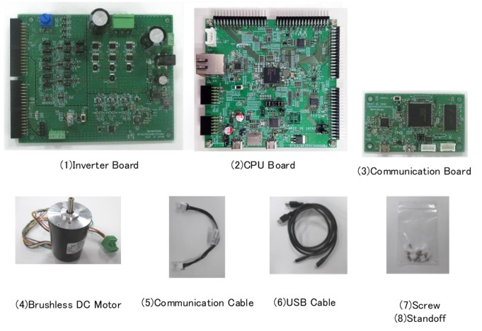
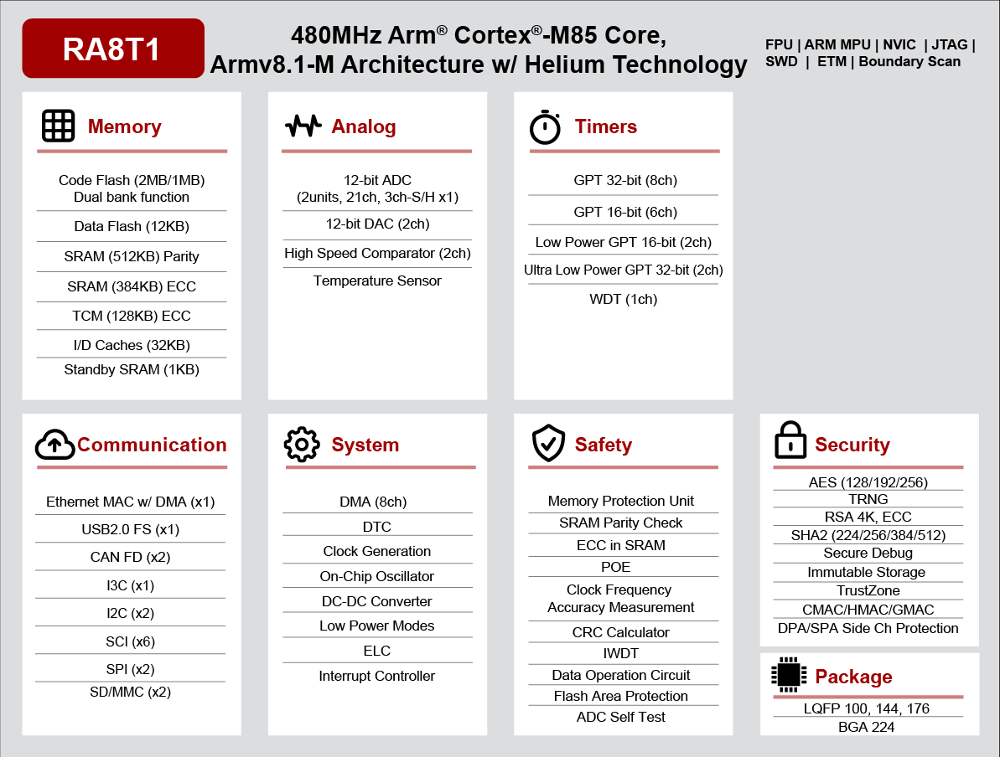

<!-- Copyright 2015-2026 Zephyr Project members and individual contributors. -->
<!-- SPDX-License-Identifier: Apache-2.0 -->
<!-- 中文翻译；编号、导航与译注为本地新增。 -->

<a id="mck_ra8t1"></a>

# 第16章\_RA8T1电机控制套件

原文：[官方页面](https://docs.zephyrproject.org/latest/boards/renesas/mck_ra8t1/doc/index.html)。读取日期：2026-10-16；来源摘要见[来源记录](../SOURCES.md)。

开发板概览（Board Overview）

<a id="id1"></a>

[](images/mck_ra8t1.jpg)

RA8T1电机控制套件

名称（Name）：

`mck_ra8t1`

厂商（Vendor）：

[瑞萨电子（Renesas Electronics Corporation）](https://docs.zephyrproject.org/latest/boards/index.html#vendor=renesas)

状态（Status）：

维护中（Maintained）

架构（Architecture）：

[arm](https://docs.zephyrproject.org/latest/boards/index.html#arch=arm)

片上系统（SoC）：

[r7fa8t1ahecbd](https://docs.zephyrproject.org/latest/boards/index.html#soc=r7fa8t1ahecbd)

<a id="board-github-link"></a>

[浏览开发板源码（Browse Board Sources）](https://github.com/zephyrproject-rtos/zephyr/blob/main//boards/renesas/mck_ra8t1/doc/index.rst/../..)<a id="overview"></a>

## 概述（Overview）

MCK-RA8T1开发套件支持方便地评估永磁同步电机（Permanent Magnet Synchronous Motor），即无刷直流电机的控制。套件功能及应用详情见[MCK-RA8T1网站](https://www.renesas.com/us/en/products/microcontrollers-microprocessors/ra-cortex-m-mcus/rtk0ema5k0s00020bj-mck-ra8t1-renesas-flexible-motor-control-kit-ra8t1-mcu-group)。

MCK-RA8T1套件包括：


- RA8T1 CPU板，[MCB-RA8T1](https://www.renesas.com/us/en/products/microcontrollers-microprocessors/ra-cortex-m-mcus/rtk0ema5k0c00000bj-mcb-ra8t1-cpu-board-ra8t1-mcu-group)
- 逆变器板，[MCI-LV-1](https://www.renesas.com/us/en/products/power-power-management/fet-motor-drivers/rtk0em0000s04020bj-mci-lv-1-renesas-flexible-motor-control-inverter-board-low-voltage-48v10a-three-phase-bldcpmsm-motor)
- 通信板，[MC-COM](https://www.renesas.com/us/en/products/microcontrollers-microprocessors/rx-32-bit-performance-efficiency-mcus/rtk0emxc90s00000bj-mc-com-renesas-flexible-motor-control-communication-board)
- 永磁同步电机
- 附件，包括线缆、隔离柱等

<a id="id2"></a>



MCK-RA8T1产品内容，图片来源：瑞萨电子

MCB-RA8T1是装有RA8T1的电机控制CPU板，与受支持的逆变器板组合即可方便地实现RA8T1电机控制；也可单独使用此板评估RA8T1 MCU。

使用受支持的通信板可将CPU板与PC电气隔离，以安全地进行电机控制评估及调试。

CPU板规格如下：

MCU规格


- 480 MHz Arm Cortex-M85 RA8T1 MCU，224引脚BGA封装
- ROM／RAM容量：2 MB／1 MB
- MCU输入时钟：24 MHz，由外部晶体振荡器产生
- 供电：直流5 V，自动从以下方式选择一种：


  - 由兼容逆变器板（Inverter Board）供电
  - 由USB连接器供电

连接器（Connector）


- 逆变器板连接器，2对
- J-Link OB的USB连接器
- RA8T1的USB连接器
- 与Renesas Motor Workbench通信的SCI连接器
- CAN通信通孔
- Arm调试器的20针通孔
- Pmod连接器，Type6A及Type2A／3A
- 以太网连接器；原文拼作Ethrnet
- microSD卡连接器

板载调试器（Onboard Debugger）

本产品包含J-Link On-Board板载调试电路，下称J-Link-OB，可用它写入RA8T1程序或固件。

<a id="hardware"></a>

## 硬件（Hardware）

RA8T1 MCU组硬件详情见[RA8T1组用户手册硬件篇](https://www.renesas.com/us/en/document/mah/ra8t1-group-users-manual-hardware?r=25463106)。

<a id="id3"></a>

[](images/ra8t1_block_diagram.png)

RA8T1框图，图片来源：瑞萨电子

MCB-RA8T1硬件详情见其用户手册。（[MCB-RA8T1用户手册](https://www.renesas.com/us/en/document/mat/mcb-ra8t1-users-manual?r=25466356)）

<a id="supported-features"></a>

### 支持的功能（Supported Features）

`mck_ra8t1`开发板支持下表所列的硬件功能。

片上／板载（On-Chip / On-Board）

功能集成在片上系统（SoC）内／位于开发板上。

2 / 2

分别表示已启用／已禁用的实例数。点击数量标签，可查看开发板或SoC设备树源码（DTS）中该功能的第一个实例。

`vnd,foo`

与此功能匹配的设备树绑定兼容字符串（Compatible String）；点击链接可查看绑定文档。

<a id="mck_ra8t1-hw-features"></a>

<a id="mck_ra8t1-mck_ra8t1/r7fa8t1ahecbd-hw-features-section"></a>

#### `mck_ra8t1/r7fa8t1ahecbd`目标（Target）

<a id="mck_ra8t1-mck_ra8t1/r7fa8t1ahecbd-hw-features-panel"></a>

<a id="mck_ra8t1-mck_ra8t1/r7fa8t1ahecbd-hw-features-memory"></a>

该开发板目标的片上存储容量：896 KiB RAM、2016 KiB Flash。

<a id="mck_ra8t1-mck_ra8t1/r7fa8t1ahecbd-hw-features-table"></a>

<table>
<tr>
<th>类型（Type）</th>
<th>位置（Location）</th>
<th>说明（Description）</th>
<th>兼容字符串（Compatible）</th>
</tr>
<tr>
<td rowspan="1">中央处理器（CPU）</td>
<td>片上（On-Chip）</td>
<td>ARM Cortex-M85处理器（CPU）（<a href="https://github.com/zephyrproject-rtos/zephyr/blob/main/dts/arm/renesas/ra/ra8/ra8x1.dtsi?plain=1#L20">已启用：1</a>）</td>
<td><a href="../cpu_cortex_xtensa_binding_reference/P006_arm_cortex-m85.md#std-dtcompatible-arm-cortex-m85"><code>arm,cortex-m85</code></a></td>
</tr>
<tr>
<td rowspan="1">模数转换器（ADC）</td>
<td>片上（On-Chip）</td>
<td>Renesas RA 12位分辨率模数转换器（ADC12）（<a href="https://github.com/zephyrproject-rtos/zephyr/blob/main/dts/arm/renesas/ra/ra8/ra8x1.dtsi?plain=1#L458">已启用：1</a>；<a href="https://github.com/zephyrproject-rtos/zephyr/blob/main/dts/arm/renesas/ra/ra8/ra8x1.dtsi?plain=1#L470">已禁用：1</a>）</td>
<td><a href="../hardware/P868_RenesasRAADC12绑定.md#dtbinding-renesas-ra-adc12"><code>renesas,ra-adc12</code></a></td>
</tr>
<tr>
<td rowspan="2">控制器局域网（CAN）</td>
<td>片上（On-Chip）</td>
<td>Renesas RA CAN FD控制器全局节点（<a href="https://github.com/zephyrproject-rtos/zephyr/blob/main/dts/arm/renesas/ra/ra8/ra8x1.dtsi?plain=1#L768">已启用：1</a>）</td>
<td><a href="../can_nxp_renesas_stm32_ti_binding_reference/P004_renesas_ra-canfd-global.md#std-dtcompatible-renesas-ra-canfd-global"><code>renesas,ra-canfd-global</code></a></td>
</tr>
<tr>
<td>片上（On-Chip）</td>
<td>Renesas RA CAN FD控制器（<a href="https://github.com/zephyrproject-rtos/zephyr/blob/main/dts/arm/renesas/ra/ra8/ra8x1.dtsi?plain=1#L789">已启用：1</a>；<a href="https://github.com/zephyrproject-rtos/zephyr/blob/main/dts/arm/renesas/ra/ra8/ra8x1.dtsi?plain=1#L779">已禁用：1</a>）</td>
<td><a href="../can_nxp_renesas_stm32_ti_binding_reference/P005_renesas_ra-canfd.md#std-dtcompatible-renesas-ra-canfd"><code>renesas,ra-canfd</code></a></td>
</tr>
<tr>
<td rowspan="8">时钟控制（Clock Control）</td>
<td>片上（On-Chip）</td>
<td>Renesas RA时钟生成电路（Clock Generation Circuit）的外部时钟配置（<a href="https://github.com/zephyrproject-rtos/zephyr/blob/main/dts/arm/renesas/ra/ra8/r7fa8t1xh.dtsi?plain=1#L22">已启用：1</a>）</td>
<td><a href="../clock_nxp_pico_realtek_renesas_binding_reference/P029_renesas_ra-cgc-external-clock.md#std-dtcompatible-renesas-ra-cgc-external-clock"><code>renesas,ra-cgc-external-clock</code></a></td>
</tr>
<tr>
<td>片上（On-Chip）</td>
<td>通用固定频率时钟提供者（Fixed-Rate Clock Provider）（<a href="https://github.com/zephyrproject-rtos/zephyr/blob/main/dts/arm/renesas/ra/ra8/r7fa8t1xh.dtsi?plain=1#L29">已启用：3</a>）</td>
<td><a href="../hardware/P566_固定时钟绑定.md#dtbinding-fixed-clock"><code>fixed-clock</code></a></td>
</tr>
<tr>
<td>片上（On-Chip）</td>
<td>Renesas RA子时钟（Sub-Clock）（<a href="https://github.com/zephyrproject-rtos/zephyr/blob/main/dts/arm/renesas/ra/ra8/r7fa8t1xh.dtsi?plain=1#L47">已禁用：1</a>）</td>
<td><a href="../clock_renesas_rockchip_sifli_silabs_binding_reference/P004_renesas_ra-cgc-subclk.md#std-dtcompatible-renesas-ra-cgc-subclk"><code>renesas,ra-cgc-subclk</code></a></td>
</tr>
<tr>
<td>片上（On-Chip）</td>
<td>Renesas RA时钟生成电路的锁相环时钟（PLL Clock）（<a href="https://github.com/zephyrproject-rtos/zephyr/blob/main/dts/arm/renesas/ra/ra8/r7fa8t1xh.dtsi?plain=1#L54">已启用：1</a>；<a href="https://github.com/zephyrproject-rtos/zephyr/blob/main/dts/arm/renesas/ra/ra8/r7fa8t1xh.dtsi?plain=1#L87">已禁用：1</a>）</td>
<td><a href="../clock_renesas_rockchip_sifli_silabs_binding_reference/P003_renesas_ra-cgc-pll.md#std-dtcompatible-renesas-ra-cgc-pll"><code>renesas,ra-cgc-pll</code></a></td>
</tr>
<tr>
<td>片上（On-Chip）</td>
<td>Renesas RA时钟生成电路（Clock Generation Circuit）的PLL时钟输出线（<a href="https://github.com/zephyrproject-rtos/zephyr/blob/main/dts/arm/renesas/ra/ra8/r7fa8t1xh.dtsi?plain=1#L62">已启用：3</a>；<a href="https://github.com/zephyrproject-rtos/zephyr/blob/main/dts/arm/renesas/ra/ra8/r7fa8t1xh.dtsi?plain=1#L95">已禁用：3</a>）</td>
<td><a href="../clock_renesas_rockchip_sifli_silabs_binding_reference/P002_renesas_ra-cgc-pll-out.md#std-dtcompatible-renesas-ra-cgc-pll-out"><code>renesas,ra-cgc-pll-out</code></a></td>
</tr>
<tr>
<td>片上（On-Chip）</td>
<td>Renesas RA时钟控制节点的pclk模块（<a href="https://github.com/zephyrproject-rtos/zephyr/blob/main/dts/arm/renesas/ra/ra8/r7fa8t1xh.dtsi?plain=1#L120">已启用：1</a>）</td>
<td><a href="../clock_nxp_pico_realtek_renesas_binding_reference/P030_renesas_ra-cgc-pclk-block.md#std-dtcompatible-renesas-ra-cgc-pclk-block"><code>renesas,ra-cgc-pclk-block</code></a></td>
</tr>
<tr>
<td>片上（On-Chip）</td>
<td>Renesas RA时钟控制外设时钟（Peripheral Clock）（<a href="https://github.com/zephyrproject-rtos/zephyr/blob/main/dts/arm/renesas/ra/ra8/r7fa8t1xh.dtsi?plain=1#L130">已启用：13</a>；<a href="https://github.com/zephyrproject-rtos/zephyr/blob/main/dts/arm/renesas/ra/ra8/r7fa8t1xh.dtsi?plain=1#L201">已禁用：5</a>）</td>
<td><a href="../clock_renesas_rockchip_sifli_silabs_binding_reference/P001_renesas_ra-cgc-pclk.md#std-dtcompatible-renesas-ra-cgc-pclk"><code>renesas,ra-cgc-pclk</code></a></td>
</tr>
<tr>
<td>片上（On-Chip）</td>
<td>Renesas RA外部总线时钟（External Bus Clock）（<a href="https://github.com/zephyrproject-rtos/zephyr/blob/main/dts/arm/renesas/ra/ra8/r7fa8t1xh.dtsi?plain=1#L186">已启用：1</a>）</td>
<td><a href="../clock_nxp_pico_realtek_renesas_binding_reference/P028_renesas_ra-cgc-busclk.md#std-dtcompatible-renesas-ra-cgc-busclk"><code>renesas,ra-cgc-busclk</code></a></td>
</tr>
<tr>
<td rowspan="3">比较器（Comparator）</td>
<td>片上（On-Chip）</td>
<td>Renesas RA高速模拟比较器（ACMPHS）全局节点（<a href="https://github.com/zephyrproject-rtos/zephyr/blob/main/dts/arm/renesas/ra/ra8/ra8x1.dtsi?plain=1#L1039">已禁用：1</a>）</td>
<td><a href="../hardware/P748_RenesasRA高速模拟比较器全局绑定.md#dtbinding-renesas-ra-acmphs-global"><code>renesas,ra-acmphs-global</code></a></td>
</tr>
<tr>
<td>片上（On-Chip）</td>
<td>Renesas RA高速模拟比较器（ACMPHS）控制器（<a href="https://github.com/zephyrproject-rtos/zephyr/blob/main/dts/arm/renesas/ra/ra8/ra8x1.dtsi?plain=1#L1044">已禁用：2</a>）</td>
<td><a href="../hardware/P749_RenesasRA高速模拟比较器绑定.md#dtbinding-renesas-ra-acmphs"><code>renesas,ra-acmphs</code></a></td>
</tr>
<tr>
<td>片上（On-Chip）</td>
<td>Renesas RA低电压检测（LVD）控制器（<a href="https://github.com/zephyrproject-rtos/zephyr/blob/main/dts/arm/renesas/ra/ra8/ra8x1.dtsi?plain=1#L1057">已禁用：2</a>）</td>
<td><a href="../hardware/P750_RenesasRA电压检测器绑定.md#dtbinding-renesas-ra-lvd"><code>renesas,ra-lvd</code></a></td>
</tr>
<tr>
<td rowspan="2">计数器（Counter）</td>
<td>片上（On-Chip）</td>
<td>Renesas RA超低功耗定时器（ULPT）计数器（<a href="https://github.com/zephyrproject-rtos/zephyr/blob/main/dts/arm/renesas/ra/ra8/ra8x1.dtsi?plain=1#L699">已禁用：2</a>）</td>
<td><a href="../renesas_realtek_counter_binding_reference/P015_renesas_ra-ulpt-counter.md#std-dtcompatible-renesas-ra-ulpt-counter"><code>renesas,ra-ulpt-counter</code></a></td>
</tr>
<tr>
<td>片上（On-Chip）</td>
<td>用作计数器的Renesas RA异步通用定时器（AGT）（<a href="https://github.com/zephyrproject-rtos/zephyr/blob/main/dts/arm/renesas/ra/ra8/ra8x1.dtsi?plain=1#L745">已禁用：2</a>）</td>
<td><a href="../renesas_realtek_counter_binding_reference/P014_renesas_ra-agt-counter.md#std-dtcompatible-renesas-ra-agt-counter"><code>renesas,ra-agt-counter</code></a></td>
</tr>
<tr>
<td rowspan="1">循环冗余校验（CRC）</td>
<td>片上（On-Chip）</td>
<td>Renesas RA循环冗余校验（CRC）设备（<a href="https://github.com/zephyrproject-rtos/zephyr/blob/main/dts/arm/renesas/ra/ra8/ra8x1.dtsi?plain=1#L800">已启用：1</a>）</td>
<td><a href="../crc_clock_monitor_binding_reference/P008_renesas_ra-crc.md#std-dtcompatible-renesas-ra-crc"><code>renesas,ra-crc</code></a></td>
</tr>
<tr>
<td rowspan="2">数模转换器（DAC）</td>
<td>片上（On-Chip）</td>
<td>Renesas RA数模转换器全局控制器（DAC Controller Global）（<a href="https://github.com/zephyrproject-rtos/zephyr/blob/main/dts/arm/renesas/ra/ra8/ra8x1.dtsi?plain=1#L482">已启用：1</a>）</td>
<td><a href="../hardware/P772_RenesasRA数模转换器全局绑定.md#dtbinding-renesas-ra-dac-global"><code>renesas,ra-dac-global</code></a></td>
</tr>
<tr>
<td>片上（On-Chip）</td>
<td>Renesas RA数模转换器（DAC）控制器（<a href="https://github.com/zephyrproject-rtos/zephyr/blob/main/dts/arm/renesas/ra/ra8/ra8x1.dtsi?plain=1#L488">已启用：1</a>；<a href="https://github.com/zephyrproject-rtos/zephyr/blob/main/dts/arm/renesas/ra/ra8/ra8x1.dtsi?plain=1#L495">已禁用：1</a>）</td>
<td><a href="../hardware/P773_RenesasRA数模转换器绑定.md#dtbinding-renesas-ra-dac"><code>renesas,ra-dac</code></a></td>
</tr>
<tr>
<td rowspan="1">直接存储器访问（DMA）</td>
<td>片上（On-Chip）</td>
<td>Renesas RA直接存储器访问（DMA）控制器（<a href="https://github.com/zephyrproject-rtos/zephyr/blob/main/dts/arm/renesas/ra/ra8/ra8x1.dtsi?plain=1#L213">已禁用：1</a>）</td>
<td><a href="../nxp_realtek_renesas_dma_binding_reference/P012_renesas_ra-dma.md#std-dtcompatible-renesas-ra-dma"><code>renesas,ra-dma</code></a></td>
</tr>
<tr>
<td rowspan="3">以太网（Ethernet）</td>
<td>片上（On-Chip）</td>
<td>Renesas RA以太网（Ethernet）（<a href="https://github.com/zephyrproject-rtos/zephyr/blob/main/dts/arm/renesas/ra/ra8/ra8x1.dtsi?plain=1#L807">已启用：1</a>）</td>
<td><a href="../ethernet_phy_renesas_rockchip_binding_reference/P017_renesas_ra-ethernet.md#std-dtcompatible-renesas-ra-ethernet"><code>renesas,ra-ethernet</code></a></td>
</tr>
<tr>
<td>片上（On-Chip）</td>
<td>Renesas RA外部管理数据输入输出控制器（MDIO Controller）（<a href="https://github.com/zephyrproject-rtos/zephyr/blob/main/dts/arm/renesas/ra/ra8/ra8x1.dtsi?plain=1#L817">已启用：1</a>）</td>
<td><a href="../ethernet_mdio_microchip_binding_reference/P006_renesas_ra-mdio.md#std-dtcompatible-renesas-ra-mdio"><code>renesas,ra-mdio</code></a></td>
</tr>
<tr>
<td>板载（On-Board）</td>
<td>通用媒体独立接口物理层（MII PHY）（<a href="https://github.com/zephyrproject-rtos/zephyr/blob/main/boards/renesas/mck_ra8t1/mck_ra8t1.dts?plain=1#L218">已启用：1</a>）</td>
<td><a href="../ethernet_nxp_phy_binding_reference/P019_ethernet-phy.md#std-dtcompatible-ethernet-phy"><code>ethernet-phy</code></a></td>
</tr>
<tr>
<td rowspan="2">闪存控制器（Flash Controller）</td>
<td>片上（On-Chip）</td>
<td>Renesas RA闪存应用命令接口（Flash Application Command Interface）（<a href="https://github.com/zephyrproject-rtos/zephyr/blob/main/dts/arm/renesas/ra/ra8/ra8x1.dtsi?plain=1#L449">已启用：1</a>）</td>
<td><a href="../flash_nuvoton_nxp_renesas_binding_reference/P025_renesas_ra-faci.md#std-dtcompatible-renesas-ra-faci"><code>renesas,ra-faci</code></a></td>
</tr>
<tr>
<td>片上（On-Chip）</td>
<td>Renesas RA系列高性能闪存控制器（Flash High-Performance Controller）（<a href="https://github.com/zephyrproject-rtos/zephyr/blob/main/dts/arm/renesas/ra/ra8/r7fa8t1ahecbd.dtsi?plain=1#L11">已启用：2</a>）</td>
<td><a href="../flash_nuvoton_nxp_renesas_binding_reference/P027_renesas_ra-flash-hp-controller.md#std-dtcompatible-renesas-ra-flash-hp-controller"><code>renesas,ra-flash-hp-controller</code></a></td>
</tr>
<tr>
<td rowspan="1">通用输入输出与接插件（GPIO &amp; Headers）</td>
<td>片上（On-Chip）</td>
<td>Renesas RA通用输入输出端口（GPIO I/O Port）（<a href="https://github.com/zephyrproject-rtos/zephyr/blob/main/dts/arm/renesas/ra/ra8/ra8x1.dtsi?plain=1#L122">已启用：3</a>；<a href="https://github.com/zephyrproject-rtos/zephyr/blob/main/dts/arm/renesas/ra/ra8/ra8x1.dtsi?plain=1#L92">已禁用：9</a>）</td>
<td><a href="../gpio_raspberrypi_renesas_binding_reference/P014_renesas_ra-gpio-ioport.md#std-dtcompatible-renesas-ra-gpio-ioport"><code>renesas,ra-gpio-ioport</code></a></td>
</tr>
<tr>
<td rowspan="2">集成电路间总线（I2C）</td>
<td>片上（On-Chip）</td>
<td>Renesas RA I2C控制器（<a href="https://github.com/zephyrproject-rtos/zephyr/blob/main/dts/arm/renesas/ra/ra8/ra8x1.dtsi?plain=1#L231">已启用：1</a>；<a href="https://github.com/zephyrproject-rtos/zephyr/blob/main/dts/arm/renesas/ra/ra8/ra8x1.dtsi?plain=1#L223">已禁用：1</a>）</td>
<td><a href="../i2c_nxp_pico_renesas_binding_reference/P014_renesas_ra-iic.md#std-dtcompatible-renesas-ra-iic"><code>renesas,ra-iic</code></a></td>
</tr>
<tr>
<td>片上（On-Chip）</td>
<td>Renesas RA SCI-B I2C控制器（<a href="https://github.com/zephyrproject-rtos/zephyr/blob/main/dts/arm/renesas/ra/ra8/ra8x1.dtsi?plain=1#L256">已禁用：6</a>）</td>
<td><a href="../i2c_nxp_pico_renesas_binding_reference/P012_renesas_ra-i2c-sci-b.md#std-dtcompatible-renesas-ra-i2c-sci-b"><code>renesas,ra-i2c-sci-b</code></a></td>
</tr>
<tr>
<td rowspan="1">改进型集成电路间总线（I3C）</td>
<td>片上（On-Chip）</td>
<td>Renesas RA I3C控制器（<a href="https://github.com/zephyrproject-rtos/zephyr/blob/main/dts/arm/renesas/ra/ra8/ra8x1.dtsi?plain=1#L533">已启用：1</a>）</td>
<td><a href="../i3c_smbus_binding_reference/P008_renesas_ra-i3c.md#std-dtcompatible-renesas-ra-i3c"><code>renesas,ra-i3c</code></a></td>
</tr>
<tr>
<td rowspan="1">中断控制器（Interrupt Controller）</td>
<td>片上（On-Chip）</td>
<td>ARMv8.1-M嵌套向量中断控制器（NVIC / Nested Vectored Interrupt Controller）（<a href="https://github.com/zephyrproject-rtos/zephyr/blob/main/dts/arm/armv8.1-m.dtsi?plain=1#L17">已启用：1</a>）</td>
<td><a href="../arm_interrupt_timer_binding_reference/P004_ARMv8_1_M_NVIC.md#std-dtcompatible-arm-v8.1m-nvic"><code>arm,v8.1m-nvic</code></a></td>
</tr>
<tr>
<td rowspan="1">发光二极管（LED）</td>
<td>板载（On-Board）</td>
<td>一组由 GPIO 控制的 LED（GPIO-Controlled LEDs）（<a href="https://github.com/zephyrproject-rtos/zephyr/blob/main/boards/renesas/mck_ra8t1/mck_ra8t1.dts?plain=1#L28">已启用：1</a>）</td>
<td><a href="../hardware/P564_GPIO指示灯绑定.md#dtbinding-gpio-leds"><code>gpio-leds</code></a></td>
</tr>
<tr>
<td rowspan="1">本地互连网络（LIN）</td>
<td>片上（On-Chip）</td>
<td>Renesas RA LIN SCI控制器（<a href="https://github.com/zephyrproject-rtos/zephyr/blob/main/dts/arm/renesas/ra/ra8/ra8x1.dtsi?plain=1#L273">已禁用：2</a>）</td>
<td><a href="../lin_dali_mctp_sensor_bus_binding_reference/P002_renesas_ra-lin-sci-b.md#std-dtcompatible-renesas-ra-lin-sci-b"><code>renesas,ra-lin-sci-b</code></a></td>
</tr>
<tr>
<td rowspan="1">存储器控制器（Memory Controller）</td>
<td>片上（On-Chip）</td>
<td>Renesas RA SDRAM控制器（<a href="https://github.com/zephyrproject-rtos/zephyr/blob/main/dts/arm/renesas/ra/ra8/ra8x1.dtsi?plain=1#L824">已禁用：1</a>）</td>
<td><a href="../memory_controller_sdram_psram_binding_reference/P005_renesas_ra-sdram.md#std-dtcompatible-renesas-ra-sdram"><code>renesas,ra-sdram</code></a></td>
</tr>
<tr>
<td rowspan="5">其他绑定（Miscellaneous）</td>
<td>片上（On-Chip）</td>
<td>Renesas RA事件链接控制器（Event Link Controller）（<a href="https://github.com/zephyrproject-rtos/zephyr/blob/main/dts/arm/renesas/ra/ra8/ra8x1.dtsi?plain=1#L78">已禁用：1</a>）</td>
<td><a href="../misc_nxp_renesas_zephyr_binding_reference/P016_renesas_ra-elc.md#std-dtcompatible-renesas-ra-elc"><code>renesas,ra-elc</code></a></td>
</tr>
<tr>
<td>片上（On-Chip）</td>
<td>Renesas RA串行通信接口（SCI）控制器（<a href="https://github.com/zephyrproject-rtos/zephyr/blob/main/dts/arm/renesas/ra/ra8/ra8x1.dtsi?plain=1#L350">已启用：1</a>；<a href="https://github.com/zephyrproject-rtos/zephyr/blob/main/dts/arm/renesas/ra/ra8/ra8x1.dtsi?plain=1#L241">已禁用：5</a>）</td>
<td><a href="../misc_nxp_renesas_zephyr_binding_reference/P020_renesas_ra-sci.md#std-dtcompatible-renesas-ra-sci"><code>renesas,ra-sci</code></a></td>
</tr>
<tr>
<td>片上（On-Chip）</td>
<td>Renesas RA超低功耗定时器（ULPT）（<a href="https://github.com/zephyrproject-rtos/zephyr/blob/main/dts/arm/renesas/ra/ra8/ra8x1.dtsi?plain=1#L684">已启用：2</a>）</td>
<td><a href="../misc_nxp_renesas_zephyr_binding_reference/P021_renesas_ra-ulpt.md#std-dtcompatible-renesas-ra-ulpt"><code>renesas,ra-ulpt</code></a></td>
</tr>
<tr>
<td>片上（On-Chip）</td>
<td>Renesas RA异步通用定时器（AGT）（<a href="https://github.com/zephyrproject-rtos/zephyr/blob/main/dts/arm/renesas/ra/ra8/ra8x1.dtsi?plain=1#L734">已禁用：2</a>）</td>
<td><a href="../misc_nxp_renesas_zephyr_binding_reference/P014_renesas_ra-agt.md#std-dtcompatible-renesas-ra-agt"><code>renesas,ra-agt</code></a></td>
</tr>
<tr>
<td>片上（On-Chip）</td>
<td>Renesas RA外部中断（External Interrupt）（<a href="https://github.com/zephyrproject-rtos/zephyr/blob/main/dts/arm/renesas/ra/ra8/ra8x1.dtsi?plain=1#L839">已禁用：16</a>）</td>
<td><a href="../misc_nxp_renesas_zephyr_binding_reference/P017_renesas_ra-external-interrupt.md#std-dtcompatible-renesas-ra-external-interrupt"><code>renesas,ra-external-interrupt</code></a></td>
</tr>
<tr>
<td rowspan="1">内存管理单元／内存保护单元（MMU / MPU）</td>
<td>片上（On-Chip）</td>
<td>ARMv8.1-M存储器保护单元（MPU / Memory Protection Unit）（<a href="https://github.com/zephyrproject-rtos/zephyr/blob/main/dts/arm/renesas/ra/ra8/ra8x1.dtsi?plain=1#L28">已启用：1</a>）</td>
<td><a href="../memory_protection_binding_reference/P006_arm_armv8.1m-mpu.md#std-dtcompatible-arm-armv8.1m-mpu"><code>arm,armv8.1m-mpu</code></a></td>
</tr>
<tr>
<td rowspan="1">存储技术设备（MTD）</td>
<td>片上（On-Chip）</td>
<td>闪存（Flash）节点（<a href="https://github.com/zephyrproject-rtos/zephyr/blob/main/dts/arm/renesas/ra/ra8/r7fa8t1ahecbd.dtsi?plain=1#L19">已启用：2</a>）</td>
<td><a href="../mtd_nxp_st_ti_partition_binding_reference/P013_soc-nv-flash.md#std-dtcompatible-soc-nv-flash"><code>soc-nv-flash</code></a></td>
</tr>
<tr>
<td rowspan="1">八线串行外设接口（OCTOSPI）</td>
<td>片上（On-Chip）</td>
<td>Renesas RA八线SPI（OSPI）（<a href="https://github.com/zephyrproject-rtos/zephyr/blob/main/dts/arm/renesas/ra/ra8/ra8x1.dtsi?plain=1#L724">已禁用：1</a>）</td>
<td><a href="../qspi_ospi_xspi_binding_reference/P001_renesas_ra-ospi-b.md#std-dtcompatible-renesas-ra-ospi-b"><code>renesas,ra-ospi-b</code></a></td>
</tr>
<tr>
<td rowspan="1">物理层（PHY）</td>
<td>片上（On-Chip）</td>
<td>用于所有内置于 USB IP 的 USB 收发器（USB Transceivers）的绑定。（<a href="https://github.com/zephyrproject-rtos/zephyr/blob/main/dts/arm/renesas/ra/ra8/ra8x1.dtsi?plain=1#L1179">已启用：1</a>）</td>
<td><a href="../phy_binding_reference/P008_usb-nop-xceiv.md#std-dtcompatible-usb-nop-xceiv"><code>usb-nop-xceiv</code></a></td>
</tr>
<tr>
<td rowspan="1">引脚控制（Pin Control）</td>
<td>片上（On-Chip）</td>
<td>Renesas RA引脚控制器（Pin Controller）（<a href="https://github.com/zephyrproject-rtos/zephyr/blob/main/dts/arm/renesas/ra/ra8/ra8x1.dtsi?plain=1#L86">已启用：1</a>）</td>
<td><a href="../pinctrl_renesas_silabs_binding_reference/P006_renesas_ra-pinctrl-pfs.md#std-dtcompatible-renesas-ra-pinctrl-pfs"><code>renesas,ra-pinctrl-pfs</code></a></td>
</tr>
<tr>
<td rowspan="1">脉宽调制（PWM）</td>
<td>片上（On-Chip）</td>
<td>Renesas RA脉宽调制（PWM）（<a href="https://github.com/zephyrproject-rtos/zephyr/blob/main/dts/arm/renesas/ra/ra8/ra8x1.dtsi?plain=1#L564">已启用：1</a>；<a href="https://github.com/zephyrproject-rtos/zephyr/blob/main/dts/arm/renesas/ra/ra8/ra8x1.dtsi?plain=1#L544">已禁用：13</a>）</td>
<td><a href="../pwm_nxp_renesas_binding_reference/P019_renesas_ra-pwm.md#std-dtcompatible-renesas-ra-pwm"><code>renesas,ra-pwm</code></a></td>
</tr>
<tr>
<td rowspan="1">随机数生成器（RNG）</td>
<td>片上（On-Chip）</td>
<td>Renesas RA RSIP-E51A真随机数发生器（TRNG）（<a href="https://github.com/zephyrproject-rtos/zephyr/blob/main/dts/arm/renesas/ra/ra8/ra8x1.dtsi?plain=1#L503">已启用：1</a>）</td>
<td><a href="../soc_rng_binding_reference/P005_renesas_ra-rsip-e51a-trng.md#std-dtcompatible-renesas-ra-rsip-e51a-trng"><code>renesas,ra-rsip-e51a-trng</code></a></td>
</tr>
<tr>
<td rowspan="1">实时时钟（RTC）</td>
<td>片上（On-Chip）</td>
<td>Renesas RA实时时钟（RTC）（<a href="https://github.com/zephyrproject-rtos/zephyr/blob/main/dts/arm/renesas/ra/ra8/ra8x1.dtsi?plain=1#L1094">已禁用：1</a>）</td>
<td><a href="../soc_rtc_binding_reference/P006_renesas_ra-rtc.md#std-dtcompatible-renesas-ra-rtc"><code>renesas,ra-rtc</code></a></td>
</tr>
<tr>
<td rowspan="1">SD 主机控制器（SDHC）</td>
<td>片上（On-Chip）</td>
<td>Renesas RA SD主机控制器（SDHC）（<a href="https://github.com/zephyrproject-rtos/zephyr/blob/main/dts/arm/renesas/ra/ra8/ra8x1.dtsi?plain=1#L983">已启用：1</a>；<a href="https://github.com/zephyrproject-rtos/zephyr/blob/main/dts/arm/renesas/ra/ra8/ra8x1.dtsi?plain=1#L998">已禁用：1</a>）</td>
<td><a href="../sdhc_binding_reference/P017_renesas_ra-sdhc.md#std-dtcompatible-renesas-ra-sdhc"><code>renesas,ra-sdhc</code></a></td>
</tr>
<tr>
<td rowspan="1">串行控制器（Serial Controller）</td>
<td>片上（On-Chip）</td>
<td>Renesas RA SCI_B UART控制器（<a href="https://github.com/zephyrproject-rtos/zephyr/blob/main/dts/arm/renesas/ra/ra8/ra8x1.dtsi?plain=1#L359">已启用：1</a>；<a href="https://github.com/zephyrproject-rtos/zephyr/blob/main/dts/arm/renesas/ra/ra8/ra8x1.dtsi?plain=1#L250">已禁用：5</a>）</td>
<td><a href="../uart_raspberrypi_realtek_renesas_binding_reference/P008_renesas_ra8-uart-sci-b.md#std-dtcompatible-renesas-ra8-uart-sci-b"><code>renesas,ra8-uart-sci-b</code></a></td>
</tr>
<tr>
<td rowspan="2">串行外设接口（SPI）</td>
<td>片上（On-Chip）</td>
<td>Renesas RA SCI B SPI控制器（<a href="https://github.com/zephyrproject-rtos/zephyr/blob/main/dts/arm/renesas/ra/ra8/ra8x1.dtsi?plain=1#L264">已禁用：6</a>）</td>
<td><a href="../spi_flexspi_nxp_renesas_binding_reference/P015_renesas_ra-spi-sci-b.md#std-dtcompatible-renesas-ra-spi-sci-b"><code>renesas,ra-spi-sci-b</code></a></td>
</tr>
<tr>
<td>片上（On-Chip）</td>
<td>Renesas RA8 SPI_B控制器（<a href="https://github.com/zephyrproject-rtos/zephyr/blob/main/dts/arm/renesas/ra/ra8/ra8x1.dtsi?plain=1#L507">已启用：1</a>；<a href="https://github.com/zephyrproject-rtos/zephyr/blob/main/dts/arm/renesas/ra/ra8/ra8x1.dtsi?plain=1#L520">已禁用：1</a>）</td>
<td><a href="../spi_flexspi_nxp_renesas_binding_reference/P018_renesas_ra8-spi-b.md#std-dtcompatible-renesas-ra8-spi-b"><code>renesas,ra8-spi-b</code></a></td>
</tr>
<tr>
<td rowspan="1">静态随机存储器（SRAM）</td>
<td>片上（On-Chip）</td>
<td>通用片上静态随机存储器（SRAM）（<a href="https://github.com/zephyrproject-rtos/zephyr/blob/main/dts/arm/renesas/ra/ra8/ra8x1.dtsi?plain=1#L53">已启用：1</a>）</td>
<td><a href="../hardware/P567_内存映射SRAM绑定.md#dtbinding-mmio-sram"><code>mmio-sram</code></a></td>
</tr>
<tr>
<td rowspan="2">定时器（Timer）</td>
<td>片上（On-Chip）</td>
<td>ARMv8.1-M系统节拍（System Tick）（<a href="https://github.com/zephyrproject-rtos/zephyr/blob/main/dts/arm/armv8.1-m.dtsi?plain=1#L25">已启用：1</a>）</td>
<td><a href="../arm_interrupt_timer_binding_reference/P008_ARMv8_1_M_SysTick.md#std-dtcompatible-arm-armv8.1m-systick"><code>arm,armv8.1m-systick</code></a></td>
</tr>
<tr>
<td>片上（On-Chip）</td>
<td>Renesas RA ULPT定时器（<a href="https://github.com/zephyrproject-rtos/zephyr/blob/main/dts/arm/renesas/ra/ra8/ra8x1.dtsi?plain=1#L694">已启用：2</a>）</td>
<td><a href="../renesas_timer_binding_reference/P001_renesas_ra-ulpt-timer.md#std-dtcompatible-renesas-ra-ulpt-timer"><code>renesas,ra-ulpt-timer</code></a></td>
</tr>
<tr>
<td rowspan="3">通用串行总线（USB）</td>
<td>片上（On-Chip）</td>
<td>Renesas RA USB全速控制器（Full-Speed Controller）（<a href="https://github.com/zephyrproject-rtos/zephyr/blob/main/dts/arm/renesas/ra/ra8/ra8x1.dtsi?plain=1#L1018">已启用：1</a>）</td>
<td><a href="../usb_soc_binding_reference/P018_renesas_ra-usbfs.md#std-dtcompatible-renesas-ra-usbfs"><code>renesas,ra-usbfs</code></a></td>
</tr>
<tr>
<td>片上（On-Chip）</td>
<td>Renesas RA USB设备控制器（Device Controller）（<a href="https://github.com/zephyrproject-rtos/zephyr/blob/main/dts/arm/renesas/ra/ra8/ra8x1.dtsi?plain=1#L1028">已启用：1</a>）</td>
<td><a href="../usb_soc_binding_reference/P016_renesas_ra-udc.md#std-dtcompatible-renesas-ra-udc"><code>renesas,ra-udc</code></a></td>
</tr>
<tr>
<td>片上（On-Chip）</td>
<td>Renesas RA USB主机控制器（Host Controller）（<a href="https://github.com/zephyrproject-rtos/zephyr/blob/main/dts/arm/renesas/ra/ra8/ra8x1.dtsi?plain=1#L1033">已禁用：1</a>）</td>
<td><a href="../usb_soc_binding_reference/P017_renesas_ra-uhc.md#std-dtcompatible-renesas-ra-uhc"><code>renesas,ra-uhc</code></a></td>
</tr>
<tr>
<td rowspan="1">看门狗（Watchdog）</td>
<td>片上（On-Chip）</td>
<td>Renesas RA看门狗（WDT）（<a href="https://github.com/zephyrproject-rtos/zephyr/blob/main/dts/arm/renesas/ra/ra8/ra8x1.dtsi?plain=1#L1011">已启用：1</a>）</td>
<td><a href="../realtek_renesas_silabs_watchdog_binding_reference/P005_renesas_ra-wdt.md#std-dtcompatible-renesas-ra-wdt"><code>renesas,ra-wdt</code></a></td>
</tr>
</table>

注意（Note）

使用SDHC模块时，将microSD卡插入CN12插槽；本段原文板名写EK-RA8M1，保留并提示与本页MCB-RA8T1的差异。

<a id="programming-and-debugging"></a>

## 烧录与调试（Programming and Debugging）

`mck_ra8t1`开发板支持下表所列的运行工具（Runners）及相关west命令。

<table>
<tr>
<th></th>
<th>烧录（flash）</th>
<th>调试（debug）</th>
<th>连接调试会话（attach）</th>
<th>实时传输（rtt）</th>
<th>复位（reset）</th>
<th>调试服务器（debugserver）</th>
</tr>
<tr>
<td><a href="https://docs.zephyrproject.org/latest/develop/flash_debug/host-tools.html#runner-jlink">jlink</a></td>
<td>✅（默认 / default）</td>
<td>✅（默认 / default）</td>
<td>✅</td>
<td>✅</td>
<td>✅</td>
<td>✅</td>
</tr>
<tr>
<td><a href="https://docs.zephyrproject.org/latest/develop/flash_debug/host-tools.html#runner-pyocd">pyocd</a></td>
<td>✅</td>
<td>✅</td>
<td>✅</td>
<td>✅</td>
<td>✅</td>
<td>✅</td>
</tr>
</table>

mcb_ra8t1可按常规方式构建、烧录及调试，详见“构建应用”与“运行应用”。（[构建应用（Building an Application）](../application/P001_应用开发.md#build-an-application)；[运行应用（Run an Application）](https://docs.zephyrproject.org/latest/develop/application/index.html#application-run)）

注意：原文要求SDK从v0.16.6开始支持，因为该版提供Cortex-M85的GCC。原文称为EK-RA8M1构建时，需从[https://github.com/zephyrproject-rtos/sdk-ng/releases/tag/v0.16.6](https://github.com/zephyrproject-rtos/sdk-ng/releases/tag/v0.16.6)获取并安装GNU Arm Embedded工具链；这里保留原文的板名、命名及版本背景。

<a id="flashing"></a>

### 烧录（Flashing）

MCB-RA8T1可通过板载SEGGER J-Link烧录，驱动见[https://www.segger.com/downloads/jlink/](https://www.segger.com/downloads/jlink/)。

向开发板烧录程序：


1. 通过USB将J-Link OB连接主机；原文此处称OB，与前文外部调试器表述不同。
2. 确认J-Link OB跳线保持[MCB-RA8T1用户手册](https://www.renesas.com/us/en/document/mat/mcb-ra8t1-users-manual?r=25466356)中的默认配置。
3. 执行west命令。

  > ```text
  > west flash -r jlink
  > ```

<a id="debugging"></a>

### 调试（Debugging）

可使用Segger Ozone提供图形调试界面，见[Segger Ozone下载页](https://www.segger.com/downloads/jlink#Ozone)。

下载并安装后打开Ozone，按以下参数配置调试项目：


- 目标器件：R7FA8T1AH
- 目标接口（Target Interface）：SWD
- 目标接口速度：4 MHz
- 主机接口（Host Interface）：USB
- 程序文件（Program File）：<path/to/your/build/zephyr.elf>

注意：原文确认在SEGGER Ozone v3.30d上调试正常，因此要求使用该版本或更高版本。

<a id="references"></a>

## 参考资料（References）


- [MCB-RA8T1网站](https://www.renesas.com/us/en/products/microcontrollers-microprocessors/ra-cortex-m-mcus/rtk0ema5k0c00000bj-mcb-ra8t1-cpu-board-ra8t1-mcu-group)
- [RA8T1 MCU组网站](https://www.renesas.com/us/en/products/microcontrollers-microprocessors/ra-cortex-m-mcus/ra8t1-480-mhz-arm-cortex-m85-based-motor-control-microcontroller-helium-and-trustzone)

## 译注

RA8T1的SDHC段原文误写EK-RA8M1，SDK说明亦沿用另一板名，均保留并提示；本页插槽为CN12。

## 原文外链核对

2026-10-16核对并重试以下原文外链时未能确认可访问性，保留原始目标，不将访问失败解释为原文内容有误。

- [ra8t1-group-users-manual-hardware?r=25463106](https://www.renesas.com/us/en/document/mah/ra8t1-group-users-manual-hardware?r=25463106)：HTTP Error 429: Too Many Requests。
- [mcb-ra8t1-users-manual?r=25466356](https://www.renesas.com/us/en/document/mat/mcb-ra8t1-users-manual?r=25466356)：HTTP Error 429: Too Many Requests。
- [ra8t1-480-mhz-arm-cortex-m85-based-motor-control-microcontroller-helium-and-trustzone](https://www.renesas.com/us/en/products/microcontrollers-microprocessors/ra-cortex-m-mcus/ra8t1-480-mhz-arm-cortex-m85-based-motor-control-microcontroller-helium-and-trustzone)：HTTP Error 429: Too Many Requests。
- [rtk0ema5k0c00000bj-mcb-ra8t1-cpu-board-ra8t1-mcu-group](https://www.renesas.com/us/en/products/microcontrollers-microprocessors/ra-cortex-m-mcus/rtk0ema5k0c00000bj-mcb-ra8t1-cpu-board-ra8t1-mcu-group)：HTTP Error 429: Too Many Requests。
- [rtk0ema5k0s00020bj-mck-ra8t1-renesas-flexible-motor-control-kit-ra8t1-mcu-group](https://www.renesas.com/us/en/products/microcontrollers-microprocessors/ra-cortex-m-mcus/rtk0ema5k0s00020bj-mck-ra8t1-renesas-flexible-motor-control-kit-ra8t1-mcu-group)：HTTP Error 429: Too Many Requests。
- [rtk0emxc90s00000bj-mc-com-renesas-flexible-motor-control-communication-board](https://www.renesas.com/us/en/products/microcontrollers-microprocessors/rx-32-bit-performance-efficiency-mcus/rtk0emxc90s00000bj-mc-com-renesas-flexible-motor-control-communication-board)：HTTP Error 429: Too Many Requests。
- [rtk0em0000s04020bj-mci-lv-1-renesas-flexible-motor-control-inverter-board-low-voltage-48v10a-three-phase-bldcpmsm-motor](https://www.renesas.com/us/en/products/power-power-management/fet-motor-drivers/rtk0em0000s04020bj-mci-lv-1-renesas-flexible-motor-control-inverter-board-low-voltage-48v10a-three-phase-bldcpmsm-motor)：HTTP Error 429: Too Many Requests。
- [jlink](https://www.segger.com/downloads/jlink#Ozone)：页面可访问，但未确认目标片段。

---

[上一章](P015_RA4T1_Motor_Control_Kit.md) · [返回大纲](大纲.md) · [全站翻译进度](../PROGRESS.md) · [下一章](P017_RA8T2_Motor_Control_Kit.md)
