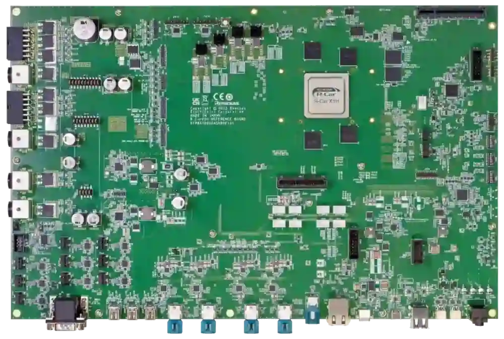

<!-- Copyright 2015-2026 Zephyr Project members and individual contributors. -->
<!-- SPDX-License-Identifier: Apache-2.0 -->
<!-- 中文翻译；编号、导航与译注为本地新增。 -->

<a id="rcar_ironhide_x5h"></a>

# 第18章\_R-Car Ironhide开发板

原文：[官方页面](https://docs.zephyrproject.org/latest/boards/renesas/rcar_ironhide_x5h/doc/index.html)。读取日期：2026-10-16；来源摘要见[来源记录](../SOURCES.md)。

开发板概览（Board Overview）

<a id="id4"></a>

[](images/rcar_ironhide_x5h.webp)

R-Car Ironhide开发板

名称（Name）：

`rcar_ironhide_x5h`

厂商（Vendor）：

[瑞萨电子（Renesas Electronics Corporation）](https://docs.zephyrproject.org/latest/boards/index.html#vendor=renesas)

状态（Status）：

维护中（Maintained）

架构（Architecture）：

[arm](https://docs.zephyrproject.org/latest/boards/index.html#arch=arm)、[arm64](https://docs.zephyrproject.org/latest/boards/index.html#arch=arm64)

片上系统（SoC）：

[r8a78000](https://docs.zephyrproject.org/latest/boards/index.html#soc=r8a78000)

<a id="board-github-link"></a>

[浏览开发板源码（Browse Board Sources）](https://github.com/zephyrproject-rtos/zephyr/blob/main//boards/renesas/rcar_ironhide_x5h/doc/index.rst/../..)<a id="overview"></a>

## 概述（Overview）

R-Car Ironhide基于R-Car X5H片上系统（SoC），提供高级驾驶辅助系统（Advanced Driver Assistance System，ADAS）、网关系统及车载信息娱乐（In-Vehicle Infotainment，IVI）产品所需的基本功能。

<a id="hardware"></a>

## 硬件（Hardware）

Ironhide功能：


- 中央处理器（CPU）


  - 2.7 GHz Cortex-A720AE，8个簇、每簇4核
  - 1.8 GHz Cortex-R52，3个簇、每簇4核
  - 600 MHz Cortex-M33，1核
- 计算（Compute）


  - 图形处理器（GPU）
  - 神经网络处理单元（NPU）
- SDRAM
- 存储（Storage）


  - 闪存（Flash Memory）
  - eMMC
  - 通用闪存存储（Universal Flash Storage，UFS）
- 网络（Network）


  - 灵活数据速率CAN（CAN-FD）
  - 扩展数据字段CAN（CAN-XL）
  - 本地互连网络（LIN）
  - 音频（Audio）
  - FlexRay
- 高吞吐量通信接口


  - 显示输出
  - 摄像头输入
  - 高速外围组件互连（PCIe）
  - 以太网（Ethernet）
  - 用于调试的以太网
  - USB 3.1，带USB 2.0
  - USB2.0
- 通用通信接口


  - 集成电路间总线（I2C）
  - 改进型集成电路间总线（I3C）
  - 高速串口接口（HSCIF）
  - MSIOF接口
  - JTAG调试器接口
  - 外围器件，RL78 MCU及I2C EEPROM
- 电源（Power）


  - 电源管理芯片（PMIC）
  - 电源（Power Supply）

<a id="supported-features"></a>

### 支持的功能（Supported Features）

`rcar_ironhide_x5h`开发板支持下表所列的硬件功能。

片上／板载（On-Chip / On-Board）

功能集成在片上系统（SoC）内／位于开发板上。

2 / 2

分别表示已启用／已禁用的实例数。点击数量标签，可查看开发板或SoC设备树源码（DTS）中该功能的第一个实例。

`vnd,foo`

与此功能匹配的设备树绑定兼容字符串（Compatible String）；点击链接可查看绑定文档。

<a id="rcar_ironhide_x5h-hw-features"></a>

<a id="rcar_ironhide_x5h-rcar_ironhide_x5h/r8a78000/a720-hw-features-section"></a>

#### `rcar_ironhide_x5h/r8a78000/a720`目标（Target）

<a id="rcar_ironhide_x5h-rcar_ironhide_x5h/r8a78000/a720-hw-features-panel"></a>

<a id="rcar_ironhide_x5h-rcar_ironhide_x5h/r8a78000/a720-hw-features-memory"></a>

该开发板目标的片上存储容量：512 MiB RAM、N/A Flash。

<a id="rcar_ironhide_x5h-rcar_ironhide_x5h/r8a78000/a720-hw-features-table"></a>

<table>
<tr>
<th>类型（Type）</th>
<th>位置（Location）</th>
<th>说明（Description）</th>
<th>兼容字符串（Compatible）</th>
</tr>
<tr>
<td rowspan="1">中央处理器（CPU）</td>
<td>片上（On-Chip）</td>
<td>Arm Cortex-A720处理器（CPU）（<a href="https://github.com/zephyrproject-rtos/zephyr/blob/main/dts/arm64/renesas/r8a78000.dtsi?plain=1#L18">已启用：1</a>）</td>
<td><a href="../cpu_arm_riscv_binding_reference/P013_arm_cortex-a720.md#std-dtcompatible-arm-cortex-a720"><code>arm,cortex-a720</code></a></td>
</tr>
<tr>
<td rowspan="6">固件（Firmware）</td>
<td>片上（On-Chip）</td>
<td>SCMI系统控制与管理接口共享内存（SHMEM）（<a href="https://github.com/zephyrproject-rtos/zephyr/blob/main/dts/arm64/renesas/r8a78000.dtsi?plain=1#L40">已启用：1</a>）</td>
<td><a href="../hardware/P602_SCMI共享内存绑定.md#dtbinding-arm-scmi-shmem"><code>arm,scmi-shmem</code></a></td>
</tr>
<tr>
<td>片上（On-Chip）</td>
<td>采用门铃（Doorbell）及共享内存（SHMEM）传输的系统控制与管理接口（SCMI）（<a href="https://github.com/zephyrproject-rtos/zephyr/blob/main/dts/arm64/renesas/r8a78000.dtsi?plain=1#L46">已启用：1</a>）</td>
<td><a href="../hardware/P600_SCMI邮箱传输绑定.md#dtbinding-arm-scmi"><code>arm,scmi</code></a></td>
</tr>
<tr>
<td>片上（On-Chip）</td>
<td>SCMI系统控制与管理接口电源域协议（Power Domain Protocol）（<a href="https://github.com/zephyrproject-rtos/zephyr/blob/main/dts/arm64/renesas/r8a78000.dtsi?plain=1#L55">已禁用：1</a>）</td>
<td><a href="../hardware/P604_SCMI电源域协议绑定.md#dtbinding-arm-scmi-power"><code>arm,scmi-power</code></a></td>
</tr>
<tr>
<td>片上（On-Chip）</td>
<td>SCMI系统电源协议（System Power Protocol）（<a href="https://github.com/zephyrproject-rtos/zephyr/blob/main/dts/arm64/renesas/r8a78000.dtsi?plain=1#L62">已禁用：1</a>）</td>
<td><a href="../hardware/P607_SCMI系统电源协议绑定.md#dtbinding-arm-scmi-system"><code>arm,scmi-system</code></a></td>
</tr>
<tr>
<td>片上（On-Chip）</td>
<td>SCMI系统控制与管理接口时钟协议（Clock Protocol）（<a href="https://github.com/zephyrproject-rtos/zephyr/blob/main/dts/arm64/renesas/r8a78000.dtsi?plain=1#L68">已启用：1</a>）</td>
<td><a href="../hardware/P603_SCMI时钟协议绑定.md#dtbinding-arm-scmi-clock"><code>arm,scmi-clock</code></a></td>
</tr>
<tr>
<td>片上（On-Chip）</td>
<td>SCMI引脚控制（Pinctrl）协议（<a href="https://github.com/zephyrproject-rtos/zephyr/blob/main/dts/arm64/renesas/r8a78000.dtsi?plain=1#L74">已禁用：1</a>）</td>
<td><a href="../hardware/P606_SCMI引脚控制协议绑定.md#dtbinding-arm-scmi-pinctrl"><code>arm,scmi-pinctrl</code></a></td>
</tr>
<tr>
<td rowspan="1">中断控制器（Interrupt Controller）</td>
<td>片上（On-Chip）</td>
<td>ARM通用中断控制器（GIC）v3（<a href="https://github.com/zephyrproject-rtos/zephyr/blob/main/dts/arm64/renesas/r8a78000.dtsi?plain=1#L190">已启用：1</a>）</td>
<td><a href="../interrupt_fabric_binding_reference/P004_arm_gic-v3.md#std-dtcompatible-arm-gic-v3"><code>arm,gic-v3</code></a></td>
</tr>
<tr>
<td rowspan="1">邮箱（Mailbox）</td>
<td>片上（On-Chip）</td>
<td>瑞萨R-Car MFIS邮箱（MBOX）（<a href="https://github.com/zephyrproject-rtos/zephyr/blob/main/dts/arm64/renesas/r8a78000.dtsi?plain=1#L87">已启用：1</a>）</td>
<td><a href="../intercore_reference/P052_RenesasR-Car邮箱绑定.md#dtbinding-renesas-rcar-mfis-mbox"><code>renesas,rcar-mfis-mbox</code></a></td>
</tr>
<tr>
<td rowspan="1">引脚控制（Pin Control）</td>
<td>片上（On-Chip）</td>
<td>瑞萨R-Car Gen5引脚功能控制器（Pin Function Controller，PFC）（<a href="https://github.com/zephyrproject-rtos/zephyr/blob/main/dts/arm64/renesas/r8a78000.dtsi?plain=1#L201">已启用：1</a>）</td>
<td><a href="../pinctrl_renesas_silabs_binding_reference/P008_renesas_rcar-pfc-x5h.md#std-dtcompatible-renesas-rcar-pfc-x5h"><code>renesas,rcar-pfc-x5h</code></a></td>
</tr>
<tr>
<td rowspan="1">电源管理 CPU 操作（Power Management CPU Operations）</td>
<td>片上（On-Chip）</td>
<td>电源状态协调接口（PSCI / Power State Coordination Interface）1.1版（<a href="https://github.com/zephyrproject-rtos/zephyr/blob/main/dts/arm64/renesas/r8a78000.dtsi?plain=1#L26">已启用：1</a>）</td>
<td><a href="https://docs.zephyrproject.org/latest/build/dts/api/bindings/pm_cpu_ops/arm%2Cpsci-1.1.html#std-dtcompatible-arm-psci-1.1"><code>arm,psci-1.1</code></a></td>
</tr>
<tr>
<td rowspan="1">串行控制器（Serial Controller）</td>
<td>片上（On-Chip）</td>
<td>Renesas R-Car高速串行通信接口（HSCIF）控制器（<a href="https://github.com/zephyrproject-rtos/zephyr/blob/main/dts/arm64/renesas/r8a78000.dtsi?plain=1#L211">已启用：1</a>）</td>
<td><a href="../uart_raspberrypi_realtek_renesas_binding_reference/P009_renesas_rcar-hscif.md#std-dtcompatible-renesas-rcar-hscif"><code>renesas,rcar-hscif</code></a></td>
</tr>
<tr>
<td rowspan="1">定时器（Timer）</td>
<td>片上（On-Chip）</td>
<td>每个内核独立的ARM架构定时器（Architected Timer）（<a href="https://github.com/zephyrproject-rtos/zephyr/blob/main/dts/arm64/renesas/r8a78000.dtsi?plain=1#L31">已启用：1</a>）</td>
<td><a href="../arm_interrupt_timer_binding_reference/P010_ARMv8架构定时器.md#std-dtcompatible-arm-armv8-timer"><code>arm,armv8-timer</code></a></td>
</tr>
</table>

<a id="rcar_ironhide_x5h-rcar_ironhide_x5h/r8a78000/r52-hw-features-section"></a>

#### `rcar_ironhide_x5h/r8a78000/r52`目标（Target）

<a id="rcar_ironhide_x5h-rcar_ironhide_x5h/r8a78000/r52-hw-features-panel"></a>

<a id="rcar_ironhide_x5h-rcar_ironhide_x5h/r8a78000/r52-hw-features-memory"></a>

该开发板目标的片上存储容量：2 MiB RAM、N/A Flash。

<a id="rcar_ironhide_x5h-rcar_ironhide_x5h/r8a78000/r52-hw-features-table"></a>

<table>
<tr>
<th>类型（Type）</th>
<th>位置（Location）</th>
<th>说明（Description）</th>
<th>兼容字符串（Compatible）</th>
</tr>
<tr>
<td rowspan="1">中央处理器（CPU）</td>
<td>片上（On-Chip）</td>
<td>ARM Cortex-R52处理器（CPU）（<a href="https://github.com/zephyrproject-rtos/zephyr/blob/main/dts/arm/renesas/rcar/gen5/rcar_gen5_cr52.dtsi?plain=1#L18">已启用：1</a>）</td>
<td><a href="../cpu_cortex_xtensa_binding_reference/P011_arm_cortex-r52.md#std-dtcompatible-arm-cortex-r52"><code>arm,cortex-r52</code></a></td>
</tr>
<tr>
<td rowspan="2">控制器局域网（CAN）</td>
<td>片上（On-Chip）</td>
<td>瑞萨R-Car RS-CANFD全局控制器（<a href="https://github.com/zephyrproject-rtos/zephyr/blob/main/dts/arm/renesas/rcar/gen5/rcar_gen5_cr52.dtsi?plain=1#L355">已启用：2</a>）</td>
<td><a href="../can_nxp_renesas_stm32_ti_binding_reference/P007_renesas_rcar-rscanfd-global.md#std-dtcompatible-renesas-rcar-rscanfd-global"><code>renesas,rcar-rscanfd-global</code></a></td>
</tr>
<tr>
<td>片上（On-Chip）</td>
<td>瑞萨R-Car RS-CANFD通道（<a href="https://github.com/zephyrproject-rtos/zephyr/blob/main/dts/arm/renesas/rcar/gen5/rcar_gen5_cr52.dtsi?plain=1#L361">已启用：11</a>；<a href="https://github.com/zephyrproject-rtos/zephyr/blob/main/dts/arm/renesas/rcar/gen5/rcar_gen5_cr52.dtsi?plain=1#L396">已禁用：5</a>）</td>
<td><a href="../can_nxp_renesas_stm32_ti_binding_reference/P008_renesas_rcar-rscanfd.md#std-dtcompatible-renesas-rcar-rscanfd"><code>renesas,rcar-rscanfd</code></a></td>
</tr>
<tr>
<td rowspan="6">固件（Firmware）</td>
<td>片上（On-Chip）</td>
<td>SCMI系统控制与管理接口共享内存（SHMEM）（<a href="https://github.com/zephyrproject-rtos/zephyr/blob/main/dts/arm/renesas/rcar/gen5/rcar_gen5_cr52.dtsi?plain=1#L29">已启用：1</a>）</td>
<td><a href="../hardware/P602_SCMI共享内存绑定.md#dtbinding-arm-scmi-shmem"><code>arm,scmi-shmem</code></a></td>
</tr>
<tr>
<td>片上（On-Chip）</td>
<td>采用门铃（Doorbell）及共享内存（SHMEM）传输的系统控制与管理接口（SCMI）（<a href="https://github.com/zephyrproject-rtos/zephyr/blob/main/dts/arm/renesas/rcar/gen5/rcar_gen5_cr52.dtsi?plain=1#L36">已启用：1</a>）</td>
<td><a href="../hardware/P600_SCMI邮箱传输绑定.md#dtbinding-arm-scmi"><code>arm,scmi</code></a></td>
</tr>
<tr>
<td>片上（On-Chip）</td>
<td>SCMI系统控制与管理接口电源域协议（Power Domain Protocol）（<a href="https://github.com/zephyrproject-rtos/zephyr/blob/main/dts/arm/renesas/rcar/gen5/rcar_gen5_cr52.dtsi?plain=1#L45">已启用：1</a>）</td>
<td><a href="../hardware/P604_SCMI电源域协议绑定.md#dtbinding-arm-scmi-power"><code>arm,scmi-power</code></a></td>
</tr>
<tr>
<td>片上（On-Chip）</td>
<td>SCMI系统控制与管理接口时钟协议（Clock Protocol）（<a href="https://github.com/zephyrproject-rtos/zephyr/blob/main/dts/arm/renesas/rcar/gen5/rcar_gen5_cr52.dtsi?plain=1#L51">已启用：1</a>）</td>
<td><a href="../hardware/P603_SCMI时钟协议绑定.md#dtbinding-arm-scmi-clock"><code>arm,scmi-clock</code></a></td>
</tr>
<tr>
<td>片上（On-Chip）</td>
<td>系统控制与管理接口（SCMI）复位域管理接口（<a href="https://github.com/zephyrproject-rtos/zephyr/blob/main/dts/arm/renesas/rcar/gen5/rcar_gen5_cr52.dtsi?plain=1#L57">已启用：1</a>）</td>
<td><a href="../hardware/P605_SCMI复位协议绑定.md#dtbinding-arm-scmi-reset"><code>arm,scmi-reset</code></a></td>
</tr>
<tr>
<td>片上（On-Chip）</td>
<td>SCMI引脚控制（Pinctrl）协议（<a href="https://github.com/zephyrproject-rtos/zephyr/blob/main/dts/arm/renesas/rcar/gen5/rcar_gen5_cr52.dtsi?plain=1#L63">已启用：1</a>）</td>
<td><a href="../hardware/P606_SCMI引脚控制协议绑定.md#dtbinding-arm-scmi-pinctrl"><code>arm,scmi-pinctrl</code></a></td>
</tr>
<tr>
<td rowspan="1">通用输入输出与接插件（GPIO &amp; Headers）</td>
<td>片上（On-Chip）</td>
<td>Renesas R-Car通用输入输出（GPIO）（<a href="https://github.com/zephyrproject-rtos/zephyr/blob/main/dts/arm/renesas/rcar/gen5/rcar_gen5_cr52.dtsi?plain=1#L176">已启用：2</a>；<a href="https://github.com/zephyrproject-rtos/zephyr/blob/main/dts/arm/renesas/rcar/gen5/rcar_gen5_cr52.dtsi?plain=1#L185">已禁用：9</a>）</td>
<td><a href="../gpio_raspberrypi_renesas_binding_reference/P017_renesas_rcar-gpio.md#std-dtcompatible-renesas-rcar-gpio"><code>renesas,rcar-gpio</code></a></td>
</tr>
<tr>
<td rowspan="1">集成电路间总线（I2C）</td>
<td>片上（On-Chip）</td>
<td>瑞萨R-Car I2C控制器（<a href="https://github.com/zephyrproject-rtos/zephyr/blob/main/dts/arm/renesas/rcar/gen5/rcar_gen5_cr52.dtsi?plain=1#L315">已启用：1</a>；<a href="https://github.com/zephyrproject-rtos/zephyr/blob/main/dts/arm/renesas/rcar/gen5/rcar_gen5_cr52.dtsi?plain=1#L275">已禁用：7</a>）</td>
<td><a href="../i2c_nxp_pico_renesas_binding_reference/P015_renesas_rcar-i2c.md#std-dtcompatible-renesas-rcar-i2c"><code>renesas,rcar-i2c</code></a></td>
</tr>
<tr>
<td rowspan="1">输入（Input）</td>
<td>板载（On-Board）</td>
<td>一组绑定到 GPIO 的输入按键（GPIO-Bound Input Keys）（<a href="https://github.com/zephyrproject-rtos/zephyr/blob/main/boards/renesas/rcar_ironhide_x5h/rcar_ironhide_x5h_r8a78000_r52.dts?plain=1#L52">已启用：1</a>）</td>
<td><a href="../hardware/P563_GPIO按键绑定.md#std-dtcompatible-gpio-keys"><code>gpio-keys</code></a></td>
</tr>
<tr>
<td rowspan="1">中断控制器（Interrupt Controller）</td>
<td>片上（On-Chip）</td>
<td>ARM通用中断控制器（GIC）v3（<a href="https://github.com/zephyrproject-rtos/zephyr/blob/main/dts/arm/renesas/rcar/gen5/rcar_gen5_cr52.dtsi?plain=1#L76">已启用：1</a>）</td>
<td><a href="../interrupt_fabric_binding_reference/P004_arm_gic-v3.md#std-dtcompatible-arm-gic-v3"><code>arm,gic-v3</code></a></td>
</tr>
<tr>
<td rowspan="1">发光二极管（LED）</td>
<td>板载（On-Board）</td>
<td>一组由 GPIO 控制的 LED（GPIO-Controlled LEDs）（<a href="https://github.com/zephyrproject-rtos/zephyr/blob/main/boards/renesas/rcar_ironhide_x5h/rcar_ironhide_x5h_r8a78000_r52.dts?plain=1#L33">已启用：1</a>）</td>
<td><a href="../hardware/P564_GPIO指示灯绑定.md#dtbinding-gpio-leds"><code>gpio-leds</code></a></td>
</tr>
<tr>
<td rowspan="1">邮箱（Mailbox）</td>
<td>片上（On-Chip）</td>
<td>瑞萨R-Car MFIS邮箱（MBOX）（<a href="https://github.com/zephyrproject-rtos/zephyr/blob/main/dts/arm/renesas/rcar/gen5/rcar_gen5_cr52.dtsi?plain=1#L95">已启用：1</a>）</td>
<td><a href="../intercore_reference/P052_RenesasR-Car邮箱绑定.md#dtbinding-renesas-rcar-mfis-mbox"><code>renesas,rcar-mfis-mbox</code></a></td>
</tr>
<tr>
<td rowspan="1">其他绑定（Miscellaneous）</td>
<td>板载（On-Board）</td>
<td>TI四通道20 Gbps DisplayPort 2.1及12 Gbps HDMI 2.1线性重驱动器（Linear Redriver）（<a href="https://github.com/zephyrproject-rtos/zephyr/blob/main/boards/renesas/rcar_ironhide_x5h/rcar_ironhide_x5h_r8a78000_r52.dts?plain=1#L111">已启用：1</a>）</td>
<td><a href="../misc_nxp_renesas_zephyr_binding_reference/P039_ti_tdp2004.md#std-dtcompatible-ti-tdp2004"><code>ti,tdp2004</code></a></td>
</tr>
<tr>
<td rowspan="1">引脚控制（Pin Control）</td>
<td>片上（On-Chip）</td>
<td>瑞萨R-Car Gen5引脚功能控制器（Pin Function Controller，PFC）（<a href="https://github.com/zephyrproject-rtos/zephyr/blob/main/dts/arm/renesas/rcar/gen5/rcar_gen5_cr52.dtsi?plain=1#L102">已启用：1</a>）</td>
<td><a href="../pinctrl_renesas_silabs_binding_reference/P008_renesas_rcar-pfc-x5h.md#std-dtcompatible-renesas-rcar-pfc-x5h"><code>renesas,rcar-pfc-x5h</code></a></td>
</tr>
<tr>
<td rowspan="1">电源域（Power Domain）</td>
<td>片上（On-Chip）</td>
<td>SCMI系统控制与管理接口电源域（Power Domain）（<a href="https://github.com/zephyrproject-rtos/zephyr/blob/main/dts/vendor/renesas/r8a78000_power_domains.dtsi?plain=1#L14">已启用：4</a>）</td>
<td><a href="../hardware/P613_SCMI电源域绑定.md#dtbinding-arm-scmi-power-domain"><code>arm,scmi-power-domain</code></a></td>
</tr>
<tr>
<td rowspan="2">串行控制器（Serial Controller）</td>
<td>片上（On-Chip）</td>
<td>瑞萨R-Car UART控制器（<a href="https://github.com/zephyrproject-rtos/zephyr/blob/main/dts/arm/renesas/rcar/gen5/rcar_gen5_cr52.dtsi?plain=1#L112">已禁用：4</a>）</td>
<td><a href="../uart_raspberrypi_realtek_renesas_binding_reference/P010_renesas_rcar-scif.md#std-dtcompatible-renesas-rcar-scif"><code>renesas,rcar-scif</code></a></td>
</tr>
<tr>
<td>片上（On-Chip）</td>
<td>Renesas R-Car高速串行通信接口（HSCIF）控制器（<a href="https://github.com/zephyrproject-rtos/zephyr/blob/main/dts/arm/renesas/rcar/gen5/rcar_gen5_cr52.dtsi?plain=1#L152">已启用：1</a>；<a href="https://github.com/zephyrproject-rtos/zephyr/blob/main/dts/arm/renesas/rcar/gen5/rcar_gen5_cr52.dtsi?plain=1#L144">已禁用：3</a>）</td>
<td><a href="../uart_raspberrypi_realtek_renesas_binding_reference/P009_renesas_rcar-hscif.md#std-dtcompatible-renesas-rcar-hscif"><code>renesas,rcar-hscif</code></a></td>
</tr>
<tr>
<td rowspan="1">静态随机存储器（SRAM）</td>
<td>片上（On-Chip）</td>
<td>通用片上静态随机存储器（SRAM）（<a href="https://github.com/zephyrproject-rtos/zephyr/blob/main/dts/arm/renesas/rcar/gen5/rcar_gen5_cr52.dtsi?plain=1#L71">已启用：1</a>）</td>
<td><a href="../hardware/P567_内存映射SRAM绑定.md#dtbinding-mmio-sram"><code>mmio-sram</code></a></td>
</tr>
<tr>
<td rowspan="1">定时器（Timer）</td>
<td>片上（On-Chip）</td>
<td>每个内核独立的ARM架构定时器（Architected Timer）（<a href="https://github.com/zephyrproject-rtos/zephyr/blob/main/dts/arm/renesas/rcar/gen5/rcar_gen5_cr52.dtsi?plain=1#L85">已启用：1</a>）</td>
<td><a href="../arm_interrupt_timer_binding_reference/P010_ARMv8架构定时器.md#std-dtcompatible-arm-armv8-timer"><code>arm,armv8-timer</code></a></td>
</tr>
</table>

注意（Note）

建议在Linux主机端禁用由R52内核使用的外设。

<a id="connections-and-ios"></a>

### 连接与输入输出（Connections and IOs）

输入输出接口图见[eLinux X5H Ironhide页面](https://elinux.org/R-Car/Boards/Ironhide)。

<a id="gpio"></a>

#### 通用输入输出（GPIO）

在X5H Ironhide上运行Zephyr时，可将软件可读按键sw47作为输入，将软件可控LED led47、led48及led49作为输出。

<a id="uart"></a>

#### 通用异步收发器（UART）

Ironhide通过CN44提供两个串口：


- HSCIF0用于运行Linux的A720AE内核；
- HSCIF1用于运行RTOS的R52内核。

<a id="programming-and-debugging-r52"></a>

## 编程与调试：R52

`rcar_ironhide_x5h`开发板支持下表所列的运行工具（Runners）及相关west命令。

<table>
<tr>
<th></th>
<th>烧录（flash）</th>
<th>调试（debug）</th>
</tr>
</table>

<a id="debug-probe"></a>

### 调试探针（Debug Probe）

Ironhide提供主JTAG连接器CN2，作为连接JTAG仿真器的调试接口。

但当前尚不能通过JTAG烧录或调试。

<a id="configuring-a-console"></a>

### 配置控制台（Configuring a Console）

通过USB线将PC连接Ironhide的CN44 USB端口，Zephyr控制台输出分配给HSCIF1。

打开minicom、PuTTY等串口终端，采用以下设置：


- 速率：1843200
- 数据位（Data）：8位
- 奇偶校验（Parity）：无（None）
- 停止位（Stop Bits）：1位

<a id="building"></a>

### 构建（Building）

按通常方式构建应用，详情见[构建应用（Building an Application）](../application/P001_应用开发.md#build-an-application)。

```text
# From the root of the zephyr repository
west build -b rcar_ironhide_x5h/r8a78000/r52 samples/hello_world
```

<a id="flashing"></a>

### 烧录（Flashing）

在支持JTAG之前，可使用瑞萨BSP ROM Writer工具烧录，详见[烧录说明](https://github.com/morimoto/renesas-bsp-rom-writer/tree/master/board/x5h_ironhide/linux)。此工具使用SREC文件格式，因此构建时会生成build/zephyr/zephyr.srec。（[瑞萨BSP ROM写入工具（ROM Writer）](https://github.com/morimoto/renesas-bsp-rom-writer)）

终端中应出现以下消息：

```text
*** Booting Zephyr OS build v4.4.0 ***
Hello World! rcar_ironhide_x5h/r8a78000/r52
```

<a id="programming-and-debugging-a720"></a>

## 编程与调试：A720

<a id="id1"></a>

### 配置控制台（Configuring a Console）

通过USB线将PC连接Ironhide的CN44 USB端口，Zephyr控制台输出分配给HSCIF0。

打开minicom、PuTTY等串口终端，采用以下设置：


- 速率：1843200
- 数据位（Data）：8位
- 奇偶校验（Parity）：无（None）
- 停止位（Stop Bits）：1位

<a id="id2"></a>

### 构建（Building）

按通常方式构建应用，详情见[构建应用（Building an Application）](../application/P001_应用开发.md#build-an-application)。

```text
# From the root of the zephyr repository
west build -b rcar_ironhide_x5h/r8a78000/a720 samples/hello_world
```

<a id="id3"></a>

### 烧录（Flashing）

可通过U-Boot写入并加载镜像。

```text
U-Boot 2025.01-SDKv4.31.0 (Oct 29 2025 - 07:12:14 +0000)

CPU:   Renesas Electronics R8A78000 rev 1.0
Model: Renesas Ironhide board based on r8a78000
DRAM:  2 GiB (total 32 GiB)
RAM Configuration:
Bank #0: 0x040000000 - 0x0bfffffff, 2 GiB
Bank #1: 0x1080000000 - 0x10ffffffff, 2 GiB
Bank #2: 0x1200000000 - 0x12ffffffff, 4 GiB
Bank #3: 0x1400000000 - 0x14ffffffff, 4 GiB
Bank #4: 0x1600000000 - 0x16ffffffff, 4 GiB
Bank #5: 0x1800000000 - 0x18ffffffff, 4 GiB
Bank #6: 0x1a00000000 - 0x1affffffff, 4 GiB
Bank #7: 0x1c00000000 - 0x1cffffffff, 4 GiB
Bank #8: 0x1e00000000 - 0x1effffffff, 4 GiB

Core:  59 devices, 26 uclasses, devicetree: separate
MMC:   mmc@c0880000: 0
Loading Environment from MMC... Reading from MMC(0)... OK
In:    serial@c0710000
Out:   serial@c0710000
Err:   serial@c0710000
Net:   Multi-Protocol PHY driver probed
eth0: port@4
=>
```

按任意键中断启动流程，进入U-Boot命令提示符。

随后通过TFTP传输Zephyr镜像；镜像载入内存后，用go命令执行。

```text
=> setenv ipaddr <board.ip>
=> setenv serverip <tftp.server.ip>
=> tftpboot 0x9e600000 <path/to/zephyr.bin>
=> go 0x9e600000
```

终端中应出现以下消息：

```text
## Starting application at 0x9E600000 ...
*** Booting Zephyr OS build v4.4.0 ***
Hello World! rcar_ironhide_x5h/r8a78000/a720
```

<a id="references"></a>

## 参考资料（References）


- [eLinux X5H Ironhide页面](https://elinux.org/R-Car/Boards/Ironhide)

## 译注

Ironhide的R52与A720使用不同控制台：HSCIF1及HSCIF0，串口速率1843200。原文尚不支持JTAG烧录调试，R52使用ROM Writer的SREC，A720使用U-Boot。

---

[上一章](P017_RA8T2_Motor_Control_Kit.md) · [返回大纲](大纲.md) · [全站翻译进度](../PROGRESS.md) · [下一章](P019_R-Car_Salvator-X.md)
