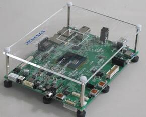
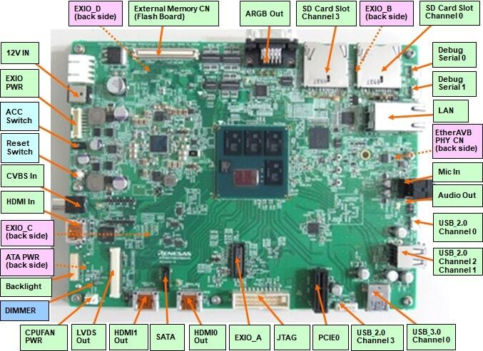

<!-- Copyright 2015-2026 Zephyr Project members and individual contributors. -->
<!-- SPDX-License-Identifier: Apache-2.0 -->
<!-- 中文翻译；编号、导航与译注为本地新增。 -->

<a id="rcar_salvator_x"></a>

# 第19章\_R-Car Salvator-X开发板

原文：[官方页面](https://docs.zephyrproject.org/latest/boards/renesas/rcar_salvator_x/doc/index.html)。读取日期：2026-10-16；来源摘要见[来源记录](../SOURCES.md)。

开发板概览（Board Overview）

<a id="id1"></a>

[](images/rcar_salvator_x.jpg)

R-Car Salvator-X开发板

名称（Name）：

`rcar_salvator_x`

厂商（Vendor）：

[瑞萨电子（Renesas Electronics Corporation）](https://docs.zephyrproject.org/latest/boards/index.html#vendor=renesas)

状态（Status）：

维护中（Maintained）

架构（Architecture）：

[arm](https://docs.zephyrproject.org/latest/boards/index.html#arch=arm)

片上系统（SoC）：

[r8a77951](https://docs.zephyrproject.org/latest/boards/index.html#soc=r8a77951)

<a id="board-github-link"></a>

[浏览开发板源码（Browse Board Sources）](https://github.com/zephyrproject-rtos/zephyr/blob/main//boards/renesas/rcar_salvator_x/doc/index.rst/../..)<a id="overview"></a>

## 概述（Overview）


- H3 Salvator-X用于评估瑞萨R-Car H3器件的功能及性能，也用于开发和评估面向R-Car H3的应用软件。
- H3 Salvator-X基于R-Car H3系统级封装（SiP），配备4 GB LPDDR4、两个64位宽通道，以及64 MB HyperFlash、CSI2接口和USB、以太网、HDMI等通信接口。可独立工作，也可通过底面的440针连接器连接其他板卡。

H3 SoC更多信息见[瑞萨R-Car H3芯片](https://www.renesas.com/eu/en/products/automotive-products/automotive-system-chips-socs/r-car-h3-high-end-automotive-system-chip-soc-vehicle-infotainment-and-driving-safety-support)页面。

<a id="hardware"></a>

## 硬件（Hardware）

H3 Salvator-X硬件能力见[eLinux H3 Salvator-X页面](https://elinux.org/R-Car/Boards/Salvator-X)。

注意（Note）

Zephyr将在为RTOS提供的CR7处理器上启动。

板卡更多信息见[瑞萨R-Car开发支持网站](https://www.renesas.com/us/en/support/partners/r-car-consortium/r-car-development-support)。

<a id="supported-features"></a>

### 支持的功能（Supported Features）

`rcar_salvator_x`开发板支持下表所列的硬件功能。

片上／板载（On-Chip / On-Board）

功能集成在片上系统（SoC）内／位于开发板上。

2 / 2

分别表示已启用／已禁用的实例数。点击数量标签，可查看开发板或SoC设备树源码（DTS）中该功能的第一个实例。

`vnd,foo`

与此功能匹配的设备树绑定兼容字符串（Compatible String）；点击链接可查看绑定文档。

<a id="rcar_salvator_x-hw-features"></a>

<a id="rcar_salvator_x-rcar_salvator_x/r8a77951/r7-hw-features-section"></a>

#### `rcar_salvator_x/r8a77951/r7`目标（Target）

<a id="rcar_salvator_x-rcar_salvator_x/r8a77951/r7-hw-features-panel"></a>

<a id="rcar_salvator_x-rcar_salvator_x/r8a77951/r7-hw-features-memory"></a>

此开发板目标的存储器：32512 KiB RAM；闪存容量不适用（N/A）。

<a id="rcar_salvator_x-rcar_salvator_x/r8a77951/r7-hw-features-table"></a>

<table>
<tr>
<th>类型（Type）</th>
<th>位置（Location）</th>
<th>说明（Description）</th>
<th>兼容字符串（Compatible）</th>
</tr>
<tr>
<td rowspan="1">中央处理器（CPU）</td>
<td>片上（On-Chip）</td>
<td>Arm Cortex-R7处理器（CPU）（<a href="https://github.com/zephyrproject-rtos/zephyr/blob/main/dts/arm/renesas/rcar/gen3/rcar_gen3_cr7.dtsi?plain=1#L20">已启用：1</a>）</td>
<td><a href="../cpu_cortex_xtensa_binding_reference/P013_arm_cortex-r7.md#std-dtcompatible-arm-cortex-r7"><code>arm,cortex-r7</code></a></td>
</tr>
<tr>
<td rowspan="1">控制器局域网（CAN）</td>
<td>片上（On-Chip）</td>
<td>瑞萨R-Car CAN控制器（<a href="https://github.com/zephyrproject-rtos/zephyr/blob/main/dts/arm/renesas/rcar/gen3/rcar_gen3_cr7.dtsi?plain=1#L91">已启用：1</a>）</td>
<td><a href="../can_nxp_renesas_stm32_ti_binding_reference/P006_renesas_rcar-can.md#std-dtcompatible-renesas-rcar-can"><code>renesas,rcar-can</code></a></td>
</tr>
<tr>
<td rowspan="1">时钟控制（Clock Control）</td>
<td>片上（On-Chip）</td>
<td>瑞萨R8A7795 SoC时钟脉冲发生器（CPG）、模块待机及软件复位（<a href="https://github.com/zephyrproject-rtos/zephyr/blob/main/dts/arm/renesas/rcar/gen3/r8a77951.dtsi?plain=1#L12">已启用：1</a>）</td>
<td><a href="../clock_nxp_pico_realtek_renesas_binding_reference/P025_renesas_r8a7795-cpg-mssr.md#std-dtcompatible-renesas-r8a7795-cpg-mssr"><code>renesas,r8a7795-cpg-mssr</code></a></td>
</tr>
<tr>
<td rowspan="1">通用输入输出与接插件（GPIO &amp; Headers）</td>
<td>片上（On-Chip）</td>
<td>Renesas R-Car通用输入输出（GPIO）（<a href="https://github.com/zephyrproject-rtos/zephyr/blob/main/dts/arm/renesas/rcar/gen3/rcar_gen3_cr7.dtsi?plain=1#L55">已启用：1</a>；<a href="https://github.com/zephyrproject-rtos/zephyr/blob/main/dts/arm/renesas/rcar/gen3/rcar_gen3_cr7.dtsi?plain=1#L44">已禁用：1</a>）</td>
<td><a href="../gpio_raspberrypi_renesas_binding_reference/P017_renesas_rcar-gpio.md#std-dtcompatible-renesas-rcar-gpio"><code>renesas,rcar-gpio</code></a></td>
</tr>
<tr>
<td rowspan="1">集成电路间总线（I2C）</td>
<td>片上（On-Chip）</td>
<td>瑞萨R-Car I2C控制器（<a href="https://github.com/zephyrproject-rtos/zephyr/blob/main/dts/arm/renesas/rcar/gen3/rcar_gen3_cr7.dtsi?plain=1#L100">已启用：2</a>）</td>
<td><a href="../i2c_nxp_pico_renesas_binding_reference/P015_renesas_rcar-i2c.md#std-dtcompatible-renesas-rcar-i2c"><code>renesas,rcar-i2c</code></a></td>
</tr>
<tr>
<td rowspan="1">输入（Input）</td>
<td>板载（On-Board）</td>
<td>一组绑定到 GPIO 的输入按键（GPIO-Bound Input Keys）（<a href="https://github.com/zephyrproject-rtos/zephyr/blob/main/boards/renesas/rcar_salvator_x/rcar_salvator_x_r8a77951_r7.dts?plain=1#L48">已启用：1</a>）</td>
<td><a href="../hardware/P563_GPIO按键绑定.md#std-dtcompatible-gpio-keys"><code>gpio-keys</code></a></td>
</tr>
<tr>
<td rowspan="1">中断控制器（Interrupt Controller）</td>
<td>片上（On-Chip）</td>
<td>ARM通用中断控制器（GIC）v2（<a href="https://github.com/zephyrproject-rtos/zephyr/blob/main/dts/arm/renesas/rcar/gen3/rcar_gen3_cr7.dtsi?plain=1#L33">已启用：1</a>）</td>
<td><a href="../interrupt_fabric_binding_reference/P003_arm_gic-v2.md#std-dtcompatible-arm-gic-v2"><code>arm,gic-v2</code></a></td>
</tr>
<tr>
<td rowspan="1">发光二极管（LED）</td>
<td>板载（On-Board）</td>
<td>一组由 GPIO 控制的 LED（GPIO-Controlled LEDs）（<a href="https://github.com/zephyrproject-rtos/zephyr/blob/main/boards/renesas/rcar_salvator_x/rcar_salvator_x_r8a77951_r7.dts?plain=1#L29">已启用：1</a>）</td>
<td><a href="../hardware/P564_GPIO指示灯绑定.md#dtbinding-gpio-leds"><code>gpio-leds</code></a></td>
</tr>
<tr>
<td rowspan="1">引脚控制（Pin Control）</td>
<td>片上（On-Chip）</td>
<td>Renesas R-Car Gen3／Gen4引脚功能控制器（Pin Function Controller）（<a href="https://github.com/zephyrproject-rtos/zephyr/blob/main/dts/arm/renesas/rcar/gen3/rcar_gen3_cr7.dtsi?plain=1#L66">已启用：1</a>）</td>
<td><a href="../pinctrl_renesas_silabs_binding_reference/P009_renesas_rcar-pfc.md#std-dtcompatible-renesas-rcar-pfc"><code>renesas,rcar-pfc</code></a></td>
</tr>
<tr>
<td rowspan="1">脉宽调制（PWM）</td>
<td>片上（On-Chip）</td>
<td>瑞萨R-Car脉宽调制（PWM）控制器（<a href="https://github.com/zephyrproject-rtos/zephyr/blob/main/dts/arm/renesas/rcar/gen3/rcar_gen3_cr7.dtsi?plain=1#L71">已禁用：1</a>）</td>
<td><a href="../pwm_nxp_renesas_binding_reference/P018_renesas_pwm-rcar.md#std-dtcompatible-renesas-pwm-rcar"><code>renesas,pwm-rcar</code></a></td>
</tr>
<tr>
<td rowspan="1">串行控制器（Serial Controller）</td>
<td>片上（On-Chip）</td>
<td>瑞萨R-Car UART控制器（<a href="https://github.com/zephyrproject-rtos/zephyr/blob/main/dts/arm/renesas/rcar/gen3/rcar_gen3_cr7.dtsi?plain=1#L126">已启用：1</a>；<a href="https://github.com/zephyrproject-rtos/zephyr/blob/main/dts/arm/renesas/rcar/gen3/rcar_gen3_cr7.dtsi?plain=1#L136">已禁用：1</a>）</td>
<td><a href="../uart_raspberrypi_realtek_renesas_binding_reference/P010_renesas_rcar-scif.md#std-dtcompatible-renesas-rcar-scif"><code>renesas,rcar-scif</code></a></td>
</tr>
<tr>
<td rowspan="1">静态随机存储器（SRAM）</td>
<td>片上（On-Chip）</td>
<td>通用片上静态随机存储器（SRAM）（<a href="https://github.com/zephyrproject-rtos/zephyr/blob/main/dts/arm/renesas/rcar/gen3/rcar_gen3_cr7.dtsi?plain=1#L28">已启用：1</a>）</td>
<td><a href="../hardware/P567_内存映射SRAM绑定.md#dtbinding-mmio-sram"><code>mmio-sram</code></a></td>
</tr>
<tr>
<td rowspan="1">定时器（Timer）</td>
<td>片上（On-Chip）</td>
<td>瑞萨R-Car比较匹配定时器（CMT）（<a href="https://github.com/zephyrproject-rtos/zephyr/blob/main/dts/arm/renesas/rcar/gen3/rcar_gen3_cr7.dtsi?plain=1#L78">已启用：1</a>）</td>
<td><a href="../renesas_timer_binding_reference/P002_renesas_rcar-cmt.md#std-dtcompatible-renesas-rcar-cmt"><code>renesas,rcar-cmt</code></a></td>
</tr>
</table>

注意（Note）

建议在Linux主机端禁用由R7内核使用的外设。

<a id="connections-and-ios"></a>

### 连接与输入输出（Connections and IOs）



<a id="gpio"></a>

#### 通用输入输出（GPIO）

在H3 Salvator-X上运行Zephyr时，可将软件可读按键SW20、SW21及SW22作为输入，将软件可控LED4、LED5及LED6作为输出。

<a id="uart"></a>

#### 通用异步收发器（UART）

Salvator-X提供两个串口：


- 一个用于A53／A57处理器；
- 另一个用于CR7。

两个端口均通过CP2102转换为USB，接口如下：

<table>
<tr>
<th>连接器（Connector）</th>
<th>处理器（Processor）</th>
</tr>
<tr>
<td>CN25</td>
<td>A53/A57</td>
</tr>
<tr>
<td>CN26</td>
<td>CR7</td>
</tr>
</table>

<a id="programming-and-debugging"></a>

## 烧录与调试（Programming and Debugging）

`rcar_salvator_x`开发板支持下表所列的运行工具（Runners）及相关west命令。

<table>
<tr>
<th></th>
<th>烧录（flash）</th>
<th>调试（debug）</th>
<th>连接调试会话（attach）</th>
<th>实时传输（rtt）</th>
<th>调试服务器（debugserver）</th>
</tr>
<tr>
<td><a href="https://docs.zephyrproject.org/latest/develop/flash_debug/host-tools.html#runner-openocd">openocd</a></td>
<td>✅（默认 / default）</td>
<td>✅（默认 / default）</td>
<td>✅</td>
<td>✅</td>
<td>✅</td>
</tr>
</table>

按通常方式构建并烧录应用，详见“构建应用”（[Building an Application](../application/P001_应用开发.md#build-an-application)）与“运行应用”（[Run an Application](https://docs.zephyrproject.org/latest/develop/application/index.html#application-run)）。

<a id="supported-debug-probe"></a>

### 支持的调试探针（Debug Probe）

原文唯一正式支持的探针为Olimex ARM-USB-OCD-H，Zephyr SDK随附的OpenOCD支持此探针。

将Olimex ARM-USB-OCD-H探针连接到Salvator-X的CN1。

<a id="configuring-a-console"></a>

### 配置控制台（Configuring a Console）

用USB线将PC连接到CN25及／或CN26，在minicom、PuTTY等串口终端中采用以下设置：


- 速率（Speed）：115200波特率
- 数据位（Data）：8位
- 奇偶校验（Parity）：无（None）
- 停止位（Stop Bits）：1位

<a id="flashing"></a>

### 烧录（Flashing）

首先打开串口终端。

rcar_salvator_x配置的应用可按常规方式构建，详见“构建应用”。（[构建应用（Building an Application）](../application/P001_应用开发.md#build-an-application)）

```text
# From the root of the zephyr repository
west build -b rcar_salvator_x samples/hello_world
west flash
```

终端中应出现以下消息：

```text
*** Booting Zephyr OS build v2.6.0-rc1 ***
Hello World! rcar_salvator_x
```

<a id="debugging"></a>

### 调试（Debugging）

首先打开串口终端。

下面以[Hello World](../getting_started/P005_HelloWorld示例.md#hello_world)应用为例。

```text
# From the root of the zephyr repository
west build -b rcar_salvator_x samples/hello_world
west debug
```

随后可进入GDB会话进行调试。

继续运行应用后，终端应显示以下消息：

```text
*** Booting Zephyr OS build v2.6.0-rc1 ***
Hello World! rcar_salvator_x
```

<a id="references"></a>

## 参考资料（References）


- [瑞萨R-Car H3芯片](https://www.renesas.com/eu/en/products/automotive-products/automotive-system-chips-socs/r-car-h3-high-end-automotive-system-chip-soc-vehicle-infotainment-and-driving-safety-support)
- [瑞萨R-Car开发支持网站](https://www.renesas.com/us/en/support/partners/r-car-consortium/r-car-development-support)
- [eLinux H3 Salvator-X页面](https://elinux.org/R-Car/Boards/Salvator-X)

## 译注

Salvator-X在CR7运行Zephyr，原文正式支持的调试探针为Olimex ARM-USB-OCD-H，连接CN1；Linux端须禁用归Zephyr使用的外设。

## 原文外链核对

2026-10-16核对并重试以下原文外链时未能确认可访问性，保留原始目标，不将访问失败解释为原文内容有误。

- [r-car-h3-high-end-automotive-system-chip-soc-vehicle-infotainment-and-driving-safety-support](https://www.renesas.com/eu/en/products/automotive-products/automotive-system-chips-socs/r-car-h3-high-end-automotive-system-chip-soc-vehicle-infotainment-and-driving-safety-support)：HTTP Error 429: Too Many Requests。
- [r-car-development-support](https://www.renesas.com/us/en/support/partners/r-car-consortium/r-car-development-support)：HTTP Error 429: Too Many Requests。

---

[上一章](P018_R-Car_Ironhide.md) · [返回大纲](大纲.md) · [全站翻译进度](../PROGRESS.md) · [下一章](P020_R-Car_Salvator-XS.md)
