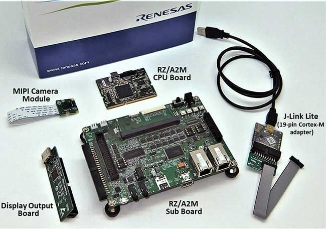
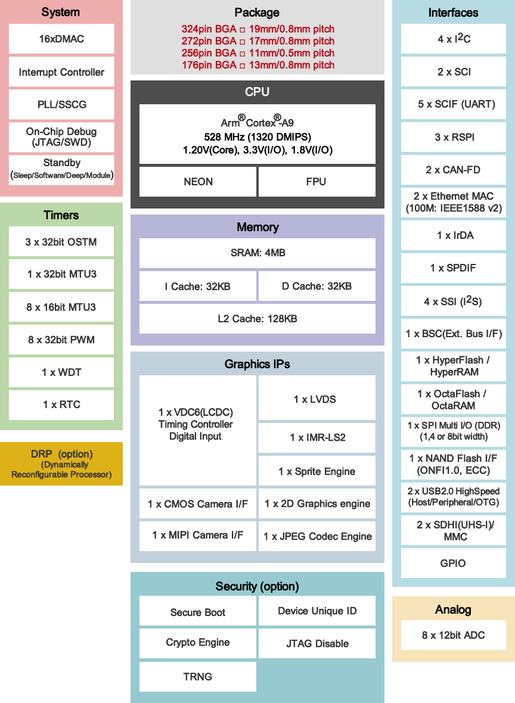

<!-- Copyright 2015-2026 Zephyr Project members and individual contributors. -->
<!-- SPDX-License-Identifier: Apache-2.0 -->
<!-- 中文翻译；编号、导航与译注为本地新增。 -->

<a id="rza2m_evk"></a>

# 第24章\_RZ/A2M评估套件

原文：[官方页面](https://docs.zephyrproject.org/latest/boards/renesas/rza2m_evk/doc/index.html)。读取日期：2026-10-16；来源摘要见[来源记录](../SOURCES.md)。

开发板概览（Board Overview）

<a id="id1"></a>

[](images/rza2m_evkit.webp)

RZ/A2M评估套件

名称（Name）：

`rza2m_evk`

厂商（Vendor）：

[瑞萨电子（Renesas Electronics Corporation）](https://docs.zephyrproject.org/latest/boards/index.html#vendor=renesas)

状态（Status）：

维护中（Maintained）

架构（Architecture）：

[arm](https://docs.zephyrproject.org/latest/boards/index.html#arch=arm)

片上系统（SoC）：

[r7s921053vcbg](https://docs.zephyrproject.org/latest/boards/index.html#soc=r7s921053vcbg)

<a id="board-github-link"></a>

[浏览开发板源码（Browse Board Sources）](https://github.com/zephyrproject-rtos/zephyr/blob/main//boards/renesas/rza2m_evk/doc/index.rst/../..)<a id="overview"></a>

## 概述（Overview）

RZ/A2M评估板套件用于评估RZ/A2M。


- 板载RZ/A2M器件为R7S921053VCBG，包含动态可重配置处理器（Dynamically Reconfigurable Processor，DRP）功能，不含加密功能，内部RAM为4 MB，可评估DRP。
- 套件随附MIPI CSI摄像头模块，可使用MIPI摄像头输入的图像进行图像识别等处理。
- 板上安装HyperMCP多芯片封装（Multi-chip Package），将HyperFlash与HyperRAM集成在一个封装内，可评估这两种存储器。
- 套件包含显示输出板，连接外部显示器后可输出图形。
- 可评估双通道以太网通信。
- 也可评估SDHI、USB等其他外设。
- 支持安全、可靠地连接AWS云。HyperFlash及HyperRAM为美国赛普拉斯半导体公司的商标。

<a id="hardware"></a>

## 硬件（Hardware）

<a id="id4"></a>

瑞萨RZ/A2M微处理器（MPU）文档见[RZ/A2M组网站](https://www.renesas.com/us/en/products/microcontrollers-microprocessors/rz-mpus/rza2m-image-processing-rtos-mpu-drp-and-4mb-chip-ram)[注1](#id3)。

<a id="id2"></a>

[](images/rza2m_block_diagram.webp)

RZ/A2M框图，图片来源：瑞萨电子

<a id="id6"></a>

板卡详细硬件功能见[RZ/A2M-EVK网站](https://www.renesas.com/en/products/microcontrollers-microprocessors/rz-mpus/rza2m-evkit-rza2m-evaluation-kit)[注2](#id5)。

<a id="supported-features"></a>

### 支持的功能（Supported Features）

`rza2m_evk`开发板支持下表所列的硬件功能。

片上／板载（On-Chip / On-Board）

功能集成在片上系统（SoC）内／位于开发板上。

2 / 2

分别表示已启用／已禁用的实例数。点击数量标签，可查看开发板或SoC设备树源码（DTS）中该功能的第一个实例。

`vnd,foo`

与此功能匹配的设备树绑定兼容字符串（Compatible String）；点击链接可查看绑定文档。

<a id="rza2m_evk-hw-features"></a>

<a id="rza2m_evk-rza2m_evk/r7s921053vcbg-hw-features-section"></a>

#### `rza2m_evk/r7s921053vcbg`目标（Target）

<a id="rza2m_evk-rza2m_evk/r7s921053vcbg-hw-features-panel"></a>

<a id="rza2m_evk-rza2m_evk/r7s921053vcbg-hw-features-memory"></a>

此开发板目标的存储器：3968 KiB RAM、64 MiB闪存。

<a id="rza2m_evk-rza2m_evk/r7s921053vcbg-hw-features-table"></a>

<table>
<tr>
<th>类型（Type）</th>
<th>位置（Location）</th>
<th>说明（Description）</th>
<th>兼容字符串（Compatible）</th>
</tr>
<tr>
<td rowspan="1">中央处理器（CPU）</td>
<td>片上（On-Chip）</td>
<td>ARM Cortex-A9处理器（CPU）（<a href="https://github.com/zephyrproject-rtos/zephyr/blob/main/dts/arm/renesas/rz/rza/r7s9210.dtsi?plain=1#L23">已启用：1</a>）</td>
<td><a href="../cpu_arm_riscv_binding_reference/P016_arm_cortex-a9.md#std-dtcompatible-arm-cortex-a9"><code>arm,cortex-a9</code></a></td>
</tr>
<tr>
<td rowspan="1">模数转换器（ADC）</td>
<td>片上（On-Chip）</td>
<td>瑞萨RZ/A2M模数转换器（ADC）驱动（<a href="https://github.com/zephyrproject-rtos/zephyr/blob/main/dts/arm/renesas/rz/rza/r7s9210.dtsi?plain=1#L360">已启用：1</a>）</td>
<td><a href="../hardware/P874_RenesasRZA2M模数转换器绑定.md#dtbinding-renesas-rza2m-adc"><code>renesas,rza2m-adc</code></a></td>
</tr>
<tr>
<td rowspan="2">时钟控制（Clock Control）</td>
<td>片上（On-Chip）</td>
<td>RZ/A2M时钟脉冲发生器（Clock Pulse Generator）（<a href="https://github.com/zephyrproject-rtos/zephyr/blob/main/dts/arm/renesas/rz/rza/r7s9210.dtsi?plain=1#L57">已启用：1</a>）</td>
<td><a href="../clock_renesas_rockchip_sifli_silabs_binding_reference/P018_renesas_rza2m-cpg.md#std-dtcompatible-renesas-rza2m-cpg"><code>renesas,rza2m-cpg</code></a></td>
</tr>
<tr>
<td>片上（On-Chip）</td>
<td>通用固定频率时钟提供者（Fixed-Rate Clock Provider）（<a href="https://github.com/zephyrproject-rtos/zephyr/blob/main/dts/arm/renesas/rz/rza/r7s9210.dtsi?plain=1#L63">已启用：4</a>）</td>
<td><a href="../hardware/P566_固定时钟绑定.md#dtbinding-fixed-clock"><code>fixed-clock</code></a></td>
</tr>
<tr>
<td rowspan="1">计数器（Counter）</td>
<td>片上（On-Chip）</td>
<td>瑞萨RZ/A2M操作系统定时器（OSTM）计数器（<a href="https://github.com/zephyrproject-rtos/zephyr/blob/main/dts/arm/renesas/rz/rza/r7s9210.dtsi?plain=1#L93">已禁用：3</a>）</td>
<td><a href="../stm32_ti_xilinx_counter_binding_reference/P001_renesas_rza2m-ostm-counter.md#std-dtcompatible-renesas-rza2m-ostm-counter"><code>renesas,rza2m-ostm-counter</code></a></td>
</tr>
<tr>
<td rowspan="1">直接存储器访问（DMA）</td>
<td>片上（On-Chip）</td>
<td>RZ/A2M直接存储访问（DMA）控制器（<a href="https://github.com/zephyrproject-rtos/zephyr/blob/main/dts/arm/renesas/rz/rza/r7s9210.dtsi?plain=1#L666">已禁用：2</a>）</td>
<td><a href="../nxp_realtek_renesas_dma_binding_reference/P015_renesas_rza2m-dma.md#std-dtcompatible-renesas-rza2m-dma"><code>renesas,rza2m-dma</code></a></td>
</tr>
<tr>
<td rowspan="1">闪存控制器（Flash Controller）</td>
<td>板载（On-Board）</td>
<td>瑞萨RZ/A2M SPI总线控制器（SPIBSC）NOR闪存控制器，支持JEDEC通用闪存接口（CFI）（<a href="https://github.com/zephyrproject-rtos/zephyr/blob/main/boards/renesas/rza2m_evk/rza2m_evk.dts?plain=1#L91">已启用：1</a>）</td>
<td><a href="../flash_renesas_st_ti_binding_reference/P004_renesas_rza2m-qspi-spibsc.md#std-dtcompatible-renesas-rza2m-qspi-spibsc"><code>renesas,rza2m-qspi-spibsc</code></a></td>
</tr>
<tr>
<td rowspan="2">通用输入输出与接插件（GPIO &amp; Headers）</td>
<td>片上（On-Chip）</td>
<td>瑞萨RZ/A2M GPIO中断（<a href="https://github.com/zephyrproject-rtos/zephyr/blob/main/dts/arm/renesas/rz/rza/r7s9210.dtsi?plain=1#L143">已启用：1</a>）</td>
<td><a href="../gpio_raspberrypi_renesas_binding_reference/P026_renesas_rza2m-gpio-int.md#std-dtcompatible-renesas-rza2m-gpio-int"><code>renesas,rza2m-gpio-int</code></a></td>
</tr>
<tr>
<td>片上（On-Chip）</td>
<td>瑞萨RZ/A2M GPIO控制器（<a href="https://github.com/zephyrproject-rtos/zephyr/blob/main/dts/arm/renesas/rz/rza/r7s9210.dtsi?plain=1#L182">已启用：22</a>）</td>
<td><a href="../gpio_raspberrypi_renesas_binding_reference/P027_renesas_rza2m-gpio.md#std-dtcompatible-renesas-rza2m-gpio"><code>renesas,rza2m-gpio</code></a></td>
</tr>
<tr>
<td rowspan="1">集成电路间总线（I2C）</td>
<td>片上（On-Chip）</td>
<td>瑞萨RZ/A2M I2C控制器（<a href="https://github.com/zephyrproject-rtos/zephyr/blob/main/dts/arm/renesas/rz/rza/r7s9210.dtsi?plain=1#L796">已启用：1</a>；<a href="https://github.com/zephyrproject-rtos/zephyr/blob/main/dts/arm/renesas/rz/rza/r7s9210.dtsi?plain=1#L730">已禁用：3</a>）</td>
<td><a href="../i2c_nxp_pico_renesas_binding_reference/P019_renesas_rza2m-riic.md#std-dtcompatible-renesas-rza2m-riic"><code>renesas,rza2m-riic</code></a></td>
</tr>
<tr>
<td rowspan="1">中断控制器（Interrupt Controller）</td>
<td>片上（On-Chip）</td>
<td>ARM通用中断控制器（GIC）v2（<a href="https://github.com/zephyrproject-rtos/zephyr/blob/main/dts/arm/renesas/rz/rza/r7s9210.dtsi?plain=1#L43">已启用：1</a>）</td>
<td><a href="../interrupt_fabric_binding_reference/P003_arm_gic-v2.md#std-dtcompatible-arm-gic-v2"><code>arm,gic-v2</code></a></td>
</tr>
<tr>
<td rowspan="1">发光二极管（LED）</td>
<td>板载（On-Board）</td>
<td>一组由 GPIO 控制的 LED（GPIO-Controlled LEDs）（<a href="https://github.com/zephyrproject-rtos/zephyr/blob/main/boards/renesas/rza2m_evk/rza2m_evk.dts?plain=1#L29">已启用：1</a>）</td>
<td><a href="../hardware/P564_GPIO指示灯绑定.md#dtbinding-gpio-leds"><code>gpio-leds</code></a></td>
</tr>
<tr>
<td rowspan="1">存储技术设备（MTD）</td>
<td>板载（On-Board）</td>
<td>闪存（Flash）节点（<a href="https://github.com/zephyrproject-rtos/zephyr/blob/main/boards/renesas/rza2m_evk/rza2m_evk.dts?plain=1#L99">已启用：1</a>）</td>
<td><a href="../mtd_nxp_st_ti_partition_binding_reference/P013_soc-nv-flash.md#std-dtcompatible-soc-nv-flash"><code>soc-nv-flash</code></a></td>
</tr>
<tr>
<td rowspan="1">引脚控制（Pin Control）</td>
<td>片上（On-Chip）</td>
<td>瑞萨RZ/A2M引脚控制器（<a href="https://github.com/zephyrproject-rtos/zephyr/blob/main/dts/arm/renesas/rz/rza/r7s9210.dtsi?plain=1#L139">已启用：1</a>）</td>
<td><a href="../pinctrl_renesas_silabs_binding_reference/P014_renesas_rza2m-pinctrl.md#std-dtcompatible-renesas-rza2m-pinctrl"><code>renesas,rza2m-pinctrl</code></a></td>
</tr>
<tr>
<td rowspan="1">脉宽调制（PWM）</td>
<td>片上（On-Chip）</td>
<td>瑞萨RZ/A2M通用定时器（GPT）脉宽调制（PWM）（<a href="https://github.com/zephyrproject-rtos/zephyr/blob/main/dts/arm/renesas/rz/rza/r7s9210.dtsi?plain=1#L393">已禁用：8</a>）</td>
<td><a href="../pwm_stm32_ti_generic_binding_reference/P003_renesas_rza2m-gpt-pwm.md#std-dtcompatible-renesas-rza2m-gpt-pwm"><code>renesas,rza2m-gpt-pwm</code></a></td>
</tr>
<tr>
<td rowspan="1">四线串行外设接口（QSPI）</td>
<td>片上（On-Chip）</td>
<td>瑞萨RZ SPI总线控制器（SPIBSC）（<a href="https://github.com/zephyrproject-rtos/zephyr/blob/main/dts/arm/renesas/rz/rza/r7s9210.dtsi?plain=1#L818">已启用：1</a>）</td>
<td><a href="../qspi_ospi_xspi_binding_reference/P009_renesas_rz-spibsc.md#std-dtcompatible-renesas-rz-spibsc"><code>renesas,rz-spibsc</code></a></td>
</tr>
<tr>
<td rowspan="1">串行控制器（Serial Controller）</td>
<td>片上（On-Chip）</td>
<td>瑞萨RZ/A2M UART（<a href="https://github.com/zephyrproject-rtos/zephyr/blob/main/dts/arm/renesas/rz/rza/r7s9210.dtsi?plain=1#L652">已启用：1</a>；<a href="https://github.com/zephyrproject-rtos/zephyr/blob/main/dts/arm/renesas/rz/rza/r7s9210.dtsi?plain=1#L596">已禁用：4</a>）</td>
<td><a href="../uart_raspberrypi_realtek_renesas_binding_reference/P017_renesas_rza2m-scif-uart.md#std-dtcompatible-renesas-rza2m-scif-uart"><code>renesas,rza2m-scif-uart</code></a></td>
</tr>
<tr>
<td rowspan="1">静态随机存储器（SRAM）</td>
<td>片上（On-Chip）</td>
<td>通用片上静态随机存储器（SRAM）（<a href="https://github.com/zephyrproject-rtos/zephyr/blob/main/dts/arm/renesas/rz/rza/r7s9210.dtsi?plain=1#L52">已启用：1</a>）</td>
<td><a href="../hardware/P567_内存映射SRAM绑定.md#dtbinding-mmio-sram"><code>mmio-sram</code></a></td>
</tr>
<tr>
<td rowspan="3">定时器（Timer）</td>
<td>片上（On-Chip）</td>
<td>瑞萨RZ/A2M操作系统定时器（OS Timer）（<a href="https://github.com/zephyrproject-rtos/zephyr/blob/main/dts/arm/renesas/rz/rza/r7s9210.dtsi?plain=1#L79">已启用：1</a>；<a href="https://github.com/zephyrproject-rtos/zephyr/blob/main/dts/arm/renesas/rz/rza/r7s9210.dtsi?plain=1#L99">已禁用：2</a>）</td>
<td><a href="../renesas_timer_binding_reference/P012_renesas_rza2m-ostm.md#std-dtcompatible-renesas-rza2m-ostm"><code>renesas,rza2m-ostm</code></a></td>
</tr>
<tr>
<td>片上（On-Chip）</td>
<td>瑞萨RZ/A2M OSTM定时器（<a href="https://github.com/zephyrproject-rtos/zephyr/blob/main/dts/arm/renesas/rz/rza/r7s9210.dtsi?plain=1#L88">已启用：1</a>；<a href="https://github.com/zephyrproject-rtos/zephyr/blob/main/dts/arm/renesas/rz/rza/r7s9210.dtsi?plain=1#L108">已禁用：2</a>）</td>
<td><a href="../renesas_timer_binding_reference/P011_renesas_rza2m-ostm-timer.md#std-dtcompatible-renesas-rza2m-ostm-timer"><code>renesas,rza2m-ostm-timer</code></a></td>
</tr>
<tr>
<td>片上（On-Chip）</td>
<td>瑞萨RZ/A2M通用定时器（GPT）（<a href="https://github.com/zephyrproject-rtos/zephyr/blob/main/dts/arm/renesas/rz/rza/r7s9210.dtsi?plain=1#L372">已禁用：8</a>）</td>
<td><a href="../renesas_timer_binding_reference/P010_renesas_rza2m-gpt.md#std-dtcompatible-renesas-rza2m-gpt"><code>renesas,rza2m-gpt</code></a></td>
</tr>
</table>

<a id="programming-and-debugging"></a>

## 烧录与调试（Programming and Debugging）

`rza2m_evk`开发板支持下表所列的运行工具（Runners）及相关west命令。

<table>
<tr>
<th></th>
<th>烧录（flash）</th>
<th>调试（debug）</th>
<th>连接调试会话（attach）</th>
<th>实时传输（rtt）</th>
<th>复位（reset）</th>
<th>调试服务器（debugserver）</th>
</tr>
<tr>
<td><a href="https://docs.zephyrproject.org/latest/develop/flash_debug/host-tools.html#runner-jlink">jlink</a></td>
<td>✅（默认 / default）</td>
<td>✅（默认 / default）</td>
<td>✅</td>
<td>✅</td>
<td>✅</td>
<td>✅</td>
</tr>
</table>

rza2m_evk可按常规方式构建并烧录，详见“构建应用”与“运行应用”。（[构建应用（Building an Application）](../application/P001_应用开发.md#build-an-application)；[运行应用（Run an Application）](https://docs.zephyrproject.org/latest/develop/application/index.html#application-run)）

<a id="console"></a>

### 控制台（Console）

通过USB串口端口CN5访问UART。

<a id="building-flashing"></a>

### 构建与烧录（Building & Flashing）

以下为构建并烧录[Hello World](../getting_started/P005_HelloWorld示例.md#hello_world)应用的示例。

```text
# From the root of the zephyr repository
west build -b rza2m_evk samples/hello_world
west flash
```

<a id="references"></a>

## 参考资料（References）

<a id="id3"></a>

〔[1](#id4)〕 [https://www.renesas.com/us/en/products/microcontrollers-microprocessors/rz-mpus/rza2m-image-processing-rtos-mpu-drp-and-4mb-chip-ram](https://www.renesas.com/us/en/products/microcontrollers-microprocessors/rz-mpus/rza2m-image-processing-rtos-mpu-drp-and-4mb-chip-ram)

<a id="id5"></a>

〔[2](#id6)〕 [https://www.renesas.com/en/products/microcontrollers-microprocessors/rz-mpus/rza2m-evkit-rza2m-evaluation-kit](https://www.renesas.com/en/products/microcontrollers-microprocessors/rz-mpus/rza2m-evkit-rza2m-evaluation-kit)

## 译注

rza2m_block_diagram.webp实际为GIF，已再次下载确认字节一致，并通过块结构及图像解码检查；保留原名及原件，在媒体清单标记实际格式。

## 原文外链核对

2026-10-16核对并重试以下原文外链时未能确认可访问性，保留原始目标，不将访问失败解释为原文内容有误。

- [rza2m-evkit-rza2m-evaluation-kit](https://www.renesas.com/en/products/microcontrollers-microprocessors/rz-mpus/rza2m-evkit-rza2m-evaluation-kit)：HTTP Error 429: Too Many Requests。
- [rza2m-image-processing-rtos-mpu-drp-and-4mb-chip-ram](https://www.renesas.com/us/en/products/microcontrollers-microprocessors/rz-mpus/rza2m-image-processing-rtos-mpu-drp-and-4mb-chip-ram)：HTTP Error 429: Too Many Requests。

---

[上一章](P023_Capacitive_Touch_Evaluation_System_for_RA2L1.md) · [返回大纲](大纲.md) · [全站翻译进度](../PROGRESS.md) · [下一章](P025_RZ_A3M_Evaluation_Kit.md)
