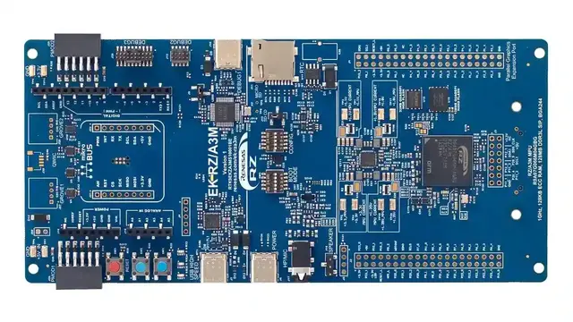

<!-- Copyright 2015-2026 Zephyr Project members and individual contributors. -->
<!-- SPDX-License-Identifier: Apache-2.0 -->
<!-- 中文翻译；编号、导航与译注为本地新增。 -->

<a id="rza3m_ek"></a>

# 第25章\_RZ/A3M评估套件

原文：[官方页面](https://docs.zephyrproject.org/latest/boards/renesas/rza3m_ek/doc/index.html)。读取日期：2026-10-16；来源摘要见[来源记录](../SOURCES.md)。

开发板概览（Board Overview）

<a id="id1"></a>

[](images/rza3m_ek.webp)

RZ/A3M评估套件

名称（Name）：

`rza3m_ek`

厂商（Vendor）：

[瑞萨电子（Renesas Electronics Corporation）](https://docs.zephyrproject.org/latest/boards/index.html#vendor=renesas)

状态（Status）：

维护中（Maintained）

架构（Architecture）：

[arm64](https://docs.zephyrproject.org/latest/boards/index.html#arch=arm64)

片上系统（SoC）：

[r9a07g066m04gbg](https://docs.zephyrproject.org/latest/boards/index.html#soc=r9a07g066m04gbg)

<a id="board-github-link"></a>

[浏览开发板源码（Browse Board Sources）](https://github.com/zephyrproject-rtos/zephyr/blob/main//boards/renesas/rza3m_ek/doc/index.rst/../..)<a id="overview"></a>

## 概述（Overview）

EK-RZ/A3M评估套件用于方便地评估RZ/A3M MPU功能，包含EK-RZ/A3M开发板、5英寸720×1280像素LCD MIPI图形扩展板及USB线，可评估高清人机界面（Human Machine Interface，HMI）、USB摄像头输入等功能。套件配备板载J-Link，无需额外调试器即可开始调试。SDIO、Pmod及Arduino等扩展连接器可连接传感器、Wi-Fi及低功耗蓝牙（Bluetooth LE），无需扩大板卡空间即可增加功能。


- 专用功能接口（Special Feature Access）


  - 四通道MIPI DSI及并行图形扩展端口
  - 5英寸MIPI LCD面板，720×1280像素
  - USB高速主机及设备
  - 32 MB外部QSPI NOR闪存
  - 128 MB外部QSPI NAND闪存
  - 外部音频编解码器（Sound Codec）
  - 外部实时时钟（RTC）
- MPU原生引脚访问（MPU Native Pin Access）


  - R9A07G066M04GBG MPU
  - 1 GHz Arm Cortex-A55内核，带NEON扩展
  - 内置128 MB DDR3L DRAM
  - 128 KB SRAM，带纠错码（ECC）
  - 244引脚BGA封装
  - 原生引脚访问
  - MPU及USB电流测量
- 生态及系统控制接口


  - USB高速主机及设备
  - 经USB调试、高速或USB-PD端口，或外部电源输入5 V
  - 板载SEGGER J-Link调试
  - 外部调试，SWD及JTAG
  - SCIF下载，原文括注SWD
  - 3个用户LED、2个用户按键
  - 2个Seeed Grove接口，I2C及模拟
  - 2个Digilent Pmod连接器，可选择I2C、SPI或UART
  - Arduino Uno R3
  - MikroElektronika mikroBUS
  - SparkFun Qwiic，I2C
  - MPU启动配置开关
  - 四极音频输入／输出接口
  - MicroSD卡槽（Card Slot）
- 套件内容（Kit Contents）


  - EK-RZ/A3M开发板
  - MIPI图形扩展板
  - USB线，USB-C转USB-C
  - USB线，USB-A母头转USB-C
  - USB线，USB-A公头转USB-C
  - 用于固定子板的螺钉及隔离柱

<a id="hardware"></a>

## 硬件（Hardware）

板卡详细硬件功能见：


- <a id="id3"></a>

  [RZ/A3M组网站](https://www.renesas.com/en/products/rz-a3m)[注1](#id2)
- <a id="id5"></a>

  [EK-RZ/A3M网站](https://www.renesas.com/en/design-resources/boards-kits/ek-rz-a3m)[注2](#id4)

<a id="supported-features"></a>

### 支持的功能（Supported Features）

`rza3m_ek`开发板支持下表所列的硬件功能。

片上／板载（On-Chip / On-Board）

功能集成在片上系统（SoC）内／位于开发板上。

2 / 2

分别表示已启用／已禁用的实例数。点击数量标签，可查看开发板或SoC设备树源码（DTS）中该功能的第一个实例。

`vnd,foo`

与此功能匹配的设备树绑定兼容字符串（Compatible String）；点击链接可查看绑定文档。

<a id="rza3m_ek-hw-features"></a>

<a id="rza3m_ek-rza3m_ek/r9a07g066m04gbg-hw-features-section"></a>

#### `rza3m_ek/r9a07g066m04gbg`目标（Target）

<a id="rza3m_ek-rza3m_ek/r9a07g066m04gbg-hw-features-panel"></a>

<a id="rza3m_ek-rza3m_ek/r9a07g066m04gbg-hw-features-memory"></a>

此开发板目标的存储器：126 MiB RAM、32 MiB闪存。

<a id="rza3m_ek-rza3m_ek/r9a07g066m04gbg-hw-features-table"></a>

<table>
<tr>
<th>类型（Type）</th>
<th>位置（Location）</th>
<th>说明（Description）</th>
<th>兼容字符串（Compatible）</th>
</tr>
<tr>
<td rowspan="1">中央处理器（CPU）</td>
<td>片上（On-Chip）</td>
<td>Arm Cortex-A55 CPU（<a href="https://github.com/zephyrproject-rtos/zephyr/blob/main/dts/arm64/renesas/rz/rza/r9a07g066.dtsi?plain=1#L24">已启用：1</a>）</td>
<td><a href="../cpu_arm_riscv_binding_reference/P009_arm_cortex-a55.md#std-dtcompatible-arm-cortex-a55"><code>arm,cortex-a55</code></a></td>
</tr>
<tr>
<td rowspan="1">时钟控制（Clock Control）</td>
<td>片上（On-Chip）</td>
<td>通用固定频率时钟提供者（Fixed-Rate Clock Provider）（<a href="https://github.com/zephyrproject-rtos/zephyr/blob/main/dts/arm64/renesas/rz/rza/r9a07g066.dtsi?plain=1#L41">已启用：1</a>）</td>
<td><a href="../hardware/P566_固定时钟绑定.md#dtbinding-fixed-clock"><code>fixed-clock</code></a></td>
</tr>
<tr>
<td rowspan="1">显示（Display）</td>
<td>片上（On-Chip）</td>
<td>瑞萨液晶显示（LCD）控制器（<a href="https://github.com/zephyrproject-rtos/zephyr/blob/main/dts/arm64/renesas/rz/rza/r9a07g066.dtsi?plain=1#L641">已禁用：1</a>）</td>
<td><a href="../display_panel_renesas_sharp_binding_reference/P012_renesas_rz-lcdc.md#std-dtcompatible-renesas-rz-lcdc"><code>renesas,rz-lcdc</code></a></td>
</tr>
<tr>
<td rowspan="3">通用输入输出与接插件（GPIO &amp; Headers）</td>
<td>片上（On-Chip）</td>
<td>瑞萨RZ GPIO公共部分（<a href="https://github.com/zephyrproject-rtos/zephyr/blob/main/dts/arm64/renesas/rz/rza/r9a07g066.dtsi?plain=1#L64">已启用：1</a>）</td>
<td><a href="../gpio_raspberrypi_renesas_binding_reference/P022_renesas_rz-gpio-common.md#std-dtcompatible-renesas-rz-gpio-common"><code>renesas,rz-gpio-common</code></a></td>
</tr>
<tr>
<td>片上（On-Chip）</td>
<td>瑞萨RZ GPIO控制器（<a href="https://github.com/zephyrproject-rtos/zephyr/blob/main/dts/arm64/renesas/rz/rza/r9a07g066.dtsi?plain=1#L146">已启用：4</a>；<a href="https://github.com/zephyrproject-rtos/zephyr/blob/main/dts/arm64/renesas/rz/rza/r9a07g066.dtsi?plain=1#L74">已禁用：13</a>）</td>
<td><a href="../gpio_raspberrypi_renesas_binding_reference/P025_renesas_rz-gpio.md#std-dtcompatible-renesas-rz-gpio"><code>renesas,rz-gpio</code></a></td>
</tr>
<tr>
<td>板载（On-Board）</td>
<td>瑞萨MIPI LCD显示排针引出的GPIO（<a href="https://github.com/zephyrproject-rtos/zephyr/blob/main/boards/renesas/rza3m_ek/rza3m_ek.dts?plain=1#L83">已启用：1</a>）</td>
<td><a href="../gpio_raspberrypi_renesas_binding_reference/P024_renesas_rz-gpio-mipi-header.md#std-dtcompatible-renesas-rz-gpio-mipi-header"><code>renesas,rz-gpio-mipi-header</code></a></td>
</tr>
<tr>
<td rowspan="1">集成电路间总线（I2C）</td>
<td>片上（On-Chip）</td>
<td>瑞萨RZ I2C控制器（<a href="https://github.com/zephyrproject-rtos/zephyr/blob/main/dts/arm64/renesas/rz/rza/r9a07g066.dtsi?plain=1#L603">已启用：2</a>）</td>
<td><a href="../i2c_nxp_pico_renesas_binding_reference/P018_renesas_rz-riic.md#std-dtcompatible-renesas-rz-riic"><code>renesas,rz-riic</code></a></td>
</tr>
<tr>
<td rowspan="1">输入（Input）</td>
<td>板载（On-Board）</td>
<td>一组绑定到 GPIO 的输入按键（GPIO-Bound Input Keys）（<a href="https://github.com/zephyrproject-rtos/zephyr/blob/main/boards/renesas/rza3m_ek/rza3m_ek.dts?plain=1#L67">已启用：1</a>）</td>
<td><a href="../hardware/P563_GPIO按键绑定.md#std-dtcompatible-gpio-keys"><code>gpio-keys</code></a></td>
</tr>
<tr>
<td rowspan="3">中断控制器（Interrupt Controller）</td>
<td>片上（On-Chip）</td>
<td>ARM通用中断控制器（GIC）v3（<a href="https://github.com/zephyrproject-rtos/zephyr/blob/main/dts/arm64/renesas/rz/rza/r9a07g066.dtsi?plain=1#L55">已启用：1</a>）</td>
<td><a href="../interrupt_fabric_binding_reference/P004_arm_gic-v3.md#std-dtcompatible-arm-gic-v3"><code>arm,gic-v3</code></a></td>
</tr>
<tr>
<td>片上（On-Chip）</td>
<td>瑞萨RZ中断控制器（<a href="https://github.com/zephyrproject-rtos/zephyr/blob/main/dts/arm64/renesas/rz/rza/r9a07g066.dtsi?plain=1#L228">已启用：1</a>）</td>
<td><a href="../renesas_interrupt_binding_reference/P008_renesas_rz-intc.md#std-dtcompatible-renesas-rz-intc"><code>renesas,rz-intc</code></a></td>
</tr>
<tr>
<td>片上（On-Chip）</td>
<td>瑞萨RZ GPIO中断（TINT）控制器（<a href="https://github.com/zephyrproject-rtos/zephyr/blob/main/dts/arm64/renesas/rz/rza/r9a07g066.dtsi?plain=1#L241">已启用：3</a>；<a href="https://github.com/zephyrproject-rtos/zephyr/blob/main/dts/arm64/renesas/rz/rza/r9a07g066.dtsi?plain=1#L268">已禁用：29</a>）</td>
<td><a href="../renesas_interrupt_binding_reference/P009_renesas_rz-tint.md#std-dtcompatible-renesas-rz-tint"><code>renesas,rz-tint</code></a></td>
</tr>
<tr>
<td rowspan="1">发光二极管（LED）</td>
<td>板载（On-Board）</td>
<td>一组由 GPIO 控制的 LED（GPIO-Controlled LEDs）（<a href="https://github.com/zephyrproject-rtos/zephyr/blob/main/boards/renesas/rza3m_ek/rza3m_ek.dts?plain=1#L48">已启用：1</a>）</td>
<td><a href="../hardware/P564_GPIO指示灯绑定.md#dtbinding-gpio-leds"><code>gpio-leds</code></a></td>
</tr>
<tr>
<td rowspan="1">MIPI 显示串行接口（MIPI-DSI）</td>
<td>片上（On-Chip）</td>
<td>瑞萨RZ MIPI显示串行接口（DSI）主机（<a href="https://github.com/zephyrproject-rtos/zephyr/blob/main/dts/arm64/renesas/rz/rza/r9a07g066.dtsi?plain=1#L653">已禁用：1</a>）</td>
<td><a href="../mipi_dbi_dsi_binding_reference/P017_renesas_rz-mipi-dsi.md#std-dtcompatible-renesas-rz-mipi-dsi"><code>renesas,rz-mipi-dsi</code></a></td>
</tr>
<tr>
<td rowspan="1">存储技术设备（MTD）</td>
<td>板载（On-Board）</td>
<td>闪存（Flash）节点（<a href="https://github.com/zephyrproject-rtos/zephyr/blob/main/boards/renesas/rza3m_ek/rza3m_ek.dts?plain=1#L96">已启用：1</a>）</td>
<td><a href="../mtd_nxp_st_ti_partition_binding_reference/P013_soc-nv-flash.md#std-dtcompatible-soc-nv-flash"><code>soc-nv-flash</code></a></td>
</tr>
<tr>
<td rowspan="1">引脚控制（Pin Control）</td>
<td>片上（On-Chip）</td>
<td>以下通用示例展示受支持的引脚控制（Pinctrl）定义：（<a href="https://github.com/zephyrproject-rtos/zephyr/blob/main/dts/arm64/renesas/rz/rza/r9a07g066.dtsi?plain=1#L48">已启用：1</a>）</td>
<td><a href="../pinctrl_renesas_silabs_binding_reference/P013_renesas_rza-pinctrl.md#std-dtcompatible-renesas-rza-pinctrl"><code>renesas,rza-pinctrl</code></a></td>
</tr>
<tr>
<td rowspan="1">四线串行外设接口（QSPI）</td>
<td>片上（On-Chip）</td>
<td>瑞萨RZ SPI总线控制器（SPIBSC）（<a href="https://github.com/zephyrproject-rtos/zephyr/blob/main/dts/arm64/renesas/rz/rza/r9a07g066.dtsi?plain=1#L595">已禁用：1</a>）</td>
<td><a href="../qspi_ospi_xspi_binding_reference/P009_renesas_rz-spibsc.md#std-dtcompatible-renesas-rz-spibsc"><code>renesas,rz-spibsc</code></a></td>
</tr>
<tr>
<td rowspan="1">串行控制器（Serial Controller）</td>
<td>片上（On-Chip）</td>
<td>瑞萨RZ串行通信接口（SCIF）UART控制器（<a href="https://github.com/zephyrproject-rtos/zephyr/blob/main/dts/arm64/renesas/rz/rza/r9a07g066.dtsi?plain=1#L530">已启用：1</a>；<a href="https://github.com/zephyrproject-rtos/zephyr/blob/main/dts/arm64/renesas/rz/rza/r9a07g066.dtsi?plain=1#L543">已禁用：4</a>）</td>
<td><a href="../uart_raspberrypi_realtek_renesas_binding_reference/P016_renesas_rz-scif-uart.md#std-dtcompatible-renesas-rz-scif-uart"><code>renesas,rz-scif-uart</code></a></td>
</tr>
<tr>
<td rowspan="1">定时器（Timer）</td>
<td>片上（On-Chip）</td>
<td>每个内核独立的ARM架构定时器（Architected Timer）（<a href="https://github.com/zephyrproject-rtos/zephyr/blob/main/dts/arm64/renesas/rz/rza/r9a07g066.dtsi?plain=1#L32">已启用：1</a>）</td>
<td><a href="../arm_interrupt_timer_binding_reference/P010_ARMv8架构定时器.md#std-dtcompatible-arm-armv8-timer"><code>arm,armv8-timer</code></a></td>
</tr>
</table>

<a id="programming-and-debugging"></a>

## 烧录与调试（Programming and Debugging）

`rza3m_ek`开发板支持下表所列的运行工具（Runners）及相关west命令。

<table>
<tr>
<th></th>
<th>烧录（flash）</th>
<th>调试（debug）</th>
<th>连接调试会话（attach）</th>
<th>实时传输（rtt）</th>
<th>复位（reset）</th>
<th>调试服务器（debugserver）</th>
</tr>
<tr>
<td><a href="https://docs.zephyrproject.org/latest/develop/flash_debug/host-tools.html#runner-jlink">jlink</a></td>
<td>✅（默认 / default）</td>
<td>✅（默认 / default）</td>
<td>✅</td>
<td>✅</td>
<td>✅</td>
<td>✅</td>
</tr>
</table>

rza3m_ek可按常规方式构建、烧录及调试，详见“构建应用”与“运行应用”。（[构建应用（Building an Application）](../application/P001_应用开发.md#build-an-application)；[运行应用（Run an Application）](https://docs.zephyrproject.org/latest/develop/application/index.html#application-run)）

rza3m_ek通过初始程序加载器（Initial Program Loader，IPL）完成初始设置，将Zephyr镜像从闪存复制到DDR DRAM后执行。开发板出厂已写入瑞萨IPL，因此下述通过-DCONFIG_BUILD_WITH_TFA=y启用的IPL构建及烧录步骤是可选的。IPL只需写入闪存一次，仅在IPL损坏或需要重写时执行。


1. <a id="id9"></a>

  开发板配置及连接方法见《RZ/A灵活配置软件包入门》[注4](#id8)的“3.2 Board Setup”。（[RZ/A灵活配置软件包（FSP）入门](https://www.renesas.com/en/document/apn/rza-getting-started-flexible-software-package)）
2. 通过-DCONFIG_BUILD_WITH_TFA=y启用IPL构建，生成的rza3m_ek_nor_ipl.srec位于zephyr/build/tfa/rza3m_ek_nor/release。

```text
# From the root of the zephyr repository
west build -b rza3m_ek samples/hello_world -- -DCONFIG_BUILD_WITH_TFA=y
west flash
```

注意（Note）

<a id="id7"></a>

当前IPL源码只能在Linux环境构建。Windows用户请参考《初始程序加载器应用说明》[注3](#id6)。（[初始程序加载器（IPL）应用说明](https://github.com/renesas/rza-initial-program-loader/tree/main/application_note)）

<a id="console"></a>

### 控制台（Console）

通过USB调试连接器J10访问UART。

<a id="debugging"></a>

### 调试（Debugging）

可使用J-Link调试器及[J-Link Debug Host Tools](https://docs.zephyrproject.org/latest/develop/flash_debug/host-tools.html#jlink-debug-host-tools)，将Zephyr应用二进制加载到此板的DDR SDRAM，并在Cortex-A55系统核上执行。

以下为构建并调试[Hello World](../getting_started/P005_HelloWorld示例.md#hello_world)应用的示例。

```text
# From the root of the zephyr repository
west build -b rza3m_ek samples/hello_world
west debug
```

<a id="flashing"></a>

### 烧录（Flashing）

可将Zephyr应用烧录到Quad-SPI存储器，再由IPL加载。

```text
# From the root of the zephyr repository
west build -b rza3m_ek samples/hello_world
west flash
```

<a id="references"></a>

## 参考资料（References）

<a id="id2"></a>

〔[1](#id3)〕 [https://www.renesas.com/en/products/rz-a3m](https://www.renesas.com/en/products/rz-a3m)

<a id="id4"></a>

〔[2](#id5)〕 [https://www.renesas.com/en/design-resources/boards-kits/ek-rz-a3m](https://www.renesas.com/en/design-resources/boards-kits/ek-rz-a3m)

<a id="id6"></a>

〔[3](#id7)〕 [https://github.com/renesas/rza-initial-program-loader/tree/main/application_note](https://github.com/renesas/rza-initial-program-loader/tree/main/application_note)

<a id="id8"></a>

〔[4](#id9)〕 [https://www.renesas.com/en/document/apn/rza-getting-started-flexible-software-package](https://www.renesas.com/en/document/apn/rza-getting-started-flexible-software-package)

## 译注

RZ/A3M出厂已写入IPL，只在损坏或需要重写时执行可选IPL构建烧录。原文SCIF下载括注SWD，按原文保留。

## 原文外链核对

2026-10-16核对并重试以下原文外链时未能确认可访问性，保留原始目标，不将访问失败解释为原文内容有误。

- [rz-a3m](https://www.renesas.com/en/products/rz-a3m)：HTTP Error 429: Too Many Requests。

---

[上一章](P024_RZ_A2M_Evaluation_Kit.md) · [返回大纲](大纲.md) · [全站翻译进度](../PROGRESS.md) · [下一章](P026_RZ_A3UL_SMARC_Evaluation_Board_Kit.md)
