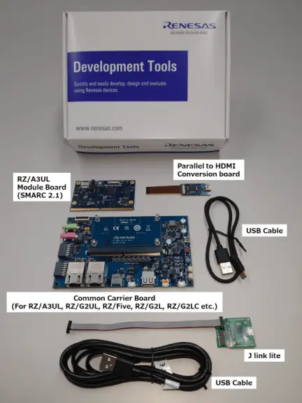
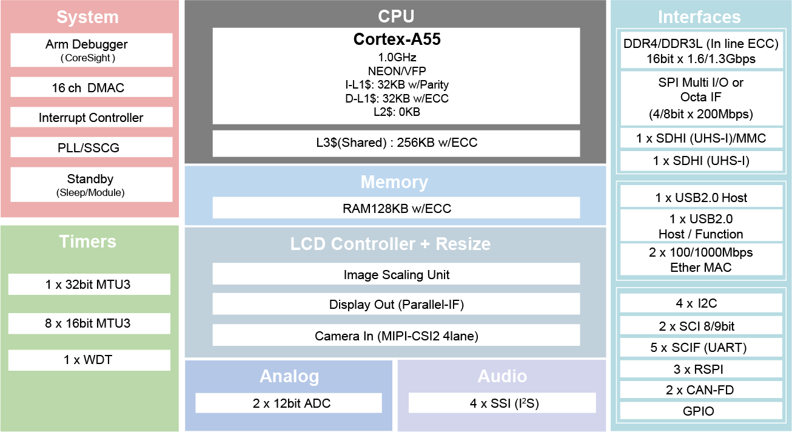

<!-- Copyright 2015-2026 Zephyr Project members and individual contributors. -->
<!-- SPDX-License-Identifier: Apache-2.0 -->
<!-- 中文翻译；编号、导航与译注为本地新增。 -->

<a id="rza3ul_smarc"></a>

# 第26章\_RZ/A3UL SMARC评估板套件

原文：[官方页面](https://docs.zephyrproject.org/latest/boards/renesas/rza3ul_smarc/doc/index.html)。读取日期：2026-10-16；来源摘要见[来源记录](../SOURCES.md)。

开发板概览（Board Overview）

<a id="id1"></a>

[](images/rza3ul_smarc.webp)

RZ/A3UL SMARC评估板套件

名称（Name）：

`rza3ul_smarc`

厂商（Vendor）：

[瑞萨电子（Renesas Electronics Corporation）](https://docs.zephyrproject.org/latest/boards/index.html#vendor=renesas)

状态（Status）：

维护中（Maintained）

架构（Architecture）：

[arm64](https://docs.zephyrproject.org/latest/boards/index.html#arch=arm64)

片上系统（SoC）：

[r9a07g063u02gbg](https://docs.zephyrproject.org/latest/boards/index.html#soc=r9a07g063u02gbg)

<a id="board-github-link"></a>

[浏览开发板源码（Browse Board Sources）](https://github.com/zephyrproject-rtos/zephyr/blob/main//boards/renesas/rza3ul_smarc/doc/index.rst/../..)<a id="overview"></a>

## 概述（Overview）

瑞萨RZ/A3UL SMARC评估板套件RZ/A3UL-EVKIT由SMARC v2.1模块板及载板（Carrier Board）组成，提供QSPI及Octal-SPI两种版本；本移植支持QSPI版本。


- 器件：RZ/A3UL R9A07G063U02GBG


  - 单核Cortex-A55
  - 361引脚BGA，13 mm方形本体，0.5 mm间距
  - [Azure认证设备目录](https://devicecatalog.azure.com/devices/5848d87b-5d3e-4c11-ad76-90612639b025)中的认证器件
- SMARC v2.1模块板功能


  - 提供两种评估板版本：


    - QSPI版本：用于启动的QSPI串行闪存及DDR4
    - Octal-SPI版本：用于启动的Octa Flash、OctaRAM及DDR4
  - DDR4 SDRAM：1 GB×1颗
  - QSPI闪存：128 Mb×1颗，[AT25QL128A](https://www.renesas.com/en/products/memory-logic/non-volatile-memory/spi-nor-flash/at25ql128a-128mbit-17v-minimum-spi-serial-flash-memory-dual-io-quad-io-and-qpi-support)，QSPI版本
  - Octa RAM：512 Mb×1颗；Octa Flash：1 Gb×1颗，Octal-SPI版本
  - eMMC：64 GB×1颗
  - 配备microSD卡槽，作为启动用eSD。
  - 配备五路输出时钟振荡器[5P35023](https://www.renesas.com/en/products/clocks-timing/clock-generation/programmable-clocks/5p35023-versaclock-3s-programmable-clock-generator)
  - 配备电源管理集成电路（PMIC）[DA9062](https://www.renesas.com/en/products/power-management/multi-channel-power-management-ics-pmics/da9062-pmic-designed-applications-requiring-85a)
- 载板功能（Carrier Board Functions）


  - 标准配置FFC／FPC连接器，用于连接摄像头模块的高速串行接口。
  - 标准配置Micro-HDMI连接器，通过DSI／HDMI转换模块连接数字视频模块的高速串行接口。
  - USB接口标准配置为Micro-AB插座，通道0、USB 2.0 OTG，以及Type-A插座，通道1、USB 2.0主机。
  - 标准配置RJ45连接器，用于以太网软件开发及评估。
  - 标准配置音频编解码器，支持音频系统的前期开发；配备音频插孔以连接音频接口。
  - 配备Micro-AB插座，用于连接异步串行端口接口。
  - 配备microSD卡槽及两个Pmod插座，作为RZ/A3UL外设接口。
  - 供电用USB Type-C插座支持USB电力传输（USB PD）标准。

<a id="hardware"></a>

## 硬件（Hardware）

<a id="id4"></a>

瑞萨RZ/A3UL MPU文档见[RZ/A3UL组网站](https://www.renesas.com/en/products/microcontrollers-microprocessors/rz-mpus/rza3ul-powerful-1ghz-64-bit-mpus-rtos-support-enables-high-definition-hmi-and-quick-startup)[注1](#id3)。

<a id="id2"></a>

[](images/rza3ul_block_diagram.webp)

RZ/A3UL框图，图片来源：瑞萨电子

<a id="id6"></a>

板卡详细硬件功能见[RZA3UL-EVKIT网站](https://www.renesas.com/en/products/microcontrollers-microprocessors/rz-mpus/rza3ul-evkit-rza3ul-evaluation-board-kit)[注2](#id5)。

<a id="supported-features"></a>

### 支持的功能（Supported Features）

`rza3ul_smarc`开发板支持下表所列的硬件功能。

片上／板载（On-Chip / On-Board）

功能集成在片上系统（SoC）内／位于开发板上。

2 / 2

分别表示已启用／已禁用的实例数。点击数量标签，可查看开发板或SoC设备树源码（DTS）中该功能的第一个实例。

`vnd,foo`

与此功能匹配的设备树绑定兼容字符串（Compatible String）；点击链接可查看绑定文档。

<a id="rza3ul_smarc-hw-features"></a>

<a id="rza3ul_smarc-rza3ul_smarc/r9a07g063u02gbg-hw-features-section"></a>

#### `rza3ul_smarc/r9a07g063u02gbg`目标（Target）

<a id="rza3ul_smarc-rza3ul_smarc/r9a07g063u02gbg-hw-features-panel"></a>

<a id="rza3ul_smarc-rza3ul_smarc/r9a07g063u02gbg-hw-features-memory"></a>

此开发板目标的存储器：1022 MiB RAM、16 MiB闪存。

<a id="rza3ul_smarc-rza3ul_smarc/r9a07g063u02gbg-hw-features-table"></a>

<table>
<tr>
<th>类型（Type）</th>
<th>位置（Location）</th>
<th>说明（Description）</th>
<th>兼容字符串（Compatible）</th>
</tr>
<tr>
<td rowspan="1">中央处理器（CPU）</td>
<td>片上（On-Chip）</td>
<td>Arm Cortex-A55 CPU（<a href="https://github.com/zephyrproject-rtos/zephyr/blob/main/dts/arm64/renesas/rz/rza/r9a07g063.dtsi?plain=1#L28">已启用：1</a>）</td>
<td><a href="../cpu_arm_riscv_binding_reference/P009_arm_cortex-a55.md#std-dtcompatible-arm-cortex-a55"><code>arm,cortex-a55</code></a></td>
</tr>
<tr>
<td rowspan="1">模数转换器（ADC）</td>
<td>片上（On-Chip）</td>
<td>瑞萨RZ ADC-C模数转换驱动（<a href="https://github.com/zephyrproject-rtos/zephyr/blob/main/dts/arm64/renesas/rz/rza/r9a07g063.dtsi?plain=1#L269">已启用：1</a>）</td>
<td><a href="../hardware/P871_RenesasRZADCC绑定.md#dtbinding-renesas-rz-adc-c"><code>renesas,rz-adc-c</code></a></td>
</tr>
<tr>
<td rowspan="4">时钟控制（Clock Control）</td>
<td>片上（On-Chip）</td>
<td>瑞萨RZ时钟脉冲发生器（CPG）（<a href="https://github.com/zephyrproject-rtos/zephyr/blob/main/dts/arm64/renesas/rz/rza/r9a07g063.dtsi?plain=1#L59">已启用：1</a>）</td>
<td><a href="../clock_renesas_rockchip_sifli_silabs_binding_reference/P017_renesas_rz-cpg.md#std-dtcompatible-renesas-rz-cpg"><code>renesas,rz-cpg</code></a></td>
</tr>
<tr>
<td>片上（On-Chip）</td>
<td>瑞萨RZ时钟脉冲发生器的PLL输出（<a href="https://github.com/zephyrproject-rtos/zephyr/blob/main/dts/arm64/renesas/rz/rza/r9a07g063.dtsi?plain=1#L66">已启用：10</a>）</td>
<td><a href="../clock_renesas_rockchip_sifli_silabs_binding_reference/P016_renesas_rz-cpg-pll.md#std-dtcompatible-renesas-rz-cpg-pll"><code>renesas,rz-cpg-pll</code></a></td>
</tr>
<tr>
<td>片上（On-Chip）</td>
<td>瑞萨RZ时钟脉冲发生器的时钟输出（<a href="https://github.com/zephyrproject-rtos/zephyr/blob/main/dts/arm64/renesas/rz/rza/r9a07g063.dtsi?plain=1#L126">已启用：19</a>）</td>
<td><a href="../clock_renesas_rockchip_sifli_silabs_binding_reference/P015_renesas_rz-cpg-clock.md#std-dtcompatible-renesas-rz-cpg-clock"><code>renesas,rz-cpg-clock</code></a></td>
</tr>
<tr>
<td>片上（On-Chip）</td>
<td>通用固定频率时钟提供者（Fixed-Rate Clock Provider）（<a href="https://github.com/zephyrproject-rtos/zephyr/blob/main/dts/arm64/renesas/rz/rza/r9a07g063.dtsi?plain=1#L45">已启用：1</a>）</td>
<td><a href="../hardware/P566_固定时钟绑定.md#dtbinding-fixed-clock"><code>fixed-clock</code></a></td>
</tr>
<tr>
<td rowspan="1">计数器（Counter）</td>
<td>片上（On-Chip）</td>
<td>瑞萨RZ通用定时器（GTM）计数器（<a href="https://github.com/zephyrproject-rtos/zephyr/blob/main/dts/arm64/renesas/rz/rza/r9a07g063.dtsi?plain=1#L1169">已禁用：3</a>）</td>
<td><a href="../renesas_realtek_counter_binding_reference/P017_renesas_rz-gtm-counter.md#std-dtcompatible-renesas-rz-gtm-counter"><code>renesas,rz-gtm-counter</code></a></td>
</tr>
<tr>
<td rowspan="1">直接存储器访问（DMA）</td>
<td>片上（On-Chip）</td>
<td>RZ直接存储访问（DMA）控制器（<a href="https://github.com/zephyrproject-rtos/zephyr/blob/main/dts/arm64/renesas/rz/rza/r9a07g063.dtsi?plain=1#L1213">已禁用：1</a>）</td>
<td><a href="../nxp_realtek_renesas_dma_binding_reference/P014_renesas_rz-dmac.md#std-dtcompatible-renesas-rz-dmac"><code>renesas,rz-dmac</code></a></td>
</tr>
<tr>
<td rowspan="1">闪存控制器（Flash Controller）</td>
<td>板载（On-Board）</td>
<td>瑞萨RZ SPIBSC NOR闪存控制器，支持JEDEC通用闪存接口（CFI）（<a href="https://github.com/zephyrproject-rtos/zephyr/blob/main/boards/renesas/rza3ul_smarc/rza3ul_smarc.dts?plain=1#L75">已启用：1</a>）</td>
<td><a href="../flash_renesas_st_ti_binding_reference/P002_renesas_rz-qspi-spibsc.md#std-dtcompatible-renesas-rz-qspi-spibsc"><code>renesas,rz-qspi-spibsc</code></a></td>
</tr>
<tr>
<td rowspan="2">通用输入输出与接插件（GPIO &amp; Headers）</td>
<td>片上（On-Chip）</td>
<td>瑞萨RZ GPIO公共部分（<a href="https://github.com/zephyrproject-rtos/zephyr/blob/main/dts/arm64/renesas/rz/rza/r9a07g063.dtsi?plain=1#L280">已启用：1</a>）</td>
<td><a href="../gpio_raspberrypi_renesas_binding_reference/P022_renesas_rz-gpio-common.md#std-dtcompatible-renesas-rz-gpio-common"><code>renesas,rz-gpio-common</code></a></td>
</tr>
<tr>
<td>片上（On-Chip）</td>
<td>瑞萨RZ GPIO控制器（<a href="https://github.com/zephyrproject-rtos/zephyr/blob/main/dts/arm64/renesas/rz/rza/r9a07g063.dtsi?plain=1#L290">已禁用：19</a>）</td>
<td><a href="../gpio_raspberrypi_renesas_binding_reference/P025_renesas_rz-gpio.md#std-dtcompatible-renesas-rz-gpio"><code>renesas,rz-gpio</code></a></td>
</tr>
<tr>
<td rowspan="1">集成电路间总线（I2C）</td>
<td>片上（On-Chip）</td>
<td>瑞萨RZ I2C控制器（<a href="https://github.com/zephyrproject-rtos/zephyr/blob/main/dts/arm64/renesas/rz/rza/r9a07g063.dtsi?plain=1#L1060">已启用：1</a>；<a href="https://github.com/zephyrproject-rtos/zephyr/blob/main/dts/arm64/renesas/rz/rza/r9a07g063.dtsi?plain=1#L1041">已禁用：3</a>）</td>
<td><a href="../i2c_nxp_pico_renesas_binding_reference/P018_renesas_rz-riic.md#std-dtcompatible-renesas-rz-riic"><code>renesas,rz-riic</code></a></td>
</tr>
<tr>
<td rowspan="4">中断控制器（Interrupt Controller）</td>
<td>片上（On-Chip）</td>
<td>ARM通用中断控制器（GIC）v3（<a href="https://github.com/zephyrproject-rtos/zephyr/blob/main/dts/arm64/renesas/rz/rza/r9a07g063.dtsi?plain=1#L260">已启用：1</a>）</td>
<td><a href="../interrupt_fabric_binding_reference/P004_arm_gic-v3.md#std-dtcompatible-arm-gic-v3"><code>arm,gic-v3</code></a></td>
</tr>
<tr>
<td>片上（On-Chip）</td>
<td>瑞萨RZ中断控制器（<a href="https://github.com/zephyrproject-rtos/zephyr/blob/main/dts/arm64/renesas/rz/rza/r9a07g063.dtsi?plain=1#L667">已启用：1</a>）</td>
<td><a href="../renesas_interrupt_binding_reference/P008_renesas_rz-intc.md#std-dtcompatible-renesas-rz-intc"><code>renesas,rz-intc</code></a></td>
</tr>
<tr>
<td>片上（On-Chip）</td>
<td>瑞萨RZ外部中断控制器（<a href="https://github.com/zephyrproject-rtos/zephyr/blob/main/dts/arm64/renesas/rz/rza/r9a07g063.dtsi?plain=1#L681">已禁用：9</a>）</td>
<td><a href="../renesas_interrupt_binding_reference/P004_renesas_rz-ext-irq.md#std-dtcompatible-renesas-rz-ext-irq"><code>renesas,rz-ext-irq</code></a></td>
</tr>
<tr>
<td>片上（On-Chip）</td>
<td>瑞萨RZ GPIO中断（TINT）控制器（<a href="https://github.com/zephyrproject-rtos/zephyr/blob/main/dts/arm64/renesas/rz/rza/r9a07g063.dtsi?plain=1#L752">已禁用：32</a>）</td>
<td><a href="../renesas_interrupt_binding_reference/P009_renesas_rz-tint.md#std-dtcompatible-renesas-rz-tint"><code>renesas,rz-tint</code></a></td>
</tr>
<tr>
<td rowspan="1">存储技术设备（MTD）</td>
<td>板载（On-Board）</td>
<td>闪存（Flash）节点（<a href="https://github.com/zephyrproject-rtos/zephyr/blob/main/boards/renesas/rza3ul_smarc/rza3ul_smarc.dts?plain=1#L83">已启用：1</a>）</td>
<td><a href="../mtd_nxp_st_ti_partition_binding_reference/P013_soc-nv-flash.md#std-dtcompatible-soc-nv-flash"><code>soc-nv-flash</code></a></td>
</tr>
<tr>
<td rowspan="1">引脚控制（Pin Control）</td>
<td>片上（On-Chip）</td>
<td>以下通用示例展示受支持的引脚控制（Pinctrl）定义：（<a href="https://github.com/zephyrproject-rtos/zephyr/blob/main/dts/arm64/renesas/rz/rza/r9a07g063.dtsi?plain=1#L52">已启用：1</a>）</td>
<td><a href="../pinctrl_renesas_silabs_binding_reference/P013_renesas_rza-pinctrl.md#std-dtcompatible-renesas-rza-pinctrl"><code>renesas,rza-pinctrl</code></a></td>
</tr>
<tr>
<td rowspan="1">脉宽调制（PWM）</td>
<td>片上（On-Chip）</td>
<td>瑞萨RZ多功能定时器脉冲单元（Multi-Function Timer Pulse Unit，MTU）PWM控制器（<a href="https://github.com/zephyrproject-rtos/zephyr/blob/main/dts/arm64/renesas/rz/rza/r9a07g063.dtsi?plain=1#L542">已禁用：7</a>）</td>
<td><a href="../pwm_stm32_ti_generic_binding_reference/P002_renesas_rz-mtu-pwm.md#std-dtcompatible-renesas-rz-mtu-pwm"><code>renesas,rz-mtu-pwm</code></a></td>
</tr>
<tr>
<td rowspan="1">四线串行外设接口（QSPI）</td>
<td>片上（On-Chip）</td>
<td>瑞萨RZ SPI总线控制器（SPIBSC）（<a href="https://github.com/zephyrproject-rtos/zephyr/blob/main/dts/arm64/renesas/rz/rza/r9a07g063.dtsi?plain=1#L1252">已启用：1</a>）</td>
<td><a href="../qspi_ospi_xspi_binding_reference/P009_renesas_rz-spibsc.md#std-dtcompatible-renesas-rz-spibsc"><code>renesas,rz-spibsc</code></a></td>
</tr>
<tr>
<td rowspan="1">串行控制器（Serial Controller）</td>
<td>片上（On-Chip）</td>
<td>瑞萨RZ串行通信接口（SCIF）UART控制器（<a href="https://github.com/zephyrproject-rtos/zephyr/blob/main/dts/arm64/renesas/rz/rza/r9a07g063.dtsi?plain=1#L462">已启用：1</a>；<a href="https://github.com/zephyrproject-rtos/zephyr/blob/main/dts/arm64/renesas/rz/rza/r9a07g063.dtsi?plain=1#L475">已禁用：4</a>）</td>
<td><a href="../uart_raspberrypi_realtek_renesas_binding_reference/P016_renesas_rz-scif-uart.md#std-dtcompatible-renesas-rz-scif-uart"><code>renesas,rz-scif-uart</code></a></td>
</tr>
<tr>
<td rowspan="1">串行外设接口（SPI）</td>
<td>片上（On-Chip）</td>
<td>瑞萨RZ SPI（<a href="https://github.com/zephyrproject-rtos/zephyr/blob/main/dts/arm64/renesas/rz/rza/r9a07g063.dtsi?plain=1#L1117">已启用：1</a>；<a href="https://github.com/zephyrproject-rtos/zephyr/blob/main/dts/arm64/renesas/rz/rza/r9a07g063.dtsi?plain=1#L1130">已禁用：2</a>）</td>
<td><a href="../spi_flexspi_nxp_renesas_binding_reference/P020_renesas_rz-rspi.md#std-dtcompatible-renesas-rz-rspi"><code>renesas,rz-rspi</code></a></td>
</tr>
<tr>
<td rowspan="4">定时器（Timer）</td>
<td>片上（On-Chip）</td>
<td>瑞萨RZ MTU控制器（<a href="https://github.com/zephyrproject-rtos/zephyr/blob/main/dts/arm64/renesas/rz/rza/r9a07g063.dtsi?plain=1#L527">已禁用：7</a>）</td>
<td><a href="../renesas_timer_binding_reference/P009_renesas_rz-mtu.md#std-dtcompatible-renesas-rz-mtu"><code>renesas,rz-mtu</code></a></td>
</tr>
<tr>
<td>片上（On-Chip）</td>
<td>瑞萨RZ GTM定时器（<a href="https://github.com/zephyrproject-rtos/zephyr/blob/main/dts/arm64/renesas/rz/rza/r9a07g063.dtsi?plain=1#L1156">已禁用：3</a>）</td>
<td><a href="../renesas_timer_binding_reference/P008_renesas_rz-gtm.md#std-dtcompatible-renesas-rz-gtm"><code>renesas,rz-gtm</code></a></td>
</tr>
<tr>
<td>片上（On-Chip）</td>
<td>瑞萨RZ操作系统定时器（<a href="https://github.com/zephyrproject-rtos/zephyr/blob/main/dts/arm64/renesas/rz/rza/r9a07g063.dtsi?plain=1#L1164">已禁用：3</a>）</td>
<td><a href="../renesas_timer_binding_reference/P007_renesas_rz-gtm-os-timer.md#std-dtcompatible-renesas-rz-gtm-os-timer"><code>renesas,rz-gtm-os-timer</code></a></td>
</tr>
<tr>
<td>片上（On-Chip）</td>
<td>每个内核独立的ARM架构定时器（Architected Timer）（<a href="https://github.com/zephyrproject-rtos/zephyr/blob/main/dts/arm64/renesas/rz/rza/r9a07g063.dtsi?plain=1#L36">已启用：1</a>）</td>
<td><a href="../arm_interrupt_timer_binding_reference/P010_ARMv8架构定时器.md#std-dtcompatible-arm-armv8-timer"><code>arm,armv8-timer</code></a></td>
</tr>
<tr>
<td rowspan="1">看门狗（Watchdog）</td>
<td>片上（On-Chip）</td>
<td>瑞萨RZ看门狗（Watchdog，WDT）（<a href="https://github.com/zephyrproject-rtos/zephyr/blob/main/dts/arm64/renesas/rz/rza/r9a07g063.dtsi?plain=1#L1244">已启用：1</a>）</td>
<td><a href="../realtek_renesas_silabs_watchdog_binding_reference/P007_renesas_rz-wdt.md#std-dtcompatible-renesas-rz-wdt"><code>renesas,rz-wdt</code></a></td>
</tr>
</table>

<a id="programming-and-debugging"></a>

## 烧录与调试（Programming and Debugging）

`rza3ul_smarc`开发板支持下表所列的运行工具（Runners）及相关west命令。

<table>
<tr>
<th></th>
<th>烧录（flash）</th>
<th>调试（debug）</th>
<th>连接调试会话（attach）</th>
<th>实时传输（rtt）</th>
<th>复位（reset）</th>
<th>调试服务器（debugserver）</th>
</tr>
<tr>
<td><a href="https://docs.zephyrproject.org/latest/develop/flash_debug/host-tools.html#runner-jlink">jlink</a></td>
<td>✅（默认 / default）</td>
<td>✅（默认 / default）</td>
<td>✅</td>
<td>✅</td>
<td>✅</td>
<td>✅</td>
</tr>
</table>

RZ/A3UL-EVKIT使用初始程序加载器（IPL）完成初始设置，并将Zephyr镜像从闪存复制到原文所称“DDR SRAM”执行。IPL只需写入闪存一次；这里保留原文存储类型措辞。

写入IPL有两种方式：


1. <a id="id10"></a>

  推荐：按《RZ/A灵活配置软件包入门》[注4](#id9)的“4. Tutorial: Your First RZ MPU Project - Blinky”，使用FSP编写Blinky示例。调试时默认会将IPL写入闪存。（[RZ/A灵活配置软件包（FSP）入门](https://www.renesas.com/en/document/apn/rza-getting-started-flexible-software-package)）
2. <a id="id8"></a>

  也可按《初始程序加载器应用说明》[注3](#id7)单独写入IPL，最少步骤如下。（[初始程序加载器（IPL）应用说明](https://github.com/renesas/rza-initial-program-loader/tree/main/application_note)）


  1. 按第6节“IPL development environment construction procedure”准备构建环境。
  2. 按第7节“IPL build environment construction procedure”构建IPL。成功后，在该工程build目录下生成a3ul/release/rza3ul_smarc_qspi_ipl.srec；原文以构建树根为起点描述这个输出位置。
  3. 按“8.1 Create Debug Configuration”创建调试配置，以在目标板运行IPL。
  4. 按“8.2 Connection to SMARC EVK Board”配置目标板：SW1调试器使能，SW1-1为OFF；启动模式为1.8 V，SW11[1:4]依次为OFF、OFF、OFF、ON。
  5. 按“8.4 Execution procedure of IPL”将IPL写入目标板。

rza3ul_smarc应用可按“构建应用”中的常规方式构建。（[构建应用（Building an Application）](../application/P001_应用开发.md#build-an-application)）

<a id="console"></a>

### 控制台（Console）

通过USB Micro-B端口CN14访问UART；原文Type-mircoB拼写按接口语义翻译。

<a id="debugging"></a>

### 调试（Debugging）

可使用J-Link调试器及[J-Link Debug Host Tools](https://docs.zephyrproject.org/latest/develop/flash_debug/host-tools.html#jlink-debug-host-tools)，将Zephyr应用二进制加载到此板的DDR SDRAM，并在Cortex-A55系统核上执行。

以下为构建并调试[Hello World](../getting_started/P005_HelloWorld示例.md#hello_world)应用的示例。

```text
# From the root of the zephyr repository
west build -b rza3ul_smarc samples/hello_world
west debug
```

<a id="flashing"></a>

### 烧录（Flashing）

可将Zephyr应用烧录到QSPI／Octal-SPI存储器，再由IPL加载。

```text
# From the root of the zephyr repository
west build -b rza3ul_smarc samples/hello_world
west flash
```

<a id="references"></a>

## 参考资料（References）

<a id="id3"></a>

〔[1](#id4)〕 [https://www.renesas.com/en/products/microcontrollers-microprocessors/rz-mpus/rza3ul-powerful-1ghz-64-bit-mpus-rtos-support-enables-high-definition-hmi-and-quick-startup?](https://www.renesas.com/en/products/microcontrollers-microprocessors/rz-mpus/rza3ul-powerful-1ghz-64-bit-mpus-rtos-support-enables-high-definition-hmi-and-quick-startup)

<a id="id5"></a>

〔[2](#id6)〕 [https://www.renesas.com/en/products/microcontrollers-microprocessors/rz-mpus/rza3ul-evkit-rza3ul-evaluation-board-kit](https://www.renesas.com/en/products/microcontrollers-microprocessors/rz-mpus/rza3ul-evkit-rza3ul-evaluation-board-kit)

<a id="id7"></a>

〔[3](#id8)〕 [https://github.com/renesas/rza-initial-program-loader/tree/main/application_note](https://github.com/renesas/rza-initial-program-loader/tree/main/application_note)

<a id="id9"></a>

〔[4](#id10)〕 [https://www.renesas.com/en/document/apn/rza-getting-started-flexible-software-package](https://www.renesas.com/en/document/apn/rza-getting-started-flexible-software-package)

## 译注

RZ/A3UL仅声明支持QSPI版本；后文QSPI／Octal-SPI加载措辞保留。原文DDR SRAM与硬件DDR4 SDRAM措辞不同，已注明；构建输出以相对工程路径表达。

## 原文外链核对

2026-10-16核对并重试以下原文外链时未能确认可访问性，保留原始目标，不将访问失败解释为原文内容有误。

- [5p35023-versaclock-3s-programmable-clock-generator](https://www.renesas.com/en/products/clocks-timing/clock-generation/programmable-clocks/5p35023-versaclock-3s-programmable-clock-generator)：HTTP Error 429: Too Many Requests。
- [at25ql128a-128mbit-17v-minimum-spi-serial-flash-memory-dual-io-quad-io-and-qpi-support](https://www.renesas.com/en/products/memory-logic/non-volatile-memory/spi-nor-flash/at25ql128a-128mbit-17v-minimum-spi-serial-flash-memory-dual-io-quad-io-and-qpi-support)：HTTP Error 429: Too Many Requests。
- [rza3ul-evkit-rza3ul-evaluation-board-kit](https://www.renesas.com/en/products/microcontrollers-microprocessors/rz-mpus/rza3ul-evkit-rza3ul-evaluation-board-kit)：HTTP Error 429: Too Many Requests。
- [rza3ul-powerful-1ghz-64-bit-mpus-rtos-support-enables-high-definition-hmi-and-quick-startup](https://www.renesas.com/en/products/microcontrollers-microprocessors/rz-mpus/rza3ul-powerful-1ghz-64-bit-mpus-rtos-support-enables-high-definition-hmi-and-quick-startup)：HTTP Error 429: Too Many Requests。
- [da9062-pmic-designed-applications-requiring-85a](https://www.renesas.com/en/products/power-management/multi-channel-power-management-ics-pmics/da9062-pmic-designed-applications-requiring-85a)：HTTP Error 429: Too Many Requests。

---

[上一章](P025_RZ_A3M_Evaluation_Kit.md) · [返回大纲](大纲.md) · [全站翻译进度](../PROGRESS.md) · [下一章](P027_RZ_G2L_SMARC_Evaluation_Board_Kit.md)
