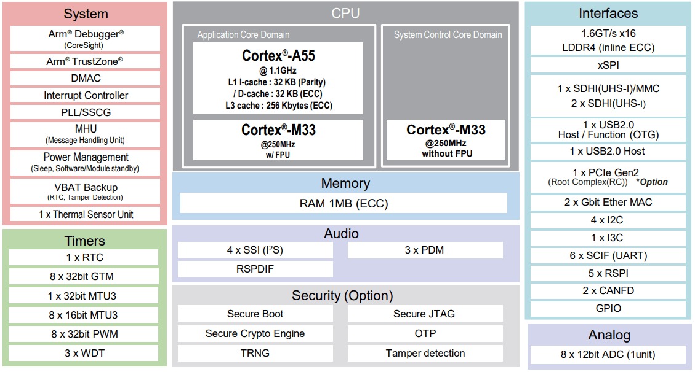

<!-- Copyright 2015-2026 Zephyr Project members and individual contributors. -->
<!-- SPDX-License-Identifier: Apache-2.0 -->
<!-- 中文翻译；编号、导航与译注为本地新增。 -->

<a id="rzg3s_smarc"></a>

# 第31章\_RZ/G3S SMARC评估板套件

原文：[官方页面](https://docs.zephyrproject.org/latest/boards/renesas/rzg3s_smarc/doc/index.html)。读取日期：2026-10-16；来源摘要见[来源记录](../SOURCES.md)。

开发板概览（Board Overview）

<a id="id1"></a>

[](images/rzg3s_smarc.webp)

RZ/G3S SMARC评估板套件

名称（Name）：

`rzg3s_smarc`

厂商（Vendor）：

[瑞萨电子（Renesas Electronics Corporation）](https://docs.zephyrproject.org/latest/boards/index.html#vendor=renesas)

状态（Status）：

维护中（Maintained）

架构（Architecture）：

[arm](https://docs.zephyrproject.org/latest/boards/index.html#arch=arm)

片上系统（SoC）：

[r9a08g045s33gbg](https://docs.zephyrproject.org/latest/boards/index.html#soc=r9a08g045s33gbg)

<a id="board-github-link"></a>

[浏览开发板源码（Browse Board Sources）](https://github.com/zephyrproject-rtos/zephyr/blob/main//boards/renesas/rzg3s_smarc/doc/index.rst/../..)<a id="overview"></a>

## 概述（Overview）

瑞萨RZ/G3S SMARC评估板套件RZ/G3S-EVKIT由SMARC v2.1模块板及载板组成。


- 器件：RZ/G3S R9A08G045S33GBG


  - 单核Cortex-A55及两个Cortex-M33
  - 359引脚BGA，14 mm方形本体，0.5 mm间距
- SMARC v2.1模块板功能


  - LPDDR4 SDRAM：1 GB×1颗
  - QSPI闪存：128 Mb×1颗
  - eMMC：64 GB×1颗
  - 配备电源管理集成电路（PMIC）RAA215300A2GNP#HA3
  - 2个microSD卡接口
  - I3C连接器
  - JTAG连接器
  - 8通道ADC
  - 电流监测，USB Micro-B
- 载板功能（Carrier Board Functions）


  - 2个千兆以太网接口
  - USB 2.0双通道，一个OTG及一个主机
  - 2个CAN-FD接口
  - 1个microSD卡接口
  - 单声道扬声器、立体声耳机、麦克风及辅助音频接口
  - 2个Pmod接口
  - USB Type-C电源输入
  - PCIe Gen2四通道插槽，G3S仅支持单通道
  - M.2 Key E接口
  - M.2 Key B及SIM卡
  - 纽扣电池座，支持3.0 V

<a id="hardware"></a>

## 硬件（Hardware）

<a id="id6"></a>

瑞萨RZ/G3S MPU文档见[RZ/G3S组网站](https://www.renesas.com/en/products/rz-g3s)[注2](#id5)。

<a id="id2"></a>

[](images/rzg3s_block_diagram.webp)

RZ/G3S框图，图片来源：瑞萨电子

<a id="id8"></a>

板卡详细硬件功能见[RZG3S-EVKIT网站](https://www.renesas.com/en/design-resources/boards-kits/rz-g3s-evkit)[注3](#id7)。

<a id="multi-os-processing"></a>

## 多操作系统处理（Multi-OS Processing）

RZ/G3S-EVKIT可在RZ/G3S SoC上执行不同应用。借助多核架构，各核可独立执行定制任务，或通过OpenAMP框架交换数据，参见[OpenAMP Linux Zephyr RPMsg](../intercore_reference/P091_RenesasLinux与Zephyr通信示例.md#rz-openamp-linux-zephyr)示例。

<a id="supported-features"></a>

### 支持的功能（Supported Features）

`rzg3s_smarc`开发板支持下表所列的硬件功能。

片上／板载（On-Chip / On-Board）

功能集成在片上系统（SoC）内／位于开发板上。

2 / 2

分别表示已启用／已禁用的实例数。点击数量标签，可查看开发板或SoC设备树源码（DTS）中该功能的第一个实例。

`vnd,foo`

与此功能匹配的设备树绑定兼容字符串（Compatible String）；点击链接可查看绑定文档。

<a id="rzg3s_smarc-hw-features"></a>

<a id="rzg3s_smarc-rzg3s_smarc/r9a08g045s33gbg/cm33-hw-features-section"></a>

#### `rzg3s_smarc/r9a08g045s33gbg/cm33`目标（Target）

<a id="rzg3s_smarc-rzg3s_smarc/r9a08g045s33gbg/cm33-hw-features-panel"></a>

<a id="rzg3s_smarc-rzg3s_smarc/r9a08g045s33gbg/cm33-hw-features-memory"></a>

此开发板目标的存储器：243 KiB RAM、256 KiB闪存。

<a id="rzg3s_smarc-rzg3s_smarc/r9a08g045s33gbg/cm33-hw-features-table"></a>

<table>
<tr>
<th>类型（Type）</th>
<th>位置（Location）</th>
<th>说明（Description）</th>
<th>兼容字符串（Compatible）</th>
</tr>
<tr>
<td rowspan="1">中央处理器（CPU）</td>
<td>片上（On-Chip）</td>
<td>ARM Cortex-M33处理器（CPU）（<a href="https://github.com/zephyrproject-rtos/zephyr/blob/main/dts/arm/renesas/rz/rzg/r9a08g045.dtsi?plain=1#L25">已启用：1</a>）</td>
<td><a href="../cpu_arm_riscv_binding_reference/P022_arm_cortex-m33.md#std-dtcompatible-arm-cortex-m33"><code>arm,cortex-m33</code></a></td>
</tr>
<tr>
<td rowspan="1">模数转换器（ADC）</td>
<td>片上（On-Chip）</td>
<td>瑞萨RZ ADC-C模数转换驱动（<a href="https://github.com/zephyrproject-rtos/zephyr/blob/main/dts/arm/renesas/rz/rzg/r9a08g045.dtsi?plain=1#L211">已启用：1</a>）</td>
<td><a href="../hardware/P871_RenesasRZADCC绑定.md#dtbinding-renesas-rz-adc-c"><code>renesas,rz-adc-c</code></a></td>
</tr>
<tr>
<td rowspan="2">控制器局域网（CAN）</td>
<td>片上（On-Chip）</td>
<td>瑞萨RZ CANFD全局控制器（<a href="https://github.com/zephyrproject-rtos/zephyr/blob/main/dts/arm/renesas/rz/rzg/r9a08g045.dtsi?plain=1#L498">已启用：1</a>）</td>
<td><a href="../can_nxp_renesas_stm32_ti_binding_reference/P009_renesas_rz-canfd-global.md#std-dtcompatible-renesas-rz-canfd-global"><code>renesas,rz-canfd-global</code></a></td>
</tr>
<tr>
<td>片上（On-Chip）</td>
<td>瑞萨RZ CANFD控制器（<a href="https://github.com/zephyrproject-rtos/zephyr/blob/main/dts/arm/renesas/rz/rzg/r9a08g045.dtsi?plain=1#L505">已启用：1</a>；<a href="https://github.com/zephyrproject-rtos/zephyr/blob/main/dts/arm/renesas/rz/rzg/r9a08g045.dtsi?plain=1#L514">已禁用：1</a>）</td>
<td><a href="../can_nxp_renesas_stm32_ti_binding_reference/P010_renesas_rz-canfd.md#std-dtcompatible-renesas-rz-canfd"><code>renesas,rz-canfd</code></a></td>
</tr>
<tr>
<td rowspan="2">时钟控制（Clock Control）</td>
<td>片上（On-Chip）</td>
<td>瑞萨RZ时钟脉冲发生器（CPG）（<a href="https://github.com/zephyrproject-rtos/zephyr/blob/main/dts/arm/renesas/rz/rzg/r9a08g045.dtsi?plain=1#L59">已启用：1</a>）</td>
<td><a href="../clock_renesas_rockchip_sifli_silabs_binding_reference/P017_renesas_rz-cpg.md#std-dtcompatible-renesas-rz-cpg"><code>renesas,rz-cpg</code></a></td>
</tr>
<tr>
<td>片上（On-Chip）</td>
<td>通用固定频率时钟提供者（Fixed-Rate Clock Provider）（<a href="https://github.com/zephyrproject-rtos/zephyr/blob/main/dts/arm/renesas/rz/rzg/r9a08g045.dtsi?plain=1#L66">已启用：26</a>）</td>
<td><a href="../hardware/P566_固定时钟绑定.md#dtbinding-fixed-clock"><code>fixed-clock</code></a></td>
</tr>
<tr>
<td rowspan="1">计数器（Counter）</td>
<td>片上（On-Chip）</td>
<td>瑞萨RZ通用定时器（GTM）计数器（<a href="https://github.com/zephyrproject-rtos/zephyr/blob/main/dts/arm/renesas/rz/rzg/r9a08g045.dtsi?plain=1#L584">已禁用：8</a>）</td>
<td><a href="../renesas_realtek_counter_binding_reference/P017_renesas_rz-gtm-counter.md#std-dtcompatible-renesas-rz-gtm-counter"><code>renesas,rz-gtm-counter</code></a></td>
</tr>
<tr>
<td rowspan="1">直接存储器访问（DMA）</td>
<td>片上（On-Chip）</td>
<td>RZ直接存储访问（DMA）控制器（<a href="https://github.com/zephyrproject-rtos/zephyr/blob/main/dts/arm/renesas/rz/rzg/r9a08g045.dtsi?plain=1#L404">已禁用：2</a>）</td>
<td><a href="../nxp_realtek_renesas_dma_binding_reference/P013_renesas_rz-dmac-b.md#std-dtcompatible-renesas-rz-dmac-b"><code>renesas,rz-dmac-b</code></a></td>
</tr>
<tr>
<td rowspan="2">通用输入输出与接插件（GPIO &amp; Headers）</td>
<td>片上（On-Chip）</td>
<td>瑞萨RZ GPIO公共部分（<a href="https://github.com/zephyrproject-rtos/zephyr/blob/main/dts/arm/renesas/rz/rzg/r9a08g045.dtsi?plain=1#L222">已启用：1</a>）</td>
<td><a href="../gpio_raspberrypi_renesas_binding_reference/P022_renesas_rz-gpio-common.md#std-dtcompatible-renesas-rz-gpio-common"><code>renesas,rz-gpio-common</code></a></td>
</tr>
<tr>
<td>片上（On-Chip）</td>
<td>瑞萨RZ GPIO控制器（<a href="https://github.com/zephyrproject-rtos/zephyr/blob/main/dts/arm/renesas/rz/rzg/r9a08g045.dtsi?plain=1#L232">已启用：3</a>；<a href="https://github.com/zephyrproject-rtos/zephyr/blob/main/dts/arm/renesas/rz/rzg/r9a08g045.dtsi?plain=1#L241">已禁用：16</a>）</td>
<td><a href="../gpio_raspberrypi_renesas_binding_reference/P025_renesas_rz-gpio.md#std-dtcompatible-renesas-rz-gpio"><code>renesas,rz-gpio</code></a></td>
</tr>
<tr>
<td rowspan="1">集成电路间总线（I2C）</td>
<td>片上（On-Chip）</td>
<td>瑞萨RZ I2C控制器（<a href="https://github.com/zephyrproject-rtos/zephyr/blob/main/dts/arm/renesas/rz/rzg/r9a08g045.dtsi?plain=1#L524">已启用：1</a>；<a href="https://github.com/zephyrproject-rtos/zephyr/blob/main/dts/arm/renesas/rz/rzg/r9a08g045.dtsi?plain=1#L537">已禁用：3</a>）</td>
<td><a href="../i2c_nxp_pico_renesas_binding_reference/P018_renesas_rz-riic.md#std-dtcompatible-renesas-rz-riic"><code>renesas,rz-riic</code></a></td>
</tr>
<tr>
<td rowspan="1">输入（Input）</td>
<td>板载（On-Board）</td>
<td>一组绑定到 GPIO 的输入按键（GPIO-Bound Input Keys）（<a href="https://github.com/zephyrproject-rtos/zephyr/blob/main/boards/renesas/rzg3s_smarc/rzg3s_smarc_r9a08g045s33gbg_cm33.dts?plain=1#L35">已启用：1</a>）</td>
<td><a href="../hardware/P563_GPIO按键绑定.md#std-dtcompatible-gpio-keys"><code>gpio-keys</code></a></td>
</tr>
<tr>
<td rowspan="4">中断控制器（Interrupt Controller）</td>
<td>片上（On-Chip）</td>
<td>ARMv8-M嵌套向量中断控制器（NVIC / Nested Vectored Interrupt Controller）（<a href="https://github.com/zephyrproject-rtos/zephyr/blob/main/dts/arm/armv8-m.dtsi?plain=1#L13">已启用：1</a>）</td>
<td><a href="../arm_interrupt_timer_binding_reference/P003_ARMv8_M_NVIC.md#std-dtcompatible-arm-v8m-nvic"><code>arm,v8m-nvic</code></a></td>
</tr>
<tr>
<td>片上（On-Chip）</td>
<td>瑞萨RZ中断控制器（<a href="https://github.com/zephyrproject-rtos/zephyr/blob/main/dts/arm/renesas/rz/rzg/r9a08g045.dtsi?plain=1#L872">已启用：1</a>）</td>
<td><a href="../renesas_interrupt_binding_reference/P008_renesas_rz-intc.md#std-dtcompatible-renesas-rz-intc"><code>renesas,rz-intc</code></a></td>
</tr>
<tr>
<td>片上（On-Chip）</td>
<td>瑞萨RZ GPIO中断（TINT）控制器（<a href="https://github.com/zephyrproject-rtos/zephyr/blob/main/dts/arm/renesas/rz/rzg/r9a08g045.dtsi?plain=1#L886">已禁用：32</a>）</td>
<td><a href="../renesas_interrupt_binding_reference/P009_renesas_rz-tint.md#std-dtcompatible-renesas-rz-tint"><code>renesas,rz-tint</code></a></td>
</tr>
<tr>
<td>片上（On-Chip）</td>
<td>瑞萨RZ外部中断控制器（<a href="https://github.com/zephyrproject-rtos/zephyr/blob/main/dts/arm/renesas/rz/rzg/r9a08g045.dtsi?plain=1#L1174">已禁用：9</a>）</td>
<td><a href="../renesas_interrupt_binding_reference/P004_renesas_rz-ext-irq.md#std-dtcompatible-renesas-rz-ext-irq"><code>renesas,rz-ext-irq</code></a></td>
</tr>
<tr>
<td rowspan="1">邮箱（Mailbox）</td>
<td>片上（On-Chip）</td>
<td>瑞萨消息处理单元（MHU）邮箱（MBOX）（<a href="https://github.com/zephyrproject-rtos/zephyr/blob/main/dts/arm/renesas/rz/rzg/r9a08g045.dtsi?plain=1#L1256">已禁用：4</a>）</td>
<td><a href="../intercore_reference/P053_RenesasRZ邮箱绑定.md#dtbinding-renesas-rz-mhu-mbox"><code>renesas,rz-mhu-mbox</code></a></td>
</tr>
<tr>
<td rowspan="1">内存管理单元／内存保护单元（MMU / MPU）</td>
<td>片上（On-Chip）</td>
<td>ARMv8-M存储器保护单元（MPU / Memory Protection Unit）（<a href="https://github.com/zephyrproject-rtos/zephyr/blob/main/dts/arm/renesas/rz/rzg/r9a08g045.dtsi?plain=1#L33">已启用：1</a>）</td>
<td><a href="../memory_protection_binding_reference/P007_arm_armv8m-mpu.md#std-dtcompatible-arm-armv8m-mpu"><code>arm,armv8m-mpu</code></a></td>
</tr>
<tr>
<td rowspan="1">物理层（PHY）</td>
<td>板载（On-Board）</td>
<td>由简单GPIO控制的CAN收发器（Transceiver）（<a href="https://github.com/zephyrproject-rtos/zephyr/blob/main/boards/renesas/rzg3s_smarc/rzg3s_smarc_r9a08g045s33gbg_cm33.dts?plain=1#L79">已启用：2</a>）</td>
<td><a href="../phy_binding_reference/P001_can-transceiver-gpio.md#std-dtcompatible-can-transceiver-gpio"><code>can-transceiver-gpio</code></a></td>
</tr>
<tr>
<td rowspan="1">引脚控制（Pin Control）</td>
<td>片上（On-Chip）</td>
<td>瑞萨RZ/G引脚控制器（<a href="https://github.com/zephyrproject-rtos/zephyr/blob/main/dts/arm/renesas/rz/rzg/r9a08g045.dtsi?plain=1#L54">已启用：1</a>）</td>
<td><a href="../pinctrl_renesas_silabs_binding_reference/P015_renesas_rzg-pinctrl.md#std-dtcompatible-renesas-rzg-pinctrl"><code>renesas,rzg-pinctrl</code></a></td>
</tr>
<tr>
<td rowspan="1">脉宽调制（PWM）</td>
<td>片上（On-Chip）</td>
<td>瑞萨RZ通用定时器（GPT）脉宽调制（PWM）（<a href="https://github.com/zephyrproject-rtos/zephyr/blob/main/dts/arm/renesas/rz/rzg/r9a08g045.dtsi?plain=1#L739">已禁用：8</a>）</td>
<td><a href="../pwm_stm32_ti_generic_binding_reference/P001_renesas_rz-gpt-pwm.md#std-dtcompatible-renesas-rz-gpt-pwm"><code>renesas,rz-gpt-pwm</code></a></td>
</tr>
<tr>
<td rowspan="1">串行控制器（Serial Controller）</td>
<td>片上（On-Chip）</td>
<td>瑞萨RZ串行通信接口（SCIF）UART控制器（<a href="https://github.com/zephyrproject-rtos/zephyr/blob/main/dts/arm/renesas/rz/rzg/r9a08g045.dtsi?plain=1#L453">已启用：1</a>；<a href="https://github.com/zephyrproject-rtos/zephyr/blob/main/dts/arm/renesas/rz/rzg/r9a08g045.dtsi?plain=1#L444">已禁用：5</a>）</td>
<td><a href="../uart_raspberrypi_realtek_renesas_binding_reference/P016_renesas_rz-scif-uart.md#std-dtcompatible-renesas-rz-scif-uart"><code>renesas,rz-scif-uart</code></a></td>
</tr>
<tr>
<td rowspan="1">串行外设接口（SPI）</td>
<td>片上（On-Chip）</td>
<td>瑞萨RZ SPI（<a href="https://github.com/zephyrproject-rtos/zephyr/blob/main/dts/arm/renesas/rz/rzg/r9a08g045.dtsi?plain=1#L1307">已启用：1</a>；<a href="https://github.com/zephyrproject-rtos/zephyr/blob/main/dts/arm/renesas/rz/rzg/r9a08g045.dtsi?plain=1#L1318">已禁用：4</a>）</td>
<td><a href="../spi_flexspi_nxp_renesas_binding_reference/P020_renesas_rz-rspi.md#std-dtcompatible-renesas-rz-rspi"><code>renesas,rz-rspi</code></a></td>
</tr>
<tr>
<td rowspan="1">静态随机存储器（SRAM）</td>
<td>板载（On-Board）</td>
<td>通用片上静态随机存储器（SRAM）（<a href="https://github.com/zephyrproject-rtos/zephyr/blob/main/boards/renesas/rzg3s_smarc/rzg3s_smarc_r9a08g045s33gbg_cm33.dts?plain=1#L64">已启用：2</a>）</td>
<td><a href="../hardware/P567_内存映射SRAM绑定.md#dtbinding-mmio-sram"><code>mmio-sram</code></a></td>
</tr>
<tr>
<td rowspan="4">定时器（Timer）</td>
<td>片上（On-Chip）</td>
<td>ARMv8-M系统节拍（System Tick）（<a href="https://github.com/zephyrproject-rtos/zephyr/blob/main/dts/arm/armv8-m.dtsi?plain=1#L21">已启用：1</a>）</td>
<td><a href="../arm_interrupt_timer_binding_reference/P007_ARMv8_M_SysTick.md#std-dtcompatible-arm-armv8m-systick"><code>arm,armv8m-systick</code></a></td>
</tr>
<tr>
<td>片上（On-Chip）</td>
<td>瑞萨RZ GTM定时器（<a href="https://github.com/zephyrproject-rtos/zephyr/blob/main/dts/arm/renesas/rz/rzg/r9a08g045.dtsi?plain=1#L576">已禁用：8</a>）</td>
<td><a href="../renesas_timer_binding_reference/P008_renesas_rz-gtm.md#std-dtcompatible-renesas-rz-gtm"><code>renesas,rz-gtm</code></a></td>
</tr>
<tr>
<td>片上（On-Chip）</td>
<td>瑞萨RZ操作系统定时器（<a href="https://github.com/zephyrproject-rtos/zephyr/blob/main/dts/arm/renesas/rz/rzg/r9a08g045.dtsi?plain=1#L589">已禁用：8</a>）</td>
<td><a href="../renesas_timer_binding_reference/P007_renesas_rz-gtm-os-timer.md#std-dtcompatible-renesas-rz-gtm-os-timer"><code>renesas,rz-gtm-os-timer</code></a></td>
</tr>
<tr>
<td>片上（On-Chip）</td>
<td>瑞萨RZ通用定时器（GPT）（<a href="https://github.com/zephyrproject-rtos/zephyr/blob/main/dts/arm/renesas/rz/rzg/r9a08g045.dtsi?plain=1#L728">已禁用：8</a>）</td>
<td><a href="../renesas_timer_binding_reference/P006_renesas_rz-gpt.md#std-dtcompatible-renesas-rz-gpt"><code>renesas,rz-gpt</code></a></td>
</tr>
</table>

<a id="programming-and-debugging"></a>

## 烧录与调试（Programming and Debugging）

`rzg3s_smarc`开发板支持下表所列的运行工具（Runners）及相关west命令。

<table>
<tr>
<th></th>
<th>烧录（flash）</th>
<th>调试（debug）</th>
<th>连接调试会话（attach）</th>
<th>实时传输（rtt）</th>
<th>复位（reset）</th>
<th>调试服务器（debugserver）</th>
</tr>
<tr>
<td><a href="https://docs.zephyrproject.org/latest/develop/flash_debug/host-tools.html#runner-jlink">jlink</a></td>
<td>✅（默认 / default）</td>
<td>✅（默认 / default）</td>
<td>✅</td>
<td>✅</td>
<td>✅</td>
<td>✅</td>
</tr>
</table>

RZ/G3S-EVKIT设计为在不同内核运行不同系统。它使用Yocto构建Linux及引导加载程序，在启动Zephyr之前先在Cortex-A55系统核运行BL2 TF-A，最少步骤如下。

> 1. <a id="id10"></a>
>
>   按《[RZ/G3S SMARC EVK Linux启动指南](https://www.renesas.com/en/document/gde/smarc-evk-rzg3s-linux-start-guide-rev106)》[注4](#id9)的“2.2 Building Images”准备构建环境。
> 2. 构建前，在meta-renesas/meta-rzg3s/recipes-bsp/trusted-firmware-a/trusted-firmware-a.bbappend中添加PLAT_M33_BOOT_SUPPORT=1。
>
> ```text
>   require trusted-firmware-a.inc
>   COMPATIBLE_MACHINE_rzg3s = "(rzg3s-dev|smarc-rzg3s)"
>   PLATFORM_rzg3s-dev = "g3s"
>   EXTRA_FLAGS_rzg3s-dev = "BOARD=dev14_1_lpddr PLAT_SYSTEM_SUSPEND=vbat"
>   PLATFORM_smarc-rzg3s = "g3s"
>   EXTRA_FLAGS_smarc-rzg3s = "BOARD=smarc PLAT_SYSTEM_SUSPEND=vbat PLAT_M33_BOOT_SUPPORT=1"
> ```
>
>
> 1. 开始构建：
>
> ```text
> MACHINE=smarc-rzg3s bitbake core-image-minimal
> ```
>
> 下列必需产物位于build/tmp/deploy/images：
>
> <table>
> <tr>
> <th>构建产物（Artifacts）</th>
> <th>文件名</th>
> </tr>
> <tr>
> <td>引导加载程序（Boot Loader）</td>
> <td>bl2_bp_spi-smarc-rzg3s.srec<br><br>fip-smarc-rzg3s.srec</td>
> </tr>
> <tr>
> <td>闪存写入工具（Flash Writer）</td>
> <td>FlashWriter-smarc-rzg3s.mot</td>
> </tr>
> </table>
>
>
> 1. <a id="id11"></a>
>
>   按《[RZ/G3S SMARC EVK Linux启动指南](https://www.renesas.com/en/document/gde/smarc-evk-rzg3s-linux-start-guide-rev106)》[注4](#id9)的“4.2 Startup Procedure”配置电源及板卡。SCIF下载：SW_MODE[1:4]依次OFF、ON、OFF、ON；Cortex-A55冷启动：SW_CONFIG[1:6]依次OFF、OFF、ON、OFF、OFF、OFF。
> 2. <a id="id12"></a>
>
>   按该Linux启动指南[注4](#id9)的“4.3 Download Flash Writer to RAM”，将Flash Writer下载到RAM。（[RZ/G3S SMARC EVK Linux启动指南](https://www.renesas.com/en/document/gde/smarc-evk-rzg3s-linux-start-guide-rev106)）
> 3. <a id="id13"></a>
>
>   按该Linux启动指南[注4](#id9)的“4.4 Write the Bootloader”，使用Flash Writer将引导加载程序写入目标板。（[RZ/G3S SMARC EVK Linux启动指南](https://www.renesas.com/en/document/gde/smarc-evk-rzg3s-linux-start-guide-rev106)）

rzg3s_smarc应用可按“构建应用”中的常规方式构建。（[构建应用（Building an Application）](../application/P001_应用开发.md#build-an-application)）

<a id="console"></a>

### 控制台（Console）

将[Pmod USBUART](https://store.digilentinc.com/pmod-usbuart-usb-to-uart-interface/)连接到PMOD1_3A上侧，即可访问Cortex-M33系统核的UART端口。

<a id="debugging"></a>

### 调试（Debugging）

可使用J-Link调试器及[J-Link Debug Host Tools](https://docs.zephyrproject.org/latest/develop/flash_debug/host-tools.html#jlink-debug-host-tools)，将Zephyr应用二进制加载到此板内部SRAM，并在Cortex-M33系统核上执行。

注意（Note）

当前要求先在Cortex-A55系统核启动瑞萨BL2 TF-A，再启动Zephyr，因为BL2 TF-A负责配置时钟及Cortex-M33系统核，然后启动它。

以下为构建并调试[Hello World](../getting_started/P005_HelloWorld示例.md#hello_world)应用的示例。

```text
# From the root of the zephyr repository
west build -b rzg3s_smarc/r9a08g045s33gbg/cm33 samples/hello_world
west debug
```

<a id="flashing"></a>

### 烧录（Flashing）

可将Zephyr应用烧录到QSPI存储器，再由运行在Cortex-A55系统核上的瑞萨BL2 TF-A加载，并在Cortex-M33系统核上启动。

<a id="id4"></a>

Zephyr应用二进制须转换为Motorola S-record（[SREC](https://en.wikipedia.org/wiki/SREC_(file_format))）[注1](#id3)格式；构建会在应用构建目录自动生成扩展名为s19的文件。原文Motorolla拼写按格式名称翻译。

<a id="flashing-on-qspi-using-flash-writer"></a>

<a id="flashing-on-qspi"></a>

#### 通过Flash Writer烧录QSPI

Zephyr二进制须转换为SREC格式。


- <a id="id14"></a>

  按《[RZ/G3S SMARC EVK Linux启动指南](https://www.renesas.com/en/document/gde/smarc-evk-rzg3s-linux-start-guide-rev106)》[注4](#id9)的“4.3 Download Flash Writer to RAM”，下载并启动Flash Writer。
- 使用XLS2命令烧录Zephyr二进制
- 按提示输入：

```text
===== Please Input Program Top Address ============
  Please Input : H'23000
===== Please Input Qspi Save Address ===
  Please Input : H'200000
```


- 随后从终端以ASCII模式发送Zephyr的s19文件
- 以QSPI启动模式重启开发板

 ```text
  -- Load Program to SRAM ---------------

 Flash writer for RZ/G3S Series V0.60 Jan.26,2023
  Product Code : RZ/G3S
 >XLS2
 ===== Qspi writing of RZ/G2 Board Command =============
 Load Program to Spiflash
 Writes to any of SPI address.
 Program size & Qspi Save Address
 ===== Please Input Program Top Address ============
   Please Input : H'23000

 ===== Please Input Qspi Save Address ===
   Please Input : H'200000
 please send ! ('.' & CR stop load)
 I Flash memory...
 Erase Completed
 Write to SPI Flash memory.
 ======= Qspi  Save Information  =================
  SpiFlashMemory Stat Address : H'00200000
  SpiFlashMemory End Address  : H'002098E6
 ===========================================================
 ```

<a id="flashing-on-qspi-using-west"></a>

#### 通过west烧录QSPI

使用flash命令前，须将板卡设为Cortex-M33冷启动：SW_CONFIG[1:6]依次OFF、OFF、ON、OFF、OFF、ON。烧录后须恢复Cortex-A55冷启动才能运行。

支持QSPI烧录的SEGGER J-Link软件最低版本为v7.96。

注意：原文记录已用SEGGER J-Link v7.98g成功烧录，因此建议使用该版本或更高版本。

```text
west build -b rzg3s_smarc/r9a08g045s33gbg/cm33 samples/hello_world
west flash
```

<a id="troubleshooting"></a>

### 故障排查（Troubleshooting）

Linux与Zephyr应用不应共享SoC硬件资源，否则会导致硬件状态损坏及不可预测行为。因此，分配给Zephyr的硬件资源必须在Linux中禁用。

以下补丁展示如何阻止Linux配置由Zephyr使用的SCIF1。

```text
diff --git a/arch/arm64/boot/dts/renesas/rzg3s-smarc.dtsi b/arch/arm64/boot/dts/renesas/rzg3s-smarc.dtsi
index f01801b18e8a..d9f9a0a2bb08 100644
--- a/arch/arm64/boot/dts/renesas/rzg3s-smarc.dtsi
+++ b/arch/arm64/boot/dts/renesas/rzg3s-smarc.dtsi
@@ -347,7 +347,7 @@ &scif1 {
        pinctrl-0 = <&scif1_pins>;
        pinctrl-names = "default";
        uart-has-rtscts;
-       status = "okay";
+       status = "disabled";
};
#elif SPDIF_SEL == SW_ON
&spdif {
```

<a id="references"></a>

## 参考资料（References）

<a id="id3"></a>

〔[1](#id4)〕 [https://en.wikipedia.org/wiki/SREC_(file_format)](https://en.wikipedia.org/wiki/SREC_(file_format))

<a id="id5"></a>

〔[2](#id6)〕 [https://www.renesas.com/en/products/rz-g3s](https://www.renesas.com/en/products/rz-g3s)

<a id="id7"></a>

〔[3](#id8)〕 [https://www.renesas.com/en/design-resources/boards-kits/rz-g3s-evkit](https://www.renesas.com/en/design-resources/boards-kits/rz-g3s-evkit)

<a id="id9"></a>

〔4〕 ([1](#id10),[2](#id11),[3](#id12),[4](#id13),[5](#id14)) [https://www.renesas.com/en/document/gde/smarc-evk-rzg3s-linux-start-guide-rev106](https://www.renesas.com/en/document/gde/smarc-evk-rzg3s-linux-start-guide-rev106)

## 译注

RZ/G3S在CA55先运行BL2 TF-A。west烧录前切到CM33冷启动，烧录后恢复CA55冷启动。原文最低J-Link v7.96及验证v7.98g分别保留；硬件资源不可与Linux共享。

## 原文外链核对

2026-10-16核对并重试以下原文外链时未能确认可访问性，保留原始目标，不将访问失败解释为原文内容有误。

- [SREC_(file_format)](https://en.wikipedia.org/wiki/SREC_(file_format))：HTTP Error 403: Too Many Reqs (1862a4b)。
- [](https://store.digilentinc.com/pmod-usbuart-usb-to-uart-interface/)：HTTP Error 403: Forbidden。
- [rz-g3s](https://www.renesas.com/en/products/rz-g3s)：HTTP Error 429: Too Many Requests。

---

[上一章](P030_RZ_G3E_Evaluation_Board_Kit.md) · [返回大纲](大纲.md) · [全站翻译进度](../PROGRESS.md) · [下一章](P032_RZ_N2H_Evaluation_Board_Kit.md)
