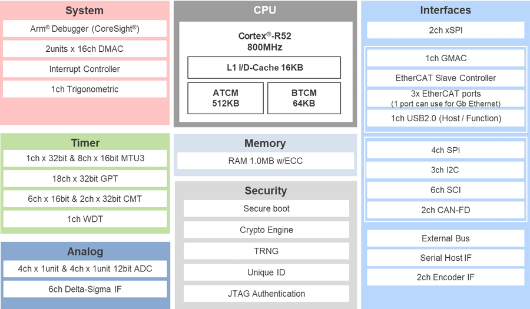

<!-- Copyright 2015-2026 Zephyr Project members and individual contributors. -->
<!-- SPDX-License-Identifier: Apache-2.0 -->
<!-- 中文翻译；编号、导航与译注为本地新增。 -->

<a id="rzt2l_rsk"></a>

# 第35章\_瑞萨RZ/T2L入门套件Plus

原文：[官方页面](https://docs.zephyrproject.org/latest/boards/renesas/rzt2l_rsk/doc/index.html)。读取日期：2026-10-16；来源摘要见[来源记录](../SOURCES.md)。

开发板概览（Board Overview）

<a id="id1"></a>

[](images/rzt2l_rsk.webp)

瑞萨RZ/T2L入门套件Plus

名称（Name）：

`rzt2l_rsk`

厂商（Vendor）：

[瑞萨电子（Renesas Electronics Corporation）](https://docs.zephyrproject.org/latest/boards/index.html#vendor=renesas)

状态（Status）：

维护中（Maintained）

架构（Architecture）：

[arm](https://docs.zephyrproject.org/latest/boards/index.html#arch=arm)

片上系统（SoC）：

[r9a07g074m04gbg](https://docs.zephyrproject.org/latest/boards/index.html#soc=r9a07g074m04gbg)

<a id="board-github-link"></a>

[浏览开发板源码（Browse Board Sources）](https://github.com/zephyrproject-rtos/zephyr/blob/main//boards/renesas/rzt2l_rsk/doc/index.rst/../..)<a id="overview"></a>

## 概述（Overview）

瑞萨RZ/T2L Starter Kit+用于评估和开发RZ/T2L MPU。只需用随附线缆连接PC，即可通过板载仿真器开始评估。产品包含千兆以太网PHY及Octal Flash等丰富功能IC，无需扩展板即可评估RZ/T2L多种功能。


- 板载196引脚RZ/T2L MPU，R9A07G074M04GBG
- 千兆以太网PHY及Octal Flash等丰富功能IC，无需扩展板即可评估RZ/T2L多种功能
- Pmod、Grove、Qwiic、mikroBUS等通用接口
- 用于外部扩展的排针，可评估多种用例
- 配备仿真电路，用USB线连接PC即可开始程序调试；随附两根USB线，分别用于仿真器及供电
- 板载存储器：


  - Octa Flash，512 Mbit
  - HyperRAM，64 Mbit
  - QSPI串行闪存，128 Mbit
  - I2C EEPROM，16 Kbit
- 通信接口包括：


  - 调试接口：J-Link OB、MIPI-10、MIPI-20、Mictor-38
  - 以太网（Ethernet）
  - 控制器局域网（CAN）
  - 通用串行总线（USB）
  - RS485
  - 通用异步收发器（UART）
  - 集成电路间总线（I2C）
  - 串行外设接口（SPI）

<a id="hardware"></a>

## 硬件（Hardware）

<a id="id4"></a>

瑞萨RZ/T2L MPU文档见[RZ/T2L组网站](https://www.renesas.com/en/products/microcontrollers-microprocessors/rz-mpus/rzt2l-high-performance-mpu-realizing-high-speed-and-high-precision-real-time-control-ethercat)[注1](#id3)。

<a id="id2"></a>

[](images/rzt2l_block_diagram.webp)

RZ/T2L框图，图片来源：瑞萨电子

<a id="id6"></a>

板卡详细硬件功能见[RZ/T2L-RSK网站](https://www.renesas.com/en/products/microcontrollers-microprocessors/rz-mpus/rzt2l-rsk-renesas-starter-kit-rzt2l)[注2](#id5)。

<a id="supported-features"></a>

### 支持的功能（Supported Features）

`rzt2l_rsk`开发板支持下表所列的硬件功能。

片上／板载（On-Chip / On-Board）

功能集成在片上系统（SoC）内／位于开发板上。

2 / 2

分别表示已启用／已禁用的实例数。点击数量标签，可查看开发板或SoC设备树源码（DTS）中该功能的第一个实例。

`vnd,foo`

与此功能匹配的设备树绑定兼容字符串（Compatible String）；点击链接可查看绑定文档。

<a id="rzt2l_rsk-hw-features"></a>

<a id="rzt2l_rsk-rzt2l_rsk/r9a07g074m04gbg-hw-features-section"></a>

#### `rzt2l_rsk/r9a07g074m04gbg`目标（Target）

<a id="rzt2l_rsk-rzt2l_rsk/r9a07g074m04gbg-hw-features-panel"></a>

<a id="rzt2l_rsk-rzt2l_rsk/r9a07g074m04gbg-hw-features-memory"></a>

该开发板目标的片上存储容量：512 KiB RAM、16 MiB Flash。

<a id="rzt2l_rsk-rzt2l_rsk/r9a07g074m04gbg-hw-features-table"></a>

<table>
<tr>
<th>类型（Type）</th>
<th>位置（Location）</th>
<th>说明（Description）</th>
<th>兼容字符串（Compatible）</th>
</tr>
<tr>
<td rowspan="1">中央处理器（CPU）</td>
<td>片上（On-Chip）</td>
<td>ARM Cortex-R52处理器（CPU）（<a href="https://github.com/zephyrproject-rtos/zephyr/blob/main/dts/arm/renesas/rz/rzt/r9a07g074.dtsi?plain=1#L26">已启用：1</a>）</td>
<td><a href="../cpu_cortex_xtensa_binding_reference/P011_arm_cortex-r52.md#std-dtcompatible-arm-cortex-r52"><code>arm,cortex-r52</code></a></td>
</tr>
<tr>
<td rowspan="1">模数转换器（ADC）</td>
<td>片上（On-Chip）</td>
<td>瑞萨RZ模数转换器（ADC）（<a href="https://github.com/zephyrproject-rtos/zephyr/blob/main/dts/arm/renesas/rz/rzt/r9a07g074.dtsi?plain=1#L457">已启用：2</a>）</td>
<td><a href="../hardware/P873_RenesasRZ模数转换器绑定.md#dtbinding-renesas-rz-adc"><code>renesas,rz-adc</code></a></td>
</tr>
<tr>
<td rowspan="1">计数器（Counter）</td>
<td>片上（On-Chip）</td>
<td>瑞萨RZ比较匹配定时器W（CMTW）计数器（<a href="https://github.com/zephyrproject-rtos/zephyr/blob/main/dts/arm/renesas/rz/rzt/r9a07g074.dtsi?plain=1#L705">已禁用：2</a>）</td>
<td><a href="../renesas_realtek_counter_binding_reference/P016_renesas_rz-cmtw-counter.md#std-dtcompatible-renesas-rz-cmtw-counter"><code>renesas,rz-cmtw-counter</code></a></td>
</tr>
<tr>
<td rowspan="1">直接存储器访问（DMA）</td>
<td>片上（On-Chip）</td>
<td>RZ直接存储访问（DMA）控制器（<a href="https://github.com/zephyrproject-rtos/zephyr/blob/main/dts/arm/renesas/rz/rzt/r9a07g074.dtsi?plain=1#L526">已禁用：2</a>）</td>
<td><a href="../nxp_realtek_renesas_dma_binding_reference/P014_renesas_rz-dmac.md#std-dtcompatible-renesas-rz-dmac"><code>renesas,rz-dmac</code></a></td>
</tr>
<tr>
<td rowspan="1">闪存控制器（Flash Controller）</td>
<td>板载（On-Board）</td>
<td>瑞萨RZ XSPI NOR闪存控制器，支持JEDEC通用闪存接口（CFI）（<a href="https://github.com/zephyrproject-rtos/zephyr/blob/main/boards/renesas/rzt2l_rsk/rzt2l_rsk.dts?plain=1#L116">已启用：1</a>）</td>
<td><a href="../flash_renesas_st_ti_binding_reference/P003_renesas_rz-qspi-xspi.md#std-dtcompatible-renesas-rz-qspi-xspi"><code>renesas,rz-qspi-xspi</code></a></td>
</tr>
<tr>
<td rowspan="2">通用输入输出与接插件（GPIO &amp; Headers）</td>
<td>片上（On-Chip）</td>
<td>瑞萨RZ GPIO公共部分V2（<a href="https://github.com/zephyrproject-rtos/zephyr/blob/main/dts/arm/renesas/rz/rzt/r9a07g074.dtsi?plain=1#L210">已启用：1</a>）</td>
<td><a href="../gpio_raspberrypi_renesas_binding_reference/P020_renesas_rz-gpio-common-v2.md#std-dtcompatible-renesas-rz-gpio-common-v2"><code>renesas,rz-gpio-common-v2</code></a></td>
</tr>
<tr>
<td>片上（On-Chip）</td>
<td>瑞萨RZ GPIO控制器（<a href="https://github.com/zephyrproject-rtos/zephyr/blob/main/dts/arm/renesas/rz/rzt/r9a07g074.dtsi?plain=1#L353">已启用：4</a>；<a href="https://github.com/zephyrproject-rtos/zephyr/blob/main/dts/arm/renesas/rz/rzt/r9a07g074.dtsi?plain=1#L222">已禁用：21</a>）</td>
<td><a href="../gpio_raspberrypi_renesas_binding_reference/P025_renesas_rz-gpio.md#std-dtcompatible-renesas-rz-gpio"><code>renesas,rz-gpio</code></a></td>
</tr>
<tr>
<td rowspan="1">集成电路间总线（I2C）</td>
<td>片上（On-Chip）</td>
<td>瑞萨RZ I2C控制器（<a href="https://github.com/zephyrproject-rtos/zephyr/blob/main/dts/arm/renesas/rz/rzt/r9a07g074.dtsi?plain=1#L496">已启用：1</a>；<a href="https://github.com/zephyrproject-rtos/zephyr/blob/main/dts/arm/renesas/rz/rzt/r9a07g074.dtsi?plain=1#L481">已禁用：2</a>）</td>
<td><a href="../i2c_nxp_pico_renesas_binding_reference/P017_renesas_rz-iic.md#std-dtcompatible-renesas-rz-iic"><code>renesas,rz-iic</code></a></td>
</tr>
<tr>
<td rowspan="1">输入（Input）</td>
<td>板载（On-Board）</td>
<td>一组绑定到 GPIO 的输入按键（GPIO-Bound Input Keys）（<a href="https://github.com/zephyrproject-rtos/zephyr/blob/main/boards/renesas/rzt2l_rsk/rzt2l_rsk.dts?plain=1#L45">已启用：1</a>）</td>
<td><a href="../hardware/P563_GPIO按键绑定.md#std-dtcompatible-gpio-keys"><code>gpio-keys</code></a></td>
</tr>
<tr>
<td rowspan="3">中断控制器（Interrupt Controller）</td>
<td>片上（On-Chip）</td>
<td>ARM通用中断控制器（GIC）v3（<a href="https://github.com/zephyrproject-rtos/zephyr/blob/main/dts/arm/renesas/rz/rzt/r9a07g074.dtsi?plain=1#L50">已启用：1</a>）</td>
<td><a href="../interrupt_fabric_binding_reference/P004_arm_gic-v3.md#std-dtcompatible-arm-gic-v3"><code>arm,gic-v3</code></a></td>
</tr>
<tr>
<td>片上（On-Chip）</td>
<td>瑞萨RZ中断控制单元（ICU）（<a href="https://github.com/zephyrproject-rtos/zephyr/blob/main/dts/arm/renesas/rz/rzt/r9a07g074.dtsi?plain=1#L74">已启用：1</a>）</td>
<td><a href="../renesas_interrupt_binding_reference/P006_renesas_rz-icu.md#std-dtcompatible-renesas-rz-icu"><code>renesas,rz-icu</code></a></td>
</tr>
<tr>
<td>片上（On-Chip）</td>
<td>瑞萨RZ外部中断控制器（<a href="https://github.com/zephyrproject-rtos/zephyr/blob/main/dts/arm/renesas/rz/rzt/r9a07g074.dtsi?plain=1#L137">已启用：1</a>；<a href="https://github.com/zephyrproject-rtos/zephyr/blob/main/dts/arm/renesas/rz/rzt/r9a07g074.dtsi?plain=1#L81">已禁用：15</a>）</td>
<td><a href="../renesas_interrupt_binding_reference/P004_renesas_rz-ext-irq.md#std-dtcompatible-renesas-rz-ext-irq"><code>renesas,rz-ext-irq</code></a></td>
</tr>
<tr>
<td rowspan="1">发光二极管（LED）</td>
<td>板载（On-Board）</td>
<td>一组由 GPIO 控制的 LED（GPIO-Controlled LEDs）（<a href="https://github.com/zephyrproject-rtos/zephyr/blob/main/boards/renesas/rzt2l_rsk/rzt2l_rsk.dts?plain=1#L31">已启用：1</a>）</td>
<td><a href="../hardware/P564_GPIO指示灯绑定.md#dtbinding-gpio-leds"><code>gpio-leds</code></a></td>
</tr>
<tr>
<td rowspan="1">其他绑定（Miscellaneous）</td>
<td>片上（On-Chip）</td>
<td>瑞萨RZ串行通信接口（SCI）控制器（<a href="https://github.com/zephyrproject-rtos/zephyr/blob/main/dts/arm/renesas/rz/rzt/r9a07g074.dtsi?plain=1#L584">已启用：1</a>；<a href="https://github.com/zephyrproject-rtos/zephyr/blob/main/dts/arm/renesas/rz/rzt/r9a07g074.dtsi?plain=1#L602">已禁用：5</a>）</td>
<td><a href="../misc_nxp_renesas_zephyr_binding_reference/P029_renesas_rz-sci.md#std-dtcompatible-renesas-rz-sci"><code>renesas,rz-sci</code></a></td>
</tr>
<tr>
<td rowspan="1">存储技术设备（MTD）</td>
<td>板载（On-Board）</td>
<td>闪存（Flash）节点（<a href="https://github.com/zephyrproject-rtos/zephyr/blob/main/boards/renesas/rzt2l_rsk/rzt2l_rsk.dts?plain=1#L124">已启用：1</a>）</td>
<td><a href="../mtd_nxp_st_ti_partition_binding_reference/P013_soc-nv-flash.md#std-dtcompatible-soc-nv-flash"><code>soc-nv-flash</code></a></td>
</tr>
<tr>
<td rowspan="1">引脚控制（Pin Control）</td>
<td>片上（On-Chip）</td>
<td>瑞萨RZ/T引脚控制器（<a href="https://github.com/zephyrproject-rtos/zephyr/blob/main/dts/arm/renesas/rz/rzt/r9a07g074.dtsi?plain=1#L43">已启用：1</a>）</td>
<td><a href="../pinctrl_renesas_silabs_binding_reference/P017_renesas_rzt-pinctrl.md#std-dtcompatible-renesas-rzt-pinctrl"><code>renesas,rzt-pinctrl</code></a></td>
</tr>
<tr>
<td rowspan="1">脉宽调制（PWM）</td>
<td>片上（On-Chip）</td>
<td>瑞萨RZ通用定时器（GPT）脉宽调制（PWM）（<a href="https://github.com/zephyrproject-rtos/zephyr/blob/main/dts/arm/renesas/rz/rzt/r9a07g074.dtsi?plain=1#L748">已禁用：18</a>）</td>
<td><a href="../pwm_stm32_ti_generic_binding_reference/P001_renesas_rz-gpt-pwm.md#std-dtcompatible-renesas-rz-gpt-pwm"><code>renesas,rz-gpt-pwm</code></a></td>
</tr>
<tr>
<td rowspan="1">四线串行外设接口（QSPI）</td>
<td>片上（On-Chip）</td>
<td>瑞萨RZ扩展串行外设接口（XSPI）（<a href="https://github.com/zephyrproject-rtos/zephyr/blob/main/dts/arm/renesas/rz/rzt/r9a07g074.dtsi?plain=1#L1187">已启用：1</a>；<a href="https://github.com/zephyrproject-rtos/zephyr/blob/main/dts/arm/renesas/rz/rzt/r9a07g074.dtsi?plain=1#L1176">已禁用：1</a>）</td>
<td><a href="../qspi_ospi_xspi_binding_reference/P010_renesas_rz-xspi.md#std-dtcompatible-renesas-rz-xspi"><code>renesas,rz-xspi</code></a></td>
</tr>
<tr>
<td rowspan="1">串行控制器（Serial Controller）</td>
<td>片上（On-Chip）</td>
<td>瑞萨RZ SCI UART控制器（<a href="https://github.com/zephyrproject-rtos/zephyr/blob/main/dts/arm/renesas/rz/rzt/r9a07g074.dtsi?plain=1#L595">已启用：1</a>；<a href="https://github.com/zephyrproject-rtos/zephyr/blob/main/dts/arm/renesas/rz/rzt/r9a07g074.dtsi?plain=1#L613">已禁用：5</a>）</td>
<td><a href="../uart_raspberrypi_realtek_renesas_binding_reference/P015_renesas_rz-sci-uart.md#std-dtcompatible-renesas-rz-sci-uart"><code>renesas,rz-sci-uart</code></a></td>
</tr>
<tr>
<td rowspan="1">串行外设接口（SPI）</td>
<td>片上（On-Chip）</td>
<td>瑞萨RZ SPI（<a href="https://github.com/zephyrproject-rtos/zephyr/blob/main/dts/arm/renesas/rz/rzt/r9a07g074.dtsi?plain=1#L1198">已禁用：4</a>）</td>
<td><a href="../spi_flexspi_nxp_renesas_binding_reference/P022_renesas_rz-spi.md#std-dtcompatible-renesas-rz-spi"><code>renesas,rz-spi</code></a></td>
</tr>
<tr>
<td rowspan="1">静态随机存储器（SRAM）</td>
<td>片上（On-Chip）</td>
<td>通用片上静态随机存储器（SRAM）（<a href="https://github.com/zephyrproject-rtos/zephyr/blob/main/dts/arm/renesas/rz/rzt/r9a07g074.dtsi?plain=1#L59">已启用：3</a>）</td>
<td><a href="../hardware/P567_内存映射SRAM绑定.md#dtbinding-mmio-sram"><code>mmio-sram</code></a></td>
</tr>
<tr>
<td rowspan="3">定时器（Timer）</td>
<td>片上（On-Chip）</td>
<td>瑞萨RZ CMTW定时器（<a href="https://github.com/zephyrproject-rtos/zephyr/blob/main/dts/arm/renesas/rz/rzt/r9a07g074.dtsi?plain=1#L692">已禁用：2</a>）</td>
<td><a href="../renesas_timer_binding_reference/P005_renesas_rz-cmtw.md#std-dtcompatible-renesas-rz-cmtw"><code>renesas,rz-cmtw</code></a></td>
</tr>
<tr>
<td>片上（On-Chip）</td>
<td>瑞萨RZ通用定时器（GPT）（<a href="https://github.com/zephyrproject-rtos/zephyr/blob/main/dts/arm/renesas/rz/rzt/r9a07g074.dtsi?plain=1#L730">已禁用：18</a>）</td>
<td><a href="../renesas_timer_binding_reference/P006_renesas_rz-gpt.md#std-dtcompatible-renesas-rz-gpt"><code>renesas,rz-gpt</code></a></td>
</tr>
<tr>
<td>片上（On-Chip）</td>
<td>每个内核独立的ARM架构定时器（Architected Timer）（<a href="https://github.com/zephyrproject-rtos/zephyr/blob/main/dts/arm/renesas/rz/rzt/r9a07g074.dtsi?plain=1#L33">已启用：1</a>）</td>
<td><a href="../arm_interrupt_timer_binding_reference/P010_ARMv8架构定时器.md#std-dtcompatible-arm-armv8-timer"><code>arm,armv8-timer</code></a></td>
</tr>
</table>

<a id="connections-and-ios"></a>

### 连接与输入输出（Connections and IOs）

开发板默认配置为：


- UART0连接到USB串口，引脚G12及G11；
- UART2连接到Pmod排针J25，引脚M1及L2；
- LED定义为led1及led3；

Zephyr控制台使用UART0。

<a id="programming-and-debugging"></a>

## 烧录与调试（Programming and Debugging）

`rzt2l_rsk`开发板支持下表所列的运行工具（Runners）及相关west命令。

<table>
<tr>
<th></th>
<th>烧录（flash）</th>
<th>调试（debug）</th>
<th>连接调试会话（attach）</th>
<th>实时传输（rtt）</th>
<th>复位（reset）</th>
<th>调试服务器（debugserver）</th>
</tr>
<tr>
<td><a href="https://docs.zephyrproject.org/latest/develop/flash_debug/host-tools.html#runner-jlink">jlink</a></td>
<td>✅（默认 / default）</td>
<td>✅（默认 / default）</td>
<td>✅</td>
<td>✅</td>
<td>✅</td>
<td>✅</td>
</tr>
</table>

rzt2l_rsk可按常规方式构建、烧录及调试，详见“构建应用”与“运行应用”。（[构建应用（Building an Application）](../application/P001_应用开发.md#build-an-application)；[运行应用（Run an Application）](https://docs.zephyrproject.org/latest/develop/application/index.html#application-run)）

在RSK+RZT2L上使用J-Link OB时：


1. 断开用于切换调试连接的跳线J9。
2. 将Micro-USB Type-B连接到J-Link OB的USB连接器J10，LED6随后亮起。

<a id="console"></a>

### 控制台（Console）

通过USB串口端口CN16访问UART。

<a id="debugging"></a>

### 调试（Debugging）

以下为构建并调试[Hello World](../getting_started/P005_HelloWorld示例.md#hello_world)应用的示例。

```text
# From the root of the zephyr repository
west build -b rzt2l_rsk samples/hello_world
west debug
```

<a id="flashing"></a>

### 烧录（Flashing）

使用flash命令前，必须将开发板设为xSPI1启动模式。

```text
# From the root of the zephyr repository
west build -b rzt2l_rsk samples/hello_world
west flash
```

<a id="references"></a>

## 参考资料（References）

<a id="id3"></a>

〔[1](#id4)〕 [https://www.renesas.com/en/products/microcontrollers-microprocessors/rz-mpus/rzt2l-high-performance-mpu-realizing-high-speed-and-high-precision-real-time-control-ethercat](https://www.renesas.com/en/products/microcontrollers-microprocessors/rz-mpus/rzt2l-high-performance-mpu-realizing-high-speed-and-high-precision-real-time-control-ethercat)

<a id="id5"></a>

〔[2](#id6)〕 [https://www.renesas.com/en/products/microcontrollers-microprocessors/rz-mpus/rzt2l-rsk-renesas-starter-kit-rzt2l](https://www.renesas.com/en/products/microcontrollers-microprocessors/rz-mpus/rzt2l-rsk-renesas-starter-kit-rzt2l)

## 译注

RZ/T2L的UART0引脚G12／G11，UART2在J25；烧录前设为xSPI1启动。

## 原文外链核对

2026-10-16核对并重试以下原文外链时未能确认可访问性，保留原始目标，不将访问失败解释为原文内容有误。

- [rzt2l-high-performance-mpu-realizing-high-speed-and-high-precision-real-time-control-ethercat](https://www.renesas.com/en/products/microcontrollers-microprocessors/rz-mpus/rzt2l-high-performance-mpu-realizing-high-speed-and-high-precision-real-time-control-ethercat)：HTTP Error 429: Too Many Requests。
- [rzt2l-rsk-renesas-starter-kit-rzt2l](https://www.renesas.com/en/products/microcontrollers-microprocessors/rz-mpus/rzt2l-rsk-renesas-starter-kit-rzt2l)：HTTP Error 429: Too Many Requests。

---

[上一章](P034_RZ_T2H_Evaluation_Board_Kit.md) · [返回大纲](大纲.md) · [全站翻译进度](../PROGRESS.md) · [下一章](P036_Renesas_Starter_Kit_for_RZ_T2M.md)
