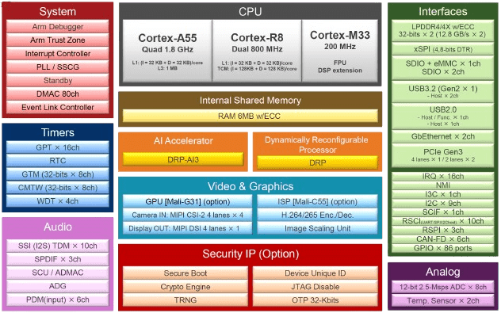

<!-- Copyright 2015-2026 Zephyr Project members and individual contributors. -->
<!-- SPDX-License-Identifier: Apache-2.0 -->
<!-- 中文翻译；编号、导航与译注为本地新增。 -->

<a id="rzv2h_evk"></a>

# 第37章\_RZ/V2H评估板套件

原文：[官方页面](https://docs.zephyrproject.org/latest/boards/renesas/rzv2h_evk/doc/index.html)。读取日期：2026-10-16；来源摘要见[来源记录](../SOURCES.md)。

开发板概览（Board Overview）

<a id="id1"></a>

[](images/rzv2h_evk.webp)

RZ/V2H评估板套件

名称（Name）：

`rzv2h_evk`

厂商（Vendor）：

[瑞萨电子（Renesas Electronics Corporation）](https://docs.zephyrproject.org/latest/boards/index.html#vendor=renesas)

状态（Status）：

维护中（Maintained）

架构（Architecture）：

[arm](https://docs.zephyrproject.org/latest/boards/index.html#arch=arm)

片上系统（SoC）：

[r9a09g057h44gbg](https://docs.zephyrproject.org/latest/boards/index.html#soc=r9a09g057h44gbg)

<a id="board-github-link"></a>

[浏览开发板源码（Browse Board Sources）](https://github.com/zephyrproject-rtos/zephyr/blob/main//boards/renesas/rzv2h_evk/doc/index.rst/../..)<a id="overview"></a>

## 概述（Overview）

RZ/V2H高端AI微处理器配备瑞萨专有的动态可重配置处理器AI加速器（DRP-AI3）、四个1.8 GHz Arm Cortex-A55 Linux处理器，以及两个800 MHz Cortex-R8实时处理器。此外还包含另一个动态可重配置处理器（DRP），可加速OpenCV等图像处理及机器人应用所需的动力学计算。PCIe、USB 3.2及千兆以太网等高速接口，使其适合工厂自动化中的自主机器人和机器视觉等需要低功耗高级AI处理的应用。


- RZ/V2H安全评估板，CPU板


  - 电源管理集成电路（PMIC）：RAA215300
  - 时钟发生器：5L35023B
  - 主存：LPDDR4X，8 GB×2
  - xSPI闪存：64 MB
  - 外部存储：2个Micro SD接口
  - 高速接口：


    - 2个千兆以太网端口
    - USB 3.2 Gen2双通道，仅主机
    - USB 2.0双通道，一个随行即用（On-the-Go，OTG）及一个主机
    - PCIe Gen3一个通道，最多4条Lane
    - 4通道MIPI CSI-2
    - 1通道MIPI DSI
    - GPIO：86针
- RZ/V2H-EVK扩展板，EXP板：


  - 1个HDMI发送接口（Tx）
  - 1通道辅助音频（AUX）连接器
  - 1通道麦克风（MIC）连接器
  - 1通道耳机（HP）连接器
  - 4个Pmod接口

<a id="hardware"></a>

## 硬件（Hardware）

<a id="id12"></a>

瑞萨RZ/V2H文档见[RZ/V2H组网站](https://www.renesas.com/en/products/microcontrollers-microprocessors/rz-mpus/rzv2h-quad-core-vision-ai-mpu-drp-ai3-accelerator-and-high-performance-real-time-processor)[注5](#id11)。

<a id="id2"></a>

[](images/rzv2h_block_diagram.webp)

RZ/V2H框图，图片来源：瑞萨电子

<a id="id10"></a>

板卡详细硬件功能见[RZV2H-EVK网站](https://www.renesas.com/en/products/microcontrollers-microprocessors/rz-mpus/rzv2h-evk-rzv2h-quad-core-vision-ai-mpu-evaluation-kit)[注4](#id9)。

<a id="supported-features"></a>

### 支持的功能（Supported Features）

`rzv2h_evk`开发板支持下表所列的硬件功能。

片上／板载（On-Chip / On-Board）

功能集成在片上系统（SoC）内／位于开发板上。

2 / 2

分别表示已启用／已禁用的实例数。点击数量标签，可查看开发板或SoC设备树源码（DTS）中该功能的第一个实例。

`vnd,foo`

与此功能匹配的设备树绑定兼容字符串（Compatible String）；点击链接可查看绑定文档。

<a id="rzv2h_evk-hw-features"></a>

<a id="rzv2h_evk-rzv2h_evk/r9a09g057h44gbg/cm33-hw-features-section"></a>

#### `rzv2h_evk/r9a09g057h44gbg/cm33`目标（Target）

<a id="rzv2h_evk-rzv2h_evk/r9a09g057h44gbg/cm33-hw-features-panel"></a>

<a id="rzv2h_evk-rzv2h_evk/r9a09g057h44gbg/cm33-hw-features-memory"></a>

此开发板目标的存储器：1032191 B RAM；闪存容量不适用（N/A）。

<a id="rzv2h_evk-rzv2h_evk/r9a09g057h44gbg/cm33-hw-features-table"></a>

<table>
<tr>
<th>类型（Type）</th>
<th>位置（Location）</th>
<th>说明（Description）</th>
<th>兼容字符串（Compatible）</th>
</tr>
<tr>
<td rowspan="1">中央处理器（CPU）</td>
<td>片上（On-Chip）</td>
<td>ARM Cortex-M33处理器（CPU）（<a href="https://github.com/zephyrproject-rtos/zephyr/blob/main/dts/arm/renesas/rz/rzv/r9a09g057_cm33.dtsi?plain=1#L23">已启用：1</a>）</td>
<td><a href="../cpu_arm_riscv_binding_reference/P022_arm_cortex-m33.md#std-dtcompatible-arm-cortex-m33"><code>arm,cortex-m33</code></a></td>
</tr>
<tr>
<td rowspan="1">模数转换器（ADC）</td>
<td>片上（On-Chip）</td>
<td>瑞萨RZ ADC-E模数转换驱动（<a href="https://github.com/zephyrproject-rtos/zephyr/blob/main/dts/arm/renesas/rz/rzv/r9a09g057_cm33.dtsi?plain=1#L839">已启用：1</a>）</td>
<td><a href="../hardware/P872_RenesasRZADCE绑定.md#dtbinding-renesas-rz-adc-e"><code>renesas,rz-adc-e</code></a></td>
</tr>
<tr>
<td rowspan="1">计数器（Counter）</td>
<td>片上（On-Chip）</td>
<td>瑞萨RZ通用定时器（GTM）计数器（<a href="https://github.com/zephyrproject-rtos/zephyr/blob/main/dts/arm/renesas/rz/rzv/r9a09g057_cm33.dtsi?plain=1#L1104">已禁用：8</a>）</td>
<td><a href="../renesas_realtek_counter_binding_reference/P017_renesas_rz-gtm-counter.md#std-dtcompatible-renesas-rz-gtm-counter"><code>renesas,rz-gtm-counter</code></a></td>
</tr>
<tr>
<td rowspan="1">直接存储器访问（DMA）</td>
<td>片上（On-Chip）</td>
<td>RZ直接存储访问（DMA）控制器（<a href="https://github.com/zephyrproject-rtos/zephyr/blob/main/dts/arm/renesas/rz/rzv/r9a09g057_cm33.dtsi?plain=1#L851">已禁用：5</a>）</td>
<td><a href="../nxp_realtek_renesas_dma_binding_reference/P013_renesas_rz-dmac-b.md#std-dtcompatible-renesas-rz-dmac-b"><code>renesas,rz-dmac-b</code></a></td>
</tr>
<tr>
<td rowspan="2">通用输入输出与接插件（GPIO &amp; Headers）</td>
<td>片上（On-Chip）</td>
<td>瑞萨RZ GPIO公共部分（<a href="https://github.com/zephyrproject-rtos/zephyr/blob/main/dts/arm/renesas/rz/rzv/r9a09g057_cm33.dtsi?plain=1#L44">已启用：1</a>）</td>
<td><a href="../gpio_raspberrypi_renesas_binding_reference/P022_renesas_rz-gpio-common.md#std-dtcompatible-renesas-rz-gpio-common"><code>renesas,rz-gpio-common</code></a></td>
</tr>
<tr>
<td>片上（On-Chip）</td>
<td>瑞萨RZ GPIO控制器（<a href="https://github.com/zephyrproject-rtos/zephyr/blob/main/dts/arm/renesas/rz/rzv/r9a09g057_cm33.dtsi?plain=1#L54">已启用：1</a>；<a href="https://github.com/zephyrproject-rtos/zephyr/blob/main/dts/arm/renesas/rz/rzv/r9a09g057_cm33.dtsi?plain=1#L63">已禁用：11</a>）</td>
<td><a href="../gpio_raspberrypi_renesas_binding_reference/P025_renesas_rz-gpio.md#std-dtcompatible-renesas-rz-gpio"><code>renesas,rz-gpio</code></a></td>
</tr>
<tr>
<td rowspan="1">集成电路间总线（I2C）</td>
<td>片上（On-Chip）</td>
<td>瑞萨RZ I2C控制器（<a href="https://github.com/zephyrproject-rtos/zephyr/blob/main/dts/arm/renesas/rz/rzv/r9a09g057_cm33.dtsi?plain=1#L445">已启用：1</a>；<a href="https://github.com/zephyrproject-rtos/zephyr/blob/main/dts/arm/renesas/rz/rzv/r9a09g057_cm33.dtsi?plain=1#L419">已禁用：8</a>）</td>
<td><a href="../i2c_nxp_pico_renesas_binding_reference/P018_renesas_rz-riic.md#std-dtcompatible-renesas-rz-riic"><code>renesas,rz-riic</code></a></td>
</tr>
<tr>
<td rowspan="3">中断控制器（Interrupt Controller）</td>
<td>片上（On-Chip）</td>
<td>ARMv8-M嵌套向量中断控制器（NVIC / Nested Vectored Interrupt Controller）（<a href="https://github.com/zephyrproject-rtos/zephyr/blob/main/dts/arm/armv8-m.dtsi?plain=1#L13">已启用：1</a>）</td>
<td><a href="../arm_interrupt_timer_binding_reference/P003_ARMv8_M_NVIC.md#std-dtcompatible-arm-v8m-nvic"><code>arm,v8m-nvic</code></a></td>
</tr>
<tr>
<td>片上（On-Chip）</td>
<td>瑞萨RZ中断控制器（<a href="https://github.com/zephyrproject-rtos/zephyr/blob/main/dts/arm/renesas/rz/rzv/r9a09g057_cm33.dtsi?plain=1#L536">已启用：1</a>）</td>
<td><a href="../renesas_interrupt_binding_reference/P007_renesas_rz-intc-v2.md#std-dtcompatible-renesas-rz-intc-v2"><code>renesas,rz-intc-v2</code></a></td>
</tr>
<tr>
<td>片上（On-Chip）</td>
<td>瑞萨RZ GPIO中断（TINT）控制器（<a href="https://github.com/zephyrproject-rtos/zephyr/blob/main/dts/arm/renesas/rz/rzv/r9a09g057_cm33.dtsi?plain=1#L550">已禁用：32</a>）</td>
<td><a href="../renesas_interrupt_binding_reference/P009_renesas_rz-tint.md#std-dtcompatible-renesas-rz-tint"><code>renesas,rz-tint</code></a></td>
</tr>
<tr>
<td rowspan="1">发光二极管（LED）</td>
<td>板载（On-Board）</td>
<td>一组由 GPIO 控制的 LED（GPIO-Controlled LEDs）（<a href="https://github.com/zephyrproject-rtos/zephyr/blob/main/boards/renesas/rzv2h_evk/rzv2h_evk_r9a09g057h44gbg_cm33.dts?plain=1#L30">已启用：1</a>）</td>
<td><a href="../hardware/P564_GPIO指示灯绑定.md#dtbinding-gpio-leds"><code>gpio-leds</code></a></td>
</tr>
<tr>
<td rowspan="1">其他绑定（Miscellaneous）</td>
<td>片上（On-Chip）</td>
<td>瑞萨RZ SCI-B控制器（<a href="https://github.com/zephyrproject-rtos/zephyr/blob/main/dts/arm/renesas/rz/rzv/r9a09g057_cm33.dtsi?plain=1#L946">已启用：1</a>；<a href="https://github.com/zephyrproject-rtos/zephyr/blob/main/dts/arm/renesas/rz/rzv/r9a09g057_cm33.dtsi?plain=1#L961">已禁用：9</a>）</td>
<td><a href="../misc_nxp_renesas_zephyr_binding_reference/P028_renesas_rz-sci-b.md#std-dtcompatible-renesas-rz-sci-b"><code>renesas,rz-sci-b</code></a></td>
</tr>
<tr>
<td rowspan="1">内存管理单元／内存保护单元（MMU / MPU）</td>
<td>片上（On-Chip）</td>
<td>ARMv8-M存储器保护单元（MPU / Memory Protection Unit）（<a href="https://github.com/zephyrproject-rtos/zephyr/blob/main/dts/arm/renesas/rz/rzv/r9a09g057_cm33.dtsi?plain=1#L31">已启用：1</a>）</td>
<td><a href="../memory_protection_binding_reference/P007_arm_armv8m-mpu.md#std-dtcompatible-arm-armv8m-mpu"><code>arm,armv8m-mpu</code></a></td>
</tr>
<tr>
<td rowspan="1">引脚控制（Pin Control）</td>
<td>片上（On-Chip）</td>
<td>瑞萨RZ/V引脚控制器（<a href="https://github.com/zephyrproject-rtos/zephyr/blob/main/dts/arm/renesas/rz/rzv/r9a09g057_cm33.dtsi?plain=1#L39">已启用：1</a>）</td>
<td><a href="../pinctrl_renesas_silabs_binding_reference/P019_renesas_rzv-pinctrl.md#std-dtcompatible-renesas-rzv-pinctrl"><code>renesas,rzv-pinctrl</code></a></td>
</tr>
<tr>
<td rowspan="1">脉宽调制（PWM）</td>
<td>片上（On-Chip）</td>
<td>瑞萨RZ通用定时器（GPT）脉宽调制（PWM）（<a href="https://github.com/zephyrproject-rtos/zephyr/blob/main/dts/arm/renesas/rz/rzv/r9a09g057_cm33.dtsi?plain=1#L172">已禁用：16</a>）</td>
<td><a href="../pwm_stm32_ti_generic_binding_reference/P001_renesas_rz-gpt-pwm.md#std-dtcompatible-renesas-rz-gpt-pwm"><code>renesas,rz-gpt-pwm</code></a></td>
</tr>
<tr>
<td rowspan="1">串行控制器（Serial Controller）</td>
<td>片上（On-Chip）</td>
<td>瑞萨RZ SCI-B UART控制器（<a href="https://github.com/zephyrproject-rtos/zephyr/blob/main/dts/arm/renesas/rz/rzv/r9a09g057_cm33.dtsi?plain=1#L954">已启用：1</a>；<a href="https://github.com/zephyrproject-rtos/zephyr/blob/main/dts/arm/renesas/rz/rzv/r9a09g057_cm33.dtsi?plain=1#L969">已禁用：9</a>）</td>
<td><a href="../uart_raspberrypi_realtek_renesas_binding_reference/P014_renesas_rz-sci-b-uart.md#std-dtcompatible-renesas-rz-sci-b-uart"><code>renesas,rz-sci-b-uart</code></a></td>
</tr>
<tr>
<td rowspan="1">串行外设接口（SPI）</td>
<td>片上（On-Chip）</td>
<td>瑞萨RZ SPI B（<a href="https://github.com/zephyrproject-rtos/zephyr/blob/main/dts/arm/renesas/rz/rzv/r9a09g057_cm33.dtsi?plain=1#L1208">已禁用：3</a>）</td>
<td><a href="../spi_flexspi_nxp_renesas_binding_reference/P021_renesas_rz-spi-b.md#std-dtcompatible-renesas-rz-spi-b"><code>renesas,rz-spi-b</code></a></td>
</tr>
<tr>
<td rowspan="1">静态随机存储器（SRAM）</td>
<td>板载（On-Board）</td>
<td>通用片上静态随机存储器（SRAM）（<a href="https://github.com/zephyrproject-rtos/zephyr/blob/main/boards/renesas/rzv2h_evk/rzv2h_evk_r9a09g057h44gbg_cm33.dts?plain=1#L44">已启用：2</a>）</td>
<td><a href="../hardware/P567_内存映射SRAM绑定.md#dtbinding-mmio-sram"><code>mmio-sram</code></a></td>
</tr>
<tr>
<td rowspan="3">定时器（Timer）</td>
<td>片上（On-Chip）</td>
<td>ARMv8-M系统节拍（System Tick）（<a href="https://github.com/zephyrproject-rtos/zephyr/blob/main/dts/arm/armv8-m.dtsi?plain=1#L21">已启用：1</a>）</td>
<td><a href="../arm_interrupt_timer_binding_reference/P007_ARMv8_M_SysTick.md#std-dtcompatible-arm-armv8m-systick"><code>arm,armv8m-systick</code></a></td>
</tr>
<tr>
<td>片上（On-Chip）</td>
<td>瑞萨RZ通用定时器（GPT）（<a href="https://github.com/zephyrproject-rtos/zephyr/blob/main/dts/arm/renesas/rz/rzv/r9a09g057_cm33.dtsi?plain=1#L163">已禁用：16</a>）</td>
<td><a href="../renesas_timer_binding_reference/P006_renesas_rz-gpt.md#std-dtcompatible-renesas-rz-gpt"><code>renesas,rz-gpt</code></a></td>
</tr>
<tr>
<td>片上（On-Chip）</td>
<td>瑞萨RZ GTM定时器（<a href="https://github.com/zephyrproject-rtos/zephyr/blob/main/dts/arm/renesas/rz/rzv/r9a09g057_cm33.dtsi?plain=1#L1096">已禁用：8</a>）</td>
<td><a href="../renesas_timer_binding_reference/P008_renesas_rz-gtm.md#std-dtcompatible-renesas-rz-gtm"><code>renesas,rz-gtm</code></a></td>
</tr>
</table>

<a id="rzv2h_evk-rzv2h_evk/r9a09g057h44gbg/cr8_0-hw-features-section"></a>

#### `rzv2h_evk/r9a09g057h44gbg/cr8_0`目标（Target）

<a id="rzv2h_evk-rzv2h_evk/r9a09g057h44gbg/cr8_0-hw-features-panel"></a>

<a id="rzv2h_evk-rzv2h_evk/r9a09g057h44gbg/cr8_0-hw-features-memory"></a>

该开发板目标的片上存储容量：512 KiB RAM、N/A Flash。

<a id="rzv2h_evk-rzv2h_evk/r9a09g057h44gbg/cr8_0-hw-features-table"></a>

<table>
<tr>
<th>类型（Type）</th>
<th>位置（Location）</th>
<th>说明（Description）</th>
<th>兼容字符串（Compatible）</th>
</tr>
<tr>
<td rowspan="1">中央处理器（CPU）</td>
<td>片上（On-Chip）</td>
<td>Arm Cortex-R8处理器（CPU）（<a href="https://github.com/zephyrproject-rtos/zephyr/blob/main/dts/arm/renesas/rz/rzv/r9a09g057_cr8.dtsi?plain=1#L22">已启用：1</a>）</td>
<td><a href="../cpu_cortex_xtensa_binding_reference/P014_arm_cortex-r8.md#std-dtcompatible-arm-cortex-r8"><code>arm,cortex-r8</code></a></td>
</tr>
<tr>
<td rowspan="1">模数转换器（ADC）</td>
<td>片上（On-Chip）</td>
<td>瑞萨RZ ADC-E模数转换驱动（<a href="https://github.com/zephyrproject-rtos/zephyr/blob/main/dts/arm/renesas/rz/rzv/r9a09g057_cr8.dtsi?plain=1#L201">已启用：1</a>）</td>
<td><a href="../hardware/P872_RenesasRZADCE绑定.md#dtbinding-renesas-rz-adc-e"><code>renesas,rz-adc-e</code></a></td>
</tr>
<tr>
<td rowspan="1">计数器（Counter）</td>
<td>片上（On-Chip）</td>
<td>瑞萨RZ通用定时器（GTM）计数器（<a href="https://github.com/zephyrproject-rtos/zephyr/blob/main/dts/arm/renesas/rz/rzv/r9a09g057_cr8.dtsi?plain=1#L1163">已禁用：8</a>）</td>
<td><a href="../renesas_realtek_counter_binding_reference/P017_renesas_rz-gtm-counter.md#std-dtcompatible-renesas-rz-gtm-counter"><code>renesas,rz-gtm-counter</code></a></td>
</tr>
<tr>
<td rowspan="2">通用输入输出与接插件（GPIO &amp; Headers）</td>
<td>片上（On-Chip）</td>
<td>瑞萨RZ GPIO公共部分（<a href="https://github.com/zephyrproject-rtos/zephyr/blob/main/dts/arm/renesas/rz/rzv/r9a09g057_cr8.dtsi?plain=1#L82">已启用：1</a>）</td>
<td><a href="../gpio_raspberrypi_renesas_binding_reference/P022_renesas_rz-gpio-common.md#std-dtcompatible-renesas-rz-gpio-common"><code>renesas,rz-gpio-common</code></a></td>
</tr>
<tr>
<td>片上（On-Chip）</td>
<td>瑞萨RZ GPIO控制器（<a href="https://github.com/zephyrproject-rtos/zephyr/blob/main/dts/arm/renesas/rz/rzv/r9a09g057_cr8.dtsi?plain=1#L92">已启用：1</a>；<a href="https://github.com/zephyrproject-rtos/zephyr/blob/main/dts/arm/renesas/rz/rzv/r9a09g057_cr8.dtsi?plain=1#L101">已禁用：11</a>）</td>
<td><a href="../gpio_raspberrypi_renesas_binding_reference/P025_renesas_rz-gpio.md#std-dtcompatible-renesas-rz-gpio"><code>renesas,rz-gpio</code></a></td>
</tr>
<tr>
<td rowspan="1">集成电路间总线（I2C）</td>
<td>片上（On-Chip）</td>
<td>瑞萨RZ I2C控制器（<a href="https://github.com/zephyrproject-rtos/zephyr/blob/main/dts/arm/renesas/rz/rzv/r9a09g057_cr8.dtsi?plain=1#L539">已启用：1</a>；<a href="https://github.com/zephyrproject-rtos/zephyr/blob/main/dts/arm/renesas/rz/rzv/r9a09g057_cr8.dtsi?plain=1#L501">已禁用：8</a>）</td>
<td><a href="../i2c_nxp_pico_renesas_binding_reference/P018_renesas_rz-riic.md#std-dtcompatible-renesas-rz-riic"><code>renesas,rz-riic</code></a></td>
</tr>
<tr>
<td rowspan="3">中断控制器（Interrupt Controller）</td>
<td>片上（On-Chip）</td>
<td>ARM通用中断控制器（GIC）v1（<a href="https://github.com/zephyrproject-rtos/zephyr/blob/main/dts/arm/renesas/rz/rzv/r9a09g057_cr8.dtsi?plain=1#L56">已启用：1</a>）</td>
<td><a href="../interrupt_fabric_binding_reference/P002_arm_gic-v1.md#std-dtcompatible-arm-gic-v1"><code>arm,gic-v1</code></a></td>
</tr>
<tr>
<td>片上（On-Chip）</td>
<td>瑞萨RZ中断控制器（<a href="https://github.com/zephyrproject-rtos/zephyr/blob/main/dts/arm/renesas/rz/rzv/r9a09g057_cr8.dtsi?plain=1#L672">已启用：1</a>）</td>
<td><a href="../renesas_interrupt_binding_reference/P007_renesas_rz-intc-v2.md#std-dtcompatible-renesas-rz-intc-v2"><code>renesas,rz-intc-v2</code></a></td>
</tr>
<tr>
<td>片上（On-Chip）</td>
<td>瑞萨RZ GPIO中断（TINT）控制器（<a href="https://github.com/zephyrproject-rtos/zephyr/blob/main/dts/arm/renesas/rz/rzv/r9a09g057_cr8.dtsi?plain=1#L686">已禁用：32</a>）</td>
<td><a href="../renesas_interrupt_binding_reference/P009_renesas_rz-tint.md#std-dtcompatible-renesas-rz-tint"><code>renesas,rz-tint</code></a></td>
</tr>
<tr>
<td rowspan="1">发光二极管（LED）</td>
<td>板载（On-Board）</td>
<td>一组由 GPIO 控制的 LED（GPIO-Controlled LEDs）（<a href="https://github.com/zephyrproject-rtos/zephyr/blob/main/boards/renesas/rzv2h_evk/rzv2h_evk_r9a09g057h44gbg_cr8_0.dts?plain=1#L29">已启用：1</a>）</td>
<td><a href="../hardware/P564_GPIO指示灯绑定.md#dtbinding-gpio-leds"><code>gpio-leds</code></a></td>
</tr>
<tr>
<td rowspan="1">其他绑定（Miscellaneous）</td>
<td>片上（On-Chip）</td>
<td>瑞萨RZ SCI-B控制器（<a href="https://github.com/zephyrproject-rtos/zephyr/blob/main/dts/arm/renesas/rz/rzv/r9a09g057_cr8.dtsi?plain=1#L975">已启用：1</a>；<a href="https://github.com/zephyrproject-rtos/zephyr/blob/main/dts/arm/renesas/rz/rzv/r9a09g057_cr8.dtsi?plain=1#L993">已禁用：9</a>）</td>
<td><a href="../misc_nxp_renesas_zephyr_binding_reference/P028_renesas_rz-sci-b.md#std-dtcompatible-renesas-rz-sci-b"><code>renesas,rz-sci-b</code></a></td>
</tr>
<tr>
<td rowspan="1">引脚控制（Pin Control）</td>
<td>片上（On-Chip）</td>
<td>瑞萨RZ/V引脚控制器（<a href="https://github.com/zephyrproject-rtos/zephyr/blob/main/dts/arm/renesas/rz/rzv/r9a09g057_cr8.dtsi?plain=1#L33">已启用：1</a>）</td>
<td><a href="../pinctrl_renesas_silabs_binding_reference/P019_renesas_rzv-pinctrl.md#std-dtcompatible-renesas-rzv-pinctrl"><code>renesas,rzv-pinctrl</code></a></td>
</tr>
<tr>
<td rowspan="1">脉宽调制（PWM）</td>
<td>片上（On-Chip）</td>
<td>瑞萨RZ通用定时器（GPT）脉宽调制（PWM）（<a href="https://github.com/zephyrproject-rtos/zephyr/blob/main/dts/arm/renesas/rz/rzv/r9a09g057_cr8.dtsi?plain=1#L224">已禁用：16</a>）</td>
<td><a href="../pwm_stm32_ti_generic_binding_reference/P001_renesas_rz-gpt-pwm.md#std-dtcompatible-renesas-rz-gpt-pwm"><code>renesas,rz-gpt-pwm</code></a></td>
</tr>
<tr>
<td rowspan="1">串行控制器（Serial Controller）</td>
<td>片上（On-Chip）</td>
<td>瑞萨RZ SCI-B UART控制器（<a href="https://github.com/zephyrproject-rtos/zephyr/blob/main/dts/arm/renesas/rz/rzv/r9a09g057_cr8.dtsi?plain=1#L986">已启用：1</a>；<a href="https://github.com/zephyrproject-rtos/zephyr/blob/main/dts/arm/renesas/rz/rzv/r9a09g057_cr8.dtsi?plain=1#L1004">已禁用：9</a>）</td>
<td><a href="../uart_raspberrypi_realtek_renesas_binding_reference/P014_renesas_rz-sci-b-uart.md#std-dtcompatible-renesas-rz-sci-b-uart"><code>renesas,rz-sci-b-uart</code></a></td>
</tr>
<tr>
<td rowspan="3">定时器（Timer）</td>
<td>片上（On-Chip）</td>
<td>每个内核独立的ARM架构定时器（Architected Timer）（<a href="https://github.com/zephyrproject-rtos/zephyr/blob/main/dts/arm/renesas/rz/rzv/r9a09g057_cr8.dtsi?plain=1#L44">已启用：1</a>）</td>
<td><a href="../arm_interrupt_timer_binding_reference/P010_ARMv8架构定时器.md#std-dtcompatible-arm-armv8-timer"><code>arm,armv8-timer</code></a></td>
</tr>
<tr>
<td>片上（On-Chip）</td>
<td>瑞萨RZ通用定时器（GPT）（<a href="https://github.com/zephyrproject-rtos/zephyr/blob/main/dts/arm/renesas/rz/rzv/r9a09g057_cr8.dtsi?plain=1#L213">已禁用：16</a>）</td>
<td><a href="../renesas_timer_binding_reference/P006_renesas_rz-gpt.md#std-dtcompatible-renesas-rz-gpt"><code>renesas,rz-gpt</code></a></td>
</tr>
<tr>
<td>片上（On-Chip）</td>
<td>瑞萨RZ GTM定时器（<a href="https://github.com/zephyrproject-rtos/zephyr/blob/main/dts/arm/renesas/rz/rzv/r9a09g057_cr8.dtsi?plain=1#L1155">已禁用：8</a>）</td>
<td><a href="../renesas_timer_binding_reference/P008_renesas_rz-gtm.md#std-dtcompatible-renesas-rz-gtm"><code>renesas,rz-gtm</code></a></td>
</tr>
</table>

<a id="connections-and-ios"></a>

### 连接与输入输出（Connections and IOs）

开发板默认配置为：

<a id="sci-uart"></a>

#### SCI_UART


- SCI_UART0:

  > - TX：Pmod 3A第2针
  > - RX：Pmod 3A第3针

<a id="led"></a>

#### 发光二极管（LED）


- LED5，黄色：P0_0
- LED6，黄色：P0_1

<a id="programming-and-debugging-m33-r8"></a>

## 编程与调试：M33／R8

`rzv2h_evk`开发板支持下表所列的运行工具（Runners）及相关west命令。

<table>
<tr>
<th></th>
<th>烧录（flash）</th>
<th>调试（debug）</th>
<th>连接调试会话（attach）</th>
<th>实时传输（rtt）</th>
<th>复位（reset）</th>
<th>调试服务器（debugserver）</th>
</tr>
<tr>
<td><a href="https://docs.zephyrproject.org/latest/develop/flash_debug/host-tools.html#runner-jlink">jlink</a></td>
<td>✅（默认 / default）</td>
<td>✅（默认 / default）</td>
<td>✅</td>
<td>✅</td>
<td>✅</td>
<td>✅</td>
</tr>
</table>

rzv2h_evk应用可按“构建应用”中的常规方式构建。（[构建应用（Building an Application）](../application/P001_应用开发.md#build-an-application)）

<a id="console"></a>

### 控制台（Console）

将[Pmod USBUART](https://store.digilentinc.com/pmod-usbuart-usb-to-uart-interface/)连接到Pmod Type 3A上侧，即可访问Cortex-M33／Cortex-R8系统核的UART端口。

<a id="debugging"></a>

### 调试（Debugging）

可使用J-Link调试器及[J-Link Debug Host Tools](https://docs.zephyrproject.org/latest/develop/flash_debug/host-tools.html#jlink-debug-host-tools)，将Zephyr应用二进制加载到此板内部SRAM，并在Cortex-M33／Cortex-R8系统核上执行。

以下为构建并调试[Hello World](../getting_started/P005_HelloWorld示例.md#hello_world)应用的示例。

CM33:

```text
# From the root of the zephyr repository
west build -b rzv2h_evk/r9a09g057h44gbg/cm33 samples/hello_world
west debug
```

CR8:

```text
# From the root of the zephyr repository
west build -b rzv2h_evk/r9a09g057h44gbg/cr8_0 samples/hello_world
west debug
```

<a id="flashing"></a>

### 烧录（Flashing）

RZ/V2H-EVK设计为在不同内核运行不同系统。它使用Yocto构建Linux及引导加载程序，并通过U-Boot在Cortex-M33／Cortex-R8上运行Zephyr，最少步骤如下。


1. <a id="id4"></a>

  从《[RZ/V2H简易下载指南](https://www.renesas.com/en/document/gde/rzv2h-easy-download-guide)》[注1](#id3)下载多操作系统软件包（Multi-OS Package）。
2. 解压Multi-OS Package，打开名为r01qs0077ej****-rzv2h-multi-os-pkg的PDF。
3. 按“3.2 Integration of Multi-OS Package related stuff”构建RZ/V2H AI SDK源码。在meta-rz-features/meta-rz-multi-os/meta-rzv2h/conf/layer.conf中取消以下行的注释。

```text
#MACHINE_FEATURES_append = " RZV2H_CM33_BOOT"
MACHINE_FEATURES_append = " SRAM_REGION_ACCESS"
#MACHINE_FEATURES_append = " CM33_FIRMWARE_LOAD"
#MACHINE_FEATURES_append = " CA55_CPU_CLOCKUP"
```

下列必需产物位于build/tmp/deploy/image：

<table>
<tr>
<th>构建产物（Artifacts）</th>
<th>文件名</th>
</tr>
<tr>
<td>引导加载程序（Boot Loader）</td>
<td>bl2_bp_spi-rzv2h-evk-ver1.srec<br><br>fip-rzv2h-evk-ver1.srec</td>
</tr>
<tr>
<td>闪存写入工具（Flash Writer）</td>
<td>Flash_Writer_SCIF_RZV2H_DEV_INTERNAL_MEMORY.mot</td>
</tr>
<tr>
<td>SD卡镜像</td>
<td>core-image-weston-rzv2h-evk-ver1.wic.bmap<br><br>core-image-weston-rzv2h-evk-ver1.wic.gz</td>
</tr>
</table>


1. <a id="id6"></a>

  按“[Step 7 Deploy AI Application](https://renesas-rz.github.io/rzv_ai_sdk/5.00/getting_started_v2h.html#step7)”[注2](#id5)中“1-B Write the Linux files to SD card”的第1～9步准备SD卡。
2. 运行以下命令将zephyr.bin写入SD卡。

```text
$ sudo mkdir /mnt/sd -p
$ sudo mount /dev/sdb2 /mnt/sd
$ sudo cp /path/to/zephyr.bin /mnt/sd/boot
$ sync
$ sudo umount /mnt/sd
```

警告（Warning）

将命令中的/dev/sdb替换为实际microSD卡设备名。原文建议使用dh -h检查；该命令拼写有疑点，此处保留提示。


1. 将SD卡插入RZ/V2H EVK的SD1，设为eSD模式：DSW1[4:5]依次ON、OFF。
2. <a id="id8"></a>

  按《灵活配置软件包入门》[注3](#id7)的“3.2.2.4 Power Supply”谨慎上电，随后应在RZ/V2H EVK的CN12对应控制台看到以下消息。（[灵活配置软件包（FSP）入门](https://www.renesas.com/en/document/apn/rzv-getting-started-flexible-software-package)）

```text
U-Boot 2021.10 (Jun 14 2024 - 18:14:19 +0000)
CPU: Renesas Electronics CPU rev 1.0
Model: Renesas EVK Version 1 based on r9a09g057h4
DRAM: 15.9 GiB
MMC: mmc@15c00000: 0, mmc@15c10000: 1(snip)
Net: eth0: ethernet@15c30000, eth1: ethernet@15c40000
Hit any key to stop autoboot: 3
```


1. 在3秒内按任意键停止自动启动。
2. 执行以下U-Boot设置，启动CM33／CR8内核。

CM33:

```text
=> setenv cm33start 'dcache off
=> mw.l 0x10420D2C 0x02000000
=> mw.l 0x1043080c 0x08003000
=> mw.l 0x10430810 0x18003000
=> mw.l 0x10420604 0x00040004
=> mw.l 0x10420C1C 0x00003100
=> mw.l 0x10420C0C 0x00000001
=> mw.l 0x10420904 0x00380008
=> mw.l 0x10420904 0x00380038
=> ext4load mmc 0:2 0x08003000 boot/zephyr.bin
=> mw.l 0x10420C0C 0x00000000
=> dcache on'
=> saveenv
=> run cm33start
```

CR8:

```text
=> setenv cr8start 'dcache off
=> mw.l 0x10420D24 0x04000000
=> mw.l 0x10420600 0xE000E000
=> mw.l 0x10420604 0x00030003
=> mw.l 0x10420908 0x1FFF0000
=> mw.l 0x10420C44 0x003F0000
=> mw.l 0x10420C14 0x00000000
=> mw.l 0x10420908 0x10001000
=> mw.l 0x10420C48 0x00000020
=> mw.l 0x10420908 0x1FFF1FFF
=> mw.l 0x10420C48 0x00000000
=> ext4load mmc 0:2 0x12040000 boot/zephyr.bin
=> mw.l 0x10420C14 0x00000003
=> dcache on'
=> saveenv
=> run cr8start
```

<a id="references"></a>

## 参考资料（References）

<a id="id3"></a>

〔[1](#id4)〕 [https://www.renesas.com/en/document/gde/rzv2h-easy-download-guide](https://www.renesas.com/en/document/gde/rzv2h-easy-download-guide)

<a id="id5"></a>

〔[2](#id6)〕 [https://renesas-rz.github.io/rzv_ai_sdk/5.00/getting_started_v2h.html#step7](https://renesas-rz.github.io/rzv_ai_sdk/5.00/getting_started_v2h.html#step7)

<a id="id7"></a>

〔[3](#id8)〕 [https://www.renesas.com/en/document/apn/rzv-getting-started-flexible-software-package](https://www.renesas.com/en/document/apn/rzv-getting-started-flexible-software-package)

<a id="id9"></a>

〔[4](#id10)〕 [https://www.renesas.com/en/products/microcontrollers-microprocessors/rz-mpus/rzv2h-evk-rzv2h-quad-core-vision-ai-mpu-evaluation-kit](https://www.renesas.com/en/products/microcontrollers-microprocessors/rz-mpus/rzv2h-evk-rzv2h-quad-core-vision-ai-mpu-evaluation-kit)

<a id="id11"></a>

〔[5](#id12)〕 [https://www.renesas.com/en/products/microcontrollers-microprocessors/rz-mpus/rzv2h-quad-core-vision-ai-mpu-drp-ai3-accelerator-and-high-performance-real-time-processor](https://www.renesas.com/en/products/microcontrollers-microprocessors/rz-mpus/rzv2h-quad-core-vision-ai-mpu-drp-ai3-accelerator-and-high-performance-real-time-processor)

## 译注

RZ/V2H保留CM33及CR8两个目标，以及原文LPDDR4X 8 GB×2数值。build/tmp/deploy/image的单数形式按来源保留。

## 原文外链核对

2026-10-16核对并重试以下原文外链时未能确认可访问性，保留原始目标，不将访问失败解释为原文内容有误。

- [](https://store.digilentinc.com/pmod-usbuart-usb-to-uart-interface/)：HTTP Error 403: Forbidden。
- [rzv2h-easy-download-guide](https://www.renesas.com/en/document/gde/rzv2h-easy-download-guide)：HTTP Error 429: Too Many Requests。
- [rzv2h-evk-rzv2h-quad-core-vision-ai-mpu-evaluation-kit](https://www.renesas.com/en/products/microcontrollers-microprocessors/rz-mpus/rzv2h-evk-rzv2h-quad-core-vision-ai-mpu-evaluation-kit)：HTTP Error 429: Too Many Requests。
- [rzv2h-quad-core-vision-ai-mpu-drp-ai3-accelerator-and-high-performance-real-time-processor](https://www.renesas.com/en/products/microcontrollers-microprocessors/rz-mpus/rzv2h-quad-core-vision-ai-mpu-drp-ai3-accelerator-and-high-performance-real-time-processor)：HTTP Error 429: Too Many Requests。

---

[上一章](P036_Renesas_Starter_Kit_for_RZ_T2M.md) · [返回大纲](大纲.md) · [全站翻译进度](../PROGRESS.md) · [下一章](P038_RZ_V2L_SMARC_Evaluation_Board_Kit.md)
