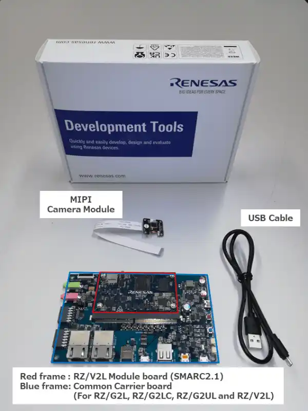
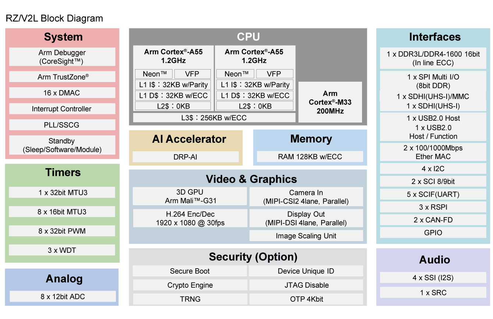

<!-- Copyright 2015-2026 Zephyr Project members and individual contributors. -->
<!-- SPDX-License-Identifier: Apache-2.0 -->
<!-- 中文翻译；编号、导航与译注为本地新增。 -->

<a id="rzv2l_smarc"></a>

# 第38章\_RZ/V2L SMARC评估板套件

原文：[官方页面](https://docs.zephyrproject.org/latest/boards/renesas/rzv2l_smarc/doc/index.html)。读取日期：2026-10-16；来源摘要见[来源记录](../SOURCES.md)。

开发板概览（Board Overview）

<a id="id1"></a>

[](images/rzv2l_smarc.webp)

RZ/V2L SMARC评估板套件

名称（Name）：

`rzv2l_smarc`

厂商（Vendor）：

[瑞萨电子（Renesas Electronics Corporation）](https://docs.zephyrproject.org/latest/boards/index.html#vendor=renesas)

状态（Status）：

维护中（Maintained）

架构（Architecture）：

[arm](https://docs.zephyrproject.org/latest/boards/index.html#arch=arm)

片上系统（SoC）：

[r9a07g054l23gbg](https://docs.zephyrproject.org/latest/boards/index.html#soc=r9a07g054l23gbg)

<a id="board-github-link"></a>

[浏览开发板源码（Browse Board Sources）](https://github.com/zephyrproject-rtos/zephyr/blob/main//boards/renesas/rzv2l_smarc/doc/index.rst/../..)<a id="overview"></a>

## 概述（Overview）

瑞萨RZ/V2L SMARC评估板套件RZ/V2L-EVKIT由SMARC v2.1模块板及载板组成。


- 器件：RZ/V2L R9A07G054L23GBG


  - 双核Cortex-A55及Cortex-M33
  - 551引脚BGA，15 mm方形本体，0.5 mm间距
- SMARC v2.1模块板功能


  - DDR4 SDRAM：2 GB×1颗
  - QSPI闪存：512 Mb×1颗
  - eMMC：64 GB×1颗
  - 配备microSD卡槽，作为启动用eSD
  - 配备五路输出时钟振荡器[5P35023](https://www.renesas.com/en/products/clocks-timing/clock-generation/programmable-clocks/5p35023-versaclock-3s-programmable-clock-generator)
  - 配备电源管理集成电路（PMIC）[RAA215300](https://www.renesas.com/en/products/power-management/multi-channel-power-management-ics-pmics/raa215300-high-performance-9-channel-pmic-supporting-ddr-memory-built-charger-and-rtc)
- 载板功能（Carrier Board Functions）


  - 标准配置FFC／FPC连接器，用于连接摄像头模块的高速串行接口。
  - 标准配置Micro-HDMI连接器，通过DSI／HDMI转换模块连接数字视频模块的高速串行接口。
  - USB接口标准配置为Micro-AB插座，通道0、USB 2.0 OTG，以及Type-A插座，通道1、USB 2.0主机。
  - 标准配置RJ45连接器，用于以太网软件开发及评估。
  - 标准配置音频编解码器，支持音频系统的前期开发；配备音频插孔以连接音频接口。
  - 配备CAN连接器，用于连接CAN总线接口。
  - 配备Micro-AB插座，用于连接异步串行端口接口。
  - 配备microSD卡槽及两个Pmod插座，作为RZ/V2L外设接口。
  - 供电用USB Type-C插座支持USB电力传输（USB PD）标准。
- MIPI摄像头模块


  - 套件包含MIPI CSI摄像头模块，可使用MIPI摄像头输入的图像进行图像识别处理。

<a id="hardware"></a>

## 硬件（Hardware）

<a id="id4"></a>

瑞萨RZ/V2L MPU文档见[RZ/V2L组网站](https://www.renesas.com/en/products/rz-v2l)[注1](#id3)。

<a id="id2"></a>

[](images/rzv2l_block_diagram.webp)

RZ/V2L框图，图片来源：瑞萨电子

<a id="id6"></a>

板卡详细硬件功能见[RZV2L-EVKIT网站](https://www.renesas.com/en/design-resources/boards-kits/rz-v2l-evkit)[注2](#id5)。

<a id="multi-os-processing"></a>

## 多操作系统处理（Multi-OS Processing）

RZ/V2L-EVKIT可在RZ/V2L SoC上执行不同应用。借助多核架构，各核可独立执行定制任务，或通过OpenAMP框架交换数据，参见[OpenAMP Linux Zephyr RPMsg](../intercore_reference/P091_RenesasLinux与Zephyr通信示例.md#rz-openamp-linux-zephyr)示例。

<a id="supported-features"></a>

### 支持的功能（Supported Features）

`rzv2l_smarc`开发板支持下表所列的硬件功能。

片上／板载（On-Chip / On-Board）

功能集成在片上系统（SoC）内／位于开发板上。

2 / 2

分别表示已启用／已禁用的实例数。点击数量标签，可查看开发板或SoC设备树源码（DTS）中该功能的第一个实例。

`vnd,foo`

与此功能匹配的设备树绑定兼容字符串（Compatible String）；点击链接可查看绑定文档。

<a id="rzv2l_smarc-hw-features"></a>

<a id="rzv2l_smarc-rzv2l_smarc/r9a07g054l23gbg/cm33-hw-features-section"></a>

#### `rzv2l_smarc/r9a07g054l23gbg/cm33`目标（Target）

<a id="rzv2l_smarc-rzv2l_smarc/r9a07g054l23gbg/cm33-hw-features-panel"></a>

<a id="rzv2l_smarc-rzv2l_smarc/r9a07g054l23gbg/cm33-hw-features-memory"></a>

此开发板目标的存储器：46 MiB RAM；闪存容量不适用（N/A）。

<a id="rzv2l_smarc-rzv2l_smarc/r9a07g054l23gbg/cm33-hw-features-table"></a>

<table>
<tr>
<th>类型（Type）</th>
<th>位置（Location）</th>
<th>说明（Description）</th>
<th>兼容字符串（Compatible）</th>
</tr>
<tr>
<td rowspan="1">中央处理器（CPU）</td>
<td>片上（On-Chip）</td>
<td>ARM Cortex-M33处理器（CPU）（<a href="https://github.com/zephyrproject-rtos/zephyr/blob/main/dts/arm/renesas/rz/rzv/r9a07g054.dtsi?plain=1#L24">已启用：1</a>）</td>
<td><a href="../cpu_arm_riscv_binding_reference/P022_arm_cortex-m33.md#std-dtcompatible-arm-cortex-m33"><code>arm,cortex-m33</code></a></td>
</tr>
<tr>
<td rowspan="1">模数转换器（ADC）</td>
<td>片上（On-Chip）</td>
<td>瑞萨RZ ADC-C模数转换驱动（<a href="https://github.com/zephyrproject-rtos/zephyr/blob/main/dts/arm/renesas/rz/rzv/r9a07g054.dtsi?plain=1#L51">已启用：1</a>）</td>
<td><a href="../hardware/P871_RenesasRZADCC绑定.md#dtbinding-renesas-rz-adc-c"><code>renesas,rz-adc-c</code></a></td>
</tr>
<tr>
<td rowspan="2">时钟控制（Clock Control）</td>
<td>片上（On-Chip）</td>
<td>瑞萨RZ时钟脉冲发生器（CPG）（<a href="https://github.com/zephyrproject-rtos/zephyr/blob/main/dts/arm/renesas/rz/rzv/r9a07g054.dtsi?plain=1#L62">已启用：1</a>）</td>
<td><a href="../clock_renesas_rockchip_sifli_silabs_binding_reference/P017_renesas_rz-cpg.md#std-dtcompatible-renesas-rz-cpg"><code>renesas,rz-cpg</code></a></td>
</tr>
<tr>
<td>片上（On-Chip）</td>
<td>通用固定频率时钟提供者（Fixed-Rate Clock Provider）（<a href="https://github.com/zephyrproject-rtos/zephyr/blob/main/dts/arm/renesas/rz/rzv/r9a07g054.dtsi?plain=1#L68">已启用：21</a>）</td>
<td><a href="../hardware/P566_固定时钟绑定.md#dtbinding-fixed-clock"><code>fixed-clock</code></a></td>
</tr>
<tr>
<td rowspan="1">计数器（Counter）</td>
<td>片上（On-Chip）</td>
<td>瑞萨RZ通用定时器（GTM）计数器（<a href="https://github.com/zephyrproject-rtos/zephyr/blob/main/dts/arm/renesas/rz/rzv/r9a07g054.dtsi?plain=1#L1388">已禁用：3</a>）</td>
<td><a href="../renesas_realtek_counter_binding_reference/P017_renesas_rz-gtm-counter.md#std-dtcompatible-renesas-rz-gtm-counter"><code>renesas,rz-gtm-counter</code></a></td>
</tr>
<tr>
<td rowspan="1">直接存储器访问（DMA）</td>
<td>片上（On-Chip）</td>
<td>RZ直接存储访问（DMA）控制器（<a href="https://github.com/zephyrproject-rtos/zephyr/blob/main/dts/arm/renesas/rz/rzv/r9a07g054.dtsi?plain=1#L641">已禁用：2</a>）</td>
<td><a href="../nxp_realtek_renesas_dma_binding_reference/P013_renesas_rz-dmac-b.md#std-dtcompatible-renesas-rz-dmac-b"><code>renesas,rz-dmac-b</code></a></td>
</tr>
<tr>
<td rowspan="2">通用输入输出与接插件（GPIO &amp; Headers）</td>
<td>片上（On-Chip）</td>
<td>瑞萨RZ GPIO公共部分（<a href="https://github.com/zephyrproject-rtos/zephyr/blob/main/dts/arm/renesas/rz/rzv/r9a07g054.dtsi?plain=1#L189">已启用：1</a>）</td>
<td><a href="../gpio_raspberrypi_renesas_binding_reference/P022_renesas_rz-gpio-common.md#std-dtcompatible-renesas-rz-gpio-common"><code>renesas,rz-gpio-common</code></a></td>
</tr>
<tr>
<td>片上（On-Chip）</td>
<td>瑞萨RZ GPIO控制器（<a href="https://github.com/zephyrproject-rtos/zephyr/blob/main/dts/arm/renesas/rz/rzv/r9a07g054.dtsi?plain=1#L199">已禁用：49</a>）</td>
<td><a href="../gpio_raspberrypi_renesas_binding_reference/P025_renesas_rz-gpio.md#std-dtcompatible-renesas-rz-gpio"><code>renesas,rz-gpio</code></a></td>
</tr>
<tr>
<td rowspan="1">集成电路间总线（I2C）</td>
<td>片上（On-Chip）</td>
<td>瑞萨RZ I2C控制器（<a href="https://github.com/zephyrproject-rtos/zephyr/blob/main/dts/arm/renesas/rz/rzv/r9a07g054.dtsi?plain=1#L1277">已启用：1</a>；<a href="https://github.com/zephyrproject-rtos/zephyr/blob/main/dts/arm/renesas/rz/rzv/r9a07g054.dtsi?plain=1#L1238">已禁用：3</a>）</td>
<td><a href="../i2c_nxp_pico_renesas_binding_reference/P018_renesas_rz-riic.md#std-dtcompatible-renesas-rz-riic"><code>renesas,rz-riic</code></a></td>
</tr>
<tr>
<td rowspan="4">中断控制器（Interrupt Controller）</td>
<td>片上（On-Chip）</td>
<td>ARMv8-M嵌套向量中断控制器（NVIC / Nested Vectored Interrupt Controller）（<a href="https://github.com/zephyrproject-rtos/zephyr/blob/main/dts/arm/armv8-m.dtsi?plain=1#L13">已启用：1</a>）</td>
<td><a href="../arm_interrupt_timer_binding_reference/P003_ARMv8_M_NVIC.md#std-dtcompatible-arm-v8m-nvic"><code>arm,v8m-nvic</code></a></td>
</tr>
<tr>
<td>片上（On-Chip）</td>
<td>瑞萨RZ中断控制器（<a href="https://github.com/zephyrproject-rtos/zephyr/blob/main/dts/arm/renesas/rz/rzv/r9a07g054.dtsi?plain=1#L870">已启用：1</a>）</td>
<td><a href="../renesas_interrupt_binding_reference/P008_renesas_rz-intc.md#std-dtcompatible-renesas-rz-intc"><code>renesas,rz-intc</code></a></td>
</tr>
<tr>
<td>片上（On-Chip）</td>
<td>瑞萨RZ外部中断控制器（<a href="https://github.com/zephyrproject-rtos/zephyr/blob/main/dts/arm/renesas/rz/rzv/r9a07g054.dtsi?plain=1#L885">已禁用：8</a>）</td>
<td><a href="../renesas_interrupt_binding_reference/P004_renesas_rz-ext-irq.md#std-dtcompatible-renesas-rz-ext-irq"><code>renesas,rz-ext-irq</code></a></td>
</tr>
<tr>
<td>片上（On-Chip）</td>
<td>瑞萨RZ GPIO中断（TINT）控制器（<a href="https://github.com/zephyrproject-rtos/zephyr/blob/main/dts/arm/renesas/rz/rzv/r9a07g054.dtsi?plain=1#L949">已禁用：32</a>）</td>
<td><a href="../renesas_interrupt_binding_reference/P009_renesas_rz-tint.md#std-dtcompatible-renesas-rz-tint"><code>renesas,rz-tint</code></a></td>
</tr>
<tr>
<td rowspan="1">邮箱（Mailbox）</td>
<td>片上（On-Chip）</td>
<td>瑞萨消息处理单元（MHU）邮箱（MBOX）（<a href="https://github.com/zephyrproject-rtos/zephyr/blob/main/dts/arm/renesas/rz/rzv/r9a07g054.dtsi?plain=1#L1291">已禁用：4</a>）</td>
<td><a href="../intercore_reference/P053_RenesasRZ邮箱绑定.md#dtbinding-renesas-rz-mhu-mbox"><code>renesas,rz-mhu-mbox</code></a></td>
</tr>
<tr>
<td rowspan="1">内存管理单元／内存保护单元（MMU / MPU）</td>
<td>片上（On-Chip）</td>
<td>ARMv8-M存储器保护单元（MPU / Memory Protection Unit）（<a href="https://github.com/zephyrproject-rtos/zephyr/blob/main/dts/arm/renesas/rz/rzv/r9a07g054.dtsi?plain=1#L32">已启用：1</a>）</td>
<td><a href="../memory_protection_binding_reference/P007_arm_armv8m-mpu.md#std-dtcompatible-arm-armv8m-mpu"><code>arm,armv8m-mpu</code></a></td>
</tr>
<tr>
<td rowspan="1">引脚控制（Pin Control）</td>
<td>片上（On-Chip）</td>
<td>瑞萨RZ/V引脚控制器（<a href="https://github.com/zephyrproject-rtos/zephyr/blob/main/dts/arm/renesas/rz/rzv/r9a07g054.dtsi?plain=1#L46">已启用：1</a>）</td>
<td><a href="../pinctrl_renesas_silabs_binding_reference/P019_renesas_rzv-pinctrl.md#std-dtcompatible-renesas-rzv-pinctrl"><code>renesas,rzv-pinctrl</code></a></td>
</tr>
<tr>
<td rowspan="1">脉宽调制（PWM）</td>
<td>片上（On-Chip）</td>
<td>瑞萨RZ通用定时器（GPT）脉宽调制（PWM）（<a href="https://github.com/zephyrproject-rtos/zephyr/blob/main/dts/arm/renesas/rz/rzv/r9a07g054.dtsi?plain=1#L737">已禁用：8</a>）</td>
<td><a href="../pwm_stm32_ti_generic_binding_reference/P001_renesas_rz-gpt-pwm.md#std-dtcompatible-renesas-rz-gpt-pwm"><code>renesas,rz-gpt-pwm</code></a></td>
</tr>
<tr>
<td rowspan="1">串行控制器（Serial Controller）</td>
<td>片上（On-Chip）</td>
<td>瑞萨RZ串行通信接口（SCIF）UART控制器（<a href="https://github.com/zephyrproject-rtos/zephyr/blob/main/dts/arm/renesas/rz/rzv/r9a07g054.dtsi?plain=1#L699">已启用：1</a>；<a href="https://github.com/zephyrproject-rtos/zephyr/blob/main/dts/arm/renesas/rz/rzv/r9a07g054.dtsi?plain=1#L681">已禁用：4</a>）</td>
<td><a href="../uart_raspberrypi_realtek_renesas_binding_reference/P016_renesas_rz-scif-uart.md#std-dtcompatible-renesas-rz-scif-uart"><code>renesas,rz-scif-uart</code></a></td>
</tr>
<tr>
<td rowspan="1">串行外设接口（SPI）</td>
<td>片上（On-Chip）</td>
<td>瑞萨RZ SPI（<a href="https://github.com/zephyrproject-rtos/zephyr/blob/main/dts/arm/renesas/rz/rzv/r9a07g054.dtsi?plain=1#L1353">已启用：1</a>；<a href="https://github.com/zephyrproject-rtos/zephyr/blob/main/dts/arm/renesas/rz/rzv/r9a07g054.dtsi?plain=1#L1342">已禁用：2</a>）</td>
<td><a href="../spi_flexspi_nxp_renesas_binding_reference/P020_renesas_rz-rspi.md#std-dtcompatible-renesas-rz-rspi"><code>renesas,rz-rspi</code></a></td>
</tr>
<tr>
<td rowspan="1">静态随机存储器（SRAM）</td>
<td>板载（On-Board）</td>
<td>通用片上静态随机存储器（SRAM）（<a href="https://github.com/zephyrproject-rtos/zephyr/blob/main/boards/renesas/rzv2l_smarc/rzv2l_smarc_r9a07g054l23gbg_cm33.dts?plain=1#L28">已启用：1</a>）</td>
<td><a href="../hardware/P567_内存映射SRAM绑定.md#dtbinding-mmio-sram"><code>mmio-sram</code></a></td>
</tr>
<tr>
<td rowspan="4">定时器（Timer）</td>
<td>片上（On-Chip）</td>
<td>ARMv8-M系统节拍（System Tick）（<a href="https://github.com/zephyrproject-rtos/zephyr/blob/main/dts/arm/armv8-m.dtsi?plain=1#L21">已启用：1</a>）</td>
<td><a href="../arm_interrupt_timer_binding_reference/P007_ARMv8_M_SysTick.md#std-dtcompatible-arm-armv8m-systick"><code>arm,armv8m-systick</code></a></td>
</tr>
<tr>
<td>片上（On-Chip）</td>
<td>瑞萨RZ通用定时器（GPT）（<a href="https://github.com/zephyrproject-rtos/zephyr/blob/main/dts/arm/renesas/rz/rzv/r9a07g054.dtsi?plain=1#L726">已禁用：8</a>）</td>
<td><a href="../renesas_timer_binding_reference/P006_renesas_rz-gpt.md#std-dtcompatible-renesas-rz-gpt"><code>renesas,rz-gpt</code></a></td>
</tr>
<tr>
<td>片上（On-Chip）</td>
<td>瑞萨RZ GTM定时器（<a href="https://github.com/zephyrproject-rtos/zephyr/blob/main/dts/arm/renesas/rz/rzv/r9a07g054.dtsi?plain=1#L1375">已禁用：3</a>）</td>
<td><a href="../renesas_timer_binding_reference/P008_renesas_rz-gtm.md#std-dtcompatible-renesas-rz-gtm"><code>renesas,rz-gtm</code></a></td>
</tr>
<tr>
<td>片上（On-Chip）</td>
<td>瑞萨RZ操作系统定时器（<a href="https://github.com/zephyrproject-rtos/zephyr/blob/main/dts/arm/renesas/rz/rzv/r9a07g054.dtsi?plain=1#L1383">已禁用：3</a>）</td>
<td><a href="../renesas_timer_binding_reference/P007_renesas_rz-gtm-os-timer.md#std-dtcompatible-renesas-rz-gtm-os-timer"><code>renesas,rz-gtm-os-timer</code></a></td>
</tr>
</table>

<a id="programming-and-debugging"></a>

## 烧录与调试（Programming and Debugging）

`rzv2l_smarc`开发板支持下表所列的运行工具（Runners）及相关west命令。

<table>
<tr>
<th></th>
<th>烧录（flash）</th>
<th>调试（debug）</th>
<th>连接调试会话（attach）</th>
<th>实时传输（rtt）</th>
<th>复位（reset）</th>
<th>调试服务器（debugserver）</th>
</tr>
<tr>
<td><a href="https://docs.zephyrproject.org/latest/develop/flash_debug/host-tools.html#runner-jlink">jlink</a></td>
<td>✅（默认 / default）</td>
<td>✅（默认 / default）</td>
<td>✅</td>
<td>✅</td>
<td>✅</td>
<td>✅</td>
</tr>
</table>

rzv2l_smarc应用可按“构建应用”中的常规方式构建。（[构建应用（Building an Application）](../application/P001_应用开发.md#build-an-application)）

<a id="console"></a>

### 控制台（Console）

将[Pmod USBUART](https://store.digilentinc.com/pmod-usbuart-usb-to-uart-interface/)连接到PMOD 1上侧，即可访问Cortex-M33系统核的UART端口。

<a id="debugging"></a>

### 调试（Debugging）

可使用J-Link调试器及[J-Link Debug Host Tools](https://docs.zephyrproject.org/latest/develop/flash_debug/host-tools.html#jlink-debug-host-tools)，将Zephyr应用二进制加载到此板内部SRAM，并在Cortex-M33系统核上执行。

以下为构建并调试[Hello World](../getting_started/P005_HelloWorld示例.md#hello_world)应用的示例。

```text
# From the root of the zephyr repository
west build -b rzv2l_smarc/r9a07g054l23gbg/cm33 samples/hello_world
west debug
```

<a id="flashing"></a>

### 烧录（Flashing）

RZ/V2L-EVKIT设计为在不同内核运行不同系统。它使用Yocto构建Linux及引导加载程序，并通过U-Boot在Cortex-M33上运行Zephyr，最少步骤如下。


1. <a id="id8"></a>

  按《[RZ/V2L SMARC EVK Linux启动指南](https://www.renesas.com/en/document/gde/rzv2l-linux-start-guide-rev105)》[注3](#id7)的“2.2 Building Images”准备构建环境。
2. <a id="id14"></a>

  在步骤4，按《RZ/V Multi-OS Package的RZ/V2L快速入门指南》[注4](#id13)的“3.2 Integration of OpenAMP related stuff”，执行“2. Download Multi-OS Package”及“3. Add the layer for Multi-OS Package”，添加多操作系统软件包构建层。（[RZ/V多操作系统软件包的RZ/V2L快速入门指南](https://www.renesas.com/en/document/apn/rzv2l-quick-start-guide-rzv-multi-os-package-v311)）

```text
$ cd ~/rzv_vlp_<pkg ver>
$ unzip <Multi-OS Dir>/r01an7254ej0311-rzv-multi-os-pkg.zip
$ tar zxvf r01an7254ej0311-rzv-multi-os-pkg/meta-rz-features_multi-os_v3.1.1.tar.gz
$ cd build
$ bitbake-layers add-layer ../meta-rz-features/meta-rz-multi-os/meta-rzv2l
```


1. 开始构建：

```text
$ MACHINE=smarc-rzv2l bitbake core-image-minimal
```

下列必需产物位于build/tmp/deploy/images：

<table>
<tr>
<th>构建产物（Artifacts）</th>
<th>文件名</th>
</tr>
<tr>
<td>引导加载程序（Boot Loader）</td>
<td>bl2_bp-smarc-rzv2l_pmic.srec<br><br>fip-smarc-rzv2l_pmic.srec</td>
</tr>
<tr>
<td>闪存写入工具（Flash Writer）</td>
<td>Flash_Writer_SCIF_RZV2L_SMARC_PMIC_DDR4_2GB_1PCS.mot</td>
</tr>
</table>


1. <a id="id9"></a>

  按《[RZ/V2L SMARC EVK Linux启动指南](https://www.renesas.com/en/document/gde/rzv2l-linux-start-guide-rev105)》[注3](#id7)的“4.2 Startup Procedure”配置电源及板卡，采用SCIF下载模式：SW11[1:4]依次OFF、ON、OFF、ON，SW1[1:2]依次ON、OFF。
2. <a id="id10"></a>

  按该Linux启动指南[注3](#id7)的“4.3 Download Flash Writer to RAM”，将Flash Writer下载到RAM。（[RZ/V2L SMARC EVK Linux启动指南](https://www.renesas.com/en/document/gde/rzv2l-linux-start-guide-rev105)）
3. <a id="id11"></a>

  按该Linux启动指南[注3](#id7)的“4.4 Write the Bootloader”，使用Flash Writer将引导加载程序写入目标板。（[RZ/V2L SMARC EVK Linux启动指南](https://www.renesas.com/en/document/gde/rzv2l-linux-start-guide-rev105)）
4. 按“4.5 Change Back to Normal Boot Mode”恢复正常启动模式：SW11[1:4]依次OFF、OFF、OFF、ON，SW1[1:2]依次ON、OFF。
5. <a id="id12"></a>

  按该Linux启动指南[注3](#id7)的“3. Preparing the SD Card”，将文件写入microSD卡。（[RZ/V2L SMARC EVK Linux启动指南](https://www.renesas.com/en/document/gde/rzv2l-linux-start-guide-rev105)）
6. 将zephyr.bin复制到microSD卡
7. <a id="id15"></a>

  按《RZ/V Multi-OS Package的RZ/V2L快速入门指南》[注4](#id13)的“4.3.2 CM33 Sample Program Invocation with u-boot”，从开头执行至步骤4。（[RZ/V多操作系统软件包的RZ/V2L快速入门指南](https://www.renesas.com/en/document/apn/rzv2l-quick-start-guide-rzv-multi-os-package-v311)）
8. 在控制台执行以下命令，以CM33内核启动Zephyr应用。其中N表示存放zephyr.bin的分区编号。

```text
Hit any key to stop autoboot: 2
=> dcache off
=> mmc dev 1
=> fatload mmc 1:N 0x00010000 zephyr.bin
=> fatload mmc 1:N 0x40010000 zephyr.bin
=> cm33 start_normal 0x00010000 0x40010000
=> dcache on
```

<a id="references"></a>

## 参考资料（References）

<a id="id3"></a>

〔[1](#id4)〕 [https://www.renesas.com/en/products/rz-v2l](https://www.renesas.com/en/products/rz-v2l)

<a id="id5"></a>

〔[2](#id6)〕 [https://www.renesas.com/en/design-resources/boards-kits/rz-v2l-evkit](https://www.renesas.com/en/design-resources/boards-kits/rz-v2l-evkit)

<a id="id7"></a>

〔3〕 ([1](#id8),[2](#id9),[3](#id10),[4](#id11),[5](#id12)) [https://www.renesas.com/en/document/gde/rzv2l-linux-start-guide-rev105](https://www.renesas.com/en/document/gde/rzv2l-linux-start-guide-rev105)

<a id="id13"></a>

〔4〕 ([1](#id14),[2](#id15)) [https://www.renesas.com/en/document/apn/rzv2l-quick-start-guide-rzv-multi-os-package-v311](https://www.renesas.com/en/document/apn/rzv2l-quick-start-guide-rzv-multi-os-package-v311)

## 译注

RZ/V2L保留其独立Multi-OS指南、MIPI摄像头及SCIF启动步骤。

## 原文外链核对

2026-10-16核对并重试以下原文外链时未能确认可访问性，保留原始目标，不将访问失败解释为原文内容有误。

- [](https://store.digilentinc.com/pmod-usbuart-usb-to-uart-interface/)：HTTP Error 403: Forbidden。
- [5p35023-versaclock-3s-programmable-clock-generator](https://www.renesas.com/en/products/clocks-timing/clock-generation/programmable-clocks/5p35023-versaclock-3s-programmable-clock-generator)：HTTP Error 429: Too Many Requests。
- [raa215300-high-performance-9-channel-pmic-supporting-ddr-memory-built-charger-and-rtc](https://www.renesas.com/en/products/power-management/multi-channel-power-management-ics-pmics/raa215300-high-performance-9-channel-pmic-supporting-ddr-memory-built-charger-and-rtc)：HTTP Error 429: Too Many Requests。
- [rz-v2l](https://www.renesas.com/en/products/rz-v2l)：HTTP Error 429: Too Many Requests。

---

[上一章](P037_RZ_V2H_Evaluation_Board_Kit.md) · [返回大纲](大纲.md) · [全站翻译进度](../PROGRESS.md) · [下一章](P039_RZ_V2N_Evaluation_Board_Kit.md)
