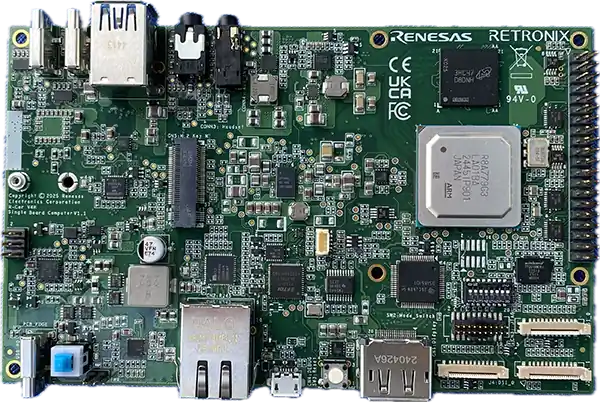

<!-- Copyright 2015-2026 Zephyr Project members and individual contributors. -->
<!-- SPDX-License-Identifier: Apache-2.0 -->
<!-- 中文翻译；编号、导航与译注为本地新增。 -->

<a id="sparrowhawk_rcar_v4h"></a>

# 第2章\_Sparrow Hawk R-Car V4H单板计算机（SBC）

原文：[官方页面](https://docs.zephyrproject.org/latest/boards/retronix/sparrowhawk_rcar_v4h/doc/index.html)。读取日期：2026-10-16；来源摘要见[来源记录](../SOURCES.md)。

开发板概览（Board Overview）

<a id="id1"></a>

[](images/sparrowhawk_rcar_v4h.webp)

Sparrow Hawk R-Car V4H单板计算机（SBC）

名称（Name）：

`sparrowhawk_rcar_v4h`

厂商（Vendor）：

[Retronix Technology Inc.](https://docs.zephyrproject.org/latest/boards/index.html#vendor=retronix)

状态（Status）：

当前未积极维护（Not Actively Maintained）

架构（Architecture）：

[arm](https://docs.zephyrproject.org/latest/boards/index.html#arch=arm)、[arm64](https://docs.zephyrproject.org/latest/boards/index.html#arch=arm64)

片上系统（SoC）：

[r8a779g0](https://docs.zephyrproject.org/latest/boards/index.html#soc=r8a779g0)

<a id="board-github-link"></a>

[浏览开发板源码（Browse Board Sources）](https://github.com/zephyrproject-rtos/zephyr/blob/main//boards/retronix/sparrowhawk_rcar_v4h/doc/index.rst/../..)<a id="overview"></a>

## 概述（Overview）

Retronix Sparrow Hawk单板计算机（Single Board Computer，SBC）采用Renesas R-Car V4H片上系统，面向机器人、工业自动化及快速原型开发，提供灵活且兼顾成本的开发平台。

R-Car V4H面向高级驾驶辅助系统（ADAS）及自动驾驶（AD）系统的集中处理，深度学习性能最高34 TOPS，即每秒34万亿次运算，可高速识别及处理来自汽车摄像头、雷达及激光雷达（LiDAR）的周边物体信息。

<a id="hardware"></a>

## 硬件（Hardware）

开发板硬件能力见[Retronix Sparrow Hawk](https://rcar-community.github.io/Sparrow-Hawk/index.html)页面，R-Car V4H SoC完整功能见[Renesas R-Car V4H](https://www.renesas.com/en/products/r-car-v4h)产品页。

<a id="supported-features"></a>

### 支持的功能（Supported Features）

`sparrowhawk_rcar_v4h`开发板支持下表所列的硬件功能。

片上／板载（On-Chip / On-Board）

功能集成在片上系统（SoC）内／位于开发板上。

2 / 2

分别表示已启用／已禁用的实例数。点击数量标签，可查看开发板或SoC设备树源码（DTS）中该功能的第一个实例。

`vnd,foo`

与此功能匹配的设备树绑定兼容字符串（Compatible String）；点击链接可查看绑定文档。

<a id="sparrowhawk_rcar_v4h-hw-features"></a>

<a id="sparrowhawk_rcar_v4h-sparrowhawk_rcar_v4h/r8a779g0/a76-hw-features-section"></a>

#### `sparrowhawk_rcar_v4h/r8a779g0/a76`目标（Target）

<a id="sparrowhawk_rcar_v4h-sparrowhawk_rcar_v4h/r8a779g0/a76-hw-features-panel"></a>

<a id="sparrowhawk_rcar_v4h-sparrowhawk_rcar_v4h/r8a779g0/a76-hw-features-memory"></a>

该开发板目标的片上存储容量：2 GiB RAM、N/A Flash。

<a id="sparrowhawk_rcar_v4h-sparrowhawk_rcar_v4h/r8a779g0/a76-hw-features-table"></a>

<table>
<tr>
<th>类型（Type）</th>
<th>位置（Location）</th>
<th>说明（Description）</th>
<th>兼容字符串（Compatible）</th>
</tr>
<tr>
<td rowspan="1">中央处理器（CPU）</td>
<td>片上（On-Chip）</td>
<td>通用ARMv8-A处理器（CPU）（<a href="https://github.com/zephyrproject-rtos/zephyr/blob/main/dts/arm64/renesas/r8a779g0.dtsi?plain=1#L23">已启用：1</a>）</td>
<td><a href="../cpu_arm_riscv_binding_reference/P004_arm_armv8.md#std-dtcompatible-arm-armv8"><code>arm,armv8</code></a></td>
</tr>
<tr>
<td rowspan="2">时钟控制（Clock Control）</td>
<td>片上（On-Chip）</td>
<td>Renesas R8A779G0 SoC时钟脉冲发生器（CPG）、模块待机及软件复位（<a href="https://github.com/zephyrproject-rtos/zephyr/blob/main/dts/arm64/renesas/r8a779g0.dtsi?plain=1#L83">已启用：1</a>）</td>
<td><a href="../clock_nxp_pico_realtek_renesas_binding_reference/P027_renesas_r8a779g0-cpg-mssr.md#std-dtcompatible-renesas-r8a779g0-cpg-mssr"><code>renesas,r8a779g0-cpg-mssr</code></a></td>
</tr>
<tr>
<td>片上（On-Chip）</td>
<td>通用固定频率时钟提供者（Fixed-Rate Clock Provider）（<a href="https://github.com/zephyrproject-rtos/zephyr/blob/main/dts/arm64/renesas/r8a779g0.dtsi?plain=1#L219">已启用：1</a>）</td>
<td><a href="../hardware/P566_固定时钟绑定.md#dtbinding-fixed-clock"><code>fixed-clock</code></a></td>
</tr>
<tr>
<td rowspan="1">通用输入输出与接插件（GPIO &amp; Headers）</td>
<td>片上（On-Chip）</td>
<td>Renesas R-Car通用输入输出（GPIO）（<a href="https://github.com/zephyrproject-rtos/zephyr/blob/main/dts/arm64/renesas/r8a779g0.dtsi?plain=1#L100">已禁用：9</a>）</td>
<td><a href="../gpio_raspberrypi_renesas_binding_reference/P017_renesas_rcar-gpio.md#std-dtcompatible-renesas-rcar-gpio"><code>renesas,rcar-gpio</code></a></td>
</tr>
<tr>
<td rowspan="1">中断控制器（Interrupt Controller）</td>
<td>片上（On-Chip）</td>
<td>ARM通用中断控制器（GIC）v3（<a href="https://github.com/zephyrproject-rtos/zephyr/blob/main/dts/arm64/renesas/r8a779g0.dtsi?plain=1#L73">已启用：1</a>）</td>
<td><a href="../interrupt_fabric_binding_reference/P004_arm_gic-v3.md#std-dtcompatible-arm-gic-v3"><code>arm,gic-v3</code></a></td>
</tr>
<tr>
<td rowspan="1">引脚控制（Pin Control）</td>
<td>片上（On-Chip）</td>
<td>Renesas R-Car Gen3／Gen4引脚功能控制器（Pin Function Controller）（<a href="https://github.com/zephyrproject-rtos/zephyr/blob/main/dts/arm64/renesas/r8a779g0.dtsi?plain=1#L91">已启用：1</a>）</td>
<td><a href="../pinctrl_renesas_silabs_binding_reference/P009_renesas_rcar-pfc.md#std-dtcompatible-renesas-rcar-pfc"><code>renesas,rcar-pfc</code></a></td>
</tr>
<tr>
<td rowspan="1">电源管理 CPU 操作（Power Management CPU Operations）</td>
<td>片上（On-Chip）</td>
<td>电源状态协调接口（PSCI / Power State Coordination Interface）0.2版（<a href="https://github.com/zephyrproject-rtos/zephyr/blob/main/dts/arm64/renesas/r8a779g0.dtsi?plain=1#L31">已启用：1</a>）</td>
<td><a href="https://docs.zephyrproject.org/latest/build/dts/api/bindings/pm_cpu_ops/arm%2Cpsci-0.2.html#std-dtcompatible-arm-psci-0.2"><code>arm,psci-0.2</code></a></td>
</tr>
<tr>
<td rowspan="1">稳压器（Regulator）</td>
<td>片上（On-Chip）</td>
<td>固定电压稳压器（Fixed Voltage Regulators）（<a href="https://github.com/zephyrproject-rtos/zephyr/blob/main/dts/arm64/renesas/r8a779g0.dtsi?plain=1#L45">已启用：2</a>）</td>
<td><a href="../hardware/P635_固定稳压器设备树绑定.md#dtbinding-regulator-fixed"><code>regulator-fixed</code></a></td>
</tr>
<tr>
<td rowspan="1">串行控制器（Serial Controller）</td>
<td>片上（On-Chip）</td>
<td>Renesas R-Car高速串行通信接口（HSCIF）控制器（<a href="https://github.com/zephyrproject-rtos/zephyr/blob/main/dts/arm64/renesas/r8a779g0.dtsi?plain=1#L190">已启用：1</a>；<a href="https://github.com/zephyrproject-rtos/zephyr/blob/main/dts/arm64/renesas/r8a779g0.dtsi?plain=1#L199">已禁用：2</a>）</td>
<td><a href="../uart_raspberrypi_realtek_renesas_binding_reference/P009_renesas_rcar-hscif.md#std-dtcompatible-renesas-rcar-hscif"><code>renesas,rcar-hscif</code></a></td>
</tr>
<tr>
<td rowspan="1">定时器（Timer）</td>
<td>片上（On-Chip）</td>
<td>每个内核独立的ARM架构定时器（Architected Timer）（<a href="https://github.com/zephyrproject-rtos/zephyr/blob/main/dts/arm64/renesas/r8a779g0.dtsi?plain=1#L36">已启用：1</a>）</td>
<td><a href="../arm_interrupt_timer_binding_reference/P010_ARMv8架构定时器.md#std-dtcompatible-arm-armv8-timer"><code>arm,armv8-timer</code></a></td>
</tr>
</table>

<a id="sparrowhawk_rcar_v4h-sparrowhawk_rcar_v4h/r8a779g0/r52-hw-features-section"></a>

#### `sparrowhawk_rcar_v4h/r8a779g0/r52`目标（Target）

<a id="sparrowhawk_rcar_v4h-sparrowhawk_rcar_v4h/r8a779g0/r52-hw-features-panel"></a>

<a id="sparrowhawk_rcar_v4h-sparrowhawk_rcar_v4h/r8a779g0/r52-hw-features-memory"></a>

该开发板目标的片上存储容量：4 MiB RAM、N/A Flash。

<a id="sparrowhawk_rcar_v4h-sparrowhawk_rcar_v4h/r8a779g0/r52-hw-features-table"></a>

<table>
<tr>
<th>类型（Type）</th>
<th>位置（Location）</th>
<th>说明（Description）</th>
<th>兼容字符串（Compatible）</th>
</tr>
<tr>
<td rowspan="1">中央处理器（CPU）</td>
<td>片上（On-Chip）</td>
<td>ARM Cortex-R52处理器（CPU）（<a href="https://github.com/zephyrproject-rtos/zephyr/blob/main/dts/arm/renesas/rcar/gen4/rcar_gen4_v4h_cr52.dtsi?plain=1#L17">已启用：1</a>）</td>
<td><a href="../cpu_cortex_xtensa_binding_reference/P011_arm_cortex-r52.md#std-dtcompatible-arm-cortex-r52"><code>arm,cortex-r52</code></a></td>
</tr>
<tr>
<td rowspan="2">时钟控制（Clock Control）</td>
<td>片上（On-Chip）</td>
<td>Renesas R8A779G0 SoC时钟脉冲发生器（CPG）、模块待机及软件复位（<a href="https://github.com/zephyrproject-rtos/zephyr/blob/main/dts/arm/renesas/rcar/gen4/r8a779g0.dtsi?plain=1#L23">已启用：1</a>）</td>
<td><a href="../clock_nxp_pico_realtek_renesas_binding_reference/P027_renesas_r8a779g0-cpg-mssr.md#std-dtcompatible-renesas-r8a779g0-cpg-mssr"><code>renesas,r8a779g0-cpg-mssr</code></a></td>
</tr>
<tr>
<td>片上（On-Chip）</td>
<td>通用固定频率时钟提供者（Fixed-Rate Clock Provider）（<a href="https://github.com/zephyrproject-rtos/zephyr/blob/main/dts/arm/renesas/rcar/gen4/r8a779g0.dtsi?plain=1#L69">已启用：1</a>）</td>
<td><a href="../hardware/P566_固定时钟绑定.md#dtbinding-fixed-clock"><code>fixed-clock</code></a></td>
</tr>
<tr>
<td rowspan="1">通用输入输出与接插件（GPIO &amp; Headers）</td>
<td>片上（On-Chip）</td>
<td>Renesas R-Car通用输入输出（GPIO）（<a href="https://github.com/zephyrproject-rtos/zephyr/blob/main/dts/arm/renesas/rcar/gen4/r8a779g0.dtsi?plain=1#L29">已禁用：2</a>）</td>
<td><a href="../gpio_raspberrypi_renesas_binding_reference/P017_renesas_rcar-gpio.md#std-dtcompatible-renesas-rcar-gpio"><code>renesas,rcar-gpio</code></a></td>
</tr>
<tr>
<td rowspan="1">中断控制器（Interrupt Controller）</td>
<td>片上（On-Chip）</td>
<td>ARM通用中断控制器（GIC）v3（<a href="https://github.com/zephyrproject-rtos/zephyr/blob/main/dts/arm/renesas/rcar/gen4/rcar_gen4_v4h_cr52.dtsi?plain=1#L41">已启用：1</a>）</td>
<td><a href="../interrupt_fabric_binding_reference/P004_arm_gic-v3.md#std-dtcompatible-arm-gic-v3"><code>arm,gic-v3</code></a></td>
</tr>
<tr>
<td rowspan="1">引脚控制（Pin Control）</td>
<td>片上（On-Chip）</td>
<td>Renesas R-Car Gen3／Gen4引脚功能控制器（Pin Function Controller）（<a href="https://github.com/zephyrproject-rtos/zephyr/blob/main/dts/arm/renesas/rcar/gen4/r8a779g0.dtsi?plain=1#L13">已启用：1</a>）</td>
<td><a href="../pinctrl_renesas_silabs_binding_reference/P009_renesas_rcar-pfc.md#std-dtcompatible-renesas-rcar-pfc"><code>renesas,rcar-pfc</code></a></td>
</tr>
<tr>
<td rowspan="1">串行控制器（Serial Controller）</td>
<td>片上（On-Chip）</td>
<td>Renesas R-Car高速串行通信接口（HSCIF）控制器（<a href="https://github.com/zephyrproject-rtos/zephyr/blob/main/dts/arm/renesas/rcar/gen4/r8a779g0.dtsi?plain=1#L58">已启用：1</a>；<a href="https://github.com/zephyrproject-rtos/zephyr/blob/main/dts/arm/renesas/rcar/gen4/r8a779g0.dtsi?plain=1#L49">已禁用：1</a>）</td>
<td><a href="../uart_raspberrypi_realtek_renesas_binding_reference/P009_renesas_rcar-hscif.md#std-dtcompatible-renesas-rcar-hscif"><code>renesas,rcar-hscif</code></a></td>
</tr>
<tr>
<td rowspan="1">静态随机存储器（SRAM）</td>
<td>片上（On-Chip）</td>
<td>通用片上静态随机存储器（SRAM）（<a href="https://github.com/zephyrproject-rtos/zephyr/blob/main/dts/arm/renesas/rcar/gen4/rcar_gen4_v4h_cr52.dtsi?plain=1#L36">已启用：1</a>）</td>
<td><a href="../hardware/P567_内存映射SRAM绑定.md#dtbinding-mmio-sram"><code>mmio-sram</code></a></td>
</tr>
<tr>
<td rowspan="1">定时器（Timer）</td>
<td>片上（On-Chip）</td>
<td>每个内核独立的ARM架构定时器（Architected Timer）（<a href="https://github.com/zephyrproject-rtos/zephyr/blob/main/dts/arm/renesas/rcar/gen4/rcar_gen4_v4h_cr52.dtsi?plain=1#L24">已启用：1</a>）</td>
<td><a href="../arm_interrupt_timer_binding_reference/P010_ARMv8架构定时器.md#std-dtcompatible-arm-armv8-timer"><code>arm,armv8-timer</code></a></td>
</tr>
</table>

<a id="connections-and-ios"></a>

### 连接与输入输出（Connections and IOs）

连接及I/O接口信息见[Retronix Sparrow Hawk](https://rcar-community.github.io/Sparrow-Hawk/index.html)官方页面。

<a id="uart"></a>

#### 通用异步收发器（UART）

Sparrow Hawk提供的串口信息如下：

<table>
<tr>
<th>软件接口（Software Interface）</th>
<th>物理接口（Physical Interface）</th>
<th>硬件接口（Hardware Interface）</th>
<th>转换器（Converter）</th>
<th>使用说明（Usage Note）</th>
</tr>
<tr>
<td>/tty/USBx、COMn，编号较低</td>
<td>CN4 USB端口</td>
<td>HSCIF0</td>
<td>FT2232H</td>
<td>U-Boot／Linux、A76上的Zephyr</td>
</tr>
<tr>
<td>/tty/USBy、COMm，编号较高</td>
<td>CN4 USB端口</td>
<td>HSCIF1</td>
<td>FT2232H</td>
<td>R52上的Zephyr默认控制台</td>
</tr>
</table>

注意（Note）

A76上的Zephyr控制台使用HSCIF0，R52上的Zephyr控制台使用HSCIF1。两者在Zephyr板级定义中均为921600、8N1，不启用硬件流控。

<a id="programming-and-debugging"></a>

## 烧录与调试（Programming and Debugging）

应用可按常规方式构建，以下为Hello World示例：

对于Cortex-R52：

```text
# From the root of the zephyr repository
west build -b sparrowhawk_rcar_v4h/r8a779g0/r52 samples/hello_world
```

对于Cortex-A76：

```text
# From the root of the zephyr repository
west build -b sparrowhawk_rcar_v4h/r8a779g0/a76 samples/hello_world
```

<a id="configuring-a-console"></a>

### 配置控制台（Configuring a Console）

通过USB线将电脑连接CN4 USB端口，会出现两个COM端口或/tty/USB设备，二者均用于启动过程。使用minicom、PuTTY等串口终端并设定：


- 波特率（Speed）：921600
- 数据位（Data）：8位
- 奇偶校验（Parity）：无（None）
- 停止位（Stop Bits）：1位

<a id="flashing"></a>

### 烧录（Flashing）

此板不支持直接烧录Zephyr镜像，但可通过U-Boot写入及加载镜像。

确认开发板已烧录U-Boot，参见[Flash_loader](https://rcar-community.github.io/Sparrow-Hawk/BSP/yocto_bsp.html)指南第3.2.2节“Flashing loader”。将终端软件连接HSCIF0串口，即编号较低的/tty/USBx或COMn，按SW1上电，应看到以下启动日志：

```text
U-Boot SPL 2025.07 (Aug 07 2025 - 04:02:12 +0000)
Trying to boot from SPI


U-Boot 2025.07 (Aug 07 2025 - 04:02:12 +0000)

CPU:   Renesas Electronics R8A779G0 rev 3.0
Model: Retronix Sparrow Hawk board based on r8a779g3
DRAM:  2 GiB (total 16 GiB)
Core:  87 devices, 23 uclasses, devicetree: separate
MMC:   mmc@ee140000: 0
Loading Environment from SPIFlash... SF: Detected w77q51nw with page size 256 Bytes, erase size 64 KiB, total 64 MiB
OK
In:    serial@e6540000
Out:   serial@e6540000
Err:   serial@e6540000
Net:   eth0: ethernet@e6800000
=>
```

注意（Note）

U-Boot日志中的r8a779g3是V4H SoC（R8A779G0）3.0修订版的料号，未来板卡版本可能改变此编号。

按任意键停止自动启动，进入U-Boot提示符。

<a id="method-1-using-tftp-to-transfer-zephyr-image"></a>

#### 方法一：通过TFTP传输Zephyr镜像

假设主机已安装简单文件传输协议（TFTP）服务器，将build/zephyr/zephyr.bin放入TFTP根目录，再执行以下U-Boot命令：

对于Cortex-R52：

```text
=> setenv ipaddr <board.ip>
=> setenv serverip <tftp.server.ip>
=> tftp 0x40040000 zephyr.bin
=> rproc init; rproc load 0:3 0x40040000 0x200000; rproc start 0
```

对于Cortex-A76：

```text
=> setenv ipaddr <board.ip>
=> setenv serverip <tftp.server.ip>
=> tftp 0x48000000 zephyr.bin
=> booti 0x48000000 - ${fdtcontroladdr}
```

<a id="method-2-using-serial-to-transfer-zephyr-image"></a>

#### 方法二：通过串口传输Zephyr镜像

部分终端软件支持通过串口使用Kermit协议传输文件，执行以下U-Boot命令：

对于Cortex-R52：

```text
=> loadb 0x40040000 921600
## Ready for binary (kermit) download to 0x40040000 at 921600 bps...
(Transfer zephyr.bin after this line)
## Total Size      = 0x00009f2c = 40748 Bytes
## Start Addr      = 0x40040000
=> rproc init; rproc load 0:3 0x40040000 0x200000; rproc start 0
```

对于Cortex-A76：

```text
=> loadb 0x48000000 921600
## Ready for binary (kermit) download to 0x48000000 at 921600 bps...
(Transfer zephyr.bin after this line)
## Total Size      = 0x00009f2c = 40748 Bytes
## Start Addr      = 0x48000000
=> booti 0x48000000 - ${fdtcontroladdr}
```

```text
*** Booting Zephyr OS build v4.2.0-4945-g8fc6351ef451 ***
Hello World! sparrowhawk_rcar_v4h/r8a779g0/r52
```

<a id="references"></a>

## 参考资料（References）


- [Renesas R-Car V4H](https://www.renesas.com/en/products/r-car-v4h)
- [Retronix Sparrow Hawk](https://rcar-community.github.io/Sparrow-Hawk/index.html)

## 译注

Sparrow Hawk的A76与R52控制台分别使用HSCIF0／HSCIF1，均为921600、8N1；通过CN4枚举两个串口。此页不支持直接烧录Zephyr，镜像由U-Boot经TFTP或Kermit加载。

---

[上一章](P001_Retronix_Technology_Inc.md) · [返回大纲](大纲.md) · [全站翻译进度](../PROGRESS.md) · [下一章](P003_Ronoth.md)
