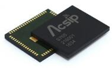

<!-- Copyright 2015-2026 Zephyr Project members and individual contributors. -->
<!-- SPDX-License-Identifier: Apache-2.0 -->
<!-- 中文翻译；编号、导航与译注为本地新增。 -->

# 第5章\_AcSIP S76S

原文：[官方页面](https://docs.zephyrproject.org/latest/boards/ronoth/lodev/doc/s76s.html)。读取日期：2026-10-16；来源摘要见[来源记录](../SOURCES.md)。

## 概述（Overview）

[AcSIP S76S](http://www.acsip.com.tw/index.php?action=products-detail&fid1=11&fid2=29&fid3=27&id=79&lang=3)是[AcSIP](http://www.acsip.com.tw)的系统级封装（SiP），内含[STMicroelectronics STM32L073RZ](https://www.st.com/en/microcontrollers-microprocessors/stm32l073rz.html)微控制器、[Semtech SX1276](https://www.semtech.com/products/wireless-rf/lora-transceivers/sx1276) LoRaWAN收发器及+20 dBm功率放大器。详情见[AcSIP S76S产品简介](https://www.acsip.com.tw/index.php?action=download_pro&perm=d&id=365)，更多资料见可能需要登录的[AcSIP产品数据下载](http://www.acsip.com.tw/index.php?action=technical)网站，器件[可通过TechShip获取](https://techship.com/products/acsip-lorawan-module-s76s/)。

Zephyr应用可使用acsip_s76s配置使用此SiP。

AcSIP S76S

## 器件资源（Device Resources）

内嵌STM32L073RZ的一些GPIO及SPI2已在封装内部专用于LoRaWAN收发器，资源列表见内部占用表。（[STMicroelectronics STM32L073RZ](https://www.st.com/en/microcontrollers-microprocessors/stm32l073rz.html)；[内部占用资源表](#internally-committed-table)）

因此，STM32L073RZ的部分功能、端口及特性不可用。因封装未引出而不可用的资源见相应表格。（[STMicroelectronics STM32L073RZ](https://www.st.com/en/microcontrollers-microprocessors/stm32l073rz.html)；[不可用资源表](#unavailable-table)）

已引出的可用资源见[本表](#this-table)，实际[S76S引脚表](#s76s-pinout-table)列在下方。

这些表格适用于STM32L07x系列；部分已引出的资源仍可能受STM32L073RZ芯片自身限制而不可用，请查阅该芯片文档。（[STMicroelectronics STM32L073RZ](https://www.st.com/en/microcontrollers-microprocessors/stm32l073rz.html)；[STMicroelectronics STM32L073RZ](https://www.st.com/en/microcontrollers-microprocessors/stm32l073rz.html)）

## 开发（Development）

[Ronoth](https://ronoth.com/) [LoDev](https://ronoth.com/products/lodev-s76s-lora-soc-development-board?variant=31608819417220)是一块开源开发板，参见其板卡描述文件。

## 调试（Debugging）

与其他STM32处理器一样，编程及调试使用串行线调试（SWD）端口。可使用ST-LINK/V2适配器及配套软件，Linux下为st-utils软件包。

## 引脚分配及可用引脚（Pin Assignments and Available Pins）

### S76S引脚分配（Pin Assignment）

<table>
<tr>
<th>引脚（Pin）</th>
<th>功能（Function）</th>
<th>引脚（Pin）</th>
<th>功能（Function）</th>
</tr>
<tr>
<td>1</td>
<td>未连接（NC）</td>
<td>32</td>
<td>地（GND）</td>
</tr>
<tr>
<td>2</td>
<td>地（GND）</td>
<td>33</td>
<td>RF_ANT</td>
</tr>
<tr>
<td>3</td>
<td>地（GND）</td>
<td>34</td>
<td>地（GND）</td>
</tr>
<tr>
<td>4</td>
<td>PC1</td>
<td>35</td>
<td>地（GND）</td>
</tr>
<tr>
<td>5</td>
<td>PC2</td>
<td>36</td>
<td>PA1_RF_FEM_CPS</td>
</tr>
<tr>
<td>6</td>
<td>PC3</td>
<td>37</td>
<td>地（GND）</td>
</tr>
<tr>
<td>7</td>
<td>未连接（NC）</td>
<td>38</td>
<td>未连接（NC）</td>
</tr>
<tr>
<td>8</td>
<td>未连接（NC）</td>
<td>39</td>
<td>地（GND）</td>
</tr>
<tr>
<td>9</td>
<td>未连接（NC）</td>
<td>40</td>
<td>未连接（NC）</td>
</tr>
<tr>
<td>10</td>
<td>未连接（NC）</td>
<td>41</td>
<td>地（GND）</td>
</tr>
<tr>
<td>11</td>
<td>未连接（NC）</td>
<td>42</td>
<td>未连接（NC）</td>
</tr>
<tr>
<td>12</td>
<td>低电平复位（nReset）</td>
<td>43</td>
<td>电源（VDD）</td>
</tr>
<tr>
<td>13</td>
<td>PA0</td>
<td>44</td>
<td>电源（VDD）</td>
</tr>
<tr>
<td>14</td>
<td>地（GND）</td>
<td>45</td>
<td>PA8_USART1_CK</td>
</tr>
<tr>
<td>15</td>
<td>地（GND）</td>
<td>46</td>
<td>PA10_USART1_RX</td>
</tr>
<tr>
<td>16</td>
<td>PA2_TxD_A</td>
<td>47</td>
<td>PA9_USART1_TX</td>
</tr>
<tr>
<td>17</td>
<td>PA3_RxD_A</td>
<td>48</td>
<td>PA11_USART1_CTS</td>
</tr>
<tr>
<td>18</td>
<td>PA4_SPI1_NSS</td>
<td>49</td>
<td>PA12_USART1_RTS</td>
</tr>
<tr>
<td>19</td>
<td>PA5_SPI1_SCK</td>
<td>50</td>
<td>PA13_SWDIO</td>
</tr>
<tr>
<td>20</td>
<td>PA6_SPI1_MISO</td>
<td>51</td>
<td>PA14_SWCLK</td>
</tr>
<tr>
<td>21</td>
<td>PA7_SPI1_MOSI</td>
<td>52</td>
<td>PC10</td>
</tr>
<tr>
<td>22</td>
<td>PC4</td>
<td>53</td>
<td>PC11</td>
</tr>
<tr>
<td>23</td>
<td>PC5</td>
<td>54</td>
<td>PC12</td>
</tr>
<tr>
<td>24</td>
<td>PB0_IO_INT1</td>
<td>55</td>
<td>PD2</td>
</tr>
<tr>
<td>25</td>
<td>PB1_IO_INT2</td>
<td>56</td>
<td>PB5</td>
</tr>
<tr>
<td>26</td>
<td>PC6</td>
<td>57</td>
<td>PB6_SCL</td>
</tr>
<tr>
<td>27</td>
<td>PC7</td>
<td>58</td>
<td>PB7_SDA</td>
</tr>
<tr>
<td>28</td>
<td>PC8</td>
<td>59</td>
<td>BOOT0</td>
</tr>
<tr>
<td>29</td>
<td>PC9</td>
<td>60</td>
<td>PB8_IO_LED_FCT</td>
</tr>
<tr>
<td>30</td>
<td>RXTX/RFMOD</td>
<td>61</td>
<td>地（GND）</td>
</tr>
<tr>
<td>31</td>
<td>地（GND）</td>
<td>62</td>
<td>地（GND）</td>
</tr>
</table>

### 连接到外部引脚的端口

<table>
<tr>
<th>引脚名称（Pin Name）</th>
<th>引脚类型（Pin Type）</th>
<th>I/O结构（I/O Structure）</th>
<th>注意（Note）</th>
<th>复用功能（Alternate Functions）</th>
<th>附加功能（Additional Functions）</th>
</tr>
<tr>
<td>BOOT0</td>
<td>输入（I）</td>
<td></td>
<td><ul><li></li></ul></td>
<td><ul><li></li></ul></td>
<td><ul><li></li></ul></td>
</tr>
<tr>
<td>低电平复位（NRST）</td>
<td>输入输出（I/O）</td>
<td><ul><li></li></ul></td>
<td><ul><li></li></ul></td>
<td><ul><li></li></ul></td>
<td><ul><li></li></ul></td>
</tr>
<tr>
<td>PA0</td>
<td>输入输出（I/O）</td>
<td>TC</td>
<td><ul><li></li></ul></td>
<td>TIM2_CH1, TSC_G1_IO1, USART2_CTS, TIM2_ETR, USART4_TX, COMP1_OUT</td>
<td>COMP1_INM, ADC_IN0, RTC_TAMP2/WKUP1</td>
</tr>
<tr>
<td>PA1</td>
<td>输入输出（I/O）</td>
<td>FT</td>
<td><ul><li></li></ul></td>
<td>EVENTOUT, LCD_SEG0, TIM2_CH2, TSC_G1_IO2, USART2_RTS/USART2_DE, TIM21_ETR, USART4_RX</td>
<td>COMP1_INP, ADC_IN1</td>
</tr>
<tr>
<td>PA2</td>
<td>输入输出（I/O）</td>
<td>FT</td>
<td><ul><li></li></ul></td>
<td>TIM21_CH1, LCD_SEG1, TIM2_CH3, TSC_G1_IO3, USART2_TX, LPUART1_TX, COMP2_OUT</td>
<td>COMP2_INM, ADC_IN2</td>
</tr>
<tr>
<td>PA3</td>
<td>输入输出（I/O）</td>
<td>FT</td>
<td><ul><li></li></ul></td>
<td>TIM21_CH2, LCD_SEG2, TIM2_CH4, TSC_G1_IO4, USART2_RX, LPUART1_RX</td>
<td>COMP2_INP, ADC_IN3</td>
</tr>
<tr>
<td>PA4</td>
<td>输入输出（I/O）</td>
<td>TC</td>
<td><ol><li></li></ol></td>
<td>SPI1_NSS, TSC_G2_IO1, USART2_CK, TIM22_ETR</td>
<td>COMP1_INM, COMP2_INM, ADC_IN4, DAC_OUT1</td>
</tr>
<tr>
<td>PA5</td>
<td>输入输出（I/O）</td>
<td>TC</td>
<td><ul><li></li></ul></td>
<td>SPI1_SCK, TIM2_ETR, TSC_G2_IO2, TIM2_CH1</td>
<td>COMP1_INM, COMP2_INM, ADC_IN5, DAC_OUT2</td>
</tr>
<tr>
<td>PA6</td>
<td>输入输出（I/O）</td>
<td>FT</td>
<td><ul><li></li></ul></td>
<td>SPI1_MISO, LCD_SEG3, TIM3_CH1, TSC_G2_IO3, LPUART1_CTS, TIM22_CH1, EVENTOUT, COMP1_OUT</td>
<td>ADC_IN6</td>
</tr>
<tr>
<td>PA7</td>
<td>输入输出（I/O）</td>
<td>FT</td>
<td><ul><li></li></ul></td>
<td>SPI1_MOSI, LCD_SEG4, TIM3_CH2, TSC_G2_IO4, TIM22_CH2, EVENTOUT, COMP2_OUT</td>
<td>ADC_IN7</td>
</tr>
<tr>
<td>PA8</td>
<td>输入输出（I/O）</td>
<td>FTf</td>
<td><ul><li></li></ul></td>
<td>MCO, LCD_COM0, USB_CRS_SYNC, EVENTOUT, USART1_CK, I2C3_SCL</td>
<td><ul><li></li></ul></td>
</tr>
<tr>
<td>PA9</td>
<td>输入输出（I/O）</td>
<td>FTf</td>
<td><ul><li></li></ul></td>
<td>MCO, LCD_COM1, TSC_G4_IO1, USART1_TX, I2C1_SCL, I2C3_SMBA</td>
<td><ul><li></li></ul></td>
</tr>
<tr>
<td>PA10</td>
<td>输入输出（I/O）</td>
<td>FTf</td>
<td><ul><li></li></ul></td>
<td>LCD_COM2, TSC_G4_IO2, USART1_RX, I2C1_SDA</td>
<td><ul><li></li></ul></td>
</tr>
<tr>
<td>PA11</td>
<td>输入输出（I/O）</td>
<td>FT</td>
<td><ol><li></li></ol></td>
<td>SPI1_MISO, EVENTOUT, TSC_G4_IO3, USART1_CTS, COMP1_OUT</td>
<td>USB_DM</td>
</tr>
<tr>
<td>PA12</td>
<td>输入输出（I/O）</td>
<td>FT</td>
<td><ol><li></li></ol></td>
<td>SPI1_MOSI, EVENTOUT, TSC_G4_IO4, USART1_RTS/USART1_DE, COMP2_OUT</td>
<td>USB_DP</td>
</tr>
<tr>
<td>PA13</td>
<td>输入输出（I/O）</td>
<td>FT</td>
<td><ul><li></li></ul></td>
<td>SWDIO, USB_NOE, LPUART1_RX</td>
<td><ul><li></li></ul></td>
</tr>
<tr>
<td>PA14</td>
<td>输入输出（I/O）</td>
<td>FT</td>
<td><ul><li></li></ul></td>
<td>SWCLK, USART2_TX, LPUART1_TX</td>
<td><ul><li></li></ul></td>
</tr>
<tr>
<td>PB0</td>
<td>输入输出（I/O）</td>
<td>FT</td>
<td><ul><li></li></ul></td>
<td>EVENTOUT, LCD_SEG5, TIM3_CH3, TSC_G3_IO2</td>
<td>LCD_VLCD3, ADC_IN8, VREF_OUT</td>
</tr>
<tr>
<td>PB1</td>
<td>输入输出（I/O）</td>
<td>FT</td>
<td><ul><li></li></ul></td>
<td>LCD_SEG6, TIM3_CH4, TSC_G3_IO3, LPUART1_RTS/LPUART1_DE</td>
<td>ADC_IN9, VREF_OUT</td>
</tr>
<tr>
<td>PB5</td>
<td>输入输出（I/O）</td>
<td>FT</td>
<td><ul><li></li></ul></td>
<td>SPI1_MOSI, LCD_SEG9, LPTIM1_IN1, I2C1_SMBA, TIM3_CH2/TIM22_CH2, USART1_CK, USART5_CK, USART5_RTS/USART5_DE</td>
<td>COMP2_INP</td>
</tr>
<tr>
<td>PB6</td>
<td>输入输出（I/O）</td>
<td>FTf</td>
<td><ul><li></li></ul></td>
<td>USART1_TX, I2C1_SCL, LPTIM1_ETR, TSC_G5_IO3</td>
<td>COMP2_INP</td>
</tr>
<tr>
<td>PB7</td>
<td>输入输出（I/O）</td>
<td>FTf</td>
<td><ul><li></li></ul></td>
<td>USART1_RX, I2C1_SDA, LPTIM1_IN2, TSC_G5_IO4, USART4_CTS</td>
<td>COMP2_INP, PVD_IN</td>
</tr>
<tr>
<td>PB8</td>
<td>输入输出（I/O）</td>
<td>FTf</td>
<td><ul><li></li></ul></td>
<td>LCD_SEG16, TSC_SYNC, I2C1_SCL</td>
<td><ul><li></li></ul></td>
</tr>
<tr>
<td>PC1</td>
<td>输入输出（I/O）</td>
<td>FTf</td>
<td><ul><li></li></ul></td>
<td>LPTIM1_OUT, LCD_SEG19, EVENTOUT, TSC_G7_IO2, LPUART1_TX, I2C3_SDA</td>
<td>ADC_IN11</td>
</tr>
<tr>
<td>PC2</td>
<td>输入输出（I/O）</td>
<td>FTf</td>
<td><ul><li></li></ul></td>
<td>LPTIM1_IN2, LCD_SEG20, SPI2_MISO/I2S2_MCK, TSC_G7_IO3</td>
<td>ADC_IN12</td>
</tr>
<tr>
<td>PC3</td>
<td>输入输出（I/O）</td>
<td>FT</td>
<td><ul><li></li></ul></td>
<td>LPTIM1_ETR, LCD_SEG21, SPI2_MOSI/I2S2_SD, TSC_G7_IO4</td>
<td>ADC_IN13</td>
</tr>
<tr>
<td>PC4</td>
<td>输入输出（I/O）</td>
<td>FT</td>
<td><ul><li></li></ul></td>
<td>EVENTOUT, LCD_SEG22, LPUART1_TX</td>
<td>ADC_IN14</td>
</tr>
<tr>
<td>PC5</td>
<td>输入输出（I/O）</td>
<td>FT</td>
<td><ul><li></li></ul></td>
<td>LCD_SEG23, LPUART1_RX, TSC_G3_IO1</td>
<td>ADC_IN15</td>
</tr>
<tr>
<td>PC6</td>
<td>输入输出（I/O）</td>
<td>FT</td>
<td><ul><li></li></ul></td>
<td>TIM22_CH1, LCD_SEG24, TIM3_CH1, TSC_G8_IO1</td>
<td><ul><li></li></ul></td>
</tr>
<tr>
<td>PC7</td>
<td>输入输出（I/O）</td>
<td>FT</td>
<td><ul><li></li></ul></td>
<td>TIM22_CH2, LCD_SEG25, TIM3_CH2, TSC_G8_IO2</td>
<td><ul><li></li></ul></td>
</tr>
<tr>
<td>PC8</td>
<td>输入输出（I/O）</td>
<td>FT</td>
<td><ul><li></li></ul></td>
<td>TIM22_ETR, LCD_SEG26, TIM3_CH3, TSC_G8_IO3</td>
<td><ul><li></li></ul></td>
</tr>
<tr>
<td>PC9</td>
<td>输入输出（I/O）</td>
<td>FTf</td>
<td><ul><li></li></ul></td>
<td>TIM21_ETR, LCD_SEG27, USB_NOE/TIM3_CH4, TSC_G8_IO4, I2C3_SDA</td>
<td><ul><li></li></ul></td>
</tr>
<tr>
<td>PC10</td>
<td>输入输出（I/O）</td>
<td>FT</td>
<td><ul><li></li></ul></td>
<td>LPUART1_TX, LCD_COM4/LCD_SEG2 8/LCD_SEG48, USART4_TX</td>
<td><ul><li></li></ul></td>
</tr>
<tr>
<td>PC11</td>
<td>输入输出（I/O）</td>
<td>FT</td>
<td><ul><li></li></ul></td>
<td>LPUART1_RX, LCD_COM5/LCD_SEG2 9/LCD_SEG49, USART4_RX</td>
<td><ul><li></li></ul></td>
</tr>
<tr>
<td>PC12</td>
<td>输入输出（I/O）</td>
<td>FT</td>
<td><ul><li></li></ul></td>
<td>LCD_COM6/LCD_SEG3 0/LCD_SEG50, USART5_TX, USART4_CK</td>
<td><ul><li></li></ul></td>
</tr>
<tr>
<td>PD2</td>
<td>输入输出（I/O）</td>
<td>FT</td>
<td><ul><li></li></ul></td>
<td>LPUART1_RTS/LPUART1_DE, LCD_COM7/LCD_SEG3 1/LCD_SEG51, TIM3_ETR, USART5_RX</td>
<td><ul><li></li></ul></td>
</tr>
</table>

备注（Notes）：

1. PA4的触摸感应灵敏度较低，建议将其用作采样电容I/O。
2. 这些引脚由VDD_USB供电；所有以VDD为参考的特性，在此均应改用VDD_USB。

### 内部专用端口（Internally Dedicated Ports）

<table>
<tr>
<th>引脚名称（Pin Name）</th>
<th>引脚类型（Pin Type）</th>
<th>I/O结构（I/O Structure）</th>
<th>注意（Note）</th>
<th>功能（Function）</th>
</tr>
<tr>
<td>PA15</td>
<td>输入输出（I/O）</td>
<td>FT</td>
<td><ul><li></li></ul></td>
<td>内部SX1276 D5</td>
</tr>
<tr>
<td>PB3</td>
<td>输入输出（I/O）</td>
<td>FTf</td>
<td><ul><li></li></ul></td>
<td>内部SX1276 D4</td>
</tr>
<tr>
<td>PB4</td>
<td>输入输出（I/O）</td>
<td>FTf</td>
<td><ul><li></li></ul></td>
<td>内部SX1276 D3</td>
</tr>
<tr>
<td>PB9</td>
<td>输入输出（I/O）</td>
<td>FTf</td>
<td><ul><li></li></ul></td>
<td>内部SX1276 D2</td>
</tr>
<tr>
<td>PB10</td>
<td>输入输出（I/O）</td>
<td>FT</td>
<td><ul><li></li></ul></td>
<td>内部SX1276复位（Reset）</td>
</tr>
<tr>
<td>PB11</td>
<td>输入输出（I/O）</td>
<td>FT</td>
<td><ul><li></li></ul></td>
<td>内部SX1276 D0</td>
</tr>
<tr>
<td>PB12</td>
<td>输入输出（I/O）</td>
<td>FT</td>
<td><ul><li></li></ul></td>
<td>内部SX1276 SPI低有效片选（nCS）</td>
</tr>
<tr>
<td>PB13</td>
<td>输入输出（I/O）</td>
<td>FTf</td>
<td><ul><li></li></ul></td>
<td>内部SX1276 SPI2_SCK</td>
</tr>
<tr>
<td>PB14</td>
<td>输入输出（I/O）</td>
<td>FTf</td>
<td><ul><li></li></ul></td>
<td>内部SX1276 SPI2_MISO</td>
</tr>
<tr>
<td>PB15</td>
<td>输入输出（I/O）</td>
<td>FT</td>
<td><ul><li></li></ul></td>
<td>内部SX1276 SPI2_MOSI</td>
</tr>
<tr>
<td>PC13</td>
<td>输入输出（I/O）</td>
<td>FT</td>
<td><ul><li></li></ul></td>
<td>内部SX1276 D1</td>
</tr>
</table>

### 不可用／未连接的端口（Ports Not Available / Not Connected）

<table>
<tr>
<th>引脚名称（Pin Name）</th>
<th>引脚类型（Pin Type）</th>
<th>I/O结构（I/O Structure）</th>
<th>注意（Note）</th>
<th>复用功能（Alternate Functions）</th>
<th>附加功能（Additional Functions）</th>
</tr>
<tr>
<td>PC0</td>
<td>输入输出（I/O）</td>
<td>FTf</td>
<td><ul><li></li></ul></td>
<td>LPTIM1_IN1, LCD_SEG18, EVENTOUT, TSC_G7_IO1, LPUART1_RX, I2C3_SCL</td>
<td>ADC_IN10</td>
</tr>
<tr>
<td>PC14- OSC32_IN (PC14)</td>
<td>输入输出（I/O）</td>
<td>FT</td>
<td><ul><li></li></ul></td>
<td><ul><li></li></ul></td>
<td>OSC32_IN</td>
</tr>
<tr>
<td>PC15- OSC32_OUT (PC15)</td>
<td>输入输出（I/O）</td>
<td>TC</td>
<td><ul><li></li></ul></td>
<td><ul><li></li></ul></td>
<td>OSC32_OUT</td>
</tr>
<tr>
<td>PD0</td>
<td>输入输出（I/O）</td>
<td>FT</td>
<td><ul><li></li></ul></td>
<td>TIM21_CH1, SPI2_NSS/I2S2_WS</td>
<td><ul><li></li></ul></td>
</tr>
<tr>
<td>PD1</td>
<td>输入输出（I/O）</td>
<td>FT</td>
<td><ul><li></li></ul></td>
<td>SPI2_SCK/I2S2_CK</td>
<td><ul><li></li></ul></td>
</tr>
<tr>
<td>PD3</td>
<td>输入输出（I/O）</td>
<td>FT</td>
<td><ul><li></li></ul></td>
<td>USART2_CTS, LCD_SEG44, SPI2_MISO/I2S2_MCK</td>
<td><ul><li></li></ul></td>
</tr>
<tr>
<td>PD4</td>
<td>输入输出（I/O）</td>
<td>FT</td>
<td><ul><li></li></ul></td>
<td>USART2_RTS/USART2_DE, SPI2_MOSI/I2S2_SD</td>
<td><ul><li></li></ul></td>
</tr>
<tr>
<td>PD5</td>
<td>输入输出（I/O）</td>
<td>FT</td>
<td><ul><li></li></ul></td>
<td>USART2_TX</td>
<td><ul><li></li></ul></td>
</tr>
<tr>
<td>PD6</td>
<td>输入输出（I/O）</td>
<td>FT</td>
<td><ul><li></li></ul></td>
<td>USART2_RX</td>
<td><ul><li></li></ul></td>
</tr>
<tr>
<td>PD7</td>
<td>输入输出（I/O）</td>
<td>FT</td>
<td><ul><li></li></ul></td>
<td>USART2_CK, TIM21_CH2</td>
<td><ul><li></li></ul></td>
</tr>
<tr>
<td>PD8</td>
<td>输入输出（I/O）</td>
<td>FT</td>
<td><ul><li></li></ul></td>
<td>LPUART1_TX, LCD_SEG28</td>
<td><ul><li></li></ul></td>
</tr>
<tr>
<td>PD9</td>
<td>输入输出（I/O）</td>
<td>FT</td>
<td><ul><li></li></ul></td>
<td>LPUART1_RX, LCD_SEG29</td>
<td><ul><li></li></ul></td>
</tr>
<tr>
<td>PD10</td>
<td>输入输出（I/O）</td>
<td>FT</td>
<td><ul><li></li></ul></td>
<td>LCD_SEG30</td>
<td><ul><li></li></ul></td>
</tr>
<tr>
<td>PD11</td>
<td>输入输出（I/O）</td>
<td>FT</td>
<td><ul><li></li></ul></td>
<td>LPUART1_CTS, LCD_SEG31</td>
<td><ul><li></li></ul></td>
</tr>
<tr>
<td>PD12</td>
<td>输入输出（I/O）</td>
<td>FT</td>
<td><ul><li></li></ul></td>
<td>LPUART1_RTS/LPUART1_DE, LCD_SEG32</td>
<td><ul><li></li></ul></td>
</tr>
<tr>
<td>PD13</td>
<td>输入输出（I/O）</td>
<td>FT</td>
<td><ul><li></li></ul></td>
<td>LCD_SEG33</td>
<td><ul><li></li></ul></td>
</tr>
<tr>
<td>PD14</td>
<td>输入输出（I/O）</td>
<td>FT</td>
<td><ul><li></li></ul></td>
<td>LCD_SEG34</td>
<td><ul><li></li></ul></td>
</tr>
<tr>
<td>PD15</td>
<td>输入输出（I/O）</td>
<td>FT</td>
<td><ul><li></li></ul></td>
<td>USB_CRS_SYNC, LCD_SEG35</td>
<td><ul><li></li></ul></td>
</tr>
<tr>
<td>PE0</td>
<td>输入输出（I/O）</td>
<td>FT</td>
<td><ul><li></li></ul></td>
<td>LCD_SEG36, EVENTOUT</td>
<td><ul><li></li></ul></td>
</tr>
<tr>
<td>PE1</td>
<td>输入输出（I/O）</td>
<td>FT</td>
<td><ul><li></li></ul></td>
<td>LCD_SEG37, EVENTOUT</td>
<td><ul><li></li></ul></td>
</tr>
<tr>
<td>PE2</td>
<td>输入输出（I/O）</td>
<td>FT</td>
<td><ul><li></li></ul></td>
<td>LCD_SEG38, TIM3_ETR</td>
<td><ul><li></li></ul></td>
</tr>
<tr>
<td>PE3</td>
<td>输入输出（I/O）</td>
<td>FT</td>
<td><ul><li></li></ul></td>
<td>TIM22_CH1, LCD_SEG39, TIM3_CH1</td>
<td><ul><li></li></ul></td>
</tr>
<tr>
<td>PE4</td>
<td>输入输出（I/O）</td>
<td>FT</td>
<td><ul><li></li></ul></td>
<td>TIM22_CH2, TIM3_CH2</td>
<td><ul><li></li></ul></td>
</tr>
<tr>
<td>PE5</td>
<td>输入输出（I/O）</td>
<td>FT</td>
<td><ul><li></li></ul></td>
<td>TIM21_CH1, TIM3_CH3</td>
<td><ul><li></li></ul></td>
</tr>
<tr>
<td>PE6</td>
<td>输入输出（I/O）</td>
<td>FT</td>
<td><ul><li></li></ul></td>
<td>TIM21_CH2, TIM3_CH4</td>
<td>RTC_TAMP3/WKUP3</td>
</tr>
<tr>
<td>PE7</td>
<td>输入输出（I/O）</td>
<td>FT</td>
<td><ul><li></li></ul></td>
<td>LCD_SEG45, USART5_CK/USART5_RTS/USART5_DE</td>
<td><ul><li></li></ul></td>
</tr>
<tr>
<td>PE8</td>
<td>输入输出（I/O）</td>
<td>FT</td>
<td><ul><li></li></ul></td>
<td>LCD_SEG46, USART4_TX</td>
<td><ul><li></li></ul></td>
</tr>
<tr>
<td>PE9</td>
<td>输入输出（I/O）</td>
<td>FT</td>
<td><ul><li></li></ul></td>
<td>TIM2_CH1, LCD_SEG47, TIM2_ETR, USART4_RX</td>
<td><ul><li></li></ul></td>
</tr>
<tr>
<td>PE10</td>
<td>输入输出（I/O）</td>
<td>FT</td>
<td><ul><li></li></ul></td>
<td>TIM2_CH2, LCD_SEG40, USART5_TX</td>
<td><ul><li></li></ul></td>
</tr>
<tr>
<td>PE11</td>
<td>输入输出（I/O）</td>
<td>FT</td>
<td><ul><li></li></ul></td>
<td>TIM2_CH3, USART5_RX</td>
<td>LCD_VLCD1</td>
</tr>
<tr>
<td>PE12</td>
<td>输入输出（I/O）</td>
<td>FT</td>
<td><ul><li></li></ul></td>
<td>TIM2_CH4, SPI1_NSS</td>
<td>LCD_VLCD3</td>
</tr>
<tr>
<td>PE13</td>
<td>输入输出（I/O）</td>
<td>FT</td>
<td><ul><li></li></ul></td>
<td>LCD_SEG41, SPI1_SCK</td>
<td><ul><li></li></ul></td>
</tr>
<tr>
<td>PE14</td>
<td>输入输出（I/O）</td>
<td>FT</td>
<td><ul><li></li></ul></td>
<td>LCD_SEG42, SPI1_MISO</td>
<td><ul><li></li></ul></td>
</tr>
<tr>
<td>PE15</td>
<td>输入输出（I/O）</td>
<td>FT</td>
<td><ul><li></li></ul></td>
<td>LCD_SEG43, SPI1_MOSI</td>
<td><ul><li></li></ul></td>
</tr>
<tr>
<td>PH0-OSC_IN (PH0)</td>
<td>输入输出（I/O）</td>
<td>TC</td>
<td><ul><li></li></ul></td>
<td>USB_CRS_SYNC</td>
<td>OSC_IN</td>
</tr>
<tr>
<td>PH1- OSC_OUT (PH1)</td>
<td>输入输出（I/O）</td>
<td>TC</td>
<td><ul><li></li></ul></td>
<td><ul><li></li></ul></td>
<td>OSC_OUT</td>
</tr>
<tr>
<td>PH9</td>
<td>输入输出（I/O）</td>
<td>FT</td>
<td><ul><li></li></ul></td>
<td><ul><li></li></ul></td>
<td><ul><li></li></ul></td>
</tr>
<tr>
<td>PH10</td>
<td>输入输出（I/O）</td>
<td>FT</td>
<td><ul><li></li></ul></td>
<td><ul><li></li></ul></td>
<td><ul><li></li></ul></td>
</tr>
<tr>
<td>VDD_USB</td>
<td>安全态（S）</td>
<td></td>
<td><ul><li></li></ul></td>
<td><ul><li></li></ul></td>
<td><ul><li></li></ul></td>
</tr>
<tr>
<td>VDDA</td>
<td>安全态（S）</td>
<td><ul><li></li></ul></td>
<td><ul><li></li></ul></td>
<td><ul><li></li></ul></td>
<td><ul><li></li></ul></td>
</tr>
<tr>
<td>VLCD</td>
<td>安全态（S）</td>
<td></td>
<td><ul><li></li></ul></td>
<td><ul><li></li></ul></td>
<td></td>
</tr>
<tr>
<td>VREF-</td>
<td>安全态（S）</td>
<td><ul><li></li></ul></td>
<td><ul><li></li></ul></td>
<td><ul><li></li></ul></td>
<td><ul><li></li></ul></td>
</tr>
<tr>
<td>VREF+</td>
<td>安全态（S）</td>
<td><ul><li></li></ul></td>
<td><ul><li></li></ul></td>
<td><ul><li></li></ul></td>
<td><ul><li></li></ul></td>
</tr>
<tr>
<td>VSSA</td>
<td>安全态（S）</td>
<td><ul><li></li></ul></td>
<td><ul><li></li></ul></td>
<td><ul><li></li></ul></td>
<td><ul><li></li></ul></td>
</tr>
</table>

## 参考资料（References）

## 许可证（License）

本文档版权（Copyright）归2021年Dean Weiten <[dmw@weiten.com](mailto:dmw%40weiten.com)>所有。

SPDX许可证标识：Apache-2.0

## 译注

本页是Zephyr官方网站boards/ronoth/lodev/doc/s76s.html中的AcSIP S76S配套说明。完整保留外部引脚、内部占用及未引出资源表；表中LCD_SEG2 8等异常空格按原文保留，不自行合并引脚符号。

## 原文外链核对

2026-10-16核对并重试以下原文外链时未能确认可访问性，保留原始目标，不将访问失败解释为原文内容有误。

- ：HTTP Error 429: Too Many Requests。
- [lodev-s76s-lora-soc-development-board?variant=31608819417220](https://ronoth.com/products/lodev-s76s-lora-soc-development-board?variant=31608819417220)：HTTP Error 429: Too Many Requests。
- [stm32l073rz.html](https://www.st.com/en/microcontrollers-microprocessors/stm32l073rz.html)：HTTP Error 567: Unknown Status。

---

[上一章](P004_LoDev.md) · [返回大纲](大纲.md) · [全站翻译进度](../PROGRESS.md) · [下一章](P006_Ruuvi.md)
