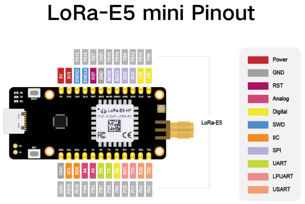

<!-- Copyright 2015-2026 Zephyr Project members and individual contributors. -->
<!-- SPDX-License-Identifier: Apache-2.0 -->
<!-- 中文翻译；编号、导航与译注为本地新增。 -->

<a id="lora_e5_mini"></a>

# 第3章\_LoRa-E5 mini

原文：[官方页面](https://docs.zephyrproject.org/latest/boards/seeed/lora_e5_mini/doc/index.html)。读取日期：2026-10-16；来源摘要见[来源记录](../SOURCES.md)。

开发板概览（Board Overview）

<a id="id1"></a>

[](images/lora_e5_mini.jpg)

LoRa-E5 mini

名称（Name）：

`lora_e5_mini`

厂商（Vendor）：

[Seeed Technology Co., Ltd](https://docs.zephyrproject.org/latest/boards/index.html#vendor=seeed)

状态（Status）：

当前未积极维护（Not Actively Maintained）

架构（Architecture）：

[arm](https://docs.zephyrproject.org/latest/boards/index.html#arch=arm)

片上系统（SoC）：

[stm32wle5xx](https://docs.zephyrproject.org/latest/boards/index.html#soc=stm32wle5xx)

<a id="board-github-link"></a>

[浏览开发板源码（Browse Board Sources）](https://github.com/zephyrproject-rtos/zephyr/blob/main//boards/seeed/lora_e5_mini/doc/index.rst/../..)<a id="overview"></a>

## 概述（Overview）

LoRa-E5 mini是一块紧凑开发板，适合快速测试及制作小型LoRa设备，并引出Seeed Studio LoRa-E5 STM32WLE5JC模块的全部功能。

<a id="hardware"></a>

## 硬件（Hardware）

板载LoRa-E5模块采用28引脚表面贴装（SMD）封装，内含STM32WLE5JC SoC、32 MHz温度补偿晶体振荡器（TCXO）及32.768 kHz晶体振荡器。SoC采用Arm Cortex-M4核并集成Semtech SX126X LoRa IP，支持(G)FSK、BPSK、(G)MSK及LoRa调制；原文后一处芯片名写作STM32WLEJC。


- LoRa-E5 STM32WLE5JC模块采用28引脚SMD封装，内含STM32WLE5JC多协议LPWAN单核32位微控制器，即48 MHz Arm Cortex-M4，具备以下功能：


  - 超低功耗微控制器（MCU）
  - 射频收发器（RF Transceiver），频率范围150—960 MHz，支持LoRa、(G)FSK、(G)MSK及BPSK调制
  - 256 KB闪存及64 KB SRAM
  - 256位AES硬件加密及真随机数发生器（TRNG）
- 一个用户LED
- 两个串行通信LED，分别指示RX及TX
- 一个启动／用户按键及一个复位按键
- 32.768 kHz LSE晶体振荡器
- 32 MHz高速外部（HSE）振荡器
- 开发板连接器（Board Connectors）：


  - USB Type-C接口
  - 正负电池电源输入引脚，3—5 V
  - SMA-K及IPEX天线连接器
- 随附SMA天线，默认IPEX连接器未接通
- 供电方式灵活：USB Type-C，或将3—5 V电池焊接到正负引脚
- 适合快速开发基于LoRaWAN、Sigfox、无线M-Bus（wM-Bus）及其他专有协议的终端节点（End Nodes）原型
- 引出LoRa-E5 STM32WLE5JC模块全部GPIO
- 四个M2安装孔

更多板卡信息见[LoRa-E5 mini Wiki](https://wiki.seeedstudio.com/LoRa_E5_mini/)。

LoRa-E5 STM32WLE5JC模块的更多信息见：


- [LoRa-E5 STM32WLE5JC模块Wiki](https://wiki.seeedstudio.com/LoRa-E5_STM32WLE5JC_Module/)
- [LoRa-E5 STM32WLE5JC模块数据手册](https://files.seeedstudio.com/products/317990687/res/LoRa-E5%20module%20datasheet_V1.0.pdf)
- [STM32WLE5JC数据手册](https://www.st.com/resource/en/datasheet/stm32wle5jc.pdf)
- [STM32WLE5JC参考手册](https://www.st.com/resource/en/reference_manual/dm00530369-stm32wlex-advanced-armbased-32bit-mcus-with-subghz-radio-solution-stmicroelectronics.pdf)
- [www.st.com上的STM32WLE5JC资料](https://www.st.com/en/microcontrollers-microprocessors/stm32wle5jc.html)

<a id="supported-features"></a>

### 支持的功能（Supported Features）

`lora_e5_mini`开发板支持下表所列的硬件功能。

片上／板载（On-Chip / On-Board）

功能集成在片上系统（SoC）内／位于开发板上。

2 / 2

分别表示已启用／已禁用的实例数。点击数量标签，可查看开发板或SoC设备树源码（DTS）中该功能的第一个实例。

`vnd,foo`

与此功能匹配的设备树绑定兼容字符串（Compatible String）；点击链接可查看绑定文档。

<a id="lora_e5_mini-hw-features"></a>

<a id="lora_e5_mini-lora_e5_mini/stm32wle5xx-hw-features-section"></a>

#### `lora_e5_mini/stm32wle5xx`目标（Target）

<a id="lora_e5_mini-lora_e5_mini/stm32wle5xx-hw-features-panel"></a>

<a id="lora_e5_mini-lora_e5_mini/stm32wle5xx-hw-features-memory"></a>

该开发板目标的片上存储容量：64 KiB RAM、256 KiB Flash。

<a id="lora_e5_mini-lora_e5_mini/stm32wle5xx-hw-features-table"></a>

<table>
<tr>
<th>类型（Type）</th>
<th>位置（Location）</th>
<th>说明（Description）</th>
<th>兼容字符串（Compatible）</th>
</tr>
<tr>
<td rowspan="1">中央处理器（CPU）</td>
<td>片上（On-Chip）</td>
<td>ARM Cortex-M4 处理器（CPU）（<a href="https://github.com/zephyrproject-rtos/zephyr/blob/main/dts/arm/st/wl/stm32wl.dtsi?plain=1#L33">已启用：1</a>）</td>
<td><a href="../cpu_arm_riscv_binding_reference/P024_arm_cortex-m4.md#std-dtcompatible-arm-cortex-m4"><code>arm,cortex-m4</code></a></td>
</tr>
<tr>
<td rowspan="1">模数转换器（ADC）</td>
<td>片上（On-Chip）</td>
<td>STM32模数转换器（ADC）（<a href="https://github.com/zephyrproject-rtos/zephyr/blob/main/dts/arm/st/wl/stm32wl.dtsi?plain=1#L400">已禁用：1</a>）</td>
<td><a href="../hardware/P839_STM32模数转换器绑定.md#dtbinding-st-stm32-adc"><code>st,stm32-adc</code></a></td>
</tr>
<tr>
<td rowspan="7">时钟控制（Clock Control）</td>
<td>片上（On-Chip）</td>
<td>STM32WL复位与时钟控制器（RCC）（<a href="https://github.com/zephyrproject-rtos/zephyr/blob/main/dts/arm/st/wl/stm32wl.dtsi?plain=1#L179">已启用：1</a>）</td>
<td><a href="../timer_reference/P173_STM32WL复位与时钟控制绑定.md#dtbinding-st-stm32wl-rcc"><code>st,stm32wl-rcc</code></a></td>
</tr>
<tr>
<td>片上（On-Chip）</td>
<td>STM32WL高速外部时钟（HSE）（<a href="https://github.com/zephyrproject-rtos/zephyr/blob/main/dts/arm/st/wl/stm32wl.dtsi?plain=1#L70">已禁用：1</a>）</td>
<td><a href="../timer_reference/P164_STM32WL高速外部时钟绑定.md#dtbinding-st-stm32wl-hse-clock"><code>st,stm32wl-hse-clock</code></a></td>
</tr>
<tr>
<td>片上（On-Chip）</td>
<td>通用固定频率时钟提供者（Fixed-Rate Clock Provider）（<a href="https://github.com/zephyrproject-rtos/zephyr/blob/main/dts/arm/st/wl/stm32wl.dtsi?plain=1#L100">已启用：1</a>；<a href="https://github.com/zephyrproject-rtos/zephyr/blob/main/dts/arm/st/wl/stm32wl.dtsi?plain=1#L78">已禁用：1</a>）</td>
<td><a href="../hardware/P566_固定时钟绑定.md#dtbinding-fixed-clock"><code>fixed-clock</code></a></td>
</tr>
<tr>
<td>片上（On-Chip）</td>
<td>STM32多速内部时钟（MSI Clock）（<a href="https://github.com/zephyrproject-rtos/zephyr/blob/main/dts/arm/st/wl/stm32wl.dtsi?plain=1#L85">已启用：1</a>）</td>
<td><a href="../timer_reference/P132_STM32多速内部时钟绑定.md#dtbinding-st-stm32-msi-clock"><code>st,stm32-msi-clock</code></a></td>
</tr>
<tr>
<td>片上（On-Chip）</td>
<td>STM32低速外部时钟（LSE Clock）（<a href="https://github.com/zephyrproject-rtos/zephyr/blob/main/dts/arm/st/wl/stm32wl.dtsi?plain=1#L92">已禁用：1</a>）</td>
<td><a href="../timer_reference/P130_STM32低速外部时钟绑定.md#dtbinding-st-stm32-lse-clock"><code>st,stm32-lse-clock</code></a></td>
</tr>
<tr>
<td>片上（On-Chip）</td>
<td>STM32WB及STM32WL锁相环（PLL）节点（<a href="https://github.com/zephyrproject-rtos/zephyr/blob/main/dts/arm/st/wl/stm32wl.dtsi?plain=1#L107">已禁用：1</a>）</td>
<td><a href="../timer_reference/P151_STM32WB锁相环时钟绑定.md#dtbinding-st-stm32wb-pll-clock"><code>st,stm32wb-pll-clock</code></a></td>
</tr>
<tr>
<td>片上（On-Chip）</td>
<td>STM32 微控制器时钟输出（Microcontroller Clock Output，MCO）（<a href="https://github.com/zephyrproject-rtos/zephyr/blob/main/dts/arm/st/wl/stm32wl.dtsi?plain=1#L115">已禁用：1</a>）</td>
<td><a href="../timer_reference/P134_STM32时钟输出绑定.md#dtbinding-st-stm32-clock-mco"><code>st,stm32-clock-mco</code></a></td>
</tr>
<tr>
<td rowspan="1">计数器（Counter）</td>
<td>片上（On-Chip）</td>
<td>STM32 计数器（Counters）（<a href="https://github.com/zephyrproject-rtos/zephyr/blob/main/dts/arm/st/wl/stm32wl.dtsi?plain=1#L449">已禁用：4</a>）</td>
<td><a href="../stm32_ti_xilinx_counter_binding_reference/P007_st_stm32-counter.md#std-dtcompatible-st-stm32-counter"><code>st,stm32-counter</code></a></td>
</tr>
<tr>
<td rowspan="1">循环冗余校验（CRC）</td>
<td>片上（On-Chip）</td>
<td>STM32 CRC 计算单元（Calculation Unit）（<a href="https://github.com/zephyrproject-rtos/zephyr/blob/main/dts/arm/st/wl/stm32wl.dtsi?plain=1#L620">已禁用：1</a>）</td>
<td><a href="../crc_clock_monitor_binding_reference/P011_st_stm32-crc.md#std-dtcompatible-st-stm32-crc"><code>st,stm32-crc</code></a></td>
</tr>
<tr>
<td rowspan="1">密码学加速器（Cryptographic Accelerator）</td>
<td>片上（On-Chip）</td>
<td>STM32高级加密标准加速器（AES Accelerator）（<a href="https://github.com/zephyrproject-rtos/zephyr/blob/main/dts/arm/st/wl/stm32wl.dtsi?plain=1#L536">已启用：1</a>）</td>
<td><a href="../crypto_secure_engine_st_ti_binding_reference/P015_st_stm32-aes.md#std-dtcompatible-st-stm32-aes"><code>st,stm32-aes</code></a></td>
</tr>
<tr>
<td rowspan="1">数模转换器（DAC）</td>
<td>片上（On-Chip）</td>
<td>STM32 系列数模转换器（DAC）（<a href="https://github.com/zephyrproject-rtos/zephyr/blob/main/dts/arm/st/wl/stm32wl.dtsi?plain=1#L424">已禁用：1</a>）</td>
<td><a href="../hardware/P760_STM32数模转换器绑定.md#dtbinding-st-stm32-dac"><code>st,stm32-dac</code></a></td>
</tr>
<tr>
<td rowspan="2">直接存储器访问（DMA）</td>
<td>片上（On-Chip）</td>
<td>STM32直接存储器访问控制器（DMA Controller，V2）（<a href="https://github.com/zephyrproject-rtos/zephyr/blob/main/dts/arm/st/wl/stm32wl.dtsi?plain=1#L556">已禁用：2</a>）</td>
<td><a href="../stm32_ti_xilinx_dma_binding_reference/P008_st_stm32-dma-v2.md#std-dtcompatible-st-stm32-dma-v2"><code>st,stm32-dma-v2</code></a></td>
</tr>
<tr>
<td>片上（On-Chip）</td>
<td>STM32 DMA 多路复用控制器（DMAMUX Controller）（<a href="https://github.com/zephyrproject-rtos/zephyr/blob/main/dts/arm/st/wl/stm32wl.dtsi?plain=1#L578">已禁用：1</a>）</td>
<td><a href="../stm32_ti_xilinx_dma_binding_reference/P011_st_stm32-dmamux.md#std-dtcompatible-st-stm32-dmamux"><code>st,stm32-dmamux</code></a></td>
</tr>
<tr>
<td rowspan="1">闪存控制器（Flash Controller）</td>
<td>片上（On-Chip）</td>
<td>STM32 系列闪存控制器（Flash Controller）（<a href="https://github.com/zephyrproject-rtos/zephyr/blob/main/dts/arm/st/wl/stm32wl.dtsi?plain=1#L123">已启用：1</a>）</td>
<td><a href="../flash_renesas_st_ti_binding_reference/P011_st_stm32-flash-controller.md#std-dtcompatible-st-stm32-flash-controller"><code>st,stm32-flash-controller</code></a></td>
</tr>
<tr>
<td rowspan="1">通用输入输出与接插件（GPIO &amp; Headers）</td>
<td>片上（On-Chip）</td>
<td>STM32 通用输入输出控制器（GPIO Controller）（<a href="https://github.com/zephyrproject-rtos/zephyr/blob/main/dts/arm/st/wl/stm32wl.dtsi?plain=1#L213">已启用：4</a>）</td>
<td><a href="../gpio_silabs_st_connectors_binding_reference/P029_st_stm32-gpio.md#std-dtcompatible-st-stm32-gpio"><code>st,stm32-gpio</code></a></td>
</tr>
<tr>
<td rowspan="1">集成电路间总线（I2C）</td>
<td>片上（On-Chip）</td>
<td>STM32 I2C V2 控制器（Controller）（<a href="https://github.com/zephyrproject-rtos/zephyr/blob/main/dts/arm/st/wl/stm32wl.dtsi?plain=1#L335">已启用：1</a>；<a href="https://github.com/zephyrproject-rtos/zephyr/blob/main/dts/arm/st/wl/stm32wl.dtsi?plain=1#L323">已禁用：2</a>）</td>
<td><a href="../i2c_stm32_ti_mux_binding_reference/P008_st_stm32-i2c-v2.md#std-dtcompatible-st-stm32-i2c-v2"><code>st,stm32-i2c-v2</code></a></td>
</tr>
<tr>
<td rowspan="1">输入（Input）</td>
<td>板载（On-Board）</td>
<td>一组绑定到 GPIO 的输入按键（GPIO-Bound Input Keys）（<a href="https://github.com/zephyrproject-rtos/zephyr/blob/main/boards/seeed/lora_e5_mini/lora_e5_mini.dts?plain=1#L33">已启用：1</a>）</td>
<td><a href="../hardware/P563_GPIO按键绑定.md#std-dtcompatible-gpio-keys"><code>gpio-keys</code></a></td>
</tr>
<tr>
<td rowspan="2">中断控制器（Interrupt Controller）</td>
<td>片上（On-Chip）</td>
<td>ARMv7-M 嵌套向量中断控制器（Nested Vectored Interrupt Controller，NVIC）（<a href="https://github.com/zephyrproject-rtos/zephyr/blob/main/dts/arm/armv7-m.dtsi?plain=1#L13">已启用：1</a>）</td>
<td><a href="../arm_interrupt_timer_binding_reference/P002_ARMv7_M_NVIC.md#std-dtcompatible-arm-v7m-nvic"><code>arm,v7m-nvic</code></a></td>
</tr>
<tr>
<td>片上（On-Chip）</td>
<td>STM32 外部中断控制器（External Interrupt Controller）（<a href="https://github.com/zephyrproject-rtos/zephyr/blob/main/dts/arm/st/wl/stm32wl.dtsi?plain=1#L190">已启用：1</a>）</td>
<td><a href="../mcu_external_interrupt_binding_reference/P001_st_stm32-exti.md#std-dtcompatible-st-stm32-exti"><code>st,stm32-exti</code></a></td>
</tr>
<tr>
<td rowspan="1">发光二极管（LED）</td>
<td>板载（On-Board）</td>
<td>一组由 GPIO 控制的 LED（GPIO-Controlled LEDs）（<a href="https://github.com/zephyrproject-rtos/zephyr/blob/main/boards/seeed/lora_e5_mini/lora_e5_mini.dts?plain=1#L24">已启用：1</a>）</td>
<td><a href="../hardware/P564_GPIO指示灯绑定.md#dtbinding-gpio-leds"><code>gpio-leds</code></a></td>
</tr>
<tr>
<td rowspan="1">远距离无线通信（LoRa）</td>
<td>片上（On-Chip）</td>
<td>STM32WL Sub-GHz无线电（<a href="https://github.com/zephyrproject-rtos/zephyr/blob/main/dts/arm/st/wl/stm32wl.dtsi?plain=1#L391">已启用：1</a>）</td>
<td><a href="../lora_ieee802154_binding_reference/P026_st_stm32wl-subghz-radio.md#std-dtcompatible-st-stm32wl-subghz-radio"><code>st,stm32wl-subghz-radio</code></a></td>
</tr>
<tr>
<td rowspan="1">存储器控制器（Memory Controller）</td>
<td>片上（On-Chip）</td>
<td>STM32 电池备份 RAM（Battery-Backed RAM）（<a href="https://github.com/zephyrproject-rtos/zephyr/blob/main/dts/arm/st/wl/stm32wl.dtsi?plain=1#L274">已禁用：1</a>）</td>
<td><a href="../memory_controller_sdram_psram_binding_reference/P010_st_stm32-bbram.md#std-dtcompatible-st-stm32-bbram"><code>st,stm32-bbram</code></a></td>
</tr>
<tr>
<td rowspan="1">存储技术设备（MTD）</td>
<td>片上（On-Chip）</td>
<td>STM32闪存（Flash Memory）（<a href="https://github.com/zephyrproject-rtos/zephyr/blob/main/dts/arm/st/wl/stm32wl.dtsi?plain=1#L132">已启用：1</a>）</td>
<td><a href="../mtd_nxp_st_ti_partition_binding_reference/P016_st_stm32-nv-flash.md#std-dtcompatible-st-stm32-nv-flash"><code>st,stm32-nv-flash</code></a></td>
</tr>
<tr>
<td rowspan="1">非易失存储器（NVMEM）</td>
<td>片上（On-Chip）</td>
<td>非易失存储器固定布局（Fixed Layout for Non-Volatile Memory）（<a href="https://github.com/zephyrproject-rtos/zephyr/blob/main/dts/arm/st/wl/stm32wl.dtsi?plain=1#L153">已启用：1</a>）</td>
<td><a href="../memory_protection_binding_reference/P009_fixed-layout.md#std-dtcompatible-fixed-layout"><code>fixed-layout</code></a></td>
</tr>
<tr>
<td rowspan="1">一次性可编程存储器（OTP Memory）</td>
<td>片上（On-Chip）</td>
<td>STM32 嵌入式非易失一次性可编程存储器（NVM OTP）（<a href="https://github.com/zephyrproject-rtos/zephyr/blob/main/dts/arm/st/wl/stm32wl.dtsi?plain=1#L149">已启用：1</a>；<a href="https://github.com/zephyrproject-rtos/zephyr/blob/main/dts/arm/st/wl/stm32wl.dtsi?plain=1#L142">已禁用：1</a>）</td>
<td><a href="../otp_binding_reference/P010_st_stm32-nvm-otp.md#std-dtcompatible-st-stm32-nvm-otp"><code>st,stm32-nvm-otp</code></a></td>
</tr>
<tr>
<td rowspan="1">引脚控制（Pin Control）</td>
<td>片上（On-Chip）</td>
<td>STM32 引脚控制器（Pin Controller）（<a href="https://github.com/zephyrproject-rtos/zephyr/blob/main/dts/arm/st/wl/stm32wl.dtsi?plain=1#L206">已启用：1</a>）</td>
<td><a href="../pinctrl_stm32_ti_xilinx_binding_reference/P004_st_stm32-pinctrl.md#std-dtcompatible-st-stm32-pinctrl"><code>st,stm32-pinctrl</code></a></td>
</tr>
<tr>
<td rowspan="2">电源管理（Power Management）</td>
<td>片上（On-Chip）</td>
<td>STM32 电源控制器（Power Controller）（<a href="https://github.com/zephyrproject-rtos/zephyr/blob/main/dts/arm/st/wl/stm32wl.dtsi?plain=1#L590">已启用：1</a>）</td>
<td><a href="../stm32_soc_power_binding_reference/P010_st_stm32-pwr.md#std-dtcompatible-st-stm32-pwr"><code>st,stm32-pwr</code></a></td>
</tr>
<tr>
<td>片上（On-Chip）</td>
<td>STM32唤醒线控制器（Wake-up Lines Controller）（<a href="https://github.com/zephyrproject-rtos/zephyr/blob/main/dts/arm/st/wl/stm32wl.dtsi?plain=1#L594">已禁用：1</a>）</td>
<td><a href="../stm32_soc_power_binding_reference/P009_st_stm32-pwr-wkupctrl.md#std-dtcompatible-st-stm32-pwr-wkupctrl"><code>st,stm32-pwr-wkupctrl</code></a></td>
</tr>
<tr>
<td rowspan="1">脉宽调制（PWM）</td>
<td>片上（On-Chip）</td>
<td>STM32 脉宽调制（PWM）（<a href="https://github.com/zephyrproject-rtos/zephyr/blob/main/dts/arm/st/wl/stm32wl.dtsi?plain=1#L443">已禁用：4</a>）</td>
<td><a href="../pwm_stm32_ti_generic_binding_reference/P011_st_stm32-pwm.md#std-dtcompatible-st-stm32-pwm"><code>st,stm32-pwm</code></a></td>
</tr>
<tr>
<td rowspan="1">复位控制器（Reset Controller）</td>
<td>片上（On-Chip）</td>
<td>STM32 复位与时钟控制器（Reset and Clock Control，RCC）（<a href="https://github.com/zephyrproject-rtos/zephyr/blob/main/dts/arm/st/wl/stm32wl.dtsi?plain=1#L184">已启用：1</a>）</td>
<td><a href="../reset_controller_binding_reference/P017_st_stm32-rcc-rctl.md#std-dtcompatible-st-stm32-rcc-rctl"><code>st,stm32-rcc-rctl</code></a></td>
</tr>
<tr>
<td rowspan="1">随机数生成器（RNG）</td>
<td>片上（On-Chip）</td>
<td>STM32 随机数生成器（Random Number Generator）（<a href="https://github.com/zephyrproject-rtos/zephyr/blob/main/dts/arm/st/wl/stm32wl.dtsi?plain=1#L545">已禁用：1</a>）</td>
<td><a href="../soc_rng_binding_reference/P016_st_stm32-rng.md#std-dtcompatible-st-stm32-rng"><code>st,stm32-rng</code></a></td>
</tr>
<tr>
<td rowspan="1">实时时钟（RTC）</td>
<td>片上（On-Chip）</td>
<td>STM32 实时时钟（RTC）（<a href="https://github.com/zephyrproject-rtos/zephyr/blob/main/dts/arm/st/wl/stm32wl.dtsi?plain=1#L258">已启用：1</a>）</td>
<td><a href="../soc_rtc_binding_reference/P014_st_stm32-rtc.md#std-dtcompatible-st-stm32-rtc"><code>st,stm32-rtc</code></a></td>
</tr>
<tr>
<td rowspan="4">传感器（Sensors）</td>
<td>片上（On-Chip）</td>
<td>STM32 正交解码器（Quadrature Decoder）（<a href="https://github.com/zephyrproject-rtos/zephyr/blob/main/dts/arm/st/wl/stm32wl.dtsi?plain=1#L454">已禁用：2</a>）</td>
<td><a href="../sensor_st_lsm_stm32_binding_reference/P028_st_stm32-qdec.md#std-dtcompatible-st-stm32-qdec"><code>st,stm32-qdec</code></a></td>
</tr>
<tr>
<td>片上（On-Chip）</td>
<td>STM32 系列温度节点（TEMP），用于以两个温度点完成生产校准的传感器。（<a href="https://github.com/zephyrproject-rtos/zephyr/blob/main/dts/arm/st/wl/stm32wl.dtsi?plain=1#L629">已禁用：1</a>）</td>
<td><a href="../sensor_st_lsm_stm32_binding_reference/P029_st_stm32-temp-cal.md#std-dtcompatible-st-stm32-temp-cal"><code>st,stm32-temp-cal</code></a></td>
</tr>
<tr>
<td>片上（On-Chip）</td>
<td>STM32 参考电压（VREF+）（<a href="https://github.com/zephyrproject-rtos/zephyr/blob/main/dts/arm/st/wl/stm32wl.dtsi?plain=1#L640">已禁用：1</a>）</td>
<td><a href="../sensor_st_ti_power_capacitance_binding_reference/P003_st_stm32-vref.md#std-dtcompatible-st-stm32-vref"><code>st,stm32-vref</code></a></td>
</tr>
<tr>
<td>片上（On-Chip）</td>
<td>STM32 电池电压（VBAT）（<a href="https://github.com/zephyrproject-rtos/zephyr/blob/main/dts/arm/st/wl/stm32wl.dtsi?plain=1#L648">已禁用：1</a>）</td>
<td><a href="../sensor_st_ti_power_capacitance_binding_reference/P001_st_stm32-vbat.md#std-dtcompatible-st-stm32-vbat"><code>st,stm32-vbat</code></a></td>
</tr>
<tr>
<td rowspan="2">串行控制器（Serial Controller）</td>
<td>片上（On-Chip）</td>
<td>STM32 通用同步／异步收发器（USART）（<a href="https://github.com/zephyrproject-rtos/zephyr/blob/main/dts/arm/st/wl/stm32wl.dtsi?plain=1#L295">已启用：1</a>；<a href="https://github.com/zephyrproject-rtos/zephyr/blob/main/dts/arm/st/wl/stm32wl.dtsi?plain=1#L304">已禁用：1</a>）</td>
<td><a href="../uart_silabs_stm32_ti_binding_reference/P016_st_stm32-usart.md#std-dtcompatible-st-stm32-usart"><code>st,stm32-usart</code></a></td>
</tr>
<tr>
<td>片上（On-Chip）</td>
<td>STM32低功耗通用异步收发器（LPUART）（<a href="https://github.com/zephyrproject-rtos/zephyr/blob/main/dts/arm/st/wl/stm32wl.dtsi?plain=1#L313">已禁用：1</a>）</td>
<td><a href="../uart_silabs_stm32_ti_binding_reference/P014_st_stm32-lpuart.md#std-dtcompatible-st-stm32-lpuart"><code>st,stm32-lpuart</code></a></td>
</tr>
<tr>
<td rowspan="1">系统管理总线（SMbus）</td>
<td>片上（On-Chip）</td>
<td>STM32 系统管理总线控制器（SMBus Controller）（<a href="https://github.com/zephyrproject-rtos/zephyr/blob/main/dts/arm/st/wl/stm32wl.dtsi?plain=1#L655">已禁用：3</a>）</td>
<td><a href="../i3c_smbus_binding_reference/P013_st_stm32-smbus.md#std-dtcompatible-st-stm32-smbus"><code>st,stm32-smbus</code></a></td>
</tr>
<tr>
<td rowspan="2">串行外设接口（SPI）</td>
<td>片上（On-Chip）</td>
<td>带嵌入式接收和发送先进先出队列（Rx / Tx FIFOs）的STM32 SPI控制器（<a href="https://github.com/zephyrproject-rtos/zephyr/blob/main/dts/arm/st/wl/stm32wl.dtsi?plain=1#L359">已禁用：2</a>）</td>
<td><a href="../spi_stm32_ti_xilinx_binding_reference/P009_st_stm32-spi-fifo.md#std-dtcompatible-st-stm32-spi-fifo"><code>st,stm32-spi-fifo</code></a></td>
</tr>
<tr>
<td>片上（On-Chip）</td>
<td>STM32 SUBGHZ SPI控制器（<a href="https://github.com/zephyrproject-rtos/zephyr/blob/main/dts/arm/st/wl/stm32wl.dtsi?plain=1#L381">已启用：1</a>）</td>
<td><a href="../spi_stm32_ti_xilinx_binding_reference/P011_st_stm32-spi-subghz.md#std-dtcompatible-st-stm32-spi-subghz"><code>st,stm32-spi-subghz</code></a></td>
</tr>
<tr>
<td rowspan="3">定时器（Timer）</td>
<td>片上（On-Chip）</td>
<td>ARMv7-M 系统节拍（System Tick）（<a href="https://github.com/zephyrproject-rtos/zephyr/blob/main/dts/arm/armv7-m.dtsi?plain=1#L21">已启用：1</a>）</td>
<td><a href="../arm_interrupt_timer_binding_reference/P006_ARMv7_M_SysTick.md#std-dtcompatible-arm-armv7m-systick"><code>arm,armv7m-systick</code></a></td>
</tr>
<tr>
<td>片上（On-Chip）</td>
<td>STM32低功耗定时器（LPTIM）（<a href="https://github.com/zephyrproject-rtos/zephyr/blob/main/dts/arm/st/wl/stm32wl.dtsi?plain=1#L246">已启用：1</a>）</td>
<td><a href="../stm32_ti_silabs_timer_binding_reference/P007_st_stm32-lptim.md#std-dtcompatible-st-stm32-lptim"><code>st,stm32-lptim</code></a></td>
</tr>
<tr>
<td>片上（On-Chip）</td>
<td>STM32 定时器（Timers）（<a href="https://github.com/zephyrproject-rtos/zephyr/blob/main/dts/arm/st/wl/stm32wl.dtsi?plain=1#L432">已禁用：4</a>）</td>
<td><a href="../stm32_ti_silabs_timer_binding_reference/P008_st_stm32-timers.md#std-dtcompatible-st-stm32-timers"><code>st,stm32-timers</code></a></td>
</tr>
<tr>
<td rowspan="2">看门狗（Watchdog）</td>
<td>片上（On-Chip）</td>
<td>STM32 看门狗（Watchdog）（<a href="https://github.com/zephyrproject-rtos/zephyr/blob/main/dts/arm/st/wl/stm32wl.dtsi?plain=1#L281">已启用：1</a>）</td>
<td><a href="../stm32_ti_xilinx_watchdog_binding_reference/P001_st_stm32-watchdog.md#std-dtcompatible-st-stm32-watchdog"><code>st,stm32-watchdog</code></a></td>
</tr>
<tr>
<td>片上（On-Chip）</td>
<td>STM32 系统窗口看门狗（System Window Watchdog）（<a href="https://github.com/zephyrproject-rtos/zephyr/blob/main/dts/arm/st/wl/stm32wl.dtsi?plain=1#L287">已禁用：1</a>）</td>
<td><a href="../stm32_ti_xilinx_watchdog_binding_reference/P002_st_stm32-window-watchdog.md#std-dtcompatible-st-stm32-window-watchdog"><code>st,stm32-window-watchdog</code></a></td>
</tr>
</table>

<a id="connections-and-ios"></a>

### 连接与输入输出（Connections and IOs）

LoRa-E5 mini具有4个GPIO控制器，负责引脚复用、输入输出、上拉等功能。

<a id="available-pins"></a>

#### 可用引脚：



<a id="default-zephyr-peripheral-mapping"></a>

#### Zephyr 默认外设映射（Peripheral Mapping）：


- USART_1发送（TX）：PB6
- USART_1接收（RX）：PB7
- I2C_2时钟（SCL）：PB15
- I2C_2数据（SDA）：PA15
- 启动按键（BOOT_PB）：PB13
- LED_1：PB5

<a id="system-clock"></a>

#### 系统时钟（System Clock）

LoRa-E5 mini系统时钟可由低功耗内部振荡器（MSI）、高速内部振荡器（HSI）、高速外部振荡器（HSE）或主PLL提供。默认使用48 MHz的MSI时钟。

<a id="programming-and-debugging"></a>

## 烧录与调试（Programming and Debugging）

`lora_e5_mini`开发板支持下表所列的运行工具（Runners）及相关west命令。

<table>
<tr>
<th></th>
<th>烧录（flash）</th>
<th>调试（debug）</th>
<th>连接调试会话（attach）</th>
<th>实时传输（rtt）</th>
<th>复位（reset）</th>
<th>调试服务器（debugserver）</th>
</tr>
<tr>
<td><a href="https://docs.zephyrproject.org/latest/develop/flash_debug/host-tools.html#runner-blackmagicprobe">blackmagicprobe</a></td>
<td>✅</td>
<td>✅</td>
<td>✅</td>
<td></td>
<td></td>
<td></td>
</tr>
<tr>
<td><a href="https://docs.zephyrproject.org/latest/develop/flash_debug/host-tools.html#runner-jlink"><code>jlink</code></a></td>
<td>✅</td>
<td>✅</td>
<td>✅</td>
<td>✅</td>
<td>✅</td>
<td>✅</td>
</tr>
<tr>
<td><a href="https://docs.zephyrproject.org/latest/develop/flash_debug/host-tools.html#runner-openocd"><code>openocd</code></a></td>
<td>✅</td>
<td>✅</td>
<td>✅</td>
<td>✅</td>
<td></td>
<td>✅</td>
</tr>
<tr>
<td><a href="https://docs.zephyrproject.org/latest/develop/flash_debug/host-tools.html#runner-pyocd"><code>pyocd</code></a></td>
<td>✅（默认 / default）</td>
<td>✅（默认 / default）</td>
<td>✅</td>
<td>✅</td>
<td>✅</td>
<td>✅</td>
</tr>
<tr>
<td><a href="https://docs.zephyrproject.org/latest/develop/flash_debug/host-tools.html#runner-stm32cubeprogrammer"><code>stm32cubeprogrammer</code></a></td>
<td>✅</td>
<td></td>
<td></td>
<td></td>
<td></td>
<td></td>
</tr>
</table>

lora_e5_mini板级配置的应用可按常规方式构建，见“构建应用”。（[构建应用（Building an Application）](../application/P001_应用开发.md#build-an-application)）

模块出厂时烧录了DFU引导加载器及AT命令固件，并启用读保护级别1（RDP Level 1）。首次写入Zephyr应用前，必须将读保护降至级别0。使用ST-LINK时，可在STM32CubeProgrammer图形界面将RDP选项字节设为AA，或向STM32_Programmer_CLI传入--readunprotect命令执行降级。由级别1降至级别0会擦除出厂AT固件；原文说明Seeed Studio未发布该固件的源码或二进制文件。此外，模块不引出SoC的BOOT0引脚，只有通过选项字节配置后才能执行系统引导加载器。

<a id="flashing"></a>

### 烧录（Flashing）

LoRa-E5 mini没有板载调试探针。可将外部探针连接到2.54 mm排针进行调试。根据探针，可使用openocd、stm32cubeprogrammer、pyocd、blackmagic或jlink运行工具（Runner）烧录。补充说明如下：


- pyOCD支持STM32WL需要额外目标信息，可通过以下命令添加设备包（Pack）支持：

```text
$ pyocd pack --update
$ pyocd pack --install stm32wl
```

<a id="flashing-an-application-to-lora-e5-mini"></a>

#### 向LoRa-E5 mini烧录应用

通过外部调试探针将LoRa-E5连接主机，随后构建并烧录应用。以下以[Hello World](../getting_started/P005_HelloWorld示例.md#hello_world)为例。

运行主机串口程序连接开发板。默认usart1控制台通过板载USB转UART转换器连接到USB Type-C接口。

```text
$ picocom --baud 115200 /dev/ttyACM0
```

随后构建并烧录应用。

```text
# From the root of the zephyr repository
west build -b lora_e5_mini samples/hello_world
west flash
```

<a id="debugging"></a>

### 调试（Debugging）

可以按通常方式调试应用，以下以[Blinky](../getting_started/P004_LED闪烁示例.md#blinky)为例。

```text
# From the root of the zephyr repository
west build -b lora_e5_mini samples/basic/blinky
west debug
```

## 译注

LoRa-E5 mini使用外部SWD探针，复用Dev页面的RDP降级说明，但连接器及供电方式分别按本页保留。STM32WLEJC为原文一处拼写。

## 原文外链核对

2026-10-16核对并重试以下原文外链时未能确认可访问性，保留原始目标，不将访问失败解释为原文内容有误。

- [stm32wle5jc.html](https://www.st.com/en/microcontrollers-microprocessors/stm32wle5jc.html)：HTTP Error 567: Unknown Status。
- [stm32wle5jc.pdf](https://www.st.com/resource/en/datasheet/stm32wle5jc.pdf)：HTTP Error 567: Unknown Status。
- [dm00530369-stm32wlex-advanced-armbased-32bit-mcus-with-subghz-radio-solution-stmicroelectronics.pdf](https://www.st.com/resource/en/reference_manual/dm00530369-stm32wlex-advanced-armbased-32bit-mcus-with-subghz-radio-solution-stmicroelectronics.pdf)：HTTP Error 567: Unknown Status。

---

[上一章](P002_LoRa-E5_Dev_Board.md) · [返回大纲](大纲.md) · [全站翻译进度](../PROGRESS.md) · [下一章](P004_reTerminal_E1001.md)
