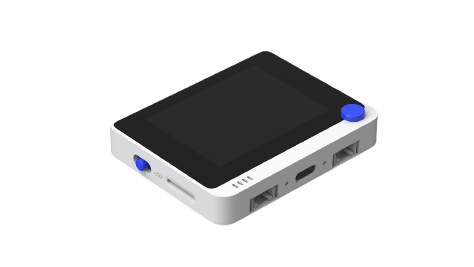

<!-- Copyright 2015-2026 Zephyr Project members and individual contributors. -->
<!-- SPDX-License-Identifier: Apache-2.0 -->
<!-- 中文翻译；编号、导航与译注为本地新增。 -->

<a id="wio_terminal"></a>

# 第8章\_Wio Terminal

原文：[官方页面](https://docs.zephyrproject.org/latest/boards/seeed/wio_terminal/doc/index.html)。读取日期：2026-10-16；来源摘要见[来源记录](../SOURCES.md)。

开发板概览（Board Overview）

<a id="id1"></a>

[](images/wio_terminal.png)

Wio Terminal

名称（Name）：

`wio_terminal`

厂商（Vendor）：

[Seeed Technology Co., Ltd](https://docs.zephyrproject.org/latest/boards/index.html#vendor=seeed)

状态（Status）：

当前未积极维护（Not Actively Maintained）

架构（Architecture）：

[arm](https://docs.zephyrproject.org/latest/boards/index.html#arch=arm)

片上系统（SoC）：

[samd51p19a](https://docs.zephyrproject.org/latest/boards/index.html#soc=samd51p19a)

<a id="board-github-link"></a>

[浏览开发板源码（Browse Board Sources）](https://github.com/zephyrproject-rtos/zephyr/blob/main//boards/seeed/wio_terminal/doc/index.rst/../..)<a id="overview"></a>

## 概述（Overview）

Wio Terminal是一块小型且功能丰富的Arm开发板，尺寸72 mm × 57 mm × 12 mm，提供2.4 GHz／5 GHz双频Wi-Fi及BLE 5.0、LCD显示屏、USB-C端口、FPC连接器、MicroSD卡槽、兼容Raspberry Pi的40引脚排针及两个Grove连接器。

<a id="hardware"></a>

## 硬件（Hardware）


- 120 MHz ATSAMD51P19 Arm Cortex-M4F处理器
- 512 KiB闪存及192 KiB RAM
- 4 MiB外部闪存
- MicroSD卡槽（Card Slot）
- RTL8720DN 2.4 GHz／5 GHz双频无线及BLE 5.0组合模块
- 2.4英寸LCD显示屏
- LIS3DH加速度计（Accelerometer）
- 麦克风：1.0—10 V，−42 dB
- 扬声器：4000 Hz、距离10 cm时不低于78 dB
- 光传感器：400—1050 nm
- 红外发射器：940 nm
- 40引脚GPIO接口，兼容Raspberry Pi
- 两个Grove连接器
- 一个用户LED
- 三个用户按键
- 五向用户按键
- 电源／复位／启动模式开关
- 原生USB端口（Native USB Port）

<a id="supported-features"></a>

### 支持的功能（Supported Features）

`wio_terminal`开发板支持下表所列的硬件功能。

片上／板载（On-Chip / On-Board）

功能集成在片上系统（SoC）内／位于开发板上。

2 / 2

分别表示已启用／已禁用的实例数。点击数量标签，可查看开发板或SoC设备树源码（DTS）中该功能的第一个实例。

`vnd,foo`

与此功能匹配的设备树绑定兼容字符串（Compatible String）；点击链接可查看绑定文档。

<a id="wio_terminal-hw-features"></a>

<a id="wio_terminal-wio_terminal/samd51p19a-hw-features-section"></a>

#### `wio_terminal/samd51p19a`目标（Target）

<a id="wio_terminal-wio_terminal/samd51p19a-hw-features-panel"></a>

<a id="wio_terminal-wio_terminal/samd51p19a-hw-features-memory"></a>

该开发板目标的片上存储容量：192 KiB RAM、512 KiB Flash。

<a id="wio_terminal-wio_terminal/samd51p19a-hw-features-table"></a>

<table>
<tr>
<th>类型（Type）</th>
<th>位置（Location）</th>
<th>说明（Description）</th>
<th>兼容字符串（Compatible）</th>
</tr>
<tr>
<td rowspan="1">中央处理器（CPU）</td>
<td>片上（On-Chip）</td>
<td>ARM Cortex-M4F 处理器（CPU）（<a href="https://github.com/zephyrproject-rtos/zephyr/blob/main/dts/arm/atmel/samd5x.dtsi?plain=1#L59">已启用：1</a>）</td>
<td><a href="../cpu_arm_riscv_binding_reference/P025_arm_cortex-m4f.md#std-dtcompatible-arm-cortex-m4f"><code>arm,cortex-m4f</code></a></td>
</tr>
<tr>
<td rowspan="1">模数转换器（ADC）</td>
<td>片上（On-Chip）</td>
<td>Atmel SAM0系列模数转换器（ADC）（<a href="https://github.com/zephyrproject-rtos/zephyr/blob/main/dts/arm/atmel/samd5x.dtsi?plain=1#L346">已禁用：2</a>）</td>
<td><a href="../hardware/P858_AtmelSAM0模数转换器绑定.md#dtbinding-atmel-sam0-adc"><code>atmel,sam0-adc</code></a></td>
</tr>
<tr>
<td rowspan="1">ARM 架构（ARM Architecture）</td>
<td>片上（On-Chip）</td>
<td>用于定位Atmel SAM0设备的设备ID（Device ID，即序列号）（<a href="https://github.com/zephyrproject-rtos/zephyr/blob/main/dts/arm/atmel/samd5x.dtsi?plain=1#L86">已启用：1</a>）</td>
<td><a href="../arm_timing_ethosu_control_binding_reference/P008_atmel_sam0-id.md#std-dtcompatible-atmel-sam0-id"><code>atmel,sam0-id</code></a></td>
</tr>
<tr>
<td rowspan="3">时钟控制（Clock Control）</td>
<td>片上（On-Chip）</td>
<td>Atmel SAM0主时钟控制器（MCLK / Main Clock Controller）（<a href="https://github.com/zephyrproject-rtos/zephyr/blob/main/dts/arm/atmel/samd5x.dtsi?plain=1#L94">已启用：1</a>）</td>
<td><a href="../clock_adi_atmel_bflb_binding_reference/P011_atmel_sam0-mclk.md#std-dtcompatible-atmel-sam0-mclk"><code>atmel,sam0-mclk</code></a></td>
</tr>
<tr>
<td>片上（On-Chip）</td>
<td>Atmel SAM0 32 kHz振荡器控制器（OSC32KCTRL / Oscillator Controller）（<a href="https://github.com/zephyrproject-rtos/zephyr/blob/main/dts/arm/atmel/samd5x.dtsi?plain=1#L101">已启用：1</a>）</td>
<td><a href="../clock_adi_atmel_bflb_binding_reference/P012_atmel_sam0-osc32kctrl.md#std-dtcompatible-atmel-sam0-osc32kctrl"><code>atmel,sam0-osc32kctrl</code></a></td>
</tr>
<tr>
<td>片上（On-Chip）</td>
<td>Atmel SAMD0通用时钟控制器（GCLK / Generic Clock Controller）（<a href="https://github.com/zephyrproject-rtos/zephyr/blob/main/dts/arm/atmel/samd5x.dtsi?plain=1#L108">已启用：1</a>）</td>
<td><a href="../clock_adi_atmel_bflb_binding_reference/P010_atmel_sam0-gclk.md#std-dtcompatible-atmel-sam0-gclk"><code>atmel,sam0-gclk</code></a></td>
</tr>
<tr>
<td rowspan="1">计数器（Counter）</td>
<td>片上（On-Chip）</td>
<td>以32位模式运行的Atmel SAM0基本定时器／计数器（TC / Timer Counter）（<a href="https://github.com/zephyrproject-rtos/zephyr/blob/main/dts/arm/atmel/samd5x.dtsi?plain=1#L408">已禁用：4</a>）</td>
<td><a href="../counter_binding_reference/P011_atmel_sam0-tc32.md#std-dtcompatible-atmel-sam0-tc32"><code>atmel,sam0-tc32</code></a></td>
</tr>
<tr>
<td rowspan="1">数模转换器（DAC）</td>
<td>片上（On-Chip）</td>
<td>Atmel SAMD5x/E5x系列数模转换器（DAC）（<a href="https://github.com/zephyrproject-rtos/zephyr/blob/main/dts/arm/atmel/samd5x.dtsi?plain=1#L395">已禁用：1</a>）</td>
<td><a href="../hardware/P764_AtmelSAMD5x数模转换器绑定.md#dtbinding-atmel-samd5x-dac"><code>atmel,samd5x-dac</code></a></td>
</tr>
<tr>
<td rowspan="1">显示（Display）</td>
<td>板载（On-Board）</td>
<td>奕力（Ilitek）ILI9341显示控制器，320 × 240（<a href="https://github.com/zephyrproject-rtos/zephyr/blob/main/boards/seeed/wio_terminal/wio_terminal.dts?plain=1#L147">已启用：1</a>）</td>
<td><a href="../display_ilitek_matrix_nxp_binding_reference/P004_ilitek_ili9341.md#std-dtcompatible-ilitek-ili9341"><code>ilitek,ili9341</code></a></td>
</tr>
<tr>
<td rowspan="1">直接存储器访问（DMA）</td>
<td>片上（On-Chip）</td>
<td>Atmel SAM0直接存储器访问控制器（DMA Controller）（<a href="https://github.com/zephyrproject-rtos/zephyr/blob/main/dts/arm/atmel/samd5x.dtsi?plain=1#L137">已启用：1</a>）</td>
<td><a href="../dma_binding_reference/P011_atmel_sam0-dmac.md#std-dtcompatible-atmel-sam0-dmac"><code>atmel,sam0-dmac</code></a></td>
</tr>
<tr>
<td rowspan="1">闪存控制器（Flash Controller）</td>
<td>片上（On-Chip）</td>
<td>Atmel SAM0非易失性存储器控制器（NVMC / Non-Volatile Memory Controller）（<a href="https://github.com/zephyrproject-rtos/zephyr/blob/main/dts/arm/atmel/samd5x.dtsi?plain=1#L116">已启用：1</a>）</td>
<td><a href="../flash_adi_microchip_nordic_binding_reference/P007_atmel_sam0-nvmctrl.md#std-dtcompatible-atmel-sam0-nvmctrl"><code>atmel,sam0-nvmctrl</code></a></td>
</tr>
<tr>
<td rowspan="3">通用输入输出与接插件（GPIO &amp; Headers）</td>
<td>片上（On-Chip）</td>
<td>SAM0 GPIO端口（PORT）节点（<a href="https://github.com/zephyrproject-rtos/zephyr/blob/main/dts/arm/atmel/samd5x.dtsi?plain=1#L276">已启用：4</a>）</td>
<td><a href="../gpio_adi_headers_ambiq_binding_reference/P030_atmel_sam0-gpio.md#std-dtcompatible-atmel-sam0-gpio"><code>atmel,sam0-gpio</code></a></td>
</tr>
<tr>
<td>板载（On-Board）</td>
<td>通过Grove四针排针引出的GPIO（<a href="https://github.com/zephyrproject-rtos/zephyr/blob/main/boards/seeed/wio_terminal/grove_connectors.dtsi?plain=1#L7">已启用：2</a>）</td>
<td><a href="../gpio_connectors_bflb_esp_binding_reference/P029_grove-header.md#std-dtcompatible-grove-header"><code>grove-header</code></a></td>
</tr>
<tr>
<td>板载（On-Board）</td>
<td>通过Raspberry Pi 40针排针引出的GPIO（<a href="https://github.com/zephyrproject-rtos/zephyr/blob/main/boards/seeed/wio_terminal/raspberrypi_40pins_connector.dtsi?plain=1#L7">已启用：1</a>）</td>
<td><a href="../gpio_raspberrypi_renesas_binding_reference/P009_raspberrypi-40pins-header.md#std-dtcompatible-raspberrypi-40pins-header"><code>raspberrypi-40pins-header</code></a></td>
</tr>
<tr>
<td rowspan="1">集成电路间总线（I2C）</td>
<td>片上（On-Chip）</td>
<td>Atmel SAM0系列SERCOM I2C接口（<a href="https://github.com/zephyrproject-rtos/zephyr/blob/main/dts/arm/atmel/samd5x.dtsi?plain=1#L214">已启用：2</a>）</td>
<td><a href="../i2c_adi_atmel_esp_binding_reference/P011_atmel_sam0-i2c.md#std-dtcompatible-atmel-sam0-i2c"><code>atmel,sam0-i2c</code></a></td>
</tr>
<tr>
<td rowspan="1">输入（Input）</td>
<td>板载（On-Board）</td>
<td>一组绑定到 GPIO 的输入按键（GPIO-Bound Input Keys）（<a href="https://github.com/zephyrproject-rtos/zephyr/blob/main/boards/seeed/wio_terminal/wio_terminal.dts?plain=1#L50">已启用：2</a>）</td>
<td><a href="../hardware/P563_GPIO按键绑定.md#std-dtcompatible-gpio-keys"><code>gpio-keys</code></a></td>
</tr>
<tr>
<td rowspan="2">中断控制器（Interrupt Controller）</td>
<td>片上（On-Chip）</td>
<td>ARMv7-M 嵌套向量中断控制器（Nested Vectored Interrupt Controller，NVIC）（<a href="https://github.com/zephyrproject-rtos/zephyr/blob/main/dts/arm/armv7-m.dtsi?plain=1#L13">已启用：1</a>）</td>
<td><a href="../arm_interrupt_timer_binding_reference/P002_ARMv7_M_NVIC.md#std-dtcompatible-arm-v7m-nvic"><code>arm,v7m-nvic</code></a></td>
</tr>
<tr>
<td>片上（On-Chip）</td>
<td>Atmel SAM0系列外部中断控制器（External Interrupt Controller）（<a href="https://github.com/zephyrproject-rtos/zephyr/blob/main/dts/arm/atmel/samd5x.dtsi?plain=1#L146">已启用：1</a>）</td>
<td><a href="../mcu_external_interrupt_binding_reference/P008_atmel_sam0-eic.md#std-dtcompatible-atmel-sam0-eic"><code>atmel,sam0-eic</code></a></td>
</tr>
<tr>
<td rowspan="1">发光二极管（LED）</td>
<td>板载（On-Board）</td>
<td>一组由 GPIO 控制的 LED（GPIO-Controlled LEDs）（<a href="https://github.com/zephyrproject-rtos/zephyr/blob/main/boards/seeed/wio_terminal/wio_terminal.dts?plain=1#L40">已启用：1</a>）</td>
<td><a href="../hardware/P564_GPIO指示灯绑定.md#dtbinding-gpio-leds"><code>gpio-leds</code></a></td>
</tr>
<tr>
<td rowspan="1">内存管理单元／内存保护单元（MMU / MPU）</td>
<td>片上（On-Chip）</td>
<td>ARMv7-M存储器保护单元（MPU / Memory Protection Unit）（<a href="https://github.com/zephyrproject-rtos/zephyr/blob/main/dts/arm/atmel/samd5x.dtsi?plain=1#L68">已启用：1</a>）</td>
<td><a href="../memory_protection_binding_reference/P005_arm_armv7m-mpu.md#std-dtcompatible-arm-armv7m-mpu"><code>arm,armv7m-mpu</code></a></td>
</tr>
<tr>
<td rowspan="1">存储技术设备（MTD）</td>
<td>片上（On-Chip）</td>
<td>闪存（Flash）节点（<a href="https://github.com/zephyrproject-rtos/zephyr/blob/main/dts/arm/atmel/samd5x.dtsi?plain=1#L127">已启用：1</a>）</td>
<td><a href="../mtd_nxp_st_ti_partition_binding_reference/P013_soc-nv-flash.md#std-dtcompatible-soc-nv-flash"><code>soc-nv-flash</code></a></td>
</tr>
<tr>
<td rowspan="2">引脚控制（Pin Control）</td>
<td>片上（On-Chip）</td>
<td>Atmel SAM0引脚复用（PINMUX）（<a href="https://github.com/zephyrproject-rtos/zephyr/blob/main/dts/arm/atmel/samd5x.dtsi?plain=1#L155">已启用：4</a>）</td>
<td><a href="../pinctrl_adi_ambiq_arm_binding_reference/P015_atmel_sam0-pinmux.md#std-dtcompatible-atmel-sam0-pinmux"><code>atmel,sam0-pinmux</code></a></td>
</tr>
<tr>
<td>片上（On-Chip）</td>
<td>Atmel SAM0引脚控制容器（Pinctrl Container）（<a href="https://github.com/zephyrproject-rtos/zephyr/blob/main/dts/arm/atmel/samd5x.dtsi?plain=1#L269">已启用：1</a>）</td>
<td><a href="../pinctrl_adi_ambiq_arm_binding_reference/P014_atmel_sam0-pinctrl.md#std-dtcompatible-atmel-sam0-pinctrl"><code>atmel,sam0-pinctrl</code></a></td>
</tr>
<tr>
<td rowspan="1">稳压器（Regulator）</td>
<td>板载（On-Board）</td>
<td>固定电压稳压器（Fixed Voltage Regulators）（<a href="https://github.com/zephyrproject-rtos/zephyr/blob/main/boards/seeed/wio_terminal/wio_terminal.dts?plain=1#L110">已启用：4</a>）</td>
<td><a href="../hardware/P635_固定稳压器设备树绑定.md#dtbinding-regulator-fixed"><code>regulator-fixed</code></a></td>
</tr>
<tr>
<td rowspan="1">随机数生成器（RNG）</td>
<td>片上（On-Chip）</td>
<td>Atmel SAM随机数发生器（RNG）（<a href="https://github.com/zephyrproject-rtos/zephyr/blob/main/dts/arm/atmel/samd5x.dtsi?plain=1#L326">已启用：1</a>）</td>
<td><a href="../rng_binding_reference/P004_atmel_sam-trng.md#std-dtcompatible-atmel-sam-trng"><code>atmel,sam-trng</code></a></td>
</tr>
<tr>
<td rowspan="1">实时时钟（RTC）</td>
<td>片上（On-Chip）</td>
<td>Atmel SAM0实时时钟（RTC）（<a href="https://github.com/zephyrproject-rtos/zephyr/blob/main/dts/arm/atmel/samd5x.dtsi?plain=1#L332">已禁用：1</a>）</td>
<td><a href="../rtc_binding_reference/P005_atmel_sam0-rtc.md#std-dtcompatible-atmel-sam0-rtc"><code>atmel,sam0-rtc</code></a></td>
</tr>
<tr>
<td rowspan="1">传感器（Sensors）</td>
<td>板载（On-Board）</td>
<td>意法半导体（STMicroelectronics）LIS3DH三轴加速度计（3-axis Accelerometer）（<a href="https://github.com/zephyrproject-rtos/zephyr/blob/main/boards/seeed/wio_terminal/wio_terminal.dts?plain=1#L247">已启用：1</a>）</td>
<td><a href="../sensor_st_lis_lps_binding_reference/P016_st_lis3dh-i2c.md#std-dtcompatible-st-lis3dh"><code>st,lis3dh</code></a></td>
</tr>
<tr>
<td rowspan="1">串行控制器（Serial Controller）</td>
<td>片上（On-Chip）</td>
<td>Atmel SAM0 SERCOM UART驱动（Driver）（<a href="https://github.com/zephyrproject-rtos/zephyr/blob/main/dts/arm/atmel/samd5x.dtsi?plain=1#L192">已启用：2</a>）</td>
<td><a href="../uart_adi_arm_atmel_binding_reference/P012_atmel_sam0-uart.md#std-dtcompatible-atmel-sam0-uart"><code>atmel,sam0-uart</code></a></td>
</tr>
<tr>
<td rowspan="1">串行外设接口（SPI）</td>
<td>片上（On-Chip）</td>
<td>Atmel SAM0 SERCOM SPI控制器（Controller）（<a href="https://github.com/zephyrproject-rtos/zephyr/blob/main/dts/arm/atmel/samd5x.dtsi?plain=1#L181">已启用：4</a>）</td>
<td><a href="../spi_adi_atmel_esp_binding_reference/P009_atmel_sam0-spi.md#std-dtcompatible-atmel-sam0-spi"><code>atmel,sam0-spi</code></a></td>
</tr>
<tr>
<td rowspan="1">静态随机存储器（SRAM）</td>
<td>片上（On-Chip）</td>
<td>通用片上静态随机存储器（SRAM）（<a href="https://github.com/zephyrproject-rtos/zephyr/blob/main/dts/arm/atmel/samd5x.dtsi?plain=1#L76">已启用：2</a>）</td>
<td><a href="../hardware/P567_内存映射SRAM绑定.md#dtbinding-mmio-sram"><code>mmio-sram</code></a></td>
</tr>
<tr>
<td rowspan="1">定时器（Timer）</td>
<td>片上（On-Chip）</td>
<td>ARMv7-M 系统节拍（System Tick）（<a href="https://github.com/zephyrproject-rtos/zephyr/blob/main/dts/arm/armv7-m.dtsi?plain=1#L21">已启用：1</a>）</td>
<td><a href="../arm_interrupt_timer_binding_reference/P006_ARMv7_M_SysTick.md#std-dtcompatible-arm-armv7m-systick"><code>arm,armv7m-systick</code></a></td>
</tr>
<tr>
<td rowspan="1">通用串行总线（USB）</td>
<td>片上（On-Chip）</td>
<td>设备模式（Device Mode）下的Atmel SAM0 USB（<a href="https://github.com/zephyrproject-rtos/zephyr/blob/main/dts/arm/atmel/samd5x.dtsi?plain=1#L317">已启用：1</a>）</td>
<td><a href="../usb_controller_binding_reference/P006_atmel_sam0-usb.md#std-dtcompatible-atmel-sam0-usb"><code>atmel,sam0-usb</code></a></td>
</tr>
<tr>
<td rowspan="1">看门狗（Watchdog）</td>
<td>片上（On-Chip）</td>
<td>Atmel SAM0看门狗（Watchdog）（<a href="https://github.com/zephyrproject-rtos/zephyr/blob/main/dts/arm/atmel/samd5x.dtsi?plain=1#L175">已启用：1</a>）</td>
<td><a href="../watchdog_binding_reference/P008_atmel_sam0-watchdog.md#std-dtcompatible-atmel-sam0-watchdog"><code>atmel,sam0-watchdog</code></a></td>
</tr>
</table>

Zephyr可以使用默认的Cortex-M系统节拍定时器（SYSTICK），也可以使用SAM0专用的实时时钟（RTC）。要使用RTC，请设置`CONFIG_CORTEX_M_SYSTICK=n`，并将[`CONFIG_SYS_CLOCK_TICKS_PER_SEC`](https://docs.zephyrproject.org/latest/kconfig.html#CONFIG_SYS_CLOCK_TICKS_PER_SEC)设为不大于32 kHz除以7的值，即不超过4500。

<a id="connections-and-ios"></a>

### 连接与输入输出（Connections and IOs）

<a id="id3"></a>

<a id="id5"></a>

<a id="id7"></a>

[Wio Terminal入门指南](https://wiki.seeedstudio.com/Wio-Terminal-Getting-Started/)[注1](#id2)提供详细板卡资料，包括引脚排列[注2](#id4)及原理图[注3](#id6)。（[引脚分配（Pinouts）](https://wiki.seeedstudio.com/Wio-Terminal-Getting-Started/#pinout-diagram)；[原理图（Schematics）](https://wiki.seeedstudio.com/Wio-Terminal-Getting-Started/#resources)）

<a id="system-clock"></a>

### 系统时钟（System Clock）

SAMD51配置为使用32.768 kHz内部振荡器，通过片上PLL生成120 MHz系统时钟。

<a id="serial-port"></a>

### 串口（Serial Port）

Zephyr控制台通过USB连接器输出，以USB通信设备类（CDC）形式在电脑上提供串口控制台。

<a id="usb-device-port"></a>

### USB设备端口（USB Device Port）

SAMD51微控制器（MCU）的[USB](../usb/P065_USB示例目录.md#usb)设备端口可用于与主机PC通信。更多内容见USB示例应用，例如[USB CDC ACM UART示例](../usb/P054_CDCACM串口示例.md#usb-cdc-acm)；它创建一个虚拟串口（Virtual Serial Port），将收到的字符回显给主机PC。

<a id="programming-and-debugging"></a>

## 烧录与调试（Programming and Debugging）

`wio_terminal`开发板支持下表所列的运行工具（Runners）及相关west命令。

<table>
<tr>
<th></th>
<th>烧录（flash）</th>
<th>调试（debug）</th>
<th>连接调试会话（attach）</th>
<th>实时传输（rtt）</th>
<th>调试服务器（debugserver）</th>
</tr>
<tr>
<td><a href="https://docs.zephyrproject.org/latest/develop/flash_debug/host-tools.html#runner-bossac">bossac</a></td>
<td>✅（默认 / default）</td>
<td></td>
<td></td>
<td></td>
<td></td>
</tr>
<tr>
<td><a href="https://docs.zephyrproject.org/latest/develop/flash_debug/host-tools.html#runner-openocd"><code>openocd</code></a></td>
<td>✅</td>
<td>✅（默认 / default）</td>
<td>✅</td>
<td>✅</td>
<td>✅</td>
</tr>
</table>

Wio Terminal出厂带有兼容BOSSA的UF2引导加载器，快速触发复位两次可进入引导模式。

构建应用会生成UF2文件，可用来烧录目标。快速滑动电源开关两次进入引导模式，将UF2文件复制到USB大容量存储设备。传输完成后，设备重启并运行新固件。

<a id="flashing"></a>

### 烧录（Flashing）


1. 构建Zephyr内核及Button按键示例应用：

  ```text
  west build -b wio_terminal samples/basic/button
  ```
2. 快速向下滑动复位／电源开关两次，进入引导模式。
3. 烧录镜像（Flash the Image）：

  ```text
  west build -b wio_terminal samples/basic/button
  west flash
  ```

  每次按下Wio Terminal顶部从左上方数起的第三个用户按键时，应看到蓝色用户LED闪烁。

<a id="debugging"></a>

### 调试（Debugging）

除内置引导加载器外，也可使用SEGGER J-Link等SWD探针烧录及调试Wio Terminal。


1. <a id="id9"></a>

  将线缆焊接到SWCLK、SWDIO、RESET、GND及3V3引脚，更多信息见[Test with SWD](https://wiki.seeedstudio.com/Wio-Terminal-Getting-Started/#test-with-swd) [注4](#id8)。
2. <a id="id11"></a>

  将Wio Terminal的SWCLK、SWDIO、RESET、GND及3V3，分别连接到[J-Link](https://www.segger.com/products/debug-probes/j-link/technology/interface-description/) [注5](#id10)的SWCLK、SWDIO、RESET、GND及目标参考电压VTref。
3. 烧录镜像（Flash the Image）：

  ```text
  west build -b wio_terminal samples/basic/button
  west flash -r openocd
  ```
4. 开始调试（Start Debugging）：

  ```text
  west build -b wio_terminal samples/basic/button
  west debug
  ```

<a id="references"></a>

## 参考资料（References）

<a id="id2"></a>

〔[1](#id3)〕 [https://wiki.seeedstudio.com/Wio-Terminal-Getting-Started/](https://wiki.seeedstudio.com/Wio-Terminal-Getting-Started/)

<a id="id4"></a>

〔[2](#id5)〕 [https://wiki.seeedstudio.com/Wio-Terminal-Getting-Started/#pinout-diagram](https://wiki.seeedstudio.com/Wio-Terminal-Getting-Started/#pinout-diagram)

<a id="id6"></a>

〔[3](#id7)〕 [https://wiki.seeedstudio.com/Wio-Terminal-Getting-Started/#resources](https://wiki.seeedstudio.com/Wio-Terminal-Getting-Started/#resources)

<a id="id8"></a>

〔[4](#id9)〕 [https://wiki.seeedstudio.com/Wio-Terminal-Getting-Started/#test-with-swd](https://wiki.seeedstudio.com/Wio-Terminal-Getting-Started/#test-with-swd)

<a id="id10"></a>

〔[5](#id11)〕 [https://www.segger.com/products/debug-probes/j-link/technology/interface-description/](https://www.segger.com/products/debug-probes/j-link/technology/interface-description/)

## 译注

Wio Terminal为SAMD51板卡，控制台走USB CDC；快速触发电源／复位开关两次进入UF2引导。外接J-Link需要焊接SWD连接。

---

[上一章](P007_Seeeduino_XIAO.md) · [返回大纲](大纲.md) · [全站翻译进度](../PROGRESS.md) · [下一章](P009_Wio_Tracker_L1.md)
