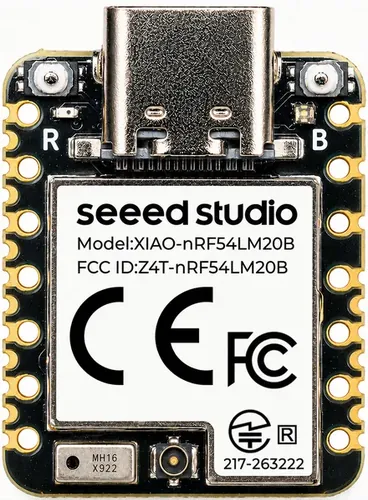

<!-- Copyright 2015-2026 Zephyr Project members and individual contributors. -->
<!-- SPDX-License-Identifier: Apache-2.0 -->
<!-- 中文翻译；编号、导航与译注为本地新增。 -->

<a id="xiao_nrf54lm20b"></a>

# 第19章\_XIAO nRF54LM20B

原文：[官方页面](https://docs.zephyrproject.org/latest/boards/seeed/xiao_nrf54lm20b/doc/index.html)。读取日期：2026-10-16；来源摘要见[来源记录](../SOURCES.md)。

开发板概览（Board Overview）

<a id="id1"></a>

[](images/xiao_nrf54lm20b.webp)

XIAO nRF54LM20B

名称（Name）：

`xiao_nrf54lm20b`

厂商（Vendor）：

[Seeed Technology Co., Ltd](https://docs.zephyrproject.org/latest/boards/index.html#vendor=seeed)

状态（Status）：

当前未积极维护（Not Actively Maintained）

架构（Architecture）：

[arm](https://docs.zephyrproject.org/latest/boards/index.html#arch=arm)

片上系统（SoC）：

[nrf54lm20b](https://docs.zephyrproject.org/latest/boards/index.html#soc=nrf54lm20b)

<a id="board-github-link"></a>

[浏览开发板源码（Browse Board Sources）](https://github.com/zephyrproject-rtos/zephyr/blob/main//boards/seeed/xiao_nrf54lm20b/doc/index.rst/../..)<a id="overview"></a>

## 概述（Overview）

[Seeed Studio XIAO nRF54LM20B](https://www.seeedstudio.com/)是一款紧凑、高性能开发板，搭载Nordic nRF54LM20B芯片。此SoC集成超低功耗多协议2.4 GHz无线电及128 MHz Arm Cortex-M33微控制器，具有2 MB RRAM及512 KB RAM。

开发板内置支持电池充电的Nordic NPM1300电源管理芯片（PMIC）、RGB LED、LSM6DS3TR-C六轴惯性测量单元（IMU）、USB 2.0高速接口、NFCT及128 Mbit PY25Q128HA外部SPI闪存。XIAO外形提供28个引脚D0—D27，支持GPIO、I2C、SPI、UART、ADC及PWM等。

超低功耗设计显著延长电池寿命，无线电支持Bluetooth、Matter、Thread、Zigbee及高吞吐量2.4 GHz专有模式。开发板适用于智能穿戴、工业传感器及先进人机界面等紧凑、安全、节能的物联网应用。

<a id="hardware"></a>

## 硬件（Hardware）


- 128 MHz Arm Cortex-M33处理器
- 2 MB RRAM非易失性存储器
- 512 KB随机存取存储器（RAM）
- 多协议2.4 GHz无线电，支持Bluetooth Low Energy、802.15.4-2020及2.4 GHz专有模式
- 丰富外设，包括14位ADC、高速串行接口、PDM／数字麦克风（DMIC）及PWM
- 内置支持电池充电的Nordic NPM1300电源管理芯片（PMIC）
- RGB LED，红、蓝、绿
- LSM6DS3TR-C六轴惯性测量单元（IMU），含加速度计及陀螺仪
- USB 2.0高速接口（High-speed Interface）
- 近场通信标签（NFCT，Near Field Communication）
- 外部SPI闪存，PY25Q128HA，128 Mbit
- 28引脚XIAO连接器，D0—D27
- 高级安全功能，包括TrustZone隔离及加密引擎保护

nRF54LM20B SoC及XIAO nRF54LM20B开发板的更多信息见：


- [nRF54LM20B网站](https://www.nordicsemi.com/)
- [Seeed Studio XIAO nRF54LM20B](https://www.seeedstudio.com/)
- [XIAO nRF54LM20B Wiki](https://wiki.seeedstudio.com/)

<a id="supported-features"></a>

### 支持的功能（Supported Features）

`xiao_nrf54lm20b`开发板支持下表所列的硬件功能。

片上／板载（On-Chip / On-Board）

功能集成在片上系统（SoC）内／位于开发板上。

2 / 2

分别表示已启用／已禁用的实例数。点击数量标签，可查看开发板或SoC设备树源码（DTS）中该功能的第一个实例。

`vnd,foo`

与此功能匹配的设备树绑定兼容字符串（Compatible String）；点击链接可查看绑定文档。

<a id="xiao_nrf54lm20b-hw-features"></a>

<a id="xiao_nrf54lm20b-xiao_nrf54lm20b/nrf54lm20b/cpuapp-hw-features-section"></a>

#### `xiao_nrf54lm20b/nrf54lm20b/cpuapp`目标（Target）

<a id="xiao_nrf54lm20b-xiao_nrf54lm20b/nrf54lm20b/cpuapp-hw-features-panel"></a>

<a id="xiao_nrf54lm20b-xiao_nrf54lm20b/nrf54lm20b/cpuapp-hw-features-memory"></a>

此板级目标的片上存储：511 KiB RAM及2036 KiB Flash。

<a id="xiao_nrf54lm20b-xiao_nrf54lm20b/nrf54lm20b/cpuapp-hw-features-table"></a>

<table>
<tr>
<th>类型（Type）</th>
<th>位置（Location）</th>
<th>说明（Description）</th>
<th>兼容字符串（Compatible）</th>
</tr>
<tr>
<td rowspan="1">中央处理器（CPU）</td>
<td>片上（On-Chip）</td>
<td>ARM Cortex-M33F处理器（CPU）（<a href="https://github.com/zephyrproject-rtos/zephyr/blob/main/dts/vendor/nordic/nrf54lm20_a_b.dtsi?plain=1#L26">已启用：1</a>）</td>
<td><a href="../cpu_arm_riscv_binding_reference/P023_arm_cortex-m33f.md#std-dtcompatible-arm-cortex-m33f"><code>arm,cortex-m33f</code></a></td>
</tr>
<tr>
<td rowspan="1">模数转换器（ADC）</td>
<td>片上（On-Chip）</td>
<td>Nordic Semiconductor nRF系列逐次逼近模数转换器（SAADC）节点（<a href="https://github.com/zephyrproject-rtos/zephyr/blob/main/dts/vendor/nordic/nrf54lm20_a_b.dtsi?plain=1#L596">已启用：1</a>）</td>
<td><a href="../hardware/P846_NordicNRF逐次逼近ADC绑定.md#dtbinding-nordic-nrf-saadc"><code>nordic,nrf-saadc</code></a></td>
</tr>
<tr>
<td rowspan="2">ARM 架构（ARM Architecture）</td>
<td>片上（On-Chip）</td>
<td>Nordic用户信息配置寄存器（UICR / User Information Configuration Registers）（<a href="https://github.com/zephyrproject-rtos/zephyr/blob/main/dts/vendor/nordic/nrf54lm20_a_b.dtsi?plain=1#L109">已启用：1</a>）</td>
<td><a href="../arm_nordic_nxp_control_binding_reference/P007_nordic_nrf-uicr.md#std-dtcompatible-nordic-nrf-uicr"><code>nordic,nrf-uicr</code></a></td>
</tr>
<tr>
<td>片上（On-Chip）</td>
<td>Nordic事件发生器单元（EGU / Event Generator Unit）（<a href="https://github.com/zephyrproject-rtos/zephyr/blob/main/dts/vendor/nordic/nrf54lm20_a_b.dtsi?plain=1#L317">已禁用：2</a>）</td>
<td><a href="../arm_timing_ethosu_control_binding_reference/P018_nordic_nrf-egu.md#std-dtcompatible-nordic-nrf-egu"><code>nordic,nrf-egu</code></a></td>
</tr>
<tr>
<td rowspan="1">音频（Audio）</td>
<td>片上（On-Chip）</td>
<td>Nordic脉冲密度调制接口（PDM / Pulse Density Modulation Interface）（<a href="https://github.com/zephyrproject-rtos/zephyr/blob/main/dts/vendor/nordic/nrf54lm20_a_b.dtsi?plain=1#L555">已禁用：2</a>）</td>
<td><a href="../audio_pdm_codec_binding_reference/P012_nordic_nrf-pdm.md#std-dtcompatible-nordic-nrf-pdm"><code>nordic,nrf-pdm</code></a></td>
</tr>
<tr>
<td rowspan="7">时钟控制（Clock Control）</td>
<td>片上（On-Chip）</td>
<td>通用固定频率时钟提供者（Fixed-Rate Clock Provider）（<a href="https://github.com/zephyrproject-rtos/zephyr/blob/main/dts/vendor/nordic/nrf54lm20_a_b.dtsi?plain=1#L53">已启用：4</a>）</td>
<td><a href="../hardware/P566_固定时钟绑定.md#dtbinding-fixed-clock"><code>fixed-clock</code></a></td>
</tr>
<tr>
<td>片上（On-Chip）</td>
<td>Nordic nRF低频晶体振荡器（nRF54L系列）（<a href="https://github.com/zephyrproject-rtos/zephyr/blob/main/dts/vendor/nordic/nrf54lm20_a_b.dtsi?plain=1#L65">已启用：1</a>）</td>
<td><a href="../clock_sam_nordic_binding_reference/P029_nordic_nrf54l-lfxo.md#std-dtcompatible-nordic-nrf54l-lfxo"><code>nordic,nrf54l-lfxo</code></a></td>
</tr>
<tr>
<td>片上（On-Chip）</td>
<td>Nordic nRF高频晶体振荡器（nRF54L系列）（<a href="https://github.com/zephyrproject-rtos/zephyr/blob/main/dts/vendor/nordic/nrf54lm20_a_b.dtsi?plain=1#L71">已启用：1</a>）</td>
<td><a href="../clock_sam_nordic_binding_reference/P028_nordic_nrf54l-hfxo.md#std-dtcompatible-nordic-nrf54l-hfxo"><code>nordic,nrf54l-hfxo</code></a></td>
</tr>
<tr>
<td>片上（On-Chip）</td>
<td>Nordic nRF时钟控制（Clock Control）节点（<a href="https://github.com/zephyrproject-rtos/zephyr/blob/main/dts/vendor/nordic/nrf54lm20_a_b.dtsi?plain=1#L867">已启用：1</a>）</td>
<td><a href="../clock_sam_nordic_binding_reference/P015_nordic_nrf-clock.md#std-dtcompatible-nordic-nrf-clock"><code>nordic,nrf-clock</code></a></td>
</tr>
<tr>
<td>片上（On-Chip）</td>
<td>Nordic nRF XO时钟控制节点（<a href="https://github.com/zephyrproject-rtos/zephyr/blob/main/dts/vendor/nordic/nrf54lm20_a_b.dtsi?plain=1#L873">已启用：1</a>）</td>
<td><a href="../clock_sam_nordic_binding_reference/P013_nordic_nrf-clock-xo.md#std-dtcompatible-nordic-nrf-clock-xo"><code>nordic,nrf-clock-xo</code></a></td>
</tr>
<tr>
<td>片上（On-Chip）</td>
<td>Nordic nRF低频时钟（LFCLK）控制节点（<a href="https://github.com/zephyrproject-rtos/zephyr/blob/main/dts/vendor/nordic/nrf54lm20_a_b.dtsi?plain=1#L880">已启用：1</a>）</td>
<td><a href="../clock_sam_nordic_binding_reference/P012_nordic_nrf-clock-lfclk.md#std-dtcompatible-nordic-nrf-clock-lfclk"><code>nordic,nrf-clock-lfclk</code></a></td>
</tr>
<tr>
<td>片上（On-Chip）</td>
<td>Nordic nRF XO24M时钟控制节点（<a href="https://github.com/zephyrproject-rtos/zephyr/blob/main/dts/vendor/nordic/nrf54lm20_a_b.dtsi?plain=1#L885">已启用：1</a>）</td>
<td><a href="../clock_sam_nordic_binding_reference/P014_nordic_nrf-clock-xo24m.md#std-dtcompatible-nordic-nrf-clock-xo24m"><code>nordic,nrf-clock-xo24m</code></a></td>
</tr>
<tr>
<td rowspan="1">比较器（Comparator）</td>
<td>片上（On-Chip）</td>
<td>Nordic nRF模拟比较器（COMP / Analog Comparator）（<a href="https://github.com/zephyrproject-rtos/zephyr/blob/main/dts/vendor/nordic/nrf54lm20_a_b.dtsi?plain=1#L820">已禁用：1</a>）</td>
<td><a href="../hardware/P752_NordicnRF比较器绑定.md#dtbinding-nordic-nrf-comp"><code>nordic,nrf-comp</code></a></td>
</tr>
<tr>
<td rowspan="1">计数器（Counter）</td>
<td>片上（On-Chip）</td>
<td>Nordic nRF定时器（Timer）节点（<a href="https://github.com/zephyrproject-rtos/zephyr/blob/main/dts/vendor/nordic/nrf54lm20_a_b.dtsi?plain=1#L239">已禁用：7</a>）</td>
<td><a href="../microchip_soc_counter_binding_reference/P017_nordic_nrf-timer.md#std-dtcompatible-nordic-nrf-timer"><code>nordic,nrf-timer</code></a></td>
</tr>
<tr>
<td rowspan="1">调试（Debug）</td>
<td>片上（On-Chip）</td>
<td>ARMv8仪器跟踪宏单元（Instrumentation Trace Macrocell）（<a href="https://github.com/zephyrproject-rtos/zephyr/blob/main/dts/vendor/nordic/nrf54lm20_a_b.dtsi?plain=1#L34">已启用：1</a>）</td>
<td><a href="../debug_binding_reference/P002_ARMv8M_ITM调试绑定.md#std-dtcompatible-arm-armv8m-itm"><code>arm,armv8m-itm</code></a></td>
</tr>
<tr>
<td rowspan="1">闪存控制器（Flash Controller）</td>
<td>片上（On-Chip）</td>
<td>Nordic电阻式随机存储器控制器（RRAMC / Resistive Random Access Memory Controller）（<a href="https://github.com/zephyrproject-rtos/zephyr/blob/main/dts/vendor/nordic/nrf54lm20_a_b.dtsi?plain=1#L945">已启用：1</a>）</td>
<td><a href="../flash_nuvoton_nxp_renesas_binding_reference/P003_nordic_rram-controller.md#std-dtcompatible-nordic-rram-controller"><code>nordic,rram-controller</code></a></td>
</tr>
<tr>
<td rowspan="3">通用输入输出与接插件（GPIO &amp; Headers）</td>
<td>片上（On-Chip）</td>
<td>NRF5通用输入输出（GPIO）（<a href="https://github.com/zephyrproject-rtos/zephyr/blob/main/dts/vendor/nordic/nrf54lm20_a_b.dtsi?plain=1#L228">已启用：3</a>；<a href="https://github.com/zephyrproject-rtos/zephyr/blob/main/dts/vendor/nordic/nrf54lm20_a_b.dtsi?plain=1#L632">已禁用：1</a>）</td>
<td><a href="../gpio_microchip_nordic_nuvoton_binding_reference/P016_nordic_nrf-gpio.md#std-dtcompatible-nordic-nrf-gpio"><code>nordic,nrf-gpio</code></a></td>
</tr>
<tr>
<td>片上（On-Chip）</td>
<td>NRF5 GPIO任务与事件（GPIOTE）（<a href="https://github.com/zephyrproject-rtos/zephyr/blob/main/dts/vendor/nordic/nrf54lm20_a_b.dtsi?plain=1#L643">已启用：2</a>）</td>
<td><a href="../gpio_microchip_nordic_nuvoton_binding_reference/P017_nordic_nrf-gpiote.md#std-dtcompatible-nordic-nrf-gpiote"><code>nordic,nrf-gpiote</code></a></td>
</tr>
<tr>
<td>板载（On-Board）</td>
<td>引出到Seeeduino XIAO及兼容设备排针（Headers）的GPIO引脚（<a href="https://github.com/zephyrproject-rtos/zephyr/blob/main/boards/seeed/xiao_nrf54lm20b/seeed_xiao_connector.dtsi?plain=1#L7">已启用：1</a>）</td>
<td><a href="../gpio_silabs_st_connectors_binding_reference/P005_seeed_xiao-gpio.md#std-dtcompatible-seeed-xiao-gpio"><code>seeed,xiao-gpio</code></a></td>
</tr>
<tr>
<td rowspan="2">集成电路间总线（I2C）</td>
<td>片上（On-Chip）</td>
<td>Nordic nRF系列TWIM（带EasyDMA的TWI主机）（<a href="https://github.com/zephyrproject-rtos/zephyr/blob/main/dts/vendor/nordic/nrf54lm20_a_b.dtsi?plain=1#L458">已启用：2</a>；<a href="https://github.com/zephyrproject-rtos/zephyr/blob/main/dts/vendor/nordic/nrf54lm20_a_b.dtsi?plain=1#L378">已禁用：4</a>）</td>
<td><a href="../i2c_infineon_ite_nordic_binding_reference/P016_nordic_nrf-twim.md#std-dtcompatible-nordic-nrf-twim"><code>nordic,nrf-twim</code></a></td>
</tr>
<tr>
<td>板载（On-Board）</td>
<td>通过GPIO软件模拟（Bit-Banging）实现I2C（<a href="https://github.com/zephyrproject-rtos/zephyr/blob/main/boards/seeed/xiao_nrf54lm20b/xiao_nrf54lm20b_nrf54lm20b-common.dtsi?plain=1#L57">已启用：1</a>）</td>
<td><a href="../i2c_infineon_ite_nordic_binding_reference/P002_gpio-i2c.md#std-dtcompatible-gpio-i2c"><code>gpio-i2c</code></a></td>
</tr>
<tr>
<td rowspan="1">集成电路间音频总线（I2S）</td>
<td>片上（On-Chip）</td>
<td>Nordic时分复用音频接口（TDM / Time Division Multiplexed Audio Interface）（<a href="https://github.com/zephyrproject-rtos/zephyr/blob/main/dts/vendor/nordic/nrf54lm20_a_b.dtsi?plain=1#L674">已禁用：1</a>）</td>
<td><a href="../i2s_binding_reference/P011_nordic_nrf-tdm.md#std-dtcompatible-nordic-nrf-tdm"><code>nordic,nrf-tdm</code></a></td>
</tr>
<tr>
<td rowspan="1">低速率无线个域网（IEEE 802.15.4）</td>
<td>片上（On-Chip）</td>
<td>Nordic nRF IEEE 802.15.4节点（<a href="https://github.com/zephyrproject-rtos/zephyr/blob/main/dts/vendor/nordic/nrf54lm20_a_b.dtsi?plain=1#L335">已启用：1</a>）</td>
<td><a href="../lora_ieee802154_binding_reference/P005_nordic_nrf-ieee802154.md#std-dtcompatible-nordic-nrf-ieee802154"><code>nordic,nrf-ieee802154</code></a></td>
</tr>
<tr>
<td rowspan="1">输入（Input）</td>
<td>板载（On-Board）</td>
<td>一组绑定到 GPIO 的输入按键（GPIO-Bound Input Keys）（<a href="https://github.com/zephyrproject-rtos/zephyr/blob/main/boards/seeed/xiao_nrf54lm20b/xiao_nrf54lm20b_nrf54lm20b-common.dtsi?plain=1#L46">已启用：1</a>）</td>
<td><a href="../hardware/P563_GPIO按键绑定.md#std-dtcompatible-gpio-keys"><code>gpio-keys</code></a></td>
</tr>
<tr>
<td rowspan="1">中断控制器（Interrupt Controller）</td>
<td>片上（On-Chip）</td>
<td>ARMv8-M嵌套向量中断控制器（NVIC / Nested Vectored Interrupt Controller）（<a href="https://github.com/zephyrproject-rtos/zephyr/blob/main/dts/vendor/nordic/nrf54lm20_a_b.dtsi?plain=1#L977">已启用：1</a>）</td>
<td><a href="../arm_interrupt_timer_binding_reference/P003_ARMv8_M_NVIC.md#std-dtcompatible-arm-v8m-nvic"><code>arm,v8m-nvic</code></a></td>
</tr>
<tr>
<td rowspan="3">发光二极管（LED）</td>
<td>板载（On-Board）</td>
<td>一组由 GPIO 控制的 LED（GPIO-Controlled LEDs）（<a href="https://github.com/zephyrproject-rtos/zephyr/blob/main/boards/seeed/xiao_nrf54lm20b/xiao_nrf54lm20b_nrf54lm20b-common.dtsi?plain=1#L11">已启用：1</a>）</td>
<td><a href="../hardware/P564_GPIO指示灯绑定.md#dtbinding-gpio-leds"><code>gpio-leds</code></a></td>
</tr>
<tr>
<td>板载（On-Board）</td>
<td>一组由脉宽调制（PWM）控制的LED（<a href="https://github.com/zephyrproject-rtos/zephyr/blob/main/boards/seeed/xiao_nrf54lm20b/xiao_nrf54lm20b_nrf54lm20b-common.dtsi?plain=1#L30">已启用：1</a>）</td>
<td><a href="../hardware/P565_PWM指示灯绑定.md#dtbinding-pwm-leds"><code>pwm-leds</code></a></td>
</tr>
<tr>
<td>板载（On-Board）</td>
<td>Nordic nPM1300 LED控制器（<a href="https://github.com/zephyrproject-rtos/zephyr/blob/main/boards/seeed/xiao_nrf54lm20b/xiao_nrf54lm20b_nrf54lm20b-common.dtsi?plain=1#L95">已启用：1</a>）</td>
<td><a href="../led_issi_nordic_nxp_binding_reference/P013_nordic_npm1300-led.md#std-dtcompatible-nordic-npm1300-led"><code>nordic,npm1300-led</code></a></td>
</tr>
<tr>
<td rowspan="2">邮箱（Mailbox）</td>
<td>片上（On-Chip）</td>
<td>Nordic VPR事件接口（VEVIF / VPR Event Interface），事件接收模式（EVENT RX MODE）（<a href="https://github.com/zephyrproject-rtos/zephyr/blob/main/dts/arm/nordic/nrf54lm20_a_b_cpuapp.dtsi?plain=1#L57">已禁用：1</a>）</td>
<td><a href="../intercore_reference/P043_NordicVEVIF事件接收绑定.md#dtbinding-nordic-nrf-vevif-event-rx"><code>nordic,nrf-vevif-event-rx</code></a></td>
</tr>
<tr>
<td>片上（On-Chip）</td>
<td>Nordic VPR事件接口（VEVIF），任务发送模式（TASK TX MODE）（<a href="https://github.com/zephyrproject-rtos/zephyr/blob/main/dts/arm/nordic/nrf54lm20_a_b_cpuapp.dtsi?plain=1#L67">已禁用：1</a>）</td>
<td><a href="../intercore_reference/P046_NordicVEVIF任务发送绑定.md#dtbinding-nordic-nrf-vevif-task-tx"><code>nordic,nrf-vevif-task-tx</code></a></td>
</tr>
<tr>
<td rowspan="1">多功能设备（Multi-Function Device）</td>
<td>板载（On-Board）</td>
<td>Nordic nPM1300（<a href="https://github.com/zephyrproject-rtos/zephyr/blob/main/boards/seeed/xiao_nrf54lm20b/xiao_nrf54lm20b_nrf54lm20b-common.dtsi?plain=1#L66">已启用：1</a>）</td>
<td><a href="../hardware/P685_nPM1300多功能设备绑定.md#dtbinding-nordic-npm1300"><code>nordic,npm1300</code></a></td>
</tr>
<tr>
<td rowspan="5">其他绑定（Miscellaneous）</td>
<td>片上（On-Chip）</td>
<td>Nordic工厂信息配置寄存器（FICR / Factory Information Configuration Registers）（<a href="https://github.com/zephyrproject-rtos/zephyr/blob/main/dts/vendor/nordic/nrf54lm20_a_b.dtsi?plain=1#L100">已启用：1</a>）</td>
<td><a href="../misc_adi_nordic_binding_reference/P018_nordic_nrf-ficr.md#std-dtcompatible-nordic-nrf-ficr"><code>nordic,nrf-ficr</code></a></td>
</tr>
<tr>
<td>片上（On-Chip）</td>
<td>Nordic分布式可编程外设互连控制器（DPPIC / Distributed Programmable Peripheral Interconnect Controller）（<a href="https://github.com/zephyrproject-rtos/zephyr/blob/main/dts/vendor/nordic/nrf54lm20_a_b.dtsi?plain=1#L156">已启用：4</a>）</td>
<td><a href="../misc_adi_nordic_binding_reference/P017_nordic_nrf-dppic.md#std-dtcompatible-nordic-nrf-dppic"><code>nordic,nrf-dppic</code></a></td>
</tr>
<tr>
<td>片上（On-Chip）</td>
<td>Nordic可编程外设互连桥（PPIB / Programmable Peripheral Interconnect Bridge）（<a href="https://github.com/zephyrproject-rtos/zephyr/blob/main/dts/vendor/nordic/nrf54lm20_a_b.dtsi?plain=1#L164">已启用：8</a>）</td>
<td><a href="../misc_adi_nordic_binding_reference/P021_nordic_nrf-ppib.md#std-dtcompatible-nordic-nrf-ppib"><code>nordic,nrf-ppib</code></a></td>
</tr>
<tr>
<td>片上（On-Chip）</td>
<td>Nordic Axon（<a href="https://github.com/zephyrproject-rtos/zephyr/blob/main/dts/vendor/nordic/nrf54lm20b.dtsi?plain=1#L10">已禁用：1</a>）</td>
<td><a href="../misc_adi_nordic_binding_reference/P012_nordic_axon.md#std-dtcompatible-nordic-axon"><code>nordic,axon</code></a></td>
</tr>
<tr>
<td>片上（On-Chip）</td>
<td>Nordic存储器权限控制器（MPC / Memory Privilege Controller）（<a href="https://github.com/zephyrproject-rtos/zephyr/blob/main/dts/vendor/nordic/nrf54lm20_a_b.dtsi?plain=1#L964">已启用：1</a>）</td>
<td><a href="../misc_adi_nordic_binding_reference/P019_nordic_nrf-mpc.md#std-dtcompatible-nordic-nrf-mpc"><code>nordic,nrf-mpc</code></a></td>
</tr>
<tr>
<td rowspan="2">存储技术设备（MTD）</td>
<td>板载（On-Board）</td>
<td>这些属性用于支持Zephyr的<code>spi-nor</code>闪存驱动通过Zephyr SPI API，使用基于M25P80的标准命令集控制串行闪存（Serial Flash Memory）。（<a href="https://github.com/zephyrproject-rtos/zephyr/blob/main/boards/seeed/xiao_nrf54lm20b/nrf54lm20b_cpuapp_common.dtsi?plain=1#L160">已禁用：1</a>）</td>
<td><a href="../mtd_microchip_nordic_nxp_binding_reference/P002_jedec_spi-nor.md#std-dtcompatible-jedec-spi-nor"><code>jedec,spi-nor</code></a></td>
</tr>
<tr>
<td>片上（On-Chip）</td>
<td>闪存（Flash）节点（<a href="https://github.com/zephyrproject-rtos/zephyr/blob/main/dts/vendor/nordic/nrf54lm20_a_b.dtsi?plain=1#L953">已启用：1</a>）</td>
<td><a href="../mtd_nxp_st_ti_partition_binding_reference/P013_soc-nv-flash.md#std-dtcompatible-soc-nv-flash"><code>soc-nv-flash</code></a></td>
</tr>
<tr>
<td rowspan="2">网络（Networking）</td>
<td>片上（On-Chip）</td>
<td>Nordic nRF系列无线电（RADIO）外设（<a href="https://github.com/zephyrproject-rtos/zephyr/blob/main/dts/vendor/nordic/nrf54lm20_a_b.dtsi?plain=1#L324">已启用：1</a>）</td>
<td><a href="../network_radio_frontend_binding_reference/P009_nordic_nrf-radio.md#std-dtcompatible-nordic-nrf-radio"><code>nordic,nrf-radio</code></a></td>
</tr>
<tr>
<td>片上（On-Chip）</td>
<td>Nordic nRF系列近场通信标签（NFCT / Near Field Communication Tag）（<a href="https://github.com/zephyrproject-rtos/zephyr/blob/main/dts/vendor/nordic/nrf54lm20_a_b.dtsi?plain=1#L607">已启用：1</a>）</td>
<td><a href="../network_radio_frontend_binding_reference/P007_nordic_nrf-nfct-v2.md#std-dtcompatible-nordic-nrf-nfct-v2"><code>nordic,nrf-nfct-v2</code></a></td>
</tr>
<tr>
<td rowspan="1">引脚控制（Pin Control）</td>
<td>片上（On-Chip）</td>
<td>Nordic nRF系列引脚控制器（Pin Controller）（<a href="https://github.com/zephyrproject-rtos/zephyr/blob/main/dts/vendor/nordic/nrf_common.dtsi?plain=1#L26">已启用：1</a>）</td>
<td><a href="../pinctrl_infineon_nordic_nxp_binding_reference/P009_nordic_nrf-pinctrl.md#std-dtcompatible-nordic-nrf-pinctrl"><code>nordic,nrf-pinctrl</code></a></td>
</tr>
<tr>
<td rowspan="1">电源管理（Power Management）</td>
<td>片上（On-Chip）</td>
<td>Nordic nRF电源控制（Power Control）节点（<a href="https://github.com/zephyrproject-rtos/zephyr/blob/main/dts/vendor/nordic/nrf54lm20_a_b.dtsi?plain=1#L893">已禁用：1</a>）</td>
<td><a href="../power_control_binding_reference/P008_nordic_nrf-power.md#std-dtcompatible-nordic-nrf-power"><code>nordic,nrf-power</code></a></td>
</tr>
<tr>
<td rowspan="1">脉宽调制（PWM）</td>
<td>片上（On-Chip）</td>
<td>nRF脉宽调制（PWM）（<a href="https://github.com/zephyrproject-rtos/zephyr/blob/main/dts/vendor/nordic/nrf54lm20_a_b.dtsi?plain=1#L569">已启用：1</a>；<a href="https://github.com/zephyrproject-rtos/zephyr/blob/main/dts/vendor/nordic/nrf54lm20_a_b.dtsi?plain=1#L578">已禁用：2</a>）</td>
<td><a href="../pwm_intel_microchip_nxp_binding_reference/P015_nordic_nrf-pwm.md#std-dtcompatible-nordic-nrf-pwm"><code>nordic,nrf-pwm</code></a></td>
</tr>
<tr>
<td rowspan="4">稳压器（Regulator）</td>
<td>片上（On-Chip）</td>
<td>nRF54L上的Nordic电压稳压器控制模块（REGULATORS）（<a href="https://github.com/zephyrproject-rtos/zephyr/blob/main/dts/vendor/nordic/nrf54lm20_a_b.dtsi?plain=1#L919">已禁用：1</a>）</td>
<td><a href="../hardware/P642_nRF54L稳压器集合绑定.md#dtbinding-nordic-nrf54l-regulators"><code>nordic,nrf54l-regulators</code></a></td>
</tr>
<tr>
<td>片上（On-Chip）</td>
<td>Nordic nRF5X稳压器（Regulator，内核供电的固定级）（<a href="https://github.com/zephyrproject-rtos/zephyr/blob/main/dts/vendor/nordic/nrf54lm20_a_b.dtsi?plain=1#L927">已启用：1</a>）</td>
<td><a href="../hardware/P643_nRF5X稳压器绑定.md#dtbinding-nordic-nrf5x-regulator"><code>nordic,nrf5x-regulator</code></a></td>
</tr>
<tr>
<td>片上（On-Chip）</td>
<td>USB外设使用的Nordic VBUS稳压器（Regulator）（<a href="https://github.com/zephyrproject-rtos/zephyr/blob/main/dts/vendor/nordic/nrf54lm20_a_b.dtsi?plain=1#L935">已启用：1</a>）</td>
<td><a href="../hardware/P645_Nordic_USB稳压器绑定.md#dtbinding-nordic-vregusb-regulator"><code>nordic,vregusb-regulator</code></a></td>
</tr>
<tr>
<td>板载（On-Board）</td>
<td>Nordic nPM1300电源管理芯片（PMIC）（<a href="https://github.com/zephyrproject-rtos/zephyr/blob/main/boards/seeed/xiao_nrf54lm20b/xiao_nrf54lm20b_nrf54lm20b-common.dtsi?plain=1#L82">已启用：1</a>）</td>
<td><a href="../hardware/P662_nPM1300稳压器绑定.md#dtbinding-nordic-npm1300-regulator"><code>nordic,npm1300-regulator</code></a></td>
</tr>
<tr>
<td rowspan="1">保持存储器（Retained Memory）</td>
<td>片上（On-Chip）</td>
<td>Nordic通用保持寄存器（GPREGRET / General Purpose Register Retention）设备（<a href="https://github.com/zephyrproject-rtos/zephyr/blob/main/dts/vendor/nordic/nrf54lm20_a_b.dtsi?plain=1#L902">已启用：1</a>；<a href="https://github.com/zephyrproject-rtos/zephyr/blob/main/dts/vendor/nordic/nrf54lm20_a_b.dtsi?plain=1#L910">已禁用：1</a>）</td>
<td><a href="../hardware/P627_Nordic通用保留寄存器绑定.md#dtbinding-nordic-nrf-gpregret"><code>nordic,nrf-gpregret</code></a></td>
</tr>
<tr>
<td rowspan="1">RISC-V 架构（RISC-V Architecture）</td>
<td>片上（On-Chip）</td>
<td>VPR协处理器（Coprocessor）（<a href="https://github.com/zephyrproject-rtos/zephyr/blob/main/dts/vendor/nordic/nrf54lm20_a_b.dtsi?plain=1#L178">已禁用：1</a>）</td>
<td><a href="../platform_rmt_openthread_binding_reference/P010_nordic_nrf-vpr-coprocessor.md#std-dtcompatible-nordic-nrf-vpr-coprocessor"><code>nordic,nrf-vpr-coprocessor</code></a></td>
</tr>
<tr>
<td rowspan="1">随机数生成器（RNG）</td>
<td>片上（On-Chip）</td>
<td>基于Nordic nRF CRACEN CTR_DRBG的随机数发生器（Random Number Generator）（<a href="https://github.com/zephyrproject-rtos/zephyr/blob/main/dts/arm/nordic/nrf54lm20_a_b_cpuapp.dtsi?plain=1#L35">已启用：1</a>）</td>
<td><a href="../rng_binding_reference/P013_nordic_nrf-cracen-ctrdrbg.md#std-dtcompatible-nordic-nrf-cracen-ctrdrbg"><code>nordic,nrf-cracen-ctrdrbg</code></a></td>
</tr>
<tr>
<td rowspan="4">传感器（Sensors）</td>
<td>片上（On-Chip）</td>
<td>Nordic nRF系列温度（TEMP）节点（<a href="https://github.com/zephyrproject-rtos/zephyr/blob/main/dts/vendor/nordic/nrf54lm20_a_b.dtsi?plain=1#L614">已启用：1</a>）</td>
<td><a href="../sensor_microchip_nordic_nxp_binding_reference/P023_nordic_nrf-temp.md#std-dtcompatible-nordic-nrf-temp"><code>nordic,nrf-temp</code></a></td>
</tr>
<tr>
<td>片上（On-Chip）</td>
<td>Nordic nRF正交解码器（QDEC / Quadrature Decoder）节点（<a href="https://github.com/zephyrproject-rtos/zephyr/blob/main/dts/vendor/nordic/nrf54lm20_a_b.dtsi?plain=1#L650">已禁用：2</a>）</td>
<td><a href="../sensor_microchip_nordic_nxp_binding_reference/P021_nordic_nrf-qdec.md#std-dtcompatible-nordic-nrf-qdec"><code>nordic,nrf-qdec</code></a></td>
</tr>
<tr>
<td>板载（On-Board）</td>
<td>通过I2C访问的STMicroelectronics LSM6DSL六轴加速度计及陀螺仪（<a href="https://github.com/zephyrproject-rtos/zephyr/blob/main/boards/seeed/xiao_nrf54lm20b/nrf54lm20b_cpuapp_common.dtsi?plain=1#L195">已启用：1</a>）</td>
<td><a href="../compatible_binding_reference/P090_st_lsm6dsl.md#std-dtcompatible-st-lsm6dsl"><code>st,lsm6dsl</code></a></td>
</tr>
<tr>
<td>板载（On-Board）</td>
<td>NPM1300 PMIC充电器（Charger）（<a href="https://github.com/zephyrproject-rtos/zephyr/blob/main/boards/seeed/xiao_nrf54lm20b/xiao_nrf54lm20b_nrf54lm20b-common.dtsi?plain=1#L70">已启用：1</a>）</td>
<td><a href="../sensor_microchip_nordic_nxp_binding_reference/P018_nordic_npm1300-charger.md#std-dtcompatible-nordic-npm1300-charger"><code>nordic,npm1300-charger</code></a></td>
</tr>
<tr>
<td rowspan="1">串行控制器（Serial Controller）</td>
<td>片上（On-Chip）</td>
<td>Nordic nRF系列UARTE（带EasyDMA的UART）（<a href="https://github.com/zephyrproject-rtos/zephyr/blob/main/dts/vendor/nordic/nrf54lm20_a_b.dtsi?plain=1#L409">已启用：2</a>；<a href="https://github.com/zephyrproject-rtos/zephyr/blob/main/dts/vendor/nordic/nrf54lm20_a_b.dtsi?plain=1#L218">已禁用：5</a>）</td>
<td><a href="../uart_microchip_nordic_nxp_binding_reference/P004_nordic_nrf-uarte.md#std-dtcompatible-nordic-nrf-uarte"><code>nordic,nrf-uarte</code></a></td>
</tr>
<tr>
<td rowspan="1">串行外设接口（SPI）</td>
<td>片上（On-Chip）</td>
<td>Nordic nRF系列SPIM（带EasyDMA的SPI控制器）（<a href="https://github.com/zephyrproject-rtos/zephyr/blob/main/dts/vendor/nordic/nrf54lm20_a_b.dtsi?plain=1#L198">已启用：2</a>；<a href="https://github.com/zephyrproject-rtos/zephyr/blob/main/dts/vendor/nordic/nrf54lm20_a_b.dtsi?plain=1#L390">已禁用：5</a>）</td>
<td><a href="../spi_microchip_nordic_nxp_binding_reference/P013_nordic_nrf-spim.md#std-dtcompatible-nordic-nrf-spim"><code>nordic,nrf-spim</code></a></td>
</tr>
<tr>
<td rowspan="1">静态随机存储器（SRAM）</td>
<td>片上（On-Chip）</td>
<td>通用片上静态随机存储器（SRAM）（<a href="https://github.com/zephyrproject-rtos/zephyr/blob/main/dts/vendor/nordic/nrf54lm20_a_b.dtsi?plain=1#L128">已启用：2</a>）</td>
<td><a href="../hardware/P567_内存映射SRAM绑定.md#dtbinding-mmio-sram"><code>mmio-sram</code></a></td>
</tr>
<tr>
<td rowspan="2">定时器（Timer）</td>
<td>片上（On-Chip）</td>
<td>Nordic全局实时时钟（GRTC / Global RTC）（<a href="https://github.com/zephyrproject-rtos/zephyr/blob/main/dts/vendor/nordic/nrf54lm20_a_b.dtsi?plain=1#L664">已启用：1</a>）</td>
<td><a href="../microchip_nordic_nxp_realtek_timer_binding_reference/P005_nordic_nrf-grtc.md#std-dtcompatible-nordic-nrf-grtc"><code>nordic,nrf-grtc</code></a></td>
</tr>
<tr>
<td>片上（On-Chip）</td>
<td>ARMv8-M系统节拍（System Tick）（<a href="https://github.com/zephyrproject-rtos/zephyr/blob/main/dts/vendor/nordic/nrf54lm20_a_b.dtsi?plain=1#L986">已禁用：1</a>）</td>
<td><a href="../arm_interrupt_timer_binding_reference/P007_ARMv8_M_SysTick.md#std-dtcompatible-arm-armv8m-systick"><code>arm,armv8m-systick</code></a></td>
</tr>
<tr>
<td rowspan="4">通用串行总线（USB）</td>
<td>片上（On-Chip）</td>
<td>Nordic USBHS Type 2 PHY配置（<a href="https://github.com/zephyrproject-rtos/zephyr/blob/main/dts/vendor/nordic/nrf54lm20_a_b.dtsi?plain=1#L91">已禁用：1</a>）</td>
<td><a href="../usb_soc_binding_reference/P001_nordic_nrf-usbhs-phy-type2.md#std-dtcompatible-nordic-nrf-usbhs-phy-type2"><code>nordic,nrf-usbhs-phy-type2</code></a></td>
</tr>
<tr>
<td>片上（On-Chip）</td>
<td>Nordic USB控制器与PHY硬件封装（Wrapper）（<a href="https://github.com/zephyrproject-rtos/zephyr/blob/main/dts/vendor/nordic/nrf54lm20_a_b.dtsi?plain=1#L250">已启用：1</a>）</td>
<td><a href="../usb_soc_binding_reference/P002_nordic_nrf-usbhs-wrapper.md#std-dtcompatible-nordic-nrf-usbhs-wrapper"><code>nordic,nrf-usbhs-wrapper</code></a></td>
</tr>
<tr>
<td>片上（On-Chip）</td>
<td>DesignWare OTG USB 2.0控制器（<a href="https://github.com/zephyrproject-rtos/zephyr/blob/main/dts/vendor/nordic/nrf54lm20_a_b.dtsi?plain=1#L260">已启用：1</a>）</td>
<td><a href="../usb_stm32_audio_binding_reference/P003_snps_dwc2.md#std-dtcompatible-snps-dwc2"><code>snps,dwc2</code></a></td>
</tr>
<tr>
<td>片上（On-Chip）</td>
<td>Nordic USB PD充电类型检测器（Charging-Type Detector）（<a href="https://github.com/zephyrproject-rtos/zephyr/blob/main/dts/vendor/nordic/nrf54lm20_a_b.dtsi?plain=1#L277">已启用：1</a>）</td>
<td><a href="../usb_controller_binding_reference/P019_nordic_nrf-usbhs-bc12.md#std-dtcompatible-nordic-nrf-usbhs-bc12"><code>nordic,nrf-usbhs-bc12</code></a></td>
</tr>
<tr>
<td rowspan="1">看门狗（Watchdog）</td>
<td>片上（On-Chip）</td>
<td>Nordic nRF系列看门狗定时器（WDT / Watchdog Timer）（<a href="https://github.com/zephyrproject-rtos/zephyr/blob/main/dts/vendor/nordic/nrf54lm20_a_b.dtsi?plain=1#L834">已禁用：2</a>）</td>
<td><a href="../nxp_nordic_nuvoton_watchdog_binding_reference/P002_nordic_nrf-wdt.md#std-dtcompatible-nordic-nrf-wdt"><code>nordic,nrf-wdt</code></a></td>
</tr>
</table>

<a id="connections-and-ios"></a>

### 连接与输入输出（Connections and IOs）

下表的Name列为引脚名称。例如P1_0表示PORT1上的第0脚，与开发板数据手册及手册中的命名一致。

<table>
<tr>
<th>名称（Name）</th>
<th>功能（Function）</th>
<th>用途（Usage）</th>
</tr>
<tr>
<td>P1_22</td>
<td>通用输入输出（GPIO）</td>
<td>LED1，红色</td>
</tr>
<tr>
<td>P1_23</td>
<td>通用输入输出（GPIO）</td>
<td>LED0，蓝色</td>
</tr>
<tr>
<td>P1_24</td>
<td>通用输入输出（GPIO）</td>
<td>LED2，绿色</td>
</tr>
<tr>
<td>P0_9</td>
<td>通用输入输出（GPIO）</td>
<td>按键0（Button 0）</td>
</tr>
<tr>
<td>P1_11</td>
<td>USART20_TX</td>
<td>UART20发送（TX），测试焊盘</td>
</tr>
<tr>
<td>P1_10</td>
<td>USART20_RX</td>
<td>UART20接收（RX），测试焊盘</td>
</tr>
<tr>
<td>P1_8</td>
<td>USART21_TX</td>
<td>XIAO串口发送（TX）</td>
</tr>
<tr>
<td>P1_9</td>
<td>USART21_RX</td>
<td>XIAO串口接收（RX）</td>
</tr>
<tr>
<td>P1_3</td>
<td>TWIM22_SDA</td>
<td>XIAO I2C数据（SDA）</td>
</tr>
<tr>
<td>P1_7</td>
<td>TWIM22_SCL</td>
<td>XIAO I2C时钟（SCL）</td>
</tr>
<tr>
<td>P1_4</td>
<td>SPIM23_SCK</td>
<td>XIAO SPI时钟（SCK）</td>
</tr>
<tr>
<td>P1_6</td>
<td>SPIM23_MOSI</td>
<td>XIAO SPI主出从入（MOSI）</td>
</tr>
<tr>
<td>P1_5</td>
<td>SPIM23_MISO</td>
<td>XIAO SPI主入从出（MISO）</td>
</tr>
<tr>
<td>P0_8</td>
<td>TWIM30_SDA</td>
<td>IMU I2C数据（SDA）</td>
</tr>
<tr>
<td>P0_7</td>
<td>TWIM30_SCL</td>
<td>IMU I2C时钟（SCL）</td>
</tr>
<tr>
<td>P1_0</td>
<td>通用输入输出（GPIO）</td>
<td>XIAO D0</td>
</tr>
<tr>
<td>P1_31</td>
<td>通用输入输出（GPIO）</td>
<td>XIAO D1</td>
</tr>
<tr>
<td>P1_30</td>
<td>通用输入输出（GPIO）</td>
<td>XIAO D2</td>
</tr>
<tr>
<td>P1_29</td>
<td>通用输入输出（GPIO）</td>
<td>XIAO D3</td>
</tr>
<tr>
<td>P1_3</td>
<td>通用输入输出（GPIO）</td>
<td>XIAO D4</td>
</tr>
<tr>
<td>P1_7</td>
<td>通用输入输出（GPIO）</td>
<td>XIAO D5</td>
</tr>
<tr>
<td>P1_8</td>
<td>通用输入输出（GPIO）</td>
<td>XIAO D6</td>
</tr>
<tr>
<td>P1_9</td>
<td>通用输入输出（GPIO）</td>
<td>XIAO D7</td>
</tr>
<tr>
<td>P1_4</td>
<td>通用输入输出（GPIO）</td>
<td>XIAO D8</td>
</tr>
<tr>
<td>P1_5</td>
<td>通用输入输出（GPIO）</td>
<td>XIAO D9</td>
</tr>
<tr>
<td>P1_6</td>
<td>通用输入输出（GPIO）</td>
<td>XIAO D10</td>
</tr>
<tr>
<td>P1_18</td>
<td>通用输入输出（GPIO）</td>
<td>PMIC I2C数据（SDA）</td>
</tr>
<tr>
<td>P1_17</td>
<td>通用输入输出（GPIO）</td>
<td>PMIC I2C时钟（SCL）</td>
</tr>
<tr>
<td>P1_13</td>
<td>PDM20_CLK</td>
<td>数字麦克风时钟（DMIC Clock）</td>
</tr>
<tr>
<td>P1_14</td>
<td>PDM20_DIN</td>
<td>数字麦克风数据（DMIC Data）</td>
</tr>
<tr>
<td>P2_1</td>
<td>SPIM00_SCK</td>
<td>外部SPI闪存时钟（SCK）</td>
</tr>
<tr>
<td>P2_2</td>
<td>SPIM00_MOSI</td>
<td>外部SPI闪存主出从入（MOSI）</td>
</tr>
<tr>
<td>P2_4</td>
<td>SPIM00_MISO</td>
<td>外部SPI闪存主入从出（MISO）</td>
</tr>
</table>

开发板只有一个USB-C连接器，连接SoC的USB 2.0高速控制器。控制台通过此连接器上的USB CDC ACM提供。

<a id="programming-and-debugging"></a>

## 烧录与调试（Programming and Debugging）

`xiao_nrf54lm20b`开发板支持下表所列的运行工具（Runners）及相关west命令。

<table>
<tr>
<th></th>
<th>烧录（flash）</th>
<th>调试（debug）</th>
<th>连接调试会话（attach）</th>
<th>实时传输（rtt）</th>
<th>复位（reset）</th>
<th>调试服务器（debugserver）</th>
</tr>
<tr>
<td><a href="https://docs.zephyrproject.org/latest/develop/flash_debug/host-tools.html#runner-jlink"><code>jlink</code></a></td>
<td>✅</td>
<td>✅（默认 / default）</td>
<td>✅</td>
<td>✅</td>
<td>✅</td>
<td>✅</td>
</tr>
<tr>
<td>nrfutil</td>
<td>✅（默认 / default）</td>
<td></td>
<td></td>
<td></td>
<td></td>
<td></td>
</tr>
</table>

<a id="bootloader-and-firmware-updates"></a>

### 引导加载器及固件更新（Bootloader and Firmware Updates）

开发板出厂时在RRAM最前方24 KiB区域预装MCUboot固件更新引导加载器。应用默认链接到其位于0x6000的应用槽（Application Slot），CONFIG_BOOTLOADER_MCUBOOT默认为y。下述USB CDC ACM控制台由应用提供，引导加载器本身没有控制台。

出厂引导加载器使用板上密钥管理单元（KMU）内预置的密钥验证PURE格式的Ed25519镜像签名，因而写入应用槽的镜像必须按要求签名。签名细节及出厂固件更新见[XIAO nRF54LM20B Wiki](https://wiki.seeedstudio.com/)。

通过USB更新应用时，在上电或复位期间保持按下Button 0；引导加载器随后运行slot1 USB加载程序，通过USB CDC ACM端口接收MCUmgr镜像上传。

<a id="flashing"></a>

### 烧录（Flashing）

通过USB将XIAO nRF54LM20B连接主机，主机应出现USB CDC ACM串口，可用来查看已烧录应用的日志。

下面以[Hello World](../getting_started/P005_HelloWorld示例.md#hello_world)应用为例。

```text
# From the root of the zephyr repository
west build -b xiao_nrf54lm20b/nrf54lm20b/cpuapp samples/hello_world
west flash
```

打开minicom、PuTTY等串口终端，连接USB CDC ACM串口。

复位开发板后，终端应显示以下消息：

```text
Hello World! xiao_nrf54lm20b/nrf54lm20b/cpuapp
```

## 译注

XIAO nRF54LM20B的MCUboot占前24 KiB RRAM，应用槽起于0x6000。应用必须按KMU预置密钥要求提供PURE格式Ed25519签名；按Button 0上电进入MCUmgr USB更新。USB控制台由应用提供。

## 原文外链核对

2026-10-16核对并重试以下原文外链时未能确认可访问性，保留原始目标，不将访问失败解释为原文内容有误。

- [](https://www.nordicsemi.com/)：HTTP Error 403: Forbidden。

---

[上一章](P018_XIAO_nRF54LM20A.md) · [返回大纲](大纲.md) · [全站翻译进度](../PROGRESS.md) · [下一章](P020_XIAO_RA4M1.md)
