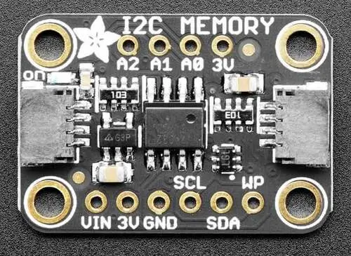

<!-- Copyright 2015-2026 Zephyr Project members and individual contributors. -->
<!-- SPDX-License-Identifier: Apache-2.0 -->
<!-- 中文翻译；编号、导航与译注为本地新增。 -->

<a id="adafruit-24lc32-eeprom-shield"></a>

<a id="adafruit-24lc32"></a>

# 第3章\_Adafruit 24LC32 EEPROM扩展板（Shield）

原文：[官方页面](https://docs.zephyrproject.org/latest/boards/shields/adafruit_24lc32/doc/index.html)。读取日期：2026-10-16；来源摘要见[来源记录](../SOURCES.md)。

<a id="overview"></a>

## 概述（Overview）

Adafruit 24LC32 EEPROM扩展板采用Microchip 24LC32或同等EEPROM，容量32 kbit，即4 kByte，带2个STEMMA QT连接器。（[Adafruit 24LC32 EEPROM扩展板（Shield）](https://learn.adafruit.com/adafruit-24lc32-i2c-eeprom-breakout-32kbit-4-kb)；[Microchip 24LC32 EEPROM产品资料](https://www.microchip.com/en-us/product/24lc32)）

<a id="id2"></a>



Adafruit 24LC32 EEPROM扩展板（Shield），图片来源：Adafruit

<a id="requirements"></a>

## 前置要求（Requirements）

该扩展板可用于提供I2C连接器的开发板，例如STEMMA QT或Qwiic；目标板必须定义zephyr_i2c节点标签，详情见“[扩展板（Shields）](https://docs.zephyrproject.org/latest/hardware/porting/shields.html#shields)”。

<a id="pin-assignments"></a>

### 引脚分配（Pin Assignments）

<table>
<tr>
<th>扩展板引脚（Shield Pin）</th>
<th>功能（Function）</th>
</tr>
<tr>
<td>串行数据线（SDA）</td>
<td>24LC32 I2C数据线（SDA）</td>
</tr>
<tr>
<td>串行时钟线（SCL）</td>
<td>24LC32 I2C时钟线（SCL）</td>
</tr>
<tr>
<td>WP</td>
<td>24LC32写保护</td>
</tr>
<tr>
<td>A0～A2</td>
<td>24LC32 I2C地址选择</td>
</tr>
</table>

如何修改设备树，例如将EEPROM设为只读，见[atmel,at24](../mtd_atmel_bouffalo_binding_reference/P004_atmel_at24.md#std-dtcompatible-atmel-at24)绑定文档。

<a id="programming"></a>

## 编程（Programming）

调用west build时设置--shield adafruit_24lc32，例如运行[EEPROM](../hardware/P043_EEPROM计数示例.md#eeprom)示例：

```text
# From the root of the zephyr repository
west build -b adafruit_qt_py_rp2040 --shield adafruit_24lc32 samples/drivers/eeprom
```

## 原文外链核对

2026-10-16核对并重试以下原文外链时未能确认可访问性，保留原始目标，不将访问失败解释为原文内容有误。

- [24lc32](https://www.microchip.com/en-us/product/24lc32)：HTTP Error 403: Forbidden。

---

[上一章](P002_AD-APARDPFW-SL.md) · [返回大纲](大纲.md) · [全站翻译进度](../PROGRESS.md) · [下一章](P004_Adafruit_2.8_TFT_Touch_Shield_v2.md)
