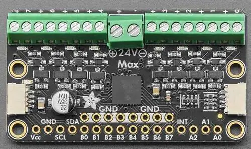

<!-- Copyright 2015-2026 Zephyr Project members and individual contributors. -->
<!-- SPDX-License-Identifier: Apache-2.0 -->
<!-- 中文翻译；编号、导航与译注为本地新增。 -->

<a id="adafruit-i2c-to-8-channel-solenoid-driver-shield"></a>

<a id="adafruit-8chan-solenoid"></a>

# 第5章\_Adafruit I2C转8通道电磁阀驱动扩展板（Solenoid Driver Shield）

原文：[官方页面](https://docs.zephyrproject.org/latest/boards/shields/adafruit_8chan_solenoid/doc/index.html)。读取日期：2026-10-16；来源摘要见[来源记录](../SOURCES.md)。

<a id="overview"></a>

## 概述（Overview）

Adafruit I2C转8通道电磁阀驱动扩展板采用[Microchip MCP23017 GPIO扩展器](https://www.microchip.com/en-us/product/mcp23017)，具有8个MOSFET及2个STEMMA QT连接器。（[Adafruit I2C转8通道电磁阀驱动扩展板（Solenoid Driver Shield）](https://learn.adafruit.com/adafruit-i2c-to-8-channel-solenoid-driver)）

<a id="id2"></a>



Adafruit 8通道电磁阀驱动扩展板，图片来源：Adafruit

每路输出都有指示LED；必须连接电磁阀电源，这些LED才会工作。

<a id="requirements"></a>

## 前置要求（Requirements）

该扩展板可用于提供I2C连接器的开发板，例如STEMMA QT或Qwiic；目标板必须定义zephyr_i2c节点标签，详情见“[扩展板（Shields）](https://docs.zephyrproject.org/latest/hardware/porting/shields.html#shields)”。

<a id="pin-assignments"></a>

### 引脚分配（Pin Assignments）

<table>
<tr>
<th>扩展板引脚（Shield Pin）</th>
<th>功能（Function）</th>
</tr>
<tr>
<td>串行数据线（SDA）</td>
<td>MCP23017 I2C数据线（SDA）</td>
</tr>
<tr>
<td>串行时钟线（SCL）</td>
<td>MCP23017 I2C时钟线（SCL）</td>
</tr>
<tr>
<td>中断（INT）</td>
<td>MCP23017中断输出</td>
</tr>
<tr>
<td>A0～A2</td>
<td>MCP23017 I2C地址选择</td>
</tr>
</table>

SDA及SCL信号也可从2个STEMMA QT连接器访问。

若要使用中断，须另接一根线，将扩展板连接到微控制器板的GPIO；如何修改设备树覆盖文件见[microchip,mcp23017](../gpio_infineon_intel_ite_microchip_binding_reference/P023_microchip_mcp23017.md#std-dtcompatible-microchip-mcp23017)绑定文档。

I2C地址选择引脚默认下拉到GND，对应7位I2C地址0x20；更改地址后也须修改设备树覆盖文件。

<a id="programming"></a>

## 编程（Programming）

调用west build时设置--shield adafruit_8chan_solenoid，例如运行传感器Shell示例：（[传感器Shell（Sensor Shell）](../sensors/P025_传感器Shell示例.md#sensor_shell)）

```text
# From the root of the zephyr repository
west build -b adafruit_qt_py_rp2040 --shield adafruit_8chan_solenoid samples/sensor/sensor_shell -- -DCONFIG_GPIO=y -DCONFIG_GPIO_SHELL=y -DCONFIG_I2C=y
```

配置并开启电磁阀0，板背面标为A0：

```text
gpio conf mcp23017_adafruit_8chan_solenoid 0 o
gpio set mcp23017_adafruit_8chan_solenoid 0 1
```

关闭电磁阀：

```text
gpio set mcp23017_adafruit_8chan_solenoid 0 0
```

将B0设为输出并置高电平：

```text
gpio conf mcp23017_adafruit_8chan_solenoid 8 o
gpio set mcp23017_adafruit_8chan_solenoid 8 1
```

将其置低电平：

```text
gpio set mcp23017_adafruit_8chan_solenoid 8 0
```

将B0设为带上拉的输入：

```text
gpio conf mcp23017_adafruit_8chan_solenoid 8 iu
gpio get mcp23017_adafruit_8chan_solenoid 8
```

## 译注

电磁阀及相应指示LED需要外部电源；GPIO扩展器默认I2C地址0x20。

## 原文外链核对

2026-10-16核对并重试以下原文外链时未能确认可访问性，保留原始目标，不将访问失败解释为原文内容有误。

- [mcp23017](https://www.microchip.com/en-us/product/mcp23017)：HTTP Error 403: Forbidden。

---

[上一章](P004_Adafruit_2.8_TFT_Touch_Shield_v2.md) · [返回大纲](大纲.md) · [全站翻译进度](../PROGRESS.md) · [下一章](P006_Adafruit_AD5693R_DAC_Shield.md)
