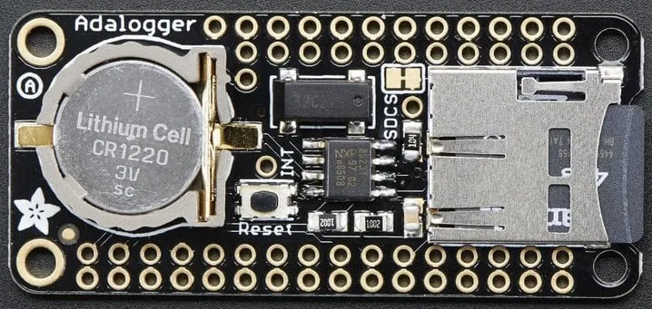

<!-- Copyright 2015-2026 Zephyr Project members and individual contributors. -->
<!-- SPDX-License-Identifier: Apache-2.0 -->
<!-- 中文翻译；编号、导航与译注为本地新增。 -->

<a id="adafruit-adalogger-featherwing-shield"></a>

<a id="id1"></a>

# 第7章\_Adafruit Adalogger FeatherWing扩展板（Shield）

原文：[官方页面](https://docs.zephyrproject.org/latest/boards/shields/adafruit_adalogger_featherwing/doc/index.html)。读取日期：2026-10-16；来源摘要见[来源记录](../SOURCES.md)。

<a id="overview"></a>

## 概述（Overview）

Adafruit Adalogger FeatherWing扩展板具有带电池备份的NXP PCF8523实时时钟／日历及SD卡接口。（[Adafruit Adalogger FeatherWing扩展板（Shield）](https://learn.adafruit.com/adafruit-adalogger-featherwing)；[NXP PCF8523 带电池备份的实时时钟／日历](https://www.nxp.com/docs/en/data-sheet/PCF8523.pdf)）

<a id="id3"></a>



Adafruit Adalogger FeatherWing扩展板（Shield），图片来源：Adafruit

<a id="pin-assignments"></a>

### 引脚分配（Pin Assignments）

<table>
<tr>
<th>扩展板连接器引脚</th>
<th>功能（Function）</th>
</tr>
<tr>
<td>D10</td>
<td>SD卡SPI片选CS</td>
</tr>
<tr>
<td>主机输出从机输入（MOSI）</td>
<td>SD卡SPI MOSI</td>
</tr>
<tr>
<td>主机输入从机输出（MISO）</td>
<td>SD卡SPI MISO</td>
</tr>
<tr>
<td>串行时钟（SCK）</td>
<td>SD卡SPI时钟SCK</td>
</tr>
<tr>
<td>串行数据线（SDA）</td>
<td>PCF8523 RTC的I2C数据SDA</td>
</tr>
<tr>
<td>串行时钟线（SCL）</td>
<td>PCF8523 RTC的I2C时钟SCL</td>
</tr>
</table>

<a id="requirements"></a>

## 前置要求（Requirements）

该扩展板只能用于提供Feather连接器配置，并定义SPI、I2C及GPIO接口节点别名的开发板，详情见“[扩展板（Shields）](https://docs.zephyrproject.org/latest/hardware/porting/shields.html#shields)”。

<a id="programming"></a>

## 编程（Programming）

调用west build时设置--shield adafruit_adalogger_featherwing，例如：

```text
# From the root of the zephyr repository
west build -b adafruit_feather_m0_basic_proto --shield adafruit_adalogger_featherwing tests/drivers/rtc/rtc_api
```

## 原文外链核对

2026-10-16核对并重试以下原文外链时未能确认可访问性，保留原始目标，不将访问失败解释为原文内容有误。

- [PCF8523.pdf](https://www.nxp.com/docs/en/data-sheet/PCF8523.pdf)：HTTP Error 404: Not Found。

---

[上一章](P006_Adafruit_AD5693R_DAC_Shield.md) · [返回大纲](大纲.md) · [全站翻译进度](../PROGRESS.md) · [下一章](P008_Adafruit_AHT20_Shield.md)
