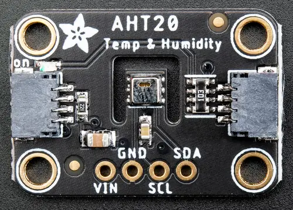

<!-- Copyright 2015-2026 Zephyr Project members and individual contributors. -->
<!-- SPDX-License-Identifier: Apache-2.0 -->
<!-- 中文翻译；编号、导航与译注为本地新增。 -->

<a id="adafruit-aht20-shield"></a>

<a id="adafruit-aht20"></a>

# 第8章\_Adafruit AHT20扩展板（Shield）

原文：[官方页面](https://docs.zephyrproject.org/latest/boards/shields/adafruit_aht20/doc/index.html)。读取日期：2026-10-16；来源摘要见[来源记录](../SOURCES.md)。

<a id="overview"></a>

## 概述（Overview）

Adafruit AHT20温湿度扩展板采用奥松Aosong AHT20传感器，带2个STEMMA QT连接器，用于测量温度及湿度。（[Adafruit AHT20 温湿度传感器 扩展板](https://learn.adafruit.com/adafruit-aht20)；[Aosong AHT20 湿度及温度传感器](https://www.aosong.com/userfiles/files/media/Data%20Sheet%20AHT20.pdf)）

<a id="id1"></a>



Adafruit AHT20扩展板（Shield），图片来源：Adafruit

<a id="requirements"></a>

## 前置要求（Requirements）

该扩展板可用于提供I2C连接器的开发板，例如STEMMA QT或Qwiic；目标板必须定义zephyr_i2c节点标签，详情见“[扩展板（Shields）](https://docs.zephyrproject.org/latest/hardware/porting/shields.html#shields)”。

<a id="pin-assignments"></a>

### 引脚分配（Pin Assignments）

<table>
<tr>
<th>扩展板引脚（Shield Pin）</th>
<th>功能（Function）</th>
</tr>
<tr>
<td>串行数据线（SDA）</td>
<td>AHT20 I2C数据线（SDA）</td>
</tr>
<tr>
<td>串行时钟线（SCL）</td>
<td>AHT20 I2C时钟线（SCL）</td>
</tr>
</table>

可用设备树设置见[aosong,aht20](../sensor_ams_aosong_bosch_binding_reference/P011_aosong_aht20.md#std-dtcompatible-aosong-aht20)绑定文档。

<a id="programming"></a>

## 编程（Programming）

调用west build时设置--shield adafruit_aht20，例如运行[通用数字温湿度传感器轮询](../sensors/P016_温湿度传感器轮询示例.md#dht_polling)示例：

```text
# From the root of the zephyr repository
west build -b adafruit_qt_py_rp2040 --shield adafruit_aht20 samples/sensor/dht_polling
```

---

[上一章](P007_Adafruit_Adalogger_Featherwing_Shield.md) · [返回大纲](大纲.md) · [全站翻译进度](../PROGRESS.md) · [下一章](P009_Adafruit_APDS9960_Shield.md)
