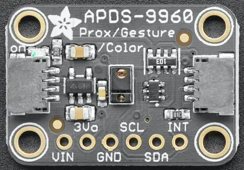

<!-- Copyright 2015-2026 Zephyr Project members and individual contributors. -->
<!-- SPDX-License-Identifier: Apache-2.0 -->
<!-- 中文翻译；编号、导航与译注为本地新增。 -->

<a id="adafruit-apds9960-shield"></a>

<a id="adafruit-apds9960"></a>

# 第9章\_Adafruit APDS9960扩展板（Shield）

原文：[官方页面](https://docs.zephyrproject.org/latest/boards/shields/adafruit_apds9960/doc/index.html)。读取日期：2026-10-16；来源摘要见[来源记录](../SOURCES.md)。

<a id="overview"></a>

## 概述（Overview）

Adafruit APDS9960接近、光照、RGB及手势传感器扩展板采用Broadcom APDS9960，带2个STEMMA QT连接器。（[Adafruit APDS9960 接近、光照、RGB及手势传感器 扩展板](https://learn.adafruit.com/adafruit-apds9960-breakout)；[Broadcom APDS9960传感器](https://www.broadcom.com/products/optical-sensors/integrated-ambient-light-and-proximity-sensors/apds-9960)）

<a id="id1"></a>



Adafruit APDS9960扩展板（Shield），图片来源：Adafruit

<a id="requirements"></a>

## 前置要求（Requirements）

该扩展板可用于提供I2C连接器的开发板，例如STEMMA QT或Qwiic；目标板必须定义zephyr_i2c节点标签，详情见“[扩展板（Shields）](https://docs.zephyrproject.org/latest/hardware/porting/shields.html#shields)”。

<a id="pin-assignments"></a>

### 引脚分配（Pin Assignments）

<table>
<tr>
<th>扩展板引脚（Shield Pin）</th>
<th>功能（Function）</th>
</tr>
<tr>
<td>串行数据线（SDA）</td>
<td>APDS9960 I2C数据线（SDA）</td>
</tr>
<tr>
<td>串行时钟线（SCL）</td>
<td>APDS9960 I2C时钟线（SCL）</td>
</tr>
<tr>
<td>中断（INT）</td>
<td>APDS9960中断输出</td>
</tr>
</table>

若要使用中断，须另接一根线，将扩展板连接到微控制器板的GPIO；如何修改设备树见[avago,apds9960](../sensor_ams_aosong_bosch_binding_reference/P021_avago_apds9960.md#std-dtcompatible-avago-apds9960)绑定文档。

<a id="programming"></a>

## 编程（Programming）

调用west build时设置--shield adafruit_apds9960，例如运行[APDS9960 RGB、环境光及手势传感器](../sensors/P058_APDS9960颜色光照与手势传感器示例.md#apds9960)的接近与光照示例：

```text
# From the root of the zephyr repository
west build -b adafruit_qt_py_rp2040 --shield adafruit_apds9960 samples/sensor/apds9960
```

---

[上一章](P008_Adafruit_AHT20_Shield.md) · [返回大纲](大纲.md) · [全站翻译进度](../PROGRESS.md) · [下一章](P010_Adafruit_AW9523_GPIO_Expander_and_LED_Driver.md)
